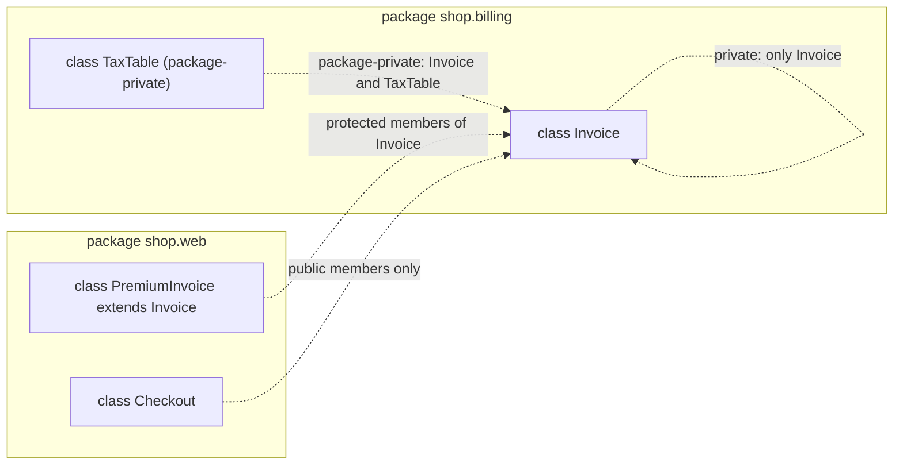

# Minimal accessibility and immutable classes

> **Before this lesson:** you know the four access modifiers and getters and setters ([Encapsulation: private fields, getters and setters](#/lesson/java/java-encapsulation)), `final` ([static, final, constants and the Math class](#/lesson/java/java-static-final)), copying and aliasing ([toString, copying objects and Comparable](#/lesson/java/java-ej-tostring-clone-comparable)) and packages ([Packages, imports and the String toolbox](#/lesson/java/java-packages-imports-strings)).

## In plain words

A well-run restaurant shows customers a menu and a dining room. The kitchen, the store cupboard and the accounts are behind a door marked "staff only". Because customers never see the kitchen, the chef can rearrange it, replace the oven or change supplier, and no customer needs to be told. Every extra thing shown to customers is a thing that can never be changed without upsetting someone.

Code works the same way. Everything a class makes public is a promise to every other class that might use it. This lesson has two rules that follow from that:

1. **Show as little as possible.** Make each class and member as inaccessible as it can be while still doing its job.
2. **Prefer objects that never change.** An object whose state is fixed at creation, an **immutable** object, cannot be put into an invalid state, cannot be corrupted by another thread, and can be shared without fear.

Why this matters for a job: these two habits are what reviewers look for first in a pull request. "How do you make a class immutable?" and "why is `String` immutable?" are standard interview questions.

## Rule 1: minimise accessibility

### The four levels, from tightest to loosest

| Level | Keyword | Visible to |
|---|---|---|
| private | `private` | the declaring top-level class only (including its nested classes) |
| package-private | *(no keyword)* | every class in the same package |
| protected | `protected` | the same package, plus subclasses in other packages |
| public | `public` | everyone |

Top-level classes and interfaces have only two choices: public or package-private.

The working rule: **start with `private` and loosen only when the compiler forces you to.**

- A **package-private** class or member is an implementation detail. You can change or delete it in the next release and nobody outside the package can be affected.
- A **public** class is part of your **exported API**. You must support it for as long as anyone uses it.
- A **protected** member is also part of the exported API, because any subclass anywhere may depend on it. Treat `protected` as nearly public and use it rarely.



### What "protected" really allows

```java
// file shop/billing/Invoice.java
package shop.billing;

public class Invoice {
    private   int secret = 1;
    int       inPackage = 2;        // package-private
    protected int forSubclasses = 3;
    public    int forEveryone = 4;
}
```

```java
// file shop/web/PremiumInvoice.java
package shop.web;

import shop.billing.Invoice;

public class PremiumInvoice extends Invoice {
    int sum(Invoice other) {
        int a = forSubclasses;               // OK: inherited protected member, through this
        // int b = other.forSubclasses;      // does not compile: 'other' is typed as Invoice, not PremiumInvoice
        // int c = inPackage;                // does not compile: different package
        return a + forEveryone;
    }
}
```

The middle line surprises people. Outside the package, a subclass may use a protected member only through a reference of **its own type** (or a subtype), not through a reference to the superclass.

### Instance fields of public classes are never public

A public mutable field gives up three things at once: you cannot validate values, you cannot change the representation, and you cannot make the class thread-safe. Use private fields with accessors:

```java
public class Rectangle {
    private double width, height;                       // not public

    public Rectangle(double width, double height) { setSize(width, height); }

    public double getWidth()  { return width; }
    public double getHeight() { return height; }

    public void setSize(double w, double h) {
        if (w <= 0 || h <= 0) {
            throw new IllegalArgumentException("sides must be positive");
        }
        width = w;
        height = h;
    }
}
```

The exception is a package-private or private nested class used as a simple record of data inside one package: exposing its fields there harms nobody, because every user of it is code you control.

### The public static final array trap

```java
public class Menu {
    public static final String[] SIZES = {"small", "medium", "large"};     // looks like a constant
}

Menu.SIZES[0] = "enormous";                 // compiles and works: the array's CONTENTS are not final
System.out.println(Menu.SIZES[0]);
```

```text
enormous
```

`final` stops `SIZES` from being pointed at a different array. It does not protect the elements. A non-empty array is always mutable, so a public static final array field (or a getter that returns a private array) is a security hole. Two fixes:

```java
private static final String[] SIZES_ARRAY = {"small", "medium", "large"};
public static final java.util.List<String> SIZES = java.util.List.of(SIZES_ARRAY);   // unmodifiable list

public static String[] sizes() { return SIZES_ARRAY.clone(); }                       // or: a fresh copy each time
```

### Other habits

- If a method overrides a superclass method, it cannot be less accessible than the original. (A subclass must be usable wherever the superclass is.)
- Do not raise accessibility to make testing easier beyond package-private; put tests in the same package.
- With the module system, a package that is not exported is hidden even if its classes are public: one more level of "staff only". See [Maven, Gradle and the module system](#/lesson/java/java-maven-gradle-modules).

### An access checker you can run

```python-run
def can_access(modifier, same_class, same_package, is_subclass, via_own_type=True):
    """Can code reach a member with this modifier? via_own_type matters only for protected access
    from a subclass in another package: the reference must be of the subclass's own type."""
    if modifier == "public":
        return True
    if modifier == "protected":
        return same_package or (is_subclass and via_own_type)
    if modifier == "package-private":
        return same_package
    return same_class                          # private

rows = [("same class",                       dict(same_class=True,  same_package=True,  is_subclass=False)),
        ("same package, unrelated class",    dict(same_class=False, same_package=True,  is_subclass=False)),
        ("other package, subclass (this.x)", dict(same_class=False, same_package=False, is_subclass=True)),
        ("other package, subclass (base.x)", dict(same_class=False, same_package=False, is_subclass=True, via_own_type=False)),
        ("other package, unrelated class",   dict(same_class=False, same_package=False, is_subclass=False))]
mods = ["private", "package-private", "protected", "public"]
print(f"{'accessing code':36}" + "".join(f"{m:17}" for m in mods))
for label, kw in rows:
    print(f"{label:36}" + "".join(f"{'yes' if can_access(m, **kw) else 'no':17}" for m in mods))
```

## Rule 2: minimise mutability

An **immutable class** is one whose instances cannot be modified after they are created. Everything an instance will ever hold is supplied at construction. `String`, `Integer`, `BigDecimal`, `LocalDate` and every record of immutable components are examples.

### Why immutable objects are worth having

1. **Simple.** An immutable object has exactly one state, the one it was created in. If the constructor establishes the invariants, they hold for ever.
2. **Thread-safe with no effort.** Many threads can read the same immutable object without locks; nothing can interfere.
3. **Freely shareable.** No defensive copies are needed, and common values can be reused as constants (`BigInteger.ZERO`).
4. **Safe as map keys and set elements.** Their hash codes cannot change.
5. **Failure atomicity for free.** An operation that fails halfway cannot leave an immutable object half-changed.

The cost: every distinct value needs its own object. Changing one bit of a million-bit number creates a new million-bit number. Where that matters, pair the immutable class with a mutable **companion** for multi-step building, as `String` has `StringBuilder`.

### The five rules

1. **Provide no methods that modify state** (no setters, no "mutators").
2. **Prevent subclassing**, so no subclass can add mutable behaviour: make the class `final`, or make all constructors private and offer static factories.
3. **Make all fields `final`.**
4. **Make all fields `private`.**
5. **Guard any mutable components.** If a field refers to a mutable object (an array, a `List`, a `Date`), make a **defensive copy** when it comes in through the constructor and never hand out the original through a getter.

### A broken attempt, then the fix

```java
import java.util.List;

public final class Playlist {
    private final String name;
    private final List<String> tracks;

    public Playlist(String name, List<String> tracks) {
        this.name = name;
        this.tracks = tracks;                    // keeps the caller's list
    }

    public String name()         { return name; }
    public List<String> tracks() { return tracks; }   // hands out the internal list
}
```

```java
List<String> source = new java.util.ArrayList<>(List.of("Tides"));
Playlist p = new Playlist("Morning", source);

source.add("sneaked in through the constructor argument");
p.tracks().add("sneaked in through the getter");
System.out.println(p.tracks().size());
```

```text
3
```

Every field is `private final`, the class is `final`, there are no setters, and the object was changed twice from outside. Rule 5 was broken in both directions.

```java
public final class Playlist {
    private final String name;
    private final List<String> tracks;

    public Playlist(String name, List<String> tracks) {
        this.name = java.util.Objects.requireNonNull(name);
        this.tracks = List.copyOf(tracks);       // unmodifiable snapshot; rejects null elements
    }

    public String name()         { return name; }
    public List<String> tracks() { return tracks; }      // safe: the list cannot be modified

    public Playlist withTrack(String track) {            // "change" by creating a new object
        List<String> extended = new java.util.ArrayList<>(tracks);
        extended.add(track);
        return new Playlist(name, extended);
    }
}
```

```java
Playlist a = new Playlist("Morning", new java.util.ArrayList<>(List.of("Tides")));
Playlist b = a.withTrack("Harbour");
System.out.println(a.tracks() + " " + b.tracks());
// a.tracks().add("x");      // throws UnsupportedOperationException
```

```text
[Tides] [Tides, Harbour]
```

`List.copyOf` both copies and wraps: the caller's later changes do not reach us, and the list we hand out refuses modification. Methods like `withTrack` that return a new object instead of altering the existing one follow the **functional approach**; `String.toUpperCase` and `BigDecimal.add` work the same way.

### Records are the short form

```java
public record Playlist(String name, List<String> tracks) {
    public Playlist {                              // compact constructor
        java.util.Objects.requireNonNull(name);
        tracks = List.copyOf(tracks);              // records are only shallowly immutable: copy yourself
    }
}
```

A record is final, its fields are private and final, and it has no setters. Rule 5 is still your job: a record holding a mutable list is not immutable until you copy it.

### An immutability audit you can run

```python-run
def audit(cls):
    """cls: dict describing a class. Returns the list of rule violations (empty = immutable)."""
    problems = []
    if not cls["final_class"] and cls["public_constructor"]:
        problems.append("class can be subclassed (not final, constructor accessible)")
    for f in cls["fields"]:
        name = f["name"]
        if not f["final"]:      problems.append(f"field {name} is not final")
        if not f["private"]:    problems.append(f"field {name} is not private")
        if f["mutable_type"]:
            if not f["copied_in"]:  problems.append(f"field {name}: mutable argument stored without a defensive copy")
            if f["exposed"] and not f["copied_out"]:
                problems.append(f"field {name}: mutable internal returned by a getter")
    if cls["setters"]:
        problems.append(f"has mutator methods: {cls['setters']}")
    return problems or ["immutable"]

def field(name, final=True, private=True, mutable_type=False, copied_in=True, exposed=True, copied_out=True):
    return dict(name=name, final=final, private=private, mutable_type=mutable_type,
                copied_in=copied_in, exposed=exposed, copied_out=copied_out)

broken = dict(final_class=True, public_constructor=True, setters=[],
              fields=[field("name"), field("tracks", mutable_type=True, copied_in=False, copied_out=False)])
sloppy = dict(final_class=False, public_constructor=True, setters=["setName"],
              fields=[field("name", final=False), field("count", private=False)])
good   = dict(final_class=True, public_constructor=True, setters=[],
              fields=[field("name"), field("tracks", mutable_type=True)])

for label, c in (("broken Playlist", broken), ("sloppy class", sloppy), ("fixed Playlist", good)):
    print(label + ":")
    for line in audit(c):
        print("   -", line)
```

## When full immutability is not possible

Some objects must change: a shopping basket, a connection, a game board. Then:

- **Limit mutability as far as you can.** Make every field `final` unless there is a compelling reason. A field that is assigned once in the constructor and never again should say so.
- **Keep the object valid at all times.** Constructors should produce a fully initialised object. Avoid separate "init" methods and half-built states.
- **Offer few, meaningful mutators** that preserve invariants, as in the bank account of the encapsulation lesson.

> [!TIP]
> The default for a new class should be: `final` class, `private final` fields, no setters. Add mutability deliberately, when a requirement demands it, and write down why.

> [!INTERVIEW]
> "How do you make a class immutable?" Recite the five rules: no mutators; class final (or private constructors with static factories); all fields final; all fields private; defensive copies of mutable components on the way in and never expose them on the way out. "Why is `String` immutable?" Security (file paths, class names and network addresses cannot be changed after being checked), thread safety, the ability to share literals in the string pool, and a stable, cacheable hash code that makes strings ideal map keys. "Is a `final` field enough?" No: `final` freezes the reference, not the object it points to.

## Pitfalls

- **Public fields**, or `protected` fields "for convenience".
- **Getters that return internal arrays or collections.**
- **`public static final` arrays.**
- **Storing a caller's mutable argument without copying it.**
- **Assuming `final` implies immutable.**
- **Assuming a record is deeply immutable.**
- **A non-final "immutable" class**: a subclass can override getters and return changing values.
- **Setters added by habit or by an IDE's "generate getters and setters".**
- **Making things public for the benefit of tests.**
- **Mutable objects as `HashMap` keys.**

## Cheat sheet

| Goal | Do |
|---|---|
| Default access for fields | `private` |
| Default access for helper classes | package-private |
| Public constants | `public static final` with an immutable type |
| Constant list of values | `List.of(...)`, or an enum |
| Immutable class | `final` class, `private final` fields, no setters, defensive copies |
| Copy in | `List.copyOf(arg)`, `arr.clone()`, `new Date(arg.getTime())` |
| Hand out | an unmodifiable view or a copy |
| "Modify" an immutable object | return a new object (`withX`) |
| Quick immutable data type | `record`, plus copies for mutable components |
| Building many intermediate values | mutable companion or builder |

## Summary

- Every public or protected member is a long-term commitment; make classes and members as inaccessible as possible.
- Public classes should expose behaviour through methods, never mutable fields; arrays in particular must not be exposed.
- Immutable objects are simple, thread-safe and shareable; prefer them.
- The five rules: no mutators, no subclassing, all fields final, all fields private, exclusive access to mutable components.
- Where state must change, keep the mutable surface small and the object always valid.

## Glossary

- **Accessibility**: which code is allowed to refer to a class or member.
- **Package-private**: accessible within the same package; the default with no keyword.
- **Exported API**: the classes and members that outside code can use and may come to depend on.
- **Information hiding**: keeping implementation details invisible to users of a component.
- **Immutable**: unable to change state after construction.
- **Mutator**: a method that modifies an object's state.
- **Defensive copy**: a copy made to prevent outside code from sharing internal mutable state.
- **Unmodifiable view**: a wrapper that forbids changes through it but reflects changes to the underlying collection.
- **Functional approach**: operations that return new values instead of modifying existing ones.
- **Companion class**: a mutable helper for building values of an immutable class.
- **Shallowly immutable**: having final fields that may still refer to mutable objects.

## Check yourself

```quiz
[
  {"q": "A field has no access modifier. Which code can read it?", "options": ["Only its own class", "Any class in the same package", "Subclasses anywhere", "Everyone"], "answer": 1,
   "explain": "No modifier means package-private."},
  {"q": "What does this print? `class K { static final int[] N = {1, 2}; }` then `K.N[0] = 7; System.out.println(K.N[0]);`", "options": ["1", "7", "It does not compile", "It throws"], "answer": 1,
   "explain": "final prevents reassigning N, not modifying the array's elements."},
  {"q": "Which is NOT required for an immutable class?", "options": ["No mutator methods", "All fields final and private", "Implementing Serializable", "Defensive copies of mutable components"], "answer": 2,
   "explain": "Serialization is unrelated. The five rules concern mutators, subclassing, final and private fields, and mutable components."},
  {"q": "`record Team(String name, List<String> members) { }` is created with an ArrayList, which the caller then modifies. Does the record's content change?", "options": ["No, records are immutable", "Yes: the record stores a reference to the caller's list", "It throws", "Only if the list is static"], "answer": 1,
   "explain": "Records are shallowly immutable. Copy in the compact constructor with List.copyOf."},
  {"q": "Why should an immutable class be final (or have only private constructors)?", "options": ["For speed", "So a subclass cannot add mutable state or override methods to return changing values", "Because final classes use less memory", "So it can be serialised"], "answer": 1,
   "explain": "Code holding a reference of the immutable type must be able to trust that the object really is immutable."},
  {"q": "In another package, `class Sub extends Base` has a method taking `Base other`. Can it read `other.protectedField`?", "options": ["Yes", "No: outside the package, protected access must go through a reference of type Sub or a subtype", "Only if the field is static", "Only with a cast to Object"], "answer": 1,
   "explain": "Protected access from a different package is limited to the subclass's own type."},
  {"q": "What does this print? `List<String> src = new ArrayList<>(List.of(\"a\")); List<String> copy = List.copyOf(src); src.add(\"b\"); System.out.println(copy.size());`", "options": ["1", "2", "0", "It throws"], "answer": 0,
   "explain": "List.copyOf takes an independent, unmodifiable snapshot."},
  {"q": "Which benefit do immutable objects provide automatically?", "options": ["Faster construction", "Thread safety without synchronisation", "Smaller memory use in all cases", "Automatic serialisation"], "answer": 1,
   "explain": "Since no thread can modify them, concurrent reads need no coordination."}
]
```

> **Source:** Effective Java 3e, item group "Classes and interfaces" (minimising accessibility of classes and members, accessor methods instead of public fields, minimising mutability); ideas restated with original examples. Access rules checked against the Java Language Specification section 6.6: https://docs.oracle.com/javase/specs/jls/se21/html/jls-6.html#jls-6.6 .
