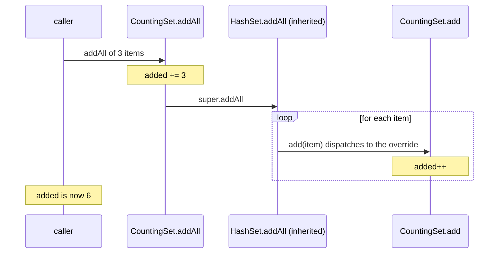
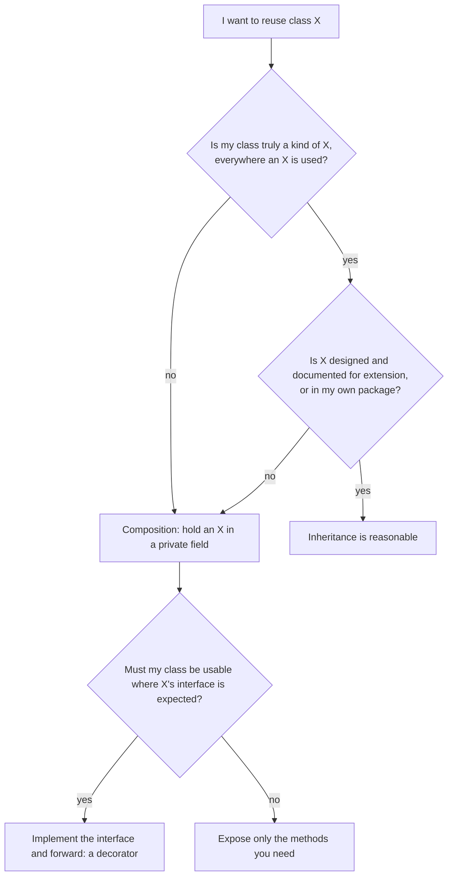

# Composition over inheritance

> **Before this lesson:** you know inheritance, overriding and `super` ([Inheritance: sharing code through a family tree](#/lesson/java/java-inheritance-basics)), dynamic dispatch, including calls from superclass code into subclass overrides ([Polymorphism, overriding and overloading](#/lesson/java/java-polymorphism)), interfaces ([Interfaces, default methods, sealed types and pattern matching](#/lesson/java/java-interfaces)) and the constructor-ordering trap ([Constructors, this and super](#/lesson/java/java-constructors)).

## In plain words

There are two ways to get a car with a tow bar. You can buy a standard car and bolt a tow bar onto it: the car's engine, brakes and electronics remain a sealed unit that you use through the pedals and the steering wheel. Or you can open the engine bay and rewire the manufacturer's electronics so that they also control a trailer. The second way might work today. It also depends on wiring details the manufacturer never promised to keep, so next year's software update may leave you with no brake lights.

**Inheritance** from a class you do not control is rewiring the electronics. Your subclass depends on *how* the superclass happens to do things internally, not only on what it promises. **Composition** is the bolt-on: your class holds the other object in a private field and uses it through its public methods.

Why this matters for a job: "favour composition over inheritance" is one of the best-known design guidelines, and interviewers expect you to explain *why* with a concrete example, to know what the "fragile base class problem" is, and to say when inheritance is still the right choice.

## Why inheritance breaks encapsulation

A class's public methods are its promise. Its private workings are supposed to be free to change. A subclass, however, can be broken by a change to those workings, because overriding lets subclass code run **in the middle of** superclass methods.

### A counting set that counts wrong

We want a `HashSet` that also reports how many elements have ever been added. Extending looks natural.

```java
import java.util.Collection;
import java.util.HashSet;
import java.util.List;

class CountingSet<E> extends HashSet<E> {
    private int added = 0;

    @Override
    public boolean add(E e) {
        added++;
        return super.add(e);
    }

    @Override
    public boolean addAll(Collection<? extends E> c) {
        added += c.size();
        return super.addAll(c);
    }

    int getAdded() { return added; }
}

public class Broken {
    public static void main(String[] args) {
        CountingSet<String> s = new CountingSet<>();
        s.addAll(List.of("tea", "jam", "scone"));
        System.out.println(s.getAdded());
    }
}
```

```text
6
```

Three elements were added, and the counter says six. The reason is inside `HashSet`: its inherited `addAll` is implemented by looping over the collection and calling `add` for each element. Because of dynamic dispatch, that internal call lands on **our** overridden `add`. So `addAll` counts 3, and then `add` counts 3 more.



A method of a class calling another overridable method of the same class is called **self-use**. `HashSet`'s documentation does not promise that `addAll` uses `add`; it is an implementation detail. We could "fix" our class by not overriding `addAll`, but then we depend on that undocumented detail staying true for ever. This weakness has a name: the **fragile base class problem**.

### Further ways a subclass gets broken

- **A new method in the superclass.** Suppose your subclass guarantees that every element is validated by overriding every method that adds elements. A later release of the superclass adds a new insertion method. Your subclass inherits it automatically, unvalidated, and your guarantee has a hole you never see.
- **A name collision.** You add a method `size2()` to your subclass. Later the superclass gains a method with the same name and a different return type: your class stops compiling. With the same signature, you have overridden it by accident.
- **Inherited API you did not want.** Extending a class gives your class all its public methods for ever. `java.util.Stack` extends `Vector`, so a "stack" lets anyone call `insertElementAt(x, 0)`. `Properties` extends `Hashtable`, so non-string keys can be put into what should be a string-to-string table. Both are regarded as mistakes that cannot be undone.

## Composition and forwarding

Instead of *being* a set, hold a set.

```java
import java.util.Collection;
import java.util.HashSet;
import java.util.Iterator;
import java.util.List;
import java.util.Set;

class CountingSet<E> {
    private final Set<E> inner;              // composition: HAS-A
    private int added = 0;

    CountingSet(Set<E> inner) {
        this.inner = inner;
    }

    public boolean add(E e) {
        added++;
        return inner.add(e);                 // forwarding
    }

    public boolean addAll(Collection<? extends E> c) {
        added += c.size();
        return inner.addAll(c);              // whatever inner does internally cannot reach our add
    }

    public boolean contains(Object o) { return inner.contains(o); }
    public int size()                 { return inner.size(); }
    public Iterator<E> iterator()     { return inner.iterator(); }
    public int getAdded()             { return added; }
}

public class Fixed {
    public static void main(String[] args) {
        CountingSet<String> s = new CountingSet<>(new HashSet<>());
        s.addAll(List.of("tea", "jam", "scone"));
        s.add("tea");
        System.out.println(s.getAdded() + " " + s.size());
    }
}
```

```text
4 3
```

- The existing class is a **private field**: this is **composition**.
- Each method of the new class calls the matching method on the field: this is **forwarding**, and such methods are **forwarding methods**.
- When `inner.addAll` loops and calls `add`, it calls **its own** `add` on the inner object. Our `add` is not involved, because the inner set knows nothing about the wrapper.

The result does not depend on how the inner class is implemented. It also became more flexible: the constructor accepts **any** `Set`, so the same class counts additions to a `HashSet`, a `TreeSet` or a `LinkedHashSet`.

### The decorator pattern

If the wrapper implements the same interface as the thing it wraps, it can be used anywhere the original could. That is the **decorator pattern**, and you have used it already: `new BufferedReader(new FileReader(file))` wraps one reader in another that adds buffering.

To avoid rewriting forwarding methods for every wrapper, write them once in a reusable **forwarding class**:

```java
class ForwardingSet<E> implements Set<E> {
    private final Set<E> s;
    ForwardingSet(Set<E> s) { this.s = s; }

    @Override public boolean add(E e)                          { return s.add(e); }
    @Override public boolean addAll(Collection<? extends E> c) { return s.addAll(c); }
    @Override public int size()                                { return s.size(); }
    @Override public boolean contains(Object o)                { return s.contains(o); }
    // ... the remaining Set methods, each a one-line forward ...
}

class CountingSet<E> extends ForwardingSet<E> {       // extending OUR OWN forwarding class is safe
    private int added = 0;
    CountingSet(Set<E> s) { super(s); }

    @Override public boolean add(E e)                          { added++; return super.add(e); }
    @Override public boolean addAll(Collection<? extends E> c) { added += c.size(); return super.addAll(c); }
    int getAdded() { return added; }
}
```

`ForwardingSet.addAll` forwards to the wrapped set and never calls `this.add`, so no self-use exists to be tripped over.

Wrappers have one weakness, the **SELF problem**: if the wrapped object passes a reference to *itself* to some other object (for a callback), that other object will call the wrapped object directly and bypass the wrapper.

### A model you can run

The model reproduces both designs, with a base class whose `add_all` uses `add` internally.

```python-run
class BaseSet:
    def __init__(self): self.items = set()
    def add(self, x):   self.items.add(x)
    def add_all(self, xs):
        for x in xs:
            self.add(x)                  # SELF-USE: dynamic dispatch decides which add runs

class InheritingCounter(BaseSet):
    def __init__(self): super().__init__(); self.added = 0
    def add(self, x):       self.added += 1; super().add(x)
    def add_all(self, xs):  self.added += len(xs); super().add_all(xs)

class ComposingCounter:
    def __init__(self, inner): self.inner, self.added = inner, 0
    def add(self, x):       self.added += 1; self.inner.add(x)
    def add_all(self, xs):  self.added += len(xs); self.inner.add_all(xs)   # inner calls ITS OWN add

a = InheritingCounter(); a.add_all(["tea", "jam", "scone"])
b = ComposingCounter(BaseSet()); b.add_all(["tea", "jam", "scone"])
print("inheritance counts :", a.added, "(wrong)")
print("composition counts :", b.added, "(right)")

# Now the base class author 'optimises' add_all so that it no longer calls add:
BaseSet.add_all = lambda self, xs: self.items.update(xs)
a2 = InheritingCounter(); a2.add_all(["tea", "jam", "scone"])
b2 = ComposingCounter(BaseSet()); b2.add_all(["tea", "jam", "scone"])
print("after the base class changed -> inheritance:", a2.added, " composition:", b2.added)
```

The inheriting version changed its answer from 6 to 3 without a single edit to its own code. The composing version was unaffected by the change. That is the fragile base class problem in ten lines.

## When inheritance is appropriate

Inheritance is safe in these situations:

1. **Within a package**, where the subclass and superclass are written and released together by the same people.
2. **From a class explicitly designed and documented for extension** (see the next section).
3. **When a real IS-A relationship holds**: every `B` really is an `A` and should be usable wherever an `A` is expected. Ask: "Would it ever be sensible for a `B` *not* to have one of `A`'s methods?" If yes, `B` should contain an `A`.

A second question guards against inheriting flaws: does the superclass have defects in its API? Inheritance passes them on to your class; composition lets you design a new API that hides them.

| | Inheritance | Composition |
|---|---|---|
| Relationship | IS-A | HAS-A |
| Coupling | to the superclass's implementation | to the component's public interface only |
| API of the new class | everything public in the superclass, for ever | exactly what you choose to expose |
| Swap the reused part at run time | no | yes: pass a different object |
| Affected by new superclass methods | yes | no |
| Code volume | less | forwarding methods needed |

## Designing a class for inheritance, or forbidding it

If you do intend a class to be extended by strangers, you take on obligations.

### Document self-use

For every overridable method (public or protected, not final), the documentation must say which other overridable methods it calls, in what order, and how the results affect later processing. Javadoc has a tag for it, `@implSpec`. This is unusual, since documentation normally says *what* a method does and not *how*, but it is the price of safe subclassing: you are promising those internals for ever.

### Offer hooks deliberately

A well-designed base class gives subclasses specific, protected methods to override, called **hooks**, and keeps the overall algorithm in a final method. This is the **template method** pattern.

```java
abstract class Report {
    public final String render() {                 // the fixed skeleton; cannot be overridden
        StringBuilder sb = new StringBuilder();
        sb.append(header()).append('\n');
        for (String line : lines()) {
            sb.append("  ").append(line).append('\n');
        }
        sb.append(footer());
        return sb.toString();
    }

    protected String header() { return "REPORT"; } // hook with a default
    protected abstract java.util.List<String> lines();   // hook that must be supplied
    protected String footer() { return "-- end --"; }
}

class StockReport extends Report {
    @Override protected String header() { return "STOCK"; }
    @Override protected java.util.List<String> lines() { return java.util.List.of("tea 12", "jam 4"); }
}
```

```java
System.out.print(new StockReport().render());
```

```text
STOCK
  tea 12
  jam 4
-- end --
```

### Constructors must not call overridable methods

The superclass constructor runs before the subclass's fields are initialised. If it calls an overridden method, that method runs on a half-built object.

```java
class Base {
    Base() { describe(); }                       // calls an overridable method
    void describe() { }
}

class Labelled extends Base {
    private final String label;
    Labelled(String label) { this.label = label; }
    @Override void describe() { System.out.println("label is " + label); }
}

new Labelled("fragile").describe();
```

```text
label is null
label is fragile
```

The first line was printed from inside `Base`'s constructor, when the "final" field `label` had not yet been assigned. Calling `private`, `final` or `static` methods from a constructor is safe, since none of those can be overridden. The same restriction applies to `clone` and `readObject`, which behave like constructors.

### Otherwise, prohibit it

Most ordinary concrete classes are **not** designed for subclassing: nobody has documented their self-use or tested them with subclasses. For those, close the door.

- Declare the class `final`; or
- make every constructor private or package-private and provide static factories; or
- use a `sealed` class to permit only named subclasses that you control.

Records and enums are implicitly final. If someone truly needs different behaviour from a final class, they can wrap it, which is the safer mechanism anyway.



> [!INTERVIEW]
> "Why favour composition over inheritance?" *Inheritance couples a subclass to the implementation of its superclass. Because of self-use and dynamic dispatch, a change inside the superclass, or a new method added to it, can break subclasses that were correct (the fragile base class problem). The subclass also inherits the whole public API, wanted or not. Composition depends only on the component's public contract, lets me expose a minimal API, and lets me swap the component at run time.* Give the counting-set example. Then add balance: inheritance is fine for real IS-A relationships with classes designed for extension, such as abstract skeleton classes and template methods.

## Pitfalls

- **Extending a class to reuse a few of its methods.**
- **Overriding methods of a class whose self-use is undocumented.**
- **Subclasses that enforce a rule by overriding "all" the mutating methods**; the next release adds one.
- **Extending concrete library classes** such as `ArrayList`, `HashMap` or `Thread` for convenience.
- **Constructors calling overridable methods.**
- **Leaving classes non-final by default**, inviting uses you never tested.
- **Forwarding by hand in many places** when one reusable forwarding class would do.
- **Wrappers in callback frameworks** (the SELF problem).
- **Deep inheritance chains**: three or more levels are hard to reason about.

## Cheat sheet

| Situation | Choose |
|---|---|
| Reuse code from a class you do not control | composition + forwarding |
| Add behaviour to any implementation of an interface | decorator (wrapper implementing the interface) |
| True IS-A, superclass designed for extension | inheritance |
| Fixed algorithm with variable steps | template method with protected hooks |
| A class not designed for subclassing | `final`, or private constructors + factories |
| Limited known set of subclasses | `sealed ... permits` |
| Constructor needs helper logic | call only `private`, `final` or `static` methods |
| Overridable method uses other overridable methods | document it (`@implSpec`) |

## Summary

- Inheritance exposes a subclass to the internal behaviour of its superclass; self-use plus dynamic dispatch makes that dangerous.
- Composition holds the reused object in a private field and forwards calls, depending only on its public contract.
- A wrapper that implements the same interface is a decorator and works with any implementation.
- Use inheritance for real IS-A relationships with classes designed for it, or inside your own package.
- A class meant for extension must document its self-use, provide deliberate hooks, and never call overridable methods from constructors. Any other class should forbid extension.

## Glossary

- **Implementation inheritance**: one class extending another, as opposed to implementing an interface.
- **Self-use**: a class's method calling another overridable method of the same class.
- **Fragile base class problem**: subclasses breaking when the superclass's implementation changes.
- **Composition**: building a class from other objects held as fields.
- **Forwarding**: a method calling the corresponding method of a contained object.
- **Delegation**: forwarding in which the wrapper also passes itself to the wrapped object.
- **Wrapper**: a class that contains another object and adds behaviour around it.
- **Decorator pattern**: a wrapper implementing the same interface as the object it wraps.
- **SELF problem**: a wrapped object exposing itself directly, bypassing its wrapper.
- **Hook**: a protected method intended to be overridden.
- **Template method**: a final method that defines an algorithm's skeleton and calls hooks.
- **`@implSpec`**: the Javadoc tag for describing a method's implementation for subclassers.

## Check yourself

```quiz
[
  {"q": "In the lesson's first CountingSet (extending HashSet), why does addAll of three elements count six?", "options": ["HashSet stores duplicates", "The inherited addAll calls add for each element, and that call dispatches to the overriding add", "The counter is static", "addAll is called twice by the JVM"], "answer": 1,
   "explain": "Self-use inside HashSet plus dynamic dispatch runs the subclass's add three more times."},
  {"q": "What is 'forwarding'?", "options": ["Calling super.method()", "A method that calls the corresponding method on a contained object", "Overloading a method", "Casting to a supertype"], "answer": 1,
   "explain": "Forwarding methods pass the call on to the wrapped component."},
  {"q": "What does this print? `class A { A() { show(); } void show() { System.out.print(\"A\"); } } class B extends A { int n = 7; void show() { System.out.print(n); } }` then `new B();`", "options": ["A", "7", "0", "It does not compile"], "answer": 2,
   "explain": "A's constructor calls the overridden show() before B's field initialiser has run, so n is still 0."},
  {"q": "Which is the strongest reason to prefer composition when reusing a library class?", "options": ["It is faster", "Your class depends only on the library class's public contract, not on its internal self-use", "It uses fewer lines", "It makes all methods static"], "answer": 1,
   "explain": "That independence is what protects you from changes in later releases."},
  {"q": "A wrapper class implements the same interface as the object it wraps and adds behaviour. This is the...", "options": ["Singleton pattern", "Decorator pattern", "Factory pattern", "Observer pattern"], "answer": 1,
   "explain": "BufferedReader around a Reader is the classic library example."},
  {"q": "Which is a legitimate way to prevent a class from being subclassed?", "options": ["Declare it abstract", "Declare it final", "Make its methods static", "Remove its constructor"], "answer": 1,
   "explain": "final forbids extension. Private constructors with static factories, or sealing, also work."},
  {"q": "`java.util.Stack` extends `Vector`. What design problem does that illustrate?", "options": ["Missing generics", "Inheritance used where the IS-A test fails, exposing methods that break the stack discipline", "Too few methods", "Lack of thread safety"], "answer": 1,
   "explain": "A stack is not a vector; callers can insert or remove at arbitrary positions."},
  {"q": "In the template method pattern, why is the skeleton method usually declared final?", "options": ["To make it faster", "So subclasses can vary only the intended hook steps and not the overall algorithm", "Because abstract methods must be final", "So it can be static"], "answer": 1,
   "explain": "The base class keeps control of the sequence; subclasses fill in the designated steps."}
]
```

> **Source:** Effective Java 3e, item group "Classes and interfaces" (composition over inheritance; designing and documenting for inheritance or prohibiting it); ideas restated with original examples. Library behaviour checked against https://docs.oracle.com/en/java/javase/21/docs/api/java.base/java/util/AbstractCollection.html#addAll(java.util.Collection) .
