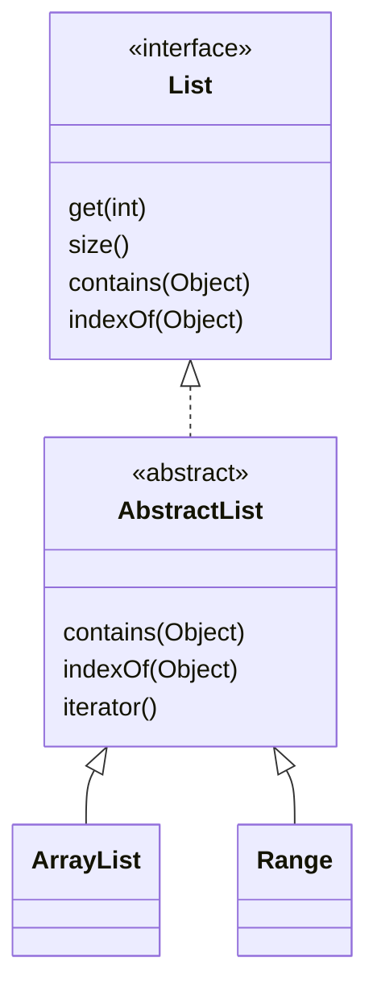

# Designing with interfaces, hierarchies and nested classes

> **Before this lesson:** you know interfaces, default methods and sealed types ([Interfaces, default methods, sealed types and pattern matching](#/lesson/java/java-interfaces)), abstract classes ([Abstract classes and the Object class](#/lesson/java/java-abstract-object)), the four kinds of nested class ([Nested, inner, local and anonymous classes](#/lesson/java/java-inner-classes)) and why composition is preferred to inheritance ([Composition over inheritance](#/lesson/java/java-ej-composition)).

## In plain words

A job advert that says "must hold a forklift licence" describes a **capability**. Anyone can have it: a warehouse worker, a farmer, a student with a weekend job. A job advert that says "must be a member of the Smith family" describes **ancestry**, and you either were born into it or you were not.

Interfaces are licences. Abstract classes are families. This lesson is about choosing between them when you define a type, and about five related design decisions that keep a code base clean:

1. prefer interfaces to abstract classes for defining types;
2. add default methods to existing interfaces with great care;
3. use interfaces to define types, never as a bag of constants;
4. replace classes that carry a "kind" field with a real hierarchy;
5. make nested classes static unless they need the outer object, and keep one top-level class per file.

Why this matters for a job: these are the judgement calls a senior reviewer makes. Interviewers ask "interface or abstract class, and why?", and a favourite refactoring exercise is "this class has a `type` field and a `switch` in every method; improve it".

## 1. Prefer interfaces to abstract classes

Both let you define a type with several implementations. The decisive difference: a class can extend **one** class and implement **many** interfaces.

- **Existing classes can adopt a new interface.** Adding `implements Comparable<Invoice>` to a class takes one line and one method. Making an existing class extend a new abstract class is usually impossible, because it already has a superclass.
- **Interfaces are ideal for mixins.** A **mixin** is a type a class implements *in addition* to its main type, to declare an extra capability: `Comparable`, `Iterable`, `AutoCloseable`, `Serializable`.
- **Interfaces allow types that do not form a tree.** A person can be a singer, a songwriter, or both. With interfaces, `class Artist implements Singer, Songwriter` is trivial. With classes you would need a separate class for every combination of capabilities.
- **Interfaces make safe wrappers possible.** The decorator pattern of the previous lesson needs the wrapper and the wrapped object to share an interface.

```java
interface Singer     { String sing(String song); }
interface Songwriter { String compose(String theme); }

interface SingerSongwriter extends Singer, Songwriter {      // interfaces combine freely
    default String performOwn(String theme) {
        return sing(compose(theme));
    }
}

record Artist(String name) implements SingerSongwriter {
    @Override public String sing(String song)     { return name + " sings '" + song + "'"; }
    @Override public String compose(String theme) { return "Song about " + theme; }
}
```

```java
System.out.println(new Artist("Mara").performOwn("rain"));
```

```text
Mara sings 'Song about rain'
```

### The skeletal implementation: both at once

Interfaces cannot hold fields, so they cannot hold much shared code. The standard solution is to offer **both**: the interface defines the type, and an abstract class, called a **skeletal implementation**, implements most of the interface's methods on top of a few primitive ones. Implementers extend the skeleton if they can and implement the interface directly if they cannot. By convention the skeleton is named `Abstract` plus the interface name: `AbstractList`, `AbstractSet`, `AbstractMap`.

```java
import java.util.AbstractList;
import java.util.List;

final class Range extends AbstractList<Integer> {       // a read-only List in ten lines
    private final int from, to;                         // from inclusive, to exclusive

    Range(int from, int to) { this.from = from; this.to = to; }

    @Override public Integer get(int index) {
        if (index < 0 || index >= size()) {
            throw new IndexOutOfBoundsException(index);
        }
        return from + index;
    }

    @Override public int size() { return to - from; }
}
```

```java
List<Integer> r = new Range(3, 8);
System.out.println(r + " " + r.contains(5) + " " + r.indexOf(7) + " " + r.subList(1, 3));
```

```text
[3, 4, 5, 6, 7] true 4 [4, 5]
```

We wrote `get` and `size`. `toString`, `contains`, `indexOf`, `subList`, iteration and `equals` all came from `AbstractList`, and the result is a full `List`.



## 2. Design interfaces for posterity

Before Java 8, adding a method to a published interface broke every implementation. Default methods lifted that restriction, and with it came a danger: a default method is **injected into existing classes whose authors never saw it**, and it may not be correct for them.

The textbook case is `Collection.removeIf`, added in Java 8 with a default body that loops with an iterator. Some third-party collection classes written earlier guarded every method with their own lock to be thread-safe. They inherited `removeIf` without that lock, so calling it from several threads could corrupt the collection, although neither the interface author nor the class author had done anything wrong.

What follows from this:

- **Get the interface right before releasing it.** Write at least three different implementations and some client code first; flaws show up quickly when you use an interface in anger.
- **Add default methods to an existing interface only when the need is compelling**, and think about whether the default can be correct for every existing implementation.
- **Default methods are excellent in a new interface**, where you control the first implementations, to supply convenience methods built from the abstract ones.
- A default method cannot provide `equals`, `hashCode` or `toString`; those must come from classes (or a skeletal implementation).

## 3. Use interfaces only to define types

Implementing an interface should say something about what instances of the class **can do**. One misuse to recognise and avoid is the **constant interface**: an interface containing only constants, which classes implement to refer to the constants without a prefix.

```java
// Anti-pattern: do not do this
interface PhysicsConstants {
    double SPEED_OF_LIGHT = 299_792_458;
    double GRAVITY = 9.80665;
}

class Rocket implements PhysicsConstants {              // "implements" used as an import
    double weight(double mass) { return mass * GRAVITY; }
}
```

The problems: the fact that `Rocket` uses those constants is an implementation detail, yet `implements` puts it into `Rocket`'s public type for ever; every subclass of `Rocket` has its namespace filled with the constants; and callers can write the meaningless `Rocket.GRAVITY`.

Where constants belong:

| Kind of constant | Put it |
|---|---|
| tied to a class or interface | in that type: `Integer.MAX_VALUE` |
| a fixed set of named alternatives | an `enum` |
| general-purpose values | a non-instantiable utility class |

```java
final class Physics {
    private Physics() { }
    static final double SPEED_OF_LIGHT = 299_792_458;
    static final double GRAVITY = 9.80665;
}
// use: Physics.GRAVITY, or 'import static' for unqualified use
```

## 4. Prefer class hierarchies to tagged classes

A **tagged class** is one class pretending to be several: it has a field (the tag) saying which flavour an instance is, and its methods branch on that field.

```java
class Shape {                                           // tagged class: avoid
    enum Kind { CIRCLE, RECTANGLE }

    final Kind kind;
    double radius;                  // used only when kind is CIRCLE
    double width, height;           // used only when kind is RECTANGLE

    Shape(double radius) { kind = Kind.CIRCLE; this.radius = radius; }
    Shape(double width, double height) { kind = Kind.RECTANGLE; this.width = width; this.height = height; }

    double area() {
        switch (kind) {
            case CIRCLE:    return Math.PI * radius * radius;
            case RECTANGLE: return width * height;
            default:        throw new AssertionError(kind);
        }
    }
}
```

Everything about it is poor. Each instance carries fields it does not use. Fields cannot be `final` unless every constructor sets even the irrelevant ones. Adding a triangle means editing every `switch`, and a forgotten one fails only at run time. The type `Shape` tells a reader nothing about which flavour a variable holds.

The hierarchy says the same thing with the compiler's help:

```java
sealed interface Shape permits Circle, Rectangle, Triangle {
    double area();
}

record Circle(double radius) implements Shape {
    @Override public double area() { return Math.PI * radius * radius; }
}

record Rectangle(double width, double height) implements Shape {
    @Override public double area() { return width * height; }
}

record Triangle(double base, double height) implements Shape {
    @Override public double area() { return 0.5 * base * height; }
}
```

```java
java.util.List<Shape> shapes = java.util.List.of(new Circle(1), new Rectangle(2, 3), new Triangle(4, 5));
for (Shape s : shapes) {
    System.out.printf("%s -> %.2f%n", s, s.area());
}
```

```text
Circle[radius=1.0] -> 3.14
Rectangle[width=2.0, height=3.0] -> 6.00
Triangle[base=4.0, height=5.0] -> 10.00
```

Each type holds exactly its own data, all of it final. A new shape is a new record; if it forgets `area()`, the code does not compile. A method can demand a `Circle` specifically. Sealing the interface additionally lets a `switch` over shapes be checked for completeness.

### The refactoring as a model you can run

```python-run
import math

# Tagged style: one function per operation, each branching on the tag
def area_tagged(shape):
    if shape["kind"] == "circle":    return math.pi * shape["radius"] ** 2
    if shape["kind"] == "rectangle": return shape["width"] * shape["height"]
    raise ValueError("unknown kind " + shape["kind"])          # found only at run time

def perimeter_tagged(shape):
    if shape["kind"] == "circle":    return 2 * math.pi * shape["radius"]
    if shape["kind"] == "rectangle": return 2 * (shape["width"] + shape["height"])
    raise ValueError("unknown kind " + shape["kind"])

# Hierarchy style: one class per kind, each complete in itself
class Circle:
    def __init__(self, r): self.r = r
    def area(self): return math.pi * self.r ** 2
    def perimeter(self): return 2 * math.pi * self.r

class Rectangle:
    def __init__(self, w, h): self.w, self.h = w, h
    def area(self): return self.w * self.h
    def perimeter(self): return 2 * (self.w + self.h)

class Triangle:                                   # the new kind: ONE new class, nothing else edited
    def __init__(self, a, b, c): self.a, self.b, self.c = a, b, c
    def area(self):
        s = (self.a + self.b + self.c) / 2
        return math.sqrt(s * (s - self.a) * (s - self.b) * (s - self.c))
    def perimeter(self): return self.a + self.b + self.c

for s in (Circle(1), Rectangle(2, 3), Triangle(3, 4, 5)):
    print(f"{type(s).__name__:10} area={s.area():6.2f} perimeter={s.perimeter():6.2f}")

try:
    area_tagged({"kind": "triangle", "a": 3, "b": 4, "c": 5})
except ValueError as e:
    print("tagged style, new kind added but a branch forgotten ->", e)
```

## 5. Nested classes: static unless proven otherwise

Recall the four kinds of nested class. The design rule is short: **if a member class does not need access to an instance of the enclosing class, declare it `static`.**

A non-static member class (an inner class) stores a hidden reference to its enclosing instance in every object. That costs memory and time, and it can keep the enclosing object alive when it should have been garbage collected.

```java
class Graph {
    private final java.util.List<Node> nodes = new java.util.ArrayList<>();

    static class Node {                         // static: a node does not need the Graph
        final String label;
        final java.util.List<Node> neighbours = new java.util.ArrayList<>();
        Node(String label) { this.label = label; }
    }

    class Walker {                              // inner: genuinely needs this Graph's node list
        private int position = 0;
        boolean hasNext() { return position < nodes.size(); }
        Node next()       { return nodes.get(position++); }
    }

    Node add(String label) { Node n = new Node(label); nodes.add(n); return n; }
    Walker walker()        { return new Walker(); }
}
```

A map with a million entries whose entry class was accidentally non-static would carry a million useless references to the map.

Choosing among the four:

| The nested class... | Use |
|---|---|
| is needed outside a single method, and does not need the enclosing instance | **static member class** |
| is needed outside a single method, and needs the enclosing instance | non-static member (inner) class |
| is used in one method, at one point, and a type already describes it | **lambda** if it is a functional interface, else anonymous class |
| is used in one method, several times, or needs a name | local class |

## 6. One top-level class per source file

Java allows several top-level classes in one file as long as at most one is public. Do not use that freedom.

```java
// File Utensil.java
class Utensil { static final String NAME = "pan"; }
class Dessert { static final String NAME = "cake"; }
```

```java
// File Dessert.java (someone adds this later)
class Utensil { static final String NAME = "pot"; }
class Dessert { static final String NAME = "pie"; }
```

Now there are two definitions of each class. Which pair the program uses depends on the **order in which the files are passed to the compiler**: `javac Main.java Dessert.java` and `javac Main.java Utensil.java` can produce programs that print different things, or a "duplicate class" error. Behaviour that depends on command-line order is unacceptable.

The cure is mechanical: one top-level class (or interface, enum, record) per file, named after it. If several small classes belong together and serve one main class, make them **static nested classes** of it. That improves readability and lets them be private.

> [!INTERVIEW]
> "Interface or abstract class?" Lead with the rule: *define types with interfaces, because a class can implement many and existing classes can adopt them; use an abstract class when implementations share state or a large amount of code, ideally as a skeletal implementation behind an interface (`List` plus `AbstractList`).* Then the modern detail: interfaces have had default and static methods since Java 8 and private methods since Java 9, but still no instance fields and no constructors. If given a tagged class to improve, say "replace the type code with a sealed hierarchy; move each branch into the corresponding subclass".

## Pitfalls

- **Defining a type as an abstract class** when nothing forces it, locking implementers out of other superclasses.
- **Adding a default method to a widely implemented interface** without considering existing implementations.
- **Constant interfaces.**
- **A `type` or `kind` field with `switch` statements** scattered across methods.
- **Fields that are meaningful only for some values of another field.**
- **Non-static member classes that never use the enclosing instance.**
- **Long anonymous classes** where a named class or a lambda would read better.
- **Several top-level classes in one file.**
- **Publishing an interface before implementing it more than once.**

## Cheat sheet

| Decision | Guideline |
|---|---|
| Define a type | interface |
| Share code among implementations | skeletal abstract class (`AbstractX`) behind the interface, or default methods |
| Extra capability for unrelated classes | mixin interface |
| Evolve a published interface | default method, only if safe for all implementers |
| Constants | owning class, enum, or utility class + `import static` |
| "Kind" field and switches | sealed hierarchy of records or classes |
| Nested helper | `static` unless it needs the outer instance |
| Small one-off behaviour | lambda |
| Source files | one top-level type each |

## Summary

- Interfaces define types that any class can adopt; abstract classes share code within a family. Combine them with a skeletal implementation.
- Default methods let interfaces grow, but they reach into classes written without knowledge of them; add them cautiously.
- Implementing an interface must describe a capability; constants belong elsewhere.
- Replace tagged classes with hierarchies so that each kind has its own type, data and compile-time checks.
- Make member classes static unless they use the enclosing instance, and give every top-level type its own file.

## Glossary

- **Mixin**: an interface a class implements in addition to its primary type to add a capability.
- **Skeletal implementation**: an abstract class that implements most of an interface, leaving a few primitive methods.
- **Primitive method**: one of the basic methods on which the others are built.
- **Default method**: an interface method with a body, inherited by implementers.
- **Constant interface**: an interface used only to export constants; an anti-pattern.
- **Anti-pattern**: a common but counter-productive solution.
- **Tagged class**: a class with a field indicating which of several flavours an instance is.
- **Class hierarchy**: a set of types related by inheritance or implementation.
- **Static member class**: a nested class with no enclosing instance.
- **Inner class**: a non-static nested class bound to an enclosing instance.
- **Top-level class**: a class not nested in another.

## Check yourself

```quiz
[
  {"q": "Why can an existing class adopt a new interface more easily than a new abstract superclass?", "options": ["Interfaces are faster", "A class may implement many interfaces but extend only one class", "Abstract classes cannot have methods", "Interfaces need no methods"], "answer": 1,
   "explain": "The class may already have a superclass; implementing another interface is always possible."},
  {"q": "What is a skeletal implementation?", "options": ["An interface with no methods", "An abstract class that implements most of an interface on top of a few abstract methods", "A final utility class", "A class with only static methods"], "answer": 1,
   "explain": "AbstractList and AbstractMap are examples: implement a couple of methods and inherit the rest."},
  {"q": "With the lesson's Range class, what does `new Range(10, 13).contains(12)` return, and where does contains come from?", "options": ["false; Range", "true; inherited from AbstractList", "true; from Object", "It does not compile"], "answer": 1,
   "explain": "Range supplies get and size; AbstractList (via AbstractCollection) builds contains from them. The range holds 10, 11, 12."},
  {"q": "Why is a constant interface an anti-pattern?", "options": ["Constants cannot be in interfaces", "Implementing it leaks an implementation detail into the class's public type and pollutes subclasses' namespaces", "It is slow", "It prevents garbage collection"], "answer": 1,
   "explain": "implements should express a capability, not a convenient way to import names."},
  {"q": "A class has `int type` and every method starts with `switch (type)`. What is the recommended refactoring?", "options": ["Add more cases", "Replace the tag with a class hierarchy, one subclass per type", "Make type a String", "Make the class final"], "answer": 1,
   "explain": "Each branch moves into its own subclass; the compiler then enforces that every kind implements every operation."},
  {"q": "A nested class never refers to the enclosing instance. How should it be declared?", "options": ["As a non-static member class", "As a static member class", "As an anonymous class", "As a top-level class in the same file"], "answer": 1,
   "explain": "Without static, each instance stores a hidden, useless reference to the outer object."},
  {"q": "What risk does adding a default method to a widely used interface carry?", "options": ["None; it is always safe", "It is injected into existing implementations for which it may be incorrect, for example ones with their own locking", "It removes abstract methods", "It makes the interface final"], "answer": 1,
   "explain": "Existing classes inherit code their authors never reviewed."},
  {"q": "Why avoid two top-level classes in one source file?", "options": ["It is a syntax error", "Duplicate definitions across files can make the program's behaviour depend on compilation order", "It doubles memory use", "Only one class can have methods"], "answer": 1,
   "explain": "One top-level type per file removes any ambiguity about which definition is used."}
]
```

> **Source:** Effective Java 3e, item group "Classes and interfaces" (interfaces versus abstract classes, designing interfaces for posterity, interfaces only for types, hierarchies over tagged classes, static member classes, one top-level class per file); ideas restated with original examples. Checked against https://docs.oracle.com/en/java/javase/21/docs/api/java.base/java/util/AbstractList.html and https://docs.oracle.com/en/java/javase/21/docs/api/java.base/java/util/Collection.html#removeIf(java.util.function.Predicate) .
