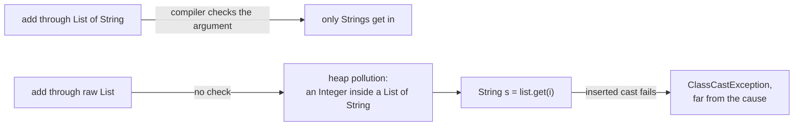

# Raw types, unchecked warnings and writing generic code

> **Before this lesson:** you can read and use generic types, bounded type parameters and wildcards, and you know what type erasure is ([Generics, wildcards and bounds](#/lesson/java/java-generics)). You know arrays and their run-time checks ([References, arrays, the stack and the heap](#/lesson/java/java-references-stack-heap)).

## In plain words

A hospital puts a wristband on every patient at admission. From then on, each medicine is checked against the wristband before it is given. The check takes a second and prevents terrible mistakes. A ward that sometimes skips the wristband "to save time" has not saved anything; it has moved the discovery of a mix-up from the bedside to the post-mortem.

Generics are the wristband. The compiler checks every operation against the declared type. Java still lets you skip the wristband (for the sake of very old code), and when you do, the compiler says so with a **warning**. This lesson is about never skipping it, about what those warnings mean, and about writing your own generic classes and methods so that the people who use your code get the same protection.

Why this matters for a job: a code base that compiles with unchecked warnings contains `ClassCastException`s waiting to happen. Reviewers reject raw types on sight, and interviewers ask "why are arrays covariant and generics invariant?" and "why can't you create a generic array?".

## Never use raw types

A **raw type** is a generic type written without type arguments: `List` instead of `List<String>`.

```java
import java.util.ArrayList;
import java.util.List;

List stamps = new ArrayList();            // raw: the compiler stops checking
stamps.add("penny black");
stamps.add(42);                           // accepted without complaint

for (Object o : stamps) {
    String s = (String) o;                // the mistake surfaces HERE, far from where it was made
    System.out.println(s.length());
}
```

```text
11
Exception in thread "main" java.lang.ClassCastException: class java.lang.Integer cannot be cast to class java.lang.String
```

The error appears where the element is *used*, which may be in a different class, weeks later. With `List<String>`, the wrong `add` is rejected at compile time, on the exact line.

Raw types exist for one reason: **migration compatibility**. When generics arrived in Java 5, billions of lines of pre-generic code had to keep compiling and had to interoperate with new code.

Three declarations that look similar are different:

| Declaration | Meaning | Safety |
|---|---|---|
| `List` | raw type: opted out of generics | none; anything can be added |
| `List<Object>` | a list that deliberately holds any kind of object | fully checked; a `List<String>` cannot be passed where it is expected |
| `List<?>` | a list of some one unknown type | fully checked; nothing but `null` can be added |

```java
static void unsafeAdd(List list, Object o)    { list.add(o); }      // raw parameter
static void safeAdd(List<Object> list, Object o) { list.add(o); }

List<String> names = new ArrayList<>();
unsafeAdd(names, 42);                       // compiles, with a warning; pollutes the list
// safeAdd(names, 42);                      // does not compile: List<String> is not a List<Object>
String first = names.get(0);                // ClassCastException here
```

If you do not know or care about the element type, write `List<?>`, not `List`.

Two places where the raw name is required by the language:

- **Class literals**: `List.class`, not `List<String>.class`.
- **`instanceof` with a type test**: `o instanceof List<?> list` (the unbounded wildcard is allowed because it asks for no erased information).

## Eliminate every unchecked warning

Working with generics you will meet warnings such as:

```text
warning: [unchecked] unchecked conversion
warning: [unchecked] unchecked call to add(E) as a member of the raw type List
warning: [unchecked] unchecked cast
warning: [rawtypes] found raw type: List
```

Each one means: "I, the compiler, can no longer guarantee that this program will not throw `ClassCastException`". Most are fixed by adding the missing type arguments or the diamond:

```java
java.util.Set<String> seen = new java.util.HashSet();      // warning: unchecked conversion
java.util.Set<String> seen2 = new java.util.HashSet<>();   // fixed
```

Make it a rule to remove **all** of them. A code base with two hundred ignored warnings hides the one that matters.

Sometimes a warning cannot be removed but you can prove the code is safe. Then, and only then, suppress it:

```java
@SuppressWarnings("unchecked")
E result = (E) elements[--size];          // safe: push(E) is the only method that stores into elements
```

Rules for `@SuppressWarnings("unchecked")`:

1. Put it on the **smallest possible scope**: a single local variable declaration, or at most a very short method. Never on a whole class, where it would also silence warnings you have not examined.
2. **Add a comment** saying why the operation is safe. The next reader needs to check your reasoning.

## Prefer lists to arrays

Arrays and generics have opposite attitudes to type checking.

| | Arrays | Generic collections |
|---|---|---|
| Subtyping | **covariant**: `Integer[]` is a subtype of `Number[]` | **invariant**: `List<Integer>` is not a `List<Number>` |
| Element type at run time | known and checked (**reified**) | erased |
| Wrong store detected | at run time: `ArrayStoreException` | at compile time |

```java
Object[] objects = new Long[1];
objects[0] = "not a long";                // compiles; throws ArrayStoreException when run

// List<Object> list = new ArrayList<Long>();   // does not compile: caught immediately
```

Because of this mismatch the two do not mix. You cannot create an array of a parameterized type or of a type parameter:

```java
// List<String>[] table = new List<String>[10];   // error: generic array creation
// T[] items = new T[10];                         // error: generic array creation
```

Why is it forbidden? If it were allowed, type safety could be broken with no warning:

```java
List<String>[] strings = new List<String>[1];     // imagine this were legal
Object[] objects = strings;                       // legal: arrays are covariant
objects[0] = List.of(42);                         // no ArrayStoreException: at run time it is merely a List
String s = strings[0].get(0);                     // ClassCastException, in code with no cast and no warning
```

When you feel the need for a generic array, use a `List<E>` instead. You may lose a little speed and conciseness, and you gain type safety.

```java
// Array version: needs a cast at every use, or an unchecked cast inside
class Chooser<T> {
    private final List<T> choices;                        // a list, not T[]

    Chooser(java.util.Collection<T> choices) {
        this.choices = new ArrayList<>(choices);
    }

    T pick(java.util.random.RandomGenerator rnd) {
        return choices.get(rnd.nextInt(choices.size()));   // no cast, no warning
    }
}
```

## Favour generic types

When you write a container-like class, make it generic so that clients need no casts. The steps: add a type parameter to the declaration, then replace `Object` with it.

```java
import java.util.Arrays;
import java.util.EmptyStackException;

public class Pile<E> {
    private E[] elements;
    private int size = 0;

    // The array is created as Object[] because 'new E[16]' is illegal.
    // Safe: elements is private, never exposed, and only push(E) stores into it.
    @SuppressWarnings("unchecked")
    public Pile() {
        elements = (E[]) new Object[16];
    }

    public void push(E e) {
        if (size == elements.length) {
            elements = Arrays.copyOf(elements, 2 * size);
        }
        elements[size++] = e;
    }

    public E pop() {
        if (size == 0) {
            throw new EmptyStackException();
        }
        E result = elements[--size];
        elements[size] = null;                 // clear the obsolete reference
        return result;
    }

    public boolean isEmpty() { return size == 0; }
}
```

```java
Pile<String> words = new Pile<>();
words.push("tea");
words.push("jam");
String top = words.pop();                      // no cast at the call site
System.out.println(top.toUpperCase() + " " + words.isEmpty());
```

```text
JAM false
```

This is one of the rare justified suppressions: a generic class backed by an array for performance. The unchecked cast is confined to one line inside the class, reasoned about once, and every client is fully type-safe. The alternative is to declare the field as `Object[]` and cast each element in `pop`; both are acceptable. A third option, a `List<E>` field, needs no suppression at all.

The lesson's contradiction is only apparent. "Prefer lists to arrays" is advice for API design and ordinary code. The collections themselves must ultimately be built on arrays, and they hide the unsafe step behind a safe interface.

## Favour generic methods

Static utility methods are natural candidates for type parameters. Without one, the method either works for a single type or returns `Object` and forces a cast.

```java
import java.util.HashSet;
import java.util.Set;

static <E> Set<E> union(Set<? extends E> a, Set<? extends E> b) {
    Set<E> result = new HashSet<>(a);
    result.addAll(b);
    return result;
}
```

```java
Set<Integer> ints = Set.of(1, 2);
Set<Double> doubles = Set.of(2.5);
Set<Number> all = union(ints, doubles);          // E inferred as Number
System.out.println(all.size());
```

```text
3
```

The type parameter list `<E>` goes before the return type. Callers rarely write it; **type inference** works it out.

### The generic singleton factory

Because of erasure, one immutable object can safely serve as an instance for *every* type argument. A static factory hands it out with the right type each time.

```java
import java.util.function.UnaryOperator;

class Functions {
    private static final UnaryOperator<Object> IDENTITY = x -> x;

    // Safe: the identity function returns its argument unchanged, so it is a UnaryOperator<T> for every T.
    @SuppressWarnings("unchecked")
    static <T> UnaryOperator<T> identity() {
        return (UnaryOperator<T>) IDENTITY;
    }
}
```

```java
UnaryOperator<String> sameString = Functions.identity();
UnaryOperator<Integer> sameNumber = Functions.identity();
System.out.println(sameString.apply("tea") + " " + sameNumber.apply(7));
```

```text
tea 7
```

`Collections.emptyList()`, `Comparator.naturalOrder()` and `Optional.empty()` use the same idea: one shared object, presented with whatever type argument the caller needs.

### Recursive type bounds

A type parameter may be bounded by an expression that mentions itself. The common case expresses "elements that can be compared with each other":

```java
static <E extends Comparable<E>> E max(java.util.Collection<E> items) {
    if (items.isEmpty()) {
        throw new IllegalArgumentException("empty collection");
    }
    E best = null;
    for (E e : items) {
        if (best == null || e.compareTo(best) > 0) {
            best = e;
        }
    }
    return best;
}
```

```java
System.out.println(max(List.of("pear", "fig", "plum")) + " " + max(List.of(4, 19, 7)));
```

```text
plum 19
```

`<E extends Comparable<E>>` reads "any type `E` whose values can be compared to other `E`s". The next lesson refines it with a wildcard.

### How erasure makes the cast (un)checked: a model you can run

The model shows why a wrong element in a "generic" container is detected late: the container stores plain objects, and the compiler-inserted cast happens only where an element is read as its declared type.

```python-run
class ErasedList:
    """What a List<T> is at run time: a list of objects with no memory of T."""
    def __init__(self): self.items = []
    def add(self, x):   self.items.append(x)
    def get(self, i):   return self.items[i]

def checked_get(lst, i, declared_type):
    """The cast javac inserts when you write: String s = list.get(i);"""
    value = lst.get(i)
    if not isinstance(value, declared_type):
        raise TypeError(f"ClassCastException: {type(value).__name__} cannot be cast to {declared_type.__name__}")
    return value

def typed_add(lst, x, declared_type):
    """What javac does for list.add(x) on a List<declared_type>: refuse to compile if x has the wrong type."""
    if not isinstance(x, declared_type):
        return f"COMPILE ERROR: incompatible types, {type(x).__name__} -> {declared_type.__name__}"
    lst.add(x); return "ok"

names = ErasedList()
print("typed add 'ada':", typed_add(names, "ada", str))
print("typed add 42   :", typed_add(names, 42, str))          # stopped at compile time
names.add(42)                                                   # a RAW reference skips the check
print("raw add 42     : accepted silently (heap pollution)")
print("get(0) as String:", checked_get(names, 0, str))
try:
    checked_get(names, 1, str)
except TypeError as e:
    print("get(1) as String:", e, " <- far from the faulty add")
```



> [!INTERVIEW]
> "Why can't you create a generic array such as `new List<String>[10]` or `new T[10]`?" Arrays are covariant and check element types at run time; generics are invariant and erased. A generic array would know only the erased element type at run time, so a covariant assignment through `Object[]` could store the wrong kind of list without an `ArrayStoreException`, and a later read would throw `ClassCastException` in code with no visible cast. Java forbids the creation to keep the guarantee that code compiling without unchecked warnings is type-safe. Workarounds: use a `List`, or create an `Object[]` and cast under a narrowly scoped, justified `@SuppressWarnings`.

## Pitfalls

- **Raw types** in new code, including `new ArrayList()` on the right-hand side.
- **`List<Object>` or raw `List` when `List<?>` was meant.**
- **Leaving unchecked warnings in place**, or suppressing them on a whole class or method.
- **Suppressing without a justification comment.**
- **Arrays of generic types**, or APIs that take and return `T[]` where a `List<T>` would do.
- **Covariant array assignments**, which defer errors to run time.
- **Returning `Object` from a utility method** and making callers cast, instead of adding a type parameter.
- **A type parameter that appears only once** in a method signature; it adds nothing, and a wildcard is clearer.
- **Exposing an internal array created by an unchecked cast** to callers; the safety proof no longer holds.

## Cheat sheet

| Situation | Write |
|---|---|
| Any list, element type irrelevant | `List<?>` |
| Deliberately heterogeneous | `List<Object>` |
| Never | raw `List` |
| Class literal | `List.class` |
| Type test | `o instanceof List<?> l` |
| Missing type argument on `new` | diamond `<>` |
| Provably safe unchecked cast | `@SuppressWarnings("unchecked")` on one declaration, with a comment |
| Need a generic array | use `List<E>`; or `(E[]) new Object[n]` hidden inside the class |
| Utility method over any type | `static <T> ... method(...)` |
| Comparable elements | `<E extends Comparable<E>>` |
| One instance for all types | generic singleton factory |

## Summary

- Raw types switch off generic checking and exist only for compatibility; use `List<?>` when the type is unknown.
- Unchecked warnings signal a possible `ClassCastException`; eliminate them, and suppress only on the narrowest scope with a written proof of safety.
- Arrays are covariant and reified; generics are invariant and erased. They mix badly, so prefer lists.
- Make your own container classes and utility methods generic so that clients never cast.
- Erasure permits one object to serve all type arguments, the basis of generic singleton factories.

## Glossary

- **Raw type**: a generic type used without type arguments.
- **Migration compatibility**: the requirement that pre-generics code continue to work with generic code.
- **Unchecked warning**: the compiler's notice that it cannot verify a generic operation.
- **Heap pollution**: a variable of a parameterized type referring to an object not of that type.
- **Covariant**: subtype relationships between element types carry over to the container type.
- **Invariant**: no subtype relationship between different parameterizations.
- **Reified**: having type information available at run time.
- **Erasure**: removal of type arguments during compilation.
- **Generic array creation**: the forbidden expressions `new T[n]` and `new List<String>[n]`.
- **Type inference**: the compiler deducing type arguments from context.
- **Generic singleton factory**: a static method returning one shared object typed for each caller.
- **Recursive type bound**: a bound that refers to the type parameter it constrains.

## Check yourself

```quiz
[
  {"q": "Does this compile? `List<String> a = new ArrayList<>(); List<Object> b = a;`", "options": ["Yes", "No: List<String> is not a subtype of List<Object>", "Yes, with a warning", "Only with a cast to List"], "answer": 1,
   "explain": "Generics are invariant. A raw List reference would accept it, with a warning and no safety."},
  {"q": "Does this compile, and what happens when it runs? `Object[] arr = new Integer[1]; arr[0] = \"x\";`", "options": ["Does not compile", "Compiles; throws ArrayStoreException at run time", "Compiles and runs fine", "Compiles; throws ClassCastException"], "answer": 1,
   "explain": "Arrays are covariant, so the assignment compiles; the JVM checks the element type on storing."},
  {"q": "Which declaration means 'a list whose element type I do not know, used safely'?", "options": ["List", "List<Object>", "List<?>", "List<null>"], "answer": 2,
   "explain": "The unbounded wildcard keeps full checking; a raw List abandons it."},
  {"q": "Does this compile inside `class Box<T>`? `T[] items = new T[10];`", "options": ["Yes", "No: generic array creation", "Yes, with an unchecked warning", "Only if T extends Object"], "answer": 1,
   "explain": "The run-time element type is unknown because of erasure, so the expression is illegal."},
  {"q": "Where should `@SuppressWarnings(\"unchecked\")` be placed?", "options": ["On the class", "On the smallest scope possible, with a comment explaining why the code is safe", "On the package", "Anywhere; it has no effect"], "answer": 1,
   "explain": "A wide scope hides other, real problems. The comment lets reviewers verify the reasoning."},
  {"q": "What does this print? `List raw = new ArrayList<String>(); raw.add(5); System.out.println(raw.size());`", "options": ["It does not compile", "1", "ClassCastException", "0"], "answer": 1,
   "explain": "A raw reference accepts anything (with a warning). No cast happens until an element is read as a String."},
  {"q": "Which expression is legal?", "options": ["List<String>.class", "List.class", "o instanceof List<String>", "new List<?>[3] = ..."], "answer": 1,
   "explain": "Class literals use the raw name. instanceof with a specific type argument is not allowed for a plain Object, because the argument is erased."},
  {"q": "In `static <E extends Comparable<E>> E max(Collection<E> c)`, what does the bound express?", "options": ["E must be a number", "Every element can be compared with other elements of the same type", "E must be final", "The collection is sorted"], "answer": 1,
   "explain": "It is a recursive type bound requiring mutual comparability."}
]
```

> **Source:** Effective Java 3e, item group "Generics" (raw types, unchecked warnings, lists versus arrays, generic types, generic methods); ideas restated with original examples. Checked against the Java Language Specification sections 4.8 and 15.10.1: https://docs.oracle.com/javase/specs/jls/se21/html/jls-4.html#jls-4.8 and https://dev.java/learn/generics/type-erasure/ .
