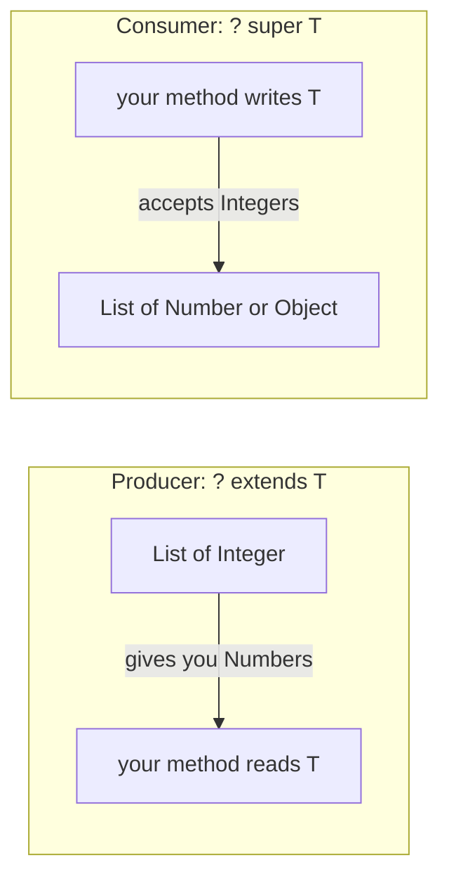
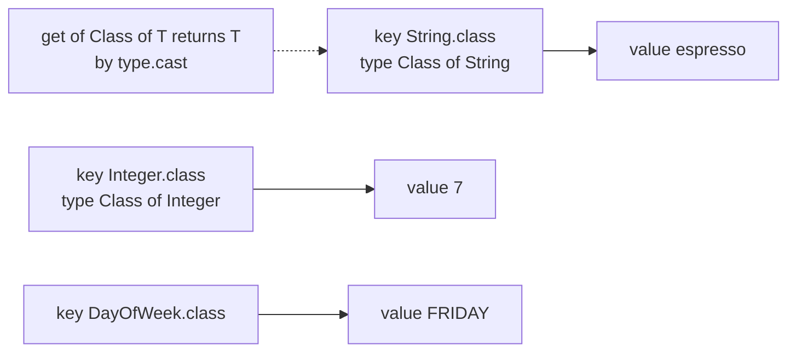

# Bounded wildcards, PECS, varargs and heterogeneous containers

> **Before this lesson:** you know wildcards `? extends` and `? super`, invariance and erasure ([Generics, wildcards and bounds](#/lesson/java/java-generics)), and how to write generic classes and methods without unchecked warnings ([Raw types, unchecked warnings and writing generic code](#/lesson/java/java-ej-raw-types-generic-code)).

## In plain words

A postbox and a vending machine are both boxes on the street, and you use them in opposite directions. You only ever put things **into** a postbox. You only ever take things **out of** a vending machine. Because of that, a postbox can be generous about what goes in (a slot marked "letters and anything larger"), and a vending machine can be specific about what comes out ("drinks, and in fact only cola").

Generic parameters work the same way. If your method only takes values **out** of a collection, it can accept collections of more specific types. If it only puts values **in**, it can accept collections of more general types. Declaring that properly makes your methods usable in many more situations, with full type safety. The memory aid is **PECS**: *producer extends, consumer super*.

This lesson applies PECS to API design, then covers two advanced corners: combining generics with variable-argument methods, and containers that hold values of many different types safely.

Why this matters for a job: these are the signatures you will read in the JDK every day (`Comparator<? super T>`, `Collection<? extends E>`). In interviews, PECS is the standard advanced-generics question.

## The problem: invariance makes APIs rigid

Take the generic stack from the previous lesson and add a method that pushes a whole collection.

```java
public class Pile<E> {
    private final java.util.ArrayDeque<E> items = new java.util.ArrayDeque<>();

    public void push(E e)  { items.push(e); }
    public E pop()         { return items.pop(); }
    public boolean isEmpty() { return items.isEmpty(); }

    public void pushAll(Iterable<E> source) {            // too strict
        for (E e : source) {
            push(e);
        }
    }
}
```

```java
Pile<Number> numbers = new Pile<>();
java.util.List<Integer> ints = java.util.List.of(1, 2, 3);
// numbers.pushAll(ints);      // does not compile: Iterable<Integer> is not an Iterable<Number>
```

Logically it should work: every `Integer` is a `Number`, and pushing integers onto a pile of numbers is harmless. The compiler refuses because `Iterable<Integer>` and `Iterable<Number>` are unrelated types.

## Producer extends

`source` **produces** elements for the pile. A producer parameter gets `? extends`:

```java
public void pushAll(Iterable<? extends E> source) {      // "an Iterable of some subtype of E"
    for (E e : source) {
        push(e);
    }
}
```

Now `numbers.pushAll(ints)` compiles. Inside the method, each element is known to be at least an `E`, which is all `push` needs.

## Consumer super

Next, a method that pops everything into a destination collection.

```java
public void popAll(java.util.Collection<E> destination) {     // too strict
    while (!isEmpty()) {
        destination.add(pop());
    }
}
```

```java
Pile<Integer> pile = new Pile<>();
java.util.Collection<Object> sink = new java.util.ArrayList<>();
// pile.popAll(sink);          // does not compile: Collection<Object> is not a Collection<Integer>
```

Again it should work: a collection of objects can certainly hold integers. Here `destination` **consumes** elements from the pile. A consumer parameter gets `? super`:

```java
public void popAll(java.util.Collection<? super E> destination) {   // "a Collection of some supertype of E"
    while (!isEmpty()) {
        destination.add(pop());
    }
}
```

```java
Pile<Integer> pile = new Pile<>();
pile.pushAll(java.util.List.of(1, 2, 3));
java.util.List<Object> sink = new java.util.ArrayList<>();
pile.popAll(sink);
System.out.println(sink);
```

```text
[3, 2, 1]
```

## PECS, stated carefully

| The parameter... | Role | Declare | You can |
|---|---|---|---|
| supplies `T` values to your method | **producer** | `Something<? extends T>` | read `T`s from it |
| receives `T` values from your method | **consumer** | `Something<? super T>` | write `T`s into it |
| does both | both | `Something<T>` | read and write |
| neither role involves the type | n/a | `Something<?>` | use type-independent methods |

"Producer" and "consumer" are from the **method's** point of view: the parameter produces values *for you*, or consumes values *from you*.



Functional interfaces follow the same logic, which explains the signatures you see in the Stream API:

- a `Function<T, R>` **consumes** a `T` and **produces** an `R`, so flexible APIs write `Function<? super T, ? extends R>`;
- a `Predicate<T>`, a `Consumer<T>` and a `Comparator<T>` consume `T`s: `Predicate<? super T>`, `Comparator<? super T>`;
- a `Supplier<T>` produces: `Supplier<? extends T>`.

```java
static <T> java.util.List<T> keep(java.util.List<? extends T> source, java.util.function.Predicate<? super T> test) {
    java.util.List<T> out = new java.util.ArrayList<>();
    for (T item : source) {
        if (test.test(item)) {
            out.add(item);
        }
    }
    return out;
}

java.util.function.Predicate<Object> notNull = o -> o != null;        // a very general predicate
java.util.List<Number> kept = keep(java.util.List.of(1, 2, 3), notNull);
System.out.println(kept);
```

```text
[1, 2, 3]
```

A predicate on `Object` can test integers, so it is accepted where a `Predicate<? super Integer>` is wanted.

### Comparable and Comparator are consumers

The previous lesson's `max` had the bound `<E extends Comparable<E>>`. It rejects perfectly reasonable types. Suppose:

```java
class Fruit implements Comparable<Fruit> {
    final int ripeness;
    Fruit(int ripeness) { this.ripeness = ripeness; }
    @Override public int compareTo(Fruit o) { return Integer.compare(ripeness, o.ripeness); }
}
class Apple extends Fruit { Apple(int r) { super(r); } }
```

An `Apple` is comparable to `Fruit`, not to `Apple` specifically, so `Apple` does not satisfy `E extends Comparable<E>`. A `Comparable<T>` **consumes** `T`s (they arrive as arguments to `compareTo`), so PECS says `super`:

```java
static <E extends Comparable<? super E>> E max(java.util.Collection<? extends E> items) {
    java.util.Iterator<? extends E> it = items.iterator();
    E best = it.next();
    while (it.hasNext()) {
        E e = it.next();
        if (e.compareTo(best) > 0) {
            best = e;
        }
    }
    return best;
}

Apple ripest = max(java.util.List.of(new Apple(3), new Apple(9), new Apple(5)));
System.out.println(ripest.ripeness);
```

```text
9
```

**Always write `Comparable<? super T>` and `Comparator<? super T>`.**

### Guidelines for using wildcards well

- **Never use a wildcard as a return type.** `List<? extends Number> totals()` forces every caller to deal with wildcards. Return a precise type. Wildcards are for parameters.
- **If a type parameter appears only once in a method declaration, replace it with a wildcard.** `static void swap(List<?> list, int i, int j)` is simpler for callers than `static <E> void swap(List<E> list, int i, int j)`.
- If the user of a class has to think about wildcard types, the API is probably wrong.

That second guideline has a snag: you cannot put an element back into a `List<?>`. The fix is a private generic helper that **captures** the unknown type and gives it a name:

```java
static void swap(java.util.List<?> list, int i, int j) {
    swapHelper(list, i, j);                         // the wildcard is "captured" as E
}

private static <E> void swapHelper(java.util.List<E> list, int i, int j) {
    list.set(i, list.set(j, list.get(i)));          // set returns the old element
}
```

### A PECS checker you can run

```python-run
PARENT = {"Object": None, "Number": "Object", "Integer": "Number", "Double": "Number",
          "Fruit": "Object", "Apple": "Fruit"}

def sub(a, b):
    while a:
        if a == b: return True
        a = PARENT[a]
    return False

def accepts(param, arg):
    """param is ('exact'|'extends'|'super'|'any', T). Can a Collection<arg> be passed?"""
    kind, t = param
    return {"exact": arg == t, "extends": sub(arg, t), "super": sub(t, arg), "any": True}[kind]

def check_call(name, e, source_param, source_arg, sink_param, sink_arg):
    ok_src, ok_dst = accepts(source_param, source_arg), accepts(sink_param, sink_arg)
    verdict = "compiles" if ok_src and ok_dst else "ERROR (" + ", ".join(
        w for w, ok in (("source", ok_src), ("destination", ok_dst)) if not ok) + ")"
    print(f"{name:34} E={e:7} source=List<{source_arg}> dest=List<{sink_arg}> -> {verdict}")

# copy(source, destination) written three ways, called with E = Number
check_call("copy(List<E>, List<E>)", "Number", ("exact", "Number"), "Integer", ("exact", "Number"), "Object")
check_call("copy(List<? extends E>, List<E>)", "Number", ("extends", "Number"), "Integer", ("exact", "Number"), "Object")
check_call("copy(<? extends E>, <? super E>)", "Number", ("extends", "Number"), "Integer", ("super", "Number"), "Object")
check_call("copy(<? extends E>, <? super E>)", "Number", ("extends", "Number"), "Apple", ("super", "Number"), "Object")
check_call("copy(<? extends E>, <? super E>)", "Number", ("extends", "Number"), "Double", ("super", "Number"), "Integer")
```

Only the PECS signature accepts a list of integers as the source and a list of objects as the destination, and it still rejects the meaningless calls.

## Generics and varargs

A varargs parameter (`T... items`) is delivered to the method as an **array**. Arrays and generics mix badly, and here the compiler permits the mixture with a warning: "possible heap pollution from parameterized vararg type". Whether it is dangerous depends on what the method does with that array.

**Safe**: the method only reads the arguments from the array and does not let the array escape.

```java
@SafeVarargs
static <T> java.util.List<T> listOf(T... items) {
    java.util.List<T> out = new java.util.ArrayList<>();
    for (T item : items) {                     // reads only
        out.add(item);
    }
    return out;
}
```

**Unsafe**: returning or storing the array.

```java
static <T> T[] asArray(T... items) {
    return items;                              // exposes the varargs array: DANGEROUS
}

static <T> T[] firstTwo(T a, T b, T c) {
    return asArray(a, b);                      // here the compiler knows only that T is Object: creates Object[]
}

String[] pair = firstTwo("x", "y", "z");       // ClassCastException: Object[] cannot be cast to String[]
```

The call inside `firstTwo` is compiled when `T` is unknown, so the array created is an `Object[]`. Returning it as `T[]` and then treating it as `String[]` fails, in a line that contains no visible cast.

The rule: annotate a generic varargs method with **`@SafeVarargs`** only if it

1. does not store anything into the varargs array, and
2. does not make the array (or a clone of it) visible to untrusted code.

`@SafeVarargs` is allowed only on methods that cannot be overridden: static, final, private, or constructors. If you cannot meet the conditions, take a `List<T>` instead of `T...`; callers can write `List.of(a, b, c)`.

## Typesafe heterogeneous containers

A `Map<String, Integer>` fixes one key type and one value type for the whole container. Sometimes you want a container whose entries have **different** value types, each still checked: a set of user preferences, say, where "volume" is an `Integer`, "theme" is a `String` and "start date" is a `LocalDate`.

The trick is to parameterize the **key** instead of the container. The class `Class<T>` is generic: `String.class` has type `Class<String>`, `Integer.class` has type `Class<Integer>`. An object used this way to carry type information at run time is a **type token**.

```java
import java.util.HashMap;
import java.util.Map;
import java.util.Objects;

public class Favourites {
    private final Map<Class<?>, Object> values = new HashMap<>();

    public <T> void put(Class<T> type, T instance) {
        values.put(Objects.requireNonNull(type), type.cast(instance));    // cast guards against raw-type misuse
    }

    public <T> T get(Class<T> type) {
        return type.cast(values.get(type));                               // dynamic, checked cast
    }
}
```

```java
Favourites f = new Favourites();
f.put(String.class, "espresso");
f.put(Integer.class, 7);
f.put(java.time.DayOfWeek.class, java.time.DayOfWeek.FRIDAY);

String drink = f.get(String.class);            // no cast in client code
int number = f.get(Integer.class);
System.out.println(drink + " " + number + " " + f.get(java.time.DayOfWeek.class) + " " + f.get(Double.class));
// f.put(Integer.class, "seven");              // does not compile
```

```text
espresso 7 FRIDAY null
```

How it holds together:

- The map's declared type is `Map<Class<?>, Object>`: the wildcard is on the **key**, so each key can have a different type argument. The value type is `Object`, so the map alone guarantees nothing.
- The **methods** restore the guarantee. `put` accepts a `Class<T>` together with a `T`, so the compiler ensures the pair matches. `get` takes a `Class<T>` and returns a `T`.
- `type.cast(obj)` is a cast performed with the `Class` object: it returns the object typed as `T`, or throws `ClassCastException`. It is the run-time counterpart of the cast operator and produces no unchecked warning.

The container is **typesafe** (a `String` key always yields a `String`) and **heterogeneous** (keys are of different types).

Limits to know:

- One value per type. To store several strings you need a richer key, such as a small generic class `Key<T>` holding a name and a `Class<T>`.
- A type token cannot describe a parameterized type: there is no `List<String>.class`, because of erasure. Libraries work around it with "super type tokens" (for example Jackson's `TypeReference`).



You have met the pattern in the wild: annotation lookup `element.getAnnotation(Override.class)`, dependency-injection containers (`context.getBean(OrderService.class)`), and `EnumMap` constructors.

> [!INTERVIEW]
> "Explain PECS." *Producer extends, consumer super. If a parameterized parameter only supplies values to my method, I declare it with `? extends T` so callers may pass collections of subtypes. If it only receives values from my method, I use `? super T` so callers may pass collections of supertypes. If it does both, I use the exact type. Return types should not be wildcards.* Give `Collections.copy(List<? super T> dest, List<? extends T> src)` as the library example, and mention `Comparator<? super T>` because comparators consume.

## Pitfalls

- **Exact type arguments on input parameters** (`Collection<E>`) where `? extends E` or `? super E` would accept more callers.
- **Wildcards in return types.**
- **`Comparable<T>` instead of `Comparable<? super T>`** in bounds.
- **Trying to add to a `? extends` collection** or to read a specific type from a `? super` one.
- **`@SafeVarargs` on a method that stores into or leaks its varargs array.**
- **Returning a generic varargs array to callers.**
- **Mixing up whose point of view "producer" refers to.** It is the method's.
- **Heterogeneous containers keyed by `String`** with values of type `Object` and casts at every use.
- **Using a raw `Class` as a key**, which bypasses the compile-time pairing.

## Cheat sheet

| Parameter role | Declaration | Library example |
|---|---|---|
| source of `T` | `Collection<? extends T>` | `addAll(Collection<? extends E> c)` |
| sink for `T` | `Collection<? super T>` | `Collections.addAll(Collection<? super T> c, T... xs)` |
| compares `T` | `Comparator<? super T>` | `List.sort(Comparator<? super E> c)` |
| tests `T` | `Predicate<? super T>` | `removeIf(Predicate<? super E> p)` |
| maps `T` to `R` | `Function<? super T, ? extends R>` | `Stream.map` |
| comparable elements | `<T extends Comparable<? super T>>` | `Collections.sort` |
| generic varargs, read-only | `@SafeVarargs static <T> ... (T... xs)` | `List.of`, `Arrays.asList` |
| many value types in one container | `Map<Class<?>, Object>` + `Class<T>` keys + `cast` | `getAnnotation(Class<A>)` |

## Summary

- Invariance makes naive generic APIs inflexible; bounded wildcards on parameters restore flexibility without losing safety.
- PECS: a parameter that produces values gets `? extends T`; one that consumes values gets `? super T`; one that does both gets `T`.
- Comparators, comparables, predicates and consumers are consumers of `T`.
- Do not use wildcards in return types; use a capture helper when a wildcard parameter must be written to.
- Generic varargs create a generic array; mark the method `@SafeVarargs` only if the array is read-only and never escapes.
- A typesafe heterogeneous container keys values by `Class<T>` tokens and uses `Class.cast` to return them with their proper types.

## Glossary

- **Bounded wildcard**: `? extends T` or `? super T`.
- **Producer**: a parameter from which the method reads values.
- **Consumer**: a parameter into which the method writes values, or which accepts values as arguments.
- **PECS**: producer extends, consumer super.
- **Wildcard capture**: the compiler assigning a temporary name to a wildcard's unknown type, usually via a generic helper method.
- **Varargs**: a parameter accepting a variable number of arguments, delivered as an array.
- **Heap pollution**: a parameterized-type variable referring to an object of another type.
- **`@SafeVarargs`**: an annotation by which the author promises that a generic varargs method is type-safe.
- **Type token**: a `Class<T>` object passed to convey type information at run time.
- **Heterogeneous container**: a container whose entries may have different value types.
- **`Class.cast`**: a run-time checked cast to the type represented by a `Class` object.
- **Super type token**: a technique for representing parameterized types such as `List<String>` at run time.

## Check yourself

```quiz
[
  {"q": "A method reads elements from its parameter `src` and never writes to it. With element type T, which declaration is the most flexible?", "options": ["List<T> src", "List<? extends T> src", "List<? super T> src", "List<Object> src"], "answer": 1,
   "explain": "src is a producer, so it should accept lists of any subtype of T."},
  {"q": "Which lists may be passed as `dst` to `<T> void fill(List<? super T> dst, T value)` when value is an Integer and T is inferred as Integer?", "options": ["Only List<Integer>", "List<Integer>, List<Number>, List<Object>", "List<Integer>, List<Double>", "Any list"], "answer": 1,
   "explain": "? super Integer admits Integer and each of its supertypes."},
  {"q": "Why should APIs write `Comparator<? super T>` instead of `Comparator<T>`?", "options": ["It is faster", "A comparator consumes Ts, so one written for a supertype of T works and should be accepted", "It allows null", "It is required by the compiler"], "answer": 1,
   "explain": "A Comparator<Fruit> can compare Apples; the wildcard lets callers reuse it."},
  {"q": "Does this compile? `static List<? extends Number> totals() { return List.of(1, 2); }` and is it good API design?", "options": ["Does not compile", "Compiles, but wildcard return types burden every caller and should be avoided", "Compiles and is the recommended style", "Compiles only with @SafeVarargs"], "answer": 1,
   "explain": "Return precise types; reserve wildcards for parameters."},
  {"q": "When is it correct to annotate a generic varargs method with @SafeVarargs?", "options": ["Always", "When the method neither stores into the varargs array nor exposes it", "When the method returns the array", "Only for public instance methods"], "answer": 1,
   "explain": "Those two conditions guarantee no heap pollution escapes. The annotation is not permitted on overridable methods."},
  {"q": "In the Favourites class, what is the type of the internal map, and why?", "options": ["Map<String, Object>, for simplicity", "Map<Class<?>, Object>, so that each key can carry its own type argument", "Map<Object, Object>, to allow null", "Map<Class<Object>, Object>"], "answer": 1,
   "explain": "The wildcard on the key allows Class<String>, Class<Integer> and so on to coexist; the methods re-establish type safety."},
  {"q": "What does `Integer.class.cast(\"seven\")` do?", "options": ["Returns 7", "Returns null", "Throws ClassCastException", "Does not compile"], "answer": 2,
   "explain": "Class.cast is a run-time checked cast. The argument is typed Object, so it compiles, and fails at run time."},
  {"q": "Does this compile? `List<? super Integer> xs = new ArrayList<Number>(); Integer n = xs.get(0);`", "options": ["Yes", "No: reading from a ? super list gives only Object", "Yes, with a warning", "Only if the list is non-empty"], "answer": 1,
   "explain": "The element type might be Number or Object, so the compiler can promise only Object."}
]
```

> **Source:** Effective Java 3e, item group "Generics" (bounded wildcards and PECS, combining generics with varargs, typesafe heterogeneous containers); ideas restated with original examples. Checked against https://docs.oracle.com/en/java/javase/21/docs/api/java.base/java/util/Collections.html#copy(java.util.List,java.util.List) , https://docs.oracle.com/en/java/javase/21/docs/api/java.base/java/lang/SafeVarargs.html and https://docs.oracle.com/en/java/javase/21/docs/api/java.base/java/lang/Class.html#cast(java.lang.Object) .
