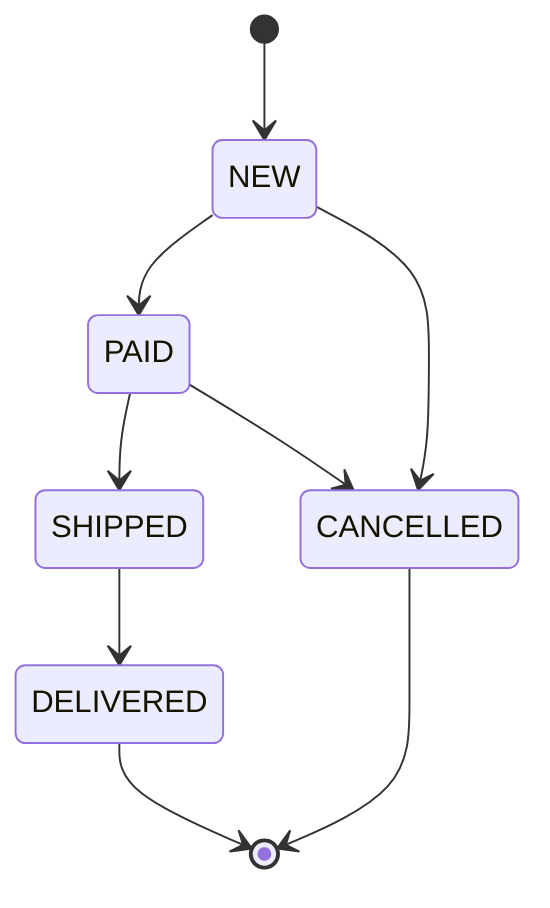

# Enums: constants with data and behaviour

> **Before this lesson:** you know `static final` constants ([static, final, constants and the Math class](#/lesson/java/java-static-final)), `switch` in both forms ([Anatomy of a class, main, and your first statements](#/lesson/java/java-class-anatomy)), interfaces and sealed types ([Interfaces, default methods, sealed types and pattern matching](#/lesson/java/java-interfaces)) and the collection types ([Collections: List, Set, Map and Queue](#/lesson/java/java-collections)).

## In plain words

A traffic light has exactly three colours. Not two, not seventeen, and never "purple". If a program stores the colour as a number (0, 1, 2), nothing stops somebody writing 7, or mixing up "0 means red" with "0 means off" from a different part of the program. If the program stores it as text, a typing slip such as "gren" sails through.

An **enum** (short for *enumerated type*) is a type whose complete set of values is listed in the source code. A variable of that type can hold one of those values and nothing else, and the compiler enforces it. Java's enums go further than those of most languages: each value is a full object that can carry data and have its own behaviour.

Why this matters for a job: enums are the correct way to model statuses, categories, days, directions and modes. Interviewers ask why enums beat `int` constants, what `ordinal()` is and why you should not use it, and what `EnumSet` and `EnumMap` are for.

## The problem with int and String constants

```java
class Old {
    static final int SIZE_SMALL = 0, SIZE_MEDIUM = 1, SIZE_LARGE = 2;
    static final int MILK_NONE = 0, MILK_OAT = 1, MILK_DAIRY = 2;

    static double price(int size) {
        return 2.0 + size * 0.5;
    }
}

System.out.println(Old.price(Old.MILK_DAIRY));     // compiles: a milk passed as a size
System.out.println(Old.price(42));                 // compiles: no such size
System.out.println(Old.SIZE_LARGE);                // prints 2: meaningless in a log
```

```text
3.0
23.0
2
```

This is the **int enum pattern**, and it has every possible weakness:

- **No type safety.** Any `int` is accepted, including constants from an unrelated group.
- **No readable form.** Logs and debuggers show `2`.
- **No way to list the values** or count them.
- **Brittle.** The numbers are compiled into every class that uses them; change one and all users must be recompiled or they silently use the old value.

String constants print nicely but are worse in other ways: a misspelt string compiles, and comparisons are slower.

## A basic enum

```java
enum Size { SMALL, MEDIUM, LARGE }

class Cafe {
    static double price(Size size) {
        return switch (size) {
            case SMALL  -> 2.0;
            case MEDIUM -> 2.5;
            case LARGE  -> 3.0;
        };
    }
}
```

```java
Size s = Size.MEDIUM;
System.out.println(s + " " + Cafe.price(s));
System.out.println(Size.valueOf("LARGE") == Size.LARGE);
System.out.println(java.util.Arrays.toString(Size.values()));
// Cafe.price(1);                 // does not compile: int cannot be converted to Size
```

```text
MEDIUM 2.5
true
[SMALL, MEDIUM, LARGE]
```

What you get for one line of declaration:

| Feature | Detail |
|---|---|
| Type safety | a `Size` parameter accepts only `SMALL`, `MEDIUM`, `LARGE` (or `null`) |
| Readable `toString` | the constant's name |
| `values()` | an array of all constants, in declaration order |
| `valueOf(String)` | the constant with that exact name, or `IllegalArgumentException` |
| `name()`, `ordinal()` | the name; the zero-based position |
| Safe `==` | each constant exists exactly once, so identity comparison is correct |
| `Comparable`, `Serializable` | built in; order is declaration order |
| Works in `switch` | and a switch expression over an enum must cover every constant |

An enum is a class. The compiler creates one object per constant, as `public static final` fields, and makes the constructor private so that no others can ever be created. The exhaustive `switch` deserves emphasis: add `Size.EXTRA_LARGE` later and the `price` method above **stops compiling** until the new case is handled.

## Enums with fields and methods

Because constants are objects, they can hold data. Give the enum fields, a constructor, and pass the values in parentheses after each constant.

```java
enum Planet {
    MERCURY(3.303e+23, 2.4397e6),
    EARTH  (5.976e+24, 6.37814e6),
    JUPITER(1.9e+27,   7.1492e7);

    private static final double G = 6.67300E-11;

    private final double massKg;
    private final double radiusM;
    private final double surfaceGravity;

    Planet(double massKg, double radiusM) {            // implicitly private
        this.massKg = massKg;
        this.radiusM = radiusM;
        this.surfaceGravity = G * massKg / (radiusM * radiusM);
    }

    double surfaceGravity() { return surfaceGravity; }

    double weightOf(double massOnEarthKg) {
        return massOnEarthKg * surfaceGravity;         // newtons
    }
}
```

```java
for (Planet p : Planet.values()) {
    System.out.printf("%-8s g = %5.2f m/s2, a 70 kg person weighs %7.1f N%n",
            p, p.surfaceGravity(), p.weightOf(70));
}
```

```text
MERCURY  g =  3.70 m/s2, a 70 kg person weighs   259.2 N
EARTH    g =  9.80 m/s2, a 70 kg person weighs   686.2 N
JUPITER  g = 24.81 m/s2, a 70 kg person weighs  1736.4 N
```

The data lives with the constant it describes. Adding a planet is one line; every loop over `Planet.values()` picks it up automatically. Enum fields should be `final`: enum constants are shared by the whole program, and mutable shared state causes trouble.

## Different behaviour per constant

Sometimes each constant needs its own code. Avoid a `switch (this)` inside the enum: add a constant, forget the case, and the fault appears only at run time. Instead declare an **abstract method** in the enum and implement it in a body attached to each constant. This is a **constant-specific method implementation**.

```java
enum Operation {
    PLUS("+")   { @Override double apply(double x, double y) { return x + y; } },
    MINUS("-")  { @Override double apply(double x, double y) { return x - y; } },
    TIMES("*")  { @Override double apply(double x, double y) { return x * y; } },
    DIVIDE("/") { @Override double apply(double x, double y) { return x / y; } };

    private final String symbol;

    Operation(String symbol) { this.symbol = symbol; }

    abstract double apply(double x, double y);         // every constant MUST implement this

    @Override public String toString() { return symbol; }
}
```

```java
for (Operation op : Operation.values()) {
    System.out.println("6 " + op + " 3 = " + op.apply(6, 3));
}
```

```text
6 + 3 = 9.0
6 - 3 = 3.0
6 * 3 = 18.0
6 / 3 = 2.0
```

Add a constant without an `apply` body and the enum does not compile. For short behaviours, a lambda in a field is a compact alternative:

```java
enum Operation {
    PLUS("+", (x, y) -> x + y),
    MINUS("-", (x, y) -> x - y);

    private final String symbol;
    private final java.util.function.DoubleBinaryOperator op;

    Operation(String symbol, java.util.function.DoubleBinaryOperator op) { this.symbol = symbol; this.op = op; }

    double apply(double x, double y) { return op.applyAsDouble(x, y); }
}
```

### The strategy enum

When several constants share one of a few behaviours, nest a second enum for the behaviour and give each constant one of its values.

```java
enum Day {
    MON, TUE, WED, THU, FRI, SAT(PayType.WEEKEND), SUN(PayType.WEEKEND);

    private final PayType payType;

    Day() { this(PayType.WEEKDAY); }
    Day(PayType payType) { this.payType = payType; }

    int payPence(int minutes, int ratePence) { return payType.pay(minutes, ratePence); }

    private enum PayType {
        WEEKDAY { int overtime(int mins, int rate) { return mins <= 480 ? 0 : (mins - 480) * rate / 2; } },
        WEEKEND { int overtime(int mins, int rate) { return mins * rate / 2; } };

        abstract int overtime(int mins, int rate);

        int pay(int mins, int rate) { return mins * rate + overtime(mins, rate); }
    }
}
```

```java
System.out.println(Day.TUE.payPence(540, 20) + " " + Day.SUN.payPence(540, 20));
```

```text
11400 16200
```

A new day **must** choose a pay type in order to be declared in a meaningful way; there is no `switch` to forget.

## Never derive meaning from ordinal()

`ordinal()` returns a constant's position: 0 for the first, 1 for the second. It is tempting to use it as data.

```java
enum Ensemble {
    SOLO, DUET, TRIO, QUARTET;
    int musicians() { return ordinal() + 1; }        // fragile
}
```

Reorder the constants, or insert one, and every number changes silently. You cannot have two constants with the same number (an octet and a double quartet both have eight players) or skip a number without inventing a dummy constant. Store the value in a field:

```java
enum Ensemble {
    SOLO(1), DUET(2), TRIO(3), QUARTET(4), OCTET(8), DOUBLE_QUARTET(8), TRIPLE_QUARTET(12);

    private final int musicians;
    Ensemble(int musicians) { this.musicians = musicians; }
    int musicians() { return musicians; }
}
```

The same goes for persistence: never store `ordinal()` in a database or file. Store the name, or better, an explicit code held in a field. `ordinal()` exists for the internal use of `EnumSet` and `EnumMap`.

## EnumSet instead of bit fields

To represent "a set of options", older code used one bit per option in an `int`:

```java
static final int BOLD = 1, ITALIC = 2, UNDERLINE = 4;        // 1 << 0, 1 << 1, 1 << 2
int style = BOLD | UNDERLINE;                                 // 5: unreadable, untyped
```

`EnumSet` is a `Set` implementation for enum values that is stored internally as exactly that kind of bit pattern, so it is as fast and compact, with a readable, type-safe interface.

```java
import java.util.EnumSet;
import java.util.Set;

enum Style { BOLD, ITALIC, UNDERLINE, STRIKETHROUGH }

Set<Style> heading = EnumSet.of(Style.BOLD, Style.UNDERLINE);
Set<Style> rest = EnumSet.complementOf(EnumSet.copyOf(heading));
Set<Style> all = EnumSet.allOf(Style.class);
Set<Style> none = EnumSet.noneOf(Style.class);

System.out.println(heading + " " + rest);
System.out.println(heading.contains(Style.ITALIC) + " " + all.size() + " " + none.isEmpty());
System.out.println(EnumSet.range(Style.ITALIC, Style.STRIKETHROUGH));
```

```text
[BOLD, UNDERLINE] [ITALIC, STRIKETHROUGH]
false 4 true
[ITALIC, UNDERLINE, STRIKETHROUGH]
```

Declare parameters as `Set<Style>` so callers may pass any set.

## EnumMap instead of ordinal indexing

To group or count by an enum, do not index an array with `ordinal()`. Use `EnumMap`, a `Map` whose keys are enum constants. Internally it is an array indexed by ordinal, so it is as fast as the hand-written version, with none of the risks: no wrong index, no unchecked casts, keys print as names, iteration follows declaration order.

```java
import java.util.EnumMap;
import java.util.List;
import java.util.Map;
import java.util.stream.Collectors;

enum Course { STARTER, MAIN, DESSERT }
record Dish(String name, Course course) { }

List<Dish> menu = List.of(new Dish("soup", Course.STARTER), new Dish("pie", Course.MAIN),
                          new Dish("curry", Course.MAIN), new Dish("tart", Course.DESSERT));

Map<Course, Integer> counts = new EnumMap<>(Course.class);
for (Dish d : menu) {
    counts.merge(d.course(), 1, Integer::sum);
}
System.out.println(counts);

Map<Course, List<String>> byCourse = menu.stream().collect(
        Collectors.groupingBy(Dish::course, () -> new EnumMap<>(Course.class),
                Collectors.mapping(Dish::name, Collectors.toList())));
System.out.println(byCourse);
```

```text
{STARTER=1, MAIN=2, DESSERT=1}
{STARTER=[soup], MAIN=[pie, curry], DESSERT=[tart]}
```

The constructor needs the enum's `Class` object, a type token, because of erasure.

### A state machine built with an EnumMap

An enum plus a transition table is the standard way to model a process with states. Each state lists the states it may move to.

```java
import java.util.EnumSet;
import java.util.Set;

enum OrderState {
    NEW, PAID, SHIPPED, DELIVERED, CANCELLED;

    private Set<OrderState> next = EnumSet.noneOf(OrderState.class);

    static {
        NEW.next = EnumSet.of(PAID, CANCELLED);
        PAID.next = EnumSet.of(SHIPPED, CANCELLED);
        SHIPPED.next = EnumSet.of(DELIVERED);
    }

    boolean canMoveTo(OrderState target) { return next.contains(target); }
    boolean isFinal()                    { return next.isEmpty(); }
}
```

```java
System.out.println(OrderState.NEW.canMoveTo(OrderState.PAID) + " "
        + OrderState.SHIPPED.canMoveTo(OrderState.CANCELLED) + " " + OrderState.DELIVERED.isFinal());
```

```text
true false true
```



### The state machine as a model you can run

```python-run
TRANSITIONS = {
    "NEW":       {"PAID", "CANCELLED"},
    "PAID":      {"SHIPPED", "CANCELLED"},
    "SHIPPED":   {"DELIVERED"},
    "DELIVERED": set(),
    "CANCELLED": set(),
}

def run(events, state="NEW"):
    """Apply requested transitions in order. An illegal one is rejected and the state is kept."""
    log = []
    for target in events:
        if target not in TRANSITIONS:
            log.append(f"{state} -> {target}: no such state (would not compile with an enum)")
        elif target in TRANSITIONS[state]:
            log.append(f"{state} -> {target}: ok")
            state = target
        else:
            log.append(f"{state} -> {target}: REJECTED")
    return state, log

final, log = run(["PAID", "DELIVERED", "SHIPPED", "CANCELLED", "DELIVERED", "REFUNDED"])
print("\n".join(log))
print("final state:", final, "| terminal:", not TRANSITIONS[final])
```

## Extending the set of constants: use an interface

An enum cannot extend another enum, and it cannot be subclassed. For operation codes that third parties should be able to add to, define an **interface** and let enums implement it:

```java
interface Operator { double apply(double x, double y); }

enum BasicOp implements Operator {
    PLUS  { public double apply(double x, double y) { return x + y; } },
    TIMES { public double apply(double x, double y) { return x * y; } }
}

enum ExtraOp implements Operator {
    POWER { public double apply(double x, double y) { return Math.pow(x, y); } }
}

static double run(Operator op, double x, double y) { return op.apply(x, y); }
```

Code written against `Operator` accepts constants of either enum, and of any enum written later.

> [!TIP]
> Enum or sealed interface? Use an **enum** when every value is a singleton known at compile time and the values share one shape of data (statuses, units, days). Use a **sealed interface with records** when each kind carries different data and many instances exist (a `Circle` with a radius, a `Rectangle` with two sides).

> [!INTERVIEW]
> "Why use an enum instead of constants?" Type safety (only declared values compile), a namespace, readable names, the ability to iterate with `values()`, fields and methods on each constant, exhaustive `switch` checking, safe `==`, built-in ordering and serialization, and guaranteed single instances (which is why an enum makes the best singleton). "`EnumSet` and `EnumMap`?" Specialised, very fast collections for enum elements and keys, backed by a bit vector and an array. "Can an enum implement an interface, extend a class, have a constructor?" Yes; no, it already extends `java.lang.Enum`; yes, always private.

## Pitfalls

- **`int` or `String` constants** for a fixed set of values.
- **Using `ordinal()` as data**, as an array index, or storing it in a database.
- **`switch (this)` inside an enum** with a `default` branch that hides forgotten cases.
- **Mutable fields in enum constants.**
- **`valueOf` on untrusted text** without handling `IllegalArgumentException`; note it is case-sensitive.
- **Comparing with `equals`** when `==` is null-safe and clearer for enums.
- **`HashSet` or `HashMap` with enum elements or keys** where `EnumSet` or `EnumMap` would be faster and ordered.
- **Renaming a constant** whose name is stored in files or sent over the network.
- **Enum constants referring to each other in constructors**: later constants are still `null` at that moment; use a static block, as in the state machine.

## Cheat sheet

| Goal | Code |
|---|---|
| Declare | `enum Size { SMALL, MEDIUM, LARGE }` |
| All values | `Size.values()` |
| From text | `Size.valueOf("SMALL")` |
| Data per constant | fields + constructor: `EARTH(5.9e24, 6.3e6)` |
| Behaviour per constant | abstract method + constant bodies, or a lambda field |
| Compare | `a == b` |
| Set of constants | `EnumSet.of(A, B)`, `EnumSet.allOf(E.class)`, `EnumSet.noneOf(E.class)` |
| Map keyed by constant | `new EnumMap<>(E.class)` |
| Extensible family | an interface implemented by several enums |
| Singleton | `enum X { INSTANCE }` |

## Summary

- An enum is a type with a fixed, compiler-enforced set of instances; it replaces integer and string constants.
- Constants are objects: they can have final fields, constructors, methods, and per-constant method bodies.
- Do not use `ordinal()` for anything; keep meaningful numbers in fields.
- Use `EnumSet` for sets of flags and `EnumMap` for tables keyed by an enum.
- Enums cannot be extended; share an interface among enums when an open-ended family is needed.

## Glossary

- **Enum (enumerated type)**: a type whose instances are a fixed list of named constants.
- **Enum constant**: one of those instances.
- **Int enum pattern**: the old practice of representing choices with `static final int` values.
- **`ordinal`**: a constant's zero-based position in its declaration.
- **Constant-specific method implementation**: a method body attached to a single enum constant.
- **Strategy enum**: a nested enum that holds a behaviour shared by several constants of the outer enum.
- **Bit field**: an integer whose individual bits represent independent yes/no options.
- **`EnumSet`**: a compact set of enum constants.
- **`EnumMap`**: a map whose keys are constants of one enum.
- **State machine**: a model with a fixed set of states and permitted transitions between them.
- **Type token**: a `Class` object passed to tell a generic class its type at run time.

## Check yourself

```quiz
[
  {"q": "What does this print? `enum Level { LOW, MID, HIGH }` then `System.out.println(Level.MID.ordinal() + \" \" + Level.valueOf(\"HIGH\") + \" \" + Level.values().length);`", "options": ["1 HIGH 3", "2 HIGH 3", "1 2 3", "MID HIGH 3"], "answer": 0,
   "explain": "Ordinals start at 0, so MID is 1. valueOf returns the constant, printed by name. There are three constants."},
  {"q": "What happens? `Level.valueOf(\"high\")` (lower case)", "options": ["Returns Level.HIGH", "Returns null", "Throws IllegalArgumentException", "Does not compile"], "answer": 2,
   "explain": "valueOf requires an exact, case-sensitive match of the constant's name."},
  {"q": "Does this compile? `enum Size { S, M } enum BigSize extends Size { L }`", "options": ["Yes", "No: enums cannot be extended", "Yes, with a warning", "Only if Size is abstract"], "answer": 1,
   "explain": "Every enum implicitly extends java.lang.Enum and is effectively final. Use a shared interface instead."},
  {"q": "Why should you not write `int musicians() { return ordinal() + 1; }`?", "options": ["ordinal() is slow", "Reordering or inserting constants silently changes the values, and duplicates or gaps are impossible", "ordinal() is private", "It returns a long"], "answer": 1,
   "explain": "Store the number in a final field passed through the constructor."},
  {"q": "A switch EXPRESSION over an enum covers all constants and has no default. A new constant is then added to the enum. What happens?", "options": ["Nothing; the switch returns null", "The switch no longer compiles until the new constant is handled", "It throws at class-load time", "The new constant maps to the first case"], "answer": 1,
   "explain": "Switch expressions over enums must be exhaustive, so the compiler flags every place needing an update."},
  {"q": "Which collection is the best choice for a set of formatting flags drawn from `enum Style`?", "options": ["HashSet<Style>", "an int bit field", "EnumSet<Style>", "ArrayList<Style>"], "answer": 2,
   "explain": "EnumSet is type-safe and readable and is implemented as a bit vector, so it is as efficient as a bit field."},
  {"q": "What does this print? `enum T { A, B; } ` then `System.out.println(T.A == T.valueOf(\"A\"));`", "options": ["true", "false", "It does not compile", "It throws"], "answer": 0,
   "explain": "Each enum constant exists exactly once, so valueOf returns the very same object and == is true."},
  {"q": "An enum declares `abstract double apply(double x);` and one constant has no body implementing it. Result?", "options": ["That constant returns 0.0", "Compile-time error", "Runtime AbstractMethodError", "The method is skipped"], "answer": 1,
   "explain": "Every constant must implement the enum's abstract methods; the compiler enforces it."}
]
```

> **Source:** Effective Java 3e, item group "Enums and annotations" (enums instead of int constants, instance fields instead of ordinals, EnumSet instead of bit fields, EnumMap instead of ordinal indexing, emulating extensible enums with interfaces); Head First Java appendix B (enumerations). Ideas restated with original examples. Checked against https://docs.oracle.com/en/java/javase/21/docs/api/java.base/java/lang/Enum.html and https://docs.oracle.com/en/java/javase/21/docs/api/java.base/java/util/EnumSet.html .
