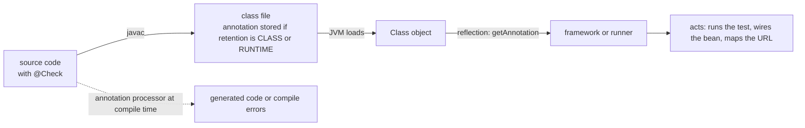

# Annotations, @Override and marker interfaces

> **Before this lesson:** you have used `@Override` and `@FunctionalInterface` ([Inheritance: sharing code through a family tree](#/lesson/java/java-inheritance-basics), [Lambdas, functional interfaces and method references](#/lesson/java/java-lambdas)), you know interfaces ([Interfaces, default methods, sealed types and pattern matching](#/lesson/java/java-interfaces)) and enums ([Enums: constants with data and behaviour](#/lesson/java/java-ej-enums)).

## In plain words

Luggage at an airport carries stickers: "FRAGILE", "PRIORITY", "CABIN". A sticker does not change what is in the suitcase. It is a note for whoever handles the bag, and each handler acts on the stickers they care about. The baggage crew looks for FRAGILE; the gate staff look for CABIN. A sticker nobody reads has no effect at all.

An **annotation** is a sticker for code. It begins with `@` and is attached to a class, a method, a field or a parameter. By itself it does nothing. A **tool** reads it and acts: the compiler, a test runner, a web framework, a code generator. Data that describes other data like this is called **metadata**.

Why this matters for a job: modern Java frameworks are driven almost entirely by annotations (`@Test`, `@RestController`, `@Entity`, `@Autowired`). You will use them from your first day, and interviewers ask what `@Override` is for, what retention policies are, and how a framework finds annotated methods.

## Annotations you already depend on

| Annotation | Read by | Effect |
|---|---|---|
| `@Override` | compiler | error if the method does not override or implement an inherited one |
| `@Deprecated` | compiler, IDE | warning wherever the element is used; `@Deprecated(forRemoval = true)` for stronger warnings |
| `@SuppressWarnings("unchecked")` | compiler | silences the named warnings in that scope |
| `@FunctionalInterface` | compiler | error if the interface does not have exactly one abstract method |
| `@SafeVarargs` | compiler | the author asserts that a generic varargs method is safe |
| `@Test` (JUnit) | test runner | run this method as a test |

## Always use @Override

This looks like a class with a sensible `equals`.

```java
import java.util.HashSet;
import java.util.Set;

class Pair {
    private final char first, second;
    Pair(char first, char second) { this.first = first; this.second = second; }

    public boolean equals(Pair other) {                 // parameter type is Pair, not Object
        return other.first == first && other.second == second;
    }

    public int hashCode() { return 31 * first + second; }
}

public class Pairs {
    public static void main(String[] args) {
        Set<Pair> set = new HashSet<>();
        for (int round = 0; round < 10; round++) {
            for (char c = 'a'; c <= 'z'; c++) {
                set.add(new Pair(c, c));
            }
        }
        System.out.println(set.size());
    }
}
```

```text
260
```

Twenty-six distinct pairs were added ten times each, so a set should hold 26. It holds 260. The method `equals(Pair)` does not **override** `Object.equals(Object)`; it **overloads** it. `HashSet` calls `equals(Object)`, finds the inherited identity comparison, and treats every object as different.

Add the annotation and the compiler tells you at once:

```java
@Override
public boolean equals(Pair other) { ... }
```

```text
error: method does not override or implement a method from a supertype
```

```java
@Override
public boolean equals(Object o) {
    return o instanceof Pair p && p.first == first && p.second == second;
}
```

Now the program prints 26. The rule: put `@Override` on **every** method that is meant to override a superclass method or implement an interface method. It costs nothing and catches misspelt names, wrong parameter types, and methods that stop overriding when a superclass changes. It also tells the reader, at a glance, that the method is part of an inherited contract.

## Declaring your own annotation

Before annotations, tools recognised special elements by **naming patterns**: JUnit 3 ran every method whose name began with `test`. Naming patterns are weak. Misspell `tsetSafety` and the method is silently skipped. There is no way to attach a parameter, such as "this test should throw `ArithmeticException`". Nothing stops a pattern being applied to something it makes no sense for.

An annotation type solves all three. It is declared with `@interface`.

```java
import java.lang.annotation.ElementType;
import java.lang.annotation.Retention;
import java.lang.annotation.RetentionPolicy;
import java.lang.annotation.Target;

@Retention(RetentionPolicy.RUNTIME)         // keep it in the class file AND make it visible at run time
@Target(ElementType.METHOD)                 // may be placed only on methods
public @interface Check {
    Class<? extends Throwable> expected() default None.class;     // an element with a default value
    String description() default "";

    final class None extends Throwable { }                         // "no exception expected"
}
```

The parts:

- `@interface Check` declares an annotation type named `Check`.
- The method-like declarations are **elements**: named values a user may supply. Allowed element types are primitives, `String`, `Class`, enums, other annotations, and arrays of these.
- `default` gives a value used when the element is omitted. An element named `value` can be written without its name: `@SuppressWarnings("unchecked")`.
- `@Retention` and `@Target` are **meta-annotations**: annotations applied to annotation declarations.

| Meta-annotation | Controls | Values |
|---|---|---|
| `@Retention` | how long the annotation is kept | `SOURCE` (discarded by the compiler, e.g. `@Override`), `CLASS` (in the class file, not visible at run time; the default), `RUNTIME` (readable by reflection) |
| `@Target` | where it may be placed | `TYPE`, `METHOD`, `FIELD`, `PARAMETER`, `CONSTRUCTOR`, `LOCAL_VARIABLE`, and more |
| `@Inherited` | whether subclasses inherit a class-level annotation | |
| `@Repeatable` | whether it may appear several times on one element | |
| `@Documented` | whether it appears in generated documentation | |

A framework that needs to find annotations while the program runs requires `RUNTIME` retention. Forgetting it is the classic reason "my annotation is ignored".

## Using and processing the annotation

```java
class CalculatorChecks {
    @Check(description = "addition works")
    public static void adds() {
        if (2 + 2 != 4) throw new IllegalStateException("arithmetic is broken");
    }

    @Check(expected = ArithmeticException.class, description = "division by zero is rejected")
    public static void dividesByZero() {
        int x = 1 / 0;
    }

    @Check(description = "this one fails on purpose")
    public static void broken() {
        throw new IllegalStateException("oops");
    }

    public static void notACheck() { }                  // no annotation: ignored by the runner
}
```

A tiny runner uses **reflection**, the ability of a program to examine classes, methods and annotations at run time, to find and execute the marked methods.

```java
import java.lang.reflect.InvocationTargetException;
import java.lang.reflect.Method;

public class MiniRunner {
    public static void main(String[] args) throws Exception {
        int passed = 0, failed = 0;
        for (Method m : CalculatorChecks.class.getDeclaredMethods()) {
            Check check = m.getAnnotation(Check.class);          // null if the method is not annotated
            if (check == null) {
                continue;
            }
            String outcome;
            try {
                m.invoke(null);                                   // static method: no target object
                outcome = check.expected() == Check.None.class ? "PASS" : "FAIL (nothing thrown)";
            } catch (InvocationTargetException wrapped) {
                Throwable cause = wrapped.getCause();             // the exception thrown by the method
                outcome = check.expected().isInstance(cause) ? "PASS" : "FAIL (" + cause + ")";
            }
            if (outcome.equals("PASS")) passed++; else failed++;
            System.out.println(outcome + "  " + m.getName() + ": " + check.description());
        }
        System.out.println(passed + " passed, " + failed + " failed");
    }
}
```

```text
PASS  adds: addition works
PASS  dividesByZero: division by zero is rejected
FAIL (java.lang.IllegalStateException: oops)  broken: this one fails on purpose
2 passed, 1 failed
```

(The order of methods returned by reflection is not guaranteed.)

That is, in miniature, how JUnit, Spring and every other annotation-driven framework operates: scan classes, ask each element "do you carry annotation X?", and act on the answer. The annotation says *what*; the framework supplies *how*.



The dotted path is the other way annotations are consumed: an **annotation processor** runs inside the compiler, reads annotations in the source, and generates code or reports errors before the program ever runs. Lombok, MapStruct and Dagger work this way.

### A runner model you can run

Python has a close relative of annotations (decorators), which lets the same mechanism be shown in a few lines.

```python-run
def check(expected=None, description=""):
    """Attach metadata to a function; do not change what it does."""
    def mark(fn):
        fn._check = {"expected": expected, "description": description}
        return fn
    return mark

class CalculatorChecks:
    @check(description="addition works")
    def adds():
        assert 2 + 2 == 4

    @check(expected=ZeroDivisionError, description="division by zero is rejected")
    def divides_by_zero():
        1 / 0

    @check(description="this one fails on purpose")
    def broken():
        raise RuntimeError("oops")

    def not_a_check():                      # no metadata: the runner skips it
        pass

passed = failed = 0
for name, fn in vars(CalculatorChecks).items():
    meta = getattr(fn, "_check", None)      # the equivalent of method.getAnnotation(Check.class)
    if meta is None:
        continue
    try:
        fn()
        ok = meta["expected"] is None
        note = "" if ok else "(nothing thrown)"
    except Exception as e:
        ok = meta["expected"] is not None and isinstance(e, meta["expected"])
        note = "" if ok else f"({type(e).__name__}: {e})"
    passed, failed = passed + ok, failed + (not ok)
    print(("PASS" if ok else "FAIL"), name, "-", meta["description"], note)
print(passed, "passed,", failed, "failed")
```

## Marker interfaces

A **marker interface** is an interface with no methods. Implementing it labels a class as having some property. `java.io.Serializable` marks a class whose instances may be serialized; `java.util.RandomAccess` marks lists with fast indexed access.

A **marker annotation** is an annotation with no elements, such as `@Override`. So there are two ways to stick a label on a class. Which is better?

| | Marker interface | Marker annotation |
|---|---|---|
| Defines a **type** | yes: you can declare `void save(Serializable s)` and have misuse caught at compile time | no: checks happen at run time, by reflection |
| Can be restricted to a family | yes: a marker interface can extend another interface, so only that family can carry it | only coarsely, with `@Target` |
| Applies to methods, fields, parameters | no: only classes and interfaces | yes |
| Can carry information later | no | yes: add elements with defaults |
| Fits an annotation-based framework | no | yes |

Rules of thumb:

- If the label applies to anything other than a class or interface, it must be an **annotation**.
- If the label applies to classes and you might ever want to write a method that **accepts only objects carrying it**, use a **marker interface**. It gives compile-time type checking, which is the entire point of having types.
- Inside a framework that already uses annotations heavily, follow the framework.

```java
interface Auditable { }                                    // marker interface: defines a type

record Payment(String id, long cents) implements Auditable { }
record Tip(String text) { }

static void audit(Auditable item) {                        // only marked objects are accepted
    System.out.println("AUDIT " + item);
}

audit(new Payment("p-17", 4200));
// audit(new Tip("hello"));        // does not compile: Tip is not Auditable
```

```text
AUDIT Payment[id=p-17, cents=4200]
```

The same check with a marker annotation would be an `if` with reflection at run time, and the mistake would be found only when that line executed.

A historical regret illustrates the point: `ObjectOutputStream.writeObject` takes `Object` instead of `Serializable`, so passing a non-serializable object compiles and fails at run time.

## Annotations in daily work

You will mostly *use* annotations that frameworks define. A sample of what they look like, so the shapes are familiar:

```java
@RestController                                   // Spring: this class handles web requests
@RequestMapping("/orders")
class OrderController {

    @GetMapping("/{id}")                          // an HTTP GET to /orders/42 calls this method
    Order find(@PathVariable long id) { ... }

    @PostMapping
    @Transactional                                // run inside a database transaction
    Order create(@Valid @RequestBody NewOrder body) { ... }
}

@Entity                                           // JPA: instances map to rows of a table
class Order {
    @Id @GeneratedValue Long id;
    @Column(nullable = false) String customer;
}

class OrderTest {
    @Test                                         // JUnit 5
    @DisplayName("an empty order has a total of zero")
    void emptyOrder() { ... }
}
```

Each of those is a label read by a framework, in exactly the way `MiniRunner` read `@Check`. When behaviour seems to come from nowhere, look for the annotation and then for the code that processes it.

> [!WARNING]
> Annotations are powerful and easy to overuse. Heavy "annotation magic" moves logic out of plain code into framework behaviour that is hard to follow and to debug. If ordinary code (a method call, a constructor argument) expresses something clearly, prefer it.

> [!INTERVIEW]
> "What does `@Override` do, and is it required?" It is optional and has source retention; it asks the compiler to verify that the method overrides or implements a supertype method, turning accidental overloads and misspellings into compile errors. "What are the retention policies?" `SOURCE`, `CLASS` (the default) and `RUNTIME`; only `RUNTIME` annotations can be read by reflection. "Marker interface versus marker annotation?" An interface defines a type and so allows compile-time checks and can be limited to a type family; an annotation can be applied to any program element and can gain elements later.

## Pitfalls

- **Omitting `@Override`** and accidentally overloading (`equals(Pair)`, `hashcode()`, `tostring()`).
- **Forgetting `@Retention(RetentionPolicy.RUNTIME)`** on an annotation meant to be read by reflection.
- **Missing or over-broad `@Target`**, letting the annotation be placed where it is meaningless.
- **Naming conventions instead of annotations** for anything a tool must recognise.
- **Believing an annotation does something by itself.** Without a processor, it is inert.
- **A marker annotation where a marker interface would give compile-time checking.**
- **Annotation elements with invalid types** (for example a `List` or an arbitrary object); only primitives, `String`, `Class`, enums, annotations and arrays of those are permitted.
- **Relying on the order of `getDeclaredMethods()`**.
- **Stacks of framework annotations** that nobody on the team can explain.

## Cheat sheet

| Goal | Code |
|---|---|
| Verify an override | `@Override` on the method |
| Mark an API as obsolete | `@Deprecated(since = "2.0", forRemoval = true)` plus a Javadoc `@deprecated` note |
| Declare an annotation | `public @interface Name { ... }` |
| Element with a default | `String label() default "";` |
| Single unnamed element | name it `value` |
| Readable at run time | `@Retention(RetentionPolicy.RUNTIME)` |
| Restrict placement | `@Target(ElementType.METHOD)` |
| Read at run time | `method.getAnnotation(Name.class)`, `isAnnotationPresent(Name.class)` |
| Label that defines a type | marker interface |
| Label for methods or fields | marker annotation |

## Summary

- An annotation is metadata attached to a program element; a compiler, processor or framework gives it meaning.
- Use `@Override` on every overriding or implementing method; it turns silent overloads into errors.
- Prefer annotations to naming patterns: they are checked, can carry typed parameters, and can be restricted to sensible targets.
- Custom annotations are declared with `@interface` and configured by `@Retention` and `@Target`; run-time processing uses reflection.
- A marker interface defines a type and permits compile-time checking; a marker annotation can label any element and can grow.

## Glossary

- **Annotation**: metadata attached to a declaration, written with `@`.
- **Metadata**: data that describes other data or code.
- **Annotation type**: a declaration made with `@interface`.
- **Element**: a named value that an annotation can carry.
- **Meta-annotation**: an annotation applied to an annotation type.
- **Retention**: how long an annotation survives: source, class file or run time.
- **Target**: the kinds of program element an annotation may be placed on.
- **Reflection**: examining and invoking program elements at run time.
- **Annotation processor**: a compiler plug-in that reads annotations and generates code or diagnostics.
- **Naming pattern**: recognising special elements by their names.
- **Marker interface**: an interface with no methods, used as a label that defines a type.
- **Marker annotation**: an annotation with no elements.

## Check yourself

```quiz
[
  {"q": "A subclass declares `@Override public boolean equals(Widget w) { ... }`. What happens?", "options": ["It overrides Object.equals", "Compile-time error: the method does not override a supertype method", "It compiles and overloads silently", "Runtime error"], "answer": 1,
   "explain": "Object.equals takes Object. With @Override the compiler reports that nothing is being overridden."},
  {"q": "Without @Override, the same `equals(Widget w)` method...", "options": ["fails to compile", "compiles as an overload, so collections keep using Object.equals", "overrides Object.equals", "is ignored by the compiler"], "answer": 1,
   "explain": "It is a legal additional method; HashSet and List.contains call equals(Object) and never see it."},
  {"q": "An annotation declared without @Retention is placed on a method. Can `method.getAnnotation(...)` find it at run time?", "options": ["Yes", "No: the default retention is CLASS, which is not available to reflection", "Only for static methods", "Only if @Target is METHOD"], "answer": 1,
   "explain": "RUNTIME retention is required for reflective access."},
  {"q": "Which is a legal annotation element declaration?", "options": ["List<String> tags();", "String[] tags() default {};", "Object payload();", "java.util.Date when();"], "answer": 1,
   "explain": "Elements may be primitives, String, Class, enums, annotations, or arrays of these."},
  {"q": "What does an annotation do if no tool processes it?", "options": ["Throws at run time", "Nothing", "Slows the method down", "Makes the method final"], "answer": 1,
   "explain": "Annotations are passive metadata."},
  {"q": "You want a method `void archive(X item)` that the compiler restricts to classes carrying a certain label. Which mechanism?", "options": ["A marker annotation", "A marker interface used as the parameter type", "A naming convention", "A comment"], "answer": 1,
   "explain": "Only an interface defines a type the compiler can check at the call site."},
  {"q": "Which retention does `@Override` have?", "options": ["RUNTIME", "CLASS", "SOURCE", "None"], "answer": 2,
   "explain": "It is needed only by the compiler and is discarded afterwards."},
  {"q": "Why are annotations preferred to naming patterns such as 'methods starting with test'?", "options": ["They run faster", "A misspelt name is silently ignored, whereas a misspelt annotation does not compile; annotations can also carry typed parameters", "They need less memory", "Names cannot contain 'test'"], "answer": 1,
   "explain": "Annotations are checked by the compiler and can be parameterised and restricted by target."}
]
```

> **Source:** Effective Java 3e, item group "Enums and annotations" (annotations in preference to naming patterns, consistent use of the Override annotation, marker interfaces to define types); ideas restated with original examples. Checked against the Java Language Specification section 9.6 and https://docs.oracle.com/en/java/javase/21/docs/api/java.base/java/lang/annotation/package-summary.html and https://dev.java/learn/annotations/ .
