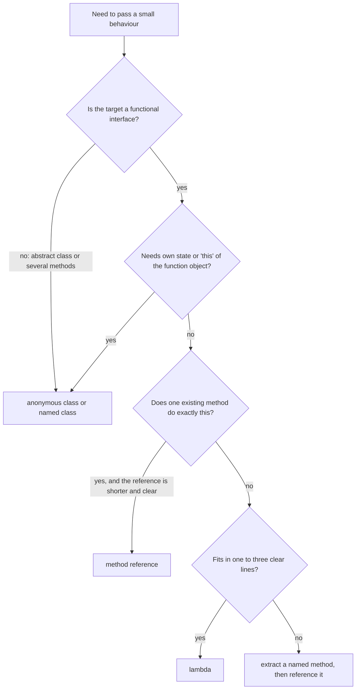

# Choosing between lambdas, method references and classes

> **Before this lesson:** you can write lambdas and method references and know the standard functional interfaces ([Lambdas, functional interfaces and method references](#/lesson/java/java-lambdas)), and you know anonymous classes ([Nested, inner, local and anonymous classes](#/lesson/java/java-inner-classes)) and enums with behaviour ([Enums: constants with data and behaviour](#/lesson/java/java-ej-enums)).

## In plain words

A recipe can say "whisk the eggs" or it can say "take the wire implement with the looped strands, hold it by the handle, and move it rapidly through the eggs in a circular motion". Both are correct. The first is better because the reader already knows what whisking is. Shorter is not always better either: "do the thing" is short and useless.

Java gives you three ways to hand a small piece of behaviour to a method: an **anonymous class**, a **lambda**, and a **method reference**. All three compile to much the same thing. Choosing among them is a matter of which one the next reader will understand fastest. This lesson gives the rules of thumb, and then a fourth choice: which **functional interface** type your own methods should accept.

Why this matters for a job: code review of modern Java is largely about these small decisions. Interviewers probe them with "when would you still use an anonymous class?" and "why not declare your own functional interface here?".

## Lambdas instead of anonymous classes

An object that exists only to carry one function is a **function object**. Before Java 8 the only way to make one was an anonymous class.

```java
import java.util.ArrayList;
import java.util.Collections;
import java.util.Comparator;
import java.util.List;

List<String> words = new ArrayList<>(List.of("kiwi", "fig", "banana"));

// 1. Anonymous class: five lines of ceremony round one expression
Collections.sort(words, new Comparator<String>() {
    @Override
    public int compare(String a, String b) {
        return Integer.compare(a.length(), b.length());
    }
});

// 2. Lambda
Collections.sort(words, (a, b) -> Integer.compare(a.length(), b.length()));

// 3. Comparator construction method with a method reference
words.sort(Comparator.comparingInt(String::length));

System.out.println(words);
```

```text
[fig, kiwi, banana]
```

Each step removes text that carried no information. The types of `a` and `b`, and the return type, are worked out by the compiler from the context; this is **type inference**. The rule: **omit the types of lambda parameters unless stating them makes the code clearer.** If the compiler reports that it cannot infer them, add them then.

Type inference depends on generics. Remove the type argument from `List<String>` (a raw type) and the lambda stops compiling, because the compiler no longer knows what `a` and `b` are. That is one more reason never to use raw types.

### Lambdas make enum behaviour compact

In the enums lesson each constant overrode an abstract method. When the behaviour is a single expression, storing a lambda in a field is shorter.

```java
import java.util.function.DoubleBinaryOperator;

enum Operation {
    PLUS("+", (x, y) -> x + y),
    MINUS("-", (x, y) -> x - y),
    TIMES("*", (x, y) -> x * y),
    DIVIDE("/", (x, y) -> x / y);

    private final String symbol;
    private final DoubleBinaryOperator op;

    Operation(String symbol, DoubleBinaryOperator op) {
        this.symbol = symbol;
        this.op = op;
    }

    double apply(double x, double y) { return op.applyAsDouble(x, y); }

    @Override public String toString() { return symbol; }
}
```

```java
System.out.println(Operation.TIMES.apply(6, 7) + " " + Operation.DIVIDE);
```

```text
42.0 /
```

### Limits of lambdas

**Lambdas have no name and no documentation.** If a computation is not self-explanatory, or runs to more than a few lines, do not put it in a lambda. One line is ideal; three is a sensible maximum. Move longer logic into a named method and refer to it.

```java
// Hard to read: a paragraph inside a call
orders.removeIf(o -> {
    if (o.customer() == null) return true;
    if (o.total() <= 0) return true;
    return o.placedAt().isBefore(cutoff) && !o.paid();
});

// Better: the name says what the test means
orders.removeIf(this::isDiscardable);
```

**When an anonymous class is still the right tool:**

| Need | Why a lambda cannot do it |
|---|---|
| implement an **abstract class** | lambdas work only for functional interfaces |
| implement an interface with **several abstract methods** | same reason |
| keep **state in fields** between calls | a lambda has no fields of its own |
| refer to **the function object itself** | in a lambda, `this` means the enclosing instance; in an anonymous class it means the anonymous object |

```java
abstract class Greeter {
    abstract String greet(String name);
    String twice(String name) { return greet(name) + " " + greet(name); }
}

Greeter g = new Greeter() {                       // an abstract class: must be an anonymous class
    private int calls = 0;                        // state
    @Override String greet(String name) { return "Hi " + name + " #" + (++calls); }
};
System.out.println(g.twice("Ada"));
```

```text
Hi Ada #1 Hi Ada #2
```

Two more cautions. Lambdas and anonymous classes cannot be reliably **serialized**; if you need a serializable function object, write a named static nested class. And inside an enum constructor a lambda cannot touch the enum's instance fields, since the constants are still being built; use a constant-specific class body for behaviour that needs them.

## Method references instead of lambdas

A method reference says "call this existing method" with even less text than a lambda.

```java
import java.util.HashMap;
import java.util.Map;

Map<String, Integer> counts = new HashMap<>();
for (String w : "to be or not to be".split(" ")) {
    counts.merge(w, 1, (old, one) -> old + one);     // lambda: the parameters add nothing
    // counts.merge(w, 1, Integer::sum);             // method reference: says what it does
}
System.out.println(counts.get("to") + " " + counts.get("or"));
```

```text
2 1
```

`Integer::sum` is shorter and names the operation. The more parameters a lambda has, the more a method reference saves.

The five kinds, with their lambda equivalents:

| Kind | Example | Equivalent lambda |
|---|---|---|
| static | `Integer::parseInt` | `s -> Integer.parseInt(s)` |
| bound (a specific object) | `Instant.now()::isAfter` | `t -> thatInstant.isAfter(t)` |
| unbound (object supplied as the first argument) | `String::toLowerCase` | `s -> s.toLowerCase()` |
| class constructor | `TreeMap<K, V>::new` | `() -> new TreeMap<K, V>()` |
| array constructor | `int[]::new` | `len -> new int[len]` |

One subtle difference: in a **bound** reference, the object expression before `::` is evaluated **once**, when the reference is created. In the lambda form it is evaluated each time the lambda runs.

### When the lambda is better

The guideline is symmetrical: **where a method reference is shorter and clearer, use it; where it is not, keep the lambda.**

```java
// The method reference is LONGER and noisier than the lambda
service.execute(OrderProcessingCoordinatorFactory::drainPendingQueue);
service.execute(() -> drainPendingQueue());

// A parameter name can document what the value is
Function<String, String> same1 = Function.identity();
Function<String, String> same2 = line -> line;            // "line" tells the reader what flows through
```

A well-chosen parameter name is free documentation that a method reference cannot provide. And when the logic does not correspond to one existing method, extracting a private method purely so you can reference it is worthwhile only if the method's name improves the code.



## Use the standard functional interfaces

When **your** method accepts a function, which type should the parameter have? You could declare a new interface each time. Do not. `java.util.function` already provides 43 of them, and using the standard ones means callers already know them, and the built-in default methods (`and`, `negate`, `andThen`, `compose`) come for free.

Six basic shapes generate the rest:

| Interface | Signature | Example |
|---|---|---|
| `UnaryOperator<T>` | `T apply(T t)` | `String::strip` |
| `BinaryOperator<T>` | `T apply(T a, T b)` | `BigInteger::add` |
| `Predicate<T>` | `boolean test(T t)` | `String::isBlank` |
| `Function<T, R>` | `R apply(T t)` | `Integer::parseInt` |
| `Supplier<T>` | `T get()` | `ArrayList::new` |
| `Consumer<T>` | `void accept(T t)` | `System.out::println` |

The variants follow a naming system, so you can find the one you need without memorising a list:

- **Primitive specialisations** for `int`, `long` and `double`: `IntPredicate`, `LongUnaryOperator`, `DoubleSupplier`, `IntBinaryOperator`.
- **Primitive-returning functions**: `ToIntFunction<T>`, `ToLongFunction<T>`, `ToDoubleFunction<T>`.
- **Primitive-taking functions**: `IntFunction<R>`, and conversions such as `IntToLongFunction`.
- **Two-argument forms**: `BiPredicate<T, U>`, `BiFunction<T, U, R>`, `BiConsumer<T, U>`, `ToIntBiFunction<T, U>`, `ObjIntConsumer<T>`.
- `BooleanSupplier` stands alone.

**Prefer the primitive specialisations to boxed types.** `Function<Integer, Integer>` boxes and unboxes on every call; `IntUnaryOperator` does not. In a loop over millions of elements the difference is large.

```java
import java.util.function.IntUnaryOperator;
import java.util.function.Predicate;

static int applyTimes(IntUnaryOperator step, int start, int times) {    // a standard type as a parameter
    int value = start;
    for (int i = 0; i < times; i++) {
        value = step.applyAsInt(value);
    }
    return value;
}

static <T> long count(java.util.List<T> items, Predicate<? super T> test) {
    long n = 0;
    for (T item : items) {
        if (test.test(item)) n++;
    }
    return n;
}
```

```java
System.out.println(applyTimes(x -> x * 2, 1, 10));
Predicate<String> isShort = s -> s.length() < 4;
System.out.println(count(List.of("fig", "kiwi", "pea", "banana"), isShort.negate()));
```

```text
1024
2
```

### When to write your own

Declare a purpose-built functional interface when one or more of these hold:

1. **None of the standard ones has the right shape**: three parameters, say, or a method that throws a checked exception.
2. **It will be used widely and a descriptive name helps.**
3. **It has a strong contract** that callers must respect.
4. **It benefits from its own default methods.**

`Comparator<T>` is the model example. Structurally it is a `ToIntBiFunction<T, T>`, yet it deserves to exist: its name is meaningful everywhere it appears, it has a strict contract (antisymmetric, transitive), and it carries useful defaults such as `reversed` and `thenComparing`.

```java
@FunctionalInterface
interface PriceRule {
    long applyTo(long pence, int quantity, boolean member);           // three parameters: no standard fit

    default PriceRule then(PriceRule next) {
        return (p, q, m) -> next.applyTo(applyTo(p, q, m), q, m);
    }
}

PriceRule bulk = (p, q, m) -> q >= 10 ? p * 90 / 100 : p;
PriceRule loyalty = (p, q, m) -> m ? p - 50 : p;
System.out.println(bulk.then(loyalty).applyTo(1000, 12, true));
```

```text
850
```

**Always annotate your own functional interfaces with `@FunctionalInterface`.** It tells readers that lambdas are expected, makes the interface fail to compile unless it has exactly one abstract method, and stops a colleague from breaking every lambda by adding a second abstract method later.

### A caution about overloading

Do not offer overloads of one method that take different functional interfaces in the same argument position.

```java
// java.util.concurrent.ExecutorService has both:
//   <T> Future<T> submit(Callable<T> task);
//   Future<?>     submit(Runnable task);

ExecutorService pool = ...;
pool.submit(() -> { throw new IllegalStateException(); });   // which one? The compiler picks Callable.
```

Callers are forced to reason about overload resolution, or to add casts such as `(Runnable) () -> ...`, to say which they mean. In your own APIs give the methods different names.

### Style comparison you can run

Python's functions let the three options be laid side by side: a class used as a function object, a lambda, and a reference to an existing function.

```python-run
import operator
from functools import reduce

words = ["kiwi", "fig", "banana", "pea"]

class ByLength:                       # "anonymous class" style: a whole class for one function
    def __call__(self, s):
        return len(s)

print(sorted(words, key=ByLength()))          # function object
print(sorted(words, key=lambda s: len(s)))    # lambda: parameter adds nothing here
print(sorted(words, key=len))                 # reference to an existing function: clearest

# merge(key, 1, Integer::sum) versus the lambda
counts = {}
for w in "to be or not to be".split():
    counts[w] = operator.add(counts.get(w, 0), 1)       # operator.add plays the part of Integer::sum
print(counts)

# When a lambda with a NAMED parameter is the clearer choice
price_with_vat = lambda net_price: round(net_price * 1.2, 2)
print(price_with_vat(10))

# A stateful function object: something a lambda cannot be
class Counter:
    def __init__(self): self.calls = 0
    def __call__(self, name):
        self.calls += 1
        return f"Hi {name} #{self.calls}"
greet = Counter()
print(greet("Ada"), "|", greet("Ada"))
print("sum via a binary operator:", reduce(operator.add, [1, 2, 3, 4]))
```

> [!INTERVIEW]
> "Lambda versus anonymous inner class?" A lambda can implement only a functional interface; it has no fields and no identity of its own; `this` inside it refers to the enclosing object; it is created without a separate class file per use. An anonymous class can extend an abstract class or implement a multi-method interface, can hold state, and has its own `this`. "Why prefer `java.util.function` interfaces to custom ones?" Familiarity, interoperability with the rest of the API, and ready-made combinators; write your own only for a shape, name, contract or default methods the standard ones cannot give, and mark it `@FunctionalInterface`.

## Pitfalls

- **Anonymous classes where a lambda or method reference would do.**
- **Lambdas longer than a few lines**, or containing logic that deserves a name.
- **Explicit parameter types in lambdas** when inference works and the types add nothing.
- **Method references that are longer or more obscure than the lambda** they replace.
- **`Function<Integer, Integer>` in hot code** instead of `IntUnaryOperator`.
- **Declaring a custom interface identical in shape to a standard one** without a good reason.
- **Custom functional interfaces without `@FunctionalInterface`.**
- **Overloads distinguished only by functional interface type.**
- **Relying on a lambda being serializable**, or on `this` inside a lambda meaning the lambda.
- **Raw types**, which break lambda type inference.

## Cheat sheet

| Situation | Choose |
|---|---|
| One existing method does the job, and its name reads well | method reference |
| Short expression; parameter names help | lambda |
| More than about three lines | named method + method reference |
| Abstract class, several methods, own state or own `this` | anonymous or named class |
| Parameter type for a callback | a standard interface from `java.util.function` |
| Numbers involved | primitive specialisation (`IntPredicate`, `ToIntFunction`) |
| No standard shape, or a strong contract and name | custom `@FunctionalInterface` |
| Two callbacks of different types on one method name | give the methods different names |

## Summary

- Prefer lambdas to anonymous classes for function objects; keep them short and let the compiler infer parameter types.
- Prefer a method reference when it is shorter and at least as clear as the lambda; keep the lambda when a parameter name or inline expression explains more.
- Anonymous classes remain necessary for abstract classes, multi-method interfaces, state, and self-reference.
- Accept standard functional interfaces in your APIs, primitive specialisations where numbers are involved.
- Write a custom functional interface only when shape, name, contract or defaults justify it, and annotate it.

## Glossary

- **Function object**: an object whose purpose is to represent a single function.
- **Anonymous class**: a class with no name, declared and instantiated in one expression.
- **Lambda expression**: a concise anonymous function.
- **Method reference**: the `::` notation for referring to an existing method or constructor.
- **Bound / unbound receiver**: a method reference whose target object is fixed in advance / supplied as the first argument.
- **Type inference**: the compiler deducing types from context.
- **Functional interface**: an interface with one abstract method.
- **Primitive specialisation**: a functional interface variant that works with `int`, `long` or `double` without boxing.
- **Combinator**: a method that builds a function from other functions, such as `andThen`.
- **Contract**: the documented rules an implementation of an interface must obey.

## Check yourself

```quiz
[
  {"q": "Which situation requires an anonymous class instead of a lambda?", "options": ["Sorting strings by length", "Providing an instance of an abstract class with one abstract method", "Passing a Runnable to an executor", "Filtering a list"], "answer": 1,
   "explain": "Lambdas can target only functional interfaces, never abstract classes."},
  {"q": "Inside a lambda written in an instance method, `this` refers to...", "options": ["the lambda", "the enclosing object", "null", "the functional interface"], "answer": 1,
   "explain": "Lambdas do not create a new scope for this; anonymous classes do."},
  {"q": "Which method reference is equivalent to `(a, b) -> Integer.sum(a, b)`?", "options": ["Integer::sum", "sum::Integer", "Integer.sum()", "a::sum"], "answer": 0,
   "explain": "A static method reference passes both arguments straight through."},
  {"q": "Why is `IntPredicate` preferable to `Predicate<Integer>` in a tight loop?", "options": ["It has more methods", "It avoids boxing every int into an Integer", "It is thread-safe", "It allows null"], "answer": 1,
   "explain": "Primitive specialisations work on primitives directly."},
  {"q": "What does `@FunctionalInterface` guarantee?", "options": ["The interface runs faster", "A compile error if the interface does not have exactly one abstract method", "The interface is serializable", "Its lambdas are cached"], "answer": 1,
   "explain": "It documents intent and makes the compiler enforce the single-abstract-method rule."},
  {"q": "Does this compile? `Function<String,Integer> f = String::length; int n = f.apply(\"tea\");` and what is n?", "options": ["No", "Yes, 3", "Yes, 0", "Yes, but it throws"], "answer": 1,
   "explain": "An unbound instance method reference: the argument is the receiver. The Integer result is unboxed to 3."},
  {"q": "When is a lambda preferable to a method reference?", "options": ["Never", "When the reference would be longer or less clear, or a parameter name documents the value", "Only for static methods", "When performance matters"], "answer": 1,
   "explain": "Both compile to similar code; choose the more readable one."},
  {"q": "You need a callback taking three arguments and returning a long. What should you do?", "options": ["Use Function<Object[], Long>", "Declare a custom interface annotated with @FunctionalInterface", "Use BiFunction and ignore one argument", "Use Runnable"], "answer": 1,
   "explain": "No standard interface has that shape, which is one of the accepted reasons to write your own."}
]
```

> **Source:** Effective Java 3e, item group "Lambdas and streams" (lambdas in preference to anonymous classes, method references in preference to lambdas, the standard functional interfaces); ideas restated with original examples. Checked against https://docs.oracle.com/en/java/javase/21/docs/api/java.base/java/util/function/package-summary.html .
