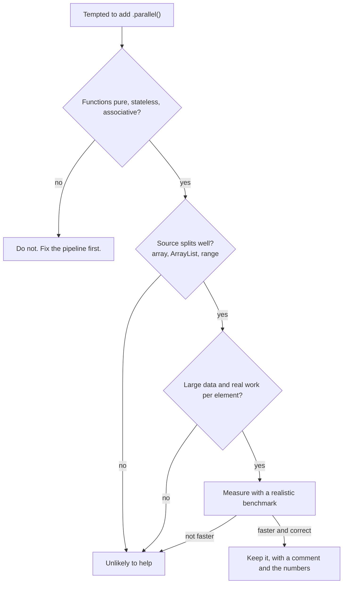

# Streams with judgement: purity, return types and parallelism

> **Before this lesson:** you can build stream pipelines with `filter`, `map`, `collect` and collectors ([The Stream API, collectors and Optional](#/lesson/java/java-streams-optional)), and you know what a race condition is ([Race conditions, synchronization, deadlock and virtual threads](#/lesson/java/java-synchronization)).

## In plain words

A food processor is excellent at chopping a kilo of onions and a poor choice for slicing one lemon; a knife is quicker and gives you more control. A cook who uses the machine for everything is not being modern. They are making extra washing-up.

Streams are the food processor of Java. For transforming, filtering and summarising collections they are clear and concise. Used for everything, they make code harder to read, harder to debug and sometimes wrong. This lesson is about judgement:

1. when a stream helps and when a loop is better;
2. keeping the functions inside a pipeline **pure**, so the pipeline means what it says;
3. what a method should **return**: a collection or a stream;
4. why switching a pipeline to **parallel** is a decision that needs evidence.

Why this matters for a job: every team that adopted streams went through a phase of overusing them. Reviewers now look for balance, and interviewers ask "what is wrong with this stream code?" about side effects and parallel streams.

## Streams or loops?

The same program three ways. Task: group words that are anagrams of each other (same letters, different order) and print the groups with at least two members.

```java
import java.util.*;
import java.util.stream.*;

List<String> words = List.of("stale", "least", "steal", "tea", "eat", "ate", "moon", "slate");

// 1. Loop
Map<String, List<String>> groups = new TreeMap<>();
for (String w : words) {
    char[] letters = w.toCharArray();
    Arrays.sort(letters);
    groups.computeIfAbsent(new String(letters), k -> new ArrayList<>()).add(w);
}
for (List<String> g : groups.values()) {
    if (g.size() >= 2) System.out.println(g.size() + ": " + g);
}
```

```java
// 2. Stream overuse: everything forced into one expression, including the key computation
words.stream().collect(Collectors.groupingBy(w -> w.chars().sorted()
                .collect(StringBuilder::new, (sb, c) -> sb.append((char) c), StringBuilder::append).toString(),
                TreeMap::new, Collectors.toList()))
        .values().stream().filter(g -> g.size() >= 2)
        .forEach(g -> System.out.println(g.size() + ": " + g));
```

```java
// 3. Balanced: a named helper for the fiddly part, a short pipeline for the flow
static String sortedLetters(String word) {
    char[] letters = word.toCharArray();
    Arrays.sort(letters);
    return new String(letters);
}

words.stream()
        .collect(Collectors.groupingBy(w -> sortedLetters(w), TreeMap::new, Collectors.toList()))
        .values().stream()
        .filter(group -> group.size() >= 2)
        .forEach(group -> System.out.println(group.size() + ": " + group));
```

```text
4: [stale, least, steal, slate]
3: [tea, eat, ate]
```

All three print the same. Version 2 is unreadable. Version 3 is the best: the helper method has a name that explains itself, and the pipeline shows the shape of the computation. Two habits carry most of the weight:

- **Extract helper methods.** Lambda bodies have no names; a method does.
- **Name lambda parameters carefully** (`group`, not `g`). With no declared types in sight, names are the reader's main clue.

### What each tool does well

| Streams suit | Loops suit |
|---|---|
| transforming every element in the same way | modifying local variables in the enclosing method |
| filtering | `return`, `break` or `continue` out of the middle |
| combining elements into one result (sum, min, join) | throwing checked exceptions |
| grouping into a map or list by some property | steps that need values from **several** earlier stages at once |
| searching for an element that meets a condition | algorithms that manage indices or neighbours |

That fourth row on the right is a subtle one. Once `map` has replaced an element with something else, the original is gone from the pipeline. If a later stage needs both, the stream version must carry pairs around and becomes clumsy.

A lambda cannot assign to a local variable of the enclosing method, cannot `return` from that method and cannot `break` a loop. If the natural solution needs any of those, write a loop. If you cannot tell which is clearer, write both and pick. Either may be right, and a team's taste varies.

> [!WARNING]
> `"Hello".chars()` returns an `IntStream`, not a stream of characters, so `"Hello".chars().forEach(System.out::print)` prints `72101108108111`. Prefer a loop over `toCharArray()` for character work.

## Keep the functions pure

A stream pipeline is a description of a computation as a sequence of transformations. That model works only if each function you pass depends **only on its argument** and **changes nothing** outside itself. Such a function is **pure**. Anything else it does (writing to a variable, adding to a collection, printing, sending a message) is a **side effect**.

The commonest mistake is using a stream as a disguised loop:

```java
// Wrong: the real work is a side effect inside forEach
Map<String, Long> freq = new HashMap<>();
words.stream().forEach(w -> freq.merge(w.toLowerCase(), 1L, Long::sum));

// Right: the pipeline produces the result
Map<String, Long> freq2 = words.stream()
        .collect(Collectors.groupingBy(String::toLowerCase, Collectors.counting()));
```

The first version uses the stream API and gains nothing from it. It is longer, depends on external mutable state, and breaks if made parallel. The second states the result directly.

**`forEach` is for reporting the result of a pipeline** (printing, logging), not for computing it.

The collectors that replace side effects:

| Goal | Collector |
|---|---|
| gather into a list or set | `toList()`, `Collectors.toSet()`, `toCollection(TreeSet::new)` |
| build a map from keys to values | `toMap(keyFn, valueFn)`; add a merge function if keys can repeat: `toMap(k, v, (a, b) -> a)` |
| group elements | `groupingBy(classifier)`, with a downstream collector for counts, sums, maximums |
| split in two | `partitioningBy(predicate)` |
| join text | `joining(", ")` |
| smallest or largest | `minBy(cmp)`, `maxBy(cmp)` |

```java
record Sale(String region, String rep, int amount) { }

List<Sale> sales = List.of(new Sale("north", "ada", 300), new Sale("south", "bo", 150),
                           new Sale("north", "cy", 500), new Sale("south", "di", 150));

Map<String, Integer> totalByRegion = sales.stream()
        .collect(Collectors.groupingBy(Sale::region, TreeMap::new, Collectors.summingInt(Sale::amount)));

Map<String, String> topRepByRegion = sales.stream()
        .collect(Collectors.toMap(Sale::region, s -> s, BinaryOperator.maxBy(Comparator.comparingInt(Sale::amount)),
                TreeMap::new))
        .entrySet().stream()
        .collect(Collectors.toMap(Map.Entry::getKey, e -> e.getValue().rep(), (a, b) -> a, TreeMap::new));

System.out.println(totalByRegion + " " + topRepByRegion);
```

```text
{north=800, south=300} {north=cy, south=bo}
```

In the south both sales are 150. `BinaryOperator.maxBy` keeps the first of two equal elements, so `bo` wins; the pipeline's answer on ties is a consequence of that choice and worth a comment in real code.

### Why purity matters: a model you can run

The same "pipeline" is run in several orders, as a parallel executor would. With pure functions the answer never changes. With a side effect it does.

```python-run
import itertools

data = [3, 1, 4, 1, 5]

def pure_pipeline(order):
    """map(x -> x * 10) then sum: each element handled independently, results combined."""
    return sum(data[i] * 10 for i in order)

def impure_pipeline(order):
    """A lambda that reads and writes outside state: running index into a shared list."""
    seen = []
    out = []
    for i in order:
        seen.append(data[i])
        out.append(data[i] * len(seen))        # result depends on HOW MANY were processed before
    return sum(out)

orders = list(itertools.permutations(range(len(data))))
pure = {pure_pipeline(o) for o in orders}
impure = {impure_pipeline(o) for o in orders}
print("pure   : results over all", len(orders), "processing orders ->", sorted(pure))
print("impure : results over all", len(orders), "processing orders ->", sorted(impure)[:6], "...",
      len(impure), "different answers")
```

A function with a side effect makes the result depend on the order of processing. Sequential streams happen to process in order, which hides the problem until someone adds `.parallel()`.

## What should a method return: a collection or a stream?

When you write a method that returns a sequence of elements, some callers will want to loop over it and others will want a pipeline.

- A `Stream` **cannot** be used in a for-each loop: `Stream` does not implement `Iterable` (it can be traversed only once).
- A `Collection` supports both: it is `Iterable`, and it has a `stream()` method.

So the default answer: **return a `Collection`** (or a subtype such as `List`) when the elements are already in memory or the sequence is small enough to hold. Every caller is served.

```java
static List<String> activeNames(List<Sale> sales) {          // serves loops and pipelines alike
    return sales.stream().map(Sale::rep).distinct().sorted().toList();
}

for (String name : activeNames(sales)) { /* loop */ }
long n = activeNames(sales).stream().filter(s -> s.length() == 2).count();
```

Return a `Stream` when the sequence is large or expensive to compute and should be produced lazily, such as lines of a huge file, in which case the caller must also close it. If such a sequence can be described without materialising it, a custom `AbstractList` over the underlying data is sometimes possible: a view that computes elements on demand.

If you are handed a stream and need to loop, adapt it: `for (String s : (Iterable<String>) stream::iterator)`. Going the other way: `StreamSupport.stream(iterable.spliterator(), false)`.

Never return `null` for "no elements". Return an empty list or an empty stream.

## Parallel streams: measure, do not hope

Adding `.parallel()` to a pipeline, or calling `parallelStream()`, asks the library to split the data, process the pieces on several threads from the shared **common fork-join pool**, and combine the partial results. It is one word, and it can make a program faster, slower, or wrong.

### It can be wrong

```java
List<Integer> numbers = IntStream.rangeClosed(1, 10_000).boxed().toList();

List<Integer> unsafe = new ArrayList<>();
numbers.parallelStream().forEach(unsafe::add);               // many threads adding to a plain ArrayList
System.out.println(unsafe.size());                            // 9,714 one run; an exception the next

List<Integer> safe = numbers.parallelStream().map(n -> n * 2).toList();
System.out.println(safe.size());
```

```text
9714
10000
```

The first pipeline has a side effect on a collection that is not thread-safe: a race condition. Results vary from run to run and may include `ArrayIndexOutOfBoundsException`. The second lets the collector assemble the result and is always correct.

Rules a parallel pipeline's functions must obey:

- **no side effects** on shared state, and no dependence on mutable state (**stateless**);
- for `reduce`, the combining function must be **associative**: `(a op b) op c` equals `a op (b op c)`. Addition is; subtraction is not.

```java
System.out.println(IntStream.rangeClosed(1, 5).reduce(0, (a, b) -> a - b));
System.out.println(IntStream.rangeClosed(1, 5).parallel().reduce(0, (a, b) -> a - b));   // differs: not associative
```

```text
-15
-3
```

(The second number depends on how the range was split; it is rarely -15.)

### It can be slower

Parallelism has overhead: splitting, thread hand-offs, merging. It pays off only when all of these hold.

| Factor | Good for parallel | Bad for parallel |
|---|---|---|
| **Data source** | `ArrayList`, arrays, `HashMap`, `IntStream.range`: split cheaply and evenly, and sit close together in memory | `LinkedList`, `Stream.iterate`, I/O sources: must be walked to be split |
| **Amount of work** | many elements × meaningful work per element | few elements or trivial work |
| **Terminal operation** | reductions (`sum`, `count`, `min`, `max`, `reduce`), `anyMatch` and friends | `collect` into a `List` or `Map`: merging results is costly |
| **Intermediate operations** | stateless ones | `limit`, `sorted`, `distinct` on ordered streams |
| **Environment** | spare cores, CPU-bound work | a server already using its cores per request; blocking I/O inside the pipeline |

A rough guide: the number of elements multiplied by the lines of work per element should be at least a hundred thousand before parallelism is worth considering.

`Stream.iterate` with `limit` is the notorious trap. The library cannot know where the limit will fall, so a parallel run may compute extra elements and discard them; a pipeline that finished in seconds sequentially may appear to hang.

Remember also that all parallel streams in a JVM share **one** common pool by default. A long-running parallel stream in one request handler slows parallel streams everywhere else in the application.



A case where it shines: counting primes up to a large bound is CPU-bound, has a splittable range source and a cheap reduction.

```java
static long primesUpTo(long n) {
    return LongStream.rangeClosed(2, n)
            .parallel()
            .mapToObj(java.math.BigInteger::valueOf)
            .filter(i -> i.isProbablePrime(50))
            .count();
}
```

On a multi-core machine this runs several times faster than the sequential version. The gain was confirmed by measuring, which is the only acceptable justification.

> [!INTERVIEW]
> "When would you use a parallel stream?" *Rarely, and only after measuring. The pipeline must be free of side effects and its reduction associative; the source should split efficiently (arrays, `ArrayList`, ranges); the workload should be large and CPU-bound; and the application must have idle cores. It is unsuitable for blocking I/O and risky in servers because all parallel streams share the common fork-join pool.* If shown `list.parallelStream().forEach(result::add)`, name the race condition and replace it with `collect` or `toList()`.

## Pitfalls

- **Turning every loop into a stream.**
- **Long multi-line lambdas** instead of named helper methods.
- **Side effects in `map`, `filter` or `forEach`**, especially adding to an outside collection.
- **`toMap` without a merge function** when keys can repeat.
- **Returning a `Stream` from a general-purpose method**, forcing callers who want to loop to adapt it.
- **Using a stream twice.**
- **`parallel()` without a benchmark.**
- **Parallel pipelines with blocking calls**, or with `Stream.iterate` and `limit`.
- **Non-associative accumulators in `reduce`.**
- **`chars()` treated as a stream of characters.**
- **Depending on encounter order after `unordered()` or in `forEach` on a parallel stream**; use `forEachOrdered` if order matters.

## Cheat sheet

| Question | Guideline |
|---|---|
| Stream or loop? | whichever reads better; streams for transform, filter, reduce, group, search |
| Fiddly sub-step in a pipeline | extract a named helper method |
| Collecting results | `toList()` or a collector, never a side effect |
| `forEach` | only to present results |
| Duplicate keys in `toMap` | supply a merge function |
| Method return type for a sequence | `Collection` or `List`; `Stream` only for large or lazy data |
| No results | empty collection or stream, never `null` |
| Parallel? | pure functions + splittable source + heavy CPU work + measured gain |
| Reduction in parallel | associative operator, correct identity |

## Summary

- Streams and loops are both tools; choose the one that makes the code clearer, and mix them freely.
- Keep lambdas short, name parameters well, and move detail into named methods.
- The functions in a pipeline should be pure; produce results with collectors and reserve `forEach` for reporting.
- Return collections from methods so that callers can loop or stream; return streams only when laziness matters.
- Parallel streams require side-effect-free, associative operations, a well-splitting source and substantial CPU work, and must be justified by measurement.

## Glossary

- **Pure function**: a function whose result depends only on its arguments and that changes nothing else.
- **Side effect**: any observable change a function makes outside its return value.
- **Stateless operation**: one whose behaviour does not depend on mutable state or on earlier elements.
- **Collector**: an object that accumulates stream elements into a result.
- **Merge function**: in `toMap`, the rule for combining values with the same key.
- **Downstream collector**: a collector applied to each group produced by `groupingBy`.
- **Encounter order**: the order in which a source presents its elements.
- **Parallel stream**: a stream whose pipeline runs on several threads.
- **Fork-join pool**: the thread pool that executes parallel streams; one common pool is shared across the JVM.
- **Associative**: an operation where grouping does not affect the result.
- **Spliterator**: the object a source uses to split and traverse its elements.
- **Locality of reference**: data being stored close together in memory, which makes processing faster.

## Check yourself

```quiz
[
  {"q": "What is wrong with `list.stream().forEach(x -> result.add(x * 2));`?", "options": ["Nothing", "It uses a side effect to build the result; use map(...).toList() instead", "forEach is deprecated", "It does not compile"], "answer": 1,
   "explain": "The pipeline should produce the result. Side effects are unclear and unsafe if the stream is made parallel."},
  {"q": "Does this compile? `Stream<String> s = Stream.of(\"a\"); for (String x : s) { }`", "options": ["Yes", "No: Stream does not implement Iterable", "Yes, once only", "Only for parallel streams"], "answer": 1,
   "explain": "for-each needs an Iterable or an array. Adapt with (Iterable<String>) s::iterator, or return a collection."},
  {"q": "What does `\"Hi\".chars().forEach(System.out::print);` print?", "options": ["Hi", "72105", "H i", "It does not compile"], "answer": 1,
   "explain": "chars() is an IntStream of character codes: 72 for H and 105 for i."},
  {"q": "What happens? `Stream.of(\"a\", \"bb\", \"cc\").collect(Collectors.toMap(String::length, s -> s))`", "options": ["{1=a, 2=bb}", "{1=a, 2=cc}", "IllegalStateException: duplicate key", "{1=a, 2=[bb, cc]}"], "answer": 2,
   "explain": "Two elements map to key 2 and no merge function was given."},
  {"q": "Which source is best suited to parallel processing?", "options": ["LinkedList", "Stream.iterate(...)", "ArrayList or an array", "BufferedReader.lines()"], "answer": 2,
   "explain": "Arrays and array-backed lists split cheaply into equal halves and have good memory locality."},
  {"q": "Why can `reduce(0, (a, b) -> a - b)` give different answers in parallel?", "options": ["Subtraction overflows", "Subtraction is not associative, so the result depends on how the data is split", "reduce is not thread-safe", "The identity is wrong for addition"], "answer": 1,
   "explain": "Parallel reduction regroups the operands, which is valid only for associative operations."},
  {"q": "A utility method produces a small in-memory list of results. What should its return type be?", "options": ["Stream<T>", "List<T> (a Collection)", "Iterator<T>", "Object[]"], "answer": 1,
   "explain": "A collection can be looped over and streamed, serving every caller."},
  {"q": "Which task is better written as a loop than as a stream?", "options": ["Summing a field over a list", "Filtering then mapping a list", "Scanning until a condition and then returning early while updating two local counters", "Grouping records by a key"], "answer": 2,
   "explain": "Lambdas cannot modify enclosing local variables or return from the enclosing method."}
]
```

> **Source:** Effective Java 3e, item group "Lambdas and streams" (judicious use of streams, side-effect-free functions, returning Collection in preference to Stream, caution with parallel streams); ideas restated with original examples. Checked against https://docs.oracle.com/en/java/javase/21/docs/api/java.base/java/util/stream/package-summary.html (sections on side effects, statelessness, associativity and parallelism) and https://docs.oracle.com/en/java/javase/21/docs/api/java.base/java/util/stream/Collectors.html .
