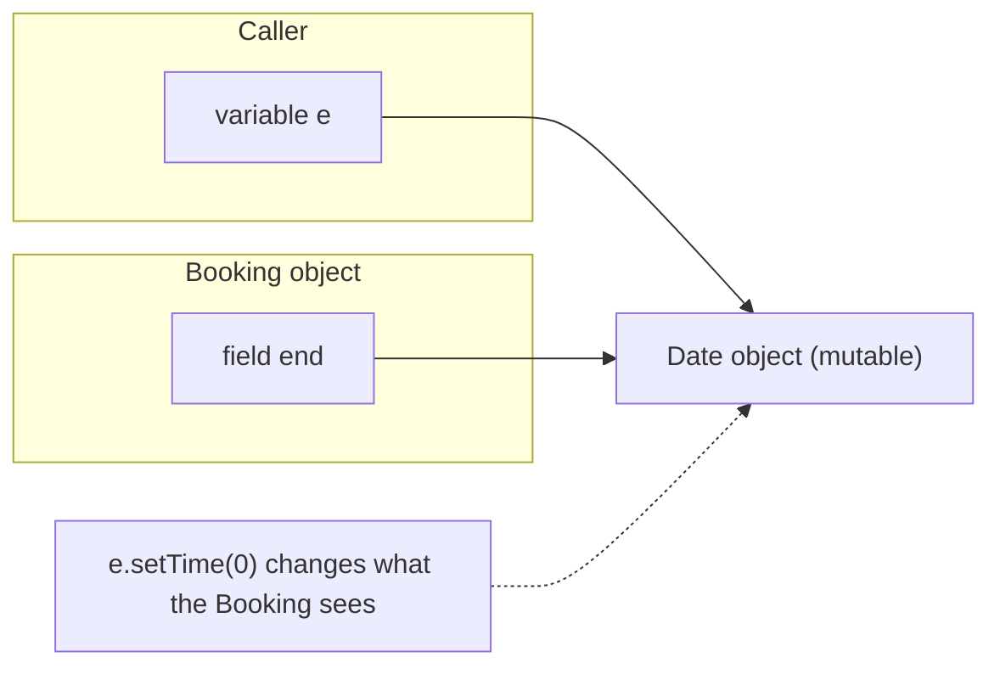

# Parameter checks, defensive copies, signatures and overloading

> **Before this lesson:** you know pass-by-value with references ([Methods, parameters, return values and pass-by-value](#/lesson/java/java-methods-pass-by-value)), exceptions ([Exceptions: try, catch, finally, checked and unchecked](#/lesson/java/java-exceptions-basics)), immutability ([Minimal accessibility and immutable classes](#/lesson/java/java-ej-accessibility-immutability)) and how overloads are chosen at compile time ([Polymorphism, overriding and overloading](#/lesson/java/java-polymorphism)).

## In plain words

A good receptionist does three things. They check who you are **at the door**, not after you have wandered into the server room. They never hand a visitor the building's only master key; they hand over a **copy** that can be cancelled. And the forms they give you are short and clear, so you cannot easily tick the wrong box.

A well-designed method treats its callers the same way:

1. **check the arguments at the start**, and fail with a clear message;
2. **never let outside code hold a reference to your internal mutable objects**: copy what comes in and what goes out;
3. **design the signature** so that correct calls are easy and incorrect ones do not compile;
4. **use overloading sparingly**, because which overload runs can surprise everyone.

Why this matters for a job: these rules decide whether a bug is found in seconds at the faulty call or in days somewhere far away. "What is a defensive copy?" and "what does this overloaded call print?" are regular interview questions.

## 1. Check parameters for validity

Most methods have restrictions on what they accept: an index must not be negative, an object must not be null, a rate must lie between 0 and 1. If a bad value gets in unchecked, three things can happen, each worse than the last:

- the method fails partway through with a confusing exception from deep inside;
- the method returns a wrong result without complaint;
- the method stores the bad value, and some unrelated code fails much later.

Checking at the top makes the method **fail fast**: stop immediately, at the place where the mistake was made, with a message that names it.

```java
import java.util.Objects;

public final class Loan {
    private final String borrower;
    private final long pence;
    private final double annualRate;

    public Loan(String borrower, long pence, double annualRate) {
        this.borrower = Objects.requireNonNull(borrower, "borrower");
        if (pence <= 0) {
            throw new IllegalArgumentException("pence must be positive: " + pence);
        }
        if (annualRate < 0 || annualRate > 1) {
            throw new IllegalArgumentException("annualRate must be between 0 and 1: " + annualRate);
        }
        this.pence = pence;
        this.annualRate = annualRate;
    }
}
```

```java
new Loan("Noor", 50_000, 7.5);          // the caller meant 0.075
```

```text
Exception in thread "main" java.lang.IllegalArgumentException: annualRate must be between 0 and 1: 7.5
```

The standard exceptions for argument problems:

| Situation | Throw |
|---|---|
| argument is `null` where that is not allowed | `NullPointerException` (via `Objects.requireNonNull`) |
| argument value is out of the acceptable set | `IllegalArgumentException` |
| index out of range | `IndexOutOfBoundsException` (via `Objects.checkIndex(i, length)`) |
| the object is in the wrong state for this call | `IllegalStateException` |

Useful helpers: `Objects.requireNonNull(x, "name")` returns `x`, so it can be used inline in an assignment; `Objects.checkIndex`, `checkFromToIndex` and `checkFromIndexSize` (Java 9) validate positions.

Guidelines:

- **Document the restrictions** in the method's Javadoc with `@throws`, so callers know the rules without reading the body.
- **Constructors need checks most of all.** A value stored by a constructor may not be used until long afterwards, when the cause will be hard to trace.
- For **non-public** methods, where you control every caller, an **assertion** documents and checks an assumption: `assert offset >= 0 : offset;`. Assertions run only when the JVM is started with `-ea`, so they cost nothing in production. Never use them for arguments of public methods.
- Skip an explicit check when it would be expensive and the computation performs it anyway. `Collections.sort` does not first verify that all elements are mutually comparable; the sort will throw `ClassCastException` if they are not.
- Do not go too far. Restrictions are a burden on callers; accept every value that the method can reasonably handle.

## 2. Make defensive copies

Java is a safe language: no buffer overruns, no dangling pointers. Yet a class can still be corrupted from outside if it shares its mutable internals. **Assume that the clients of your class will try, deliberately or carelessly, to break its invariants.**

```java
import java.util.Date;

public final class Booking {
    private final Date start;
    private final Date end;

    public Booking(Date start, Date end) {
        if (start.compareTo(end) > 0) {
            throw new IllegalArgumentException(start + " is after " + end);
        }
        this.start = start;                     // stores the caller's object
        this.end = end;
    }

    public Date start() { return start; }       // hands out the internal object
    public Date end()   { return end; }
}
```

The class is `final`, the fields are `private final`, and the constructor enforces "start is not after end". It can be broken twice over, because `java.util.Date` is mutable.

```java
Date s = new Date(1_000_000L);
Date e = new Date(2_000_000L);
Booking b = new Booking(s, e);

e.setTime(0);                                    // attack 1: change the object we passed in
System.out.println(b.start().after(b.end()));

b.start().setTime(9_000_000_000L);               // attack 2: change the object the getter returned
System.out.println(b.start().getTime());
```

```text
true
9000000000
```



### The fix

```java
public Booking(Date start, Date end) {
    this.start = new Date(start.getTime());     // 1. copy FIRST
    this.end = new Date(end.getTime());
    if (this.start.compareTo(this.end) > 0) {   // 2. then validate the COPIES
        throw new IllegalArgumentException(this.start + " is after " + this.end);
    }
}

public Date start() { return new Date(start.getTime()); }    // 3. return copies
public Date end()   { return new Date(end.getTime()); }
```

Three details, each of which matters:

- **Copy before checking, and check the copies.** If you validated the originals and then copied, another thread could change an original in the gap between the check and the copy. That gap is known as a **time-of-check to time-of-use** (TOCTOU) vulnerability.
- **Do not use `clone()` on a parameter whose class can be subclassed by untrusted code.** `Date` is not final; a malicious subclass could override `clone` to keep a reference to every copy. Use a constructor or static factory to make the copy. In the getters, cloning our own field is safe, because we know its exact class.
- **Copy on the way out as well as on the way in.**

### The better fix: do not hold mutable parts

```java
import java.time.Instant;

public record Booking(Instant start, Instant end) {
    public Booking {
        if (start.isAfter(end)) {
            throw new IllegalArgumentException(start + " is after " + end);
        }
    }
}
```

`Instant` is immutable. There is nothing to copy and nothing to attack. **Prefer immutable components**; defensive copying is what you fall back on when you cannot.

### Where the rule applies

| Situation | Action |
|---|---|
| storing a caller's array, `List`, `Map`, `Date` or other mutable object in a field | copy it in: `arr.clone()`, `List.copyOf(list)`, `new Date(d.getTime())` |
| returning an internal mutable object from a getter | return a copy or an unmodifiable view |
| a caller's object used as a key in your internal `Map` or element of a `Set` | copy it, or its later modification corrupts the collection |
| the parameter or return type is immutable (`String`, `Integer`, `LocalDate`, a record of immutables) | nothing needed |
| a deliberate hand-over: the documentation says the caller gives up the object, or the class and its only client are in one package | a copy may be skipped; say so in the documentation |

A non-empty array is **always** mutable. Never return an internal array from a public method.

### A leak detector you can run

```python-run
class Booking:
    def __init__(self, days, defensive):
        self.defensive = defensive
        self._days = list(days) if defensive else days     # copy in, or keep the caller's list

    def days(self):
        return list(self._days) if self.defensive else self._days   # copy out, or expose

def audit(defensive):
    source = [1, 2, 3]
    b = Booking(source, defensive)
    findings = []
    source.append(99)                              # attack 1: mutate the argument after the call
    if 99 in b._days:
        findings.append("constructor stored the caller's list (no copy in)")
    b.days().append(-1)                            # attack 2: mutate what the getter returned
    if -1 in b._days:
        findings.append("getter exposed the internal list (no copy out)")
    return findings or ["no leaks"], b._days

for flag in (False, True):
    findings, internal = audit(flag)
    print(f"defensive={flag}: internal state {internal}")
    for f in findings:
        print("   -", f)
```

## 3. Design method signatures carefully

**Choose names carefully.** Follow the conventions of your code base and of the JDK. A caller should be able to guess `size`, `isEmpty`, `add`, `remove`, `contains`. Consistency beats cleverness.

**Do not provide too many convenience methods.** Every method must be learned, documented, tested and maintained. Provide a shortcut only when it will be used often. When in doubt, leave it out; a method is easy to add later and nearly impossible to remove.

**Keep parameter lists short: four at most.** Long lists are unusable, and **several adjacent parameters of the same type are dangerous**, because swapping two of them compiles.

```java
// Which is width, which is height, which pair is the position?
drawBox(40, 12, 3, 7, true, false);
```

Three ways to shorten a list:

1. **Split the method** into several that each take a subset. `List` has no "index of an element within a sub-range" method; you combine `subList(from, to)` with `indexOf(x)`.
2. **Introduce a helper class** for parameters that always travel together. A `(int x, int y)` pair becomes a `Point`; a `(String rank, String suit)` pair becomes a `Card`.
3. **Use a builder** when many parameters are optional.

**For parameter types, prefer interfaces to classes.** `void store(Map<String, Integer> prices)` accepts a `HashMap`, a `TreeMap` or an unmodifiable map. Declaring `HashMap` restricts callers for no benefit and may force them to copy their data.

**Prefer two-element enums to `boolean` parameters**, unless the meaning is obvious from the method name.

```java
enum Scale { CELSIUS, FAHRENHEIT }
enum Rounding { EXACT, NEAREST_DEGREE }

static String label(double degrees, Scale scale, Rounding rounding) {
    double shown = rounding == Rounding.NEAREST_DEGREE ? Math.round(degrees) : degrees;
    return shown + (scale == Scale.CELSIUS ? " C" : " F");
}

System.out.println(label(21.6, Scale.CELSIUS, Rounding.NEAREST_DEGREE));
// compare: label(21.6, true, false)   <- what do the booleans mean?
```

```text
22.0 C
```

The enum version reads without opening the documentation, cannot have its arguments swapped by accident, and can grow a third value (`KELVIN`) without changing the signature.

## 4. Use overloading judiciously

Which of several **overloads** runs is decided at **compile time**, from the declared types of the arguments. Which **override** runs is decided at **run time**, from the object's actual class. Confusing the two produces a classic wrong answer.

```java
import java.util.*;

public class Classifier {
    static String kind(Set<?> s)        { return "Set"; }
    static String kind(List<?> l)       { return "List"; }
    static String kind(Collection<?> c) { return "Unknown collection"; }

    public static void main(String[] args) {
        Collection<?>[] items = { new HashSet<String>(), new ArrayList<Integer>(), new HashMap<String, String>().values() };
        for (Collection<?> c : items) {
            System.out.println(kind(c));
        }
    }
}
```

```text
Unknown collection
Unknown collection
Unknown collection
```

Inside the loop the declared type of `c` is `Collection<?>` on every pass, so the compiler bound all three calls to `kind(Collection<?>)` before the program ran. The run-time types are irrelevant. The fix is one method with explicit tests:

```java
static String kind(Collection<?> c) {
    return c instanceof Set ? "Set" : c instanceof List ? "List" : "Unknown collection";
}
```

### Autoboxing makes it worse

```java
Set<Integer> set = new TreeSet<>();
List<Integer> list = new ArrayList<>();
for (int i = -3; i < 3; i++) {
    set.add(i);
    list.add(i);
}
for (int i = 0; i < 3; i++) {
    set.remove(i);            // Set has only remove(Object): i is boxed; removes the VALUE i
    list.remove(i);           // List has remove(int index) AND remove(Object): picks remove(int)
}
System.out.println(set + " " + list);
```

```text
[-3, -2, -1] [-2, 0, 2]
```

The same line, written for a set and a list, does different things. `list.remove(i)` removed the elements at **positions** 0, 1 and 2 of a shrinking list. To remove values, write `list.remove(Integer.valueOf(i))`. This overload pair predates autoboxing and is acknowledged as an unfortunate legacy.

### Safe overloading policy

- **Never export two overloads with the same number of parameters.** Give the methods different names instead. `ObjectOutputStream` has `writeInt`, `writeLong` and `writeBoolean`, not three overloads of `write`.
- For varargs methods, do not overload at all.
- Constructors cannot be renamed; use **static factory methods** with distinct names.
- Overloads with the same number of parameters are tolerable when at least one corresponding pair of parameter types is **radically different**, meaning no value could be cast to both (`int` versus `String`).
- If overloads must accept related types, make them **behave identically** on the same input, typically by having the more specific forward to the more general.
- Do not overload a method to take different **functional interfaces** in the same position (`submit(Runnable)` and `submit(Callable)`); lambdas make such calls ambiguous.

> [!INTERVIEW]
> "What is a defensive copy, and when do you need one?" *A copy of a mutable object made so that outside code cannot hold a reference to an object's internal state. Needed when a constructor or setter stores a mutable argument and when a getter returns a mutable field. Copy before validating, validate the copy, and avoid `clone` for arguments of non-final types. Immutable types need no copying, which is the best argument for using them.* "Overloading versus overriding resolution?" Overloads are chosen at compile time by static argument types; overrides at run time by the receiver's dynamic type.

## Pitfalls

- **No validation**, so bad values surface far from their origin.
- **Validating after storing**, or validating the original and then copying.
- **Vague messages** that do not include the offending value.
- **Using `assert` for arguments of public methods.**
- **Storing or returning mutable arguments and fields without copies.**
- **`clone()` on arguments of non-final types.**
- **Long parameter lists**, especially runs of the same type, and `boolean` flags.
- **Concrete classes as parameter types.**
- **Overloads with the same arity and convertible types.**
- **Expecting overloads to be chosen by run-time type.**
- **`list.remove(int)` when the value was meant.**

## Cheat sheet

| Goal | Code |
|---|---|
| Reject null | `this.x = Objects.requireNonNull(x, "x");` |
| Reject a bad value | `throw new IllegalArgumentException("rate must be 0..1: " + rate);` |
| Check an index | `Objects.checkIndex(i, size);` |
| Wrong object state | `throw new IllegalStateException(...)` |
| Internal assumption | `assert n >= 0 : n;` |
| Copy a list in | `List.copyOf(list)` |
| Copy an array in or out | `arr.clone()` |
| Hand out a collection | an unmodifiable view or a copy |
| Too many parameters | helper class, builder, or split the method |
| A yes/no parameter | a two-value enum |
| Similar operations on different types | different method names, not overloads |

## Summary

- Validate parameters at the top of public methods and constructors, throw the standard exception with the bad value in the message, and document the rules.
- Copy mutable arguments before validating and storing them, and return copies of mutable fields; better, build classes from immutable parts.
- Keep signatures short and self-explanatory: good names, few parameters, interface types, enums instead of booleans.
- Overload resolution happens at compile time. Avoid overloads with the same number of parameters; prefer distinct names.

## Glossary

- **Precondition**: a condition that must hold when a method is called.
- **Fail fast**: detecting and reporting an error at the earliest possible moment.
- **Assertion**: an `assert` statement checking an internal assumption, active only when enabled.
- **Defensive copy**: a copy that prevents outside code from sharing internal mutable state.
- **Invariant**: a condition an object guarantees throughout its life.
- **TOCTOU**: time-of-check to time-of-use; a window between validating data and using it in which the data can change.
- **Unmodifiable view**: a wrapper through which a collection cannot be modified.
- **Signature**: a method's name and parameter types.
- **Arity**: the number of parameters a method takes.
- **Overloading**: several methods with one name and different parameter lists, chosen at compile time.
- **Helper class**: a small class that groups related parameters.

## Check yourself

```quiz
[
  {"q": "Why should a constructor validate its arguments immediately?", "options": ["It is required by the compiler", "A bad value stored now may cause a failure much later, far from the cause", "To make the object smaller", "So the fields can be public"], "answer": 1,
   "explain": "Failing fast at the point of the mistake makes it trivial to diagnose."},
  {"q": "Which exception should `Objects.requireNonNull(x)` throw for a null argument?", "options": ["IllegalArgumentException", "NullPointerException", "IllegalStateException", "RuntimeException"], "answer": 1,
   "explain": "By convention a forbidden null is reported with NullPointerException."},
  {"q": "A class stores `this.items = items;` where items is a List passed to the constructor, and has no setters. Is the object safe from outside changes?", "options": ["Yes, there are no setters", "No: the caller still holds the same list and can modify it", "Yes, if the field is final", "Yes, if the class is final"], "answer": 1,
   "explain": "final freezes the reference, not the list. Store List.copyOf(items)."},
  {"q": "In a defensive constructor, what is the correct order?", "options": ["Validate the arguments, then copy", "Copy the arguments, then validate the copies", "Store, then validate", "Order does not matter"], "answer": 1,
   "explain": "Validating the originals leaves a window in which another thread can change them before the copy is taken."},
  {"q": "What does this print? `static void p(Object o) { System.out.print(\"O\"); } static void p(String s) { System.out.print(\"S\"); }` then `Object x = \"hi\"; p(x); p(\"hi\");`", "options": ["SS", "OS", "OO", "SO"], "answer": 1,
   "explain": "Overloads are selected by the declared type of the argument: Object for x, String for the literal."},
  {"q": "What does this print? `List<Integer> xs = new ArrayList<>(List.of(10, 20, 30)); xs.remove(1); System.out.println(xs);`", "options": ["[10, 30]", "[20, 30]", "[10, 20, 30]", "[10, 20]"], "answer": 0,
   "explain": "The int literal selects remove(int index), which removes the element at index 1 (the value 20)."},
  {"q": "Which signature is the safest and clearest?", "options": ["void ship(String a, String b, String c, boolean d, boolean e)", "void ship(Address from, Address to, Speed speed)", "void ship(Object... args)", "void ship(HashMap<String,String> options)"], "answer": 1,
   "explain": "Helper types and enums make wrong argument order a compile error and the call self-describing."},
  {"q": "Does a getter returning a `String` field need a defensive copy?", "options": ["Yes, always", "No: String is immutable", "Only if the field is not final", "Only in multithreaded code"], "answer": 1,
   "explain": "Immutable objects can be shared freely."}
]
```

> **Source:** Effective Java 3e, item group "Methods" (checking parameters for validity, defensive copies, designing method signatures, judicious overloading); ideas restated with original examples. Checked against https://docs.oracle.com/en/java/javase/21/docs/api/java.base/java/util/Objects.html and https://docs.oracle.com/en/java/javase/21/docs/api/java.base/java/util/List.html#remove(int) .
