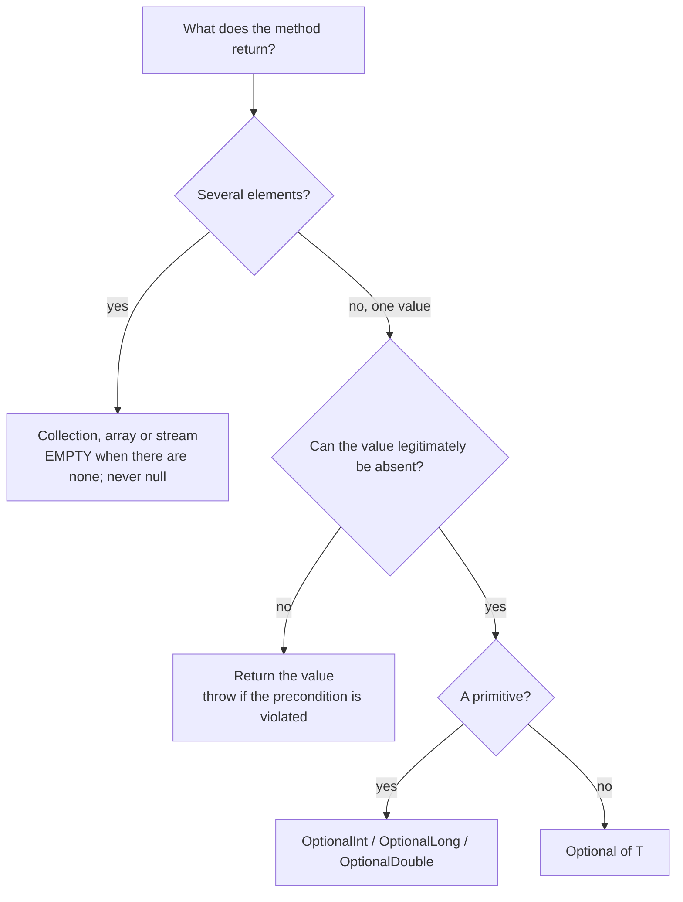

# Varargs, empty collections, Optional returns and documentation

> **Before this lesson:** you know method signatures and overloading ([Parameter checks, defensive copies, signatures and overloading](#/lesson/java/java-ej-params-defensive)), `Optional` and streams ([The Stream API, collectors and Optional](#/lesson/java/java-streams-optional)), and exceptions ([Exceptions: try, catch, finally, checked and unchecked](#/lesson/java/java-exceptions-basics)).

## In plain words

Ask a shop assistant "do you have these shoes in a size 9?" and consider three possible replies when the answer is no.

- A blank stare. You have to work out for yourself that it means no, and if you carry on as though you had been handed a box, you fall over.
- "Sorry, none in stock." Clear, and you can carry on.
- For a different question, "which sizes do you have?", the right reply to "none" is an **empty list**, not silence.

A method's **return value** is its reply. This lesson is about replying well when there is nothing to give: an empty collection for "no items", and an `Optional` for "no single result". It also covers a flexible way to accept inputs (**varargs**) and the written contract that tells callers what to expect (**documentation comments**).

Why this matters for a job: `NullPointerException` is the most common run-time failure in Java, and most of them come from methods that return `null` to mean "nothing". Interviewers ask "why not return null?", "when should you use Optional?" and "how do you document a public method?".

## Varargs: use them carefully

A **varargs** parameter, written `Type... name`, accepts zero or more arguments of that type. Inside the method it is an array.

```java
static int sum(int... numbers) {
    int total = 0;
    for (int n : numbers) {
        total += n;
    }
    return total;
}

System.out.println(sum() + " " + sum(5) + " " + sum(1, 2, 3) + " " + sum(new int[] {4, 6}));
```

```text
0 5 6 10
```

Each call creates an array, fills it with the arguments and passes it. An existing array may be passed directly. Rules: one varargs parameter per method, and it must come last.

### Requiring at least one argument

Suppose a method needs one or more values, such as `min`. Checking at run time is poor design:

```java
static int minBad(int... values) {
    if (values.length == 0) {
        throw new IllegalArgumentException("need at least one value");     // found only when run
    }
    int m = values[0];
    for (int i = 1; i < values.length; i++) {
        m = Math.min(m, values[i]);
    }
    return m;
}
```

`minBad()` compiles and fails at run time. Declare the required argument separately, and the compiler enforces it:

```java
static int min(int first, int... rest) {
    int m = first;
    for (int v : rest) {
        m = Math.min(m, v);
    }
    return m;
}

System.out.println(min(7) + " " + min(7, 3, 9));
// min();                    // does not compile
```

```text
7 3
```

### Cost and traps

- **Every call allocates an array.** In performance-critical code where most calls pass few arguments, provide fixed overloads for the common counts and one varargs method for the rest. `List.of` has overloads for zero to ten elements and a varargs version beyond that.
- **`null` is ambiguous.** `sum(null)` passes a null **array**, not an array containing null; the loop then throws `NullPointerException`.
- **Arrays of primitives do not spread.** `Arrays.asList(new int[] {1, 2, 3})` produces a list with **one** element (the array itself), because `int[]` is a single object for a `T...` of object types. Use `IntStream.of(...)` or an `Integer[]`.
- **Generic varargs** raise heap-pollution warnings; see [Bounded wildcards, PECS, varargs and heterogeneous containers](#/lesson/java/java-ej-pecs).

Use varargs when the number of arguments is truly variable, as in `String.format` and `List.of`. Do not retrofit every method that happens to end in an array parameter.

## Return empty collections or arrays, not null

```java
import java.util.ArrayList;
import java.util.List;

class Pantry {
    private final List<String> cheeses = new ArrayList<>();

    /** Returns the cheeses in stock, or null if there are none. */
    List<String> cheesesOrNull() {
        return cheeses.isEmpty() ? null : new ArrayList<>(cheeses);
    }
}
```

Every caller must now remember a special case:

```java
List<String> found = pantry.cheesesOrNull();
if (found != null && found.contains("brie")) {          // forget "found != null" and it crashes
    System.out.println("Brie is available");
}
for (String c : pantry.cheesesOrNull()) { }             // NullPointerException when the pantry is empty
```

The caller who forgets may not find out for months, because the code only fails on the day the collection happens to be empty. Returning an empty collection removes the special case entirely:

```java
List<String> cheeses() {
    return List.copyOf(cheeses);        // an empty, immutable list when there are none
}

for (String c : pantry.cheeses()) { }   // zero passes; no check needed
System.out.println(pantry.cheeses().contains("brie") + " " + pantry.cheeses().size());
```

```text
false 0
```

"But creating an empty collection is wasteful." It is not: `List.of()`, `Collections.emptyList()`, `Set.of()` and `Map.of()` each return one shared immutable instance, and `List.copyOf` of an empty list returns that same instance. For arrays, return a zero-length array, and share one constant if you wish:

```java
private static final String[] NO_CHEESES = new String[0];

String[] cheeseArray() {
    return cheeses.toArray(NO_CHEESES);      // returns NO_CHEESES itself when the list is empty
}
```

The rule has no exceptions: **never return `null` in place of an empty collection or array.** The same applies to streams (`Stream.empty()`) and strings where an empty string is a sensible "nothing".

## Return Optional judiciously

A collection has a natural "nothing": the empty one. A method that returns a **single** value does not. When there may be no result, you have three choices.

| Choice | Problem |
|---|---|
| return `null` | callers forget to check; the failure appears later and elsewhere |
| throw an exception | exceptions are costly and should signal abnormal situations, not an ordinary "not found" |
| return `Optional<T>` | the possibility of absence is written in the type; the caller must deal with it |

```java
import java.util.Collection;
import java.util.Optional;

static <E extends Comparable<E>> Optional<E> max(Collection<E> items) {
    if (items.isEmpty()) {
        return Optional.empty();
    }
    E best = null;
    for (E e : items) {
        if (best == null || e.compareTo(best) > 0) {
            best = e;
        }
    }
    return Optional.of(best);
}
```

```java
List<String> words = List.of("fig", "plum", "kiwi");
List<String> none = List.of();

String a = max(words).orElse("(no words)");                      // a default
String b = max(none).orElse("(no words)");
int length = max(words).map(String::length).orElse(0);           // transform if present
max(none).ifPresent(w -> System.out.println("never printed"));   // act only if present
System.out.println(a + " " + b + " " + length + " " + max(none).isEmpty());
// String c = max(none).orElseThrow();                           // NoSuchElementException
```

```text
plum (no words) 4 true
```

An `Optional` is in spirit like a checked exception: it forces the caller to face the fact that there may be no value, but without the cost and clumsiness of exceptions.

### How callers should consume one

| Intent | Method |
|---|---|
| use a default | `orElse(value)` |
| compute a default only if needed | `orElseGet(() -> expensive())` |
| it must be there; fail otherwise | `orElseThrow()` or `orElseThrow(() -> new MyException(...))` |
| do something if present | `ifPresent(x -> ...)`, `ifPresentOrElse(x -> ..., () -> ...)` |
| transform | `map`, `flatMap`, `filter` |
| turn into a stream of zero or one element | `stream()` |

`orElse(expensive())` evaluates its argument **every time**, even when the optional has a value. Use `orElseGet` with a supplier for anything costly.

### Rules for returning Optional

1. **Never return `null` from a method whose return type is `Optional`.** It defeats the whole purpose.
2. **Do not wrap container types.** Return an empty `List`, not `Optional<List<T>>`. That applies to collections, maps, streams, arrays and optionals themselves.
3. **Do not return `Optional<Integer>`, `Optional<Long>` or `Optional<Double>`.** Use `OptionalInt`, `OptionalLong` and `OptionalDouble`, which avoid double boxing.
4. **Avoid `Optional` for fields, method parameters, map values and collection elements.** It complicates more than it helps there. A getter may return `Optional<T>` for a field that is legitimately absent.
5. **Not in performance-critical inner loops.** An `Optional` is an extra object per call.
6. Use it when a caller **must** take special action if there is no result. If "absent" is impossible in correct use, throw instead.



### An Optional chain you can run

The model implements `map`, `filter`, `flat_map` and `or_else` on a value-or-nothing container, to show that an empty optional flows through a chain untouched.

```python-run
class Opt:
    def __init__(self, value=None, present=False):
        self.value, self.present = value, present
    @staticmethod
    def of(v):          return Opt(v, True)
    @staticmethod
    def empty():        return Opt()
    @staticmethod
    def of_nullable(v): return Opt.empty() if v is None else Opt.of(v)
    def map(self, f):       return Opt.of_nullable(f(self.value)) if self.present else self
    def filter(self, p):    return self if self.present and p(self.value) else Opt.empty()
    def flat_map(self, f):  return f(self.value) if self.present else self
    def or_else(self, d):   return self.value if self.present else d
    def __repr__(self):     return f"Optional[{self.value}]" if self.present else "Optional.empty"

users = {"ada": {"email": "ada@example.org", "manager": "bo"},
         "bo":  {"email": None,              "manager": None}}

def find(name):   return Opt.of_nullable(users.get(name))

def managers_email_domain(name):
    return (find(name)
            .map(lambda u: u["manager"])            # may be None -> becomes empty
            .flat_map(find)                         # look the manager up: itself an Optional
            .map(lambda m: m["email"])
            .filter(lambda e: "@" in e)
            .map(lambda e: e.split("@")[1])
            .or_else("unknown"))

for who in ("ada", "bo", "nobody"):
    print(f"{who:7} -> {managers_email_domain(who)}")
print(find("ada").map(lambda u: u["email"]), find("zed"))
```

Each of the three lookups ends in "unknown" for a different reason (the manager has no email; there is no manager; there is no such user), and not one `if` was needed.

## Write doc comments for everything you export

An API nobody can understand is an API nobody can use correctly. **Javadoc** is the tool that turns specially formatted comments into the HTML documentation you read for the JDK. A **doc comment** begins with `/**` and sits directly before the declaration it describes.

```java
/**
 * Returns the largest element of the given collection, according to the
 * elements' natural ordering.
 *
 * <p>If several elements are equally large, the one encountered first is returned.
 * This method runs in time proportional to the size of the collection.
 *
 * @param items the collection to search; must not be {@code null} and must not
 *              contain {@code null} elements
 * @param <E>   the type of the elements
 * @return an {@code Optional} holding the largest element, or an empty
 *         {@code Optional} if {@code items} is empty
 * @throws NullPointerException if {@code items} or any of its elements is {@code null}
 */
public static <E extends Comparable<E>> Optional<E> max(Collection<E> items) { ... }
```

What a doc comment for a method must cover is its **contract**: what the method does for the caller, not how it does it.

| Element | Content |
|---|---|
| **Summary sentence** | the first sentence, ending at the first full stop followed by a space; it appears in index tables. A verb phrase: "Returns the ...", "Removes all ...". For a class or field, a noun phrase: "A mutable sequence of characters." |
| **Preconditions** | what must be true before the call; usually expressed by `@throws` for unchecked exceptions and by `@param` text |
| **Postconditions** | what is true after the call completes |
| **Side effects** | any observable change, such as starting a thread or writing a file |
| `@param` | one per parameter (and per type parameter, as `@param <E>`): a noun phrase |
| `@return` | a noun phrase describing the value; may be omitted if identical to the summary |
| `@throws` | one per exception, checked or unchecked, with the condition: "if the index is out of range" |

Tags worth knowing:

- `{@code text}` shows code font and stops HTML interpretation. Use it for every identifier and snippet.
- `{@literal a < b}` shows special characters as they are.
- `{@link Type#method}` creates a hyperlink.
- `@implSpec` describes behaviour that subclasses can rely on when overriding.
- `{@inheritDoc}` reuses the supertype's text.
- `@since`, `@deprecated`, `@see`.

Document as well:

- **every exported class, interface, constructor, method and field**; add comments to non-exported ones wherever maintainers would be helped;
- for a **class**: whether it is immutable, and its **thread safety**;
- for a **generic type or method**: every type parameter;
- for an **enum**: each constant; for an **annotation type**: each element;
- for a **package or module**: a `package-info.java` or the module declaration.

No two members of one class should have the same summary sentence, and overloads need particular care to say how they differ. Comments must be kept accurate: an out-of-date comment is worse than none. Run `javadoc` with its checks enabled (`-Xdoclint`) in the build to catch missing or malformed tags.

> [!TIP]
> A good test of a doc comment: could a competent developer use the method correctly having read **only** the comment and the signature, without opening the source? If not, something the caller needs to know is missing.

> [!INTERVIEW]
> "Why is returning `null` for 'no results' a bad idea?" Every caller needs a null check that the compiler cannot enforce, the failure appears only when the result is empty, and it shows up as a `NullPointerException` away from the cause. Return an empty collection for multi-valued results and `Optional` for single values. "Where should `Optional` not be used?" As a field type, parameter type, collection element, map value, or wrapped round a collection; and never return `null` in its place. "What is the difference between `orElse` and `orElseGet`?" `orElse` evaluates its argument eagerly; `orElseGet` calls its supplier only when the value is absent.

## Pitfalls

- **A varargs method that needs at least one argument** but checks for it at run time.
- **Varargs in hot paths** without fixed-arity overloads.
- **`Arrays.asList(intArray)`**, yielding a one-element list.
- **Returning `null` instead of an empty collection, array, stream or string.**
- **`Optional.get()` without checking.** Prefer `orElseThrow()`, which states the intent.
- **Returning `null` from an `Optional`-returning method.**
- **`Optional<List<T>>`**, and `Optional<Integer>` where `OptionalInt` exists.
- **`Optional` as a field or parameter type.**
- **`orElse(costlyCall())`.**
- **`isPresent()` followed by `get()`** where `map`, `ifPresent` or `orElse` says it in one step.
- **Doc comments that repeat the method name** ("Gets the name.") and omit preconditions, exceptions and side effects.
- **Stale comments.**

## Cheat sheet

| Situation | Do |
|---|---|
| Zero or more arguments | `void log(String... parts)` |
| One or more arguments | `int min(int first, int... rest)` |
| No elements to return | `List.of()`, `Collections.emptyList()`, `new T[0]`, `Stream.empty()` |
| Possibly no single result | `Optional<T>`; primitives: `OptionalInt` etc. |
| Create an optional | `Optional.of(x)`, `Optional.ofNullable(x)`, `Optional.empty()` |
| Default | `opt.orElse(d)` / `opt.orElseGet(() -> d())` |
| Must exist | `opt.orElseThrow()` |
| Transform | `opt.map(f)`, `opt.flatMap(g)`, `opt.filter(p)` |
| Doc comment | `/** Summary sentence. @param ... @return ... @throws ... */` |
| Code in a doc comment | `{@code ...}` |

## Summary

- Varargs accept a variable number of arguments as an array; put required arguments in ordinary parameters before it and remember the allocation cost.
- "No elements" is an empty collection or zero-length array, never `null`.
- "Possibly no single value" is an `Optional`, which makes absence visible in the type; consume it with `orElse`, `orElseThrow`, `map` and `ifPresent`.
- Do not use `Optional` for containers, primitives (use the specialised forms), fields or parameters.
- Document every exported element with a contract-focused doc comment: summary, parameters, return value, exceptions, side effects and thread safety.

## Glossary

- **Varargs**: a parameter that accepts a variable number of arguments.
- **Arity**: the number of arguments a method takes.
- **Empty collection**: a collection with zero elements, often a shared immutable instance.
- **`Optional`**: a container that holds either one non-null value or nothing.
- **`OptionalInt` / `OptionalLong` / `OptionalDouble`**: primitive forms of `Optional`.
- **Eager / lazy evaluation**: computing a value immediately / only when needed.
- **Javadoc**: the tool and format for API documentation generated from source comments.
- **Doc comment**: a comment beginning with `/**` attached to a declaration.
- **Contract**: the documented agreement between a method and its callers.
- **Precondition / postcondition**: what must hold before a call / what is guaranteed after it.
- **Side effect**: an observable change of state caused by a call.
- **Summary sentence**: the first sentence of a doc comment, used in overview tables.

## Check yourself

```quiz
[
  {"q": "Given `static int count(String... xs) { return xs.length; }`, what does `count()` return?", "options": ["It does not compile", "0", "1", "NullPointerException"], "answer": 1,
   "explain": "Calling with no arguments passes an empty array, whose length is 0."},
  {"q": "Which signature makes the compiler require at least one number?", "options": ["int min(int... xs)", "int min(int first, int... rest)", "int min(int[] xs)", "int min(Integer... xs)"], "answer": 1,
   "explain": "The required argument is an ordinary parameter; the optional ones follow as varargs."},
  {"q": "What does `Arrays.asList(new int[]{1, 2, 3}).size()` return?", "options": ["3", "1", "0", "It throws"], "answer": 1,
   "explain": "An int[] is a single object for the generic varargs parameter T..., so the list has one element: the array."},
  {"q": "A method finds no matching orders. What should it return?", "options": ["null", "An empty list", "A list containing null", "It should throw NoSuchElementException"], "answer": 1,
   "explain": "An empty collection lets callers loop and query without a special case."},
  {"q": "What does this print? `Optional<String> o = Optional.empty(); System.out.println(o.map(String::length).orElse(-1));`", "options": ["0", "-1", "null", "NoSuchElementException"], "answer": 1,
   "explain": "map on an empty Optional yields an empty Optional; orElse supplies the default."},
  {"q": "What happens? `Optional.of(null)`", "options": ["Returns Optional.empty()", "Throws NullPointerException", "Returns an Optional containing null", "Does not compile"], "answer": 1,
   "explain": "Optional.of requires a non-null value. Use Optional.ofNullable when the value may be null."},
  {"q": "Which return type is appropriate for 'the index of the first negative number, if any'?", "options": ["Optional<Integer>", "OptionalInt", "Integer (null if none)", "int (-1 is the only option)"], "answer": 1,
   "explain": "Use the primitive-specialised optional to avoid boxing twice."},
  {"q": "In `opt.orElse(loadDefault())`, when is loadDefault() called?", "options": ["Only if opt is empty", "Always, before orElse runs", "Never", "Only if opt has a value"], "answer": 1,
   "explain": "Arguments are evaluated before the method is called. Use orElseGet(() -> loadDefault()) to defer it."}
]
```

> **Source:** Effective Java 3e, item group "Methods" (judicious varargs, returning empty collections or arrays instead of nulls, judicious Optional returns, doc comments for all exposed API elements); ideas restated with original examples. Checked against https://docs.oracle.com/en/java/javase/21/docs/api/java.base/java/util/Optional.html and the Javadoc guide https://docs.oracle.com/en/java/javase/21/javadoc/javadoc.html .
