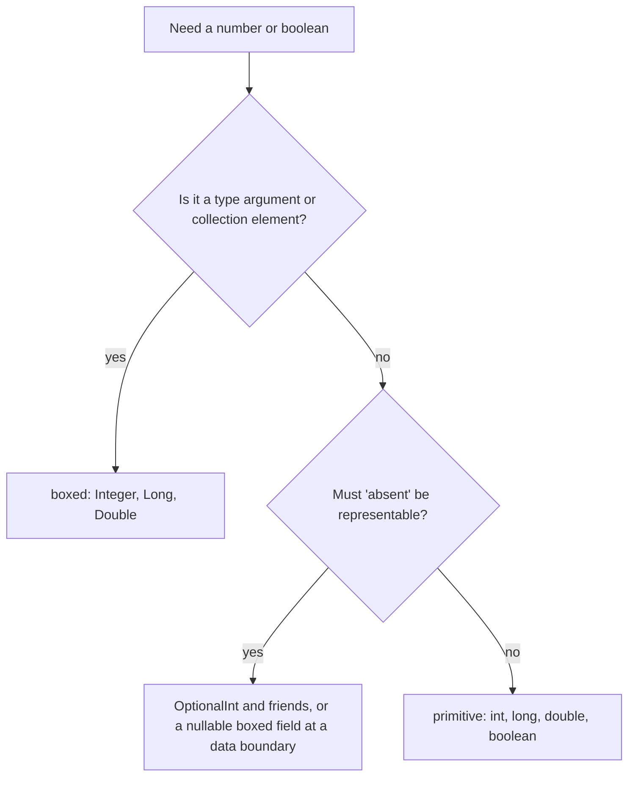

# Everyday habits: scope, for-each, libraries, money and boxing

> **Before this lesson:** you know local variables and scope ([Object lifecycle, scope and garbage collection](#/lesson/java/java-object-lifecycle-gc)), loops ([Loops, operators and casting](#/lesson/java/java-loops-casting)), floating-point surprises ([Primitive types and how numbers are stored](#/lesson/java/java-primitives)) and autoboxing ([Wrapper classes, autoboxing and formatting](#/lesson/java/java-wrappers-formatting)).

## In plain words

A tidy cook takes out an ingredient when it is needed and puts it away when done, uses the peeler that is already in the drawer instead of carving one from a spoon, and weighs expensive saffron on a precise scale, not by the handful. None of this is advanced cookery. It is habit, and habit is what keeps a kitchen from sliding into chaos.

This lesson collects five small habits for the body of a method, where most code lives:

1. keep each variable's **scope** as small as possible;
2. prefer the **for-each** loop;
3. **use the standard library** instead of writing your own version;
4. never use `float` or `double` when **exact** answers are required, above all for money;
5. prefer **primitives** to boxed primitives.

Why this matters for a job: these are the rules behind the comments you will receive on your first pull requests. Interviewers like the money question ("how would you represent currency?") and boxing traps ("what does this print?").

## 1. Minimise the scope of local variables

A variable's **scope** is the region of code where its name is usable. The smaller it is, the less a reader has to keep in mind, and the fewer ways the variable can be misused.

**Declare a variable where it is first used**, not at the top of the method. A variable declared early distracts the reader, may be used by mistake before or after its intended region, and has often been forgotten by the time it matters.

**Initialise it in the declaration.** If you do not yet know its value, you are declaring it too soon. (The exception is a variable initialised inside a `try` block but needed after it.)

**Prefer `for` loops to `while` loops** when a loop variable is not needed afterwards. A `for` loop's variables die with the loop. This matters more than it seems:

```java
import java.util.Iterator;
import java.util.List;

List<String> first = List.of("a", "b");
List<String> second = List.of("x", "y", "z");

Iterator<String> i = first.iterator();
while (i.hasNext()) {
    System.out.print(i.next());
}

Iterator<String> i2 = second.iterator();
while (i.hasNext()) {                 // BUG: copy-and-paste left the old iterator 'i'
    System.out.print(i2.next());
}
System.out.println();
```

```text
ab
```

The second loop silently does nothing: `i` is already exhausted. The code compiles and runs with no error, and the bug may go unnoticed for a long time. With `for`, the same slip cannot compile:

```java
for (Iterator<String> it = first.iterator(); it.hasNext(); ) {
    System.out.print(it.next());
}
for (Iterator<String> it2 = second.iterator(); it.hasNext(); ) {    // error: cannot find symbol 'it'
    System.out.print(it2.next());
}
```

When a loop bound is costly to compute, declare it in the loop header as well, so that it too is confined: `for (int k = 0, n = expensiveSize(); k < n; k++)`.

**Keep methods small and focused.** Two activities in one method mean the variables of one are in scope for the other. Splitting the method separates them.

## 2. Prefer for-each loops

```java
for (Iterator<String> it = second.iterator(); it.hasNext(); ) {      // iterator: three chances for error
    String s = it.next();
}
for (int k = 0; k < second.size(); k++) {                            // index: four
    String s = second.get(k);
}
for (String s : second) {                                            // for-each: none
}
```

The iterator and the index variable are clutter: you want the elements. Each extra mention is a chance to use the wrong variable. The for-each loop hides them, works identically for arrays and collections, and costs nothing in speed.

### The nested-loop bug it prevents

```java
import java.util.ArrayList;
import java.util.Collection;
import java.util.EnumSet;

enum Suit { CLUBS, HEARTS }
enum Rank { ACE, KING, QUEEN }

Collection<Suit> suits = EnumSet.allOf(Suit.class);
Collection<Rank> ranks = EnumSet.allOf(Rank.class);

List<String> deck = new ArrayList<>();
for (Iterator<Suit> s = suits.iterator(); s.hasNext(); ) {
    for (Iterator<Rank> r = ranks.iterator(); r.hasNext(); ) {
        deck.add(r.next() + " of " + s.next());          // BUG: s.next() runs once per RANK
    }
}
```

```text
Exception in thread "main" java.util.NoSuchElementException
```

`s.next()` is called in the inner loop, so the suits run out after two cards. With six-sided dice instead of cards the same mistake produces no exception at all, only wrong output. The for-each version cannot go wrong:

```java
for (Suit suit : suits) {
    for (Rank rank : ranks) {
        deck.add(rank + " of " + suit);
    }
}
System.out.println(deck.size() + " " + deck.get(0) + ", " + deck.get(5));
```

```text
6 ACE of CLUBS, QUEEN of HEARTS
```

### When for-each cannot be used

| Need | Use |
|---|---|
| **remove** elements while traversing (destructive filtering) | `collection.removeIf(predicate)`, or an explicit iterator and `it.remove()` |
| **replace** elements of a list or array (transforming) | an index loop, a `ListIterator`, or `list.replaceAll(fn)` |
| traverse **several collections in step** (parallel iteration) | explicit iterators or indices |

Any class can be made usable in for-each by implementing `Iterable<E>`, which has one method, `iterator()`.

## 3. Know and use the libraries

A task: produce a random whole number from 0 up to, but not including, `n`. A tempting home-made version:

```java
static final java.util.Random rnd = new java.util.Random();

static int randomBelow(int n) {
    return Math.abs(rnd.nextInt()) % n;        // three separate flaws
}
```

Its flaws are invisible in testing:

1. If `n` is not a power of two, some results come up more often than others. For `n` about two thirds of the `int` range, values in the lower half appear **twice** as often.
2. If `n` is a small power of two, the sequence repeats after a fairly short period.
3. `Math.abs(Integer.MIN_VALUE)` is still negative, so now and then the method returns a **negative** number.

Fixing all three properly requires knowing a fair amount about random number generators and two's-complement arithmetic. Somebody already did that work:

```java
int roll = java.util.concurrent.ThreadLocalRandom.current().nextInt(6) + 1;     // 1..6, unbiased, fast
```

What you gain by using a standard library method:

- **Expert knowledge and wide testing.** Library code is written by specialists and exercised by millions of programs. Its bugs get found and fixed.
- **Time.** You work on your application, not on plumbing.
- **Free improvements.** Library performance rises with new releases; your home-made version does not.
- **Shared vocabulary.** Other developers recognise `Collections.frequency` at once; your `countMatches` they must read.

Features are added in every release, so skim the release notes. As a minimum, be familiar with `java.lang`, `java.util` (the collections framework), `java.util.stream`, `java.util.concurrent`, `java.time` and `java.nio.file`.

Things people rewrite that already exist:

| Task | Library |
|---|---|
| read a URL or file to a string | `InputStream.transferTo`, `Files.readString` |
| join strings with a separator | `String.join(", ", parts)` |
| repeat, strip, test for blank | `"ab".repeat(3)`, `strip()`, `isBlank()` |
| count occurrences | `Collections.frequency(list, x)` |
| shuffle, reverse, rotate, swap | `Collections.shuffle`, `reverse`, `rotate`, `swap` |
| smallest, largest | `Collections.min`, `Collections.max` |
| compare two possibly-null values | `Objects.equals(a, b)` |
| sort or search an array | `Arrays.sort`, `Arrays.binarySearch` |
| overflow-safe arithmetic | `Math.addExact`, `Math.multiplyExact`, `Math.toIntExact` |

If the JDK does not have what you need, look next at a well-regarded third-party library, and write your own only as a last resort.

## 4. Avoid float and double when answers must be exact

`float` and `double` do **binary floating-point** arithmetic, designed for fast, accurate *approximations* in science and engineering. Most decimal fractions, including 0.1, have no exact binary representation, as one third has none in decimal.

```java
System.out.println(1.03 - 0.42);
System.out.println(1.00 - 9 * 0.10);
```

```text
0.6100000000000001
0.09999999999999998
```

Rounding the printed result hides the problem without removing it. A concrete case: you have one pound and buy sweets priced at 10p, 20p, 30p and so on, one of each until the money runs out.

```java
double funds = 1.00;
int bought = 0;
for (double price = 0.10; funds >= price; price += 0.10) {
    funds -= price;
    bought++;
}
System.out.println(bought + " bought, change " + funds);
```

```text
3 bought, change 0.3999999999999999
```

The correct answer is 4 sweets (10 + 20 + 30 + 40 = 100) with nothing left. The program is wrong about both numbers.

### Two correct approaches

**`BigDecimal`**: decimal arithmetic of arbitrary precision.

```java
import java.math.BigDecimal;
import java.math.RoundingMode;

final BigDecimal step = new BigDecimal("0.10");          // always construct from a String
BigDecimal funds = new BigDecimal("1.00");
int bought = 0;
for (BigDecimal price = step; funds.compareTo(price) >= 0; price = price.add(step)) {
    funds = funds.subtract(price);
    bought++;
}
System.out.println(bought + " bought, change " + funds);

BigDecimal vat = new BigDecimal("19.99").multiply(new BigDecimal("0.20")).setScale(2, RoundingMode.HALF_UP);
System.out.println(vat + " " + new BigDecimal(0.1));
```

```text
4 bought, change 0.00
4.00 0.1000000000000000055511151231257827021181583404541015625
```

- Build a `BigDecimal` from a **`String`** (or with `BigDecimal.valueOf(double)`). `new BigDecimal(0.1)` faithfully captures the inexact binary value of the `double`, as the last output shows.
- `BigDecimal` is immutable: `add`, `subtract` and `multiply` return new objects.
- Compare with `compareTo`, not `equals`: `equals` also compares scale, so `2.0` and `2.00` are unequal.
- You choose the **rounding mode** explicitly. `HALF_UP` is the everyday rule; `HALF_EVEN` ("banker's rounding") is common in finance because it does not bias totals upward.

**Whole numbers of the smallest unit**: keep pence or cents in an `int` or `long`.

```java
int funds = 100;                         // pence
int bought = 0;
for (int price = 10; funds >= price; price += 10) {
    funds -= price;
    bought++;
}
System.out.println(bought + " bought, change " + funds + "p");
```

```text
4 bought, change 0p
```

| | `double` | `long` minor units | `BigDecimal` |
|---|---|---|---|
| Exact for decimal fractions | no | yes | yes |
| Speed | fast | fast | slower |
| Convenience | high | you track the decimal point yourself | verbose method calls |
| Control over rounding | none | manual | eight rounding modes |
| Range | huge, approximate | up to about 18 digits | unlimited |

Use `int` for up to nine decimal digits, `long` for up to eighteen, and `BigDecimal` beyond that or when legally mandated rounding rules must be followed.

### A rounding comparison you can run

```python-run
from decimal import Decimal, ROUND_HALF_UP, ROUND_HALF_EVEN

# The sweet shop, three ways
funds, price, bought = 1.00, 0.10, 0
while funds >= price:
    funds -= price; bought += 1; price += 0.10
print(f"binary floating point : {bought} bought, change {funds!r}")

funds, price, bought = Decimal("1.00"), Decimal("0.10"), 0
while funds >= price:
    funds -= price; bought += 1; price += Decimal("0.10")
print(f"decimal arithmetic    : {bought} bought, change {funds}")

funds, price, bought = 100, 10, 0
while funds >= price:
    funds -= price; bought += 1; price += 10
print(f"integer pence         : {bought} bought, change {funds}p")

# Rounding modes on exact halves
print("\namount   HALF_UP   HALF_EVEN   round() on a float")
for text in ("0.125", "0.135", "2.675", "1.005"):
    d = Decimal(text)
    print(f"{text:7}  {d.quantize(Decimal('0.01'), ROUND_HALF_UP)!s:8}  "
          f"{d.quantize(Decimal('0.01'), ROUND_HALF_EVEN)!s:10}  {round(float(text), 2)}")
print("\nDecimal(0.1) built from a float:", Decimal(0.1))
```

The last column shows floats disagreeing with both decimal modes for `2.675` and `1.005`, because those numbers are stored slightly below the half.

## 5. Prefer primitives to boxed primitives

Each primitive has a boxed counterpart (`int` and `Integer`, and so on), and autoboxing blurs the line. Three real differences remain.

| | Primitive | Boxed primitive |
|---|---|---|
| Has identity separate from its value | no | yes: two `Integer` objects can hold the same number |
| Can be `null` | no | yes |
| Cost | compact, fast | an object per value; slower |

Each difference produces a bug.

**Identity: `==` compares references.**

```java
java.util.Comparator<Integer> broken = (a, b) -> (a < b) ? -1 : (a == b ? 0 : 1);
System.out.println(broken.compare(new Integer(42), new Integer(42)));
System.out.println(java.util.Comparator.<Integer>naturalOrder().compare(42, 42));
```

```text
1
0
```

`a < b` unboxes and compares numbers. `a == b` compares the two **object references**, which differ, so the comparator claims the first 42 is greater than the second. Applying `==` to boxed primitives is almost always a mistake. Use `Comparator.naturalOrder()`, `Integer.compare`, or unbox first.

**Null: unboxing can throw.**

```java
public class Main {
    static Integer counter;              // a field: defaults to null, not 0

    public static void main(String[] args) {
        if (counter == 42) {             // counter is unboxed for the comparison
            System.out.println("unbelievable");
        }
    }
}
```

```text
Exception in thread "main" java.lang.NullPointerException: Cannot invoke "java.lang.Integer.intValue()" because "Main.counter" is null
        at Main.main(Main.java:5)
```

When a boxed and a primitive value meet in one operation, the boxed one is unboxed. Unboxing `null` throws, and the message (Java 14 and later) even names the hidden `intValue()` call that the compiler inserted. Declaring `counter` as `int` fixes it.

**Cost: boxing in a loop.**

```java
Long sum = 0L;                           // should be long
for (long k = 0; k < Integer.MAX_VALUE; k++) {
    sum += k;
}
```

The program is correct and many times slower than necessary, because every pass creates a new `Long`.

Use boxed primitives only where an object is required:

- as type arguments: `List<Integer>`, `Map<String, Long>`, `Optional<Double>`;
- as elements, keys and values in collections;
- for reflective method calls;
- where "no value" must be representable and `OptionalInt` does not fit, such as a nullable database column.

Everywhere else (fields, local variables, parameters, return types, loop counters, arithmetic) use primitives.



> [!INTERVIEW]
> "How should money be represented in Java?" Not `float` or `double`: binary floating point cannot represent most decimal fractions, so sums and comparisons drift. Use `BigDecimal` constructed from strings with an explicit scale and rounding mode, or a `long` count of minor units; mention `compareTo` versus `equals` for `BigDecimal` and the cost of each choice. "Primitives or wrappers?" Primitives by default: wrappers have identity (so `==` misleads), can be `null` (so unboxing can throw) and cost time and memory. Wrappers are for generics and collections.

## Pitfalls

- **Declaring all variables at the top of a method.**
- **`while` loops whose iterator or counter outlives the loop.**
- **Index or iterator loops where for-each would do**; `next()` called in the wrong loop.
- **Modifying a collection inside a for-each over it.**
- **Re-implementing library facilities**: random ranges, joining, shuffling, date arithmetic.
- **`Math.abs(x) % n`** assumed non-negative.
- **`double` for prices, tax, balances or anything compared for equality.**
- **`new BigDecimal(0.1)`** instead of `new BigDecimal("0.1")`.
- **`BigDecimal.equals`** where `compareTo` was meant.
- **`==` between two boxed values.**
- **Unboxing a possibly-null wrapper.**
- **`Long`, `Integer` or `Double` as loop accumulators.**

## Cheat sheet

| Habit | In code |
|---|---|
| Smallest scope | declare at first use, with an initial value; prefer `for` to `while` |
| Traverse | `for (T x : items)` |
| Remove while traversing | `items.removeIf(p)` |
| Transform a list in place | `list.replaceAll(f)` |
| Random in a range | `ThreadLocalRandom.current().nextInt(lo, hi)` |
| Exact decimal | `new BigDecimal("12.34")`, or `long` pence |
| Round money | `.setScale(2, RoundingMode.HALF_UP)` |
| Compare `BigDecimal` | `a.compareTo(b) == 0` |
| Numbers by default | `int`, `long`, `double` |
| Numbers in collections | `List<Integer>`; compare with `equals` or `Integer.compare` |

## Summary

- Give each local variable the smallest possible scope: declare it late, initialise it at once, and prefer `for` loops.
- The for-each loop removes iterator and index bookkeeping, and with it a family of bugs.
- The standard library is better tested and maintained than code you write yourself; know what is in it.
- Binary floating point is approximate. Use `BigDecimal` or integer minor units for money and anything else that must be exact.
- Primitives are simpler, faster and safer than boxed primitives; box only when a type argument or collection demands it.

## Glossary

- **Scope**: the region of code in which a variable can be referred to.
- **For-each loop**: the enhanced `for` statement that visits each element of an array or `Iterable`.
- **Iterator**: an object that steps through the elements of a collection.
- **Destructive filtering**: removing selected elements while traversing.
- **Parallel iteration**: stepping through several collections in lockstep.
- **Standard library**: the classes shipped with the JDK.
- **Binary floating point**: the approximate number format of `float` and `double`.
- **`BigDecimal`**: an immutable, arbitrary-precision decimal number.
- **Scale**: the number of digits after the decimal point of a `BigDecimal`.
- **Rounding mode**: the rule for choosing between two neighbouring representable values.
- **Minor unit**: the smallest unit of a currency, such as pence or cents.
- **Boxed primitive**: a wrapper object such as `Integer` holding one primitive value.

## Check yourself

```quiz
[
  {"q": "Why is a `for` loop usually preferable to a `while` loop for iteration?", "options": ["It runs faster", "Its loop variables are confined to the loop, so they cannot be reused by mistake afterwards", "It can iterate backwards", "while loops are deprecated"], "answer": 1,
   "explain": "Limiting scope turns copy-and-paste slips into compile errors."},
  {"q": "What does `System.out.println(1.03 - 0.42 == 0.61);` print?", "options": ["true", "false", "It does not compile", "0.61"], "answer": 1,
   "explain": "The subtraction yields 0.6100000000000001 in binary floating point."},
  {"q": "What does `new BigDecimal(\"2.0\").equals(new BigDecimal(\"2.00\"))` return, and `compareTo`?", "options": ["true and 0", "false and 0", "false and 1", "true and 1"], "answer": 1,
   "explain": "equals compares value and scale; compareTo compares numeric value only."},
  {"q": "Which construction gives an exact one tenth?", "options": ["new BigDecimal(0.1)", "new BigDecimal(\"0.1\")", "new BigDecimal(1 / 10)", "BigDecimal.valueOf(1 / 10)"], "answer": 1,
   "explain": "The String constructor is exact. new BigDecimal(0.1) copies the inexact double; 1 / 10 is integer division giving 0."},
  {"q": "What does this print? `Integer a = 1000, b = 1000; System.out.println(a == b);`", "options": ["true", "false", "It does not compile", "NullPointerException"], "answer": 1,
   "explain": "== compares references, and 1000 is outside the cache range, so the two boxes are different objects."},
  {"q": "What happens? `Integer n = null; int m = n + 1;`", "options": ["m is 1", "Compile-time error", "NullPointerException", "m is 0"], "answer": 2,
   "explain": "The arithmetic unboxes n, and unboxing null throws."},
  {"q": "Which loop form is needed to remove elements from a list while traversing it?", "options": ["for-each with list.remove", "An explicit Iterator with it.remove(), or removeIf", "Any loop works", "A stream forEach"], "answer": 1,
   "explain": "Structural modification during a for-each throws ConcurrentModificationException."},
  {"q": "Why can `Math.abs(rnd.nextInt()) % n` return a negative number?", "options": ["% is unsigned", "Math.abs(Integer.MIN_VALUE) is still negative", "nextInt returns a long", "It cannot"], "answer": 1,
   "explain": "The positive counterpart of Integer.MIN_VALUE does not fit in an int, so abs returns the same negative value."}
]
```

> **Source:** Effective Java 3e, item group "General programming" (minimising local variable scope, for-each over traditional loops, knowing the libraries, avoiding float and double for exact answers, primitives over boxed primitives); ideas restated with original examples. Checked against https://docs.oracle.com/en/java/javase/21/docs/api/java.base/java/math/BigDecimal.html and https://docs.oracle.com/en/java/javase/21/docs/api/java.base/java/util/concurrent/ThreadLocalRandom.html .
