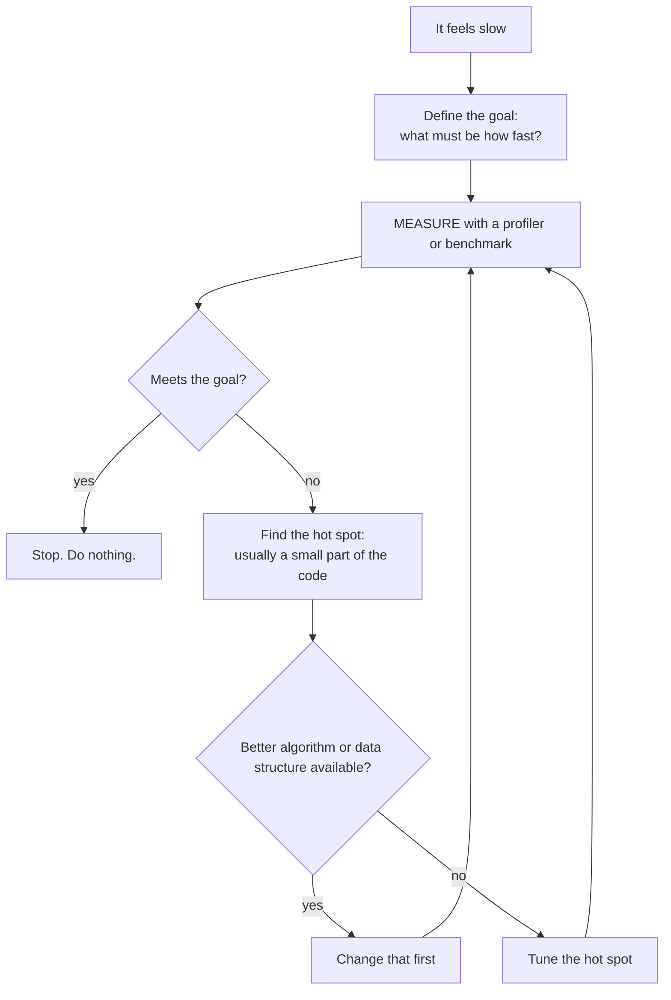

# Strings, interfaces, reflection, naming and optimisation

> **Before this lesson:** you know `String` and `StringBuilder` ([Packages, imports and the String toolbox](#/lesson/java/java-packages-imports-strings)), interfaces and "program to an interface" ([Interfaces, default methods, sealed types and pattern matching](#/lesson/java/java-interfaces)), enums ([Enums: constants with data and behaviour](#/lesson/java/java-ej-enums)) and the habits of the previous lesson ([Everyday habits: scope, for-each, libraries, money and boxing](#/lesson/java/java-ej-everyday-habits)).

## In plain words

A workshop has a favourite hammer, and to the person holding it everything looks like a nail. The hammer is a fine tool; the damage comes from using it for screws.

This lesson is about several of Java's hammers. Strings are so convenient that people store dates, numbers and whole records in them. Reflection is so powerful that people use it where an ordinary method call would do. "Optimisation" is so tempting that people damage clean designs chasing speed they never measure. Alongside these come two quieter topics: declaring variables by interface type, and the naming conventions that make any Java code base feel familiar.

The seven habits:

1. do not use strings where another type fits better;
2. do not build long strings with `+` in a loop;
3. refer to objects by their interfaces;
4. prefer interfaces to reflection;
5. use native methods sparingly;
6. optimise only with evidence;
7. follow the standard naming conventions.

Why this matters for a job: "stringly typed" code, premature optimisation and inconsistent names are the three most common complaints in code reviews. Interviewers ask "String versus StringBuilder versus StringBuffer", "what is reflection and when would you use it?" and "how do you approach a performance problem?".

## 1. Avoid strings where other types are more appropriate

Data usually arrives as text: from a file, a web form, the keyboard. The mistake is to **leave** it as text.

| Tempting | Problem | Better |
|---|---|---|
| a number kept as `"42"` | cannot do arithmetic; `"9" > "10"` alphabetically | `int`, `long`, `BigDecimal` |
| a yes/no kept as `"true"` or `"Y"` | six spellings of yes | `boolean` |
| a date kept as `"03/04/2026"` | is that March or April? | `LocalDate` |
| a fixed choice kept as `"PENDING"` | a typo compiles | an `enum` |
| several values glued together, `"ada#42#leeds"` | parsing at every use; breaks when a value contains `#` | a class or record |
| a string used as a permission or key to a shared resource | two unrelated parts of a program can collide on the same text | a dedicated unforgeable object |

```java
// Stringly typed: every user must split, parse and hope
String compound = "Leeds#4.5#2026-03-04";
String[] parts = compound.split("#");
double kg = Double.parseDouble(parts[1]);

// Typed: the compiler knows what everything is
record Delivery(String city, double kg, java.time.LocalDate due) { }
Delivery d = new Delivery("Leeds", 4.5, java.time.LocalDate.of(2026, 3, 4));
System.out.println(d.kg() * 2 + " " + d.due().getDayOfWeek());
```

```text
9.0 WEDNESDAY
```

The string version provides no `equals` that understands the parts, no ordering except alphabetical, no validation, and it fails oddly the first time a city name contains `#`. Convert text to proper types **at the edge** of the program, as soon as it arrives, and work with real types everywhere inside.

## 2. Beware the performance of string concatenation

Strings are immutable. `result += piece` cannot change `result`; it creates a new string and copies both operands into it. Doing so $n$ times copies roughly $n^2 / 2$ characters.

```java
static String joinSlow(java.util.List<String> lines) {
    String result = "";
    for (String line : lines) {
        result += line;                       // new String each pass; all earlier text copied again
    }
    return result;
}

static String joinFast(java.util.List<String> lines) {
    StringBuilder sb = new StringBuilder(lines.size() * 80);    // optional: a capacity estimate
    for (String line : lines) {
        sb.append(line);
    }
    return sb.toString();
}
```

For a hundred lines the difference is unnoticeable. For a hundred thousand, the first takes many seconds and the second a few milliseconds.

| Situation | Use |
|---|---|
| a few pieces in one expression: `"Hi " + name + "!"` | `+`; the compiler handles it efficiently |
| building in a loop | `StringBuilder` |
| joining with a separator | `String.join(", ", items)` or `Collectors.joining(", ")` |
| a template with values | `String.format` or `"...".formatted(...)` |
| shared between threads | rarely needed; `StringBuffer` is the synchronised, slower relative of `StringBuilder` |

### The cost, measured in copies

```python-run
def copies_plus_equals(pieces):
    total, length = 0, 0
    for p in pieces:
        length += len(p)
        total += length                 # the new string copies everything built so far
    return total

def copies_builder(pieces, capacity=16):
    total, length = 0, 0
    for p in pieces:
        while length + len(p) > capacity:
            total += length             # grow: copy existing content into a bigger array
            capacity = capacity * 2 + 2
        total += len(p)
        length += len(p)
    return total + length               # toString() copies once more

for n in (10, 1_000, 100_000):
    pieces = ["x" * 20] * n
    a, b = copies_plus_equals(pieces), copies_builder(pieces)
    print(f"{n:7} pieces of 20 chars: += copies {a:16,} chars | StringBuilder copies {b:10,} | ratio {a / b:10,.0f}x")
```

## 3. Refer to objects by their interfaces

If a suitable interface type exists, declare parameters, return values, fields and local variables with it. Name the class only when constructing.

```java
import java.util.*;

Set<String> tags = new LinkedHashSet<>();          // good: interface type on the left
// LinkedHashSet<String> tags = new LinkedHashSet<>();   // ties all later code to one implementation

Map<String, Integer> stock = new HashMap<>();
List<String> queue = new ArrayList<>();
Deque<String> history = new ArrayDeque<>();
```

The gain is **flexibility**: to change the implementation you edit one word.

```java
Set<String> tags = new TreeSet<>();                // now sorted; no other line changes
```

Had the variable been declared `LinkedHashSet<String>`, methods specific to that class might have crept into use, and every method receiving `tags` would name the class in its signature.

One caution: if the original implementation offered behaviour that the interface does not promise, and the code relied on it, the replacement must offer it too. `LinkedHashSet` guarantees insertion order; `HashSet` does not. Depending on an order while declaring only `Set` hides that requirement from the reader.

When no appropriate interface exists, use a class:

- **value classes** such as `String`, `BigInteger`, `LocalDate`: nobody writes alternative implementations;
- **class-based frameworks** whose base type is a class: `OutputStream`, `Reader`;
- when you need **methods only the class has**, such as `PriorityQueue.comparator()`.

In those cases use the **least specific class** in the hierarchy that provides what you need.

## 4. Prefer interfaces to reflection

**Reflection** (`java.lang.reflect`) lets a program inspect classes at run time: find a class by its name, list its constructors, methods and fields, create instances, call methods and read fields, all for classes that did not exist when the program was compiled.

```java
Class<?> cls = Class.forName("java.util.ArrayList");
Object list = cls.getDeclaredConstructor().newInstance();
java.lang.reflect.Method add = cls.getMethod("add", Object.class);
add.invoke(list, "tea");
add.invoke(list, 42);                                   // no compile-time type checking at all
System.out.println(list + " " + cls.getSimpleName());
```

```text
[tea, 42] ArrayList
```

The power has a price:

| Cost | Detail |
|---|---|
| **No compile-time checking** | a misspelt method name, a wrong argument type or a missing class becomes a run-time exception |
| **Clumsy, verbose code** | several lines and several checked exceptions for what would be `list.add("tea")` |
| **Slower** | reflective calls are much slower than direct ones and resist JIT optimisation |
| **Breaks encapsulation** | `setAccessible(true)` reaches private members; the module system restricts this |

Reflection is the right tool for a narrow class of programs: frameworks that must work with classes unknown at compile time (dependency injection containers, test runners, object mappers, serializers), and development tools such as IDEs and debuggers.

Application code can usually get the benefit with a fraction of the cost: **create the instance reflectively, then use it through an interface** it is known to implement.

```java
import java.util.Set;

static Set<String> newSet(String className) {
    try {
        @SuppressWarnings("unchecked")                        // justified: we require a Set and use it as Set<String>
        Class<? extends Set<String>> cl = (Class<? extends Set<String>>) Class.forName(className);
        return cl.getDeclaredConstructor().newInstance();
    } catch (ReflectiveOperationException e) {
        throw new IllegalArgumentException("cannot create a Set from " + className, e);
    }
}

Set<String> s = newSet("java.util.TreeSet");      // the class is chosen by a string at run time
s.addAll(java.util.List.of("pear", "fig", "apple"));     // ordinary, type-checked calls from here on
System.out.println(s);
```

```text
[apple, fig, pear]
```

Only the single line that creates the object is reflective. This small pattern is the core of every plug-in system: a configuration file names a class, the application loads it and calls it through an agreed interface.

## 5. Use native methods judiciously

The **Java Native Interface** (JNI) lets Java call **native methods** written in languages such as C or C++. Historically it served three purposes: reaching platform-specific facilities, reusing existing native libraries, and squeezing out performance.

- **Platform facilities**: the Java library has grown to cover most of them (processes, file attributes, networking). Check the JDK first.
- **Existing native libraries**: a legitimate use when no Java equivalent exists.
- **Performance**: rarely advisable now. JVMs have become very fast, and crossing the boundary between Java and native code has a cost of its own.

Native code brings back the hazards Java was designed to remove: memory corruption, crashes that take down the whole JVM, security holes, and the loss of portability, since a separate build is needed for every platform. It is also harder to debug. Newer JDKs offer the Foreign Function and Memory API (finalised in Java 22) as a safer replacement for JNI. Either way: use as little native code as you can, and test it thoroughly.

## 6. Optimise judiciously

Three well-known sayings about optimisation agree with each other. In summary: more programming harm is done in the name of efficiency than for any other single reason; small efficiencies should be ignored about 97% of the time, because **premature optimisation** is the root of much evil; and the two rules of optimisation are "do not do it" and, for experts only, "do not do it yet".

**Write good programs, not fast ones.** A well-structured program, with information hidden behind interfaces, can be made fast later, because the slow part can be replaced without disturbing the rest. A program contorted for speed from the start is usually both slow *and* impossible to fix.

That is not licence to ignore performance. Certain decisions are hard to reverse and must be considered when designing:

- **Architecture**: how components communicate, what is stored where, which data structures and algorithms carry the load. An algorithm that takes time proportional to $n^2$ cannot be rescued by tuning; an $n \log n$ algorithm can.
- **API design**: a public type that is needlessly mutable forces defensive copies for ever; a method that returns a fresh copy of a large structure on every call cannot be made cheap; choosing inheritance where composition was right ties a class to its parent's performance.
- **Wire formats and persistent formats**: once data is on disk or on the network in a format, the format stays.

Happily, good design and good performance usually point the same way.

When something is actually too slow, follow a method:



- **Measure before and after every change.** Intuition about where time goes is wrong more often than right, even for experts; programs commonly spend most of their time in a small fraction of their code.
- A **profiler** (Java Flight Recorder, async-profiler, VisualVM) shows where time and memory go.
- A **microbenchmark** framework, JMH, measures small pieces of code reliably. Hand-written timing loops with `System.nanoTime()` are misleading because of JIT warm-up, dead-code elimination and garbage-collection pauses.
- Java gives a weaker link between source code and executed machine instructions than C does, so measurement matters more, not less.

```java
// A typical finding: the "slow" part was the data structure, not the arithmetic
java.util.List<Integer> ids = ...;          // 200,000 elements
for (int wanted : queries) {                // 200,000 lookups
    if (ids.contains(wanted)) { ... }       // each one scans the list: 40 billion comparisons in total
}
java.util.Set<Integer> idSet = new java.util.HashSet<>(ids);     // one line, and each lookup is constant time
```

## 7. Follow the naming conventions

Java has naming conventions so widely followed that breaking them makes code look foreign and, in places, misleading.

### Typographical conventions

| Element | Convention | Examples |
|---|---|---|
| package, module | all lower-case, dot-separated, starting with a reversed domain; short components | `com.brightpost.shipping`, `java.util.concurrent` |
| class, interface, enum, record, annotation | `UpperCamelCase` | `HttpClient`, `LinkedHashMap`, `Comparable` |
| method, field, local variable, parameter | `lowerCamelCase` | `ensureCapacity`, `remainingSeats`, `i` |
| constant (`static final` with an immutable value), enum constant | `UPPER_SNAKE_CASE` | `MAX_VALUE`, `NEGATIVE_INFINITY`, `HALF_UP` |
| type parameter | one capital letter, perhaps with a digit | `T`, `E`, `K`, `V`, `R`, `X` (exception), `T1` |

Acronyms are treated as words: `HttpUrl` and `XmlParser`, not `HTTPURL`. A `static final` field that refers to a **mutable** object is not a constant and does not get capitals.

### Grammatical conventions

| Element | Convention | Examples |
|---|---|---|
| instantiable class | a noun or noun phrase | `Thread`, `PriorityQueue`, `ChessPiece` |
| utility class | plural noun | `Collections`, `Files`, `Objects` |
| interface | a noun, or an adjective ending in `-able` or `-ible` | `Collection`, `Comparator`, `Runnable`, `Iterable` |
| annotation | any part of speech | `@Override`, `@FunctionalInterface`, `@Deprecated` |
| method that performs an action | a verb or verb phrase | `append`, `drawImage`, `removeIf` |
| method returning a `boolean` | starts with `is`, or `has` | `isEmpty`, `isDigit`, `hasNext` |
| method returning an attribute | a noun, or `get` + noun | `size()`, `hashCode()`, `getName()` |
| method converting the type | `toType` | `toString`, `toArray`, `toList` |
| method returning a view | `asType` | `asList`, `asIterator` |
| method returning a primitive of the same value | `typeValue` | `intValue`, `doubleValue` |
| static factory | `of`, `from`, `valueOf`, `getInstance`, `newInstance`, `copyOf` | `List.of`, `Instant.from` |

```java
// Reads like Java
public final class OrderBook {
    private static final int MAX_OPEN_ORDERS = 500;
    private final Map<String, Order> ordersById = new HashMap<>();

    public boolean isEmpty()                    { return ordersById.isEmpty(); }
    public int size()                           { return ordersById.size(); }
    public Optional<Order> findById(String id)  { return Optional.ofNullable(ordersById.get(id)); }
    public List<Order> toList()                 { return List.copyOf(ordersById.values()); }
}
```

Conventions are not laws; long-established local practice or good sense may override one. But the default should be to follow them, so that any Java developer can read your code without adjusting.

> [!INTERVIEW]
> "`String`, `StringBuilder`, `StringBuffer`?" `String` is immutable; concatenating in a loop creates a new object each time and costs quadratic time. `StringBuilder` is a mutable buffer for single-threaded building. `StringBuffer` is the same with synchronised methods, kept for legacy code. "What is reflection?" Run-time inspection and invocation of classes, methods and fields by name; essential for frameworks, but it loses compile-time checking, is slower and can break encapsulation, so application code should confine it to object creation and then use interfaces. "How do you tackle a performance problem?" Set a measurable goal, profile to find the real hot spot, fix algorithms and data structures first, change one thing at a time and measure again.

## Pitfalls

- **Dates, numbers, flags and enumerated choices stored as strings.**
- **Delimited strings as poor substitutes for classes.**
- **`+=` on a `String` inside a large loop.**
- **Variables and parameters typed as `ArrayList` or `HashMap`** where `List` or `Map` would do.
- **Relying on implementation behaviour** (such as iteration order) that the declared interface does not promise.
- **Reflection for ordinary calls**, or to reach private members of other people's classes.
- **Native code for speed** without measurements.
- **Optimising without a profiler**, or sacrificing design for speculative gains.
- **Home-made benchmarks** that ignore JIT warm-up.
- **Names that defy convention**: `class order_manager`, `int MaxSize`, `boolean getEmpty()`.

## Cheat sheet

| Habit | In code |
|---|---|
| Parse at the boundary | `LocalDate.parse(text)`, `Integer.parseInt(text)`, `Status.valueOf(text)` |
| Group related values | a `record`, not a delimited string |
| Build text in a loop | `StringBuilder` |
| Join with a separator | `String.join(", ", parts)` |
| Declare by interface | `List<T> xs = new ArrayList<>();` |
| Plug-in by class name | `Class.forName(name)...newInstance()` cast to an interface |
| Performance work | goal, profile, change one thing, measure again |
| Benchmarks | JMH |
| Classes / methods / constants | `UpperCamelCase` / `lowerCamelCase` / `UPPER_SNAKE_CASE` |
| Boolean methods | `isX`, `hasX` |
| Conversions | `toX` (copy), `asX` (view), `xValue` (primitive) |

## Summary

- Convert text to real types at the boundary; strings are poor substitutes for numbers, dates, enums and records.
- Repeated string concatenation is quadratic; use `StringBuilder` or `String.join`.
- Declare by interface so implementations can change; use a class only when no interface fits.
- Reflection trades compile-time safety and speed for flexibility; limit it to creating objects that you then use through interfaces.
- Avoid native code unless a library demands it.
- Design for clarity; pay attention to architecture and API choices that fix performance for ever; optimise only what a profiler identifies, and measure the result.
- Follow the standard typographical and grammatical naming conventions.

## Glossary

- **Stringly typed**: (informal) using strings where a more specific type exists.
- **Compound key**: several values combined into one, ideally as a class and not a delimited string.
- **`StringBuilder` / `StringBuffer`**: mutable character sequences, unsynchronised and synchronised.
- **Quadratic time**: running time proportional to the square of the input size.
- **Reflection**: examining and using classes, methods and fields at run time by name.
- **Service provider / plug-in**: an implementation located and loaded at run time behind an interface.
- **JNI**: Java Native Interface, for calling code written in other languages.
- **Native method**: a method implemented outside Java.
- **Premature optimisation**: tuning code before knowing whether, and where, it is too slow.
- **Profiler**: a tool that measures where a program spends time and memory.
- **Microbenchmark**: a measurement of a small piece of code in isolation.
- **JMH**: Java Microbenchmark Harness, the standard benchmarking tool.
- **Camel case**: writing compound names with a capital at the start of each inner word.

## Check yourself

```quiz
[
  {"q": "Why is `String status = \"PENDING\"` a weaker design than `Status status = Status.PENDING` with an enum?", "options": ["Strings use more memory", "A misspelt or invalid value compiles and is found only at run time, if at all", "Strings cannot be compared", "Enums are mutable"], "answer": 1,
   "explain": "An enum restricts the variable to the declared values, checked by the compiler."},
  {"q": "What is the cost of `s += x` executed n times in a loop for a growing String s?", "options": ["Proportional to n", "Proportional to n squared", "Constant", "Proportional to log n"], "answer": 1,
   "explain": "Each concatenation copies everything accumulated so far."},
  {"q": "Which declaration best follows 'refer to objects by their interfaces'?", "options": ["ArrayList<String> xs = new ArrayList<>();", "List<String> xs = new ArrayList<>();", "Object xs = new ArrayList<String>();", "var xs = new ArrayList<String>();"], "answer": 1,
   "explain": "The interface type keeps later code independent of the implementation. (var infers ArrayList<String>.)"},
  {"q": "What is the main drawback of calling a method through reflection?", "options": ["It cannot return values", "Errors such as a wrong method name or argument type appear only at run time, and the call is slower", "It only works on static methods", "It requires native code"], "answer": 1,
   "explain": "Reflection gives up compile-time checking and performance."},
  {"q": "A page loads slowly. What is the first step?", "options": ["Rewrite string handling with StringBuilder", "Add caching everywhere", "Measure with a profiler to find where the time goes", "Switch to parallel streams"], "answer": 2,
   "explain": "Guesses about hot spots are usually wrong. Measure, then act on the real bottleneck."},
  {"q": "Which name follows Java conventions for a constant?", "options": ["maxRetries", "MaxRetries", "MAX_RETRIES", "max_retries"], "answer": 2,
   "explain": "static final constants use upper-case letters with underscores."},
  {"q": "By convention, what does a method named `asList` suggest compared with `toList`?", "options": ["They are the same", "asList returns a view backed by the original; toList returns an independent converted object", "asList is static", "toList is deprecated"], "answer": 1,
   "explain": "as... conventionally means a view; to... means a conversion producing a new object."},
  {"q": "What does this print? `StringBuilder sb = new StringBuilder(); for (int i = 0; i < 3; i++) sb.append(i).append('-'); System.out.println(sb);`", "options": ["0-1-2-", "012", "0-1-2", "---"], "answer": 0,
   "explain": "Each pass appends the number and a dash, giving 0-1-2- including the trailing dash."}
]
```

> **Source:** Effective Java 3e, item group "General programming" (strings versus other types, string concatenation performance, referring to objects by interface, interfaces over reflection, native methods, optimising judiciously, naming conventions); ideas restated with original examples. Naming conventions checked against the Java Language Specification section 6.1: https://docs.oracle.com/javase/specs/jls/se21/html/jls-6.html#jls-6.1 ; JMH: https://openjdk.org/projects/code-tools/jmh/ .
