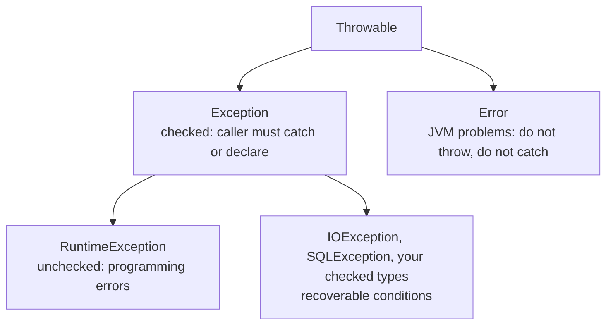
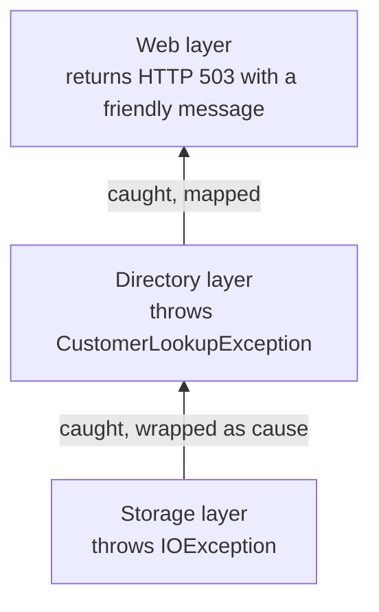

# Choosing exceptions: when, which kind and which type

> **Before this lesson:** you know `try`, `catch`, `finally`, the checked/unchecked split and how to write a custom exception with a cause ([Exceptions: try, catch, finally, checked and unchecked](#/lesson/java/java-exceptions-basics), [try-with-resources, multi-catch and custom exceptions](#/lesson/java/java-twr-custom-exceptions)), and you know `Optional` ([Varargs, empty collections, Optional returns and documentation](#/lesson/java/java-ej-varargs-returns-docs)).

## In plain words

A fire alarm is a superb device for one job: telling everybody that something has gone seriously wrong. It would be absurd to use it as the lunch bell. People would stop reacting to it, and lunch would be very stressful.

Exceptions are Java's fire alarm. Part A taught you how the alarm works. This lesson is about when to pull it, and which of the three kinds of alarm to use, so that the people who call your code can respond sensibly.

The decisions:

1. use exceptions only for exceptional conditions, never for ordinary control flow;
2. **checked** exceptions for conditions a caller can recover from, **runtime** exceptions for programming errors;
3. do not overuse checked exceptions;
4. prefer the **standard** exception types;
5. throw exceptions that fit the **level of abstraction** of your method.

Why this matters for a job: exception design is where API quality shows. Interviewers ask "when would you make an exception checked?", "which standard exceptions do you know?" and "what is exception translation?".

## 1. Exceptions are for exceptional conditions

Somewhere, someone wrote this loop:

```java
int[] readings = {12, 15, 11, 19};
int total = 0;
try {
    int i = 0;
    while (true) {
        total += readings[i++];             // run off the end deliberately
    }
} catch (ArrayIndexOutOfBoundsException e) {
    // "finished"
}
System.out.println(total);
```

```text
57
```

It prints the right answer and is wrong in every other way. The author imagined it would be faster than a loop with a bounds check. It is slower, harder to read, and dangerous:

- **Exceptions are slow when thrown.** Creating one captures the entire stack trace. JVMs do not optimise this path, because it is supposed to be rare.
- **Code inside a `try` block is harder for the JIT compiler to optimise.**
- **It hides real bugs.** If a method called inside the loop has an unrelated out-of-bounds error, the `catch` swallows it and the loop "finishes" early with a wrong total and no sign of trouble.

The ordinary loop says what it means: `for (int r : readings) total += r;`.

The principle extends to API design. **A well-designed API must not force its users to use exceptions for ordinary control flow.** If a method can only be called when the object is in a certain state, give callers a way to find out first. Two designs do this:

| Design | Example | Use when |
|---|---|---|
| **State-testing method** | `Iterator.hasNext()` before `next()`; `Deque.isEmpty()` before `pop()` | the usual choice; reads well |
| **Distinguished return value** | `Map.get` returns `null`; `Queue.poll` returns `null`; an empty `Optional` | the state can change between the test and the call (concurrent access), or the test would repeat the work of the operation |

```java
java.util.Iterator<String> it = java.util.List.of("a", "b").iterator();
while (it.hasNext()) {                      // state test: no exception needed in normal use
    System.out.print(it.next());
}
System.out.println();
// it.next();                               // only a programming error reaches NoSuchElementException
```

```text
ab
```

### The cost, in a model you can run

The model counts work units for two styles of looking up many keys, most of which are missing: "ask first" versus "try and catch". Creating an exception is modelled as costing as much as walking a 30-frame call stack.

```python-run
STACK_DEPTH = 30                     # frames captured when an exception is created

def lookups_with_test(table, keys):
    work = 0
    for k in keys:
        work += 1                    # containsKey / hasNext style test
        if k in table:
            work += 1                # the real operation
    return work

def lookups_with_exceptions(table, keys):
    work = 0
    for k in keys:
        try:
            work += 1
            table[k]
        except KeyError:
            work += STACK_DEPTH      # filling in the stack trace
    return work

table = {i: i for i in range(0, 1000, 10)}        # 100 keys present
for label, keys in (("all present", list(table)), ("10% present", list(range(1000))), ("none present", list(range(1, 1000, 10)))):
    a, b = lookups_with_test(table, keys), lookups_with_exceptions(table, keys)
    print(f"{label:13} test-first: {a:6} units   try/catch: {b:6} units   ratio {b / a:5.1f}x")
```

When failure is rare, the two styles cost about the same. When "failure" is in fact the normal case, the exception style is many times dearer, and that is exactly the case in which it should never have been an exception.

## 2. Checked for recoverable conditions, runtime for programming errors

Java has three kinds of throwable, and the choice among them is a message to the caller.



| Kind | Meaning | What the caller should do | Examples |
|---|---|---|---|
| **Checked exception** | something outside the program went wrong, and a reasonable caller can **recover** | handle it: retry, use a fallback, ask the user | `IOException`, `TimeoutException`, a custom `InsufficientFundsException` |
| **Runtime exception** | the caller broke the method's contract: a **bug** | fix the code; normally do not catch | `IllegalArgumentException`, `NullPointerException`, `IndexOutOfBoundsException` |
| **Error** | the JVM cannot continue normally | nothing | `OutOfMemoryError`, `StackOverflowError` |

The test question: **"Could a well-written caller reasonably do something about this?"**

- A file the user named does not exist. Yes: tell the user, ask again. **Checked.**
- A negative index was passed. No: the calling code is wrong and must be fixed. **Runtime.**
- A payment was declined. Yes: offer another card. **Checked**, or an alternative shown below.

Further rules:

- **Every unchecked exception you define should extend `RuntimeException`**, directly or indirectly. Never subclass `Error`; by convention it is reserved for the JVM. Never define a throwable that extends `Throwable` directly, and do not throw bare `Exception` or `RuntimeException`.
- **Give checked exceptions methods that help recovery.** If a purchase fails for lack of funds, an accessor for the shortfall lets the caller tell the user how much to add. An exception is an object; let it carry useful data, so that callers never have to parse its message text.
- If it is not clear whether recovery is possible, prefer unchecked.

## 3. Avoid unnecessary use of checked exceptions

Checked exceptions make programs more reliable by forcing callers to think about failure. Overused, they make an API painful.

- Every caller needs a `try`/`catch` or a `throws` clause.
- A method that throws a checked exception **cannot be used directly in a lambda** for the standard functional interfaces, so it does not fit into streams.
- If callers cannot do better than `catch (Exception e) { throw new RuntimeException(e); }`, the checked exception has produced only noise, or worse, an empty `catch` block.

A checked exception is justified only when **both** conditions hold:

1. the condition **cannot be prevented** by correct use of the API (the caller cannot test for it in advance), and
2. the caller **can take a useful action** on catching it.

The burden is heaviest when a checked exception is the *only* one a method throws, because that alone forces the `try` block on every caller. Look for an alternative.

**Return an empty `Optional`** when the caller needs no detail about why there is no result.

```java
import java.util.Optional;

// Checked exception: every caller needs try/catch
static int parsePortOrThrow(String text) throws java.text.ParseException {
    if (!text.matches("\\d{1,5}")) throw new java.text.ParseException("not a port: " + text, 0);
    return Integer.parseInt(text);
}

// Optional: absence is visible in the type and composes with streams
static Optional<Integer> parsePort(String text) {
    return text.matches("\\d{1,5}") && Integer.parseInt(text) <= 65535
            ? Optional.of(Integer.parseInt(text)) : Optional.empty();
}

System.out.println(parsePort("8080").orElse(80) + " " + parsePort("eighty").orElse(80));
System.out.println(java.util.stream.Stream.of("22", "x", "443").map(s -> parsePort(s)).flatMap(Optional::stream).toList());
```

```text
8080 80
[22, 443]
```

**Split the method in two**: a state-testing method that returns a `boolean`, and the action, which then throws an unchecked exception if misused.

```java
// Before
try {
    obj.action(args);
} catch (TheCheckedException e) {
    // handle
}

// After
if (obj.actionPermitted(args)) {
    obj.action(args);
} else {
    // handle
}
```

The second form is unsuitable when the object may be used by several threads without synchronisation, or when outside events can change the state between the test and the action: the answer may be stale by the time it is used.

## 4. Favour the standard exceptions

Reusing the JDK's exception types makes your API easier to learn, your code easier to read, and saves classes. The ones to know by heart:

| Exception | Throw when |
|---|---|
| `IllegalArgumentException` | a non-null argument has an inappropriate value: a negative count, an unparseable name |
| `IllegalStateException` | the object is in the wrong state for the call: used before initialisation, after `close()` |
| `NullPointerException` | an argument is `null` where that is forbidden |
| `IndexOutOfBoundsException` | an index argument is out of range |
| `ConcurrentModificationException` | an object was modified concurrently where that is not allowed |
| `UnsupportedOperationException` | the object does not support the method: `add` on an unmodifiable list |
| `ArithmeticException` | an arithmetic failure such as integer division by zero |
| `NumberFormatException` | text could not be parsed as a number (a subclass of `IllegalArgumentException`) |
| `NoSuchElementException` | a requested element does not exist: `next()` at the end, `Optional.orElseThrow()` when empty |

The first two cover most cases, and they can overlap. A rule that settles it: **if no argument value would have worked, throw `IllegalStateException`; otherwise `IllegalArgumentException`.** Asking a stack of 3 items to pop 5 is a bad argument. Asking a closed connection to send anything at all is a bad state.

By convention, a `null` argument gets `NullPointerException` and an out-of-range index gets `IndexOutOfBoundsException`, even though both are, strictly, illegal arguments.

```java
import java.util.ArrayDeque;
import java.util.Deque;
import java.util.Objects;

public final class Printer implements AutoCloseable {
    private final Deque<String> queue = new ArrayDeque<>();
    private boolean closed = false;

    public void submit(String document, int copies) {
        Objects.requireNonNull(document, "document");                     // NullPointerException
        if (copies < 1 || copies > 99) {
            throw new IllegalArgumentException("copies must be 1..99: " + copies);
        }
        if (closed) {
            throw new IllegalStateException("printer is closed");
        }
        for (int i = 0; i < copies; i++) {
            queue.add(document);
        }
    }

    public String next() {
        if (queue.isEmpty()) {
            throw new java.util.NoSuchElementException("nothing queued");
        }
        return queue.remove();
    }

    @Override public void close() { closed = true; }
}
```

Do **not** throw `Exception`, `RuntimeException`, `Throwable` or `Error` directly. Treat them as abstract: nobody can catch them without catching everything else too. Define a new exception type only when a caller needs to distinguish your condition from others and no standard type expresses it; and choose a standard one only if its documented meaning truly matches, not merely its name.

## 5. Throw exceptions appropriate to the abstraction

A method's exceptions are part of its interface. A method called `findCustomer` that throws `SQLException` has told every caller which technology it uses inside, and has tied them to it. Change the storage from a database to a web service and every caller breaks.

Higher layers should catch lower-level exceptions and throw ones that make sense at their own level. This is **exception translation**.

```java
class CustomerLookupException extends RuntimeException {
    CustomerLookupException(String message, Throwable cause) {
        super(message, cause);                          // exception chaining: keep the cause
    }
}

interface Storage { String read(String key) throws java.io.IOException; }

final class CustomerDirectory {
    private final Storage storage;

    CustomerDirectory(Storage storage) { this.storage = storage; }

    String nameOf(String customerId) {
        try {
            return storage.read("customer/" + customerId + "/name");
        } catch (java.io.IOException e) {
            throw new CustomerLookupException("cannot look up customer " + customerId, e);
        }
    }
}
```

```java
Storage broken = key -> { throw new java.io.FileNotFoundException(key); };
try {
    new CustomerDirectory(broken).nameOf("c-17");
} catch (CustomerLookupException e) {
    System.out.println(e.getMessage());
    System.out.println("caused by: " + e.getCause());
}
```

```text
cannot look up customer c-17
caused by: java.io.FileNotFoundException: customer/c-17/name
```

- The caller sees a failure described in the vocabulary of the method it called.
- The original exception travels along as the **cause** (**exception chaining**), so the full story appears in the stack trace under "Caused by:".
- `CustomerDirectory` is free to change how it stores data.



Translation is better than blindly propagating low-level exceptions, but do not overuse it. Best of all is to **prevent** the lower-level failure: validate arguments before passing them down. Where a failure cannot be prevented and the higher layer can cope, handle it there and **log** it, so that operators can investigate while callers are spared.

> [!INTERVIEW]
> "When do you make an exception checked?" *When the condition is outside the caller's control and a reasonable caller can recover: I/O failures, timeouts, a declined business operation. Programming errors (bad arguments, illegal state, null) are runtime exceptions. I avoid checked exceptions when callers could not do anything useful, because they clutter every call site and do not work with lambdas; an `Optional` or a state-testing method is often better.* "Why not catch an exception to end a loop?" Slow, obscure, and it can mask unrelated bugs. "What is exception translation?" Catching a lower-level exception and throwing one suited to the current abstraction, with the original attached as the cause.

## Pitfalls

- **Exceptions as loop terminators or as the normal "not found" signal.**
- **APIs that give no way to test state**, forcing callers into `try`/`catch` for routine cases.
- **Checked exceptions that no caller can handle usefully.**
- **Runtime exceptions for conditions the caller should recover from**, with no documentation.
- **Throwing or declaring bare `Exception` or `RuntimeException`.**
- **Subclassing `Error`.**
- **A new exception class for every method** when a standard type says the same.
- **`IllegalArgumentException` where the object's state is the problem**, or the reverse.
- **Leaking implementation exceptions** (`SQLException`, `IOException`) through high-level interfaces.
- **Translating without passing the cause.**
- **Parsing exception messages** to extract data, because no accessor was provided.

## Cheat sheet

| Situation | Choose |
|---|---|
| Ordinary, expected outcome ("no match") | return value: `Optional`, empty collection, `boolean` |
| Caller can and should recover | checked exception, with accessors for details |
| Caller violated the contract | runtime exception |
| Bad argument value | `IllegalArgumentException` |
| Null argument | `NullPointerException` (`Objects.requireNonNull`) |
| Bad index | `IndexOutOfBoundsException` (`Objects.checkIndex`) |
| Object not ready, or closed | `IllegalStateException` |
| Operation not offered | `UnsupportedOperationException` |
| No such element | `NoSuchElementException` |
| Low-level failure in a high-level method | translate: `throw new HighLevelException(msg, cause)` |
| Never throw directly | `Exception`, `RuntimeException`, `Throwable`, `Error` |

## Summary

- Exceptions signal abnormal events; ordinary outcomes belong in return values, and APIs should let callers test state without catching.
- Checked exceptions say "you can recover from this"; runtime exceptions say "you have a bug"; errors belong to the JVM.
- Use checked exceptions only when the failure is unpreventable and the caller can act; otherwise prefer `Optional`, a state test, or an unchecked exception.
- Reuse the standard exception types with their conventional meanings.
- Translate lower-level exceptions into ones that suit your abstraction, always chaining the cause.

## Glossary

- **Exceptional condition**: an event outside the normal, expected operation of a method.
- **Control flow**: the order in which statements execute.
- **State-testing method**: a method that reports whether another method may be called.
- **Distinguished return value**: a special value (`null`, `-1`, an empty `Optional`) signalling "no result".
- **Checked exception**: a non-runtime subclass of `Exception`; callers must catch or declare it.
- **Runtime (unchecked) exception**: a subclass of `RuntimeException`, indicating a programming error.
- **Error**: a throwable reserved for serious JVM-level failures.
- **Recoverable**: capable of being handled so that the program continues usefully.
- **Standard exception**: an exception type provided by the JDK with a conventional meaning.
- **Abstraction level**: the vocabulary and concepts at which a layer of software operates.
- **Exception translation**: converting a caught lower-level exception to a higher-level one.
- **Exception chaining**: attaching the original exception as the cause of the new one.

## Check yourself

```quiz
[
  {"q": "What is wrong with ending an array loop by catching ArrayIndexOutOfBoundsException?", "options": ["Nothing; it is faster", "It is slower, obscure, and can hide an unrelated out-of-bounds bug inside the loop", "It does not compile", "Arrays do not throw that exception"], "answer": 1,
   "explain": "Exceptions are for exceptional conditions; using them for control flow harms performance, clarity and correctness."},
  {"q": "A user-supplied file path does not exist. Which kind of exception fits best?", "options": ["Error", "A runtime exception", "A checked exception", "No exception; return 0"], "answer": 2,
   "explain": "The condition is outside the program's control and the caller can recover, for example by asking again."},
  {"q": "A method receives -3 for a parameter documented as 'must be positive'. Which exception?", "options": ["IllegalStateException", "IllegalArgumentException", "ArithmeticException", "IOException"], "answer": 1,
   "explain": "A non-null argument with an inappropriate value is an IllegalArgumentException."},
  {"q": "`send()` is called on a connection that has already been closed. Which exception?", "options": ["IllegalArgumentException", "IllegalStateException", "NullPointerException", "NoSuchElementException"], "answer": 1,
   "explain": "No argument value would have worked; the object's state is the problem."},
  {"q": "Does this compile? `List<String> lines = paths.stream().map(p -> Files.readString(p)).toList();` (paths is a List<Path>)", "options": ["Yes", "No: the lambda throws the checked IOException, which Function.apply does not declare", "Yes, exceptions are ignored in streams", "Only in parallel streams"], "answer": 1,
   "explain": "Checked exceptions do not fit the standard functional interfaces; wrap in an unchecked exception or use a loop."},
  {"q": "A high-level `loadProfile` method catches SQLException. What should it do?", "options": ["Rethrow SQLException", "Throw a profile-level exception with the SQLException as its cause", "Return null", "Print the stack trace and continue"], "answer": 1,
   "explain": "Exception translation with chaining keeps the abstraction clean and preserves diagnostic detail."},
  {"q": "Which may a well-designed API throw directly?", "options": ["new Exception(\"failed\")", "new Throwable()", "new IllegalStateException(\"closed\")", "new Error(\"bad\")"], "answer": 2,
   "explain": "Throw specific types. Exception, Throwable and Error are too general for callers to handle sensibly."},
  {"q": "When are checked exceptions justified?", "options": ["Always, for safety", "Only when the failure cannot be prevented by correct API use AND the caller can take useful action", "Never", "Only in constructors"], "answer": 1,
   "explain": "Both conditions are needed; otherwise they burden callers for no benefit."}
]
```

> **Source:** Effective Java 3e, item group "Exceptions" (exceptions only for exceptional conditions, checked versus runtime exceptions, avoiding needless checked exceptions, standard exceptions, exceptions appropriate to the abstraction); ideas restated with original examples. Checked against https://docs.oracle.com/en/java/javase/21/docs/api/java.base/java/lang/RuntimeException.html and https://dev.java/learn/exceptions/throwing/ .
