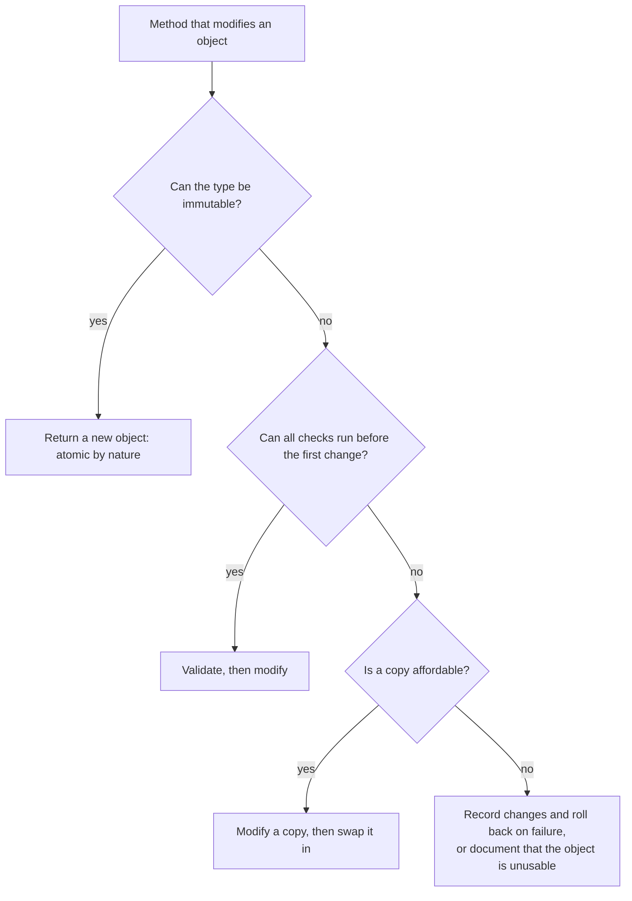

# Documenting, detailing and recovering from failures

> **Before this lesson:** you can choose between checked and unchecked exceptions and standard types, and you know exception translation ([Choosing exceptions: when, which kind and which type](#/lesson/java/java-ej-exception-choice)). You know Javadoc tags ([Varargs, empty collections, Optional returns and documentation](#/lesson/java/java-ej-varargs-returns-docs)) and immutability ([Minimal accessibility and immutable classes](#/lesson/java/java-ej-accessibility-immutability)).

## In plain words

Two notes left on a broken photocopier. The first says "Broken." The second says "Paper jam in tray 2 since 09:40, sheet half through the rollers, 37 of 50 copies done, please do not open the side panel." The second took thirty seconds longer to write and will save the repair person half an hour.

Then there is the question of what state the machine was left in. A tidy failure leaves it as it was before the job started: you can press the button again. A messy one leaves half a job inside, counters wrong and a tray open.

And the worst colleague of all is the one who notices the fault, tells nobody, and walks away.

This lesson is about those three qualities in code:

1. **documenting** which exceptions a method throws;
2. writing exception **messages** that capture what failed;
3. **failure atomicity**: leaving objects usable after a failed call;
4. never **ignoring** an exception.

Why this matters for a job: at three in the morning, the only evidence of a production failure is a stack trace and a message. Good ones turn an outage into a five-minute fix. Interviewers ask "what do you put in an exception message?", "what is failure atomicity?" and "what is wrong with an empty catch block?".

## 1. Document every exception a method throws

A method's exceptions are part of its contract. Callers cannot use it correctly without knowing what can go wrong and why.

- **Declare checked exceptions individually** in the `throws` clause, and document each with a Javadoc `@throws` tag stating the precise condition.
- **Do not declare a superclass** as a shortcut. `throws Exception` tells the caller nothing, and it hides any other exception the method might throw.
- **Document unchecked exceptions with `@throws` too**, but do **not** put them in the `throws` clause. The list of unchecked exceptions effectively states the method's **preconditions**. Keeping them out of the `throws` clause lets readers see at a glance which are checked.

```java
/**
 * Transfers money from this account to another.
 *
 * @param target the account to credit; must not be {@code null} or this account
 * @param pence  the amount to move, in pence; must be positive
 * @throws NullPointerException       if {@code target} is {@code null}
 * @throws IllegalArgumentException   if {@code pence} is not positive, or {@code target} is this account
 * @throws IllegalStateException      if either account is closed
 * @throws InsufficientFundsException if this account's balance is less than {@code pence};
 *                                    neither balance is changed
 */
public void transferTo(Account target, long pence) throws InsufficientFundsException { ... }
```

Reading only that comment, a caller knows the three ways to misuse the method (bugs they must not write) and the one failure they must be ready to handle. They also learn that a failed transfer changes nothing, which is failure atomicity, discussed below.

The single exception to "never declare a superclass" is `main`, which may be declared `throws Exception` because only the JVM calls it.

If many methods of a class throw an exception for the same reason, say so once in the class's documentation: "All methods of this class throw `NullPointerException` if passed a `null` argument."

## 2. Put failure-capture information in detail messages

When an exception goes uncaught, the system prints its **stack trace**, which begins with the exception's **detail message** (the text passed to its constructor, returned by `getMessage()` and included in `toString()`). Often that printout is all an engineer has to go on, and the failure may be impossible to reproduce.

**The detail message should contain the values of every parameter and field that contributed to the failure.**

```java
// Useless
throw new IndexOutOfBoundsException();
throw new IllegalArgumentException("invalid range");

// Useful: says what was wrong, and with what values
throw new IndexOutOfBoundsException("index " + index + " out of bounds for length " + size);
throw new IllegalArgumentException("from (" + from + ") must not be greater than to (" + to + ")");
```

Consider an out-of-bounds failure. The index may be below the lower bound, at or above the upper bound, or the bounds themselves may be wrong (lower greater than upper). A message with all three values tells you immediately which of those bugs you have. Without the values, you are guessing.

Guidelines:

- **Include the values, not an essay.** The stack trace already identifies the file and line; the reader has the source code. What they lack is the data.
- **Never include secrets**: passwords, keys, tokens, personal data. Stack traces are copied into bug reports and chat channels.
- **The detail message is for programmers and operators, not end users.** A user-facing message is different text, usually translated, produced at the edge of the application.
- **Make it easy to do right** by having the exception's constructor take the data and build the message:

```java
public class RangeException extends IllegalArgumentException {
    private final int lower, upper, index;

    public RangeException(int lower, int upper, int index) {
        super(String.format("index %d not in range [%d, %d)", index, lower, upper));
        this.lower = lower;
        this.upper = upper;
        this.index = index;
    }

    public int lower() { return lower; }
    public int upper() { return upper; }
    public int index() { return index; }
}
```

```java
try {
    throw new RangeException(0, 10, 12);
} catch (RangeException e) {
    System.out.println(e.getMessage() + " | off by " + (e.index() - e.upper() + 1));
}
```

```text
index 12 not in range [0, 10) | off by 3
```

The message is consistent everywhere the exception is thrown, nobody can forget a value, and code that catches it reads the data through **accessors** instead of parsing text. Accessors matter most for checked exceptions, where recovery is expected.

### A message scorer you can run

```python-run
def score(message, context):
    """context: the values that contributed to the failure. Returns what a reader would still not know."""
    missing = [name for name, value in context.items() if str(value) not in message]
    leaks = [w for w in ("password", "secret", "token=") if w in message.lower()]
    verdict = "good" if not missing and not leaks else "poor"
    return verdict, missing, leaks

context = {"index": 12, "lower": 0, "upper": 10}
for msg in ["Error", "Index out of range", "index 12 out of range",
            "index 12 not in range [0, 10)",
            "index 12 not in range [0, 10) for user ada, password hunter2"]:
    verdict, missing, leaks = score(msg, context)
    print(f"{verdict:4} | {msg!r:62} | missing: {missing or '-'} | leaks: {leaks or '-'}")
```

## 3. Strive for failure atomicity

After a method throws, is the object it was called on still usable? Ideally yes, exactly as it was. **A failed method invocation should leave the object in the state it was in before the invocation.** A method with this property is **failure-atomic**. It matters most for checked exceptions, since the caller is expected to recover and carry on with the same object.

Here is a method that is not failure-atomic:

```java
import java.util.ArrayList;
import java.util.List;

final class Ledger {
    private final List<Integer> entries = new ArrayList<>();
    private long total = 0;

    void addAll(List<Integer> amounts) {
        for (Integer a : amounts) {
            total += a;                      // throws NullPointerException on a null element...
            entries.add(a);                  // ...after earlier elements were already applied
        }
    }

    @Override public String toString() { return entries + " total=" + total; }
}
```

```java
Ledger ledger = new Ledger();
try {
    ledger.addAll(java.util.Arrays.asList(10, 20, null, 40));
} catch (NullPointerException e) {
    System.out.println("failed, ledger is now " + ledger);
}
```

```text
failed, ledger is now [10, 20] total=30
```

The call failed, yet half of it took effect. A caller who fixes the input and retries will count 10 and 20 twice.

### Four ways to achieve it

**1. Immutable objects.** If the object cannot change, a failed operation cannot leave it changed. Failure atomicity is free.

**2. Check before you change.** Validate every argument and every state requirement **before** making the first modification.

```java
void addAll(List<Integer> amounts) {
    for (Integer a : amounts) {                      // phase 1: validate everything
        java.util.Objects.requireNonNull(a, "amounts must not contain null");
    }
    for (Integer a : amounts) {                      // phase 2: cannot fail
        total += a;
        entries.add(a);
    }
}
```

A related technique is to **order the computation** so that anything that can fail happens before anything that modifies. A sorted map compares the new key (which may throw `ClassCastException`) while searching for the insertion point, before it changes the tree.

**3. Work on a copy, then swap.** Perform the operation on a temporary copy and replace the object's contents only when everything has succeeded.

```java
void addAll(List<Integer> amounts) {
    List<Integer> newEntries = new ArrayList<>(entries);
    long newTotal = total;
    for (Integer a : amounts) {
        newTotal += a;                               // may throw: nothing real has changed yet
        newEntries.add(a);
    }
    entries.clear();                                 // commit
    entries.addAll(newEntries);
    total = newTotal;
}
```

Some sorting methods copy their input list into an array first for speed; as a side benefit, the list is untouched if the sort fails.

**4. Recovery code.** Catch the failure partway through and undo the changes made so far (a **rollback**). This is how database transactions work; it is uncommon in ordinary in-memory code because the other three approaches are simpler.



### When it cannot be done

- **Errors** such as `OutOfMemoryError` are not expected to be recoverable; do not attempt atomicity for them.
- If two threads modify an object without proper synchronisation, it may be left inconsistent whatever you do; a `ConcurrentModificationException` does not promise a usable object.
- Sometimes atomicity would cost too much complexity or time.

Whenever a method is **not** failure-atomic, its documentation must say what state the object is left in.

### The three strategies as a model you can run

```python-run
def not_atomic(entries, amounts):
    for a in amounts:
        entries.append(a + 0)             # a + 0 raises TypeError for None, mid-way

def validate_first(entries, amounts):
    if any(a is None for a in amounts):
        raise TypeError("amounts must not contain None")
    entries.extend(amounts)

def copy_then_swap(entries, amounts):
    work = list(entries)
    for a in amounts:
        work.append(a + 0)
    entries[:] = work                     # commit only on success

for strategy in (not_atomic, validate_first, copy_then_swap):
    ledger = [5]
    before = list(ledger)
    try:
        strategy(ledger, [10, 20, None, 40])
    except TypeError:
        pass
    print(f"{strategy.__name__:15} before {before}  after failure {ledger}  "
          f"{'failure-atomic' if ledger == before else 'LEFT HALF-DONE'}")
```

## 4. Do not ignore exceptions

```java
try {
    config = loadConfig(path);
} catch (java.io.IOException e) {
}                                             // an empty catch block
```

An exception is a message that something went wrong. An empty `catch` block is the equivalent of switching off a fire alarm without looking for the fire. The program carries on in a state its author never considered, and fails later, somewhere unrelated, with no trace of the true cause. In the snippet above, `config` stays `null` and a `NullPointerException` appears in a different class ten minutes later.

Nearly as bad:

```java
} catch (Exception e) {
    e.printStackTrace();                      // prints to the console, then carries on as if nothing happened
}
```

What to do instead, in order of preference:

| Option | When |
|---|---|
| **Do not catch it.** Let it propagate | this method cannot do anything useful about it |
| **Handle it properly** | you can retry, use a fallback, or give the user a choice |
| **Translate and rethrow** with the cause | to fit your abstraction level |
| **Log it with context, then continue** | the failure is tolerable and operators should know |
| **Ignore it deliberately, and say so** | very rarely |

The rare legitimate case: nothing can be done and nothing is lost. Closing a file you have finished **reading** is the standard example; you already have the data. Even then, the code must show that the choice was deliberate: **comment the reason and name the variable `ignored`.**

```java
static int readFirstByte(java.nio.file.Path path) throws java.io.IOException {
    java.io.InputStream in = java.nio.file.Files.newInputStream(path);
    try {
        return in.read();
    } finally {
        try {
            in.close();
        } catch (java.io.IOException ignored) {
            // The byte has been read successfully; a failure to close cannot affect the result.
        }
    }
}
```

(In real code, try-with-resources is still the better tool; this shows the form of a deliberate ignore.)

One exception type needs special care. If you catch `InterruptedException` and do not rethrow it, restore the interrupt flag with `Thread.currentThread().interrupt()` so that code further up can still see that the thread was asked to stop.

> [!WARNING]
> Catching `Exception` or `Throwable` "to be safe" also catches `NullPointerException`, `ClassCastException` and other signs of bugs, and may swallow `InterruptedException`. Catch the narrowest type that you know how to handle.

### Logging an exception properly

```java
private static final System.Logger LOG = System.getLogger("orders");

try {
    gateway.charge(order);
} catch (PaymentUnavailableException e) {
    LOG.log(System.Logger.Level.WARNING, "payment gateway unavailable for order " + order.id() + ", will retry", e);
    retryQueue.add(order);
}
```

Pass the exception object itself as the last argument so that the logger records the full stack trace and the chain of causes. Logging only `e.getMessage()` throws most of the evidence away. And either log an exception **or** rethrow it, not both, or each failure will appear in the logs several times.

> [!INTERVIEW]
> "What makes a good exception message?" The values of all parameters and fields that contributed to the failure, in a consistent form produced by the exception's constructor; no secrets; written for the engineer who reads the stack trace. "What is failure atomicity?" A failed call leaves the object as it was. Achieve it with immutability, by validating before mutating, by working on a copy and swapping, or with rollback. "What is wrong with an empty catch block?" It discards the only signal that something failed, so the program continues in an unknown state and the eventual failure is far from the cause. If ignoring is truly correct, name the variable `ignored` and explain why in a comment.

## Pitfalls

- **`throws Exception`** on ordinary methods.
- **Undocumented unchecked exceptions**, leaving preconditions for callers to discover by trial.
- **Exceptions with no message**, or a message with no values.
- **Secrets or personal data in messages.**
- **Showing detail messages to end users.**
- **Callers parsing message text** because the exception has no accessors.
- **Modifying state before validating**, so a failure leaves half an operation applied.
- **Assuming an object is usable after a failed call** when the method does not promise it.
- **Empty `catch` blocks**, and `printStackTrace()` followed by carrying on.
- **Catching `Exception` or `Throwable` broadly.**
- **Swallowing `InterruptedException`.**
- **Logging and rethrowing the same exception at every layer.**

## Cheat sheet

| Goal | Practice |
|---|---|
| Declare checked exceptions | each type individually in `throws` |
| Document all exceptions | one `@throws` per type, with the exact condition |
| Unchecked exceptions | `@throws` in the doc comment, not in the `throws` clause |
| Useful message | values of every contributing parameter and field |
| Consistent messages | build them in the exception's constructor |
| Data for handlers | accessor methods on the exception |
| Failure-atomic method | immutable type; or validate first; or copy and swap; or roll back |
| Not atomic | document the resulting state |
| Cannot handle it here | do not catch it |
| Deliberate ignore | `catch (X ignored) { /* reason */ }` |
| Interrupted | rethrow, or `Thread.currentThread().interrupt()` |
| Logging | pass the exception object; log once |

## Summary

- State every exception a method can throw, checked and unchecked, each with its condition; unchecked ones describe the preconditions.
- A detail message must capture the failure: all the values involved, no secrets, generated by the exception's own constructor, with accessors for programmatic use.
- Aim for failure atomicity so that callers can recover and retry: prefer immutability, validate before mutating, or operate on a copy.
- Never swallow an exception silently. Propagate it, handle it, translate it or log it; ignore it only with a stated reason.

## Glossary

- **`@throws`**: the Javadoc tag documenting an exception and the condition that causes it.
- **Precondition**: a requirement the caller must satisfy before calling a method.
- **Detail message**: the text describing an exception, returned by `getMessage()`.
- **Stack trace**: the record of method calls active when an exception was created.
- **Failure-capture information**: the data needed to diagnose a failure from its exception.
- **Accessor**: a method that returns a piece of an object's data.
- **Failure atomicity**: the property that a failed operation leaves an object unchanged.
- **Rollback**: undoing partial changes after a failure.
- **Commit**: making the results of an operation permanent after all steps succeed.
- **Swallowing an exception**: catching it and doing nothing.
- **Interrupt flag**: the per-thread marker that records a request to stop.
- **Logger**: a facility for recording diagnostic messages with levels and context.

## Check yourself

```quiz
[
  {"q": "Where should unchecked exceptions that a method can throw be documented?", "options": ["In the throws clause only", "With @throws tags in the doc comment, but not in the throws clause", "Nowhere", "In a separate text file"], "answer": 1,
   "explain": "Documenting them states the preconditions; leaving them out of the throws clause distinguishes them from checked exceptions."},
  {"q": "Which detail message is the most useful?", "options": ["\"Error\"", "\"Invalid index\"", "\"index 12 out of bounds for length 10\"", "\"Something went wrong, please try again\""], "answer": 2,
   "explain": "It contains the values that contributed to the failure."},
  {"q": "Why should an exception offer accessor methods for its data?", "options": ["So it can be serialised", "So handlers can use the data without parsing the message text", "To make it checked", "To hide the stack trace"], "answer": 1,
   "explain": "Message formats change; accessors give stable, typed access to the failure details."},
  {"q": "What does failure atomicity mean?", "options": ["Exceptions are thread-safe", "A failed method call leaves the object in the state it had before the call", "An exception can be thrown only once", "The method never fails"], "answer": 1,
   "explain": "The caller can then recover and retry with a consistent object."},
  {"q": "Which technique gives failure atomicity with no extra code?", "options": ["Deep inheritance", "Immutable objects", "Static methods", "Synchronisation"], "answer": 1,
   "explain": "An object that cannot change cannot be left partially changed."},
  {"q": "What does this print? `List<Integer> xs = new ArrayList<>(List.of(1)); try { for (Integer v : Arrays.asList(2, null, 4)) { xs.add(v + 0); } } catch (NullPointerException e) { } System.out.println(xs);`", "options": ["[1]", "[1, 2]", "[1, 2, 4]", "[1, 2, null, 4]"], "answer": 1,
   "explain": "2 is added, then unboxing null throws. The list keeps the partial change: the operation is not failure-atomic."},
  {"q": "When is an empty catch block acceptable?", "options": ["Whenever the code compiles", "Almost never; only when nothing can be done and nothing is lost, with the variable named ignored and a comment explaining why", "For all checked exceptions", "In test code only"], "answer": 1,
   "explain": "Silently discarding an exception hides failures; a deliberate ignore must be visibly deliberate."},
  {"q": "What is wrong with `catch (Exception e) { log.warn(e.getMessage()); }`?", "options": ["Nothing", "It catches far too much and logs only the message, losing the stack trace and cause", "It does not compile", "getMessage is private"], "answer": 1,
   "explain": "Catch the narrowest type you can handle, and pass the exception object to the logger."}
]
```

> **Source:** Effective Java 3e, item group "Exceptions" (documenting all thrown exceptions, failure-capture information in detail messages, failure atomicity, not ignoring exceptions); ideas restated with original examples. Checked against https://docs.oracle.com/en/java/javase/21/docs/api/java.base/java/lang/Throwable.html and https://docs.oracle.com/en/java/javase/21/docs/api/java.base/java/lang/System.Logger.html .
