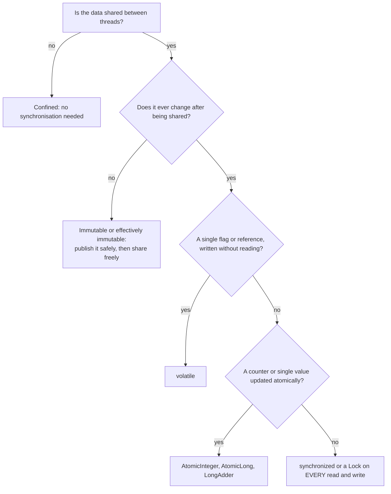
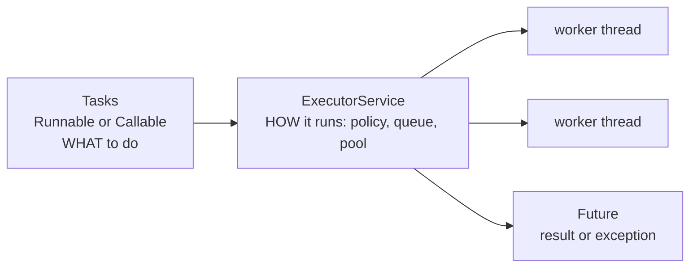

# Shared mutable data, short locks and executors

> **Before this lesson:** you know threads, `Runnable`, `ExecutorService` and `Future` ([Threads, Runnable and ExecutorService](#/lesson/java/java-threads-executors)), and race conditions, `synchronized`, `volatile`, atomics and deadlock ([Race conditions, synchronization, deadlock and virtual threads](#/lesson/java/java-synchronization)).

## In plain words

An office has one shared whiteboard for the team's schedule. Three rules keep it useful. First, if several people may change it, they take turns with the single marker, and nobody reads it while someone is halfway through rewriting a line. Second, the person holding the marker does not wander off to make a phone call with it in their pocket; they write and hand it back. Third, the manager does not personally hire a new temp for every small errand; there is a pool of staff, and errands are handed to whoever is free.

Those are the three guidelines of this lesson, about writing concurrent code that is correct and stays correct:

1. **synchronise all access to shared mutable data**, reads included;
2. **keep synchronised regions short**, and never call unknown code from inside one;
3. **prefer executors and tasks to creating threads by hand**.

Why this matters for a job: these are the rules behind most concurrency bugs found in code review. Interviewers ask "why does this loop never stop?", "what is an alien method?" and "why use an executor instead of `new Thread()`?".

## 1. Synchronise access to shared mutable data

`synchronized` is usually explained as **mutual exclusion**: only one thread at a time may run the guarded code, so no thread sees an object halfway through a change. That is half of what it does. The other half is **visibility**: without synchronisation, one thread's changes may **never** be seen by another thread.

The language guarantees that reading or writing a single variable is **atomic** (indivisible), except for `long` and `double`, which may be written in two halves unless declared `volatile`. It is tempting to conclude that a simple flag needs no synchronisation. That conclusion is wrong. Atomicity guarantees a thread will not see a *torn* value. It does not guarantee the thread will see a value written by *another thread* at all.

### A thread that will not stop

```java
import java.util.concurrent.TimeUnit;

public class StopThread {
    private static boolean stopRequested;                    // shared, mutable, unsynchronised

    public static void main(String[] args) throws InterruptedException {
        Thread background = new Thread(() -> {
            long i = 0;
            while (!stopRequested) {
                i++;
            }
            System.out.println("stopped after " + i + " iterations");
        });
        background.start();

        TimeUnit.SECONDS.sleep(1);
        stopRequested = true;
        System.out.println("main asked for a stop");
    }
}
```

```text
main asked for a stop
(the program never ends)
```

You would expect it to run for a second. On a typical JVM it runs for ever. Nothing tells the background thread that it must look at main memory for a fresh value of `stopRequested`, so the JIT compiler is entitled to transform the loop into:

```java
if (!stopRequested) {
    while (true) {
        i++;
    }
}
```

This optimisation is called **hoisting**. The result is a **liveness failure**: the program fails to make progress.

### Three correct versions

```java
// A. Synchronise BOTH the write and the read
private static boolean stopRequested;
private static synchronized void requestStop()      { stopRequested = true; }
private static synchronized boolean stopRequested() { return stopRequested; }

// B. volatile: guarantees visibility, performs no locking
private static volatile boolean stopRequested;

// C. An atomic variable
private static final java.util.concurrent.atomic.AtomicBoolean stop = new java.util.concurrent.atomic.AtomicBoolean();
```

In version A the **read** method is synchronised too. **Synchronisation has no effect unless both read and write operations are synchronised.** Here the lock is used only for its communication effect, not for exclusion.

### volatile does not make compound actions safe

```java
private static volatile int nextSerial = 0;

static int generateSerial() {
    return nextSerial++;                  // read, add, write: three steps
}
```

Two threads can both read the same value before either writes back, and two callers receive the same serial number. This is a **safety failure**: the program computes wrong results. `volatile` gives visibility only. Use a lock or, better, an atomic class:

```java
private static final java.util.concurrent.atomic.AtomicLong nextSerial = new java.util.concurrent.atomic.AtomicLong();

static long generateSerial() {
    return nextSerial.getAndIncrement();  // one atomic operation, lock-free
}
```

### The best policy: do not share mutable data

| Strategy | Meaning |
|---|---|
| **Immutable data** | share freely; nothing can go wrong |
| **Confinement** | mutable data is used by one thread only; document that it is confined |
| **Effectively immutable** | an object is modified by one thread, then **safely published** and never modified again |
| **Synchronise** | when data really must be shared and mutable, guard every read and write with the same lock |

**Safe publication** means handing an object to other threads in a way that guarantees they see it fully constructed: storing it in a `static final` or `volatile` field, a field accessed under a lock, or a concurrent collection.



### Visibility in a model you can run

The model gives each thread a private cache of a shared variable and refreshes it only when a "memory barrier" occurs, which is what `volatile` and `synchronized` insert.

```python-run
def simulate(volatile, steps=8, stop_at=3):
    main_memory = {"stop": False}
    worker_cache = {"stop": False}          # the worker's private copy
    log = []
    for t in range(steps):
        if t == stop_at:
            main_memory["stop"] = True      # the main thread writes
            log.append(f"t={t}: main sets stop = true")
        if volatile:
            worker_cache["stop"] = main_memory["stop"]   # every read goes to main memory
        if worker_cache["stop"]:
            log.append(f"t={t}: worker sees stop and exits")
            return log
        log.append(f"t={t}: worker loops (its view: stop = {worker_cache['stop']})")
    log.append("... worker never notices: liveness failure")
    return log

print("WITHOUT volatile");  print("\n".join("  " + l for l in simulate(False)))
print("WITH volatile");     print("\n".join("  " + l for l in simulate(True)))
```

## 2. Avoid excessive synchronisation

Too little synchronisation gives wrong answers. Too much gives deadlocks, poor performance and strange failures. The governing rule:

> **Inside a synchronised region, never give control to code you do not control.**

That means: do not call a method that is designed to be overridden, and do not call a function object supplied by a client (a listener, a callback, a lambda). From the class's point of view such methods are **alien**. The class has no idea what an alien method does, how long it takes, or which locks it will try to take.

### An alien method in a synchronised region

A set that notifies observers when an element is added:

```java
import java.util.ArrayList;
import java.util.HashSet;
import java.util.List;
import java.util.Set;
import java.util.function.BiConsumer;

class ObservableSet<E> {
    private final Set<E> elements = new HashSet<>();
    private final List<BiConsumer<ObservableSet<E>, E>> observers = new ArrayList<>();

    void addObserver(BiConsumer<ObservableSet<E>, E> o)    { synchronized (observers) { observers.add(o); } }
    void removeObserver(BiConsumer<ObservableSet<E>, E> o) { synchronized (observers) { observers.remove(o); } }

    boolean add(E e) {
        boolean added;
        synchronized (elements) { added = elements.add(e); }
        if (added) {
            synchronized (observers) {
                for (BiConsumer<ObservableSet<E>, E> o : observers) {
                    o.accept(this, e);                    // ALIEN METHOD called while holding the lock
                }
            }
        }
        return added;
    }
}
```

It works with a harmless observer. Now add one that removes itself when it sees the value 3:

```java
ObservableSet<Integer> set = new ObservableSet<>();
set.addObserver(new BiConsumer<>() {
    @Override public void accept(ObservableSet<Integer> s, Integer e) {
        System.out.println(e);
        if (e == 3) {
            s.removeObserver(this);               // modifies the list being iterated
        }
    }
});
for (int i = 0; i < 6; i++) {
    set.add(i);
}
```

```text
0
1
2
3
Exception in thread "main" java.util.ConcurrentModificationException
```

The observer called back into the set **while the set was in the middle of iterating over its observer list**. Java's locks are reentrant, so the same thread was allowed in again; the lock gave no protection, and the list was modified mid-iteration.

It gets worse. If the observer tries to unsubscribe by handing the job to **another thread** and waiting for it, that thread blocks on the `observers` lock, which the first thread holds while it waits: a **deadlock**, produced by a one-line change in client code.

### The cure: open calls

Move the alien calls outside the synchronised region. Take a **snapshot** of the list under the lock, release the lock, then iterate over the snapshot.

```java
boolean add(E e) {
    boolean added;
    synchronized (elements) { added = elements.add(e); }
    if (added) {
        List<BiConsumer<ObservableSet<E>, E>> snapshot;
        synchronized (observers) {
            snapshot = new ArrayList<>(observers);        // short: copy only
        }
        for (BiConsumer<ObservableSet<E>, E> o : snapshot) {
            o.accept(this, e);                            // open call: no lock held
        }
    }
    return added;
}
```

A call to an alien method made with no locks held is an **open call**. It prevents these failures and also improves concurrency, because other threads are not shut out for the unknown duration of the callback.

An even neater fix is a concurrent collection built for the purpose: `CopyOnWriteArrayList`. Every modification makes a fresh copy of its internal array, so iteration needs no lock and never sees a concurrent change. It is ideal for observer lists, which are traversed often and modified rarely.

```java
private final List<BiConsumer<ObservableSet<E>, E>> observers = new java.util.concurrent.CopyOnWriteArrayList<>();
// addObserver, removeObserver and the notification loop now need no explicit synchronisation
```

### Do as little work as possible while holding a lock

Inside a synchronised region: obtain the lock, examine the shared data, transform it if necessary, release the lock. Move everything time-consuming outside. On multi-core machines the real cost of excessive synchronisation is rarely the time spent acquiring locks; it is **contention**, the lost opportunity for threads to run in parallel, and the optimisations the JVM cannot perform across synchronised code.

### Who should synchronise: the class or the client?

When writing a mutable class, you have two honest choices:

| Choice | Meaning | Examples |
|---|---|---|
| **Leave it unsynchronised** and document that callers must synchronise externally if they share it | no cost for single-threaded use | `ArrayList`, `HashMap`, `StringBuilder` |
| **Synchronise internally** and document that the class is thread-safe | only if you can achieve much better concurrency than one big external lock would | `ConcurrentHashMap`, `AtomicLong` |

The early Java library chose badly: `StringBuffer`, `Vector` and `Hashtable` synchronise every method, paying for locks that are almost always unnecessary. They were replaced by `StringBuilder`, `ArrayList` and `HashMap`. When in doubt, do **not** synchronise the class; document that it is not thread-safe.

A method that modifies a **static** field must synchronise access to it internally even if the method is normally called from one thread, because clients cannot possibly coordinate a lock on something they cannot see.

## 3. Prefer executors, tasks and streams to threads

A `Thread` used directly is both the **unit of work** and the **mechanism that runs it**. The executor framework separates the two. The unit of work is a **task**: a `Runnable`, or a `Callable` if it returns a value. The mechanism is an **executor service**.

```java
import java.util.List;
import java.util.concurrent.Callable;
import java.util.concurrent.ExecutorService;
import java.util.concurrent.Executors;
import java.util.concurrent.Future;

public class PriceCheck {
    static int quote(String shop) throws InterruptedException {
        Thread.sleep(200);                          // pretend network call
        return shop.length() * 10;
    }

    public static void main(String[] args) throws Exception {
        List<String> shops = List.of("Alba", "Brightmart", "Cove");
        try (ExecutorService pool = Executors.newFixedThreadPool(3)) {
            List<Callable<Integer>> tasks = shops.stream()
                    .map(s -> (Callable<Integer>) () -> quote(s))
                    .toList();
            int best = Integer.MAX_VALUE;
            for (Future<Integer> f : pool.invokeAll(tasks)) {      // run all, wait for all
                best = Math.min(best, f.get());
            }
            System.out.println("best price " + best);
        }                                                           // close(): orderly shutdown
    }
}
```

```text
best price 40
```

What the executor provides that a bare thread does not:

| Need | Executor facility |
|---|---|
| wait for one task | `Future.get()` |
| wait for any or all of a set of tasks | `invokeAny`, `invokeAll` |
| wait for everything to finish | `awaitTermination`, or `close()` in try-with-resources |
| collect results as they complete | `ExecutorCompletionService` |
| run after a delay or periodically | `ScheduledExecutorService` |
| change the policy (one thread, a fixed pool, a queue limit) | swap the factory method; the tasks do not change |
| exception handling | failures are captured in the `Future` |

Choosing a pool:

- `Executors.newCachedThreadPool()` suits a lightly loaded program with short tasks. Under heavy load it creates a new thread for every task when none is idle, and can overwhelm the machine.
- `Executors.newFixedThreadPool(n)` bounds the number of threads; the right choice for a heavily loaded server doing CPU-bound work.
- `Executors.newVirtualThreadPerTaskExecutor()` (Java 21) for large numbers of tasks that mostly wait on I/O.
- For full control (queue size, rejection policy), construct a `ThreadPoolExecutor` directly.

For CPU-heavy problems that divide into sub-problems, the **fork-join** framework (`ForkJoinPool`) runs `ForkJoinTask`s that split themselves; idle threads **steal** work from busy ones. Parallel streams are built on it, and are the easy way to use it when the conditions described in [Streams with judgement: purity, return types and parallelism](#/lesson/java/java-ej-stream-style) are met.



> [!INTERVIEW]
> "Why did the background thread not stop?" The flag was read without synchronisation, so the write by another thread is not guaranteed to be visible, and the JIT may hoist the read out of the loop. Fix with `volatile`, synchronised accessors, or an `AtomicBoolean`. "What is an alien method, and why is calling one under a lock dangerous?" A method whose behaviour the class does not control (overridable, or supplied by a client). It may run for a long time, re-enter the object, or acquire other locks, causing exceptions, deadlock or data corruption. Use open calls: copy what you need under the lock, release it, then call out. "Why executors?" They decouple task submission from execution policy, reuse and bound threads, and provide results, error capture and lifecycle control.

## Pitfalls

- **Unsynchronised reads of data written by another thread**, even for a `boolean`.
- **Synchronising writes and not reads.**
- **`volatile` on a variable updated with `++`** or any read-modify-write.
- **Sharing mutable objects without safe publication.**
- **Calling listeners, callbacks or overridable methods while holding a lock.**
- **Long computations or I/O inside a synchronised block.**
- **Synchronising every method of a class "to be safe"**, as `Vector` did.
- **Leaving static mutable state unguarded** because "only one thread calls it".
- **`new Thread(...)` scattered through application code.**
- **Unbounded cached thread pools on a loaded server.**
- **Forgetting to shut an executor down.**

## Cheat sheet

| Situation | Tool |
|---|---|
| A stop flag | `volatile boolean`, or `AtomicBoolean` |
| A shared counter or id generator | `AtomicLong.getAndIncrement()`, `LongAdder` |
| Compound state shared by threads | one lock for every read and write |
| Observer or listener list | `CopyOnWriteArrayList` |
| Need to call client code | snapshot under the lock, then an open call |
| Mutable class, mostly single-threaded | unsynchronised + document "not thread-safe" |
| Run tasks | `ExecutorService` (`newFixedThreadPool`, virtual-thread executor) |
| Results | `Future.get()`, `invokeAll`, `CompletableFuture` |
| Divide-and-conquer CPU work | `ForkJoinPool`, parallel streams |
| Ending | `shutdown()` + `awaitTermination`, or try-with-resources |

## Summary

- Synchronisation provides both mutual exclusion and visibility; without it, a write in one thread may never be seen in another.
- Guard every read and write of shared mutable data with the same lock; use `volatile` for simple flags and atomics for counters; best of all, share only immutable data or confine mutable data to one thread.
- Hold locks briefly and never call alien methods while holding one; use open calls or concurrent collections.
- Decide deliberately whether a class synchronises internally or leaves it to callers, and document the decision.
- Submit tasks to executors instead of managing threads yourself.

## Glossary

- **Mutual exclusion**: only one thread at a time may execute a guarded region.
- **Visibility**: whether one thread's write can be observed by another thread.
- **Atomic**: happening as one indivisible step.
- **Hoisting**: a compiler moving a computation, such as a field read, out of a loop.
- **Liveness failure**: a program that fails to make progress.
- **Safety failure**: a program that computes incorrect results.
- **Confinement**: restricting mutable data to a single thread.
- **Effectively immutable**: never modified after being shared, although the type permits it.
- **Safe publication**: making an object available to other threads so that they see it fully initialised.
- **Alien method**: a method whose behaviour the calling class does not control.
- **Open call**: an alien method invoked while holding no locks.
- **Contention**: threads competing for the same lock.
- **Task**: a unit of work, a `Runnable` or `Callable`.
- **Executor service**: an object that runs submitted tasks according to a policy.
- **Work stealing**: idle threads taking queued tasks from busy threads.

## Check yourself

```quiz
[
  {"q": "Thread A sets a non-volatile, unsynchronised boolean field to true. Is thread B, looping on that field, guaranteed to see the change?", "options": ["Yes, immediately", "Yes, within a time slice", "No: without synchronisation there is no visibility guarantee", "Only on single-core machines"], "answer": 2,
   "explain": "The memory model permits the reading thread to keep using a stale value indefinitely."},
  {"q": "Which statement about `volatile` is correct?", "options": ["It makes ++ atomic", "It guarantees that reads see the latest write, but provides no mutual exclusion", "It acquires a lock", "It makes an object immutable"], "answer": 1,
   "explain": "volatile solves visibility only; compound actions still need a lock or an atomic class."},
  {"q": "A class synchronises its setter but not its getter. Is it thread-safe?", "options": ["Yes", "No: unsynchronised reads may see stale values", "Yes, reads never need locks", "Only if the field is an int"], "answer": 1,
   "explain": "Both reads and writes must be synchronised (or the field volatile) for visibility."},
  {"q": "What is an 'alien method' in the context of a synchronised block?", "options": ["A native method", "A method the class does not control, such as an overridable method or a client-supplied callback", "A deprecated method", "A static method"], "answer": 1,
   "explain": "Its behaviour and the locks it takes are unknown, so calling it while holding a lock is risky."},
  {"q": "How do you safely notify listeners stored in an ArrayList guarded by a lock?", "options": ["Call them inside the synchronised block", "Copy the list under the lock, release the lock, then call each listener", "Do not use listeners", "Use Thread.sleep before calling"], "answer": 1,
   "explain": "That is an open call: the callbacks run with no lock held. CopyOnWriteArrayList achieves the same without explicit locking."},
  {"q": "Why were `Vector` and `StringBuffer` superseded by `ArrayList` and `StringBuilder`?", "options": ["They had fewer methods", "They synchronise every method, a cost that is almost always unnecessary", "They were not generic", "They leaked memory"], "answer": 1,
   "explain": "Internal synchronisation of every operation rarely gives real thread safety for compound actions and always costs time."},
  {"q": "Which pool is the safer default for a heavily loaded server running CPU-bound tasks?", "options": ["newCachedThreadPool", "newFixedThreadPool with a sensible size", "A new Thread per task", "newSingleThreadExecutor"], "answer": 1,
   "explain": "A cached pool creates threads without limit under load; a fixed pool bounds them."},
  {"q": "What does this print? `AtomicLong n = new AtomicLong(5); long a = n.getAndIncrement(); long b = n.incrementAndGet(); System.out.println(a + \" \" + b);`", "options": ["5 7", "6 7", "5 6", "6 6"], "answer": 0,
   "explain": "getAndIncrement returns the old value 5 (n becomes 6); incrementAndGet makes it 7 and returns 7."}
]
```

> **Source:** Effective Java 3e, item group "Concurrency" (synchronising access to shared mutable data, avoiding excessive synchronisation, executors and tasks in preference to threads); ideas restated with original examples. Checked against the Java Language Specification section 17.4 and https://docs.oracle.com/en/java/javase/21/docs/api/java.base/java/util/concurrent/package-summary.html .
