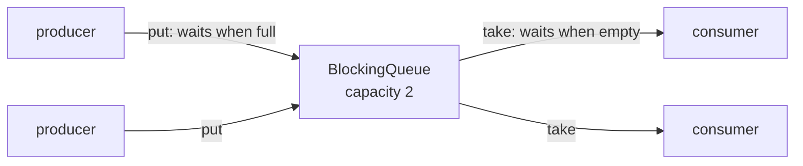
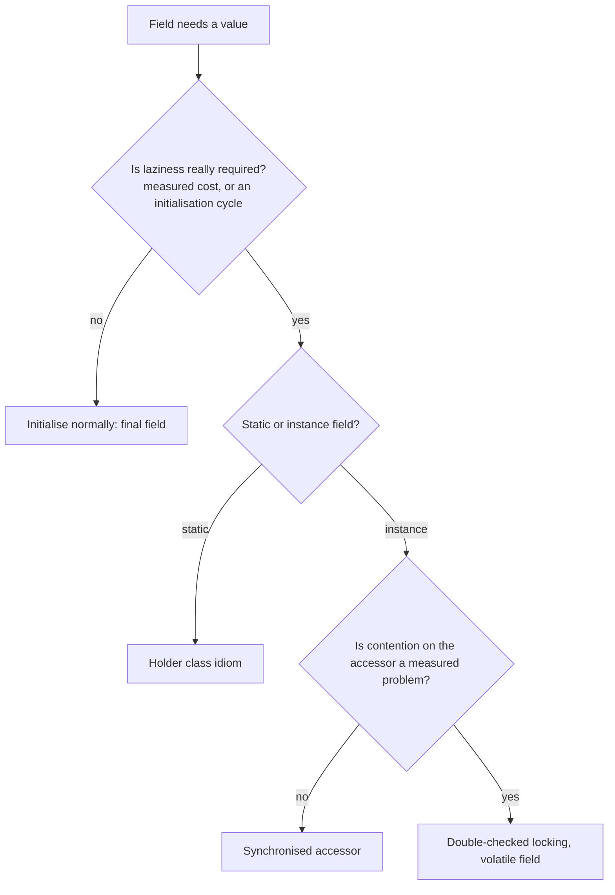

# Concurrency utilities, thread-safety levels and lazy initialisation

> **Before this lesson:** you know locks, `volatile`, atomics and executors ([Race conditions, synchronization, deadlock and virtual threads](#/lesson/java/java-synchronization), [Shared mutable data, short locks and executors](#/lesson/java/java-ej-shared-data)), and the singleton holder idiom ([Static factories, builders, singletons and dependency injection](#/lesson/java/java-ej-factories-builders)).

## In plain words

You could build your own traffic lights from a battery, three bulbs and a home-made timer. You could. It would take weeks, and it would fail in some way you did not foresee, on the one junction where failure matters. Everyone else buys certified traffic lights and spends their effort on where to put them.

Coordinating threads is like that. Java's oldest coordination tools, the methods `wait` and `notify`, are the battery and bulbs: powerful and very easy to get subtly wrong. Since Java 5 the package `java.util.concurrent` has offered certified components: thread-safe collections, counters that release waiting threads, queues that pass work between threads. This lesson covers:

1. the **concurrency utilities** to use instead of `wait` and `notify`;
2. how to **document** a class's thread safety;
3. **lazy initialisation**: delaying a computation until it is needed, correctly;
4. why a program must never rely on the **thread scheduler** for correctness.

Why this matters for a job: producer-consumer queues, latches and `ConcurrentHashMap` are the daily tools of server programming. Interview staples include "implement a bounded buffer", "what is double-checked locking and why does it need `volatile`?" and "what does *thread-safe* mean?".

## 1. Prefer concurrency utilities to wait and notify

The utilities fall into three groups: the executor framework (covered earlier), **concurrent collections**, and **synchronisers**.

### Concurrent collections

These are high-performance thread-safe implementations of the standard interfaces. They manage their own internal synchronisation, so you **cannot** exclude concurrent activity from them; locking one from outside has no effect except to slow the program.

Because you cannot lock around a sequence of calls, several operations that used to need a lock were combined into single **atomic** methods:

| Method on `ConcurrentMap` | Atomic meaning |
|---|---|
| `putIfAbsent(k, v)` | insert only if no mapping exists; return the previous value or `null` |
| `computeIfAbsent(k, fn)` | compute and insert a value only if absent |
| `merge(k, v, fn)` | insert `v`, or combine it with the existing value |
| `compute(k, fn)` | replace the value by a function of the old one |
| `replace(k, old, new)` | replace only if currently mapped to `old` |

```java
import java.util.concurrent.ConcurrentHashMap;
import java.util.concurrent.ConcurrentMap;
import java.util.concurrent.ExecutorService;
import java.util.concurrent.Executors;

public class WordCount {
    public static void main(String[] args) throws Exception {
        ConcurrentMap<String, Integer> counts = new ConcurrentHashMap<>();
        String[] words = "to be or not to be that is the question".split(" ");

        try (ExecutorService pool = Executors.newFixedThreadPool(4)) {
            for (int run = 0; run < 1000; run++) {
                for (String w : words) {
                    pool.submit(() -> counts.merge(w, 1, Integer::sum));     // atomic increment per key
                }
            }
        }
        System.out.println(counts.get("to") + " " + counts.get("be") + " " + counts.get("question"));
    }
}
```

```text
2000 2000 1000
```

The naive version, `counts.put(w, counts.get(w) + 1)`, is a check-then-act race even on a `ConcurrentHashMap`: each call is thread-safe, the pair is not.

**Use `ConcurrentHashMap` in preference to `Collections.synchronizedMap` or `Hashtable`.** The old wrappers lock the whole map for every operation; `ConcurrentHashMap` lets many threads read and write different parts at once.

### Blocking queues: the producer-consumer pattern

Some collection interfaces add **blocking operations**, which wait until they can succeed. `BlockingQueue` extends `Queue`:

- `put(e)` waits while the queue is **full**;
- `take()` waits while the queue is **empty**.

That is all you need for the **producer-consumer** pattern: some threads (producers) add work items, others (consumers) remove and process them. A bounded queue between them also provides **back-pressure**: if consumers fall behind, producers are slowed automatically instead of filling memory.

```java
import java.util.concurrent.ArrayBlockingQueue;
import java.util.concurrent.BlockingQueue;

public class Bakery {
    private static final String CLOSED = "CLOSED";               // a "poison pill" telling the consumer to stop

    public static void main(String[] args) throws InterruptedException {
        BlockingQueue<String> shelf = new ArrayBlockingQueue<>(2);    // room for two loaves

        Thread baker = new Thread(() -> {
            try {
                for (int i = 1; i <= 5; i++) {
                    shelf.put("loaf-" + i);                      // waits if the shelf is full
                }
                shelf.put(CLOSED);
            } catch (InterruptedException e) {
                Thread.currentThread().interrupt();
            }
        });

        Thread customer = new Thread(() -> {
            try {
                int bought = 0;
                while (true) {
                    String item = shelf.take();                  // waits if the shelf is empty
                    if (item.equals(CLOSED)) break;
                    bought++;
                }
                System.out.println("customer bought " + bought + " loaves");
            } catch (InterruptedException e) {
                Thread.currentThread().interrupt();
            }
        });

        baker.start();
        customer.start();
        baker.join();
        customer.join();
    }
}
```

```text
customer bought 5 loaves
```

No `synchronized`, no `wait`, no `notify`. Most thread pools are built on a `BlockingQueue` of tasks.



### A bounded buffer you can run

```python-run
from collections import deque

def simulate(capacity, script):
    """script: sequence of 'P' (a producer wants to put) and 'C' (a consumer wants to take).
    Blocked operations wait in line and complete as soon as the buffer allows."""
    buffer, waiting_put, waiting_take = deque(), deque(), deque()
    produced = consumed = 0
    log = []
    for step, who in enumerate(script, 1):
        if who == "P":
            produced += 1
            waiting_put.append(f"item{produced}")
        else:
            waiting_take.append(f"consumer@{step}")
        progress = True
        while progress:                                   # let every operation that can proceed do so
            progress = False
            if waiting_put and len(buffer) < capacity:
                buffer.append(waiting_put.popleft()); progress = True
            if waiting_take and buffer:
                waiting_take.popleft(); buffer.popleft(); consumed += 1; progress = True
        log.append(f"{step:2} {who}  buffer={list(buffer)!s:20} blocked producers={len(waiting_put)} "
                   f"blocked consumers={len(waiting_take)}")
    return log, consumed

log, consumed = simulate(2, "PPPPCCCCCP")
print("\n".join(log))
print("items consumed:", consumed)
```

Follow the fourth step: the buffer is full, so two producers are blocked. Each `take` then frees a slot, and a waiting producer immediately fills it.

### Synchronisers

A **synchroniser** lets threads wait for one another.

| Synchroniser | What it does | Typical use |
|---|---|---|
| `CountDownLatch` | one or more threads wait until a counter, counted down by others, reaches zero; single use | "start everyone together", "wait until all workers have finished" |
| `Semaphore` | holds a number of permits; `acquire` waits for one, `release` returns it | limit to N concurrent users of a resource |
| `CyclicBarrier` | a group of threads each wait until all have arrived; reusable | phased computations |
| `Phaser` | a flexible, reusable combination of the two above | advanced coordination |
| `Exchanger` | two threads swap objects | handing over buffers |

```java
import java.util.concurrent.CountDownLatch;
import java.util.concurrent.Executors;
import java.util.concurrent.atomic.AtomicInteger;

public class Race {
    public static void main(String[] args) throws InterruptedException {
        int runners = 4;
        CountDownLatch ready = new CountDownLatch(runners);
        CountDownLatch start = new CountDownLatch(1);
        CountDownLatch done = new CountDownLatch(runners);
        AtomicInteger finished = new AtomicInteger();

        try (var pool = Executors.newFixedThreadPool(runners)) {
            for (int i = 0; i < runners; i++) {
                pool.execute(() -> {
                    ready.countDown();                    // "I am at the line"
                    try {
                        start.await();                    // wait for the starting gun
                        finished.incrementAndGet();
                    } catch (InterruptedException e) {
                        Thread.currentThread().interrupt();
                    } finally {
                        done.countDown();                 // "I have finished"
                    }
                });
            }
            ready.await();                                // wait for all runners to be ready
            long t0 = System.nanoTime();                  // nanoTime, not currentTimeMillis, for intervals
            start.countDown();                            // fire
            done.await();                                 // wait for all to finish
            System.out.println(finished.get() + " runners finished");
        }
    }
}
```

```text
4 runners finished
```

Three latches coordinate the race without a single explicit lock. Note the timing detail: for measuring intervals use `System.nanoTime()`, which is more precise and unaffected by adjustments to the system clock.

### If you must use wait and notify

You may have to maintain old code. The rules:

```java
synchronized (lock) {
    while (!conditionHolds()) {         // ALWAYS a loop, never an if
        lock.wait();                    // releases the lock while waiting; reacquires before returning
    }
    // proceed: the condition holds and we hold the lock
}
```

- `wait` must be called inside a `synchronized` block on the same object.
- **Always wait inside a `while` loop** that re-tests the condition. A thread can wake although the condition is false: another thread got in first and changed it; a careless `notifyAll` woke everyone; or a **spurious wake-up** occurred, which the specification permits.
- Prefer `notifyAll` to `notify`. It is always correct, at the cost of some wasted wake-ups; `notify` wakes one arbitrary waiter, which may be the wrong one.

In new code there is seldom a reason to use them at all.

## 2. Document thread safety

How a class behaves when used from several threads is part of its contract. Without documentation, users must guess, and wrong guesses lead to either missing synchronisation (bugs) or excessive synchronisation (slowness, deadlock). The presence of the word `synchronized` on a method is an implementation detail, not documentation.

"Thread-safe" is not a yes-or-no property. There are five levels:

| Level | Meaning | Examples |
|---|---|---|
| **Immutable** | instances appear constant; no synchronisation ever needed | `String`, `Long`, `BigInteger`, records of immutables |
| **Unconditionally thread-safe** | mutable, with enough internal synchronisation that any use from any threads is safe | `AtomicLong`, `ConcurrentHashMap` |
| **Conditionally thread-safe** | as above, except that some sequences of calls need external synchronisation | collections from `Collections.synchronizedMap`: iteration must be done under the map's lock |
| **Not thread-safe** | mutable; callers must surround each use with synchronisation of their choice | `ArrayList`, `HashMap`, `StringBuilder` |
| **Thread-hostile** | unsafe even if every call is externally synchronised, usually because of unsynchronised static state | rare, and always a bug to be fixed or deprecated |

```java
import java.util.Collections;
import java.util.HashMap;
import java.util.Map;

Map<String, Integer> m = Collections.synchronizedMap(new HashMap<>());
m.put("a", 1);                                   // single calls are safe

synchronized (m) {                               // REQUIRED for iteration: documented by the library
    for (String key : m.keySet()) {
        System.out.println(key);
    }
}
```

A conditionally thread-safe class must state **which sequences of calls need external locking and which lock to take**. Put the statement in the class's doc comment; a static factory should document the thread safety of the object it returns.

### The private lock object

If a class synchronises on `this` (which is what a `synchronized` method does), its lock is publicly accessible: any client can write `synchronized (theObject) { ... }` and hold it for as long as they like, blocking every method of your object, by accident or with intent (a denial-of-service attack). Protect unconditionally thread-safe classes with a lock nobody else can reach:

```java
public final class HitCounter {
    private final Object lock = new Object();        // private, and final so it can never be swapped
    private long hits;

    public void record() {
        synchronized (lock) { hits++; }
    }

    public long total() {
        synchronized (lock) { return hits; }
    }
}
```

The lock field must be `final`: if it could be reassigned, two threads might synchronise on different objects. The idiom suits classes designed for inheritance as well, where a subclass and its base class using `this` as a lock could interfere with each other. It cannot be used for *conditionally* thread-safe classes, whose clients need to take the same lock.

## 3. Use lazy initialisation judiciously

**Lazy initialisation** means delaying the creation of a value until the first time it is needed. If it is never needed, the cost is never paid. It is an optimisation, and like most optimisations: **do not use it unless you must.** It lowers the cost of creating an object or loading a class and raises the cost of every access to the field. With several threads it is also easy to get wrong.

Under most circumstances, ordinary initialisation is best:

```java
private final Settings settings = loadSettings();        // simple, correct, thread-safe
```

When laziness is justified (the value is expensive and often unused, or it breaks an initialisation cycle), choose the idiom by situation.

| Field | Need | Idiom |
|---|---|---|
| any | correctness, simplest code | **synchronised accessor** |
| **static** | performance | **lazy initialisation holder class** |
| **instance** | performance | **double-checked locking** with a `volatile` field |
| instance | performance, and computing the value twice is harmless | **single-check** (racy single-check) |

**Synchronised accessor.**

```java
private Settings settings;

private synchronized Settings settings() {
    if (settings == null) {
        settings = loadSettings();
    }
    return settings;
}
```

**Holder class**, for static fields. The JVM initialises a class only when it is first used, and guarantees that the initialisation is thread-safe.

```java
private static class SettingsHolder {
    static final Settings INSTANCE = loadSettings();     // runs on first access to SettingsHolder
}

static Settings settings() {
    return SettingsHolder.INSTANCE;                      // no locking, no test: as fast as a plain field
}
```

**Double-checked locking**, for instance fields. The field is checked once without the lock and, only if it appears uninitialised, a second time with the lock.

```java
private volatile Settings settings;                      // volatile is ESSENTIAL

private Settings settings() {
    Settings result = settings;                          // one volatile read into a local variable
    if (result != null) {                                // first check: no lock
        return result;
    }
    synchronized (this) {
        if (settings == null) {                          // second check: with the lock
            settings = loadSettings();
        }
        return settings;
    }
}
```

Why `volatile`? Without it, another thread may see a non-null reference to an object whose fields have not yet been written, because the assignment of the reference and the writes inside the constructor can be reordered. That bug made the idiom famous: it was "broken" until Java 5 defined `volatile` precisely. The local variable `result` ensures the field is read only once in the common case, which is noticeably faster.

**Single-check**: if every thread may recompute the value without harm, drop the second check. `String` caches its hash code this way.



### Double-checked locking in a model you can run

```python-run
def run(schedule, use_second_check):
    """Two threads call the lazy getter. schedule lists which thread runs its next step.
    Steps: 0 = first check (no lock), 1 = acquire lock [+ second check], 2 = create, 3 = done."""
    field, created, lock_owner = None, 0, None
    pc = {"A": 0, "B": 0}
    saw_null = {"A": False, "B": False}
    for t in schedule:
        step = pc[t]
        if step == 0:
            saw_null[t] = field is None
            pc[t] = 1 if saw_null[t] else 3
        elif step == 1:
            if lock_owner not in (None, t):
                continue                              # blocked: lock is held by the other thread
            lock_owner = t
            if use_second_check and field is not None:
                lock_owner = None; pc[t] = 3          # someone initialised it meanwhile
            else:
                pc[t] = 2
        elif step == 2:
            created += 1; field = f"instance#{created}"
            lock_owner = None; pc[t] = 3
    return created

interleaving = ["A", "B", "A", "B", "A", "B", "B", "B"]      # both pass the first check before either creates
print("lock but NO second check :", run(interleaving, False), "instance(s) created")
print("double-checked locking   :", run(interleaving, True), "instance(s) created")
```

Both threads see `null` at the first check. Without the second check, each then creates an instance in turn. With it, the second thread finds the work already done.

## 4. Do not depend on the thread scheduler

When several threads are runnable, the **scheduler** decides which runs and for how long. Its policy differs between operating systems and JVM versions. **A program whose correctness or performance depends on the scheduler is not portable.**

- **Keep the number of runnable threads close to the number of processors.** Threads that have nothing to do should be *waiting*, not running. Size pools sensibly and keep tasks reasonably small.
- **Never busy-wait.** A loop that repeatedly checks a shared variable, waiting for it to change, burns a processor and starves other threads:

```java
while (!ready) { }                         // busy-wait: wrong
ready.await();                             // a CountDownLatch: the thread sleeps until released
```

- **Do not "fix" a concurrency bug with `Thread.yield()` or `Thread.sleep()`.** They may hide the problem on your machine and make it worse on another. `yield` has no testable meaning.
- **Do not rely on thread priorities.** They are among the least portable features of Java. Tuning them may improve responsiveness slightly; it must never be needed for correctness.
- **Never use sleeps to order events in tests** ("wait 100 ms, then the other thread should be done"). Use a latch or a `Future`.

> [!INTERVIEW]
> "Implement a thread-safe bounded buffer." Say first that in production you would use `ArrayBlockingQueue`. If asked to build it, use a lock with two conditions ("not full", "not empty") or `synchronized` with `wait`/`notifyAll`, waiting in a `while` loop. "Explain double-checked locking." Check the field without locking; if null, lock and check again before initialising; the field must be `volatile` so that other threads never see a partially constructed object, and reading it once into a local improves speed. For static fields the holder-class idiom is simpler and equally fast. "What does thread-safe mean?" Name the five levels and give an example of each.

## Pitfalls

- **Hand-written `wait`/`notify`** where a queue, latch or semaphore fits.
- **`wait` inside an `if`** instead of a `while` loop.
- **`notify` when `notifyAll` was needed.**
- **Check-then-act on a concurrent collection** (`if (!map.containsKey(k)) map.put(k, v)`); use `putIfAbsent`, `computeIfAbsent` or `merge`.
- **Iterating a `synchronizedMap` or `synchronizedList` without holding its lock.**
- **`Hashtable` or `Collections.synchronizedMap` where `ConcurrentHashMap` belongs.**
- **No statement of thread safety** in a class's documentation.
- **Locking on `this`, on a class literal, on a `String` literal or on a boxed value** in a public class.
- **A non-final lock field.**
- **Lazy initialisation by default.**
- **Double-checked locking without `volatile`.**
- **Busy-waiting, `Thread.yield()`, priorities or sleeps** used to make concurrent code "work".
- **`System.currentTimeMillis()` for measuring intervals.**

## Cheat sheet

| Need | Use |
|---|---|
| Shared map | `ConcurrentHashMap` with `merge`, `computeIfAbsent`, `putIfAbsent` |
| Pass work between threads | `BlockingQueue`: `put` and `take` |
| Wait for N events | `CountDownLatch` |
| Limit concurrent access to N | `Semaphore` |
| Rendezvous of a group, repeatedly | `CyclicBarrier` |
| Old-style waiting | `while (!cond) lock.wait();` and `notifyAll()` |
| Interval timing | `System.nanoTime()` |
| Document | immutable / unconditionally / conditionally thread-safe / not thread-safe |
| Unreachable lock | `private final Object lock = new Object();` |
| Lazy static | holder class |
| Lazy instance | `volatile` + double-checked locking |
| Waiting for a condition | a synchroniser, never a busy loop |

## Summary

- Use the tested building blocks of `java.util.concurrent`: concurrent collections with atomic compound methods, blocking queues for producer-consumer hand-off, and synchronisers such as `CountDownLatch` and `Semaphore`.
- If `wait` must be used, call it in a `while` loop inside a `synchronized` block and prefer `notifyAll`.
- Every class should document its level of thread safety; conditionally thread-safe classes must say which lock protects which sequences.
- Private final lock objects keep clients from interfering with a class's synchronisation.
- Initialise normally by default. For justified lazy initialisation, use the holder class for statics and volatile double-checked locking for instance fields.
- Correctness must never depend on scheduling, priorities, yields or sleeps.

## Glossary

- **Concurrent collection**: a collection designed for simultaneous use by several threads.
- **Atomic compound operation**: a multi-step action, such as "insert if absent", performed indivisibly.
- **Blocking operation**: a call that waits until it can complete.
- **Producer-consumer pattern**: threads that create work and threads that process it, joined by a queue.
- **Back-pressure**: slowing producers when consumers cannot keep up.
- **Poison pill**: a special queue element that tells a consumer to stop.
- **Synchroniser**: an object that coordinates the progress of threads.
- **Latch**: a one-shot gate that opens when a counter reaches zero.
- **Semaphore**: a counter of permits controlling access to a resource.
- **Spurious wake-up**: a waiting thread resuming without having been notified.
- **Thread-safety level**: immutable, unconditionally thread-safe, conditionally thread-safe, not thread-safe, or thread-hostile.
- **Private lock object**: a private final object used only for synchronisation.
- **Lazy initialisation**: deferring the computation of a value until first use.
- **Double-checked locking**: a lazy-initialisation idiom that avoids locking after the field is set.
- **Busy-wait**: looping while repeatedly testing a condition instead of sleeping.

## Check yourself

```quiz
[
  {"q": "Why is `if (!map.containsKey(k)) map.put(k, v);` unsafe even on a ConcurrentHashMap?", "options": ["containsKey is not thread-safe", "The two calls are individually atomic but another thread can act between them", "put can deadlock", "It is safe"], "answer": 1,
   "explain": "It is a check-then-act race. Use putIfAbsent or computeIfAbsent, which are atomic."},
  {"q": "On a full `ArrayBlockingQueue`, what does `put(e)` do?", "options": ["Throws IllegalStateException", "Returns false", "Blocks until space becomes available", "Overwrites the oldest element"], "answer": 2,
   "explain": "put waits; offer returns false; add throws."},
  {"q": "Why must `wait()` be called inside a `while` loop rather than an `if`?", "options": ["For performance", "The thread may wake when the condition is still false: another thread changed it, or a spurious wake-up occurred", "wait does not compile in an if", "To avoid deadlock"], "answer": 1,
   "explain": "The condition must be re-tested after every wake-up."},
  {"q": "Which thread-safety level describes `ArrayList`?", "options": ["Immutable", "Unconditionally thread-safe", "Conditionally thread-safe", "Not thread-safe"], "answer": 3,
   "explain": "Callers must provide external synchronisation if instances are shared and modified."},
  {"q": "In double-checked locking, why must the field be `volatile`?", "options": ["To make the lock faster", "So another thread cannot observe a non-null reference to an object that is not fully initialised", "Because synchronized requires it", "To allow null values"], "answer": 1,
   "explain": "volatile establishes the ordering guarantee that makes publication of the reference safe."},
  {"q": "Which lazy-initialisation idiom is best for a static field?", "options": ["Double-checked locking", "The lazy initialisation holder class", "A busy-wait loop", "Thread.sleep in a static block"], "answer": 1,
   "explain": "Class initialisation is lazy and thread-safe, and afterwards access costs nothing extra."},
  {"q": "What is the danger of a public class using `synchronized` methods (locking on this)?", "options": ["None", "Any client can synchronise on the same object and hold the lock, blocking the class's methods", "The methods run twice", "It prevents garbage collection"], "answer": 1,
   "explain": "A private final lock object makes the lock unreachable from outside."},
  {"q": "What does this print? `CountDownLatch l = new CountDownLatch(2); l.countDown(); System.out.println(l.getCount()); l.countDown(); l.countDown(); System.out.println(l.getCount());`", "options": ["1 then 0", "1 then -1", "2 then 0", "0 then 0"], "answer": 0,
   "explain": "The count goes 2, 1, 0 and stays at 0; extra countDown calls have no effect."}
]
```

> **Source:** Effective Java 3e, item group "Concurrency" (concurrency utilities in preference to wait and notify, documenting thread safety, judicious lazy initialisation, not depending on the thread scheduler); ideas restated with original examples. Checked against https://docs.oracle.com/en/java/javase/21/docs/api/java.base/java/util/concurrent/BlockingQueue.html , https://docs.oracle.com/en/java/javase/21/docs/api/java.base/java/util/concurrent/CountDownLatch.html and the Java Language Specification section 17.2 (wait sets and notification).
