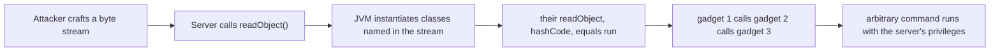
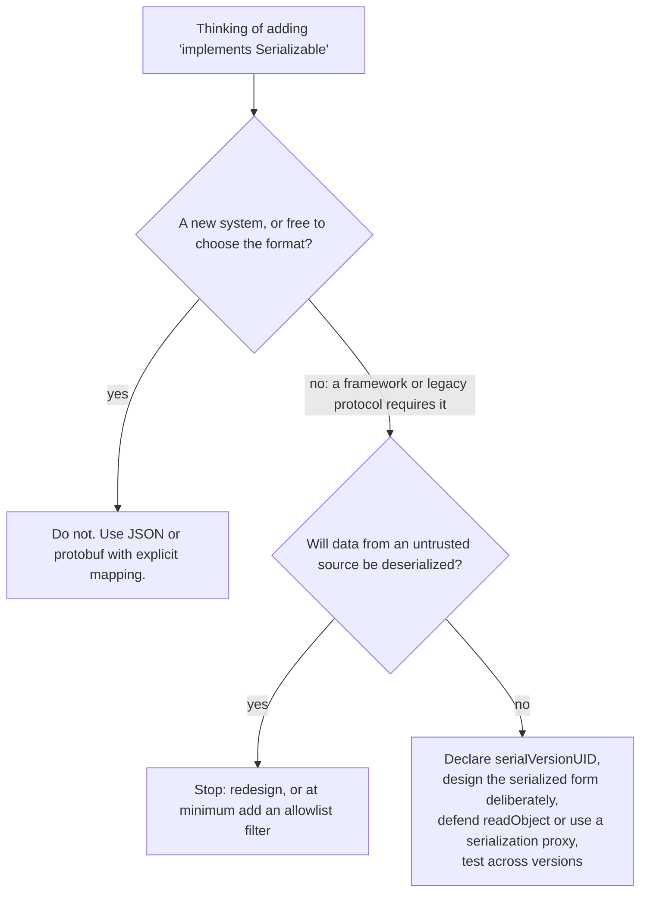

# Why to avoid Java serialization, and the alternatives

> **Before this lesson:** you know how Java serialization works: `Serializable`, `transient`, `serialVersionUID`, object graphs and the fact that deserialization bypasses constructors ([Saving objects: serialization and I/O streams](#/lesson/java/java-serialization-streams)). You know immutability and invariants ([Minimal accessibility and immutable classes](#/lesson/java/java-ej-accessibility-immutability)) and records ([Classes and objects: blueprint and building](#/lesson/java/java-classes-vs-objects)).

## In plain words

Imagine a delivery service with this rule: whatever is written on the label of a parcel, the depot staff will build. "Contains: one chair" and they assemble a chair. "Contains: one machine that opens every door in the depot" and they assemble that as well, following the enclosed instructions step by step, before anybody has looked at what the parcel is for. The service is wonderfully convenient until a stranger sends a parcel.

Java's built-in serialization works like that depot. The byte stream it reads does not only carry data. It names classes to instantiate and, as those objects are rebuilt, methods of those classes run. If the bytes come from someone you cannot trust, that someone is choosing which of your program's code runs.

This lesson explains why Java's own architects call serialization a mistake, what to use instead, and what it costs to make a class `Serializable` if you have no choice.

Why this matters for a job: deserialization of untrusted data has been one of the most damaging classes of security vulnerability in Java systems. Interviewers ask "what is wrong with Java serialization?", "what would you use instead?" and "what does implementing `Serializable` commit you to?".

## The fundamental problem

The method `ObjectInputStream.readObject()` is, in effect, a **magic constructor**. Given a byte stream, it can be made to create an instance of almost any type on the classpath that implements `Serializable`, and while doing so it executes code from those classes: their `readObject` methods, `hashCode` and `equals` of elements placed into rebuilt hash tables, and more.

All the code that can be reached this way forms the program's **attack surface**: the part of a system exposed to a possible attacker. It includes not only your classes but the Java libraries and every third-party library on the classpath.

- A method that performs a dangerous operation as a side effect of deserialization is called a **gadget**.
- Several gadgets linked together, each triggering the next, form a **gadget chain**.
- A chain powerful enough lets an attacker run arbitrary commands on the machine: **remote code execution**.

The attacker does not need to add any code to your system. They assemble a byte stream that uses classes already present, classes written innocently by people who never imagined them being combined this way. Real attacks of this kind have taken over application servers, build servers and, in one well-known incident in 2016, the ticketing systems of a major city's transport network.



### Harm without any gadget: the deserialization bomb

Even a stream made only of harmless standard classes can cause a **denial of service**, that is, make a system unavailable. A "bomb" is a small stream that takes an astronomically long time to deserialize.

Picture a set that contains two sets, each of which contains two more sets, a hundred levels deep, built so that the same inner objects are shared. The serialized form is a few thousand bytes, because each shared object is written once. Deserializing it means rebuilding a `HashSet`, which requires the hash code of every element; each element's hash code requires the hash codes of *its* elements; and with sharing, the number of `hashCode` calls doubles at every level: about $2^{100}$ of them. The machine works until the sun burns out.

### A model of the bomb you can run

```python-run
def hashcode_calls(depth):
    """Calls needed to hash a set that contains two references to one set of depth-1.
    Without caching, the shared child is hashed once per reference."""
    return 1 if depth == 0 else 1 + 2 * hashcode_calls(depth - 1)

def serialized_objects(depth):
    """Objects written to the stream: each shared object is written only once."""
    return depth + 1

print("depth   objects in the stream   hashCode calls to deserialize")
for depth in (1, 5, 10, 20, 30):
    print(f"{depth:5}   {serialized_objects(depth):21}   {hashcode_calls(depth):,}")
print(f"  100   {serialized_objects(100):21}   about {float(2 ** 101):.2e}")
```

A stream of about a hundred objects demands more work than any computer will ever do. The size of the input gives no hint of the cost.

## The best defence: do not deserialize

**There is no reason to use Java serialization in any new system you write.** The only reliable way to win this game is not to play:

> Never deserialize untrusted data.

"Untrusted" includes anything that crosses a network, any file a user could have supplied or modified, anything in a cookie, a message queue or a cache that another party can write to.

### Use a cross-platform structured-data format instead

The alternatives are simpler than Java serialization, and that is their strength. They do not reconstruct arbitrary object graphs or run application code. They describe plain **data**: a small set of primitive types, plus arrays or lists and name-value structures. You then build your own objects from that data, through your own constructors, with your own validation.

| Format | Kind | Readable by people | Schema | Typical use |
|---|---|---|---|---|
| **JSON** | text | yes | optional (JSON Schema) | web APIs, configuration; the default choice |
| **Protocol Buffers** (protobuf) | binary | no (a text form exists) | required: defines the types and enforces correct use | efficient service-to-service calls, storage |
| Avro, CBOR, MessagePack | binary | no | varies | data pipelines, messaging |
| XML | text | yes | optional | older enterprise systems, documents |

A **schema** is a formal description of what the data may contain.

```java
// With a JSON library such as Jackson (not part of the JDK):
record Booking(String guest, int nights) {
    Booking {
        if (guest == null || guest.isBlank()) throw new IllegalArgumentException("guest is required");
        if (nights < 1) throw new IllegalArgumentException("nights must be at least 1");
    }
}

ObjectMapper mapper = new ObjectMapper();
String json = mapper.writeValueAsString(new Booking("Noor", 3));
Booking back = mapper.readValue(json, Booking.class);        // calls the record's constructor: validation runs
System.out.println(json + " -> " + back);
```

```text
{"guest":"Noor","nights":3} -> Booking[guest=Noor, nights=3]
```

Three differences from Java serialization decide the matter:

1. **You name the target type** (`Booking.class`). The data cannot choose which classes are instantiated. (Keep it that way: features such as "polymorphic default typing", which let the data name classes, reintroduce the very vulnerability, and must stay off.)
2. **Your constructor runs**, so invariants are checked.
3. **The format is independent of your classes' private fields**, readable by programs in any language, and easy to inspect.

### If you cannot avoid it

Maintaining an existing system, you may be stuck with serialization. Then:

- **Never deserialize untrusted data.**
- If you must accept serialized data and are unsure of its origin, use **object deserialization filtering** (`java.io.ObjectInputFilter`, Java 9, back-ported to earlier releases). A filter sees each class in the stream before it is deserialized and can accept or reject it, and can limit depth, array sizes and the total number of references.
  - A **blocklist** rejects known-dangerous classes. It protects only against threats already known.
  - An **allowlist** accepts only the classes you list and rejects everything else. **Prefer allowlisting.**

```java
import java.io.ObjectInputFilter;
import java.io.ObjectInputStream;

ObjectInputFilter onlyOurTypes = ObjectInputFilter.Config.createFilter(
        "com.brightpost.model.*;java.base/*;maxdepth=20;maxrefs=1000;!*");    // "!*" rejects everything else

try (ObjectInputStream in = new ObjectInputStream(source)) {
    in.setObjectInputFilter(onlyOurTypes);
    Object value = in.readObject();
}
```

Filtering reduces the risk. It does not remove it, and it does not protect against every denial-of-service stream.

## The cost of implementing Serializable

Making a class serializable takes two words: `implements Serializable`. The ease is deceptive. The long-term costs are large.

### 1. It freezes your implementation

Once a serializable class is released, its byte-stream encoding, its **serialized form**, becomes part of its **exported API**. If you accept the default form, that encoding is tied to the class's private and package-private instance fields at the moment of release. Those fields have stopped being private in any meaningful sense: change them, and old data can no longer be read.

```java
public class Customer implements java.io.Serializable {
    private String fullName;                 // version 1
}

public class Customer implements java.io.Serializable {
    private String firstName;                // version 2: a "private" refactoring...
    private String lastName;                 // ...that breaks every Customer ever saved
}
```

Every serializable class has a stream identifier, `serialVersionUID`. If you do not declare one, it is computed from the class's structure: its name, interfaces, and most of its members. Add a helper method and the number changes; old data then fails with `InvalidClassException`. Always declare it:

```java
private static final long serialVersionUID = 1L;
```

### 2. It is a second, hidden constructor

Deserialization creates objects without calling the class's constructors. Every invariant the constructors establish, every defensive copy they make, is bypassed unless you write extra code. Relying on the default mechanism leaves a class open to invariant corruption and to illegal access to its internals. (The next lesson shows the defences.)

### 3. It multiplies the testing burden

When a serializable class is revised, you must check that instances serialized by the old release can be read by the new, and the reverse. The tests needed grow with the number of serializable classes multiplied by the number of releases.

### 4. It should not be decided lightly, and inheritance makes it harder

- **Value classes** such as `BigInteger` and `Instant`, and **collection classes**, implemented `Serializable`. **Classes representing active entities**, such as thread pools, rarely should.
- **A class designed for inheritance should rarely implement `Serializable`, and an interface should rarely extend it.** Doing so imposes the burden on everyone who extends or implements it.
- If a class is serializable and extendable and has invariants on its fields, it must prevent subclasses from overriding `finalize`, and must guard against instances whose fields are all default values.
- A subclass of a **non-serializable** class can be serializable only if the superclass has an accessible **no-argument constructor**, because deserialization calls it to initialise the superclass's part.
- **Inner classes should not implement `Serializable`.** Their hidden reference to the enclosing instance and compiler-generated fields have no specified serialized form. Static nested classes may.



## Design the serialized form deliberately

If a class must be serializable, do not accept the **default serialized form** without thinking. The default form encodes the object's physical representation: every non-transient field, and everything reachable from it.

**The default form is appropriate only when an object's physical representation is identical to its logical content.**

```java
// Fine with the default form: three fields that ARE the logical value
public class Name implements java.io.Serializable {
    private static final long serialVersionUID = 1L;
    /** Last name. Must be non-null.  @serial */
    private final String lastName;
    /** First name. Must be non-null. @serial */
    private final String firstName;
    /** Middle name, or null if there is none. @serial */
    private final String middleName;
    // constructor omitted
}
```

Even then, a `readObject` method is often needed to check invariants, and each field should be documented, because private fields have become public API.

Now a class whose physical and logical forms differ: a list of strings stored as a doubly linked chain of nodes.

```java
public final class Phrases implements java.io.Serializable {
    private int size = 0;
    private Node head = null;

    private static class Node implements java.io.Serializable {
        String text;
        Node next;
        Node previous;
    }
}
```

Logically it is a sequence of strings. Physically it is nodes with forward and backward links. The default form would write every node and every link, with four bad consequences:

| Problem | Why |
|---|---|
| **The API is tied to the internal representation for ever** | the private `Node` class and its links become part of the public format |
| **Excessive space** | links are implementation details and carry no information |
| **Excessive time** | the serialization logic must traverse the whole graph, with no knowledge of its simple shape |
| **Stack overflow** | the default procedure recurses along the object graph; a long chain exhausts the stack |

A sensible **custom serialized form** is the number of strings followed by the strings. Mark the physical fields `transient` and write `writeObject` and `readObject` methods:

```java
public final class Phrases implements java.io.Serializable {
    private static final long serialVersionUID = 1L;

    private transient int size = 0;                  // transient: not part of the default form
    private transient Node head = null;

    private static class Node {                      // no longer Serializable
        String text; Node next; Node previous;
    }

    public void add(String s) { /* append a node, size++ */ }

    /**
     * @serialData The number of strings ({@code int}), followed by each string in order.
     */
    private void writeObject(java.io.ObjectOutputStream out) throws java.io.IOException {
        out.defaultWriteObject();                    // always call it, for forward compatibility
        out.writeInt(size);
        for (Node n = head; n != null; n = n.next) {
            out.writeObject(n.text);
        }
    }

    private void readObject(java.io.ObjectInputStream in) throws java.io.IOException, ClassNotFoundException {
        in.defaultReadObject();
        int count = in.readInt();
        for (int i = 0; i < count; i++) {
            add((String) in.readObject());           // rebuild through the class's own logic
        }
    }
}
```

Rules that go with a custom form:

- **Mark `transient` every field whose value can be recomputed** or is tied to one run of the JVM (caches, native handles, hash codes derived from identity). Before making a field non-transient, convince yourself it is part of the logical state.
- Remember that transient fields are set to their **default values** on deserialization (`null`, `0`, `false`). If a default is unacceptable, assign the right value in `readObject` or initialise lazily.
- Call `defaultWriteObject` and `defaultReadObject` even if every field is transient; it lets later versions add non-transient fields compatibly.
- **Whatever synchronisation the class uses to read its state, use it in `writeObject` too.** A thread-safe class whose methods are synchronised needs `private synchronized void writeObject(...)`.
- **Declare an explicit `serialVersionUID`** in every serializable class, with any value for a new class, and keep it unchanged unless you intend to break compatibility.

## A balanced summary of the decision

| Question | Guidance |
|---|---|
| New code that must save or send data | JSON or protobuf; map to and from your own types explicitly |
| Must use Java serialization, trusted data only | explicit `serialVersionUID`; a deliberate serialized form; defended `readObject` or a serialization proxy |
| Data of uncertain origin | do not deserialize; if unavoidable, an allowlist `ObjectInputFilter` |
| A class designed for inheritance | do not implement `Serializable` |
| An inner class | never; a static nested class if necessary |
| A plain data carrier | a record, mapped to JSON; if it must be serializable, records are the safest form (next lesson) |

> [!INTERVIEW]
> "What is wrong with Java serialization?" *Deserialization is a hidden constructor that will instantiate whatever serializable classes the stream names and run their code, so untrusted input can trigger gadget chains leading to remote code execution, or denial of service with small inputs. It also bypasses constructors and therefore invariants, exposes private fields as a permanent wire format, is fragile across versions, and is Java-only.* "What instead?" JSON or Protocol Buffers with explicit mapping through constructors. "If you are forced to use it?" Never on untrusted data; allowlist filtering with `ObjectInputFilter`; explicit `serialVersionUID`; custom serialized form; defensive `readObject` or the serialization proxy pattern; prefer records and enums.

## Pitfalls

- **Deserializing data from the network, from users or from shared stores.**
- **Blocklists** relied on as complete protection.
- **JSON libraries configured so that the data can name classes to instantiate.**
- **`implements Serializable` added casually**, or on a class designed for inheritance.
- **No explicit `serialVersionUID`.**
- **Accepting the default serialized form** for a class whose internal structure is not its logical content.
- **Non-transient fields that are caches or derived values.**
- **Forgetting that transient fields come back as defaults.**
- **Serializable inner classes, lambdas and anonymous classes.**
- **Thread-safe classes with an unsynchronised `writeObject`.**
- **Assuming a subclass of a non-serializable class can be serialized** when the superclass has no accessible no-argument constructor.

## Cheat sheet

| Goal | Do |
|---|---|
| Persist or transmit data | JSON, protobuf: data formats, not object-graph formats |
| Untrusted bytes | never `readObject` |
| Unavoidable deserialization | `ObjectInputFilter` allowlist with depth and reference limits |
| Version stamp | `private static final long serialVersionUID = 1L;` |
| Field not part of logical state | `transient` |
| Custom form | private `writeObject` and `readObject`, calling the `default...` methods first |
| Document the form | `@serial` on fields, `@serialData` on `writeObject` |
| Extendable class | do not implement `Serializable` |
| Nested class | static only |

## Summary

- Java deserialization lets a byte stream choose which classes are instantiated and causes their code to run; with untrusted input that leads to remote code execution and denial of service.
- Do not use Java serialization in new systems. Exchange data in a neutral structured format and build objects through your own validated constructors.
- When legacy constraints force it, never deserialize untrusted data, and filter with an allowlist.
- Implementing `Serializable` makes private fields a permanent public format, adds a hidden constructor, and expands testing; avoid it for classes designed for inheritance and for inner classes.
- If a class must be serializable, declare `serialVersionUID`, choose a serialized form that reflects logical content, and mark recomputable state `transient`.

## Glossary

- **Serialization / deserialization**: converting objects to bytes / rebuilding objects from bytes.
- **Attack surface**: the parts of a system an attacker can reach and try to exploit.
- **Gadget**: a method invoked during deserialization that performs a potentially dangerous action.
- **Gadget chain**: gadgets combined so that each triggers the next.
- **Remote code execution**: an attacker running commands of their choice on a target machine.
- **Denial of service**: making a system unavailable to its legitimate users.
- **Deserialization bomb**: a small stream that takes an impractically long time to deserialize.
- **Structured-data format**: a language-neutral representation of data, such as JSON or Protocol Buffers.
- **Schema**: a formal definition of the permitted structure of data.
- **Allowlist / blocklist**: accepting only listed classes / rejecting listed classes.
- **Serialized form**: the byte-stream encoding of a class's instances.
- **Default serialized form**: the encoding produced automatically from the non-transient fields.
- **Logical content / physical representation**: the abstract value an object stands for / the fields and links used to store it.

## Check yourself

```quiz
[
  {"q": "Why is `ObjectInputStream.readObject()` dangerous on untrusted input?", "options": ["It is slow", "The stream decides which serializable classes are instantiated, and their code runs during deserialization", "It cannot read strings", "It ignores serialVersionUID"], "answer": 1,
   "explain": "An attacker can combine existing classes into a gadget chain that performs harmful actions."},
  {"q": "What is the recommended replacement for Java serialization in new systems?", "options": ["Externalizable", "A cross-platform structured-data format such as JSON or Protocol Buffers", "XMLEncoder", "Cloning"], "answer": 1,
   "explain": "They carry plain data; your own constructors build and validate the objects."},
  {"q": "If serialized data of uncertain origin must be read, which filtering strategy is preferred?", "options": ["A blocklist of known bad classes", "An allowlist of permitted classes", "No filter", "Catching ClassCastException"], "answer": 1,
   "explain": "A blocklist only stops known threats; an allowlist rejects everything not explicitly permitted."},
  {"q": "A serializable class has no declared serialVersionUID. A private helper method is added. What happens when old data is read?", "options": ["It works", "InvalidClassException: the automatically computed serialVersionUID has changed", "The method is called", "The data is silently truncated"], "answer": 1,
   "explain": "The generated value depends on class details; declaring it explicitly prevents accidental incompatibility."},
  {"q": "When is the default serialized form appropriate?", "options": ["Always", "When the object's physical representation is identical to its logical content", "Never", "Only for inner classes"], "answer": 1,
   "explain": "Otherwise the internal structure becomes a permanent, wasteful and fragile public format."},
  {"q": "A serializable class has `private transient int cachedHash;`. What is its value right after deserialization?", "options": ["The value at the time of serialization", "0", "-1", "Undefined"], "answer": 1,
   "explain": "Transient fields are not written and receive their default value."},
  {"q": "Why should a class designed for inheritance rarely implement Serializable?", "options": ["It would be final", "Every subclass inherits the security, compatibility and testing burdens", "Subclasses could not have fields", "It prevents overriding"], "answer": 1,
   "explain": "The commitment is imposed on everyone who extends the class."},
  {"q": "Why can a small serialized stream cause a denial of service?", "options": ["Streams are compressed", "Shared, deeply nested structures can require an exponential amount of work (for example hashCode calls) to rebuild", "The JVM limits stream size", "It cannot"], "answer": 1,
   "explain": "Each shared object is written once but may be processed an enormous number of times during reconstruction."}
]
```

> **Source:** Effective Java 3e, item group "Serialization" (alternatives to Java serialization, implementing Serializable with great caution, custom serialized forms); ideas restated with original examples. Checked against the Java Object Serialization Specification and the serialization filtering guide: https://docs.oracle.com/en/java/javase/21/core/serialization-filtering1.html and https://docs.oracle.com/en/java/javase/21/docs/specs/serialization/index.html .
