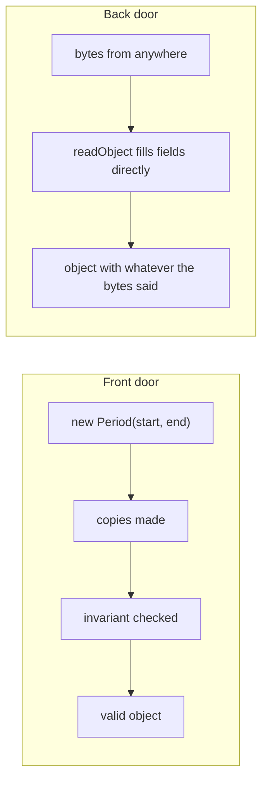
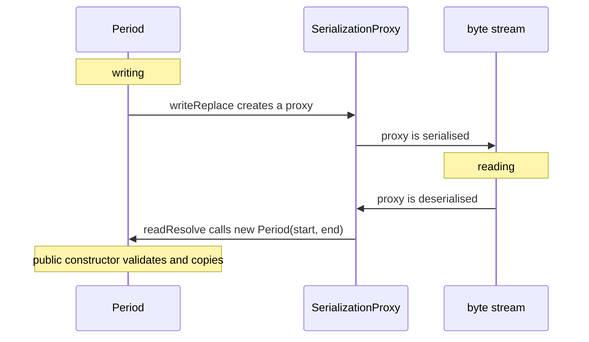
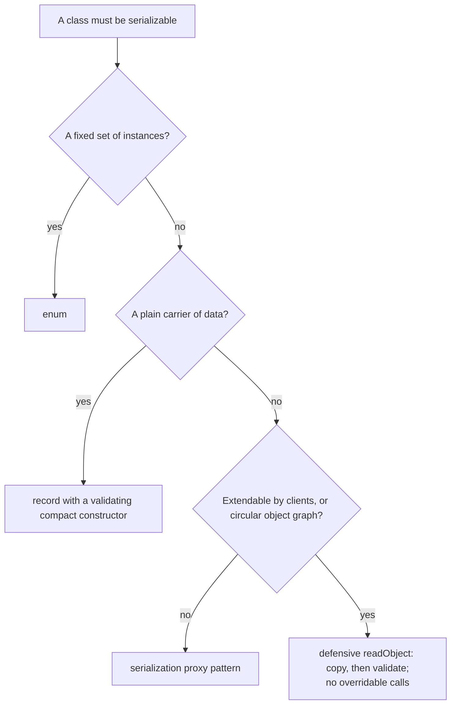

# Defensive deserialization, proxies and records

> **Before this lesson:** you know why Java serialization is risky and what a serialized form is ([Why to avoid Java serialization, and the alternatives](#/lesson/java/java-ej-serialization-risks)), defensive copies ([Parameter checks, defensive copies, signatures and overloading](#/lesson/java/java-ej-params-defensive)), singletons and enums ([Static factories, builders, singletons and dependency injection](#/lesson/java/java-ej-factories-builders), [Enums: constants with data and behaviour](#/lesson/java/java-ej-enums)).

## In plain words

A nightclub checks identity at the front door. The check is useless if there is also a back door that anyone can walk through. Careful classes check their inputs in their constructors: that is the front door. Deserialization is a back door. It creates an object directly from bytes, and the constructor never runs.

The previous lesson's advice was to brick the back door up: do not use Java serialization. Sometimes you inherit a building where that door must stay open, because a framework or an old protocol needs it. Then you post a guard on it too. This lesson shows the three guards, from weakest to strongest:

1. a **defensive `readObject`** method, which repeats the constructor's checks;
2. **enums** for classes that control how many instances exist;
3. the **serialization proxy pattern**, which sends a simple stand-in through the stream and rebuilds the real object through its public constructor;

and then the modern answer that makes most of this unnecessary: **records**.

Why this matters for a job: these are the patterns you will find in mature libraries and may be asked to apply to legacy code. Interview questions include "how can deserialization break a singleton?", "what are `readResolve` and `writeReplace`?" and "why are records safer to serialize?".

## The back door, demonstrated

An immutable period of time with an invariant: the start is not after the end. It makes defensive copies, as taught earlier.

```java
import java.io.Serializable;
import java.util.Date;

public final class Period implements Serializable {
    private static final long serialVersionUID = 1L;
    private final Date start;
    private final Date end;

    public Period(Date start, Date end) {
        this.start = new Date(start.getTime());          // defensive copies
        this.end = new Date(end.getTime());
        if (this.start.compareTo(this.end) > 0) {
            throw new IllegalArgumentException(this.start + " after " + this.end);
        }
    }

    public Date start() { return new Date(start.getTime()); }
    public Date end()   { return new Date(end.getTime()); }
}
```

Through the constructor, this class cannot be broken. Through deserialization it can be broken in two ways.

**Attack 1: a forged stream.** A serialized `Period` is a sequence of bytes. An attacker edits the bytes (or writes them from scratch) so that the end date precedes the start date, and feeds them to `readObject`. No constructor runs, no check is made, and an impossible `Period` now exists inside your program.

**Attack 2: stolen references.** The stream format allows an object to be followed by extra **back-references** to objects already written. An attacker appends references to the `Period`'s private `Date` fields. After deserialization the attacker holds the very `Date` objects inside the "immutable" `Period`, and can call `setTime` on them at leisure.



## Guard 1: write readObject defensively

A `readObject` method is, in effect, **a public constructor that takes a byte stream as its only parameter.** It must do everything a constructor would: validate arguments and make defensive copies. Assume the stream may be hostile.

```java
private void readObject(java.io.ObjectInputStream in) throws java.io.IOException, ClassNotFoundException {
    in.defaultReadObject();                               // fills the fields from the stream

    start = new Date(start.getTime());                    // 1. defensively copy mutable components
    end = new Date(end.getTime());

    if (start.compareTo(end) > 0) {                       // 2. THEN check the invariants
        throw new java.io.InvalidObjectException(start + " after " + end);
    }
}
```

The copies defeat attack 2: after `readObject`, the object's fields refer to fresh `Date` objects that no stream reference can reach. The check defeats attack 1. The order matters for the usual reason: copy first, validate the copies.

One price is paid at once: the fields can no longer be `final`, because `readObject` reassigns them. Serialization has forced a compromise on an immutable class.

A checklist for any `readObject`:

| Rule | Why |
|---|---|
| Defensively copy every field that refers to a mutable object the class must keep private | prevents stolen references |
| Check every invariant; throw `InvalidObjectException` if one fails | prevents forged state |
| Make the copies **before** the checks | prevents a change between check and use |
| If the whole object graph must be validated after being rebuilt, register an `ObjectInputValidation` callback | some invariants span several objects |
| Do not call any overridable method, directly or indirectly | the override would run before the subclass's state has been deserialized |

A litmus test for whether the default `readObject` is acceptable: *would you be comfortable adding a public constructor that takes a parameter for each non-transient field and stores the values without any validation?* If not, write a `readObject`, or better, use a serialization proxy.

### The back door as a model you can run

```python-run
class Period:
    def __init__(self, start, end):                      # the front door
        if start > end:
            raise ValueError(f"{start} is after {end}")
        self.start, self.end = start, end

def deserialize_unsafely(fields):
    """What default deserialization does: allocate, then set fields. No constructor."""
    obj = Period.__new__(Period)
    obj.__dict__.update(fields)
    return obj

def deserialize_defensively(fields):
    """A readObject that repeats the constructor's work."""
    obj = Period.__new__(Period)
    obj.__dict__.update(fields)
    if obj.start > obj.end:
        raise ValueError("InvalidObjectException: start after end")
    return obj

def deserialize_via_proxy(fields):
    """Serialization proxy: the stream holds plain data; the real object is built by its constructor."""
    return Period(fields["start"], fields["end"])

forged = {"start": 20, "end": 5}
for name, fn in (("default", deserialize_unsafely), ("defensive readObject", deserialize_defensively),
                 ("serialization proxy", deserialize_via_proxy)):
    try:
        p = fn(forged)
        print(f"{name:22} -> accepted an INVALID Period(start={p.start}, end={p.end})")
    except ValueError as e:
        print(f"{name:22} -> rejected: {e}")
```

## Guard 2: instance control with enums

Some classes control how many instances exist. A singleton has one. Serialization breaks this silently: **deserializing always creates a new object**, so a serializable singleton stops being a singleton the first time it is read from a stream.

```java
public class Registry implements java.io.Serializable {
    public static final Registry INSTANCE = new Registry();
    private Registry() { }
}
// write Registry.INSTANCE to a stream, read it back: the result != Registry.INSTANCE. Two "singletons".
```

### The readResolve repair, and why it is fragile

A class may declare a method named `readResolve`. After an object has been deserialized, the method is called on it, and **whatever it returns replaces the freshly created object**. The new object is discarded.

```java
private Object readResolve() {
    return INSTANCE;                    // throw away the impostor; return the one true instance
}
```

For this to be safe, **every instance field holding an object reference must be declared `transient`**. Otherwise a carefully built stream can capture a reference to the deserialized impostor *before* `readResolve` runs, by planting a "stealer" object in one of its fields whose own `readResolve` copies the reference into a static variable. The attacker ends up holding a second instance of your singleton. The attack is intricate, and it works.

`readResolve` also has accessibility subtleties: if the class is not final, a private `readResolve` does not apply to subclasses, and a protected or public one may cause `ClassCastException` when a subclass instance is deserialized.

### The robust answer: an enum

```java
public enum Registry {
    INSTANCE;

    private final java.util.Map<String, String> entries = new java.util.concurrent.ConcurrentHashMap<>();

    public void register(String key, String value) { entries.put(key, value); }
    public String lookup(String key)               { return entries.get(key); }
}
```

The language guarantees that no instances of an enum exist other than the declared constants. Enum serialization is special: only the constant's **name** is written, and reading it back calls `valueOf`, returning the existing constant. There is no field data in the stream to forge and no new object to steal.

**If a class must control its instances and be serializable, make it an enum.** Use `readResolve` only when the class's instances are not known at compile time, so an enum cannot represent them; then make all reference fields transient.

## Guard 3: the serialization proxy pattern

The defensive `readObject` works, but it requires care in every class, sacrifices `final` fields, and one forgotten check reopens the door. The **serialization proxy pattern** removes the problem at its root: the real class is never deserialized at all.

The idea in three steps:

1. Declare a private static nested class, the **serialization proxy**, that represents the logical state of the enclosing class in the simplest possible way. It has one constructor, taking the enclosing object, and does nothing except copy the data out. No validation and no defensive copying are needed there.
2. In the enclosing class, a method **`writeReplace`** returns a proxy. The serialization system writes the proxy **instead of** the real object.
3. In the proxy, a method **`readResolve`** rebuilds the real object using only its **public** constructor or factory.

```java
import java.io.InvalidObjectException;
import java.io.ObjectInputStream;
import java.io.Serializable;
import java.util.Date;

public final class Period implements Serializable {
    private final Date start;                             // final again
    private final Date end;

    public Period(Date start, Date end) {
        this.start = new Date(start.getTime());
        this.end = new Date(end.getTime());
        if (this.start.compareTo(this.end) > 0) {
            throw new IllegalArgumentException(this.start + " after " + this.end);
        }
    }

    public Date start() { return new Date(start.getTime()); }
    public Date end()   { return new Date(end.getTime()); }

    // --- serialization proxy pattern ---

    private static class SerializationProxy implements Serializable {
        private static final long serialVersionUID = 234098243823485285L;
        private final Date start;
        private final Date end;

        SerializationProxy(Period p) {
            this.start = p.start;                         // plain copy of the logical state
            this.end = p.end;
        }

        private Object readResolve() {
            return new Period(start, end);                // the PUBLIC constructor: copies and checks
        }
    }

    private Object writeReplace() {
        return new SerializationProxy(this);              // serialise the proxy, not this
    }

    private void readObject(ObjectInputStream in) throws InvalidObjectException {
        throw new InvalidObjectException("proxy required");      // a forged Period stream is refused
    }
}
```



Why it is the strongest guard:

- **Both attacks fail by construction.** A forged proxy with the dates reversed reaches the public constructor, which throws. Stolen references are useless, because the real object's fields are the constructor's fresh copies.
- **Fields can be `final`**, so the class is truly immutable.
- **No separate reasoning is needed**: whatever the constructors and factories guarantee is guaranteed after deserialization.
- **The deserialized object may be of a different class from the one serialized.** `EnumSet` uses the pattern: its proxy stores the element type and the elements, and `readResolve` calls the static factory, which picks the appropriate implementation for the enum's size at the time of reading.

Its limits:

- It cannot be used by classes that are meant to be extended by their users.
- It cannot be used when the object graph contains **circularities**: if the proxy's `readResolve` tries to call a method on an object that refers back to the one being built, that object does not exist yet.
- It costs a little performance compared with defensive `readObject`.

For any non-trivial, non-extendable class that must be serializable, **prefer the serialization proxy pattern.**

## Records: the back door locked by the language

Records, standard since Java 16, were designed with the lessons of this chapter in mind. The serialization of a record is defined so that the back door does not exist.

- A record's **serialized form is its components**, in order, and cannot be customised: `writeObject`, `readObject`, `readObjectNoData`, `writeExternal`, `readExternal` and `serialPersistentFields` are ignored for records.
- **Deserialization calls the record's canonical constructor**, passing the component values read from the stream. If you wrote validation in a compact constructor, it runs.

```java
import java.io.Serializable;
import java.time.Instant;

public record Period(Instant start, Instant end) implements Serializable {
    public Period {
        java.util.Objects.requireNonNull(start, "start");
        java.util.Objects.requireNonNull(end, "end");
        if (start.isAfter(end)) {
            throw new IllegalArgumentException(start + " after " + end);
        }
    }
}
```

That is the whole class. A forged stream with the instants reversed reaches the compact constructor and is rejected with an `InvalidObjectException` whose cause is the `IllegalArgumentException`. There is no proxy to write, no `readObject` to get wrong, and no `final` fields to give up. If a component is of a mutable type, copy it in the compact constructor exactly as you would for ordinary construction; that same code then protects deserialization.

A record's `serialVersionUID` is treated as `0L` unless declared, and the usual matching requirement is waived for records, which removes a whole category of version failures.

Records can also use `writeReplace` and `readResolve`, for example to substitute a canonical instance.

| | Ordinary class | Serialization proxy | Record | Enum |
|---|---|---|---|---|
| Constructor runs on deserialization | no | yes (through the proxy) | yes: canonical constructor | not applicable: existing constant returned |
| Invariants enforced | only with hand-written `readObject` | yes | yes | yes |
| Stolen references to internals | possible unless copied | no | no (copy mutable components in the constructor) | no |
| `final` fields | lost if `readObject` reassigns | kept | always | kept |
| Extra instances | possible | no | not applicable | impossible |
| Code needed | error-prone | about 20 lines | none | none |



> [!TIP]
> In modern code the practical rule is short: exchange data as JSON or protobuf, and model it with records and enums. If Java serialization is ever forced on you, those two kinds of type are already safe, and the serialization proxy pattern covers the rest.

> [!INTERVIEW]
> "How can serialization break a singleton, and how do you prevent it?" Deserialization creates a new instance, bypassing the private constructor. A `readResolve` method returning the existing instance repairs it, provided all reference fields are transient, but the watertight solution is a single-element enum. "What are `writeReplace` and `readResolve`?" Hooks that substitute another object at write time and at read time; together they implement the serialization proxy pattern, in which a simple proxy is serialized and the real object is rebuilt through its public constructor. "Why are records safer?" Their serialized form is exactly their components and deserialization goes through the canonical constructor, so validation and defensive copies written once apply to deserialized instances as well.

## Pitfalls

- **Relying on constructors for invariants in a serializable class** with the default `readObject`.
- **Validating before copying** in `readObject`.
- **Forgetting to copy mutable fields** in `readObject`, leaving references that a stream can share.
- **Calling overridable methods from `readObject`.**
- **A serializable singleton with no instance control.**
- **`readResolve` on a class with non-transient object reference fields.**
- **`readResolve` with the wrong accessibility in a non-final class.**
- **A serialization proxy without the `readObject` that rejects direct deserialization** of the enclosing class.
- **Serialization proxies for extendable classes or circular graphs.**
- **Assuming a record with a mutable component is safe** without a copy in the compact constructor.
- **Custom `writeObject`/`readObject` in a record**: they are ignored.

## Cheat sheet

| Goal | Technique |
|---|---|
| Keep invariants across deserialization | repeat constructor checks in `readObject`, after defensive copies |
| Report a bad stream | `throw new InvalidObjectException("...")` |
| Preserve a singleton | single-element `enum` |
| Replace the deserialized object | `private Object readResolve()` |
| Replace the object being serialized | `private Object writeReplace()` |
| Strongest protection for a class | serialization proxy: `writeReplace` returns a proxy, the proxy's `readResolve` calls the public constructor, the outer `readObject` throws |
| Data carrier | `record ... implements Serializable` with a compact constructor |
| Everything else | do not serialize; use JSON or protobuf |

## Summary

- Deserialization constructs objects without running constructors, so a serializable class's invariants and defensive copies can be bypassed by a crafted stream.
- A defensive `readObject` acts as a constructor: copy mutable components, then validate, and call nothing overridable.
- Instance-controlled classes should be enums; `readResolve` is a fragile substitute.
- The serialization proxy pattern serializes a simple proxy and rebuilds the real object through its public API, preserving `final` fields and every invariant.
- Records serialize as their components and deserialize through the canonical constructor, so they are safe by design.

## Glossary

- **`readObject`**: the private method through which a class customises its own deserialization.
- **`InvalidObjectException`**: the exception signalling that deserialized data violates an object's invariants.
- **Back-reference**: a stream entry referring to an object written earlier, which allows sharing.
- **Instance control**: a class's guarantee about how many instances of it exist.
- **`readResolve`**: a method whose return value replaces a newly deserialized object.
- **`writeReplace`**: a method whose return value is serialized in place of the original object.
- **Serialization proxy**: a private nested class holding an object's logical state, serialized in its place.
- **Circularity**: an object graph in which an object is reachable from itself.
- **Canonical constructor**: a record's constructor taking all components in declaration order.
- **Compact constructor**: the short form of a record's canonical constructor, used for validation.
- **Logical state**: the values that define what an object represents, independent of how they are stored.

## Check yourself

```quiz
[
  {"q": "An immutable class validates its fields in the constructor and implements Serializable with the default behaviour. Can an invalid instance be created?", "options": ["No, the constructor prevents it", "Yes: a forged byte stream is deserialized without running the constructor", "Only by reflection", "Only if the class is not final"], "answer": 1,
   "explain": "Deserialization is a hidden constructor that performs none of the class's checks."},
  {"q": "In a defensive `readObject`, what is the correct order?", "options": ["Validate, then defaultReadObject", "defaultReadObject, validate, then copy", "defaultReadObject, defensively copy mutable fields, then validate", "Copy, then defaultReadObject"], "answer": 2,
   "explain": "Fields are filled first; copies are made so no outside reference remains; then the copies are checked."},
  {"q": "A serializable singleton class is written to a stream and read back. Without special measures, what is true?", "options": ["The same instance is returned", "A second instance now exists", "Deserialization fails", "The class becomes an enum"], "answer": 1,
   "explain": "Deserialization always creates a new object unless readResolve or an enum intervenes."},
  {"q": "What does the `readResolve` method do?", "options": ["Validates the stream", "Returns an object that replaces the one just deserialized", "Writes the object", "Closes the stream"], "answer": 1,
   "explain": "Its result is handed to the caller instead of the newly created instance."},
  {"q": "What is the safest way to implement a serializable singleton?", "options": ["readResolve with non-transient fields", "A single-element enum", "A public static final field", "A static block"], "answer": 1,
   "explain": "The JVM guarantees that enum constants are the only instances and serializes them by name."},
  {"q": "In the serialization proxy pattern, which object does the stream contain?", "options": ["The enclosing object", "An instance of the private nested proxy class", "Both", "Neither; only field names"], "answer": 1,
   "explain": "writeReplace substitutes the proxy; on reading, the proxy's readResolve builds the real object through its public constructor."},
  {"q": "Why does the enclosing class in the proxy pattern declare a `readObject` that throws?", "options": ["To save memory", "To refuse streams that contain a directly serialized (forged) instance of the enclosing class", "Because readObject must always throw", "To call the constructor"], "answer": 1,
   "explain": "Only proxies should ever appear in a stream; anything else is an attack."},
  {"q": "A `record Range(int lo, int hi) implements Serializable` has a compact constructor that rejects lo > hi. A stream with lo = 9 and hi = 1 is deserialized. What happens?", "options": ["An invalid Range is created", "The canonical constructor runs and deserialization fails with an exception", "The fields are swapped", "lo and hi become 0"], "answer": 1,
   "explain": "Records are deserialized by invoking their canonical constructor, so the validation applies."}
]
```

> **Source:** Effective Java 3e, item group "Serialization" (defensive readObject methods, enum types in preference to readResolve for instance control, serialization proxies); ideas restated with original examples, extended with record serialization. Checked against the Java Object Serialization Specification, sections on readResolve, writeReplace and the serialization of records: https://docs.oracle.com/en/java/javase/21/docs/specs/serialization/serial-arch.html#serialization-of-records and https://docs.oracle.com/en/java/javase/21/docs/specs/serialization/input.html .
