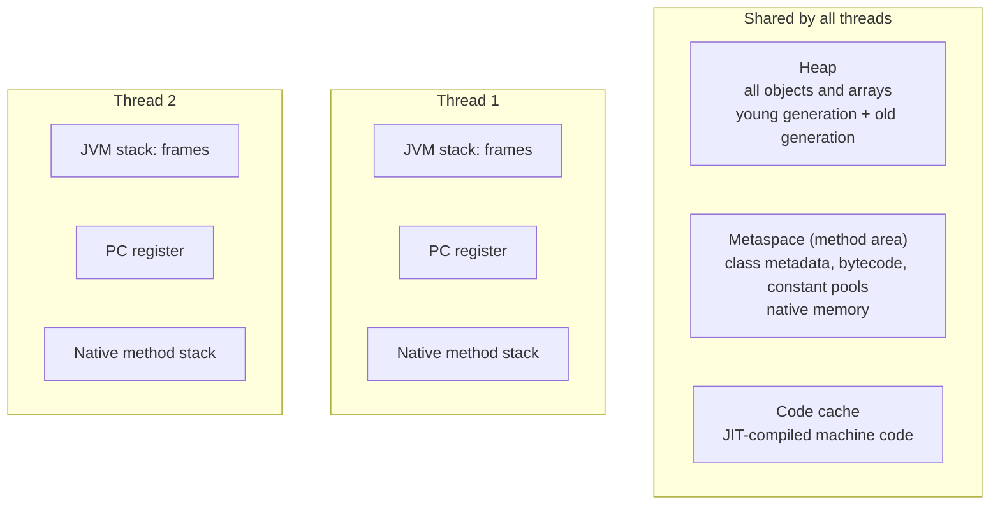
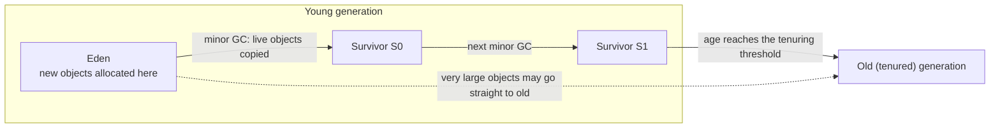
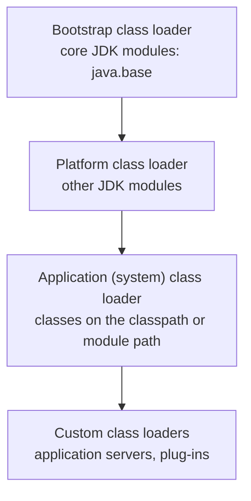

# JVM memory areas and garbage collectors

> **Before this lesson:** you know the stack and the heap ([References, arrays, the stack and the heap](#/lesson/java/java-references-stack-heap)), reachability and the basics of garbage collection ([Object lifecycle, scope and garbage collection](#/lesson/java/java-object-lifecycle-gc)), class loading and the JIT compiler ([From source code to a running program](#/lesson/java/java-source-to-jvm)) and threads ([Threads, Runnable and ExecutorService](#/lesson/java/java-threads-executors)).

## In plain words

Think of a large hotel. Guests sleep in rooms; that is where the people actually are. Each receptionist has a personal notepad for the jobs they are doing right now. Behind the desk is a shelf of manuals that describe how the hotel works and never leave the building. And there is a cleaning crew that goes round emptying rooms nobody is using any more.

The JVM is organised the same way. The **heap** is the rooms: every object lives there. Each thread has its own **stack**, a notepad of the method calls in progress. The **metaspace** is the shelf of manuals: descriptions of the loaded classes. The **garbage collector** is the cleaning crew.

This is the first of four lessons that take interview questions head on. Each topic is stated the way an interviewer asks it, followed by a worked answer you can adapt, and the reasoning behind it.

Why this matters for a job: "explain the JVM memory model" and "how does garbage collection work?" are asked in the majority of Java interviews above entry level, and the answers explain real production failures: `OutOfMemoryError`, `StackOverflowError`, long pauses.

## Q1. What are the memory areas of the JVM?

**Worked answer.** *The JVM specification defines several run-time data areas. Shared by all threads: the **heap**, where every object and array is allocated, and the **method area**, which holds per-class data such as the run-time constant pool, field and method information, and method bytecode; in HotSpot since Java 8 this is implemented as **Metaspace**, in native memory. Per thread: a **JVM stack** of frames, one per method call, each holding local variables, an operand stack and a reference to the class's constant pool; a **program counter (PC) register** pointing at the current instruction; and a **native method stack** for native code. HotSpot adds a **code cache** for JIT-compiled machine code.*



| Area | Per | Holds | Runs out with | Flag |
|---|---|---|---|---|
| Heap | JVM | objects, arrays, and since Java 7 the string pool and static variables' objects | `OutOfMemoryError: Java heap space` | `-Xms` initial, `-Xmx` maximum |
| Metaspace | JVM | class metadata | `OutOfMemoryError: Metaspace` | `-XX:MaxMetaspaceSize` |
| JVM stack | thread | frames: local variables, operand stack | `StackOverflowError` | `-Xss` |
| PC register | thread | address of the current bytecode instruction | never | none |
| Code cache | JVM | compiled native code | compilation stops; a warning | `-XX:ReservedCodeCacheSize` |

**Follow-up: "What was PermGen?"** Before Java 8, HotSpot stored class metadata in a fixed-size heap region called the permanent generation, and applications that loaded many classes died with `OutOfMemoryError: PermGen space`. Java 8 replaced it with Metaspace, allocated from native memory and able to grow (unless capped).

**Follow-up: "Where exactly is everything in this code?"**

```java
public class Where {
    static int counter = 0;                      // static field: stored with the class data (on the heap in modern HotSpot)
    private final String label;                  // instance field: inside each Where object, on the heap

    Where(String label) { this.label = label; }

    int twice(int n) {                           // n and result: in this call's stack frame
        int result = n * 2;
        return result;
    }

    public static void main(String[] args) {
        Where w = new Where("demo");             // w: reference in main's frame; the object: heap
        int x = w.twice(21);                     // x: primitive in main's frame
        System.out.println(x + " " + counter);
    }
}
```

```text
42 0
```

The summary to give: **local variables and parameters are in stack frames; objects, with their instance fields, are on the heap; class-level information is in the method area.** A local variable of a reference type is a slot on the stack holding a reference to a heap object.

## Q2. Stack versus heap?

| | Stack | Heap |
|---|---|---|
| One per | thread | JVM |
| Stores | frames: locals, parameters, return addresses | objects and arrays |
| Lifetime | until the method returns | until unreachable and collected |
| Managed by | push and pop on call and return | the garbage collector |
| Speed | very fast | allocation fast; reclamation costs |
| Thread safety | private to the thread | shared: needs care |
| Failure | `StackOverflowError` | `OutOfMemoryError` |

**Follow-up: "Can an object be allocated on the stack?"** Conceptually no. In practice the JIT compiler performs **escape analysis**: if it can prove that an object never leaves the method that creates it, it may avoid a heap allocation entirely, keeping the object's fields in registers or on the stack (**scalar replacement**). This is an invisible optimisation; the program behaves as if the object were on the heap.

## Q3. How does garbage collection work?

**Worked answer.** *The collector finds objects that are no longer reachable and reclaims their memory. It starts from **GC roots** (local variables in active stack frames, static fields, JNI references, live threads) and traces every reference to mark the reachable objects; everything unmarked is garbage. Java does not use reference counting, so cycles are collected. Most collectors are **generational**: because most objects die young, new objects go into a small young generation that is collected frequently and cheaply, and survivors are promoted to an old generation collected less often. After marking, collectors either **sweep** dead objects into free lists, **copy** live objects elsewhere, or **compact** them to remove fragmentation.*

### The generational heap



1. Objects are created in **Eden**. Allocation is a pointer bump, very cheap; each thread has its own small buffer (a **TLAB**, thread-local allocation buffer) to avoid contention.
2. When Eden fills, a **minor (young) collection** runs. Live objects in Eden and the occupied survivor space are **copied** to the other survivor space; their **age** increases by one. Eden and the old survivor space are then entirely empty. Cost is proportional to the number of *live* objects, which is small.
3. An object that survives enough minor collections (the **tenuring threshold**, at most 15) is **promoted** to the old generation.
4. When the old generation fills, a **major** or **mixed** collection handles it; a **full GC** collects the whole heap and is the most expensive event.

### A generational collector you can run

```python-run
def simulate(allocations, eden_size=4, tenure_age=2):
    """allocations: list of (name, lifetime) where lifetime = number of later allocations it stays reachable.
    Minor GC runs when Eden is full: live objects move to survivor (age+1) or are promoted."""
    eden, survivor, old, log = [], [], [], []
    clock = 0
    def alive(obj): return obj["born"] + obj["life"] > clock
    for name, life in allocations:
        if len(eden) == eden_size:
            live = [o for o in eden + survivor if alive(o)]
            dead = len(eden) + len(survivor) - len(live)
            eden, survivor = [], []
            for o in live:
                o["age"] += 1
                (old if o["age"] >= tenure_age else survivor).append(o)
            log.append(f"minor GC before {name}: reclaimed {dead}, survivor={[o['name'] for o in survivor]}, "
                       f"old={[o['name'] for o in old]}")
        eden.append({"name": name, "born": clock, "life": life, "age": 0})
        clock += 1
    return log

# Most objects are short-lived (life 1 or 2); 'cfg' and 'cache' live a long time.
allocs = [("cfg", 99), ("t1", 1), ("t2", 1), ("t3", 2), ("cache", 99), ("t4", 1), ("t5", 1), ("t6", 1),
          ("t7", 1), ("t8", 2), ("t9", 1), ("t10", 1), ("t11", 1)]
print("\n".join(simulate(allocs)))
```

The short-lived objects are reclaimed without ever being copied twice; only the two long-lived ones are promoted. That is the generational hypothesis paying off.

## Q4. Which garbage collectors does Java have, and how do you choose?

**Vocabulary first.**

- **Stop-the-world (STW) pause**: all application threads are halted while the collector works.
- **Concurrent**: the collector works while the application runs.
- **Parallel**: the collector uses several threads (during a pause, or concurrently).
- **Throughput**: the share of total time spent running the application and not collecting.
- **Latency**: how long the application is paused or delayed.
- **Footprint**: how much memory the process uses.

No collector optimises all three at once; choosing one means choosing which to favour.

| Collector | Flag | Design | Favours | Use when |
|---|---|---|---|---|
| **Serial** | `-XX:+UseSerialGC` | single-threaded, STW, generational | footprint | tiny heaps, single-core containers, small tools |
| **Parallel** | `-XX:+UseParallelGC` | multi-threaded, STW, generational | throughput | batch jobs where pauses do not matter |
| **G1** (garbage first) | `-XX:+UseG1GC` | heap split into equal **regions**; concurrent marking; collects the regions with most garbage first; pause-time target | balance | the **default since Java 9**; general-purpose servers |
| **ZGC** | `-XX:+UseZGC` | concurrent mark **and** concurrent relocation using coloured pointers and load barriers; generational since Java 21 | latency: sub-millisecond pauses | large heaps (to terabytes) with strict response times |
| **Shenandoah** | `-XX:+UseShenandoahGC` | concurrent compaction, similar goals to ZGC | latency | as above, in JDK builds that include it |
| **Epsilon** | `-XX:+UseEpsilonGC` | allocates and never collects | measurement | performance testing, very short-lived programs |

The old **CMS** (concurrent mark-sweep) collector was deprecated in Java 9 and removed in Java 14; mention it only as history.

**How G1 works, in four sentences.** The heap is divided into a couple of thousand regions, each of which is assigned on the fly to be Eden, survivor, old or "humongous" (for objects larger than half a region). Young collections are stop-the-world copying collections of the Eden and survivor regions. A concurrent marking cycle determines how much live data each old region holds. **Mixed** collections then evacuate the young regions plus the old regions with the most garbage, choosing as many as fit within the pause-time goal set by `-XX:MaxGCPauseMillis` (default 200 ms).

**Choosing, as you would say it in an interview:** *"Start with the default, G1. If the workload is batch-oriented and only total time matters, try Parallel. If the service has tight latency requirements or a very large heap, try ZGC. Then measure with GC logs before changing anything else."*

## Q5. What causes OutOfMemoryError, and how do you diagnose one?

| Message | Meaning | Usual cause |
|---|---|---|
| `Java heap space` | the heap is full of reachable objects | a memory leak, or the heap is too small for the data |
| `GC overhead limit exceeded` | almost all time is spent collecting and almost nothing is freed | the same, at an earlier stage |
| `Metaspace` | class metadata area exhausted | class-loader leaks, heavy run-time code generation |
| `unable to create native thread` | the OS refused another thread | too many platform threads; OS limits |
| `Direct buffer memory` | off-heap NIO buffers exhausted | unreleased direct `ByteBuffer`s |
| `Requested array size exceeds VM limit` | an array too big to allocate | a bug in size calculation |

**Worked answer for diagnosis.**

1. **Capture evidence.** Start the JVM with `-XX:+HeapDumpOnOutOfMemoryError -XX:HeapDumpPath=/dumps`. A **heap dump** is a snapshot of every object. On a live process: `jcmd <pid> GC.heap_dump file.hprof`.
2. **Read GC logs** (`-Xlog:gc*`). A heap whose occupancy *after* each full collection keeps climbing is leaking. A heap that returns to the same level is merely busy or undersized.
3. **Analyse the dump** in a tool such as Eclipse MAT or VisualVM. Look at the **dominator tree**: which objects retain the most memory, and the **path to GC roots** that keeps them alive.
4. **Fix the cause**: bound the cache, remove the listener, close the resource, clear the `ThreadLocal`. Raise `-Xmx` only if the data legitimately needs it.

```java
// The classic leak: a static collection that only grows
class SessionStore {
    private static final java.util.Map<String, byte[]> SESSIONS = new java.util.HashMap<>();

    static void open(String id) {
        SESSIONS.put(id, new byte[1_000_000]);     // 1 MB per session, never removed
    }
}
```

**Follow-up: "Difference between `StackOverflowError` and `OutOfMemoryError`?"** The first means one thread's stack is exhausted, almost always by runaway recursion; the second means a shared memory area (usually the heap) cannot satisfy an allocation. Both are `Error`s, not exceptions you are expected to catch.

## Q6. What are strong, soft, weak and phantom references?

By default a reference is **strong**: while it exists, the object cannot be collected. The package `java.lang.ref` offers three weaker kinds.

| Kind | Collected when | Use |
|---|---|---|
| **Strong** | never, while reachable | ordinary variables and fields |
| **Soft** (`SoftReference`) | only when the JVM is about to run out of memory | memory-sensitive caches |
| **Weak** (`WeakReference`) | at the next collection, once no strong or soft references remain | canonical maps, listeners; `WeakHashMap` keys |
| **Phantom** (`PhantomReference`) | after the object is finalised; `get()` always returns `null` | clean-up actions; the basis of `Cleaner` |

```java
import java.lang.ref.WeakReference;

Object data = new Object();
WeakReference<Object> weak = new WeakReference<>(data);
System.out.println(weak.get() != null);
data = null;                         // no strong reference remains
System.gc();                         // a request; usually honoured in a simple test
System.out.println(weak.get() == null);
```

```text
true
true
```

(The second line depends on the collector running; it is typical, not guaranteed.)

## Q7. How does class loading work?

**Worked answer.** *A class is loaded on first use, in three phases. **Loading**: a class loader finds the bytes and creates a `Class` object. **Linking**: verification of the bytecode, preparation (static fields get default values), and resolution of symbolic references. **Initialisation**: static initialisers and static field assignments run, once, in a thread-safe way. Class loaders form a hierarchy and follow **parent delegation**: a loader first asks its parent to load a class and tries itself only if the parent cannot.*



Parent delegation guarantees that nobody can substitute their own `java.lang.String`: a request for it always reaches the bootstrap loader first. A class's identity at run time is its fully qualified name **plus** the loader that defined it, which is how application servers isolate applications from one another, and why a class loaded by two loaders is two different classes (the source of baffling `ClassCastException: X cannot be cast to X` errors).

## Q8. What does the JIT compiler do?

The JVM begins by **interpreting** bytecode and counts how often methods and loops run. Hot code is compiled to native machine code by the JIT. HotSpot uses **tiered compilation**: the fast compiler **C1** produces reasonable code quickly and gathers profiling data; the optimising compiler **C2** then recompiles the hottest methods aggressively. Typical optimisations: **inlining** (replacing a call with the body of the method), escape analysis and scalar replacement, lock elision, dead-code elimination, and loop unrolling. Optimisations based on assumptions (for example "this interface has only one implementation loaded") can be undone by **deoptimisation** if the assumption stops being true.

Consequences worth stating: Java programs need **warm-up** before reaching full speed; and naive benchmarks mislead, which is why JMH exists.

## Rapid-fire answers

| Question | Answer |
|---|---|
| Can you force garbage collection? | No. `System.gc()` is a hint. |
| Is `finalize()` reliable? | No; deprecated for removal. Use try-with-resources or `Cleaner`. |
| Are static variables on the heap? | Yes, in modern HotSpot they are stored with the `Class` object, on the heap; class metadata is in Metaspace. |
| Where is the string pool? | On the heap since Java 7. |
| Default collector? | G1, since Java 9 (on server-class machines). |
| What are `-Xms` and `-Xmx`? | Initial and maximum heap size. |
| What is a memory leak in Java? | Objects that are no longer needed but remain reachable. |
| What is a safepoint? | A point where a thread's state is fully known, so the JVM can pause it for a stop-the-world operation. |
| What is a TLAB? | A per-thread chunk of Eden for lock-free allocation. |
| Does more heap mean fewer pauses? | Fewer collections, but with STW collectors each may be longer. |

> [!INTERVIEW]
> Structure every memory answer the same way: **area, what lives there, who manages it, how it fails.** For garbage collection: **roots and reachability, generations and why, the collector families with their trade-off (throughput, latency, footprint), and how you would measure.** Interviewers reward the phrase "I would look at the GC logs and a heap dump before tuning anything".

## Pitfalls

- **Saying "objects on the heap, primitives on the stack".** Primitive *fields* live inside their objects on the heap; only local primitives are in stack frames.
- **Claiming Java uses reference counting**, or that cycles leak.
- **Saying Java cannot leak memory.**
- **Mentioning PermGen as current.** It ended with Java 7.
- **Describing CMS as available** in current JDKs.
- **Treating `System.gc()` as a command.**
- **Fixing an `OutOfMemoryError` by raising `-Xmx`** without checking for a leak.
- **Confusing `StackOverflowError` with heap exhaustion.**
- **Assuming ZGC is always best.** It trades some throughput and memory for low pauses.

## Cheat sheet

| Topic | Key fact |
|---|---|
| Heap | shared; all objects; young (Eden + 2 survivors) and old |
| Stack | per thread; one frame per call; locals and operand stack |
| Metaspace | class metadata; native memory; replaced PermGen in Java 8 |
| GC roots | stack locals, statics, JNI references, threads |
| Minor GC | copies live young objects; cheap; frequent |
| Promotion | after surviving up to the tenuring threshold |
| Serial / Parallel | STW; small heaps / throughput |
| G1 | default; regions; pause target |
| ZGC, Shenandoah | concurrent; sub-millisecond to few-millisecond pauses |
| Heap dump | `-XX:+HeapDumpOnOutOfMemoryError`, `jcmd <pid> GC.heap_dump` |
| GC log | `-Xlog:gc*` |
| Thread dump | `jcmd <pid> Thread.print`, `jstack <pid>` |

## Summary

- The JVM's run-time areas are the shared heap and metaspace, and per-thread stacks, PC registers and native stacks.
- Stack frames hold locals and parameters; the heap holds every object; metaspace holds class data.
- Garbage collection traces from roots, and generational collectors exploit the short life of most objects.
- Collectors differ in the balance of throughput, latency and footprint: Serial, Parallel, G1 (default), ZGC, Shenandoah.
- `OutOfMemoryError` is diagnosed with GC logs and heap dumps, and usually means a leak: reachable objects nobody needs.
- Classes are loaded, linked and initialised lazily by a hierarchy of delegating class loaders; hot code is compiled by the tiered JIT.

## Glossary

- **Run-time data area**: a region of memory the JVM uses while executing a program.
- **Metaspace**: the native-memory area for class metadata in HotSpot.
- **Frame**: the stack record for one method invocation.
- **GC root**: a starting reference for reachability analysis.
- **Generational collection**: treating young and old objects in separate regions.
- **Eden / survivor spaces**: the parts of the young generation.
- **Promotion (tenuring)**: moving a long-lived object to the old generation.
- **Stop-the-world pause**: a period when all application threads are suspended.
- **Throughput / latency / footprint**: the three competing goals of garbage collection.
- **Region**: one of the equal-sized heap blocks used by G1 and newer collectors.
- **Heap dump**: a file containing a snapshot of all heap objects.
- **Dominator tree**: an analysis showing which objects keep which others alive.
- **Soft / weak / phantom reference**: references that do not, by themselves, keep an object alive.
- **Parent delegation**: a class loader asking its parent before loading a class itself.
- **Tiered compilation**: using a quick compiler first and an optimising compiler for hot code.
- **Escape analysis**: determining whether an object can be seen outside its creating method.

## Check yourself

```quiz
[
  {"q": "Where is the object created by `new int[100]` inside a method stored?", "options": ["On the stack, because int is a primitive", "On the heap; only the reference is in the stack frame", "In Metaspace", "In the code cache"], "answer": 1,
   "explain": "Arrays are objects, and all objects are heap-allocated. The local variable holds a reference."},
  {"q": "Which area replaced PermGen in Java 8?", "options": ["The old generation", "Metaspace", "The code cache", "Eden"], "answer": 1,
   "explain": "Class metadata moved to Metaspace, allocated from native memory."},
  {"q": "A method calls itself with no base case. Which error results?", "options": ["OutOfMemoryError: Java heap space", "StackOverflowError", "OutOfMemoryError: Metaspace", "IllegalStateException"], "answer": 1,
   "explain": "Each call adds a frame to the thread's stack until it is exhausted."},
  {"q": "Why are minor collections cheap?", "options": ["They run on the GPU", "Their cost depends on the number of live young objects, and most young objects are already dead", "They skip marking", "They only run at shutdown"], "answer": 1,
   "explain": "Copying collectors touch only survivors; the generational hypothesis says there are few."},
  {"q": "Which collector is the default in current JDKs on server-class machines?", "options": ["Serial", "Parallel", "G1", "CMS"], "answer": 2,
   "explain": "G1 has been the default since Java 9. CMS was removed in Java 14."},
  {"q": "Two objects reference each other and nothing else references them. Will they be collected?", "options": ["No, the cycle keeps them alive", "Yes, they are unreachable from any GC root", "Only with System.gc()", "Only by ZGC"], "answer": 1,
   "explain": "Tracing collectors determine liveness by reachability from roots, not by counting references."},
  {"q": "An application's heap usage after every full GC keeps rising until OutOfMemoryError. What is the most likely cause?", "options": ["The heap is fragmented", "A memory leak: objects remain reachable although no longer needed", "Too many CPU cores", "The JIT compiler"], "answer": 1,
   "explain": "A rising post-collection baseline means live data is growing. A heap dump shows what retains it."},
  {"q": "When is an object referred to only by a WeakReference collected?", "options": ["Never", "At the next garbage collection", "Only when memory is nearly exhausted", "When the JVM exits"], "answer": 1,
   "explain": "Weak references do not prevent collection. Soft references are kept until memory is low."}
]
```

> **Source:** interview synthesis; facts checked against the Java Virtual Machine Specification, ch. 2.5 (run-time data areas) and ch. 5 (loading, linking, initialising): https://docs.oracle.com/javase/specs/jvms/se21/html/jvms-2.html , the HotSpot Garbage Collection Tuning Guide: https://docs.oracle.com/en/java/javase/21/gctuning/ , and JEP 439 (generational ZGC): https://openjdk.org/jeps/439 . Background reading: Head First Java, ch. 9.
