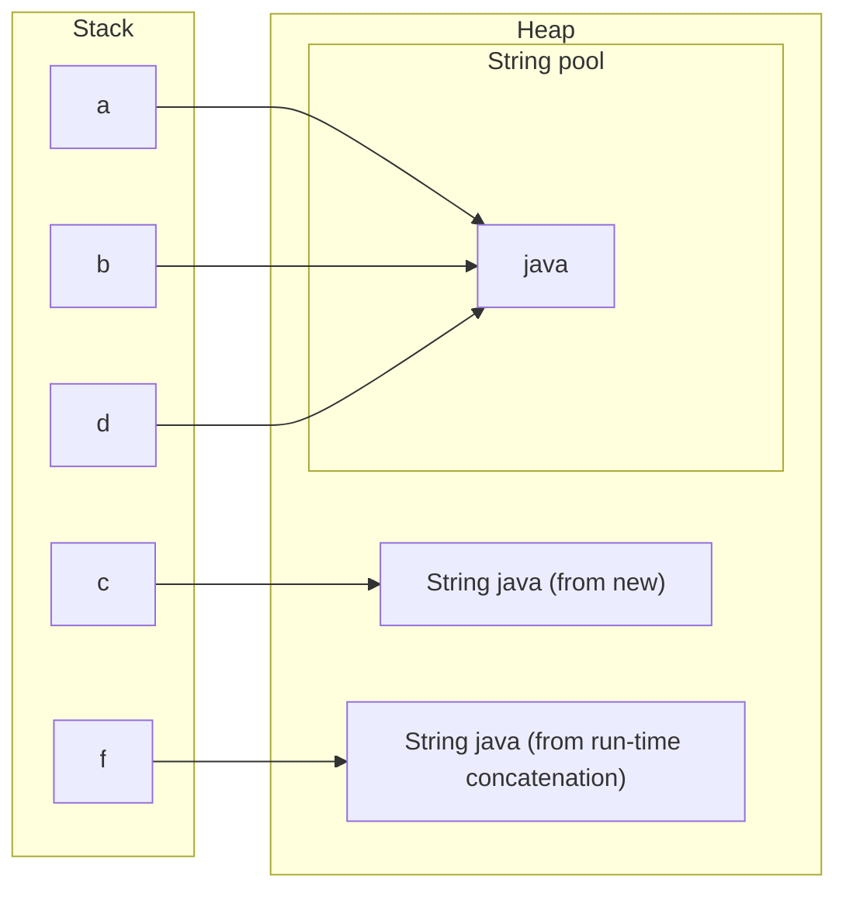
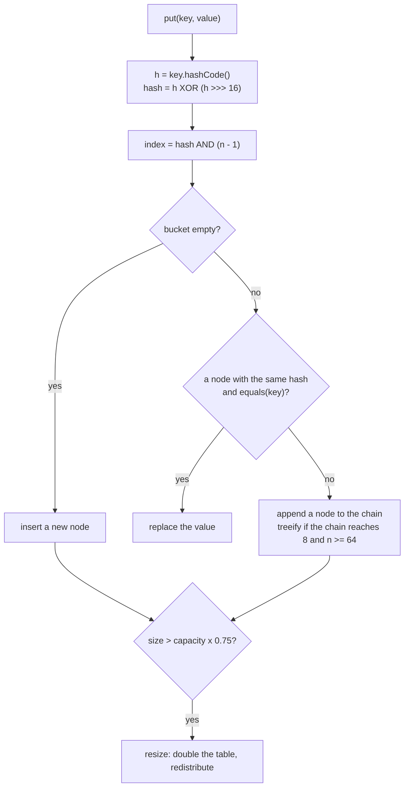

# Strings, equals/hashCode, HashMap and ConcurrentHashMap internals

> **Before this lesson:** you know references and `==` versus `equals` ([References, arrays, the stack and the heap](#/lesson/java/java-references-stack-heap)), the `equals`/`hashCode` contract ([Writing equals and hashCode correctly](#/lesson/java/java-ej-equals-hashcode)), how hash buckets work in outline ([Collections: List, Set, Map and Queue](#/lesson/java/java-collections)) and race conditions ([Race conditions, synchronization, deadlock and virtual threads](#/lesson/java/java-synchronization)).

## In plain words

A cloakroom gives you a numbered ticket for your coat. When you come back, the attendant does not search every coat in the building. The ticket number says which rail to look on, and on that rail there are only a few coats to check. If the cloakroom gets crowded, the manager opens more rails and re-hangs the coats, so each rail stays short.

A `HashMap` is that cloakroom. The ticket number is the key's **hash code**, the rails are **buckets**, and re-hanging the coats is **resizing**. A `String` is the most common kind of ticket, which is one reason Java makes strings unchangeable: a ticket whose number altered while your coat was on the rail would be useless.

This lesson answers the questions interviewers ask about these two classes more than about any others in Java.

Why this matters for a job: "how does `HashMap` work internally?" is arguably the single most common Java interview question, with "why is `String` immutable?" close behind.

## Part 1: Strings

### Q1. What is the string pool, and what does this print?

```java
public class Pool {
    public static void main(String[] args) {
        String a = "java";
        String b = "java";
        String c = new String("java");
        String d = c.intern();
        String e = "ja" + "va";              // compile-time constant
        String part = "ja";
        String f = part + "va";              // computed at run time

        System.out.println(a == b);
        System.out.println(a == c);
        System.out.println(a == d);
        System.out.println(a == e);
        System.out.println(a == f);
        System.out.println(a.equals(c) && a.equals(f));
    }
}
```

```text
true
false
true
true
false
true
```

**Worked answer.** *The **string pool** (or intern pool) is a table of unique `String` objects kept by the JVM, on the heap. Every string **literal** in the source is placed in the pool when its class is loaded, so identical literals refer to one shared object. `new String("java")` always creates a new, separate object on the heap, although its argument is the pooled literal. `intern()` returns the pooled string with the same contents, adding it if absent. Expressions made only of compile-time constants are folded by the compiler into one literal; concatenation involving a non-constant variable happens at run time and produces a new object.*

Line by line:

| Comparison | Result | Why |
|---|---|---|
| `a == b` | true | two identical literals, one pooled object |
| `a == c` | false | `new` forces a distinct object |
| `a == d` | true | `intern()` returns the pooled object |
| `a == e` | true | `"ja" + "va"` is a constant expression, folded to `"java"` at compile time |
| `a == f` | false | `part` is not a constant, so the concatenation runs at run time |
| `equals` | true | same characters |

Declare `final String part = "ja";` and `a == f` becomes **true**: a final variable initialised with a constant is itself a compile-time constant.



**Follow-up: "How many objects does `new String("java")` create?"** At most two: the pooled literal (created once, when the class is loaded, if not already present) and the new heap object each time the line runs.

### A string pool model you can run

```python-run
class Str:                                   # an object with identity
    def __init__(self, text): self.text = text

pool = {}
def literal(text):                           # a literal, or a compile-time constant expression
    return pool.setdefault(text, Str(text))
def new_string(text):                        # new String(...)
    literal(text)                            # the argument literal is pooled
    return Str(text)
def concat_runtime(x, y):                    # concatenation involving a non-constant
    return Str(x.text + y.text)
def intern(s):
    return pool.setdefault(s.text, s)

a = literal("java")
b = literal("java")
c = new_string("java")
d = intern(c)
e = literal("ja" + "va")                     # folded by the compiler
part = literal("ja")
f = concat_runtime(part, literal("va"))

for name, x in (("b", b), ("c", c), ("d", d), ("e", e), ("f", f)):
    print(f"a == {name}: {str(a is x):5}   a.equals({name}): {a.text == x.text}")
print("objects in the pool:", sorted(pool))
```

### Q2. Why is String immutable?

**Worked answer.** *`String` is a final class whose character data cannot change after construction. The reasons:*

1. **The string pool depends on it.** Sharing one object among many references is only safe if nobody can change it.
2. **Security.** Strings carry file paths, URLs, class names, user names and SQL fragments. If a string could be altered after a security check, the check would be meaningless.
3. **Thread safety.** Immutable objects can be shared between threads with no synchronisation.
4. **Hash code caching.** `String` computes its hash once, stores it in a field and reuses it, which makes strings fast, reliable `HashMap` keys. A mutable key whose hash changed would be lost in its bucket.
5. **Class loading safety.** The JVM identifies classes by name; a mutable name could cause the wrong class to be loaded.

**Follow-up: "How is immutability achieved?"** The class is `final`; its internal array (a `byte[]` since Java 9, with a coder flag for Latin-1 or UTF-16, a design called **compact strings**) is `private final` and never exposed; every "modifying" method returns a new `String`.

**Follow-up: "`String` versus `StringBuilder` versus `StringBuffer`?"**

| | `String` | `StringBuilder` | `StringBuffer` |
|---|---|---|---|
| Mutable | no | yes | yes |
| Thread-safe | yes (immutable) | no | yes (synchronised methods) |
| Speed for many appends | slow (quadratic) | fast | slower than `StringBuilder` |
| Use | values, keys | building text | legacy code |

**Follow-up: "Why prefer `char[]` to `String` for passwords?"** A `String` stays in memory, unchangeable, until garbage collected, and may appear in heap dumps and logs. A `char[]` can be overwritten with zeros as soon as it is no longer needed.

## Part 2: equals and hashCode

### Q3. State the contract. What happens if you break it?

**Worked answer.** *If `a.equals(b)` is true, then `a.hashCode()` must equal `b.hashCode()`. The converse is not required: unequal objects may share a hash code, which is a collision. `hashCode` must return the same value while the fields used by `equals` are unchanged. `equals` itself must be reflexive, symmetric, transitive, consistent and return false for `null`.*

| What you did | Consequence in `HashMap` and `HashSet` |
|---|---|
| overrode `equals`, not `hashCode` | equal keys land in different buckets: lookups miss, duplicates are accepted |
| overrode `hashCode`, not `equals` | same bucket, but identity comparison: lookups with an equal-but-distinct key miss |
| `hashCode` returns a constant | correct, but every entry collides: operations degrade from constant to logarithmic or linear time |
| mutated a key after insertion | the entry sits in its old bucket and can no longer be found or removed |

```java
import java.util.*;

record GoodKey(String id) { }

class MutableKey {
    String id;
    MutableKey(String id) { this.id = id; }
    @Override public boolean equals(Object o) { return o instanceof MutableKey k && k.id.equals(id); }
    @Override public int hashCode() { return id.hashCode(); }
}

Map<MutableKey, String> m = new HashMap<>();
MutableKey key = new MutableKey("A");
m.put(key, "first");
key.id = "B";                                           // hash code changes while the key is in the map
System.out.println(m.get(key) + " " + m.get(new MutableKey("A")) + " " + m.size());
```

```text
null null 1
```

The entry is still there (size 1) and unreachable: looking under "B" searches the wrong bucket, and looking under "A" finds the right bucket but the stored key no longer equals "A".

## Part 3: HashMap internals

### Q4. How does HashMap work?

**Worked answer.** *A `HashMap` holds an array of buckets, called the **table**, whose length is always a power of two (16 by default). Each entry is a **node** containing the key, the value, the key's hash and a link to the next node in the same bucket.*

***`put(key, value)`:***
1. *Compute `h = key.hashCode()`, then spread it: `hash = h ^ (h >>> 16)`, which mixes the high bits into the low bits.*
2. *The bucket index is `hash & (table.length - 1)`: the low bits of the hash.*
3. *If the bucket is empty, place a new node there.*
4. *Otherwise walk the bucket's chain. If a node has the same hash and its key `equals` the new key, replace its value. If none does, append a new node.*
5. *If a chain grows to 8 nodes and the table has at least 64 buckets, convert that bucket from a linked list to a **red-black tree** (**treeification**), so that operations in that bucket take logarithmic, not linear, time.*
6. *If the number of entries now exceeds `capacity × load factor` (0.75 by default), **resize**: double the table and redistribute the entries.*

***`get(key)`*** *computes the same index, then compares hash and `equals` along the chain or tree.*



The numbers interviewers expect:

| Quantity | Value |
|---|---|
| default initial capacity | 16 |
| default load factor | 0.75 |
| first resize threshold | 12 entries (the 13th insertion triggers a resize) |
| growth | capacity doubles |
| treeify threshold | chain length 8, provided capacity ≥ 64 (otherwise the table is resized instead) |
| untreeify threshold | 6 |
| `null` | one `null` key (always in bucket 0), any number of `null` values |
| iteration order | not guaranteed |
| average `get`/`put` | constant time; worst case logarithmic in a treeified bucket |

**Follow-up: "Why a power-of-two capacity?"** So that `hash & (n - 1)` can replace the slower remainder operation, and so that resizing is simple (see below).

**Follow-up: "Why spread the hash with `h ^ (h >>> 16)`?"** Because the index uses only the low bits. Without mixing, keys whose hash codes differ only in their upper bits would all collide in a small table.

**Follow-up: "Why 0.75?"** A compromise. A lower load factor wastes memory on empty buckets; a higher one lengthens chains and slows lookups.

**Follow-up: "Why trees?"** Before Java 8 a bucket was always a linked list, so an attacker (or an unlucky data set) who produced many keys with the same hash could make every operation linear: a denial-of-service vector. Tree bins bound the damage at logarithmic time.

### Q5. What happens during a resize?

When the threshold is exceeded, a new table of **twice** the length is allocated and every node is moved. Because the capacity is a power of two, a node at index `i` in the old table goes to one of exactly two places in the new one: **index `i`** or **index `i + oldCapacity`**, decided by a single bit of its hash (`hash & oldCapacity`). Each old bucket therefore splits into a "low" and a "high" list, with relative order preserved.

Resizing costs time proportional to the number of entries, which is why you should **pre-size** a map when you know roughly how many entries it will hold:

```java
int expected = 1000;
Map<String, Integer> sized = new HashMap<>((int) (expected / 0.75f) + 1);     // no resizes for 1000 entries
Map<String, Integer> easier = HashMap.newHashMap(expected);                   // Java 19+: does that arithmetic for you
```

`new HashMap<>(1000)` gives a table of 1024 with a threshold of 768, so it would still resize once on the way to 1000 entries.

### A HashMap you can run

The model follows the real algorithm: spread hash, power-of-two indexing, 0.75 load factor, doubling with the low/high split.

```python-run
def java_hash(s):
    h = 0
    for ch in s:
        h = (31 * h + ord(ch)) & 0xFFFFFFFF
    return h

def spread(h):
    return (h ^ (h >> 16)) & 0xFFFFFFFF

class HashMapModel:
    def __init__(self, capacity=4, load_factor=0.75):
        self.table = [[] for _ in range(capacity)]
        self.size, self.lf, self.resizes = 0, load_factor, 0

    def put(self, key, value):
        hsh = spread(java_hash(key))
        bucket = self.table[hsh & (len(self.table) - 1)]
        for node in bucket:
            if node[0] == hsh and node[1] == key:
                node[2] = value
                return
        bucket.append([hsh, key, value])
        self.size += 1
        if self.size > len(self.table) * self.lf:
            self._resize()

    def get(self, key):
        hsh = spread(java_hash(key))
        for node in self.table[hsh & (len(self.table) - 1)]:
            if node[0] == hsh and node[1] == key:
                return node[2]
        return None

    def _resize(self):
        old, n = self.table, len(self.table)
        self.table = [[] for _ in range(2 * n)]
        for i, bucket in enumerate(old):
            for node in bucket:
                self.table[i + n if node[0] & n else i].append(node)    # stay, or move up by old capacity
        self.resizes += 1
        print(f"   resize {n} -> {2 * n} (size {self.size} exceeded threshold {n * self.lf:g})")

m = HashMapModel()
for i, k in enumerate(["ada", "bo", "cy", "di", "eve", "fay", "gus", "ada"]):
    print(f"put({k})")
    m.put(k, i)
for i, bucket in enumerate(m.table):
    print(f"   bucket {i}: {[n[1] for n in bucket]}")
print("size", m.size, "| get('ada') =", m.get("ada"), "| get('zed') =", m.get("zed"), "| resizes", m.resizes)
```

The final `put("ada")` replaces a value and leaves the size unchanged. Change the starting capacity to 16 and the resizes disappear.

### Q6. HashMap versus Hashtable versus LinkedHashMap versus TreeMap?

| | `HashMap` | `Hashtable` | `LinkedHashMap` | `TreeMap` | `ConcurrentHashMap` |
|---|---|---|---|---|---|
| Order | none | none | insertion (or access) | sorted by key | none |
| `null` key / value | one / many | no / no | one / many | no (natural ordering) / many | no / no |
| Thread-safe | no | yes, one lock for everything | no | no | yes, fine-grained |
| `get` / `put` | constant | constant | constant | logarithmic | constant |
| Status | default | legacy | when order matters; LRU caches | ranges, sorted views | concurrent code |

**Follow-up: "HashSet?"** A `HashSet` is a `HashMap` whose keys are the elements and whose values are one shared dummy object. Everything above applies.

### Q7. Why is HashMap not thread-safe, and what goes wrong?

Without synchronisation, concurrent `put` calls can **lose updates** (two threads insert into the same empty bucket and one overwrites the other), report a **wrong size**, expose a half-finished resize so that `get` returns `null` for a key that is present, or throw `ConcurrentModificationException` during iteration. In Java 7 and earlier, a concurrent resize could even link a chain into a cycle and send `get` into an **infinite loop**. Java 8's resize preserves order and removed that particular failure; the others remain.

## Part 4: ConcurrentHashMap

### Q8. How does ConcurrentHashMap achieve thread safety?

**Worked answer (Java 8 and later).** *It has the same structure as `HashMap`: a table of bins that are lists or trees. Its concurrency comes from four techniques:*

1. ***Reads take no lock.*** *Node values and next-pointers are `volatile`, so `get` sees a consistent state without blocking.*
2. ***An insertion into an empty bin uses compare-and-swap** (CAS), an atomic hardware instruction, with no lock at all.*
3. ***An insertion into a non-empty bin synchronises on that bin's first node only.** Threads working in different bins never block each other. The lock is per bucket, not per map.*
4. ***Resizing is cooperative.** Bins are transferred to the new table one range at a time; a thread that encounters a bin already moved (marked by a special forwarding node) helps with the transfer instead of waiting.*

*The element count is kept in striped counters, as in `LongAdder`, so that `size()` does not become a bottleneck.*

(In Java 7 and earlier the map was divided into 16 **segments**, each with its own lock. That design is history, but interviewers still ask about it, so know the name.)

```mermaid
flowchart LR
  subgraph Hashtable["Hashtable / synchronizedMap: ONE lock"]
    L1["lock"] --> T1["whole table"]
  end
  subgraph CHM["ConcurrentHashMap: lock per bin, reads lock-free"]
    b0["bin 0: CAS if empty"]
    b1["bin 1: lock on head node"]
    b2["bin 2: tree bin"]
    b3["bin 3: forwarding node during resize"]
  end
```



Facts to know:

| Property | Detail |
|---|---|
| `null` keys or values | **not allowed**: `get` returning `null` must unambiguously mean "absent" |
| iterators | **weakly consistent**: never throw `ConcurrentModificationException`; may or may not reflect changes made during iteration |
| `size()`, `isEmpty()` | estimates while other threads are writing |
| compound actions | use the atomic methods: `putIfAbsent`, `computeIfAbsent`, `compute`, `merge`, `replace` |
| bulk operations | `forEach`, `search`, `reduce` with a parallelism threshold |

```java
import java.util.concurrent.ConcurrentHashMap;

ConcurrentHashMap<String, Integer> hits = new ConcurrentHashMap<>();
hits.merge("home", 1, Integer::sum);                       // atomic increment
hits.merge("home", 1, Integer::sum);
hits.computeIfAbsent("about", k -> 0);
// hits.put("x", null);                                    // NullPointerException
System.out.println(hits + " " + hits.getOrDefault("missing", -1));
```

```text
{about=0, home=2} -1
```

(The print order may differ.)

**Follow-up: "Is `map.put(k, map.get(k) + 1)` safe on a `ConcurrentHashMap`?"** No. Each call is atomic; the pair is not. Two threads can read the same value and both write back the same increment. Use `merge` or `compute`.

**Follow-up: "`ConcurrentHashMap` versus `Collections.synchronizedMap`?"** The wrapper guards every method with one lock, so only one thread can use the map at a time, and iteration must be manually synchronised. `ConcurrentHashMap` allows concurrent readers and concurrent writers in different bins, and offers atomic compound operations.

> [!INTERVIEW]
> A complete "how does HashMap work?" answer in about thirty seconds: *"An array of buckets with power-of-two length. `put` takes the key's `hashCode`, spreads the high bits into the low ones, and masks with length minus one to get the bucket. Collisions are chained in a linked list and compared with `equals`; from eight nodes, in a table of at least 64, a bucket becomes a red-black tree. When the size exceeds capacity times the load factor of 0.75, the table doubles and each bucket splits into two. That is why keys need consistent `equals` and `hashCode` and should be immutable. It is not thread-safe; for concurrent use there is `ConcurrentHashMap`, with lock-free reads, CAS on empty bins and a lock per bin."* Then wait for follow-ups.

## Pitfalls

- **Comparing strings with `==`**, and being fooled by pooled literals in tests.
- **Believing `new String("x")` reuses the pooled object.**
- **Claiming compile-time folding applies to non-final variables.**
- **Saying the string pool lives in PermGen.** It moved to the heap in Java 7.
- **Stating that `HashMap` buckets are always linked lists**, or that treeification happens at 8 regardless of table size.
- **Forgetting the hash spreading step**, or saying the index is `hashCode % length`.
- **Saying resizing happens at 16 entries.** It happens when the size exceeds 12.
- **Mutable keys.**
- **Describing `ConcurrentHashMap` only in terms of segments.** That was Java 7.
- **Assuming `ConcurrentHashMap` makes sequences of calls atomic.**
- **Putting `null` into a `ConcurrentHashMap`.**

## Cheat sheet

| Question | Short answer |
|---|---|
| `"a" == "a"` | true: pooled literals |
| `new String("a") == "a"` | false |
| `s.intern() == "a"` (when `s` equals "a") | true |
| Why immutable `String`? | pool, security, thread safety, cached hash |
| `HashMap` default capacity / load factor | 16 / 0.75 |
| Bucket index | `(h ^ (h >>> 16)) & (n - 1)` |
| Collision handling | chain; red-black tree from 8 nodes if `n >= 64` |
| Resize | when size > capacity × load factor; doubles; nodes go to `i` or `i + oldCap` |
| `null` in `HashMap` | one key, many values |
| `ConcurrentHashMap` | lock-free reads, CAS for empty bins, lock per bin, no nulls |
| Atomic update | `merge`, `compute`, `computeIfAbsent`, `putIfAbsent` |
| Sorted map | `TreeMap` |
| Insertion-ordered map | `LinkedHashMap` |

## Summary

- String literals are shared through the string pool; `new String` creates distinct objects; `intern()` returns the pooled one; only compile-time constants are folded.
- `String` is immutable so that pooling, security checks, thread sharing and hash caching are all safe.
- Equal objects must have equal hash codes; breaking the contract or mutating keys makes hash collections lose entries.
- `HashMap` is a power-of-two array of buckets indexed by the spread hash, with chained collisions that become trees, resized by doubling at a 0.75 load factor.
- `ConcurrentHashMap` adds thread safety through volatile reads, compare-and-swap, per-bin locking and cooperative resizing, forbids nulls, and provides atomic compound operations.

## Glossary

- **String pool (intern pool)**: the JVM's table of unique string objects for literals and interned strings.
- **Interning**: obtaining the canonical pooled instance of a string.
- **Compile-time constant**: an expression the compiler can evaluate, such as a literal or a `final` variable initialised with one.
- **Compact strings**: storing Latin-1 text with one byte per character inside `String`.
- **Bucket (bin)**: one slot of a hash table.
- **Node**: one stored entry: hash, key, value, link.
- **Hash spreading**: mixing the high bits of a hash code into the low bits.
- **Collision**: different keys mapping to the same bucket.
- **Load factor**: the ratio of entries to capacity at which the table grows.
- **Threshold**: capacity multiplied by load factor.
- **Resize (rehash)**: allocating a larger table and redistributing entries.
- **Treeification**: converting a long bucket chain into a red-black tree.
- **Compare-and-swap (CAS)**: an atomic "set this to B only if it is currently A" instruction.
- **Weakly consistent iterator**: an iterator that tolerates concurrent modification without failing.
- **Segment**: a separately locked portion of the pre-Java-8 `ConcurrentHashMap`.

## Check yourself

```quiz
[
  {"q": "What does this print? `String a = \"hi\"; String b = new String(\"hi\"); System.out.println((a == b) + \" \" + (a == b.intern()));`", "options": ["true true", "false true", "false false", "true false"], "answer": 1,
   "explain": "new creates a separate object; intern() returns the pooled literal that a refers to."},
  {"q": "What does this print? `String x = \"ab\"; String y = \"a\"; String z = y + \"b\"; System.out.println(x == z);`", "options": ["true", "false", "It does not compile", "It throws"], "answer": 1,
   "explain": "y is not a compile-time constant, so the concatenation happens at run time and yields a new object."},
  {"q": "With `final String y = \"a\"; String z = y + \"b\";` what is `\"ab\" == z`?", "options": ["true", "false", "Unspecified", "It does not compile"], "answer": 0,
   "explain": "A final variable initialised with a constant is a constant, so the compiler folds y + \"b\" into the literal \"ab\"."},
  {"q": "A default `new HashMap<>()` resizes when which entry is added?", "options": ["The 12th", "The 13th", "The 16th", "The 17th"], "answer": 1,
   "explain": "The threshold is 16 x 0.75 = 12. The resize happens when the size exceeds 12, i.e. on the 13th insertion."},
  {"q": "How is the bucket index computed in HashMap?", "options": ["hashCode() % capacity", "(h ^ (h >>> 16)) & (capacity - 1)", "identityHashCode / capacity", "hashCode() >> capacity"], "answer": 1,
   "explain": "The hash is spread, then masked with capacity - 1, which works because capacity is a power of two."},
  {"q": "When does a HashMap bucket become a red-black tree?", "options": ["Always", "When its chain reaches 8 nodes and the table has at least 64 buckets", "When the map exceeds 1000 entries", "When keys are Comparable"], "answer": 1,
   "explain": "With a smaller table, the map resizes instead of treeifying."},
  {"q": "What happens? `new ConcurrentHashMap<String, String>().put(\"k\", null);`", "options": ["Stores null", "NullPointerException", "Removes the key", "Compile-time error"], "answer": 1,
   "explain": "ConcurrentHashMap forbids null keys and values, so that a null from get always means 'absent'."},
  {"q": "Is `map.put(k, map.get(k) + 1)` atomic on a ConcurrentHashMap?", "options": ["Yes", "No: another thread may update the key between the get and the put; use merge or compute", "Yes, if k is a String", "Only for small maps"], "answer": 1,
   "explain": "Individual operations are thread-safe; the sequence is a read-modify-write race."}
]
```

> **Source:** interview synthesis; facts checked against the OpenJDK source and documentation of java.util.HashMap and java.util.concurrent.ConcurrentHashMap: https://docs.oracle.com/en/java/javase/21/docs/api/java.base/java/util/HashMap.html , https://docs.oracle.com/en/java/javase/21/docs/api/java.base/java/util/concurrent/ConcurrentHashMap.html , the Java Language Specification sections 3.10.5 (string literals) and 15.29 (constant expressions), and JEP 254 (compact strings): https://openjdk.org/jeps/254 . Background: Effective Java 3e, item group "Methods common to all objects".
