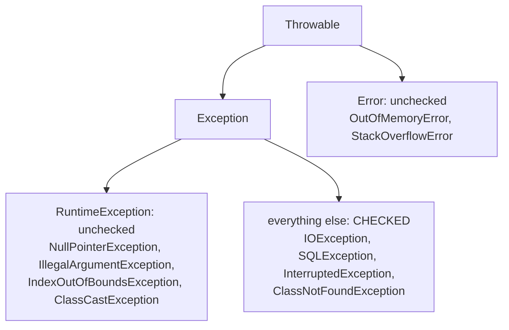
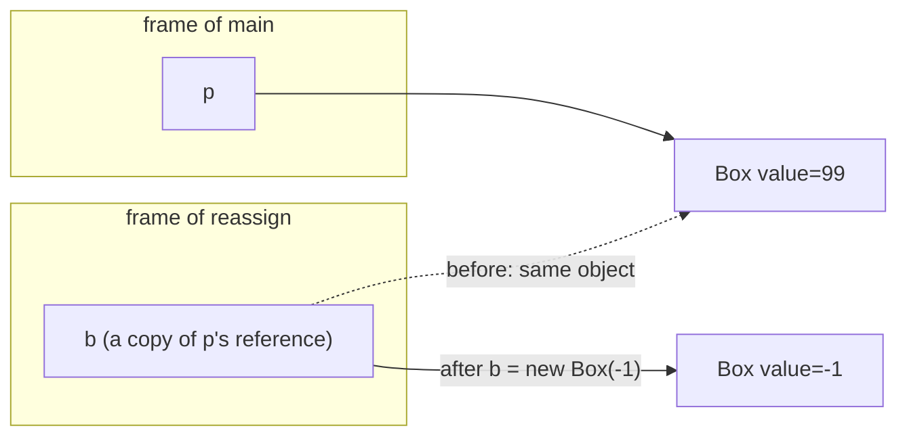

# The classic comparison questions, answered

> **Before this lesson:** this lesson gathers ideas from across the track. The main ones: `final` and `static` ([static, final, constants and the Math class](#/lesson/java/java-static-final)), exceptions ([Exceptions: try, catch, finally, checked and unchecked](#/lesson/java/java-exceptions-basics)), abstract classes and interfaces ([Interfaces, default methods, sealed types and pattern matching](#/lesson/java/java-interfaces)), pass-by-value ([Methods, parameters, return values and pass-by-value](#/lesson/java/java-methods-pass-by-value)) and `volatile` and `synchronized` ([Race conditions, synchronization, deadlock and virtual threads](#/lesson/java/java-synchronization)).

## In plain words

A driving examiner does not ask you to design an engine. They ask the same handful of things of every candidate: mirrors, signals, a hill start, an emergency stop. They ask them because each one reveals in seconds whether the basics are in place.

Java interviews have an equivalent set: short "what is the difference between X and Y?" questions. They sound like trivia. They are a quick test of whether you understand the mechanism behind the keywords. This lesson takes the most frequent ones in turn. For each you get a **worked answer** of the length to say aloud (thirty to sixty seconds), a table, a small program to anchor it, and the follow-ups that usually come next.

A structure that works for every comparison question:

1. one sentence defining each thing;
2. the two or three differences that matter;
3. a tiny example, or when you would choose each.

Why this matters for a job: these questions open most Java interviews at junior and mid level. A crisp, correct answer sets the tone for everything that follows.

## Q1. final, finally and finalize

**Worked answer.** *They are unrelated despite the similar names. `final` is a modifier: a final variable can be assigned only once, a final method cannot be overridden, and a final class cannot be extended. `finally` is a block attached to `try` that runs whether or not an exception occurred; it is used for clean-up, though try-with-resources is preferred for closing resources. `finalize` is a method of `Object` that the garbage collector may call before reclaiming an object; it is unpredictable, has been deprecated since Java 9 and is marked for removal, and should not be used.*

| | `final` | `finally` | `finalize` |
|---|---|---|---|
| What it is | keyword (modifier) | block | method of `Object` |
| Applies to | variables, methods, classes | `try` statements | objects about to be collected |
| Purpose | prevent reassignment, overriding, extension | guaranteed clean-up code | (obsolete) last-chance clean-up |
| When it acts | compile time | when the `try` block exits | at an unspecified time, perhaps never |
| Use today | constantly | sometimes; try-with-resources is better | never |

```java
import java.util.ArrayList;
import java.util.List;

public class Three {
    static int demo() {
        final List<String> names = new ArrayList<>();       // final: the reference cannot change...
        names.add("ada");                                   // ...but the list can
        try {
            return names.size();                            // value 1 is saved
        } finally {
            names.add("bo");                                // runs before the method returns
            System.out.println("finally ran, list is " + names);
        }
    }

    public static void main(String[] args) {
        System.out.println(demo());
    }
}
```

```text
finally ran, list is [ada, bo]
1
```

**Follow-ups.**
- *"Is a `final` object immutable?"* No. `final` fixes the reference. The object can still change unless its class is immutable.
- *"When does `finally` not run?"* `System.exit()`, a JVM crash, the thread being killed, or an infinite loop in the `try` block.
- *"What if both `try` and `finally` return?"* The `finally` return wins and discards any pending exception; never do it.
- *"What replaces `finalize`?"* `AutoCloseable` with try-with-resources; `java.lang.ref.Cleaner` as a safety net.
- *"What is 'effectively final'?"* A local variable assigned exactly once without the keyword; lambdas and inner classes may capture it.

## Q2. Checked and unchecked exceptions

**Worked answer.** *Both are subclasses of `Throwable`. Checked exceptions extend `Exception` but not `RuntimeException`; the compiler enforces the handle-or-declare rule for them. They represent conditions outside the program's control from which a caller can reasonably recover, such as `IOException`. Unchecked exceptions are `RuntimeException` and its subclasses, plus `Error`; the compiler requires nothing. Runtime exceptions usually indicate programming errors such as `NullPointerException` or `IllegalArgumentException`; errors indicate JVM problems such as `OutOfMemoryError`.*



| | Checked | Unchecked (runtime) |
|---|---|---|
| Superclass | `Exception` (not `RuntimeException`) | `RuntimeException` |
| Compiler requires catch or `throws` | yes | no |
| Typical cause | environment: files, network, database | bug: bad argument, null, bad index |
| Caller's reaction | recover | fix the code |
| In lambdas for standard functional interfaces | cannot be thrown | allowed |

```java
static void checked() throws java.io.IOException {           // must be declared
    throw new java.io.IOException("disk unplugged");
}

static void unchecked() {                                     // nothing to declare
    throw new IllegalStateException("not started");
}
```

**Follow-ups.**
- *"`throw` versus `throws`?"* `throw` raises an exception object in a statement; `throws` lists, in the method header, exception types that may propagate.
- *"Can an override throw more checked exceptions than the method it overrides?"* No. It may throw the same, narrower or none; unchecked exceptions are unrestricted.
- *"Which would you choose for a custom exception?"* Unchecked for programming errors and when callers cannot do anything useful; checked only when the failure is unpreventable and recoverable.
- *"`ClassNotFoundException` versus `NoClassDefFoundError`?"* The first is a checked exception from loading a class by name at run time (`Class.forName`); the second is an error thrown when a class that was present at compile time cannot be loaded at run time.

## Q3. Abstract class and interface

**Worked answer.** *Both define types that cannot be instantiated directly and may declare abstract methods. A class can extend only one abstract class but implement many interfaces. An abstract class can have instance fields, constructors and members of any accessibility, so it can hold shared state; an interface cannot have instance state or constructors, and its abstract and default methods are public. Since Java 8, interfaces may have default and static methods, and since Java 9 private methods. I use an interface to define a capability that unrelated classes can have, and an abstract class when closely related classes share state or substantial code, often as a skeletal implementation behind an interface.*

| | Abstract class | Interface |
|---|---|---|
| Keyword to use it | `extends` (one only) | `implements` (many) |
| Instance fields | yes | no; only `public static final` constants |
| Constructors | yes | no |
| Method bodies | yes | `default`, `static` and `private` methods only |
| Access levels | any | abstract and default methods are public |
| Models | IS-A: a family | CAN-DO: a capability |
| Functional (lambda target) | never | if it has exactly one abstract method |
| Library examples | `AbstractList`, `InputStream`, `Number` | `List`, `Comparable`, `Runnable` |

**Follow-ups.**
- *"Can an abstract class have no abstract methods?"* Yes; `abstract` then only prevents instantiation.
- *"Can an interface extend another interface? A class?"* An interface can extend several interfaces; it can never extend a class.
- *"Two interfaces provide the same default method. What happens?"* The implementing class must override it, and may call one with `InterfaceName.super.method()`. A method inherited from a superclass takes priority over any interface default.
- *"Why were default methods added?"* To evolve interfaces such as `Collection` (for streams) without breaking every existing implementation.

## Q4. Static and instance

**Worked answer.** *A static member belongs to the class: there is one copy, it exists once the class is loaded, and it is accessed through the class name with no object. An instance member belongs to each object: every object has its own copy of instance fields, and instance methods run on a particular object, available as `this`. A static method has no `this`, so it cannot use instance members without an explicit object reference; an instance method can use both kinds. Static methods are bound at compile time and cannot be overridden, only hidden.*

| | Static | Instance |
|---|---|---|
| Belongs to | the class | each object |
| Copies | one | one per object |
| Created | at class initialisation | at `new` |
| Accessed by | `ClassName.member` | `reference.member` |
| `this` available | no | yes |
| Can access | static members only (directly) | static and instance members |
| Polymorphic | no: hidden, not overridden | yes: overridden, dispatched dynamically |

```java
class Counter {
    static int created = 0;        // one for the class
    int id;                        // one per object

    Counter() { id = ++created; }

    static String kind()  { return "Counter"; }
    String describe()     { return kind() + " #" + id + " of " + created; }
}

class LoudCounter extends Counter {
    static String kind()  { return "LoudCounter"; }      // hides, does not override
    @Override String describe() { return super.describe().toUpperCase(); }
}

Counter a = new Counter();
Counter b = new LoudCounter();
System.out.println(a.describe());
System.out.println(b.describe());        // dynamic dispatch for the instance method
System.out.println(b.kind());            // static: bound to the declared type Counter
```

```text
Counter #1 of 2
COUNTER #2 OF 2
Counter
```

**Follow-ups.**
- *"Why is `main` static?"* The JVM must call it before any object exists.
- *"Static block?"* Code run once when the class is initialised.
- *"Can a static method be called on `null`?"* Yes: `((Counter) null).kind()` works, because the reference is not used. It is still poor style.
- *"Static nested class versus inner class?"* A static nested class has no enclosing instance; an inner class holds a hidden reference to one.

## Q5. Is Java pass-by-value or pass-by-reference?

**Worked answer.** *Java is always pass-by-value. The value of each argument is copied into the parameter. For a primitive, the value is the number itself. For an object, the value is the **reference**, so the caller and the method have two references to the same object. The method can therefore change the object's state through its copy, but if it assigns a new object to the parameter, the caller's variable is unaffected. A `swap` method that exchanges two parameters does nothing to the caller's variables, which proves it is not pass-by-reference.*

```java
class Box { int value; Box(int value) { this.value = value; } }

public class PassDemo {
    static void mutate(Box b)   { b.value = 99; }                 // changes the shared object
    static void reassign(Box b) { b = new Box(-1); }              // changes only the local copy of the reference
    static void bump(int n)     { n++; }                          // changes only the local copy of the number
    static void swap(Box x, Box y) { Box t = x; x = y; y = t; }   // swaps only the local copies

    public static void main(String[] args) {
        Box p = new Box(1), q = new Box(2);
        int n = 5;
        mutate(p);    System.out.print(p.value + " ");
        reassign(p);  System.out.print(p.value + " ");
        bump(n);      System.out.print(n + " ");
        swap(p, q);   System.out.println(p.value + " " + q.value);
    }
}
```

```text
99 99 5 99 2
```



### A pass-by-value tracer you can run

```python-run
heap = {}
def new_box(v):
    oid = f"@{len(heap) + 1}"
    heap[oid] = {"value": v}
    return oid

def call(method, frame, *arg_names):
    """Copy each caller variable's content (a number or an object id) into a parameter, run, discard."""
    params = [frame[a] for a in arg_names]             # the copies
    method(params)
    return params                                      # shown only to illustrate what the callee held

def mutate(ps):    heap[ps[0]]["value"] = 99
def reassign(ps):  ps[0] = new_box(-1)
def bump(ps):      ps[0] = ps[0] + 1
def swap(ps):      ps[0], ps[1] = ps[1], ps[0]

frame = {"p": new_box(1), "q": new_box(2), "n": 5}
show = lambda: f"p={frame['p']}{heap[frame['p']]}  q={frame['q']}{heap[frame['q']]}  n={frame['n']}"
print("start         :", show())
for name, fn, args in (("mutate(p)", mutate, ["p"]), ("reassign(p)", reassign, ["p"]),
                       ("bump(n)", bump, ["n"]), ("swap(p, q)", swap, ["p", "q"])):
    held = call(fn, frame, *args)
    print(f"after {name:12}: {show()}   (callee's copies ended as {held})")
```

In every row the caller's variables hold the same contents as before. Only `mutate` has a visible effect, and that effect is on the shared heap object, not on any variable.

**Follow-ups.**
- *"Then how do I change a caller's primitive?"* Return the new value, or pass a mutable holder (an array, an object, an `AtomicInteger`).
- *"What about `String`?"* A reference is passed, but strings are immutable, so the method cannot alter what the caller sees.
- *"Arrays?"* Objects: the method can change elements; reassigning the parameter has no outside effect.

## Q6. volatile and synchronized

**Worked answer.** *Both address problems of sharing data between threads. `volatile` is a field modifier that guarantees **visibility**: a read always sees the latest write by any thread, and it prevents reordering around that field. It does not lock and gives no atomicity for compound actions such as `count++`. `synchronized` applies to methods or blocks; it provides **mutual exclusion**, so only one thread at a time holds a given lock, and it also provides visibility. Use `volatile` for a simple flag or a reference written by one thread and read by others; use `synchronized`, a `Lock` or an atomic class when an operation reads then writes shared state.*

| | `volatile` | `synchronized` |
|---|---|---|
| Applies to | fields | methods and blocks |
| Visibility | yes | yes |
| Atomicity of compound actions | no | yes |
| Blocks threads | never | yes, while waiting for the lock |
| Risk of deadlock | none | possible |
| Cost | low | higher under contention |
| Typical use | stop flag; published reference; double-checked locking field | check-then-act, read-modify-write, invariants spanning several fields |

```java
class Worker {
    private volatile boolean running = true;          // visibility is all that is needed
    private int processed;                            // guarded by 'this'

    void stop() { running = false; }

    synchronized void record() { processed++; }       // read-modify-write: needs mutual exclusion
    synchronized int processed() { return processed; }

    void loop() {
        while (running) {
            record();
        }
    }
}
```

**Follow-ups.**
- *"Is `volatile int x; x++` thread-safe?"* No: three steps. Use `AtomicInteger`.
- *"Third option?"* `java.util.concurrent.atomic` classes: lock-free atomic updates using compare-and-swap.
- *"`synchronized` method versus block?"* A synchronised instance method locks `this` for its whole body; a block locks any chosen object for part of a method, allowing shorter critical sections and private lock objects.
- *"`synchronized` versus `ReentrantLock`?"* The explicit lock adds timed and interruptible acquisition, try-lock and fairness, and must be released in `finally`.
- *"What is the happens-before relationship?"* The memory model's guarantee that one action's effects are visible to another: an unlock happens-before a later lock of the same monitor; a volatile write happens-before later reads of that field; `Thread.start()` happens-before the thread's actions.

## More pairs, in brief

| Pair | The essential difference |
|---|---|
| `==` vs `equals` | `==` compares primitive values or reference identity; `equals` compares logical content if the class defines it |
| overloading vs overriding | same name with different parameters, chosen at compile time by declared argument types; versus a subclass replacing an inherited method, chosen at run time by the object's class |
| `String` vs `StringBuilder` vs `StringBuffer` | immutable; mutable and unsynchronised; mutable and synchronised |
| `ArrayList` vs `LinkedList` | array-backed with fast indexing; node-based with cheap insertion at known positions; prefer `ArrayList` |
| `ArrayList` vs array | resizable, generic, objects only; fixed size, may hold primitives |
| `HashMap` vs `TreeMap` vs `LinkedHashMap` | unordered constant time; sorted logarithmic time; insertion-ordered |
| `HashSet` vs `TreeSet` | hashing; sorted with comparison |
| `Comparable` vs `Comparator` | natural order inside the class; external, any number |
| `Runnable` vs `Callable` | no result, no checked exceptions; returns a value, may throw |
| `wait` vs `sleep` | `wait` releases the monitor and needs `synchronized`; `sleep` keeps all locks and only pauses |
| `throw` vs `throws` | statement that raises; clause that declares |
| JDK vs JRE vs JVM | development kit including compiler; runtime (JVM + libraries); the engine executing bytecode |
| `this` vs `super` | the current object; the superclass's view of it |
| fail-fast vs fail-safe iterators | throw `ConcurrentModificationException` on concurrent change; work on a snapshot or tolerate changes |
| shallow vs deep copy | shares inner objects; duplicates them |
| `record` vs class | concise, final, shallowly immutable data carrier with generated accessors, `equals`, `hashCode`, `toString`; fully general |
| `Iterator` vs `Iterable` | the cursor; the thing that can produce a cursor (and so supports for-each) |
| process vs thread | separate memory space; shared heap within one process |

> [!INTERVIEW]
> When you do not remember a detail, reason from the mechanism aloud instead of guessing: "A static method has no `this`, so it cannot be dispatched on an object's class, so it cannot be overridden." Interviewers value the derivation more than the recitation. And when a question has a modern twist (default methods, records, sealed types, virtual threads, the deprecation of `finalize`), mention it in one sentence; it shows your knowledge is current.

## Pitfalls

- **Saying "objects are passed by reference".** Say: "references are passed by value".
- **Describing interfaces as having no method bodies.** True only before Java 8.
- **Saying `final` makes an object immutable.**
- **Recommending `finalize`**, or not knowing it is deprecated.
- **Listing `Error` as a checked exception.**
- **Claiming `volatile` makes operations atomic.**
- **Saying static methods can be overridden.**
- **Confusing `wait` (releases the lock) with `sleep` (does not).**
- **Reciting a table without an example.** Have one small program in mind for each pair.

## Cheat sheet

| Question | One-line answer |
|---|---|
| `final` / `finally` / `finalize` | no change / always-run block / deprecated GC hook |
| Checked / unchecked | compiler-enforced, recoverable / `RuntimeException` and `Error`, bugs or JVM failures |
| Abstract class / interface | one, with state and constructors / many, no instance state |
| Static / instance | per class, no `this` / per object |
| Passing arguments | always by value; for objects the value is the reference |
| `volatile` / `synchronized` | visibility only / mutual exclusion plus visibility |
| `==` / `equals` | identity / content |
| Overload / override | compile time, by argument types / run time, by object class |

## Summary

- `final`, `finally` and `finalize` are a modifier, a block and an obsolete method.
- Checked exceptions are enforced by the compiler and signal recoverable outside conditions; unchecked ones signal bugs or JVM failures.
- Abstract classes carry state and are single; interfaces define capabilities and are multiple.
- Static members belong to the class and are not polymorphic; instance members belong to objects.
- Java passes every argument by value; object references are the values copied.
- `volatile` gives visibility; `synchronized` gives exclusion and visibility.
- Answer comparison questions with a definition of each, the decisive differences, and an example.

## Glossary

- **Modifier**: a keyword that changes the meaning of a declaration.
- **Handle-or-declare rule**: the requirement to catch or declare checked exceptions.
- **Skeletal implementation**: an abstract class implementing most of an interface.
- **Default method**: an interface method with a body.
- **Hiding**: a subclass static method or field with the same name as one in its superclass.
- **Dynamic dispatch**: choosing an overridden method at run time by the object's class.
- **Pass-by-value**: copying the argument's value into the parameter.
- **Visibility**: whether a write by one thread can be seen by another.
- **Mutual exclusion**: at most one thread inside a guarded region.
- **Atomicity**: an action occurring as one indivisible step.
- **Happens-before**: the memory model's ordering guarantee between actions in different threads.
- **Compare-and-swap**: an atomic conditional update used by lock-free classes.

## Check yourself

```quiz
[
  {"q": "Which statement is true?", "options": ["finalize is a keyword", "finally is a method of Object", "final on a reference variable prevents reassignment of the variable", "final makes the referenced object immutable"], "answer": 2,
   "explain": "final fixes the reference; finally is a block; finalize is a deprecated method."},
  {"q": "What does this print? `static int f() { try { return 1; } finally { System.out.print(\"F\"); } }` then `System.out.print(f());`", "options": ["1F", "F1", "1", "F"], "answer": 1,
   "explain": "The return value is saved, finally runs and prints F, then the method returns 1."},
  {"q": "Which is a checked exception?", "options": ["ArithmeticException", "ClassCastException", "InterruptedException", "OutOfMemoryError"], "answer": 2,
   "explain": "InterruptedException extends Exception directly. The first two are runtime exceptions and the last is an Error."},
  {"q": "Which can an abstract class have that an interface cannot?", "options": ["Static methods", "Methods with bodies", "A constructor and instance fields", "Public methods"], "answer": 2,
   "explain": "Interfaces cannot hold per-object state or define constructors."},
  {"q": "What does this print? `class P { static String s() { return \"P\"; } String i() { return \"P\"; } } class C extends P { static String s() { return \"C\"; } String i() { return \"C\"; } }` then `P x = new C(); System.out.println(x.s() + x.i());`", "options": ["PP", "PC", "CC", "CP"], "answer": 1,
   "explain": "The static call is bound to the declared type P; the instance call is dispatched to C."},
  {"q": "What does this print? `static void m(StringBuilder a, StringBuilder b) { a.append(\"!\"); b = a; b.append(\"?\"); }` then `StringBuilder x = new StringBuilder(\"x\"), y = new StringBuilder(\"y\"); m(x, y); System.out.println(x + \" \" + y);`", "options": ["x! y?", "x!? y", "x y", "x!? y?"], "answer": 1,
   "explain": "a.append changes x's object. b = a re-points only the local copy, so the ? also goes to x's object; y is untouched."},
  {"q": "Which is guaranteed by `volatile` but NOT sufficient for `counter++` to be thread-safe?", "options": ["Mutual exclusion", "Visibility of the latest write", "Atomicity", "Fairness"], "answer": 1,
   "explain": "volatile gives visibility only. The increment is a read-modify-write and needs a lock or AtomicInteger."},
  {"q": "What is the difference between `wait()` and `Thread.sleep()`?", "options": ["None", "wait releases the monitor and must be called while holding it; sleep keeps any locks held", "sleep releases locks; wait does not", "wait is static"], "answer": 1,
   "explain": "wait is for coordinating on a condition; sleep only pauses the current thread."}
]
```

> **Source:** interview synthesis drawing on the whole track; background in Head First Java, ch. 4, 8, 10, 11 and 15, and Effective Java 3e, item groups "Classes and interfaces", "Exceptions" and "Concurrency". Facts checked against the Java Language Specification sections 8.4.3 (method modifiers), 11.2 (compile-time checking of exceptions), 15.12.4.1 (argument evaluation) and 17.4 (memory model): https://docs.oracle.com/javase/specs/jls/se21/html/index.html .
