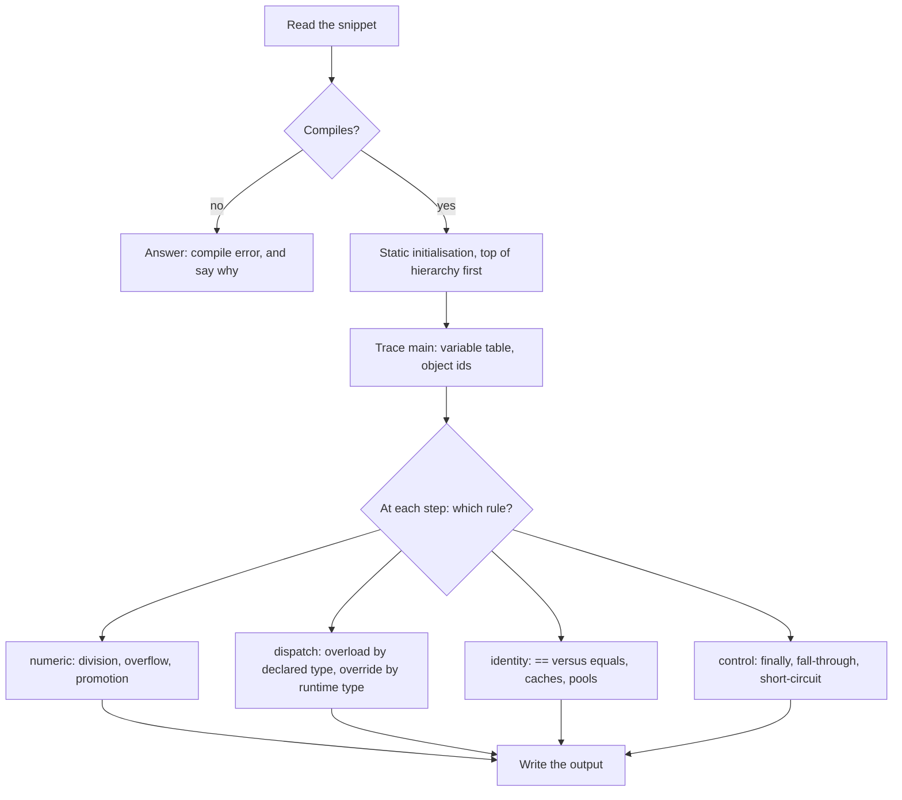
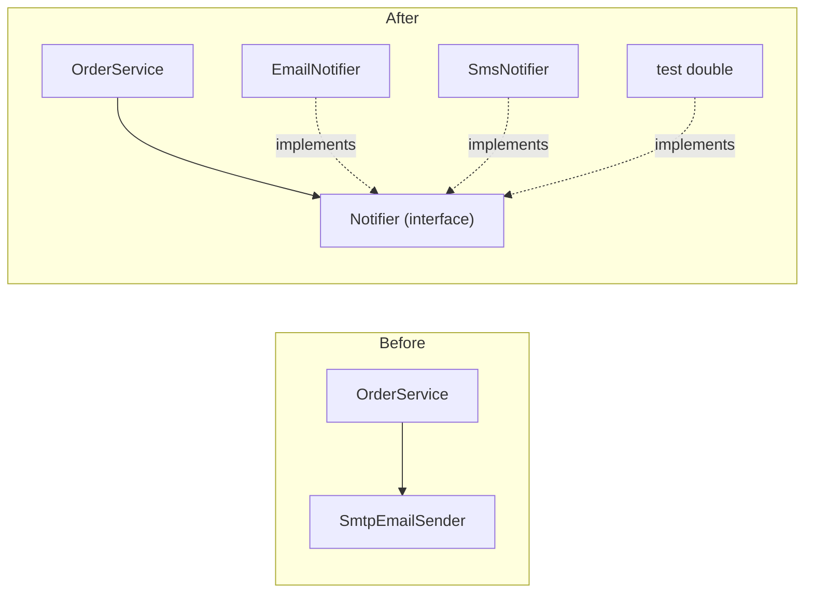

# Output-prediction puzzles and SOLID in Java

> **Before this lesson:** this lesson draws on the whole track. Useful refreshers: numeric rules ([Primitive types and how numbers are stored](#/lesson/java/java-primitives)), dispatch rules ([Polymorphism, overriding and overloading](#/lesson/java/java-polymorphism)), initialisation order ([Constructors, this and super](#/lesson/java/java-constructors)), exceptions ([Exceptions: try, catch, finally, checked and unchecked](#/lesson/java/java-exceptions-basics)), and the design lessons ([Composition over inheritance](#/lesson/java/java-ej-composition), [Static factories, builders, singletons and dependency injection](#/lesson/java/java-ej-factories-builders)).

## In plain words

A chess coach sets puzzles: "white to move and win in two". Nobody plays those exact positions in a real game. The puzzles train you to see what the pieces will do, which is the skill every real game needs.

"What does this program print?" is the chess puzzle of Java interviews. The snippets are artificial, and each one hinges on a single rule. If you can run the code in your head, you understand the language. The first half of this lesson gives a method and fourteen classic puzzles with full explanations.

The second half moves from the smallest scale to the largest: **SOLID**, five principles for arranging classes so that a system can grow without falling apart. They are the vocabulary interviewers expect when they ask "how would you design this?" or "what is wrong with this class?".

Why this matters for a job: output puzzles appear in almost every written test and online screening for Java roles, and SOLID is the most widely used shorthand for object-oriented design quality.

## Part 1: a method for output puzzles

Do not read the code like prose. Execute it, slowly, with pencil and paper.

1. **Will it compile?** Check types, missing returns, unreachable code, checked exceptions, uninitialised locals.
2. **Find the entry point** and note any static initialisation that happens first.
3. **Keep a table of variables.** For references, write an object id, not a value.
4. **At each call**, decide the overload from the *declared* types, then the override from the *runtime* type.
5. **At each operator**, consider integer division, overflow, promotion, and left-to-right string concatenation.
6. **At each `try`**, remember that `finally` runs, and what a pending return value is.
7. **Write the output as you go**, character by character.



## The puzzles

### 1. Integer arithmetic

```java
int a = 7, b = 2;
System.out.println(a / b * b + a % b);
System.out.println(a / b * 1.0 + " " + a * 1.0 / b);
System.out.println(Integer.MAX_VALUE + 1 == Integer.MIN_VALUE);
```

```text
7
3.0 3.5
true
```

`7 / 2` is 3 (integer division), times 2 is 6, plus the remainder 1 gives 7. In the second line `a / b` is still integer division (3) *before* multiplying by 1.0, while `a * 1.0` becomes a double first. Overflow wraps silently.

### 2. char arithmetic and concatenation

```java
char c = 'a';
c += 1;
System.out.println(c);
System.out.println(c + 1);
System.out.println("" + c + 1);
System.out.println('a' + 'b' + "c" + 'd' + 1);
```

```text
b
99
b1
195cd1
```

Compound assignment casts back to `char`. `c + 1` promotes to `int`. Concatenation is left to right: `'a' + 'b'` is numeric (97 + 98) because no `String` is involved yet; from `"c"` onward everything is appended as text.

### 3. Increments

```java
int i = 5;
i = i++ + ++i;
int j = 5;
j = j++;
System.out.println(i + " " + j);
```

```text
12 5
```

`i++` yields 5 (i becomes 6); `++i` makes i 7 and yields 7; the sum 12 is assigned. For `j = j++`: the old value 5 is saved, `j` becomes 6, then the saved 5 is assigned back. The increment is lost.

### 4. Integer cache and string pool

```java
Integer p = 127, q = 127, r = 128, s = 128;
String x = "hi", y = "hi", z = new String("hi");
System.out.println((p == q) + " " + (r == s) + " " + r.equals(s));
System.out.println((x == y) + " " + (x == z) + " " + (x == z.intern()));
```

```text
true false true
true false true
```

Autoboxing uses `Integer.valueOf`, which caches -128 to 127. Literals are pooled; `new` is not.

### 5. Switch fall-through

```java
int k = 2;
switch (k) {
    case 1: System.out.print("A");
    case 2: System.out.print("B");
    case 3: System.out.print("C"); break;
    default: System.out.print("D");
}
```

```text
BC
```

Entry at `case 2`, then downward until `break`.

### 6. try, catch, finally with returns

```java
static int f() {
    int x = 1;
    try {
        x = 2;
        throw new RuntimeException();
    } catch (RuntimeException e) {
        x = 3;
        return x;
    } finally {
        x = 4;
        System.out.print("F" + x + " ");
    }
}
// System.out.println(f());
```

```text
F4 3
```

The `catch` evaluates `return x` and saves 3. `finally` then runs, sets the local to 4 and prints. The saved value 3 is returned.

### 7. Overloading with null and boxing

```java
static void m(Object o)  { System.out.print("Object "); }
static void m(String s)  { System.out.print("String "); }
static void n(long l)    { System.out.print("long "); }
static void n(Integer i) { System.out.print("Integer "); }
static void n(int... v)  { System.out.print("varargs "); }
// m(null); n(5); n();
```

```text
String long varargs 
```

`null` fits both `m` methods; the **most specific** applicable one, `String`, is chosen. For `n(5)`, widening `int` to `long` (phase 1) beats boxing to `Integer` (phase 2), which beats varargs (phase 3). Add an overload `m(Integer i)` and `m(null)` no longer compiles: `String` and `Integer` are equally specific.

### 8. Overriding, hiding and fields

```java
class A {
    String name = "A";
    static String who() { return "static A"; }
    String me()         { return "A.me"; }
    String show()       { return name + " " + who() + " " + me(); }
}
class B extends A {
    String name = "B";
    static String who() { return "static B"; }
    @Override String me() { return "B.me"; }
}
// A ref = new B();
// System.out.println(ref.name + " | " + ref.show());
```

```text
A | A static A B.me
```

`ref.name` is a field access: declared type `A`. Inside `A.show`, `name` is `A`'s field, `who()` is the static method bound at compile time to `A`, and `me()` is an instance call dispatched to `B`.

### 9. Constructor and initialiser order

```java
class Base {
    static { System.out.print("1 "); }
    { System.out.print("3 "); }
    Base() { System.out.print("4 "); print(); }
    void print() { System.out.print("base "); }
}
class Derived extends Base {
    static { System.out.print("2 "); }
    int n = 7;
    { System.out.print("5 "); }
    Derived() { System.out.print("6 "); }
    @Override void print() { System.out.print("n=" + n + " "); }
}
// new Derived();
```

```text
1 2 3 4 n=0 5 6 
```

Static blocks first, superclass before subclass. Then the superclass's instance initialisers and constructor, then the subclass's. The overridden `print` runs from `Base`'s constructor before `Derived`'s field initialiser, so `n` is still 0.

### 10. Pass-by-value

```java
static void change(int[] arr, int n, String s) {
    arr[0] = 100;
    arr = new int[] {7};
    n = 50;
    s = s + "!";
}
// int[] a = {1}; int n = 5; String s = "hi";
// change(a, n, s);
// System.out.println(a[0] + " " + n + " " + s);
```

```text
100 5 hi
```

The element change goes through the shared reference. Re-pointing `arr`, changing `n` and reassigning `s` affect only the method's copies.

### 11. Strings are immutable

```java
String t = "java";
t.concat(" rocks");
t.toUpperCase();
String u = t.replace('a', 'o');
StringBuilder sb = new StringBuilder("java");
sb.append(" rocks").reverse();
System.out.println(t + " | " + u + " | " + sb);
```

```text
java | jovo | skcor avaj
```

`String` methods return new strings; ignored results vanish. `StringBuilder` methods change the builder.

### 12. Collections surprises

```java
List<Integer> list = new ArrayList<>(List.of(10, 20, 30, 40));
list.remove(1);
list.remove(Integer.valueOf(40));
Set<String> set = new TreeSet<>(List.of("b", "A", "c", "a"));
Map<String, Integer> map = new HashMap<>();
map.put("k", 1);
Integer old = map.put("k", 2);
System.out.println(list + " " + set + " " + old + " " + map.get("zzz"));
```

```text
[10, 30] [A, a, b, c] 1 null
```

`remove(1)` is by index; `remove(Integer)` is by value. Capital letters sort before lower-case. `put` returns the previous value; `get` returns `null` for a missing key.

### 13. Short-circuit and side effects

```java
int n = 0;
boolean r1 = (n++ > 0) && (n++ > 0);
boolean r2 = (n++ > 0) || (n++ > 0);
boolean r3 = (n++ > 0) & (n++ > 0);
System.out.println(r1 + " " + r2 + " " + r3 + " " + n);
```

```text
false true true 4
```

`r1`: left side false (n becomes 1), right side skipped. `r2`: left side `1 > 0` true (n becomes 2), right side skipped. `r3`: `&` evaluates both sides (n becomes 3, then 4). Total: four increments.

### 14. Lambdas and streams

```java
List<String> words = List.of("kiwi", "fig", "plum", "pea");
System.out.println(words.stream().filter(w -> w.length() > 3).map(String::toUpperCase).toList());
System.out.println(words.stream().map(String::length).reduce(0, Integer::sum));
words.stream().peek(w -> System.out.print(w + " "));
System.out.println(words.stream().sorted().findFirst().get());
```

```text
[KIWI, PLUM]
14
fig
```

The third line prints nothing: a stream with no terminal operation never runs.

### A dispatch solver you can run

Puzzle 8 is the kind most often asked. The model resolves each member access by the correct rule so you can change the hierarchy and predict the answer.

```python-run
classes = {
    "A": {"parent": None, "fields": {"name": "A"}, "statics": {"who": "static A"}, "methods": {"me": "A.me", "show": "A.show"}},
    "B": {"parent": "A",  "fields": {"name": "B"}, "statics": {"who": "static B"}, "methods": {"me": "B.me"}},
    "C": {"parent": "B",  "fields": {},            "statics": {},                  "methods": {"me": "C.me"}},
}

def find(start, kind, member):
    c = start
    while c:
        if member in classes[c][kind]:
            return classes[c][kind][member], c
        c = classes[c]["parent"]
    raise KeyError(member)

def field(declared, name):            return find(declared, "fields", name)[0]     # by declared type
def static(declared, name):           return find(declared, "statics", name)[0]    # by declared type
def virtual(runtime, name):           return find(runtime, "methods", name)        # by runtime type

def show(runtime):
    """A.show() is: name + who() + me(), written inside class A."""
    _, owner = virtual(runtime, "show")                    # the class whose code is running
    return f"{field(owner, 'name')} {static(owner, 'who')} {virtual(runtime, 'me')[0]}"

for declared, runtime in (("A", "A"), ("A", "B"), ("B", "B"), ("A", "C"), ("B", "C")):
    print(f"{declared} ref = new {runtime}():  ref.name = {field(declared, 'name')}   ref.who() = {static(declared, 'who')}"
          f"   ref.me() = {virtual(runtime, 'me')[0]}   ref.show() = {show(runtime)}")
```

## Part 2: SOLID

SOLID is an acronym for five design principles collected by Robert C. Martin. Each is illustrated here with a small "before" and "after" in Java.

| Letter | Principle | One sentence |
|---|---|---|
| **S** | Single responsibility | a class should have one reason to change |
| **O** | Open/closed | open for extension, closed for modification |
| **L** | Liskov substitution | subtypes must be usable wherever their supertype is expected |
| **I** | Interface segregation | clients should not depend on methods they do not use |
| **D** | Dependency inversion | depend on abstractions, not on concrete details |

### S: single responsibility

A class should do one job, so that only one kind of requirement change forces you to edit it.

```java
// Before: three reasons to change (pay rules, storage, report layout)
class Employee {
    double calculatePay() { /* tax and overtime rules */ return 0; }
    void saveToDatabase() { /* SQL */ }
    String toPayslipHtml() { /* layout */ return ""; }
}

// After: one job each
record Employee(String name, double hourlyRate, double hours) { }

class PayCalculator   { double payFor(Employee e) { return e.hourlyRate() * e.hours(); } }
class EmployeeStore   { void save(Employee e) { /* persistence only */ } }
class PayslipRenderer { String render(Employee e, double pay) { return e.name() + ": " + pay; } }
```

The accountants, the database team and the designers can each request changes without touching the others' class. Smell to look for: class names containing "And" or "Manager", and methods that fall into unrelated groups.

### O: open/closed

You should be able to add new behaviour by adding new code, without editing code that already works.

```java
// Before: every new shape means editing this method
class AreaCalculator {
    double area(Object shape) {
        if (shape instanceof Circle c)    return Math.PI * c.radius() * c.radius();
        if (shape instanceof Rectangle r) return r.width() * r.height();
        throw new IllegalArgumentException("unknown shape");
    }
}

// After: new shapes are new classes; nothing existing changes
interface Shape { double area(); }
record Circle(double radius) implements Shape { public double area() { return Math.PI * radius * radius; } }
record Rectangle(double width, double height) implements Shape { public double area() { return width * height; } }
record Triangle(double base, double height) implements Shape { public double area() { return 0.5 * base * height; } }

static double total(java.util.List<Shape> shapes) {
    return shapes.stream().mapToDouble(Shape::area).sum();        // never needs editing
}
```

```java
System.out.println(total(java.util.List.of(new Rectangle(2, 3), new Triangle(4, 5))));
```

```text
16.0
```

Polymorphism is the usual mechanism; strategy objects and lambdas are others.

### L: Liskov substitution

If code works with a type `T`, it must keep working when handed any subtype of `T`. A subclass may do **more** than its parent promises, never **less**: it must accept everything the parent accepts and must not break the parent's guarantees.

```java
// Violation: a Square that IS-A Rectangle breaks code written for rectangles
class Rectangle {
    protected int width, height;
    void setWidth(int w)  { width = w; }
    void setHeight(int h) { height = h; }
    int area() { return width * height; }
}

class Square extends Rectangle {
    @Override void setWidth(int w)  { width = w; height = w; }     // keeps the sides equal...
    @Override void setHeight(int h) { width = h; height = h; }     // ...and breaks the parent's contract
}

static int stretch(Rectangle r) {
    r.setWidth(5);
    r.setHeight(4);
    return r.area();                // every Rectangle user expects 20
}
```

```java
System.out.println(stretch(new Rectangle()) + " " + stretch(new Square()));
```

```text
20 16
```

A square is a rectangle in geometry, but a *mutable* `Square` cannot honour `Rectangle`'s behavioural promise that width and height vary independently. Fixes: make both immutable (then there are no setters to conflict), or do not relate them by inheritance; let both implement `Shape`.

Other signs of a violation: an override that throws `UnsupportedOperationException`, an override that does nothing, and callers that check `instanceof` to treat one subtype specially.

### I: interface segregation

Prefer several small, focused interfaces to one large one. A class should not be forced to implement, or depend on, methods it has no use for.

```java
// Before: a basic printer must "implement" scanning and faxing
interface Machine {
    void print(String doc);
    void scan(String doc);
    void fax(String doc);
}

class BasicPrinter implements Machine {
    public void print(String doc) { System.out.println("printing " + doc); }
    public void scan(String doc)  { throw new UnsupportedOperationException(); }     // forced, and a Liskov violation
    public void fax(String doc)   { throw new UnsupportedOperationException(); }
}

// After: role interfaces
interface Printer { void print(String doc); }
interface Scanner { void scan(String doc); }
interface Fax     { void fax(String doc); }

class BasicPrinter implements Printer {
    public void print(String doc) { System.out.println("printing " + doc); }
}
class OfficeMachine implements Printer, Scanner, Fax { /* all three */ }

static void printAll(Printer p, java.util.List<String> docs) { docs.forEach(p::print); }   // asks only for what it needs
```

The Java library does this: `Runnable`, `Comparable`, `Closeable`, `Iterable` are each one small capability.

### D: dependency inversion

High-level policy should not depend on low-level details. Both should depend on an abstraction, and the detail is supplied from outside.

```java
// Before: the business class is welded to one technology
class OrderService {
    private final SmtpEmailSender sender = new SmtpEmailSender();      // concrete, created here
    void confirm(String orderId) { sender.send("Order " + orderId + " confirmed"); }
}

// After: depend on an interface; receive the implementation
interface Notifier { void send(String message); }

class EmailNotifier implements Notifier { public void send(String m) { /* SMTP */ } }
class SmsNotifier   implements Notifier { public void send(String m) { /* SMS gateway */ } }

class OrderService {
    private final Notifier notifier;
    OrderService(Notifier notifier) { this.notifier = notifier; }      // constructor injection
    void confirm(String orderId) { notifier.send("Order " + orderId + " confirmed"); }
}
```

```java
java.util.List<String> sent = new java.util.ArrayList<>();
OrderService service = new OrderService(sent::add);                    // a test double as a lambda
service.confirm("A-17");
System.out.println(sent);
```

```text
[Order A-17 confirmed]
```

The "inversion": without the principle, source-code dependencies point from high-level code down to details; with it, the detail (`EmailNotifier`) depends on an abstraction (`Notifier`) owned by the high-level side. **Dependency injection** is the technique of passing the dependency in; dependency inversion is the principle that makes it worthwhile.



### Using SOLID sensibly

The principles are guides for managing change, not rules to apply everywhere. An interface with a single implementation that will never have a second, or five classes where one clear class would do, is over-engineering. Apply a principle when you feel the pain it addresses: a class that keeps being edited for unrelated reasons, a `switch` that grows with every feature, a class that cannot be tested without a database.

> [!INTERVIEW]
> For "explain SOLID", give each principle one sentence and one concrete Java example, then say which you find most valuable and why (dependency inversion for testability is a strong choice). For a "what does this print?" question, **think aloud**: name the rule at each step ("overload chosen by declared type... `finally` runs before the return completes"). If you finish with a wrong answer and sound reasoning that the interviewer could follow, you will still score well; a right answer with no explanation tells them little.

## Pitfalls

- **Reading puzzle code for its intent** instead of executing it step by step.
- **Forgetting to ask whether it compiles.**
- **Treating `==` on strings or boxed numbers as value comparison.**
- **Applying runtime types to overloads, static methods or fields.**
- **Forgetting that `finally` runs, or that it cannot change an already-saved primitive return value.**
- **Overlooking integer division inside a larger expression.**
- **Stream pipelines without a terminal operation.**
- **Reciting SOLID as slogans** without an example.
- **Confusing dependency inversion (the principle) with dependency injection (a technique).**
- **Using inheritance for a relationship that fails substitutability.**
- **Splitting classes mechanically** until nothing does anything useful.

## Cheat sheet

| Puzzle theme | Rule |
|---|---|
| `int / int` | truncates toward zero |
| overflow | wraps silently |
| `char + int` | `int`; `+=` casts back |
| `+` with a `String` | left to right; numeric until the first `String` |
| `i = i++` | `i` unchanged |
| `Integer ==` | identity; cache -128..127 |
| string literals | pooled; `new` is not |
| classic `switch` | falls through until `break` |
| return in `try` + `finally` | value saved, `finally` runs, saved value returned |
| overload | declared argument types; widen, then box, then varargs |
| override | runtime type of the receiver |
| fields, static methods | declared type |
| construction | statics (parent first), then per class: initialisers, constructor |
| arguments | passed by value |
| `&&`, `\|\|` | short-circuit |
| streams | lazy; nothing without a terminal operation |

| SOLID | Remedy |
|---|---|
| S | split by reason to change |
| O | add implementations, do not edit a `switch` |
| L | subtypes honour the supertype's contract |
| I | small role interfaces |
| D | depend on interfaces; inject implementations |

## Summary

- Output puzzles are solved by disciplined execution: check compilation, track variables and object identities, and apply the specific rule at each step.
- The recurring rules are numeric (division, overflow, promotion, concatenation), identity (pools and caches), dispatch (overload versus override versus hiding), initialisation order, `finally`, pass-by-value, short-circuiting and stream laziness.
- SOLID names five habits of maintainable object-oriented design: one responsibility per class; extension without modification; substitutable subtypes; narrow interfaces; and dependence on abstractions with implementations supplied from outside.
- Apply the principles to relieve real pain, and explain your reasoning aloud in interviews.

## Glossary

- **Tracing**: executing code by hand, recording variable values and output.
- **Declared (static) type**: the type of a variable as written in the source.
- **Runtime (dynamic) type**: the class of the object a reference points to.
- **Hiding**: a subclass field or static method with the same name as one in its superclass.
- **Short-circuit**: skipping the right operand of `&&` or `||` when the result is already determined.
- **SOLID**: the five design principles S, O, L, I and D.
- **Responsibility**: a reason for a class to change.
- **Open/closed**: extendable without editing existing code.
- **Substitutability**: the property that a subtype can stand in for its supertype.
- **Role interface**: a small interface describing one capability.
- **Abstraction**: an interface or abstract type that hides implementation details.
- **Dependency injection**: supplying an object's dependencies from outside.
- **Test double**: a stand-in implementation used in tests.

## Check yourself

```quiz
[
  {"q": "What does this print? `int x = 10; x = x++ * 2 + x; System.out.println(x);`", "options": ["30", "31", "32", "21"], "answer": 1,
   "explain": "x++ yields 10 and makes x 11; 10 * 2 = 20; then + x adds 11, giving 31, which is assigned to x."},
  {"q": "What does this print? `System.out.println(1 + 2 + \"3\" + 4 + 5);`", "options": ["12345", "3345", "339", "15"], "answer": 1,
   "explain": "1 + 2 = 3, then \"33\", then \"334\", then \"3345\"."},
  {"q": "What does this print? `static String t() { try { throw new RuntimeException(); } catch (Exception e) { return \"C\"; } finally { System.out.print(\"F\"); } }` then `System.out.print(t());`", "options": ["CF", "FC", "C", "F"], "answer": 1,
   "explain": "The catch saves the return value C; finally prints F; then C is returned and printed."},
  {"q": "With `void m(Object o)` printing O and `void m(String s)` printing S, what does `m(null)` print?", "options": ["O", "S", "Compile error: ambiguous", "NullPointerException"], "answer": 1,
   "explain": "Both apply; the most specific parameter type, String, is chosen."},
  {"q": "What does this print? `class P { P() { hi(); } void hi() { System.out.print(\"P\"); } } class Q extends P { String s = \"Q\"; void hi() { System.out.print(s); } }` then `new Q();`", "options": ["P", "Q", "null", "It does not compile"], "answer": 2,
   "explain": "P's constructor calls the overridden hi() before Q's field initialiser has run, so s is null."},
  {"q": "Which SOLID principle is violated when a subclass overrides a method to throw UnsupportedOperationException?", "options": ["Single responsibility", "Open/closed", "Liskov substitution", "Dependency inversion"], "answer": 2,
   "explain": "Code written for the supertype breaks when given the subtype."},
  {"q": "A class creates its own `new MySqlRepository()` inside a method. Which principle suggests receiving a `Repository` interface through the constructor instead?", "options": ["Interface segregation", "Dependency inversion", "Liskov substitution", "Single responsibility"], "answer": 1,
   "explain": "High-level code should depend on an abstraction, with the concrete implementation supplied from outside."},
  {"q": "What does this print? `List<Integer> xs = new ArrayList<>(List.of(3, 1, 2)); xs.stream().sorted(); System.out.println(xs);`", "options": ["[1, 2, 3]", "[3, 1, 2]", "[]", "It throws"], "answer": 1,
   "explain": "sorted() is a lazy intermediate operation with no terminal operation, and streams never modify their source anyway."}
]
```

> **Source:** interview synthesis drawing on the whole track. Language rules checked against the Java Language Specification, sections 12.5 (creation of new class instances), 14.20.2 (try-finally), 15.7 (evaluation order), 15.12.2 (overload resolution) and 15.18.1 (string concatenation): https://docs.oracle.com/javase/specs/jls/se21/html/index.html . Design background: Effective Java 3e, item groups "Classes and interfaces" and "Creating and destroying objects"; Head First Java, ch. 7 to 9.
