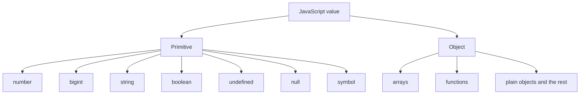

# Values, types and operators

## In plain words

A **value** is a single piece of data that a program can hold and work with: the number 42, the text "hello", the answer "yes" or "no". Think of a kitchen. Flour, eggs and milk are different *kinds* of ingredient, and what you may do with each one differs: you can whisk eggs, you cannot whisk flour on its own. In JavaScript the kinds of ingredient are called **types** (number, text, yes/no and a few more), and the kitchen tools that combine ingredients are called **operators** (`+`, `*`, `<` and so on).

Why it matters for a job: every screen you will ever build shows values computed from other values. A cart total is a number computed from prices. A greeting is text glued together from smaller texts. Whether a button is clickable is a yes/no answer produced by a comparison. Bugs such as a total showing `0.30000000000000004`, or `"5" + 2` producing `"52"`, come straight from the rules in this lesson, and interviewers love to ask about them.

> **Before this lesson:** nothing is required. This is the first lesson of the track. If you have never programmed before, read slowly and press **Run** on every example.

## How to read the examples

A **program** is a list of instructions for the computer, written as text. The grey boxes below are small programs; you can edit them and press Run. Four things appear in them before we explain them properly in later lessons:

- `console.log(something)` means "show `something` in the output panel". Several items separated by commas are shown on one line.
- Text after `//` is a **comment**: a note for human readers that the computer ignores.
- `const name = value;` stores a value under a name so that later lines can refer to it. `let` does the same but allows the stored value to be replaced later. Both are taught in [Program structure](#/lesson/javascript/program-structure).
- `for (const x of list) { ... }` repeats the lines between the braces once for every item in a list. Also taught in the program-structure lesson.

Here is the smallest possible example. It has one line, which asks for the result of `1 + 2` to be shown:

```js-run
console.log(1 + 2);
```

The output is `3`: the computer first worked out `1 + 2`, then displayed the result.

JavaScript is unusually forgiving about mixing kinds of values. It will let you multiply a piece of text by a yes/no value and hand you *something* back. That makes it easy to start and easy to get subtly wrong. The goal of this lesson is that nothing in the following example surprises you by the time you reach the quiz (do not worry if all four lines look strange now):

```js-run
console.log(0.1 + 0.2);
console.log(String(7 / 0), String(0 / 0));
console.log(typeof null, typeof undefined, typeof 10n);
console.log("5" + 2, "5" * 2);
```

> [!NOTE]
> The runnable panels on this site print values through a JSON formatter, which has no notation for `NaN`, `Infinity` or `undefined` inside structures. Whenever an example wants to show one of those, it wraps the value in `String(...)` or a template literal. In a browser console or in Node you would see them directly.

## The eight types

Every JavaScript value belongs to exactly one of eight types. Seven of them are **primitive**: simple, immutable values with no internal parts you can change. The eighth, **object**, covers everything else: arrays, functions, dates, regular expressions and the records you build yourself.



The `typeof` operator reports the type of a value as a string. It is a *unary* operator written as a word instead of a symbol:

```js-run
const samples = [42, 42n, "text", true, undefined, null, Symbol("id"), { a: 1 }, [1, 2], () => 1];
for (const value of samples) {
  console.log(typeof value);
}
```

Two results in that list are historical accidents worth memorising. `typeof null` says `"object"` even though `null` is a primitive; this is a bug from the first implementation that can never be fixed without breaking old pages. And `typeof` of a function says `"function"`, although functions are objects; that one is a convenience.

This lesson covers numbers, strings, booleans and the two "empty" values. Symbols appear in the lesson on objects, and objects themselves get several lessons of their own.

## Numbers

### One numeric type for (almost) everything

JavaScript does not distinguish integers from fractions. Every `number` is a 64-bit IEEE 754 floating-point value, the same format that C and Java call `double`. Of those 64 bits, 52 store the significant digits, 11 store an exponent that says where the binary point sits, and 1 stores the sign.

You can write numbers in several notations:

```js-run
console.log(255, 0xff, 0b11111111, 0o377);   // decimal, hex, binary, octal
console.log(1.5e3, 2e-3);                    // scientific notation
console.log(1_000_000);                      // underscores as visual separators
```

Because 52 bits (plus an implicit leading one) hold the digits, every whole number up to $2^{53} - 1$ is represented exactly. That limit is available as `Number.MAX_SAFE_INTEGER`. Beyond it, neighbouring integers start to collapse into each other:

```js-run
console.log(Number.MAX_SAFE_INTEGER);
console.log(9007199254740992 === 9007199254740993);   // two different literals, same stored number
console.log(Number.isSafeInteger(2 ** 53 - 1), Number.isSafeInteger(2 ** 53));
```

### Fractions are approximations

A finite number of binary digits cannot express most decimal fractions, in the same way that a finite number of decimal digits cannot express one third. `0.1` is stored as the nearest representable value, which is a hair above one tenth. Do arithmetic on such values and the tiny errors become visible:

```js-run
console.log(0.1 + 0.2);
console.log(0.1 + 0.2 === 0.3);
console.log(Math.abs(0.1 + 0.2 - 0.3) < Number.EPSILON);   // compare with a tolerance instead
console.log((0.1 + 0.2).toFixed(2));                        // formatting hides the noise
console.log(0.5 + 0.25 === 0.75);                           // sums of powers of two are exact
```

> [!WARNING]
> Never store money as fractional numbers of the main currency unit. Keep integer cents (or use a decimal library) and format only when displaying. `0.1 + 0.2` is harmless in a demo and a real defect in an invoice.

### Arithmetic operators

The binary arithmetic operators are `+`, `-`, `*`, `/`, `%` (remainder) and `**` (exponentiation). Precedence follows school mathematics: `**` first, then `*`, `/`, `%`, then `+` and `-`. Parentheses override everything.

```js-run
console.log(2 + 3 * 4);        // multiplication first
console.log((2 + 3) * 4);
console.log(2 ** 3 ** 2);      // ** groups from the right: 2 ** 9
console.log(17 % 5, -17 % 5);  // the sign follows the left operand
console.log(7 / 2, Math.floor(7 / 2), Math.trunc(-7 / 2));
```

Notice that `/` never performs integer division. If you want a whole quotient, round explicitly with `Math.floor` or `Math.trunc`. Notice also that `%` is a *remainder*, not a mathematical modulo: with a negative left operand the result is negative. A common idiom for a true modulo is `((a % n) + n) % n`.

### Special numbers

Three number values do not behave like ordinary numbers:

- `Infinity` and `-Infinity` are what you get when a result is too large in magnitude, including when you divide a non-zero number by zero.
- `NaN` ("not a number") is the result of a numeric operation that has no meaningful answer, such as `0 / 0` or `Math.sqrt(-1)`, or of converting unparseable text.

```js-run
console.log(String(1 / 0), String(-1 / 0), String(Infinity - Infinity));
console.log(String(Number("12px")), String(Math.sqrt(-4)));
console.log(NaN === NaN);                 // the only value not equal to itself
console.log(Number.isNaN(NaN), Number.isNaN("hello"));
console.log(typeof NaN);
```

`NaN` is contagious: any arithmetic involving it yields `NaN` again, so one bad input can silently poison a long calculation. And because `NaN === NaN` is `false`, you must test for it with `Number.isNaN(value)`.

> [!INTERVIEW]
> "How do you check for `NaN`?" The expected answer is `Number.isNaN(x)`. Mention that the older global `isNaN(x)` first converts its argument to a number, so `isNaN("hello")` is `true` even though `"hello"` is a string and not the value `NaN`. `Object.is(x, NaN)` also works, and `x !== x` is the classic trick.

There is also a negative zero. `-0` and `0` compare as equal, but `1 / -0` is `-Infinity`. You will almost never need to care, except to know that `Object.is(0, -0)` is `false`.

### BigInt for huge integers

When whole numbers beyond $2^{53}$ matter (identifiers from a database, cryptography, precise counters) there is a separate primitive type, `bigint`. Write a literal with a trailing `n`:

```js-run
const big = 9007199254740993n;
console.log(String(big + 1n));
console.log(String(2n ** 100n));
console.log(typeof big, String(7n / 2n));    // division truncates
```

BigInts and numbers do not mix in arithmetic; `1n + 1` throws a `TypeError`. Convert deliberately with `BigInt(n)` or `Number(b)`.

## Strings

### Three kinds of quotes

A string is a sequence of characters used to represent text. Single quotes and double quotes are interchangeable; pick one and be consistent. Backticks create a **template literal**, which can span lines and can embed the result of any expression inside `${...}`:

```js-run
const item = "tea";
const price = 3.5;
console.log('single' + " and " + `backtick`);
console.log(`Two cups of ${item} cost ${(price * 2).toFixed(2)} euros`);
console.log(`line one
line two`);
```

Inside ordinary quotes, a backslash starts an **escape sequence**: `\n` is a newline, `\t` a tab, `\\` a single backslash, `\"` a quote character, and `\u{1F600}` a character given by its Unicode code point.

```js-run
console.log("She said \"hi\"\tand left.\nNew line here.");
console.log("A backslash: \\", "length of '\\n':", "\n".length);
console.log("\u{1F680} launches");
```

### Strings are immutable sequences

A string has a `length` and its characters can be read by position (starting from zero), but no operation changes a string in place. Methods such as `toUpperCase` return a *new* string:

```js-run
const word = "kettle";
console.log(word.length, word[0], word.at(-1));
console.log(word.toUpperCase(), word);     // the original is untouched
console.log(word.slice(1, 4), word.includes("ett"), word.indexOf("t"));
console.log("ab".repeat(3), "  padded ".trim() + "!");
```

In strict mode an assignment such as `word[0] = "K"` throws; in sloppy mode it is silently ignored. Either way the string stays the same.

Internally JavaScript strings are sequences of 16-bit code units (UTF-16). Most characters fit in one unit, but many emoji and some rarer scripts need two, which is why `"🚀".length` is `2`. The lesson on composition and Unicode returns to this.

### Operators on strings

`+` joins strings (concatenation). The comparison operators order strings character by character according to their code units, which roughly means alphabetical, with all upper-case letters before all lower-case ones:

```js-run
console.log("con" + "cat" + "enate");
console.log("apple" < "banana", "Zebra" < "apple", "10" < "9");
console.log("résumé".localeCompare("resume", "en", { sensitivity: "base" }));   // 0 means "same"
```

The comparison `"10" < "9"` is true because the comparison is textual: the character `"1"` comes before `"9"`. When you want human ordering, use `localeCompare` or `Intl.Collator`.

## Unary operators

Operators that take one operand are called unary. You have met `typeof`. The minus sign is both binary (subtraction) and unary (negation), and `+` in unary position converts its operand to a number. `!` negates a boolean.

```js-run
console.log(-(-3), +"42", typeof +"42");
console.log(!true, !0, !!"non-empty");
console.log(typeof typeof 1);
```

The double negation `!!value` is the idiomatic way to convert any value to the boolean it "counts as". The last line prints `string`, because `typeof 1` is the string `"number"`, and the type of any string is `"string"`.

## Booleans, comparison and logic

A boolean is one of two values, `true` or `false`. Comparisons produce them:

```js-run
console.log(3 > 2, 3 >= 3, 2 !== 3, "a" === "a");
console.log(String(NaN > 1), String(NaN < 1), String(NaN === NaN));
```

Use `===` and `!==` for equality tests. Their loose cousins `==` and `!=` convert types first, with rules complicated enough to deserve the next lesson.

### Logical operators and short-circuiting

`&&` (and), `||` (or) and `!` (not) work as in logic, with two twists that make them far more useful than plain truth-table operators.

First, they accept any value, not only booleans. A value is **falsy** if it is one of `false`, `0`, `-0`, `0n`, `""`, `null`, `undefined` or `NaN`; every other value is **truthy**, including `"0"`, `"false"`, `[]` and `{}`.

Second, `&&` and `||` return one of their *operands*, not necessarily a boolean, and they evaluate the right operand only if needed:

- `a || b` yields `a` if `a` is truthy, otherwise `b`.
- `a && b` yields `a` if `a` is falsy, otherwise `b`.

```js-run
console.log("" || "default name");
console.log("Ada" || "default name");
console.log(0 && "never reached");
console.log("first" && "second");

let calls = 0;
const expensive = () => { calls++; return true; };
console.log(false && expensive(), true || expensive(), calls);   // expensive never ran
```

This behaviour, called **short-circuit evaluation**, is the reason expressions like `user && user.name` were the traditional guard against reading a property of `null`.

### The nullish coalescing operator

`||` falls back on *any* falsy left side, which is wrong when `0` or `""` are legitimate values. The `??` operator falls back only when the left side is `null` or `undefined`:

```js-run
const volume = 0;
console.log(volume || 50);    // 50: zero was treated as "missing"
console.log(volume ?? 50);    // 0: zero is a real setting
console.log(null ?? "fallback", String(undefined ?? "fallback"), false ?? "fallback");
```

> [!TIP]
> Reach for `??` when supplying defaults for settings, counters and text fields. Use `||` only when every falsy value should really trigger the fallback.

### The conditional operator

The only operator with three operands is written `condition ? a : b`. It evaluates the condition, then exactly one of the other two expressions:

```js-run
const hour = 15;
const greeting = hour < 12 ? "Good morning" : hour < 18 ? "Good afternoon" : "Good evening";
console.log(greeting);
```

Chains like the one above read top to bottom as a table of cases. Anything more complicated is clearer as an `if` statement.

## The two empty values

JavaScript has two values that mean "nothing here": `undefined` and `null`. They are the only values of their respective types.

`undefined` is what the language itself produces when something is missing: a declared binding that has not been given a value, a parameter the caller did not supply, a property that does not exist, a function that ends without `return`.

`null` is never produced spontaneously by the core language. It is what *programmers* (and many APIs, such as the DOM and JSON) use to state explicitly that a value is intentionally absent.

```js-run
let later;
const record = { name: "Ada" };
function noReturn() {}
console.log(String(later), String(record.age), String(noReturn()));
console.log(JSON.stringify({ a: null, b: undefined }));   // JSON keeps null, drops undefined
console.log(null === undefined, null == undefined);
```

In day-to-day code the difference rarely matters, and treating them as interchangeable (`value == null` is true for both, and for nothing else) is a widely accepted idiom. What does matter is that reading a property *of* either one is an error: `undefined.length` throws a `TypeError`, the single most common runtime failure in JavaScript programs.

## Operator precedence in practice

When several operators appear in one expression, precedence decides which applies first, and associativity decides how operators of equal precedence group. You do not need the full table, only its outline, from tightest to loosest:

| Level | Operators |
|---|---|
| member access, call | `a.b`, `a[b]`, `f()` |
| unary | `!`, `-x`, `+x`, `typeof` |
| exponent | `**` (right-to-left) |
| multiplicative | `*`, `/`, `%` |
| additive | `+`, `-` |
| relational | `<`, `<=`, `>`, `>=` |
| equality | `===`, `!==`, `==`, `!=` |
| logical and | `&&` |
| logical or, nullish | `\|\|`, `??` |
| conditional | `? :` |
| assignment | `=`, `+=` and friends (right-to-left) |

```js-run
console.log(1 + 2 < 4 && 10 % 3 === 1);       // arithmetic, then comparison, then logic
console.log(!true || true);                   // unary first: (!true) || true
console.log(typeof 1 + 2);                    // (typeof 1) + 2
```

The last line prints `number2`: `typeof` binds tighter than `+`, so the string `"number"` is concatenated with `2`. When you are unsure, add parentheses. They cost nothing and document intent. The language even forces them in one place: mixing `??` directly with `||` or `&&` is a syntax error until you parenthesise.

## Common pitfalls

1. **Trusting decimal fractions.** `0.1 + 0.2 !== 0.3`. Compare with a tolerance or work in integers.
2. **Testing `NaN` with `===`.** It is never equal to anything. Use `Number.isNaN`.
3. **Believing `typeof null`.** It says `"object"`. To test for a real object write `value !== null && typeof value === "object"`.
4. **Defaulting with `||` when `0`, `""` or `false` are valid.** Use `??`.
5. **Comparing numeric strings.** `"10" < "9"` is `true`. Convert to numbers first.
6. **Assuming `length` counts characters.** It counts UTF-16 code units; emoji usually count twice.
7. **Forgetting that `+` is overloaded.** With a string on either side it concatenates: `"5" + 2` is `"52"`, while `"5" * 2` is `10`.
8. **Exceeding the safe integer range.** Above `Number.MAX_SAFE_INTEGER` arithmetic silently loses precision; switch to `bigint`.

## Summary

- JavaScript has seven primitive types (`number`, `bigint`, `string`, `boolean`, `undefined`, `null`, `symbol`) and objects. `typeof` names the type, with the quirks `typeof null === "object"` and `typeof fn === "function"`.
- All ordinary numbers are 64-bit floats: integers are exact up to $2^{53} - 1$, fractions are approximations, and `Infinity`, `-Infinity` and `NaN` are special results rather than errors.
- Strings are immutable sequences of UTF-16 code units, written with quotes or backticks; template literals interpolate expressions.
- Comparison operators yield booleans; `&&`, `||` and `??` yield one of their operands and skip evaluating the right side when the left side decides the result.
- Exactly eight values are falsy; everything else is truthy.
- `undefined` means "the language found nothing", `null` means "deliberately empty"; touching a property of either throws.

## Glossary

- **Value**: one piece of data, such as `42`, `"tea"` or `true`.
- **Type**: the kind a value belongs to (number, string, boolean and so on); it decides which operations make sense.
- **Primitive**: a value with no changeable inner parts; every type except object.
- **Operator**: a symbol or word (`+`, `<`, `typeof`) that produces a new value from one, two or three values.
- **Operand**: a value that an operator works on; in `2 + 3` the operands are `2` and `3`.
- **Unary / binary / ternary**: taking one, two or three operands.
- **Expression**: any piece of code that produces a value, such as `2 + 3` or `"a".length`.
- **String**: a value holding text.
- **Boolean**: one of the two values `true` and `false`.
- **Floating point**: the way computers store numbers with a fixed number of binary digits, which makes most fractions approximate.
- **NaN**: "not a number", the result of a numeric operation with no sensible answer.
- **Truthy / falsy**: counting as `true` or as `false` when a yes/no decision is needed.
- **Short-circuit**: skipping the right-hand operand of `&&`, `||` or `??` when the left one already decides the result.
- **Precedence**: the ranking that decides which operator in an expression is applied first.
- **`undefined` / `null`**: the two "nothing here" values, produced by the language and by programmers respectively.

## Check yourself

```quiz
[
  {"q": "What does `console.log(typeof null)` print?", "options": ["null", "undefined", "object", "It throws a TypeError"], "answer": 2,
   "explain": "A long-standing quirk: typeof null is the string \"object\", even though null is a primitive value."},
  {"q": "What does this print?\n\n`console.log(\"3\" + 4 + 5)`", "options": ["12", "39", "345", "75"], "answer": 2,
   "explain": "+ groups from the left. \"3\" + 4 concatenates to \"34\", and \"34\" + 5 gives \"345\"."},
  {"q": "What does this print?\n\n`console.log(3 + 4 + \"5\")`", "options": ["75", "345", "12", "39"], "answer": 0,
   "explain": "Left to right again: 3 + 4 is the number 7, then 7 + \"5\" concatenates to \"75\"."},
  {"q": "Which expression is true?", "options": ["NaN === NaN", "0.1 + 0.2 === 0.3", "Number.isNaN(0 / 0)", "\"10\" > \"9\""], "answer": 2,
   "explain": "0 / 0 is NaN and Number.isNaN detects it. NaN never equals itself, 0.1 + 0.2 is slightly more than 0.3, and \"10\" > \"9\" compares text, where \"1\" sorts before \"9\"."},
  {"q": "What is the value of `0 || null ?? \"x\"`?", "options": ["0", "null", "\"x\"", "It is a SyntaxError"], "answer": 3,
   "explain": "Mixing ?? with || or && without parentheses is forbidden by the grammar, precisely because the intended grouping would be ambiguous to readers."},
  {"q": "What does this print?\n\n`console.log(\"\" || 0 || \"ok\" || \"later\")`", "options": ["an empty line", "0", "ok", "later"], "answer": 2,
   "explain": "|| returns the first truthy operand. The empty string and 0 are falsy, \"ok\" is truthy, and evaluation stops there."},
  {"q": "Which list contains only falsy values?", "options": ["0, \"0\", null", "\"\", [], undefined", "NaN, 0n, \"\"", "false, {}, 0"], "answer": 2,
   "explain": "NaN, the BigInt zero and the empty string are all falsy. The string \"0\", the empty array and the empty object are truthy."},
  {"q": "What does `console.log(-7 % 3)` print?", "options": ["2", "-1", "1", "-2"], "answer": 1,
   "explain": "% is a remainder whose sign follows the left operand: -7 = -2 * 3 + (-1)."}
]
```

> **Source:** Haverbeke, *Eloquent JavaScript* (4th ed.), ch. 1 "Values, Types, and Operators". Facts checked against MDN: https://developer.mozilla.org/en-US/docs/Web/JavaScript/Data_structures , https://developer.mozilla.org/en-US/docs/Web/JavaScript/Reference/Operators/Operator_precedence , https://developer.mozilla.org/en-US/docs/Web/JavaScript/Reference/Global_Objects/Number
