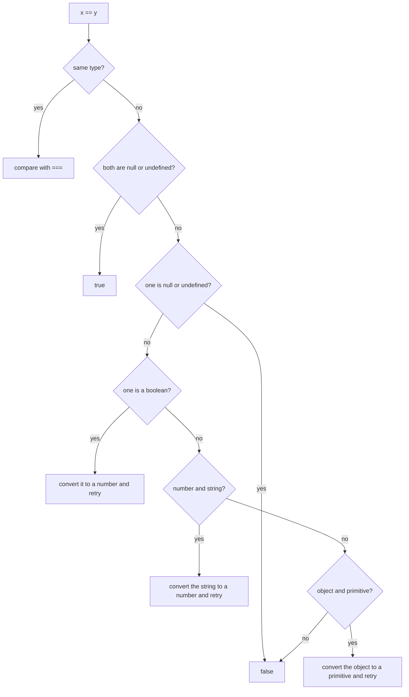

# Type coercion and equality

## In plain words

Imagine a helpful shop assistant who never says "I don't understand". Ask for "five" apples or for "5" apples and they hand you five either way; ask them to add your phone number to your age and they will still produce an answer rather than object. JavaScript behaves like that assistant. When an operator (a symbol such as `+` or `<`) receives a kind of value it was not built for, the language silently converts the value into a kind that works and carries on. This silent conversion is called **type coercion** ("coerce" means "force into another form").

Why it matters for a job: everything a user types into a web page arrives as text, including numbers. If you add two such "numbers" without converting them, `"2" + "3"` gives `"23"`. Real bugs of this kind ship every day, and questions such as "what is the difference between `==` and `===`?" appear in almost every JavaScript interview.

> **Before this lesson:** you should know the types number, string and boolean, the values `null` and `undefined`, and what truthy and falsy mean. All of that is in [Values, types and operators](#/lesson/javascript/values-types-operators).

## The simplest example first

One line, two values of different types: the text `"5"` (in quotes, so it is a string) and the number `3`.

```js-run
console.log("5" + 3);
console.log("5" - 3);
```

The first line shows `53`. Faced with text and a number, `+` decided to join text, so it converted `3` into `"3"` and glued the two together. The second line shows `2`. The `-` operator has no meaning for text, so it converted `"5"` into the number `5` and subtracted. Same two values, opposite conversions. The rest of this lesson explains how the language chooses.

## Why this topic gets its own lesson

In many other languages, adding a number to a piece of text is reported as a mistake before the program ever runs. JavaScript takes the opposite stance and converts.

Coercion is the source of the jokes about JavaScript (`[] + {}`, `"b" + "a" + +"a" + "a"`), of a whole category of interview questions, and of real bugs: a form field that concatenates instead of adding, a filter that treats `0` as "no value", an `if` that takes the wrong branch for an empty array. The good news is that the behaviour is not random. It follows a small set of rules, and once you know them you can predict every result.

```js-run
console.log("5" + 3, "5" - 3, "5" * "2");
console.log(true + true, [] + [], String(null + 1));
console.log("b" + "a" + +"a" + "a");
console.log(1 < 2 < 3, 3 > 2 > 1);
```

By the end of this lesson each of those lines will be explainable step by step.

## Three target types

Whatever the situation, a coercion always aims at one of three primitive types: **string**, **number** or **boolean**. (Objects are first reduced to a primitive, as we will see.) Each target has its own conversion table, and each table can also be invoked explicitly with a function of the same name: `String(x)`, `Number(x)`, `Boolean(x)`.

### To boolean

This is the simplest table because it is a list of exceptions. Eight values convert to `false`:

`false`, `0`, `-0`, `0n`, `""`, `null`, `undefined`, `NaN`

Everything else converts to `true`. In particular all objects are truthy, even empty ones, and non-empty strings are truthy regardless of what they say.

```js-run
const candidates = [0, "0", "", " ", "false", [], {}, null, NaN, -1];
for (const c of candidates) {
  const label = Number.isNaN(c) ? "NaN" : JSON.stringify(c);   // a readable name for the value
  console.log(label, "->", Boolean(c));
}
```

Boolean conversion happens wherever the language needs a yes/no decision: the condition of `if`, `while` and `? :`, and the operands of `!`, `&&` and `||`.

### To string

| Value | Result |
|---|---|
| `null`, `undefined` | `"null"`, `"undefined"` |
| `true`, `false` | `"true"`, `"false"` |
| numbers | the shortest decimal text that round-trips, e.g. `"0.1"`, `"1e+21"`, `"NaN"` |
| arrays | elements converted and joined with commas, `null` and `undefined` elements as empty text |
| plain objects | `"[object Object]"` |
| functions | their source text |

```js-run
console.log(String(123), String(-0), String(1 / 3));
console.log(String([1, [2, 3], null, 4]));
console.log(String({ a: 1 }));
console.log(`${[]}|${[null]}|${[undefined, 1]}`);
```

String conversion happens in template literals, when either operand of `+` is a string, and whenever a value is used as a property name.

### To number

| Value | Result |
|---|---|
| `undefined` | `NaN` |
| `null` | `0` |
| `true`, `false` | `1`, `0` |
| strings | surrounding whitespace is ignored; `""` gives `0`; valid numeric text (decimal, `0x`, `0b`, `0o`, exponent form, `Infinity`) gives that number; anything else gives `NaN` |
| objects | converted to a primitive first, then by the rows above |

```js-run
const inputs = ["", "  42  ", "4 2", "0x1f", "1e3", "12px", null, undefined, true, [], [7], [1, 2], {}];
for (const input of inputs) {
  console.log(JSON.stringify(input) ?? "undefined", "->", String(Number(input)));
}
```

Two rows deserve a second look: `Number(null)` is `0` but `Number(undefined)` is `NaN`, and the empty string becomes `0` rather than `NaN`. Both are frequent sources of confusion.

Number conversion happens for the arithmetic operators other than `+` (`-`, `*`, `/`, `%`, `**`), for unary `+` and `-`, and for relational comparisons unless both sides are strings.

## Explicit conversion: say what you mean

Good code converts on purpose. The usual tools:

```js-run
console.log(Number("42"), +"42", Number("42px") === Number("42px"));
console.log(parseInt("42px", 10), parseFloat("3.14abc"), String(parseInt("px42", 10)));
console.log(parseInt("101", 2), parseInt("ff", 16), parseInt("08", 10));
console.log(String(42), (42).toString(2), (255).toString(16));
console.log(Boolean("x"), !!"x");
```

`Number(text)` demands that the whole string be numeric. `parseInt` and `parseFloat` are lenient: they read as many leading characters as make sense and ignore the rest, which is what you want for input like `"42px"` and exactly what you do not want when validating a form. Always pass the radix to `parseInt`.

> [!WARNING]
> `parseInt` converts its argument to a string first. For very small numbers that string is in exponent notation, so `parseInt(0.0000005)` reads the text `"5e-7"` and returns `5`. Use `Math.trunc`, `Math.floor` or `Math.round` to drop the fraction of a number; keep `parseInt` for text.

## The `+` operator

`+` is the one arithmetic operator with two jobs, so it needs a rule to choose between them:

1. Convert both operands to primitives.
2. If **either** is a string, convert the other to a string and concatenate.
3. Otherwise convert both to numbers and add.

Evaluation proceeds left to right, so the position of the first string matters:

```js-run
console.log(1 + 2 + "3");        // (1 + 2) + "3"
console.log("1" + 2 + 3);        // ("1" + 2) + 3
console.log(1 + +"2" + 3);       // unary plus turns "2" into 2
console.log(String(1 + undefined), 1 + null, 1 + true);
console.log("total: " + 5 * 2);  // * binds tighter than +
```

Now the banana joke is easy. In `"b" + "a" + +"a" + "a"` the unary plus is applied to `"a"` first, giving `NaN`. Then `"ba" + NaN` is `"baNaN"`, and adding `"a"` completes the word.

All the other arithmetic operators have a single meaning and therefore always convert to numbers:

```js-run
console.log("6" / "2", "6" - 2, "3" * "4", "2" ** 3);
console.log(String("six" / 2), [5] * [4], true + true);
```

> [!TIP]
> Values read from form fields, URLs, `prompt` and `localStorage` are always strings. Convert them the moment they enter your program (`const qty = Number(field.value)`), not at the point where you finally do arithmetic.

## Objects become primitives first

When an operator needs a primitive and has an object, the engine asks the object to convert itself. The request carries a *hint*: `"string"` (for template literals and `String()`), `"number"` (for arithmetic and `Number()`), or `"default"` (for `+` and `==`).

For ordinary objects the procedure is: with hint `"string"`, try `toString()` then `valueOf()`; otherwise try `valueOf()` then `toString()`. The first one that returns a primitive wins. The inherited `valueOf` only returns the object itself, so in practice plain objects and arrays end up going through `toString`.

That explains the classic curiosities:

```js-run
console.log([] + []);                 // "" + ""
console.log([] + {});                 // "" + "[object Object]"
console.log([1, 2] + [3]);            // "1,2" + "3"
console.log([2] * [3], String({} * 2));
console.log(1 + [2, 3]);
```

You can define the conversion yourself. A `valueOf` method makes an object usable in arithmetic, and the special method `[Symbol.toPrimitive]` receives the hint and has the final say:

```js-run
const price = {
  amount: 12.5,
  currency: "EUR",
  [Symbol.toPrimitive](hint) {
    return hint === "number" ? this.amount : `${this.amount} ${this.currency}`;
  },
};
console.log(`${price}`);     // hint "string"
console.log(price * 2);      // hint "number"
console.log(price + 1);      // hint "default": we return the text, so this concatenates
```

`Date` objects are the one built-in kind that treat the default hint as "string": `date + 1` concatenates text, while `date - 1` yields a number of milliseconds.

```js-run
const moment = new Date(2030, 0, 1);
console.log(typeof (moment + 1), typeof (moment - 1));
```

## Relational comparison

`<`, `>`, `<=` and `>=` first convert both operands to primitives with a number hint. Then:

- if **both** are strings, they are compared as text, code unit by code unit;
- otherwise both are converted to numbers and compared; any comparison involving `NaN` is `false`.

```js-run
console.log("2" < "12", 2 < "12");               // text vs. numeric comparison
console.log("abc" < 5, "abc" >= 5);              // NaN makes both false
console.log(null < 1, undefined < 1, null >= 0);
console.log(1 < 2 < 3, 3 > 2 > 1);
```

The last line is a favourite trick question. Comparison operators group from the left, so `1 < 2 < 3` is `(1 < 2) < 3`, that is `true < 3`, that is `1 < 3`: true, for the wrong reason. `3 > 2 > 1` becomes `true > 1`, that is `1 > 1`: false.

## Equality: three different algorithms

### Strict equality `===`

No conversion at all. If the types differ, the answer is `false`. If they are the same, the values are compared directly, with two special cases: `NaN` is not equal to itself, and `+0` equals `-0`. Objects are equal only if they are the *same object*.

```js-run
console.log(1 === 1, 1 === "1", null === undefined);
console.log([] === [], {} === {});
const list = [1, 2];
const alias = list;
console.log(list === alias);
```

### Loose equality `==`

`==` applies coercion before comparing. Its algorithm, in the order the checks are made:



Three consequences are worth internalising:

1. `null` and `undefined` are loosely equal to each other **and to nothing else**. They are never converted. That is why `null == 0` is `false` even though `Number(null)` is `0`.
2. Booleans are converted to numbers *before* anything else happens. `x == true` therefore does not ask "is x truthy?"; it asks "is x equal to 1 after conversion?".
3. Everything that is not `null` or `undefined` is ultimately pushed towards a numeric comparison.

```js-run
console.log(null == undefined, null == 0, null == "", undefined == false);
console.log("" == 0, "0" == false, " \n" == 0);
console.log("1" == true, "2" == true, "true" == true);
console.log([] == false, [0] == false, [1] == true, [] == ![]);
console.log("1" == "01", 1 == "01");
```

Take `[] == ![]` slowly. The right side is evaluated first: an array is truthy, so `![]` is `false`. Now we have `[] == false`. The boolean becomes `0`. An object against a number: the array becomes the primitive `""`. A string against a number: `""` becomes `0`. Finally `0 == 0`, true. An array appears to be equal to its own negation, yet every step followed the chart.

Loose equality is also not transitive, which is the deepest reason to distrust it:

```js-run
console.log("0" == 0, 0 == "", "0" == "");
```

### `Object.is` and SameValueZero

A third comparison, `Object.is(a, b)`, behaves like `===` except in the two special cases: it considers `NaN` equal to `NaN`, and it distinguishes `+0` from `-0`. A close relative called *SameValueZero* (like `Object.is`, but treating the two zeros as equal) is what `includes`, `Map` and `Set` use internally:

```js-run
console.log(Object.is(NaN, NaN), Object.is(0, -0));
console.log([NaN].includes(NaN), [NaN].indexOf(NaN));    // includes: SameValueZero, indexOf: ===
console.log(new Set([NaN, NaN, 0, -0]).size);
```

### Which one should I use?

| Operator | Converts types? | `NaN` vs `NaN` | `0` vs `-0` | Typical use |
|---|---|---|---|---|
| `===` | no | not equal | equal | the default choice |
| `==` | yes | not equal | equal | only `x == null` |
| `Object.is` | no | equal | not equal | rare; change detection in libraries |

The widely followed rule: always use `===`, with one sanctioned exception. Because `null` and `undefined` are loosely equal only to each other, `value == null` is a compact and precise test for "is this either of the empty values?".

```js-run
function describe(value) {
  return value == null ? "missing" : `present (${typeof value})`;
}
console.log(describe(null), describe(undefined), describe(0), describe(""), describe(false));
```

> [!INTERVIEW]
> When asked "what is the difference between `==` and `===`?", do not stop at "one checks the type". Say that `===` never converts and returns `false` for different types, while `==` runs a fixed algorithm: `null`/`undefined` only match each other, booleans become numbers, strings facing numbers become numbers, objects become primitives. Then offer an example such as `"0" == false` being true while `if ("0")` takes the truthy branch, to show that `==` and truthiness are different questions.

## Truthiness is not equality with `true`

A recurring confusion is to mix up two separate mechanisms. The condition of an `if` uses the to-boolean table. The expression `x == true` uses the loose-equality algorithm, which converts `true` to the number `1`. They disagree often:

```js-run
const values = ["0", "hello", [], 2];
for (const v of values) {
  console.log(JSON.stringify(v), "truthy:", Boolean(v), "| == true:", v == true, "| == false:", v == false);
}
```

The string `"hello"` is truthy, yet it is loosely equal to neither `true` nor `false`. Never compare against boolean literals; write `if (x)` or `if (!x)`, or convert explicitly with `Boolean(x)`.

## Worked example: a safe quantity parser

Suppose a quantity arrives from a text field. We want a non-negative integer or a clear rejection. Leaning on coercion gives wrong answers for several inputs, so we convert and validate explicitly:

```js-run
function parseQuantity(text) {
  if (typeof text !== "string") return null;
  const trimmed = text.trim();
  if (trimmed === "") return null;              // Number("") would be 0
  const n = Number(trimmed);                    // strict: whole string must be numeric
  if (!Number.isInteger(n) || n < 0) return null;
  return n;
}

for (const input of ["3", " 12 ", "", "   ", "4.5", "-1", "7 apples", "1e2", "0x10"]) {
  console.log(JSON.stringify(input), "->", parseQuantity(input));
}
```

The outputs for `"1e2"` and `"0x10"` show that `Number` accepts more notations than a user would expect to type. If only plain digits are acceptable, test the text with a regular expression such as `/^\d+$/` before converting. The point of the exercise is the habit: decide what is valid, convert once, and keep the rest of the program free of surprises.

## Common pitfalls

1. **Adding form values.** `"2" + "3"` is `"23"`. Convert inputs to numbers at the boundary.
2. **`if (array.length)` versus `if (array)`.** An empty array is truthy; test its length.
3. **`x == true`.** It compares with the number 1. Use `if (x)`.
4. **Believing `null == 0`.** It is `false`, although `null >= 0` is `true`, because relational operators convert `null` and `==` does not.
5. **Sorting or comparing numeric strings.** `"2" < "12"` is `false`.
6. **Using `parseInt` to truncate numbers, or without a radix.**
7. **Using `indexOf` to look for `NaN`.** Use `includes` or `Number.isNaN`.
8. **Relying on object-to-string conversion.** Interpolating an object into a message yields `[object Object]`; use `JSON.stringify` or pick the fields.

## Summary

- Coercion always targets string, number or boolean, using fixed tables that are also available as `String()`, `Number()` and `Boolean()`.
- `+` concatenates if either primitive operand is a string and adds otherwise; every other arithmetic operator converts to numbers.
- Objects are reduced to primitives through `Symbol.toPrimitive`, `valueOf` and `toString`; arrays become their comma-joined text and plain objects become `"[object Object]"`.
- Relational operators compare two strings textually and everything else numerically; chained comparisons do not do what mathematics suggests.
- `===` never converts. `==` follows a short algorithm in which `null` and `undefined` match only each other, booleans turn into numbers first, and the rest drifts towards numeric comparison.
- Prefer `===`, allow `x == null`, convert explicitly at the edges of your program, and never compare against `true` or `false`.

## Glossary

- **Type coercion**: automatic conversion of a value from one type to another, done by the language without being asked.
- **Implicit / explicit conversion**: conversion done silently by an operator, versus conversion you request with `Number(x)`, `String(x)` or `Boolean(x)`.
- **Concatenation**: joining two strings end to end.
- **Truthy / falsy**: converting to `true` or to `false` when a yes/no decision is needed.
- **Radix**: the base of a number system (10 for decimal, 2 for binary, 16 for hexadecimal); the second argument of `parseInt`.
- **Primitive**: a value that is not an object (number, string, boolean, `null`, `undefined`, bigint, symbol).
- **Hint**: the word (`"string"`, `"number"` or `"default"`) that tells an object which kind of primitive is wanted from it.
- **Strict equality (`===`)**: comparison without any conversion.
- **Loose equality (`==`)**: comparison that converts the operands first, following a fixed list of steps.
- **Relational operator**: one of `<`, `>`, `<=`, `>=`.
- **Transitive**: a property of a comparison where a = b and b = c guarantee a = c; loose equality lacks it.
- **Algorithm**: a fixed sequence of steps for reaching a result.

## Check yourself

```quiz
[
  {"q": "What does this print?\n\n`console.log(1 + \"2\" - 1)`", "options": ["2", "11", "\"121\"", "NaN"], "answer": 1,
   "explain": "1 + \"2\" concatenates to \"12\". The minus operator only works on numbers, so \"12\" becomes 12 and 12 - 1 is 11."},
  {"q": "Which comparison is `true`?", "options": ["null == 0", "null == false", "null == undefined", "undefined == 0"], "answer": 2,
   "explain": "null and undefined are loosely equal to each other and to nothing else; they are never converted to numbers by ==."},
  {"q": "What does this print?\n\n`console.log([] + {})`", "options": ["0", "[object Object]", "NaN", "undefined"], "answer": 1,
   "explain": "Both operands are converted to primitives: [] becomes the empty string and {} becomes \"[object Object]\". String plus string concatenates."},
  {"q": "What is the value of `\"0\" == false`?", "options": ["true, because both are falsy", "true, because false becomes 0 and then \"0\" becomes 0", "false, because \"0\" is truthy", "false, because the types differ"], "answer": 1,
   "explain": "The boolean is converted to the number 0 first, then the string is converted to a number. Truthiness plays no part in ==; \"0\" is in fact truthy."},
  {"q": "What does this print?\n\n`console.log(3 > 2 > 1)`", "options": ["true", "false", "1", "It throws"], "answer": 1,
   "explain": "It groups as (3 > 2) > 1, i.e. true > 1. true converts to 1 and 1 > 1 is false."},
  {"q": "What does `Number(\"\")` return, and `Number(undefined)`?", "options": ["0 and 0", "NaN and NaN", "0 and NaN", "NaN and 0"], "answer": 2,
   "explain": "The empty (or whitespace-only) string converts to 0, null converts to 0, but undefined converts to NaN."},
  {"q": "Which statement about `[NaN].includes(NaN)` and `[NaN].indexOf(NaN)` is correct?", "options": ["true and 0", "false and -1", "true and -1", "false and 0"], "answer": 2,
   "explain": "includes uses the SameValueZero comparison, under which NaN equals NaN. indexOf uses ===, under which it does not, so it reports -1."},
  {"q": "What does this print?\n\n`console.log(\"5\" * \"2\" + \"1\")`", "options": ["11", "\"101\"", "521", "NaN"], "answer": 1,
   "explain": "Multiplication converts both strings to numbers and yields 10. Then 10 + \"1\" has a string operand, so it concatenates to \"101\"."}
]
```

> **Source:** Haverbeke, *Eloquent JavaScript* (4th ed.), ch. 1 "Values, Types, and Operators" (automatic type conversion). Details checked against MDN: https://developer.mozilla.org/en-US/docs/Web/JavaScript/Equality_comparisons_and_sameness , https://developer.mozilla.org/en-US/docs/Web/JavaScript/Reference/Operators/Equality , https://developer.mozilla.org/en-US/docs/Web/JavaScript/Reference/Global_Objects/Symbol/toPrimitive
