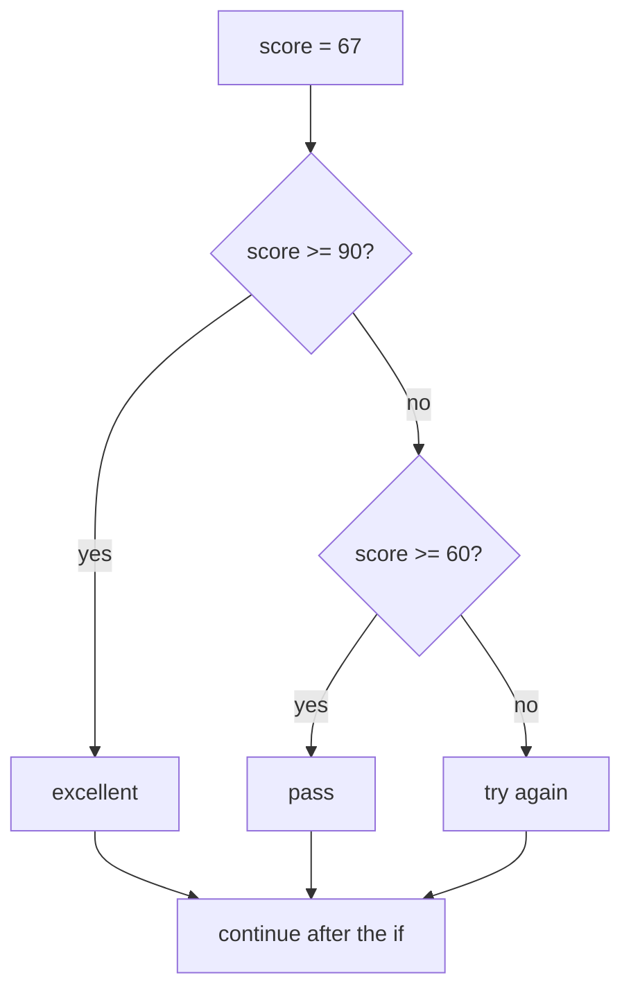
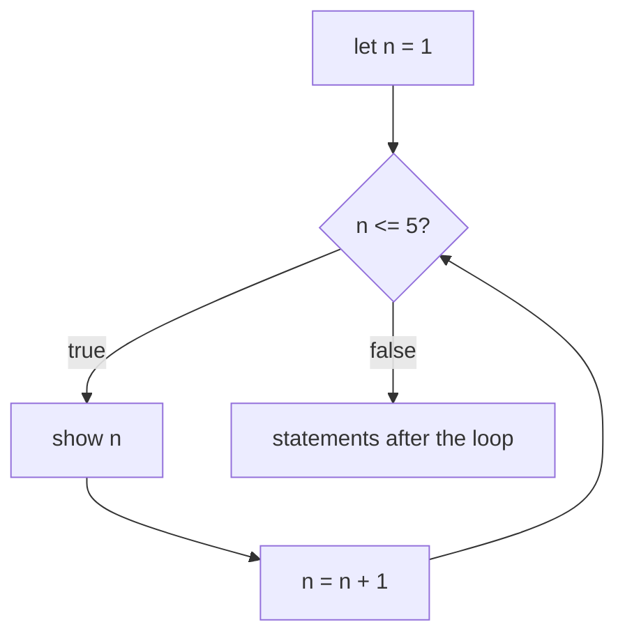

# Program structure: bindings and control flow

## In plain words

A recipe is more than a list of ingredients. It has steps ("whisk the eggs"), names for intermediate results ("the batter"), decisions ("if the dough is sticky, add flour") and repetition ("stir until smooth"). A program has exactly the same four things. The steps are called **statements**, the names are called **bindings** (many people say *variables*), the decisions are **conditionals**, and the repetition is **loops**. Together, the decisions and loops are known as **control flow**, because they control which step runs next.

Why it matters for a job: every feature you will write, from "show an error if the password is too short" to "draw one row per order", is built from these pieces. Nothing more advanced in this track replaces them; functions, objects and asynchronous code are all ways of *organising* statements, bindings, conditions and loops.

> **Before this lesson:** you should be comfortable with numbers, strings, booleans and operators such as `+`, `<` and `===` from [Values, types and operators](#/lesson/javascript/values-types-operators), and know what truthy and falsy mean from [Type coercion and equality](#/lesson/javascript/coercion-equality).

## Expressions and statements

An **expression** is a fragment of code that produces a value. `22` is an expression. So is `"tea"`, and so is `1 + 2 * 3`. Expressions can contain other expressions, the way a sentence can contain sub-sentences.

A **statement** is a complete instruction, comparable to a full sentence. A program is a list of statements that the computer carries out from top to bottom. The simplest statement is an expression followed by a semicolon:

```js-run
1 + 2;
console.log("the line above computed 3 and threw it away");
```

Line 1 is a legal statement, but it achieves nothing: the value `3` is produced and then discarded. A statement is only useful if it changes something that later code (or the outside world) can observe. Such a change is called a **side effect**. Showing text on the screen is a side effect; so is storing a value under a name, which is the next topic.

> [!NOTE]
> JavaScript can often work out where a statement ends without the semicolon, a feature named *automatic semicolon insertion*. The rules have traps, so this track always writes the semicolons. A formatter such as Prettier will add them for you in real projects.

## Bindings: giving values a name

To keep a value around, we give it a name. The keyword `let` creates a binding:

```js-run
let cups = 3;
console.log(cups);
console.log(cups * 250);
```

Line by line:

1. `let cups = 3;` creates a binding called `cups` and makes it point at the value `3`. The `=` sign here does **not** mean "equals" as in mathematics; it means "make the name on the left refer to the value on the right". It is called the **assignment operator**.
2. `console.log(cups);` looks the name up and shows what it refers to: `3`.
3. `console.log(cups * 250);` uses the name inside a bigger expression. The output is `750`.

A helpful mental picture: a binding is not a box that *contains* a value. It is a label on a string tied to a value. You can untie the label and tie it to a different value, and two labels can be tied to the same value.

```js-run
let mood = "sleepy";
console.log(mood);
mood = "awake";            // no `let` this time: we re-tie an existing binding
console.log(mood);

let debt = 140;
debt = debt - 35;          // right side first: 140 - 35, then debt points at 105
console.log(debt);
```

The line `debt = debt - 35` looks absurd as mathematics and is perfectly normal as programming: evaluate the right-hand side using the *current* value, then re-point the name at the result.

A binding declared without a value refers to `undefined` until you assign something:

```js-run
let pending;
console.log(String(pending));
pending = "now it has a value";
console.log(pending);
```

### `let`, `const` and `var`

There are three keywords that create bindings.

- `let` creates a binding that can be re-pointed later.
- `const` creates a **constant** binding: it must be given a value immediately and can never be re-pointed. Trying to do so stops the program with an error.
- `var` is the original keyword from 1995. It still works, but it has confusing rules about where the name is visible (covered in the functions lesson). Modern code does not use it.

```js-run
const vatRate = 0.2;
let subtotal = 50;
subtotal = subtotal + 10;
console.log(subtotal * (1 + vatRate));

try {
  vatRate = 0.25;                 // not allowed
} catch (error) {
  console.log("Error:", error.message);
}
```

The `try { ... } catch (error) { ... }` wrapper is explained in the lesson on exceptions. Here it only lets the example survive the forbidden assignment so that you can read the error message.

> [!TIP]
> Use `const` by default and switch to `let` only when you discover that the binding has to change. A reader who sees `const` knows immediately that the name means the same thing for the rest of its life.

### Rules for names

A binding name may contain letters, digits, `_` and the dollar sign, and must not start with a digit. It also must not be one of the language's reserved **keywords** such as `let`, `if`, `for`, `return` or `class`. Names are case-sensitive: `total` and `Total` are different bindings.

Since names cannot contain spaces, multi-word names need a convention. JavaScript programmers use **camelCase**: the first word in lower case and each later word capitalised, as in `shippingCost` or `isLoggedIn`. Names that start with a capital (`Date`, `Map`) are reserved by convention for things you create with `new`, which the lesson on classes covers.

## The environment and calling functions

The set of bindings that exist at a given moment is called the **environment**. When your program starts, the environment is not empty: the language and the surrounding system (a browser, or Node.js) provide many ready-made bindings. `console` is one. `Math` is another.

Many of those bindings refer to **functions**. A function is a piece of program wrapped in a value. Running it is named *calling* or *invoking* it, and you do that by writing parentheses after it. The values between the parentheses are the **arguments**, the inputs handed to the function:

```js-run
console.log(Math.max(4, 11, 7));
console.log(Math.round(2.5), Math.floor(2.99), Math.abs(-8));
const side = Math.sqrt(49);
console.log(side + 1);
```

`Math.max(4, 11, 7)` is called with three arguments and *produces a value*, `11`. A function that produces a value is said to **return** it, and a call that returns a value is an expression, so it can be used inside larger expressions (line 4). `console.log`, by contrast, is called for its side effect of displaying things; it returns `undefined`.

## Control flow

Without control flow, statements run strictly top to bottom, each exactly once. That is called straight-line execution. The interesting programs break that line.

### Conditional execution with `if`

The `if` statement runs a block of statements only when a condition holds. A **block** is a group of statements wrapped in braces `{ }`.

```js-run
const temperature = 31;

if (temperature > 28) {
  console.log("Open the window.");
}
console.log("Done checking.");
```

Line 3 evaluates the expression in parentheses. It is `true`, so the block runs and the first message appears. Change `31` to `20` and run again: the condition is `false`, the block is skipped, and only the second message appears. That second `console.log` is outside the block, so it runs either way.

Add `else` for a second path, and chain `else if` for more than two:

```js-run
const score = 67;

if (score >= 90) {
  console.log("excellent");
} else if (score >= 60) {
  console.log("pass");
} else {
  console.log("try again");
}
```

The conditions are tested in order, and the first one that is true wins; the rest are not even looked at. Here `67 >= 90` is false, `67 >= 60` is true, so the output is `pass` and the final `else` is ignored.



The condition does not have to be a boolean. Any value is converted using the truthy/falsy rule, so `if (name)` means "if `name` is not empty".

> [!WARNING]
> Writing `if (x = 5)` with a single `=` is an assignment, not a comparison. It re-points `x` to `5`, and since `5` is truthy the block always runs. Compare with `===`.

### `while` loops

Suppose we want to show the numbers 1 to 5. Five `console.log` lines would do, but not for 5,000 numbers. A **loop** repeats a block. The `while` loop keeps repeating as long as its condition is true:

```js-run
let n = 1;
while (n <= 5) {
  console.log(n);
  n = n + 1;
}
console.log("after the loop, n is", n);
```

Trace it by hand. `n` starts at `1`. The condition `1 <= 5` is true, so the block runs: it shows `1` and makes `n` equal `2`. Back to the condition: `2 <= 5`, true again. This continues until `n` is `6`; then `6 <= 5` is false and execution continues after the closing brace.



Every correct loop has three ingredients: a starting state (`let n = 1`), a condition that will eventually become false (`n <= 5`), and a step that makes progress towards that (`n = n + 1`). Forget the step and the condition stays true for ever: an **infinite loop**. On this site a runaway example is stopped after a few seconds; in a browser tab it freezes the page.

Loops become powerful when the number of repetitions is not known in advance. How many years until savings double at 7% interest?

```js-run
let balance = 1000;
let years = 0;
while (balance < 2000) {
  balance = balance * 1.07;
  years = years + 1;
}
console.log(years, "years, balance", balance.toFixed(2));
```

A `do ... while` loop is the same idea with the test at the bottom, so the body always runs at least once:

```js-run
let attempts = 0;
let roll;
do {
  roll = (attempts * 4 + 3) % 6 + 1;     // a stand-in for a dice throw
  attempts = attempts + 1;
  console.log("throw", attempts, "gave", roll);
} while (roll !== 6);
```

### `for` loops

The pattern "create a counter, test it, update it" is so common that it has a compact form. A `for` loop puts all three ingredients on one line, separated by semicolons:

```js-run
for (let n = 1; n <= 5; n = n + 1) {
  console.log(n, "squared is", n * n);
}
```

The part before the first semicolon runs once, at the start. The middle part is the condition, checked before every round. The last part runs after every round. Compare it with the `while` version above: the same three pieces, gathered in one place where they are hard to forget.

Loops can be nested. Here the inner loop runs completely for every round of the outer one:

```js-run
for (let row = 1; row <= 3; row = row + 1) {
  let line = "";
  for (let col = 1; col <= 4; col = col + 1) {
    line = line + row * col + "\t";
  }
  console.log(line);
}
```

### Leaving a loop early: `break` and `continue`

`break` jumps out of the innermost loop immediately. `continue` skips the rest of the current round and proceeds to the next one.

```js-run
// first number above 100 that is divisible by both 6 and 14
for (let candidate = 101; ; candidate = candidate + 1) {
  if (candidate % 6 === 0 && candidate % 14 === 0) {
    console.log("found", candidate);
    break;
  }
}

// add up 1..10 but leave out the multiples of 3
let sum = 0;
for (let i = 1; i <= 10; i = i + 1) {
  if (i % 3 === 0) continue;
  sum = sum + i;
}
console.log("sum", sum);
```

The first loop has an empty condition, which counts as "always true"; the `break` is its only exit. That is fine as long as you are certain the exit will be reached.

### Shorter ways to update a binding

Re-pointing a binding based on its old value is so frequent that there are abbreviations:

| Long form | Short form |
|---|---|
| `count = count + 5` | `count += 5` |
| `price = price * 2` | `price *= 2` |
| `text = text + "!"` | `text += "!"` |
| `count = count + 1` | `count += 1` or `count++` |
| `count = count - 1` | `count -= 1` or `count--` |

```js-run
let word = "";
for (let i = 0; i < 3; i++) {
  word += "ha";
}
console.log(word);
```

`i++` and `++i` both add one. They differ only in the value the expression itself produces (the old value versus the new one), which matters solely when you use them inside a larger expression. That is a habit best avoided.

### Choosing among many values with `switch`

When one value must be compared against a list of fixed possibilities, a chain of `else if` works, and `switch` is an alternative notation:

```js-run
const day = "sat";

switch (day) {
  case "sat":
  case "sun":
    console.log("weekend: no alarm");
    break;
  case "fri":
    console.log("almost there");
    break;
  default:
    console.log("alarm at 07:00");
}
```

Execution jumps to the `case` label whose value is strictly equal (`===`) to the tested value and then runs downwards **until it meets a `break`**. That is why `"sat"` and `"sun"` can share one block here: the `"sat"` case has no statements and falls through into the next. It is also the classic bug: forget a `break` and the following case runs too. `default` is where execution goes when nothing matches.

> [!INTERVIEW]
> A short question that checks understanding of `let` in loops: "what is the value of `i` after `for (let i = 0; i < 3; i++) {}`?" The answer is that `i` does not exist after the loop; a `let` declared in the loop header is visible only inside the loop. With `var` it would exist and be `3`. Interviewers follow up with closures created in such a loop, which the closures lesson explains.

## A complete small program

Let us combine everything: bindings, a loop, a nested condition and string building. The task: for the numbers 1 to 15, show the number, but mark multiples of 4 as "tick", multiples of 6 as "tock", and multiples of both as "tick-tock".

```js-run
for (let n = 1; n <= 15; n++) {
  let label = "";
  if (n % 4 === 0) label += "tick";
  if (n % 6 === 0) {
    if (label !== "") label += "-";
    label += "tock";
  }
  console.log(label || n);
}
```

Walk through `n = 12`. `label` starts empty. `12 % 4` is `0`, so `label` becomes `"tick"`. `12 % 6` is also `0`; the label is not empty, so a dash is added, then `"tock"`. The last line uses the `||` operator from the first lesson: an empty label is falsy, so the number is shown instead; a non-empty label is truthy and is shown itself.

When an `if` controls a single statement, the braces may be omitted, as on the third line. Many teams forbid that style because adding a second statement later without adding braces is an easy mistake.

## Comments and layout

Indentation (the spaces at the start of lines inside a block) means nothing to the computer. It is there for people: it shows at a glance which statements belong to which block. Use two spaces per level, as these examples do, or let a formatter decide.

Comments also exist only for readers. `//` starts a comment that runs to the end of the line; `/* ... */` can span several lines.

```js-run
const seconds = 7384;
// Integer division by 3600 gives whole hours; the remainder is what is left over.
const hours = Math.floor(seconds / 3600);
const minutes = Math.floor((seconds % 3600) / 60);
/* The final remainder is the seconds part.
   Nothing more to carry. */
console.log(hours + "h " + minutes + "m " + (seconds % 60) + "s");
```

A useful comment explains *why* the code does something, or states a fact the code cannot express. A comment that repeats what the line plainly says ("add 1 to i") is noise.

## Common pitfalls

1. **`=` instead of `===` in a condition.** It assigns and then tests the assigned value.
2. **Infinite loops.** The loop body never changes anything the condition depends on.
3. **Off-by-one errors.** `i < 5` runs for 0..4 (five rounds); `i <= 5` runs for 0..5 (six rounds). Decide which you mean and trace the first and last round by hand.
4. **Missing `break` in `switch`.** Execution falls through into the next case.
5. **Re-declaring instead of re-assigning.** Writing `let total = ...` a second time in the same block is an error; write `total = ...`.
6. **Assuming `const` freezes the value.** It only prevents re-pointing the *name*. An object referred to by a `const` binding can still be modified, as the data-structures lesson shows.
7. **A stray semicolon after `if (...)` or `while (...)`.** `if (ready); { start(); }` runs the block unconditionally, because the semicolon is an empty statement that ends the `if`.

## Summary

- Expressions produce values; statements do things. A program is a sequence of statements.
- A binding ties a name to a value. Declare with `const` when the name never needs to be re-pointed and with `let` when it does; avoid `var`.
- The environment is the collection of bindings currently available; it comes pre-filled with functions such as `console.log` and `Math.max`, which you call with parentheses and arguments.
- `if` / `else if` / `else` choose between paths; `switch` dispatches on one value with strict equality.
- `while` repeats while a condition holds, `do ... while` tests after the first round, and `for` packs initialisation, condition and update into one line. `break` leaves a loop, `continue` skips to the next round.
- Compound assignments (`+=`, `++`) are shorthand for updating a binding from its own value.
- Indentation and comments are for humans and are worth the effort.

## Glossary

- **Statement**: one complete instruction in a program.
- **Expression**: code that produces a value.
- **Side effect**: any observable change a statement causes, such as output or re-pointing a binding.
- **Binding (variable)**: a name tied to a value.
- **Assignment**: making a binding refer to a (new) value with `=`.
- **Keyword**: a word reserved by the language, such as `let`, `if` or `while`.
- **Constant**: a binding created with `const`, which cannot be re-pointed.
- **Environment**: all the bindings that exist at a given moment.
- **Function**: a reusable piece of program stored as a value; *calling* it runs it.
- **Argument**: a value handed to a function when calling it.
- **Return value**: the value a function call produces.
- **Block**: statements grouped inside `{ }`.
- **Control flow**: the order in which statements run, shaped by conditions and loops.
- **Loop**: a construct that repeats a block.
- **Infinite loop**: a loop whose condition never becomes false.
- **camelCase**: the naming style `likeThisOne`.
- **Comment**: text in the source code that the computer ignores.

## Check yourself

```quiz
[
  {"q": "What does this print?\n\n`let a = 5; let b = a; a = 9; console.log(b);`", "options": ["9", "5", "undefined", "It throws an error"], "answer": 1,
   "explain": "b was tied to the value 5. Re-pointing a to 9 afterwards does not affect b: bindings refer to values, not to other bindings."},
  {"q": "How many times does the body of `for (let i = 2; i <= 10; i += 3) { ... }` run?", "options": ["2", "3", "4", "8"], "answer": 1,
   "explain": "i takes the values 2, 5 and 8. The next value would be 11, which fails the condition i <= 10."},
  {"q": "What does this print?\n\n`let n = 0; while (n < 3) { n++; if (n === 2) continue; console.log(n); }`", "options": ["1 2 3", "1 3", "0 1 3", "1"], "answer": 1,
   "explain": "n becomes 1 (shown), then 2 (continue skips the log), then 3 (shown). After that the condition 3 < 3 is false."},
  {"q": "Which statement about `const` is correct?", "options": ["A const binding may be declared without a value", "A const binding can be re-pointed inside a loop", "A const binding must be initialised and cannot be re-assigned", "const is an older, discouraged form of var"], "answer": 2,
   "explain": "const requires an initial value and forbids later assignment to the name. It is the recommended default in modern code."},
  {"q": "What does this print?\n\n`switch (2) { case 1: console.log(\"one\"); case 2: console.log(\"two\"); case 3: console.log(\"three\"); break; default: console.log(\"other\"); }`", "options": ["two", "two three", "two three other", "one two three"], "answer": 1,
   "explain": "Execution starts at case 2 and, with no break there, falls through into case 3. The break after case 3 then leaves the switch."},
  {"q": "Why is `if (count = 0) { ... }` almost certainly a bug?", "options": ["It is a syntax error", "It assigns 0 to count, and 0 is falsy, so the block never runs", "It compares count with 0 loosely instead of strictly", "It always runs the block"], "answer": 1,
   "explain": "A single = assigns. The value of the assignment expression is 0, which is falsy, so the block is skipped every time and count has been overwritten."},
  {"q": "What is shown by this program?\n\n`let total = 0; for (let i = 1; i <= 4; i++) { total += i; } console.log(total);`", "options": ["4", "6", "10", "15"], "answer": 2,
   "explain": "The loop adds 1, 2, 3 and 4 to total: 1 + 2 + 3 + 4 = 10."},
  {"q": "Which of these is an expression rather than a statement?", "options": ["let x = 3;", "while (true) {}", "x * 2 + 1", "if (x) { x = 0; }"], "answer": 2,
   "explain": "x * 2 + 1 produces a value and can appear inside other expressions. Declarations, loops and if constructs are statements."}
]
```

> **Source:** Haverbeke, *Eloquent JavaScript* (4th ed.), ch. 2 "Program Structure". Details checked against MDN: https://developer.mozilla.org/en-US/docs/Web/JavaScript/Guide/Control_flow_and_error_handling , https://developer.mozilla.org/en-US/docs/Web/JavaScript/Guide/Loops_and_iteration , https://developer.mozilla.org/en-US/docs/Web/JavaScript/Reference/Statements/let
