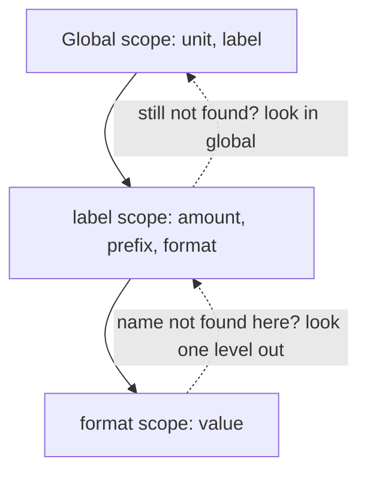
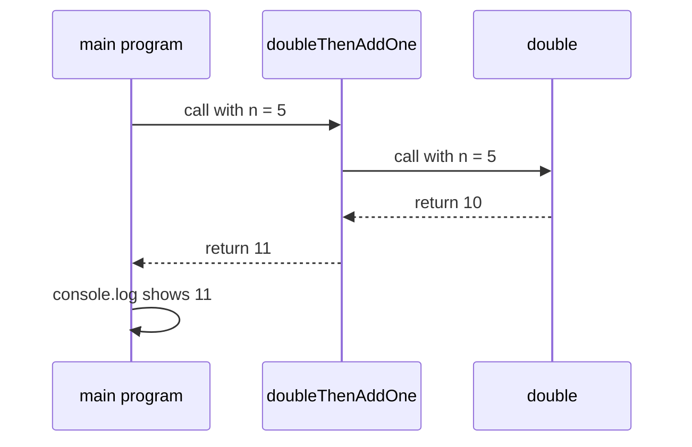

# Functions and scope

## In plain words

A **function** is a named set of instructions that you can run whenever you need it, like a recipe card. Writing the card ("to make tea: boil water, add leaves, wait three minutes") is separate from *following* it. You write the card once and follow it a hundred times, possibly with different ingredients each time ("make tea with **mint**"). In programming, writing the card is called *defining* the function, following it is called *calling* it, and the ingredients you pass in are called *arguments*.

**Scope** answers a related question: where is a given name known? A note pinned inside your kitchen is visible to people in the kitchen, not to the neighbours. In the same way, a name created inside a function is visible inside that function and nowhere else.

Why it matters for a job: functions are how every real program is organised. They let you name an idea once, test it once and reuse it everywhere. Scope rules are behind a large share of beginner bugs ("why is my variable undefined here?") and behind a large share of interview questions.

> **Before this lesson:** you need bindings (`let`, `const`), `if`, loops and the idea of calling a function such as `Math.max(1, 2)`, all from [Program structure](#/lesson/javascript/program-structure).

## Defining and calling a function

Here is the smallest useful function. It takes a number and gives back its square.

```js-run
const square = function (x) {
  return x * x;
};

console.log(square(4));
console.log(square(1.5));
```

Read it piece by piece:

- `function (x) { ... }` is an expression that creates a function value. The word `function` starts it.
- `(x)` is the list of **parameters**: names that will receive the values supplied by the caller. Here there is one.
- The braces contain the **body**: the statements that run each time the function is called.
- `return x * x;` ends the function and hands the value of `x * x` back to whoever called it.
- `const square = ...` ties the name `square` to that function value, exactly as `const n = 5` ties a name to a number.

Nothing in the body runs when the function is defined. It runs on line 5, when `square(4)` *calls* the function: the parameter `x` is bound to `4`, the body runs, and the call expression is replaced by the returned value, `16`.

A function can have several parameters or none, and it does not have to return anything:

```js-run
const greet = function (name, timeOfDay) {
  console.log("Good " + timeOfDay + ", " + name + "!");
};

const rollDie = function () {
  return 4;   // chosen by a fair roll; a real version would use Math.random()
};

greet("Noor", "evening");
console.log(rollDie());
console.log(String(greet("Sam", "morning")));
```

`greet` is called for its side effect (showing text). It contains no `return`, so the value of the call is `undefined`; the last line makes that visible. A `return;` with nothing after it also gives `undefined`, and is used to leave a function early.

## Three notations for the same thing

JavaScript offers three ways to write a function. They create the same kind of value, with a few differences worth knowing.

### 1. Function expression

The form used above: `const name = function (params) { body };`.

### 2. Function declaration

A statement that starts with the word `function` followed by a name. No `const` and no semicolon are needed:

```js-run
console.log(celsiusToFahrenheit(100));

function celsiusToFahrenheit(celsius) {
  return celsius * 9 / 5 + 32;
}
```

Notice something odd: the function is *called on line 1, before the line where it is defined*, and it works. Function declarations are **hoisted**: before running any code in a scope, the engine sets up all the function declarations found in it. This lets you put the main logic at the top of a file and the helper functions below. It applies only to declarations, not to function expressions stored with `const` or `let`.

### 3. Arrow function

A compact notation written with `=>` (an "arrow") between the parameters and the body:

```js-run
const cube = (x) => {
  return x * x * x;
};
const half = (x) => x / 2;            // a single expression: braces and `return` are omitted
const describe = (name, age) => `${name} is ${age}`;
const now = () => "no parameters still needs empty parentheses";

console.log(cube(3), half(9), describe("Li", 30));
console.log(now());
```

When the body of an arrow function is a single expression without braces, the value of that expression is returned automatically. Arrow functions are the usual choice for short functions, especially those handed to other functions, as the next module shows. They also treat the keyword `this` differently from the other two notations, which matters once we reach objects.

> [!WARNING]
> To return an object literal from a single-expression arrow function, wrap it in parentheses: `() => ({ ok: true })`. Without them, the braces are read as a function body and the function returns `undefined`.

## Parameters and arguments

A **parameter** is the name in the function definition. An **argument** is the actual value in a call. JavaScript is extremely relaxed about matching them up.

```js-run
function area(width, height) {
  return width * height;
}

console.log(area(3, 4));          // the normal case
console.log(area(3, 4, 99));      // extra arguments are ignored
console.log(String(area(3)));     // a missing argument is undefined: 3 * undefined is NaN
```

No error is raised when you pass too many or too few arguments. The benefit is flexibility; the cost is that a forgotten argument shows up later as a mysterious `NaN` or `undefined`.

### Default values

A parameter can be given a default that applies when the argument is missing or `undefined`:

```js-run
function stars(rating, outOf = 5) {
  let text = "";
  for (let i = 1; i <= outOf; i++) {
    text += i <= rating ? "*" : "-";
  }
  return text;
}

console.log(stars(3));              // outOf falls back to 5
console.log(stars(7, 10));
console.log(stars(2, undefined), "[" + stars(2, 0) + "]");
```

Passing `undefined` explicitly triggers the default as well; passing `0` or `null` does not.

### Collecting any number of arguments

Putting three dots before the last parameter turns it into a **rest parameter**: an array holding all remaining arguments.

```js-run
function average(...numbers) {
  if (numbers.length === 0) return 0;
  let total = 0;
  for (const n of numbers) total += n;
  return total / numbers.length;
}

console.log(average(4, 8), average(1, 2, 3, 4), average());
```

Arrays are covered in the data-structures module; for now, read `numbers` as "the list of everything that was passed".

## Scope: where a name is visible

Each binding has a **scope**: the region of the program in which its name can be used.

- Bindings declared outside any function or block are **global**: visible everywhere.
- Parameters, and bindings declared inside a function, are **local** to that function. They are created afresh on every call and disappear from view when the call ends.
- Bindings declared with `let` or `const` inside any block (the braces of an `if`, a loop, or a bare `{ }`) are local to that block.

```js-run
const shop = "Corner Bakery";          // global

function receipt(price) {              // price: local to receipt
  const tax = price * 0.1;             // tax: local to receipt
  if (price > 20) {
    const note = "free bag included";  // note: local to this block
    console.log(note);
  }
  // console.log(note) here would fail: note is not visible outside its block
  return shop + ": " + (price + tax);
}

console.log(receipt(30));
console.log(typeof tax);               // "undefined": tax does not exist out here
```

Because locals are private to a call, two functions can both use a name like `result` or `i` without interfering. This isolation is one of the main reasons functions make large programs manageable.

### Nested scope and the lookup rule

Blocks and functions can be nested, which nests their scopes. When code uses a name, the engine looks in the current scope first; if the name is not there, it looks in the enclosing scope, then the next one out, and finally in the global scope. The first match wins. This rule is called **lexical scoping**: what a name refers to is decided by where the code is *written*, not by where it is called from.

```js-run
const unit = "kg";

function label(amount) {
  const prefix = "about";
  function format(value) {
    // sees its own `value`, plus `prefix` and `amount` from label, plus the global `unit`
    return prefix + " " + value + " " + unit + " (of " + amount + ")";
  }
  return format(Math.round(amount));
}

console.log(label(12.6));
```



Inner scopes can see outwards; outer scopes can never see inwards.

### Shadowing

If an inner scope declares a name that also exists further out, the inner one wins inside that scope. The outer binding is untouched; it is merely hidden, or **shadowed**.

```js-run
const level = "global";

function show() {
  const level = "local";       // a different binding with the same name
  console.log(level);
}

show();
console.log(level);
```

### Why `var` is avoided

Bindings made with the old keyword `var` ignore blocks: they are scoped to the whole enclosing function (or are global). They are also hoisted with the value `undefined`, so they can be read before the line that assigns them.

```js-run
function demo() {
  console.log(String(early));     // undefined, not an error
  if (true) {
    var early = "declared inside the if";
  }
  console.log(early);             // still visible outside the block
}
demo();
```

With `let` or `const`, both of those reads would be errors, which is what you want: reading a binding before it has a value is nearly always a mistake.

## Functions are values

A function value can do everything other values can: be stored in a binding, passed as an argument, returned from another function, or put in a list.

```js-run
const shout = (text) => text.toUpperCase() + "!";
const whisper = (text) => text.toLowerCase() + "...";

function announce(message, style) {
  console.log(style(message));    // `style` is a function we were handed
}

announce("Dinner is ready", shout);
announce("Dinner is ready", whisper);

let current = shout;
current = whisper;                // a binding holding a function can be re-pointed like any other
console.log(current("Good Night"));
```

Notice that `announce("...", shout)` passes `shout` **without parentheses**. `shout` is the function itself; `shout("x")` would be the result of calling it. Mixing the two up is one of the most common beginner errors.

## The call stack

When a function is called, the computer has to remember where to continue once the function returns. It keeps these "return addresses" in the **call stack**: a pile where every call puts a new entry on top and every return removes the top entry.

```js-run
function double(n) {
  return n * 2;
}
function doubleThenAddOne(n) {
  const doubled = double(n);
  return doubled + 1;
}
console.log(doubleThenAddOne(5));
```

The order of events for the last line:



At the deepest point the stack holds three entries: the main program, `doubleThenAddOne`, and `double`. The stack has a limited size. A function that keeps calling without ever returning will fill it up, and the engine stops the program with a `RangeError`:

```js-run
function forever(depth) {
  return forever(depth + 1);
}
try {
  forever(1);
} catch (error) {
  console.log(error.name + ": " + error.message);
}
```

When your program crashes, the error report includes a *stack trace*: the list of calls that were on the stack at that moment. Reading it from the top tells you where the failure happened and how the program got there.

## Pure functions and side effects

Functions fall into two rough groups. Some are called for the value they return (`square`, `power`). Others are called for a side effect (`console.log`, `greet`). A function is **pure** when it does both of the following: its result depends only on its arguments, and it changes nothing outside itself.

```js-run
// pure: same input, same output, nothing else touched
const withTax = (price, rate) => price * (1 + rate);

// impure: depends on and modifies a binding outside the function
let orderCount = 0;
function nextOrderNumber() {
  orderCount += 1;
  return orderCount;
}

console.log(withTax(100, 0.2), withTax(100, 0.2));
console.log(nextOrderNumber(), nextOrderNumber());
```

Pure functions are easy to test (call it, check the result) and safe to reuse anywhere. Impure functions are necessary, because a program that changes nothing is useless, but it pays to keep the side effects in a few clearly named places and make everything else pure.

> [!TIP]
> When you catch yourself copying a block of code and changing one detail, that block wants to be a function and the detail wants to be a parameter. Name the function after *what* it produces (`formatPrice`), not *how* (`loopAndConcat`).

## Worked example: growing a function step by step

Task: a music player must show track lengths, stored as a number of seconds, in the familiar `m:ss` form, such as `3:07`.

First attempt, with the logic written out inline and repeated for each track:

```js-run
const intro = 187;
let introSeconds = String(intro % 60);
if (introSeconds.length < 2) introSeconds = "0" + introSeconds;
console.log(Math.floor(intro / 60) + ":" + introSeconds);

const finale = 245;
let finaleSeconds = String(finale % 60);
if (finaleSeconds.length < 2) finaleSeconds = "0" + finaleSeconds;
console.log(Math.floor(finale / 60) + ":" + finaleSeconds);
```

The two halves differ only in the number they start from. Extract the repeated idea into a function. While doing so, notice that "make a number two digits wide" is an idea of its own, so it gets its own small function:

```js-run
function twoDigits(number) {
  const text = String(number);
  return text.length < 2 ? "0" + text : text;
}

function trackLength(totalSeconds) {
  const minutes = Math.floor(totalSeconds / 60);
  const seconds = totalSeconds % 60;
  return minutes + ":" + twoDigits(seconds);
}

console.log(trackLength(187));
console.log(trackLength(245));
console.log(trackLength(59), trackLength(60), trackLength(600));
```

Line by line: `twoDigits` turns its argument into text and puts a zero in front only when the text is one character long. `trackLength` splits the total into whole minutes (`Math.floor` drops the fraction) and leftover seconds (`%` gives the remainder), then glues the pieces together. Both functions are pure, and `twoDigits` knows nothing about music, so it can be reused for clock displays or dates. (In real code the built-in `String(n).padStart(2, "0")` does this job; writing it by hand shows the process of growing a function.)

> [!INTERVIEW]
> "What is the difference between a function declaration and a function expression?" A declaration (`function f() {}`) is hoisted together with its body, so it can be called earlier in the same scope. An expression (`const f = function () {}` or an arrow function) is a value assigned to a binding; the binding follows the normal `let`/`const` rules and cannot be used before that line runs. Add that arrow functions have no `this`, no `arguments` object and cannot be used with `new`.

## Common pitfalls

1. **Forgetting `return`.** The function computes the answer and then hands back `undefined`.
2. **Calling when you meant to pass.** `setTimeout(tick(), 1000)` calls `tick` immediately and passes its result; `setTimeout(tick, 1000)` passes the function.
3. **Arrow function returning an object without parentheses.** `() => { ok: true }` returns `undefined`.
4. **Wrong number of arguments.** No error is reported; the missing parameter is `undefined`.
5. **Accidental globals.** Assigning to a name that was never declared creates a global binding in non-strict code. Always declare with `const` or `let`.
6. **Shadowing by accident.** Re-declaring an outer name inside a function hides the outer one, and changes to the inner one do not reach it.
7. **Expecting a local binding to remember things between calls.** Locals are created fresh on each call. (The next lesson shows how closures *can* remember.)

## Summary

- A function packages statements under a name; parameters receive the caller's arguments and `return` hands back a result.
- Function declarations are hoisted; function expressions and arrow functions are ordinary values bound with `const` or `let`.
- Missing arguments become `undefined`, extra ones are ignored, defaults fill in for `undefined`, and a rest parameter gathers the remainder into an array.
- Scope is lexical: a name is looked up in the current block or function, then outwards through the enclosing scopes to the global scope. Inner scopes can shadow outer names.
- `let` and `const` are block-scoped; `var` is function-scoped and best left alone.
- Functions are values that can be stored, passed and returned.
- Each call adds an entry to the call stack and each return removes it; runaway recursion overflows the stack.
- Prefer pure functions and isolate side effects.

## Glossary

- **Function**: a reusable piece of program stored as a value.
- **Define / call**: to write a function / to run it.
- **Parameter**: a name in a function's definition that receives an input.
- **Argument**: the actual value supplied for a parameter in a call.
- **Return value**: the value a call produces, set with `return`.
- **Body**: the statements between a function's braces.
- **Function declaration**: the statement form `function name() {}`; hoisted.
- **Function expression**: a function written where a value is expected, often assigned to a binding.
- **Arrow function**: the compact `(params) => result` notation.
- **Hoisting**: the engine's processing of declarations before it runs the code of a scope.
- **Scope**: the region of code where a binding is visible.
- **Global / local**: visible everywhere / visible only inside one function or block.
- **Lexical scoping**: name lookup decided by where code is written.
- **Shadowing**: an inner binding hiding an outer binding of the same name.
- **Call stack**: the engine's pile of calls that have started and not yet returned.
- **Stack trace**: the list of calls on the stack when an error occurred.
- **Pure function**: one whose result depends only on its arguments and that causes no side effects.

## Check yourself

```quiz
[
  {"q": "What does this print?\n\n`const f = (a, b = 5) => a + b; console.log(f(1), f(1, undefined), f(1, null));`", "options": ["6 6 1", "6 6 6", "6 NaN 1", "NaN NaN 1"], "answer": 0,
   "explain": "The default applies when the argument is missing or undefined, giving 6 twice. null is a real value, not a missing one, and 1 + null is 1."},
  {"q": "What does this print?\n\n`hello(); function hello() { console.log(\"hi\"); }`", "options": ["hi", "undefined", "ReferenceError", "TypeError: hello is not a function"], "answer": 0,
   "explain": "Function declarations are hoisted with their bodies, so the function can be called before the line that defines it."},
  {"q": "What does this print?\n\n`const x = 1; function show() { const x = 2; { const x = 3; } return x; } console.log(show(), x);`", "options": ["3 1", "2 1", "3 3", "2 2"], "answer": 1,
   "explain": "The innermost x (3) lives only inside its block. The return statement sees the function-level x (2), and the global x stays 1."},
  {"q": "What does `const make = () => { value: 42 }; console.log(make());` print?", "options": ["{ value: 42 }", "42", "undefined", "It is a SyntaxError"], "answer": 2,
   "explain": "The braces are parsed as a function body containing a label and the expression 42; nothing is returned. Wrap the object literal in parentheses to return it."},
  {"q": "A function is called as `area(3)` but defined as `function area(w, h) { return w * h; }`. What happens?", "options": ["A TypeError is thrown for the missing argument", "h is 0, so the result is 0", "h is undefined, so the result is NaN", "The call is ignored"], "answer": 2,
   "explain": "JavaScript does not check argument counts. The missing parameter is undefined, and 3 * undefined is NaN."},
  {"q": "Which statement about scope is correct?", "options": ["Outer scopes can read bindings declared in inner scopes", "A let binding declared in a loop body is visible after the loop", "Name lookup proceeds from the current scope outwards", "Scope depends on where a function is called from"], "answer": 2,
   "explain": "Lexical scoping: the engine searches the current scope, then each enclosing scope in turn. Inner bindings are invisible from outside."},
  {"q": "What is the difference between `run(task)` and `run(task())`?", "options": ["None", "The first passes the function itself; the second calls it and passes its result", "The first calls task twice", "The second is a syntax error"], "answer": 1,
   "explain": "Without parentheses a function name is the function value. With parentheses it is a call, and the call's return value is what gets passed."},
  {"q": "Which function is pure?", "options": ["() => Math.random()", "(list) => { list.push(1); return list; }", "(a, b) => a * b + 1", "() => console.log(\"saved\")"], "answer": 2,
   "explain": "Its result depends only on its arguments and it changes nothing. The others depend on hidden state, modify their argument, or perform output."}
]
```

> **Source:** Haverbeke, *Eloquent JavaScript* (4th ed.), ch. 3 "Functions". Details checked against MDN: https://developer.mozilla.org/en-US/docs/Web/JavaScript/Guide/Functions , https://developer.mozilla.org/en-US/docs/Web/JavaScript/Reference/Functions/Arrow_functions , https://developer.mozilla.org/en-US/docs/Glossary/Scope
