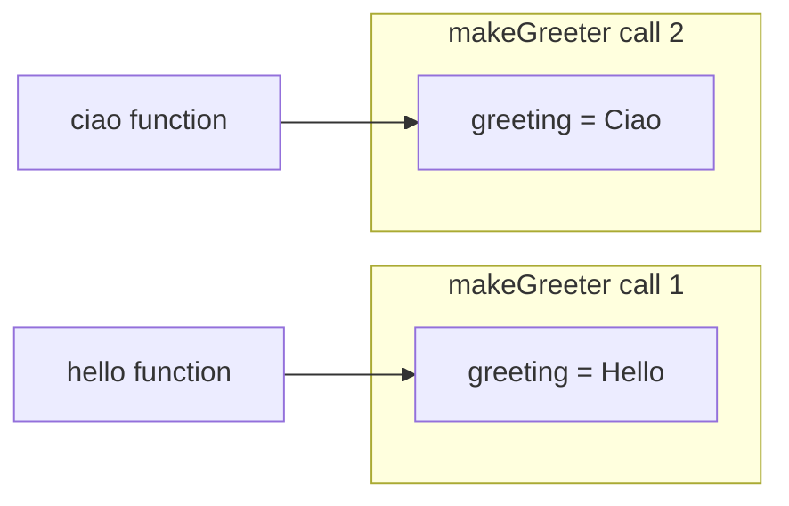
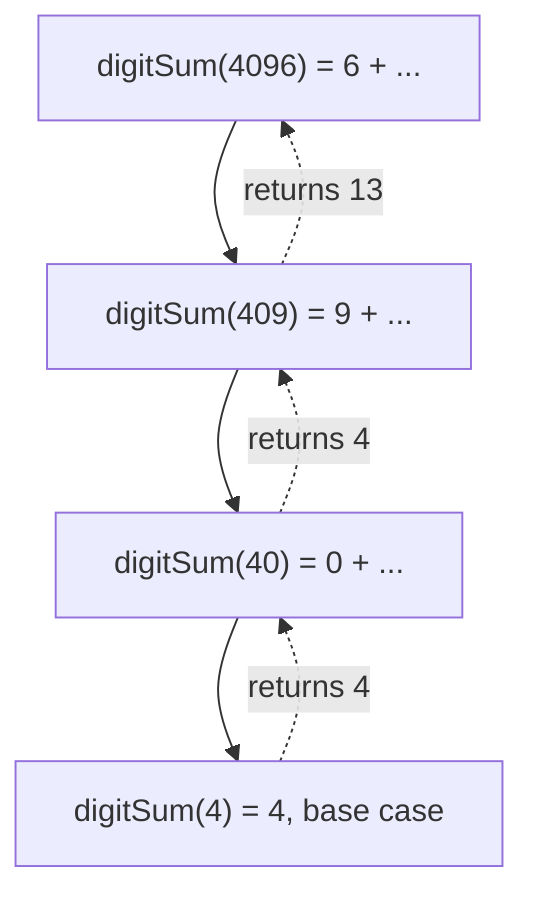

# Closures and recursion

## In plain words

This lesson covers two ideas that sound advanced and are in fact small.

A **closure** is a function that remembers the place where it was created. Picture a backpack. When a function is created inside another function, it packs the names it can see at that moment into a backpack and carries them along for the rest of its life. Whenever it runs later, even far away from where it was made, it can still reach into the backpack. That is how a function can "remember" a counter, a password or a setting between calls.

**Recursion** means a function calling itself to solve a smaller version of the same problem. Think of Russian nesting dolls: to count all the dolls, open the outer one, count one, and then count the dolls inside *using the same method*. When you reach a doll that does not open, you stop.

Why it matters for a job: closures are behind event handlers, timers, React hooks, private state and most of the "utility" functions you will be asked to write in interviews (debounce, memoize, once). Recursion is the natural tool for anything shaped like a tree: folders within folders, comments with replies, the elements of a web page.

> **Before this lesson:** you need function definitions, parameters, `return`, scope and the call stack from [Functions and scope](#/lesson/javascript/functions-scope).

## Part 1: Closures

### A puzzle to start with

In the previous lesson we said that local bindings are created when a function is called and vanish from view when it returns. So what should this program do?

```js-run
function makeGreeter(greeting) {
  return function (name) {
    return greeting + ", " + name + "!";
  };
}

const hello = makeGreeter("Hello");
console.log(hello("Ada"));
```

Follow it line by line:

1. `makeGreeter` takes one parameter, `greeting`.
2. It does not return text. It returns a *new function* (lines 2 to 4), and that inner function uses `greeting`, a name that belongs to `makeGreeter`.
3. Line 7 calls `makeGreeter("Hello")`. The call finishes and returns the inner function, which we store as `hello`.
4. Line 8 calls `hello("Ada")`. By now `makeGreeter` has long since returned. Yet the output is `Hello, Ada!`.

The parameter `greeting` did **not** disappear. The inner function still refers to it, so the engine keeps it alive. A function together with the outer bindings it can still reach is called a **closure** (it "closes over" those bindings). This is the backpack from the introduction.

### Every call makes a fresh backpack

Each call to the outer function creates new local bindings, and the inner function created during that call captures *those* bindings.

```js-run
function makeGreeter(greeting) {
  return (name) => greeting + ", " + name + "!";
}

const hello = makeGreeter("Hello");
const ciao = makeGreeter("Ciao");

console.log(hello("Ada"));
console.log(ciao("Ada"));
console.log(hello === ciao);     // two different function values
```

`hello` carries a backpack in which `greeting` is `"Hello"`; `ciao` carries a separate one in which it is `"Ciao"`. The two never interfere.



### Closures hold bindings, not snapshots

A closure does not copy the *value* a name had when the function was created. It keeps access to the **binding itself**, so it sees later changes, and it can make changes that persist.

```js-run
function makeCounter() {
  let count = 0;                 // lives on after makeCounter returns
  return function () {
    count += 1;                  // changes the captured binding
    return count;
  };
}

const nextTicket = makeCounter();
console.log(nextTicket(), nextTicket(), nextTicket());

const otherQueue = makeCounter();
console.log(otherQueue(), nextTicket());
```

`count` is not global, so no other code can reset or corrupt it. It is not an ordinary local either, because it survives between calls. It is **private state**: reachable only through the function that closed over it. The second counter, `otherQueue`, starts again at 1, while `nextTicket` continues with 4.

Several functions created in the same call share one backpack:

```js-run
function makeWallet(startingBalance) {
  let balance = startingBalance;
  return {
    deposit(amount) { balance += amount; return balance; },
    spend(amount) {
      if (amount > balance) return "declined";
      balance -= amount;
      return balance;
    },
    report() { return "balance: " + balance; },
  };
}

const wallet = makeWallet(50);
console.log(wallet.deposit(25));
console.log(wallet.spend(100));
console.log(wallet.spend(30));
console.log(wallet.report());
console.log(String(wallet.balance));     // undefined: there is no way in from outside
```

The braces after `return` create an object (a bundle of named values, covered in the next module) holding three functions. All three see the same `balance`. Outside code can use the functions and cannot touch `balance` directly.

### The classic loop question

Because closures capture bindings, the *kind* of binding matters. Compare these two loops, which each build three functions and call them afterwards:

```js-run
const withVar = [];
for (var i = 0; i < 3; i++) {
  withVar.push(() => i);
}
console.log(withVar[0](), withVar[1](), withVar[2]());

const withLet = [];
for (let j = 0; j < 3; j++) {
  withLet.push(() => j);
}
console.log(withLet[0](), withLet[1](), withLet[2]());
```

The first line shows `3 3 3`. A `var` binding is scoped to the whole function, so there is exactly **one** `i`, shared by all three closures. By the time any of them runs, the loop has finished and `i` is `3`.

The second line shows `0 1 2`. With `let`, the language creates a **new binding for every round** of the loop, so each closure captures its own `j`.

> [!INTERVIEW]
> This is one of the most frequently asked JavaScript questions, usually phrased with `setTimeout(() => console.log(i), 0)` inside a `var` loop. Explain *why*: one shared function-scoped binding, read after the loop ended. Then give the fixes: use `let`; or, in pre-2015 style, create a new scope per round with an immediately invoked function, `(function (k) { ... })(i)`.

### What closures are used for

**Function factories.** A function that builds specialised functions from a general recipe:

```js-run
const makeUnitConverter = (factor, unit) => (value) => (value * factor).toFixed(1) + " " + unit;

const kmToMiles = makeUnitConverter(0.621371, "mi");
const kgToPounds = makeUnitConverter(2.20462, "lb");

console.log(kmToMiles(10), kgToPounds(70));
```

**Run only once.** A wrapper that lets a function execute a single time and afterwards returns the remembered result:

```js-run
function once(fn) {
  let done = false;
  let result;
  return function (...args) {
    if (!done) {
      done = true;
      result = fn(...args);
    }
    return result;
  };
}

let setups = 0;
const setup = once(() => { setups += 1; return "ready"; });
console.log(setup(), setup(), setup(), "ran", setups, "time");
```

Here `...args` in the parameter list gathers all arguments into a list, and `fn(...args)` spreads that list back out into a call.

**Remembering results (memoization).** Storing answers already computed so they are not computed again:

```js-run
function memoize(fn) {
  const cache = new Map();            // a lookup table from input to result
  return function (n) {
    if (!cache.has(n)) {
      cache.set(n, fn(n));
    }
    return cache.get(n);
  };
}

let work = 0;
const slowSquare = (n) => { work += 1; return n * n; };
const fastSquare = memoize(slowSquare);

console.log(fastSquare(12), fastSquare(12), fastSquare(12), fastSquare(5));
console.log("real computations:", work);
```

`cache` lives in the closure. The slow function ran only twice for four calls.

> [!WARNING]
> A closure keeps everything in its backpack alive for as long as the closure itself is reachable. A long-lived function (an event handler, a cache, a timer callback) that closes over a large object prevents that object from being freed. This is the most common source of memory leaks in JavaScript applications.

## Part 2: Recursion

### The simplest recursive function

A function is **recursive** when it calls itself. Here is a countdown written that way:

```js-run
function countdown(n) {
  if (n === 0) {
    console.log("lift off");
    return;
  }
  console.log(n);
  countdown(n - 1);
}

countdown(3);
```

Trace it. `countdown(3)` is not zero, so it shows `3` and calls `countdown(2)`. That shows `2` and calls `countdown(1)`, which shows `1` and calls `countdown(0)`. That call takes the `if` branch, shows `lift off` and returns without calling again. Then each waiting call returns in turn.

Every recursive function needs two parts:

- a **base case**: an input so small that the answer is known directly, with no further self-call;
- a **recursive case**: reduce the problem to a smaller one and call yourself on that.

If the recursive case does not move towards the base case, the calls never stop and the call stack overflows, as we saw in the previous lesson.

### Recursion that returns values

Summing the digits of a number: the sum for `4096` is the last digit `6` plus the sum for `409`.

```js-run
function digitSum(n) {
  if (n < 10) return n;                          // base case: a single digit
  return (n % 10) + digitSum(Math.floor(n / 10)); // last digit + sum of the rest
}

console.log(digitSum(7), digitSum(4096), digitSum(999999));
```

The calls for `digitSum(4096)` stack up and then resolve from the inside out:



### Loop or recursion?

Anything a loop can do, recursion can do, and the reverse. For straight-line repetition like the two examples above, a loop is usually clearer and also faster, since each function call has a cost and consumes stack space:

```js-run
function digitSumLoop(n) {
  let total = 0;
  while (n > 0) {
    total += n % 10;
    n = Math.floor(n / 10);
  }
  return total;
}
console.log(digitSumLoop(4096));
```

Recursion earns its place when the problem **branches**: when each step leads to several smaller problems rather than one.

### Branching problem 1: nested data

A folder contains files and other folders, which contain files and more folders, to any depth. "The size of a folder is the size of its files plus the size of its sub-folders" is a recursive definition, and the code mirrors it:

```js-run
const projectFolder = {
  name: "project",
  files: [120, 300],
  folders: [
    { name: "images", files: [2048, 4096, 1024], folders: [] },
    {
      name: "src",
      files: [15, 40],
      folders: [{ name: "utils", files: [8, 12], folders: [] }],
    },
  ],
};

function folderSize(folder) {
  let total = 0;
  for (const size of folder.files) total += size;
  for (const sub of folder.folders) total += folderSize(sub);   // same question, smaller folder
  return total;
}

console.log(folderSize(projectFolder));
```

Where is the base case? It is implicit: a folder whose `folders` list is empty makes no recursive calls. Writing this with loops alone would require managing your own list of "folders still to visit"; the call stack does that bookkeeping for free.

### Branching problem 2: counting possibilities

You climb a staircase taking either one or two steps at a time. In how many different ways can you climb `n` steps? Think about the *first* move: it is either a single step (leaving `n - 1` steps) or a double (leaving `n - 2`). The total is the sum of the two.

```js-run
function waysToClimb(steps) {
  if (steps < 0) return 0;      // overshot: not a valid way
  if (steps === 0) return 1;    // arrived exactly: one valid way
  return waysToClimb(steps - 1) + waysToClimb(steps - 2);
}

for (let n = 1; n <= 8; n++) {
  console.log(n, "steps:", waysToClimb(n), "ways");
}
```

This elegant version has a hidden cost. `waysToClimb(30)` computes `waysToClimb(28)` twice, `waysToClimb(27)` three times, and so on; the number of calls roughly doubles with every extra step. The cure combines both halves of this lesson: a closure that memoizes a recursive function.

```js-run
function makeClimbCounter() {
  const known = new Map();
  let calls = 0;
  function ways(steps) {
    calls += 1;
    if (steps < 0) return 0;
    if (steps === 0) return 1;
    if (known.has(steps)) return known.get(steps);
    const answer = ways(steps - 1) + ways(steps - 2);
    known.set(steps, answer);
    return answer;
  }
  return { ways, callCount: () => calls };
}

const counter = makeClimbCounter();
console.log(counter.ways(60));
console.log("function calls needed:", counter.callCount());
```

Sixty steps finish instantly with about a hundred calls. Without the cache the same question would need trillions.

### Branching problem 3: building all combinations

Recursion is also the standard way to *generate* things. All the ways to choose toppings from a list: for each topping, either leave it out or put it in, then decide about the rest.

```js-run
function allSelections(options) {
  if (options.length === 0) return [[]];          // one way to choose from nothing: choose nothing
  const first = options[0];
  const withoutFirst = allSelections(options.slice(1));
  const withFirst = withoutFirst.map((selection) => [first, ...selection]);
  return [...withoutFirst, ...withFirst];
}

const pizzas = allSelections(["olives", "basil", "chili"]);
console.log(pizzas.length);
for (const toppings of pizzas) {
  console.log(toppings.length === 0 ? "(plain)" : toppings.join(" + "));
}
```

`options.slice(1)` is the list without its first item, `.map(...)` builds a new list by transforming every entry, and `[first, ...selection]` builds a list starting with `first`. Those tools are explained in the next module; the structure to notice here is "solve for the rest, then combine with the first".

> [!TIP]
> To write a recursive function, do not try to trace the whole chain in your head. Ask two questions only. What is the smallest input, and what is its answer? If I already had a working answer for a slightly smaller input, how would I extend it? Then trust the function to handle the smaller input.

## Common pitfalls

1. **Expecting a snapshot.** A closure sees the current value of a captured binding, not the value at creation time.
2. **`var` in loops with callbacks.** All callbacks share one binding. Use `let`.
3. **Holding on to large data.** A forgotten closure (listener, timer, cache entry) keeps its whole backpack in memory.
4. **Missing or unreachable base case.** `countdown(-1)` in the example above would never reach `0`; guard with `n <= 0`.
5. **Recursing on the same size.** Each call must be made on a strictly smaller problem.
6. **Exponential blow-up.** Two or more recursive calls on overlapping sub-problems need memoization.
7. **Deep recursion on big inputs.** JavaScript engines allow somewhere around ten thousand nested calls. For long chains (a linked list of 100,000 items), use a loop.

## Summary

- A closure is a function plus the outer bindings it can still reach. Those bindings stay alive as long as the function does.
- Each call of the enclosing function creates a separate set of captured bindings; functions created in the same call share them.
- Closures capture bindings, not values, which is why `let` (a new binding per loop round) and `var` (one binding per function) behave differently in loops.
- Closures give you private state, function factories, and wrappers such as `once` and `memoize`.
- A recursive function has a base case and a recursive case that shrinks the problem.
- Prefer loops for linear repetition; prefer recursion for nested data and for problems that branch.
- Overlapping sub-problems make naive recursion exponentially slow; caching results fixes it.

## Glossary

- **Closure**: a function bundled with the outer bindings it uses, which remain available after the outer function has returned.
- **Capture / close over**: to keep access to an outer binding from inside a function.
- **Private state**: data that can only be reached through particular functions.
- **Factory function**: a function that creates and returns other functions or objects.
- **Memoization**: saving the result of a function call so that the same input is not computed twice.
- **Cache**: a store of previously computed results.
- **Recursion**: solving a problem by having a function call itself on a smaller input.
- **Base case**: the input for which a recursive function answers directly.
- **Recursive case**: the part of a recursive function that calls itself.
- **Stack overflow**: the error that occurs when calls nest deeper than the call stack allows.
- **Exponential growth**: growth in which the amount of work is multiplied, not increased by a fixed amount, with each step of input size.
- **Memory leak**: memory that a program no longer needs and still cannot release.

## Check yourself

```quiz
[
  {"q": "What does this print?\n\n`function make() { let n = 10; return () => ++n; } const a = make(); const b = make(); a(); a(); console.log(a(), b());`", "options": ["13 11", "13 13", "11 11", "12 11"], "answer": 0,
   "explain": "Each call of make creates its own n. a has been called three times (11, 12, 13) and b once (11)."},
  {"q": "What does this print?\n\n`const fns = []; for (var i = 0; i < 3; i++) fns.push(() => i * 2); console.log(fns[0](), fns[1]());`", "options": ["0 2", "6 6", "4 4", "undefined undefined"], "answer": 1,
   "explain": "var creates a single binding shared by every closure. When the functions finally run, i is 3, so both return 6."},
  {"q": "What does this print?\n\n`let x = 1; const read = () => x; x = 2; console.log(read());`", "options": ["1", "2", "undefined", "ReferenceError"], "answer": 1,
   "explain": "The closure holds the binding x, not a copy of its value at creation time, so it sees the later assignment."},
  {"q": "Which of these is required for a recursive function to terminate?", "options": ["It must return a number", "It must use a loop internally", "Each recursive call must move towards a base case that makes no further call", "It must be declared with the function keyword"], "answer": 2,
   "explain": "Without a reachable base case the calls nest until the stack overflows."},
  {"q": "What does this print?\n\n`function f(n) { return n <= 1 ? 1 : n * f(n - 2); } console.log(f(6));`", "options": ["48", "720", "24", "15"], "answer": 0,
   "explain": "f(6) = 6 * f(4) = 6 * 4 * f(2) = 6 * 4 * 2 * f(0) = 6 * 4 * 2 * 1 = 48."},
  {"q": "Why is the plain two-branch `waysToClimb(n)` slow for large n?", "options": ["Recursion is always slower than loops by a constant factor", "It recomputes the same sub-problems again and again, so the number of calls grows exponentially", "The call stack overflows", "Closures prevent garbage collection"], "answer": 1,
   "explain": "Both branches expand into overlapping smaller problems. Memoizing the results brings the work down to roughly n calls."},
  {"q": "In the `makeWallet` example, why can outside code not change `balance` directly?", "options": ["It is declared with const", "It is a local binding of the makeWallet call, reachable only by the functions created in that call", "Objects cannot hold numbers", "It is frozen by the engine"], "answer": 1,
   "explain": "balance lives in the closure scope. Only the three methods created alongside it can see it; the returned object has no balance property."},
  {"q": "What does `once(fn)` rely on to remember that fn has already run?", "options": ["A global flag", "A property stored on fn", "Bindings in the closure created by the call to once", "The call stack"], "answer": 2,
   "explain": "done and result are local to that call of once and are captured by the returned wrapper, so they persist between its calls."}
]
```

> **Source:** Haverbeke, *Eloquent JavaScript* (4th ed.), ch. 3 "Functions" (closure, recursion). Details checked against MDN: https://developer.mozilla.org/en-US/docs/Web/JavaScript/Guide/Closures , https://developer.mozilla.org/en-US/docs/Glossary/Recursion
