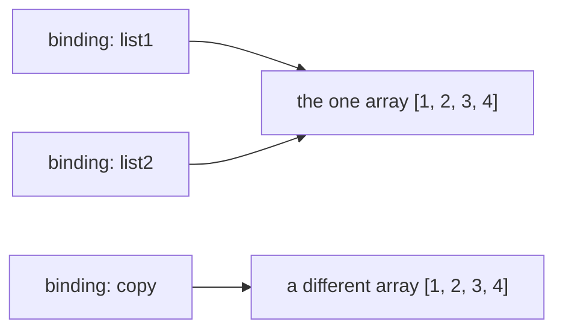

# Objects, arrays and mutability

## In plain words

So far every value has been a single thing: one number, one piece of text. Real information comes in groups. A playlist is an ordered *list* of songs. A contact card is a set of *named fields*: name, phone, email. JavaScript has one structure for each.

An **array** is a numbered list, like the pockets of an egg carton: position 0, position 1, position 2, each holding one value. An **object** is a set of labelled drawers: you look things up by name ("phone") instead of by position. Put the two together (a list of contact cards, a card that holds a list of phone numbers) and you can describe almost any data a program will meet.

The second theme of this lesson is **mutability**: arrays and objects can be changed after they are created, and two names can refer to the *same* one. Imagine a shared online document. If two people have the link and one edits, the other sees the edit. That behaviour is useful and is also the cause of a famous family of bugs.

Why it matters for a job: every response from a server, every piece of application state and every row in a table on screen is made of arrays and objects. Questions about copying, comparing and accidentally modifying them are interview staples.

> **Before this lesson:** you need bindings, loops and functions from [Program structure](#/lesson/javascript/program-structure) and [Functions and scope](#/lesson/javascript/functions-scope).

## Arrays: ordered lists

### Creating and reading

An array is written as a list of values between square brackets, separated by commas.

```js-run
const temperatures = [18, 21, 19, 24];
console.log(temperatures);
console.log(temperatures[0]);
console.log(temperatures[3]);
console.log(temperatures.length);
```

- Line 1 creates an array of four numbers.
- `temperatures[0]` reads the element at **index** 0. An index is a position number, and counting starts at zero, so the first element is `[0]` and the fourth is `[3]`.
- `temperatures.length` is the number of elements, 4. The last valid index is therefore always `length - 1`.

Reading an index that does not exist is not an error; it gives `undefined`. The `at` method accepts negative positions counted from the end:

```js-run
const letters = ["a", "b", "c"];
console.log(String(letters[7]));
console.log(letters[letters.length - 1], letters.at(-1), letters.at(-2));
```

An array can hold values of any type, mixed freely, including other arrays:

```js-run
const grid = [
  [1, 2, 3],
  [4, 5, 6],
];
console.log(grid[1][0], grid.length, grid[0].length);
```

`grid[1]` is the second inner array, and `[0]` then takes its first element: `4`.

### Changing an array

Arrays are **mutable**: their contents can be altered in place.

```js-run
const queue = ["Ana", "Ben"];
queue[1] = "Bea";            // replace an element
queue.push("Cy");            // add at the end
queue.push("Di", "Ed");      // push accepts several values
console.log(queue);

const last = queue.pop();    // remove from the end and hand it back
const first = queue.shift(); // remove from the front and hand it back
queue.unshift("Zed");        // add at the front
console.log(last, first, queue, queue.length);
```

`push`, `pop`, `shift` and `unshift` are **methods**: functions that belong to a value and are called with a dot. `push`/`pop` work at the end of the array; `unshift`/`shift` work at the start.

### Looping over an array

The classic loop uses an index. The `for...of` loop hands you each element directly and is the better choice when you do not need the position:

```js-run
const prices = [4.5, 12, 7.25];

for (let i = 0; i < prices.length; i++) {
  console.log("item", i, "costs", prices[i]);
}

let total = 0;
for (const price of prices) {
  total += price;
}
console.log("total", total);

for (const [index, price] of prices.entries()) {
  console.log(index, price);
}
```

The third loop uses `entries()`, which yields `[index, element]` pairs; the square brackets after `const` unpack each pair into two names, a technique the next lesson explains.

### Useful array methods

```js-run
const colors = ["red", "green", "blue", "green"];

console.log(colors.includes("blue"), colors.includes("pink"));
console.log(colors.indexOf("green"), colors.lastIndexOf("green"), colors.indexOf("pink"));
console.log(colors.slice(1, 3));          // from index 1 up to, not including, 3
console.log(colors.slice(2), colors.slice(-1));
console.log(colors.concat(["black"], "white"));
console.log(colors.join(" / "));
console.log([3, 1, 2].reverse(), [1, [2, [3]]].flat());
console.log(colors);                      // slice, concat and join left the original alone
```

Some methods **mutate** the array they are called on (`push`, `pop`, `shift`, `unshift`, `reverse`, `sort`, `splice`). Others leave it alone and **return a new array or value** (`slice`, `concat`, `join`, `includes`, `indexOf`, `flat`). Knowing which is which prevents many surprises; when unsure, check the MDN page for the method.

> [!WARNING]
> `sort()` with no argument converts the elements to strings and sorts them alphabetically, so `[10, 9, 1].sort()` gives `[1, 10, 9]`. To sort numbers pass a comparison function: `numbers.sort((a, b) => a - b)`. `sort` also mutates the array; `toSorted` returns a sorted copy instead.

## Objects: named properties

### Creating and reading

An object is written with braces. Inside is a comma-separated list of **properties**, each a name, a colon, and a value.

```js-run
const book = {
  title: "Dune",
  pages: 612,
  "year published": 1965,
  tags: ["sci-fi", "classic"],
};

console.log(book.title);
console.log(book["pages"]);
console.log(book["year published"]);
console.log(book.tags[0]);
console.log(String(book.author));
```

There are two ways to read a property:

- **Dot notation**, `book.title`, when the name is a plain word that you type in the code.
- **Bracket notation**, `book["pages"]`, where the name is given by any expression that produces a string. You need brackets when the name contains spaces or other special characters, and when the name is stored in a binding.

Reading a property that does not exist gives `undefined`, as the last line shows.

```js-run
const book = { title: "Dune", pages: 612 };
const field = "pages";
console.log(book[field]);      // uses the VALUE of field: reads book.pages
console.log(String(book.field)); // looks for a property literally named "field": undefined
```

That difference between `book[field]` and `book.field` is the single most common beginner mistake with objects.

### Adding, changing and removing properties

```js-run
const pet = { name: "Miso", age: 2 };

pet.age = 3;                 // change
pet.species = "cat";         // add: assigning to a new name creates the property
delete pet.name;             // remove
console.log(pet);

console.log("age" in pet, "name" in pet);
console.log(Object.keys(pet));
console.log(Object.values(pet));
console.log(Object.entries(pet));
```

The `in` operator tests whether a property exists. `Object.keys`, `Object.values` and `Object.entries` give you arrays of the names, the values, and `[name, value]` pairs, which is how you loop over an object:

```js-run
const stock = { apples: 12, pears: 0, plums: 30 };
for (const [fruit, amount] of Object.entries(stock)) {
  console.log(fruit, amount > 0 ? "in stock" : "sold out");
}
```

### Shorthand notations

When a property takes its value from a binding of the same name, write the name once. A function-valued property can be written without the word `function`. A property name can be computed by putting an expression in square brackets.

```js-run
const name = "Tariq";
const level = 7;
const key = "score-" + level;

const player = {
  name,                         // same as name: name
  level,
  [key]: 1500,                  // computed property name
  describe() {                  // method shorthand
    return this.name + " (level " + this.level + ")";
  },
};
console.log(player.describe());
console.log(Object.keys(player));
```

Inside a method, the keyword `this` refers to the object the method was called on; here `this.name` is `player.name`. The lesson on prototypes and classes treats `this` in depth.

### Even strings have properties and methods

Primitive values such as strings and numbers are not objects, yet you can read properties from them (`"tea".length`) and call methods (`"tea".toUpperCase()`). The language briefly treats the primitive as an object for the duration of the access. Two string methods connect strings and arrays:

```js-run
const sentence = "  one small step  ";
const words = sentence.trim().split(" ");
console.log(words);
console.log(words.join("-"));
console.log("7".padStart(3, "0"), "abc".indexOf("c"), "a,b,,c".split(","));
```

`trim` removes whitespace at both ends, `split` cuts a string into an array at each separator, and `join` does the reverse.

### The `Math` object

Not every object represents a "thing". `Math` is a plain object used as a container for number-related functions and constants, so that their names do not clutter the global scope.

```js-run
console.log(Math.max(3, 9, 4), Math.min(3, 9, 4));
console.log(Math.round(4.5), Math.floor(4.9), Math.ceil(4.1), Math.trunc(-4.9));
console.log(Math.PI.toFixed(4), Math.sqrt(81), Math.abs(-3), Math.hypot(3, 4));
const roll = Math.floor(Math.random() * 6) + 1;   // a whole number from 1 to 6
console.log(roll >= 1 && roll <= 6);
```

`Math.random()` returns a pseudo-random number from 0 up to (not including) 1. Multiplying by 6 and flooring gives 0 to 5; adding 1 shifts that to 1 to 6.

## Mutability and references

### Primitives versus objects

Numbers, strings and booleans are **immutable**: there is no way to change the number 5 or to alter a character inside an existing string. Operations produce *new* values.

Objects and arrays behave differently, and the difference becomes visible as soon as two bindings are involved:

```js-run
let a = 10;
let b = a;         // b gets its own tie to the value 10
b = b + 1;
console.log(a, b); // a is unaffected

const list1 = [1, 2, 3];
const list2 = list1;   // NOT a copy: a second name for the same array
list2.push(4);
console.log(list1, list2);
```

After `const list2 = list1`, there is still only one array. Both names hold a **reference** to it, meaning a pointer that says "the array is over there". A change made through one name is visible through the other.



The same holds when an object is passed to a function. The parameter refers to the caller's object, so the function can modify it:

```js-run
function applyDiscount(order) {
  order.total = order.total * 0.9;      // mutates the caller's object
}
const myOrder = { item: "lamp", total: 80 };
applyDiscount(myOrder);
console.log(myOrder.total);
```

### Identity versus content

For objects, `===` asks "are these the *same* object?", not "do these objects look alike?".

```js-run
const one = { size: 5 };
const two = { size: 5 };
const alias = one;

console.log(one === two);      // false: two separate objects with equal content
console.log(one === alias);    // true: one object, two names
console.log([1, 2] === [1, 2]);
console.log(JSON.stringify(one) === JSON.stringify(two));   // comparing the text form
```

There is no built-in "deep equality" operator. Comparing content means comparing property by property, a classic exercise that appears in this module's problems.

### `const` does not freeze

`const` prevents re-pointing the *binding*. It says nothing about the object the binding points to.

```js-run
const settings = { theme: "dark" };
settings.theme = "light";        // allowed: we change the object, not the binding
settings.fontSize = 14;
console.log(settings);

try {
  settings = { theme: "blue" };  // not allowed: re-pointing a const binding
} catch (error) {
  console.log(error.name);
}

const frozen = Object.freeze({ theme: "dark" });
frozen.theme = "light";          // silently ignored (an error in strict mode)
console.log(frozen.theme);
```

`Object.freeze` makes an object's own properties read-only. It is shallow: objects nested inside a frozen object can still be changed.

### Making copies

To get an independent array or object you must create a new one. The spread syntax `...` (detailed in the next lesson) copies the elements or properties into a fresh container:

```js-run
const original = [1, 2, 3];
const copy = [...original];
copy.push(99);
console.log(original, copy);

const profile = { name: "Ines", address: { city: "Porto" } };
const shallow = { ...profile };
shallow.name = "Inês";               // top level: independent
shallow.address.city = "Lisbon";     // nested object: still shared!
console.log(profile.name, profile.address.city);

const deep = structuredClone(profile);
deep.address.city = "Faro";
console.log(profile.address.city, deep.address.city);
```

A spread copy is **shallow**: it copies one level. Nested objects inside are still shared references. `structuredClone` makes a **deep** copy of plain data, at every level.

> [!INTERVIEW]
> "Is JavaScript pass-by-value or pass-by-reference?" A precise answer: arguments are always passed by value, and for objects the value that gets passed is a reference. So a function can mutate the object it receives (`param.x = 1` is visible to the caller), while re-pointing the parameter (`param = {}`) has no effect outside. Follow up with shallow versus deep copies.

> [!TIP]
> Prefer creating new arrays and objects over modifying existing ones, especially for data that several parts of a program share. `const next = [...items, newItem]` is safer than `items.push(newItem)`. User-interface libraries such as React depend on this style to detect what changed.

## Reading nested data safely

Real data is deeply nested, and parts of it are often missing. Reading a property of `undefined` or `null` throws a `TypeError`. The **optional chaining** operator `?.` stops and yields `undefined` instead:

```js-run
const order = {
  id: 1041,
  customer: { name: "Rui", address: null },
  items: [{ sku: "A1", qty: 2 }],
};

console.log(order.customer.name);
console.log(String(order.customer.address?.city));     // address is null: no error
console.log(String(order.coupon?.code));               // coupon is missing: no error
console.log(order.items[0]?.qty, String(order.items[5]?.qty));
console.log(order.customer.address?.city ?? "no city on file");
```

`?.` pairs naturally with `??` from the first lesson to supply a default.

## Worked example: a reading log

Let us model a small reading log and answer questions about it with what we have learned: an array of objects, loops, property access and an object used as a tally.

```js-run
const log = [
  { title: "Dune", pages: 612, genre: "sci-fi", finished: true },
  { title: "Emma", pages: 474, genre: "classic", finished: false },
  { title: "Neuromancer", pages: 271, genre: "sci-fi", finished: true },
  { title: "Persuasion", pages: 249, genre: "classic", finished: true },
];

let pagesRead = 0;
const finishedTitles = [];
const perGenre = {};                       // genre name -> number of books

for (const entry of log) {
  if (entry.finished) {
    pagesRead += entry.pages;
    finishedTitles.push(entry.title);
  }
  if (!(entry.genre in perGenre)) {
    perGenre[entry.genre] = 0;             // first time we see this genre
  }
  perGenre[entry.genre] += 1;
}

console.log("pages read:", pagesRead);
console.log("finished:", finishedTitles.join(", "));
console.log(perGenre);
```

Step by step: the loop visits each book object. For finished books it adds to a running total and collects the title. For every book it uses the genre *as a property name* (bracket notation, because the name comes from data) to count books per genre, creating the counter the first time a genre appears.

## Common pitfalls

1. **`obj.key` when you mean `obj[key]`.** The dot form uses the literal name.
2. **Off-by-one with indexes.** The last element is at `length - 1`; `array[array.length]` is `undefined`.
3. **Assuming assignment copies.** `const b = a` gives a second name for the same object.
4. **Comparing objects or arrays with `===`.** It compares identity.
5. **Shallow copies of nested data.** Spread copies only the top level.
6. **Default `sort()` on numbers.** It sorts as text.
7. **Mutating an argument by accident.** A function that calls `list.sort()` or `list.push()` changes the caller's array.
8. **Testing an empty array with `if (arr)`.** Arrays are always truthy; test `arr.length`.
9. **`typeof []` is `"object"`.** Use `Array.isArray(value)` to detect arrays.

## Summary

- Arrays are ordered, zero-indexed lists with a `length`; objects are collections of named properties.
- Use dot notation for fixed names and bracket notation for computed names.
- Methods are functions stored in properties. Learn which array methods mutate (`push`, `pop`, `sort`, `splice`, `reverse`) and which return new values (`slice`, `concat`, `join`, `includes`).
- `Object.keys`, `Object.values` and `Object.entries` turn an object into arrays you can loop over.
- Primitives are immutable; objects and arrays are mutable and are handled by reference. Assignment and argument passing share the object rather than copying it.
- `===` on objects compares identity; `const` protects the binding, not the contents.
- Spread makes shallow copies; `structuredClone` makes deep copies.
- `?.` reads through possibly missing parts without throwing.

## Glossary

- **Array**: an ordered list of values, addressed by position.
- **Index**: the position number of an element, starting at 0.
- **Element**: one value stored in an array.
- **Object**: a collection of properties.
- **Property**: a named value belonging to an object; the name is also called a *key*.
- **Method**: a property whose value is a function.
- **Dot / bracket notation**: `obj.name` versus `obj[expression]`.
- **Mutable / immutable**: able / not able to be changed after creation.
- **Mutate**: to change an existing array or object in place.
- **Reference**: a pointer to an object; what bindings and parameters actually hold for objects and arrays.
- **Identity**: being the very same object, as opposed to having equal content.
- **Shallow copy**: a new container whose nested objects are still shared with the original.
- **Deep copy**: a copy in which every nested level is new.
- **Optional chaining**: the `?.` operator, which yields `undefined` instead of throwing when the left side is `null` or `undefined`.

## Check yourself

```quiz
[
  {"q": "What does this print?\n\n`const a = [1, 2]; const b = a; b.push(3); console.log(a.length);`", "options": ["2", "3", "undefined", "It throws because a is const"], "answer": 1,
   "explain": "a and b refer to the same array. Pushing through b changes the one array, whose length is now 3. const only forbids re-pointing a."},
  {"q": "What does this print?\n\n`const key = \"size\"; const box = { size: 3, key: 9 }; console.log(box.key, box[key]);`", "options": ["3 3", "9 3", "9 9", "3 9"], "answer": 1,
   "explain": "box.key reads the property literally named key (9). box[key] evaluates the binding key to \"size\" and reads box.size (3)."},
  {"q": "What does `console.log([10, 9, 1].sort())` print?", "options": ["[1, 9, 10]", "[10, 9, 1]", "[1, 10, 9]", "[9, 10, 1]"], "answer": 2,
   "explain": "Without a comparison function, sort compares the elements as strings: \"1\" < \"10\" < \"9\"."},
  {"q": "What does this print?\n\n`const x = { n: 1 }; const y = { ...x }; y.n = 2; console.log(x.n, x === y);`", "options": ["2 true", "1 false", "2 false", "1 true"], "answer": 1,
   "explain": "Spread creates a new object with copied properties. Changing y does not affect x, and the two are different objects."},
  {"q": "Which call does NOT modify the array it is called on?", "options": ["arr.push(1)", "arr.reverse()", "arr.slice(1)", "arr.shift()"], "answer": 2,
   "explain": "slice returns a new array containing the requested range and leaves the original unchanged."},
  {"q": "What does this print?\n\n`const o = { a: { b: 1 } }; const c = { ...o }; c.a.b = 5; console.log(o.a.b);`", "options": ["1", "5", "undefined", "It throws"], "answer": 1,
   "explain": "The spread copy is shallow: c.a and o.a are the same nested object, so the change is visible through both."},
  {"q": "What is the value of `user.profile?.email` when `user` is `{ name: \"Kim\" }`?", "options": ["null", "It throws a TypeError", "undefined", "an empty string"], "answer": 2,
   "explain": "user.profile is undefined, so the optional chain stops and the whole expression is undefined instead of throwing."},
  {"q": "How should you test whether `value` is an array?", "options": ["typeof value === \"array\"", "value.length !== undefined", "Array.isArray(value)", "value === []"], "answer": 2,
   "explain": "typeof reports \"object\" for arrays, strings also have a length, and === [] compares with a brand-new array. Array.isArray is the reliable test."}
]
```

> **Source:** Haverbeke, *Eloquent JavaScript* (4th ed.), ch. 4 "Data Structures: Objects and Arrays". Details checked against MDN: https://developer.mozilla.org/en-US/docs/Web/JavaScript/Reference/Global_Objects/Array , https://developer.mozilla.org/en-US/docs/Web/JavaScript/Guide/Working_with_objects , https://developer.mozilla.org/en-US/docs/Web/JavaScript/Reference/Operators/Optional_chaining , https://developer.mozilla.org/en-US/docs/Web/API/Window/structuredClone
