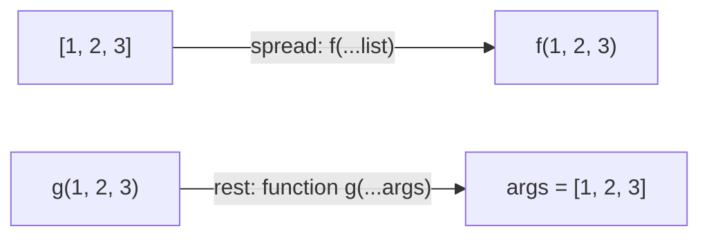
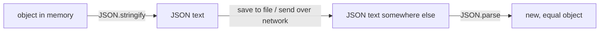

# Destructuring, spread, rest and JSON

## In plain words

This lesson is about packing and unpacking.

When groceries arrive in a bag, you take the items out and put each where it belongs: milk in the fridge, bread on the shelf. **Destructuring** is that unpacking step for arrays and objects: one line that takes values out of a structure and gives each its own name.

**Spread** is the opposite gesture: emptying one bag into another. It pours all the elements of an array (or all the properties of an object) into a new array, a new object, or a function call. **Rest** gathers "everything that is left over" into one container. Spread and rest are both written with three dots, `...`, which confuses many beginners; the position tells them apart.

**JSON** (JavaScript Object Notation) is how data is packed for travel. A living object inside your program cannot be sent over the internet or saved to a file as it is. It first has to be written down as text, the way you would write an address on paper before posting a parcel. JSON is the text format almost every web service uses for that.

Why it matters for a job: modern JavaScript code is full of destructuring and spread (every React component uses them), and nearly every program you write will read or produce JSON.

> **Before this lesson:** you need arrays, objects, properties and the idea of references versus copies from [Objects, arrays and mutability](#/lesson/javascript/objects-arrays).

## Destructuring arrays

### The simplest case

Without destructuring, taking values out of an array means one line per value:

```js-run
const point = [40, 75];
const x = point[0];
const y = point[1];
console.log(x, y);
```

With destructuring, the left side of the `=` is written as a *pattern* shaped like the data:

```js-run
const point = [40, 75];
const [x, y] = point;
console.log(x, y);
```

`const [x, y] = point;` means: "create `x` from the first element of `point` and `y` from the second". The square brackets on the left do not build an array; they describe where each name gets its value from.

### Skipping, defaults and "the rest"

```js-run
const scores = [91, 85, 78, 64, 50];

const [gold, , bronze] = scores;            // an empty slot skips an element
console.log(gold, bronze);

const [first, ...others] = scores;          // rest: everything after the first
console.log(first, others);

const [a, b, c = "none"] = ["only", "two"]; // default used when the element is undefined
console.log(a, b, c);
```

In the second pattern, `...others` is the **rest element**. It must come last, and it collects all remaining elements into a new array.

### Swapping and multiple return values

Destructuring also works when assigning to existing bindings, which gives a famous one-line swap, and it lets a function hand back several results at once:

```js-run
let left = "L";
let right = "R";
[left, right] = [right, left];
console.log(left, right);

function minAndMax(numbers) {
  let lo = numbers[0], hi = numbers[0];
  for (const n of numbers) {
    if (n < lo) lo = n;
    if (n > hi) hi = n;
  }
  return [lo, hi];
}
const [coldest, warmest] = minAndMax([12, 7, 19, 15]);
console.log(coldest, warmest);
```

In the swap, the right side builds a temporary array `[right, left]` from the current values, and the pattern on the left then assigns its elements back.

## Destructuring objects

### The simplest case

For objects, the pattern uses braces, and values are matched **by property name** rather than by position:

```js-run
const city = { name: "Lisbon", country: "Portugal", population: 545000 };

const { name, population } = city;
console.log(name, population);
```

This creates two bindings, `name` and `population`, taking their values from the properties of the same names. The order inside the braces does not matter, and properties you do not mention are ignored.

### Renaming, defaults and nesting

```js-run
const response = {
  status: 200,
  data: { user: { id: 7, email: "kai@example.com" }, tags: ["a", "b"] },
};

const { status: httpStatus } = response;                 // read status, call it httpStatus
const { retries = 3 } = response;                        // default when the property is missing
const { data: { user: { email }, tags: [firstTag] } } = response;   // reach inside nested structures
const { status, ...everythingElse } = response;          // rest for objects

console.log(httpStatus, retries, email, firstTag);
console.log(status, Object.keys(everythingElse));
```

Read `status: httpStatus` as "take the property `status` and put it in a binding named `httpStatus`". The part before the colon is where the value comes *from*; the part after is where it *goes*. In the nested pattern, `data` and `user` are only signposts on the way down; the bindings created are `email` and `firstTag`.

> [!WARNING]
> Destructuring `null` or `undefined` throws a `TypeError`, because there is nothing to take properties from. `const { a } = undefined;` fails. When a value may be missing, supply a fallback: `const { a } = maybeObject ?? {};`.

### Destructuring in parameters

Patterns may appear directly in a parameter list. This is the standard way to write functions that take a group of named options:

```js-run
function createButton({ label, color = "blue", disabled = false } = {}) {
  return `<button class="${color}"${disabled ? " disabled" : ""}>${label}</button>`;
}

console.log(createButton({ label: "Save" }));
console.log(createButton({ label: "Delete", color: "red", disabled: true }));
console.log(createButton());
```

The caller passes one object, and the function unpacks it in its signature. Callers can list the options in any order and omit those with defaults. The trailing `= {}` makes the whole argument optional; without it, calling `createButton()` would try to destructure `undefined`.

It is equally useful in loops over arrays of objects:

```js-run
const readings = [
  { sensor: "kitchen", celsius: 21.5 },
  { sensor: "attic", celsius: 14.2 },
];
for (const { sensor, celsius } of readings) {
  console.log(`${sensor}: ${celsius}`);
}
```

## Spread: pouring values out

### Spreading arrays

Inside an array literal, `...list` inserts all elements of `list` at that position:

```js-run
const morning = ["coffee", "email"];
const afternoon = ["meeting", "gym"];

const day = [...morning, "lunch", ...afternoon];
const copy = [...morning];
console.log(day);
console.log(copy, copy === morning);
console.log([..."hey"]);                // strings can be spread into characters
```

`[...morning]` creates a new array with the same elements: a shallow copy.

### Spreading into a function call

In a call, spread hands each element over as a separate argument:

```js-run
const temps = [18, 24, 21];
console.log(Math.max(...temps));        // same as Math.max(18, 24, 21)
console.log(String(Math.max(temps)));   // without spread: one argument, an array, which is not a number
```

### Spreading objects

Inside an object literal, `...obj` copies all of `obj`'s own properties. When the same property name appears more than once, the **last one wins**, which gives a compact way to say "the same object, except for these changes":

```js-run
const defaults = { theme: "light", fontSize: 14, autosave: true };
const userPrefs = { theme: "dark" };

const settings = { ...defaults, ...userPrefs };
const bigger = { ...settings, fontSize: 18 };

console.log(settings);
console.log(bigger);
console.log(defaults);                  // untouched
```

This is the foundation of immutable updates: never modify, always build a new value from the old one.

```js-run
const cart = [
  { id: 1, name: "pen", qty: 1 },
  { id: 2, name: "ink", qty: 2 },
];

// add an item without mutating
const withPaper = [...cart, { id: 3, name: "paper", qty: 5 }];

// change one item without mutating: map builds a new array, spread builds the new object
const moreInk = cart.map((item) => (item.id === 2 ? { ...item, qty: item.qty + 1 } : item));

// remove an item without mutating
const noPen = cart.filter((item) => item.id !== 1);

console.log(withPaper.length, moreInk[1].qty, noPen.length);
console.log(cart.length, cart[1].qty);  // the original is exactly as it was
```

(`map` and `filter` are array methods that build new arrays; they are the subject of the next module.)

> [!TIP]
> Remember that spread copies are **shallow**. `{ ...user }` gives a new outer object, but `user.address` inside it is the same nested object as before. To change something nested, spread at every level on the way down: `{ ...user, address: { ...user.address, city: "Faro" } }`.

## Rest: gathering values up

The same three dots, in a place where names are being *declared* (a parameter list or a destructuring pattern), mean the opposite: collect what remains.

```js-run
function logAll(level, ...messages) {       // rest parameter
  for (const message of messages) {
    console.log(`[${level}] ${message}`);
  }
  return messages.length;
}
console.log(logAll("info", "started", "listening on 8080"));

const [head, ...tail] = [1, 2, 3, 4];       // rest in an array pattern
const { id, ...fields } = { id: 9, title: "Hi", done: false };   // rest in an object pattern
console.log(head, tail, id, fields);
```

A quick rule to tell them apart:

| Where the dots appear | Name | Effect |
|---|---|---|
| in an array literal, object literal or call: `[...a]`, `{...o}`, `f(...a)` | spread | expands one thing into many |
| in a parameter list or pattern: `(...args)`, `[x, ...rest]`, `{a, ...rest}` | rest | gathers many things into one |



## JSON: data as text

### Why a text format is needed

Objects and arrays live in your program's memory as a web of references. That web cannot be written to a file or sent across a network directly; it must first be turned into a flat sequence of characters. Turning data into text is called **serialisation**, and reading it back is called **parsing** (or deserialisation).

JSON is a serialisation format that looks like JavaScript's own notation for objects and arrays, with stricter rules:

- property names must be in **double quotes**;
- strings must use double quotes;
- allowed values are strings, numbers, `true`, `false`, `null`, arrays and objects;
- no functions, no `undefined`, no comments, no trailing commas.

```json
{
  "name": "Lisbon",
  "population": 545000,
  "coastal": true,
  "twinned": ["Madrid", "Rabat"],
  "mayor": null
}
```

### `JSON.stringify` and `JSON.parse`

JavaScript provides two functions. `JSON.stringify(value)` returns the JSON text for a value; `JSON.parse(text)` returns the value described by a JSON text.

```js-run
const trip = { city: "Lisbon", nights: 3, sights: ["Belém", "Alfama"] };

const text = JSON.stringify(trip);
console.log(typeof text);
console.log(text);

const back = JSON.parse(text);
console.log(back.sights[1], back === trip);
```

Line by line: `text` is a **string** (the second line of output shows its contents, with every name quoted). `JSON.parse` builds a brand-new object from that string. It has the same content as `trip` and is a different object, so `back === trip` is `false`.



For humans, ask for indentation with the third argument:

```js-run
console.log(JSON.stringify({ id: 1, tags: ["x", "y"], owner: { name: "Bo" } }, null, 2));
```

### What does not survive the trip

JSON can only express its own small set of value types. Everything else is dropped or altered:

```js-run
const messy = {
  when: new Date(Date.UTC(2030, 0, 15)),
  missing: undefined,
  compute: () => 42,
  score: NaN,
  nested: [undefined, () => 1],
};
const text = JSON.stringify(messy);
console.log(text);
console.log(typeof JSON.parse(text).when);
```

- Properties whose value is `undefined` or a function disappear.
- Inside arrays, such values become `null` (so that positions are kept).
- `NaN` and `Infinity` become `null`.
- A `Date` becomes a string and stays a string after parsing.
- `Map`, `Set` and class instances lose their special nature and come back as plain objects.
- An object that refers back to itself (a cycle) makes `JSON.stringify` throw.

This is why `JSON.parse(JSON.stringify(x))`, a well-known trick for deep-copying, is safe only for plain data. Prefer `structuredClone(x)`, which handles dates, maps, sets and cycles.

### Invalid JSON throws

`JSON.parse` is strict. Text that breaks any rule causes a `SyntaxError`, so input from outside your program should be parsed inside `try`/`catch` (explained fully in the exceptions lesson):

```js-run
const attempts = ['{"ok": true}', "{'ok': true}", '{"ok": true,}', "{ok: true}", "[1, 2, 3]", "nonsense"];
for (const text of attempts) {
  try {
    console.log("parsed:", JSON.stringify(JSON.parse(text)));
  } catch (error) {
    console.log("rejected:", text);
  }
}
```

Single quotes, a trailing comma and unquoted names are all fine in JavaScript source code and all illegal in JSON.

### Customising with a replacer and a reviver

Both functions accept an optional helper. A **replacer** (second argument of `stringify`) can be an array of property names to keep. A **reviver** (second argument of `parse`) is a function called for every key and value, which may return a transformed value:

```js-run
const account = { id: 5, user: "mia", password: "hunter2", created: "2030-01-15T00:00:00.000Z" };

console.log(JSON.stringify(account, ["id", "user"]));   // keep only these properties

const revived = JSON.parse(JSON.stringify(account), (key, value) =>
  key === "created" ? new Date(value) : value
);
console.log(revived.created instanceof Date, revived.created.getUTCFullYear());
```

> [!INTERVIEW]
> Typical questions: "How do you deep clone an object?" (mention `structuredClone`, then the JSON round trip and precisely what it loses: `undefined`, functions, dates, `Map`/`Set`, cycles), and "What does `JSON.stringify({ a: undefined, b: [undefined] })` return?" The answer is `{"b":[null]}`: the property is dropped, the array slot becomes `null`.

## Worked example: saving and restoring application state

Suppose a to-do app keeps its state in one object and wants to save it between visits. In a browser, `localStorage` stores **strings only**, so the state must go through JSON. We simulate the storage with a plain object so the example runs anywhere:

```js-run
const fakeStorage = {};                               // stands in for the browser's localStorage

function save(state) {
  fakeStorage.todoState = JSON.stringify(state);
}

function load() {
  const fallback = { todos: [], filter: "all" };
  try {
    const parsed = JSON.parse(fakeStorage.todoState ?? "null");
    return { ...fallback, ...parsed };                // missing fields get defaults
  } catch {
    return fallback;                                  // corrupted text: start fresh
  }
}

function addTodo(state, title) {
  const todo = { id: state.todos.length + 1, title, done: false };
  return { ...state, todos: [...state.todos, todo] }; // new state, old one untouched
}

let state = load();
state = addTodo(state, "water the plants");
state = addTodo(state, "call the dentist");
save(state);

const { todos, filter } = load();
console.log(filter, todos.length);
for (const { id, title, done } of todos) {
  console.log(`${id}. [${done ? "x" : " "}] ${title}`);
}
```

Every tool from this lesson appears: spread to build new state without mutation, JSON to store it as text, destructuring to unpack what was loaded, and defaults for the first run when nothing has been saved (`JSON.parse("null")` gives `null`, and spreading `null` adds nothing).

## Common pitfalls

1. **Reading `status: code` backwards.** In a pattern, `{ status: code }` creates a binding named `code`, not `status`.
2. **Destructuring `undefined` or `null`.** It throws; provide `?? {}` or a parameter default.
3. **Defaults only cover `undefined`.** A property that is `null` keeps the value `null`; the default is not used.
4. **Forgetting that spread is shallow.** Nested objects are shared between the copy and the original.
5. **Order in object spread.** `{ ...changes, ...defaults }` lets the defaults overwrite the changes. Put the winner last.
6. **Starting a statement with `{`.** Assigning with an object pattern to existing bindings needs parentheses: `({ a, b } = obj);`. Otherwise the braces are read as a block.
7. **Writing JavaScript object syntax where JSON is expected.** Single quotes, unquoted keys, trailing commas and comments are invalid JSON.
8. **Expecting dates, `undefined` or class instances to survive JSON.** Convert them explicitly.

## Summary

- Destructuring patterns mirror the shape of data: `[a, b]` unpacks by position, `{ a, b }` by property name. Patterns support defaults, renaming (`from: to`), nesting and a final rest element.
- Patterns work in declarations, assignments, loop headers and parameter lists; the last enables named, optional function arguments.
- Spread (`...` in a literal or call) expands an array or object; it is the standard tool for shallow copies and for immutable updates. Later properties override earlier ones.
- Rest (`...` in a parameter list or pattern) gathers remaining values into an array or object.
- JSON is a strict text format for data. `JSON.stringify` serialises, `JSON.parse` parses and throws on invalid text.
- JSON carries only strings, numbers, booleans, `null`, arrays and plain objects; everything else is dropped or converted.

## Glossary

- **Destructuring**: unpacking values from an array or object into separate bindings in one statement.
- **Pattern**: the bracket or brace shape on the left of a destructuring that describes where each binding gets its value.
- **Default value**: a fallback used when the matching element or property is `undefined`.
- **Spread syntax**: `...value` in a literal or call; expands the value's contents in place.
- **Rest element / rest parameter**: `...name` in a pattern or parameter list; collects the remaining values.
- **Immutable update**: producing a changed copy instead of modifying the original.
- **Shallow copy**: a copy of the top level only.
- **JSON**: JavaScript Object Notation, a text format for exchanging data.
- **Serialisation**: converting in-memory data to text (or bytes).
- **Parsing**: converting text back into data.
- **Replacer / reviver**: optional helpers that filter or transform values during `stringify` / `parse`.
- **Cycle**: a structure that contains a reference to itself, directly or indirectly.

## Check yourself

```quiz
[
  {"q": "What does this print?\n\n`const [a, , b = 9, ...c] = [1, 2, undefined, 4, 5]; console.log(a, b, c);`", "options": ["1 undefined [4, 5]", "1 9 [4, 5]", "1 2 [4, 5]", "1 9 [undefined, 4, 5]"], "answer": 1,
   "explain": "a takes 1, the empty slot skips 2, b meets undefined so its default 9 applies, and the rest element collects [4, 5]."},
  {"q": "After `const { width: w = 10, height } = { height: 4 };` which bindings exist and with what values?", "options": ["width = 10, height = 4", "w = 10, height = 4", "w = undefined, height = 4", "width = 10, w = 10, height = 4"], "answer": 1,
   "explain": "The pattern reads property width into a binding named w, using the default 10 because the property is missing. No binding called width is created."},
  {"q": "What does this print?\n\n`const a = { x: 1, y: 2 }; const b = { y: 3, ...a, x: 4 }; console.log(b);`", "options": ["{ y: 3, x: 4 }", "{ y: 2, x: 4 }", "{ x: 1, y: 2 }", "{ y: 3, x: 1 }"], "answer": 1,
   "explain": "Properties are applied left to right and later ones win: y becomes 3, then the spread sets x to 1 and y to 2, then x becomes 4."},
  {"q": "What does `JSON.stringify({ a: undefined, b: [undefined, 1], c: null })` return?", "options": ["{\"a\":undefined,\"b\":[undefined,1],\"c\":null}", "{\"b\":[null,1],\"c\":null}", "{\"a\":null,\"b\":[null,1],\"c\":null}", "It throws a TypeError"], "answer": 1,
   "explain": "An undefined property is omitted, an undefined array element becomes null to preserve positions, and null is valid JSON."},
  {"q": "Which of these strings is valid JSON?", "options": ["{name: \"Ada\"}", "{'name': 'Ada'}", "{\"name\": \"Ada\",}", "{\"name\": \"Ada\"}"], "answer": 3,
   "explain": "JSON requires double-quoted property names and strings and forbids trailing commas."},
  {"q": "In `function f(first, ...others) {}` called as `f(1)`, what is `others`?", "options": ["undefined", "null", "[]", "[undefined]"], "answer": 2,
   "explain": "A rest parameter is always an array; with no extra arguments it is empty."},
  {"q": "What does this print?\n\n`const p = { n: { v: 1 } }; const q = { ...p }; q.n.v = 2; q.n = { v: 3 }; console.log(p.n.v);`", "options": ["1", "2", "3", "undefined"], "answer": 1,
   "explain": "The copy is shallow, so q.n.v = 2 changes the shared nested object. Re-pointing q.n afterwards affects only q."},
  {"q": "Why can `JSON.parse(JSON.stringify(obj))` be a poor way to deep-clone?", "options": ["It is not allowed on arrays", "It returns the same object", "It loses undefined, functions, Dates, Maps and Sets and fails on cycles", "It only copies one level"], "answer": 2,
   "explain": "JSON can represent only plain data. structuredClone handles the richer built-in types and cyclic references."}
]
```

> **Source:** Haverbeke, *Eloquent JavaScript* (4th ed.), ch. 4 "Data Structures: Objects and Arrays" (rest parameters, destructuring, JSON). Details checked against MDN: https://developer.mozilla.org/en-US/docs/Web/JavaScript/Reference/Operators/Destructuring , https://developer.mozilla.org/en-US/docs/Web/JavaScript/Reference/Operators/Spread_syntax , https://developer.mozilla.org/en-US/docs/Web/JavaScript/Reference/Global_Objects/JSON
