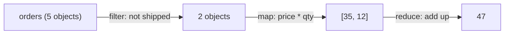

# Higher-order functions: map, filter, reduce

## In plain words

Imagine a small factory line. Parcels move along a conveyor belt and pass three stations: one removes damaged parcels, one puts a label on each remaining parcel, and one counts the total weight at the end. Each station does one small job, and you can rearrange or replace stations without rebuilding the whole line.

A **higher-order function** is a function that takes another function as an input, or gives one back as its result. That is what makes the factory line possible in code: the station ("go through every item") is written once, and the specific job ("is it damaged?", "what label?") is handed to it as a small function. The three stations above have standard names in JavaScript: `filter` (keep some), `map` (transform each), and `reduce` (combine all into one).

Why it matters for a job: these three methods are used constantly in professional JavaScript. Rendering a list in React is a `map`. A search box is a `filter`. A cart total is a `reduce`. Interviewers regularly ask candidates to use them and to implement them from scratch.

> **Before this lesson:** you need arrow functions and "functions are values" from [Functions and scope](#/lesson/javascript/functions-scope), and arrays and objects from [Objects, arrays and mutability](#/lesson/javascript/objects-arrays).

## Abstraction: hiding the "how"

Compare two ways of adding up the numbers 1 to 10.

```js-run
let total = 0;
let count = 1;
while (count <= 10) {
  total += count;
  count += 1;
}
console.log(total);
```

```js-run
const range = (from, to) => Array.from({ length: to - from + 1 }, (_, i) => from + i);
const sum = (numbers) => numbers.reduce((a, b) => a + b, 0);

console.log(sum(range(1, 10)));
```

The first version spells out *how*: a counter, a comparison, an addition per round. The second says *what*: "the sum of the range from 1 to 10". The second relies on vocabulary (`range`, `sum`) that hides the mechanics. Building and using such vocabulary is called **abstraction**. It lets you think about the problem instead of about loop counters, and it gives each piece of mechanics one place where it can be tested and fixed.

Functions that are built from plain values can only abstract over *values* (which numbers to add). To abstract over *actions* (what to do with each item), a function must accept another function.

## Functions that take functions

### The simplest example

Suppose we want to look at every pair of neighbours in a list: the first and second item, the second and third, and so on. What we *do* with each pair changes from use to use, so we pass that part in:

```js-run
function eachNeighbourPair(list, action) {
  for (let i = 0; i < list.length - 1; i++) {
    action(list[i], list[i + 1]);
  }
}

eachNeighbourPair(["Mon", "Tue", "Wed"], (a, b) => console.log(a, "is followed by", b));

const climbs = [];
eachNeighbourPair([310, 480, 455, 620], (from, to) => climbs.push(to - from));
console.log(climbs);
```

- `eachNeighbourPair` has two parameters. The second, `action`, is expected to be a function.
- Inside the loop, `action(list[i], list[i + 1])` calls whatever function was handed in, passing two neighbouring items.
- On line 7 the action is an arrow function that prints a sentence. On line 10 it is a different arrow function, which records the height difference between consecutive points of a hike.

A function passed to another function to be called later is known as a **callback**. `eachNeighbourPair` is a higher-order function because it takes one.

### `forEach`: the built-in version for arrays

Arrays have a method that calls a callback once per element:

```js-run
const guests = ["Ana", "Bo", "Cleo"];
guests.forEach((guest, index) => {
  console.log(index + 1 + ". " + guest);
});
```

The callback receives the element and, if it wants them, the index and the whole array. `forEach` is equivalent to a `for...of` loop; choose whichever reads better. It returns nothing and you cannot `break` out of it.

## Functions that return functions

Higher-order functions also go the other way: build a function and return it. You met this with closures.

```js-run
const between = (low, high) => (value) => value >= low && value <= high;

const isTeenager = between(13, 19);
const isRoomTemperature = between(18, 24);
console.log(isTeenager(15), isTeenager(30), isRoomTemperature(21.5));

function counted(fn) {
  let calls = 0;
  const wrapper = (...args) => {
    calls += 1;
    return fn(...args);
  };
  wrapper.callCount = () => calls;
  return wrapper;
}
const countedMax = counted(Math.max);
console.log(countedMax(3, 11, 7), countedMax(1, 2));
console.log("called", countedMax.callCount(), "times");
```

`between(13, 19)` returns a new function that remembers the two limits. `counted` takes any function and returns a wrapped version that behaves the same and also keeps count of how often it was used (functions are objects, so a helper can be attached to the wrapper as a property). Wrapping functions like this is how features such as logging, timing, caching and permission checks get added without touching the original code.

## The data set for this lesson

The remaining examples use a small list of orders from an imaginary online plant shop. Each order is an object.

```js-run
const orders = [
  { id: 1, customer: "Ana", plant: "fern", price: 12, qty: 2, shipped: true },
  { id: 2, customer: "Bo", plant: "cactus", price: 7, qty: 5, shipped: false },
  { id: 3, customer: "Ana", plant: "orchid", price: 30, qty: 1, shipped: true },
  { id: 4, customer: "Cleo", plant: "fern", price: 12, qty: 1, shipped: false },
  { id: 5, customer: "Bo", plant: "bonsai", price: 85, qty: 1, shipped: true },
];
console.log(orders.length, "orders; first plant:", orders[0].plant);
```

Each runnable block is independent, so later examples repeat a shortened copy of this list.

## `filter`: keep the elements that pass a test

`filter` builds a **new array** containing only the elements for which the callback returns a truthy value. A callback that answers yes or no is called a **predicate**.

```js-run
const orders = [
  { id: 1, plant: "fern", price: 12, shipped: true },
  { id: 2, plant: "cactus", price: 7, shipped: false },
  { id: 3, plant: "orchid", price: 30, shipped: true },
  { id: 4, plant: "fern", price: 12, shipped: false },
];

const waiting = orders.filter((order) => !order.shipped);
console.log(waiting.map((o) => o.id));
console.log(orders.length);          // the original array is unchanged
```

Step by step: `filter` visits order 1, calls the callback, gets `false` (it *is* shipped, and `!true` is `false`), and leaves it out. Order 2 gives `true` and is kept. And so on. The result is a new array holding orders 2 and 4.

To see that there is no magic, here is `filter` written by hand:

```js-run
function myFilter(array, test) {
  const passed = [];
  for (const element of array) {
    if (test(element)) passed.push(element);
  }
  return passed;
}
console.log(myFilter([5, 12, 8, 130, 44], (n) => n >= 10));
```

## `map`: transform every element

`map` builds a new array **of the same length**, in which each element is the callback's result for the corresponding original element.

```js-run
const orders = [
  { id: 1, plant: "fern", price: 12, qty: 2 },
  { id: 2, plant: "cactus", price: 7, qty: 5 },
  { id: 3, plant: "orchid", price: 30, qty: 1 },
];

const plants = orders.map((order) => order.plant);
const lineTotals = orders.map((order) => order.price * order.qty);
const summaries = orders.map(({ id, plant, qty }) => `#${id}: ${qty} x ${plant}`);

console.log(plants);
console.log(lineTotals);
console.log(summaries);
```

The third callback destructures its parameter (previous lesson) to pick out three properties. And here is `map` by hand:

```js-run
function myMap(array, transform) {
  const mapped = [];
  for (const element of array) {
    mapped.push(transform(element));
  }
  return mapped;
}
console.log(myMap(["a", "bb", "ccc"], (s) => s.length));
```

> [!WARNING]
> `map` passes three arguments to the callback: element, index, array. Handing it a function that takes extra parameters gives surprises. The classic one is `["10", "10", "10"].map(parseInt)`, which yields `[10, NaN, 2]` because `parseInt` receives the index as its radix. Write `.map((s) => parseInt(s, 10))` or `.map(Number)`.

## `reduce`: combine all elements into one value

`reduce` is the most general of the three and the one newcomers find hardest, so we go slowly. It boils an array down to a single value by repeatedly combining a running result with the next element.

It takes a callback with two parameters, the running result (the **accumulator**) and the current element, plus a starting value for the accumulator.

```js-run
const numbers = [5, 10, 20];
const total = numbers.reduce((runningTotal, n) => runningTotal + n, 0);
console.log(total);
```

Trace it:

| Step | accumulator before | current element | callback returns |
|---|---|---|---|
| 1 | 0 (the start value) | 5 | 5 |
| 2 | 5 | 10 | 15 |
| 3 | 15 | 20 | 35 |

After the last element the accumulator, `35`, is the result. By hand:

```js-run
function myReduce(array, combine, start) {
  let accumulator = start;
  for (const element of array) {
    accumulator = combine(accumulator, element);
  }
  return accumulator;
}
console.log(myReduce([5, 10, 20], (a, b) => a + b, 0));
console.log(myReduce([5, 10, 20], (a, b) => (b > a ? b : a), -Infinity));
```

The second call finds the maximum: the accumulator holds "largest so far".

The accumulator does not have to be a number. It can be an object that we fill in, which lets `reduce` do counting and grouping:

```js-run
const plants = ["fern", "cactus", "fern", "orchid", "fern", "cactus"];

const counts = plants.reduce((tally, plant) => {
  tally[plant] = (tally[plant] ?? 0) + 1;
  return tally;                       // always return the accumulator
}, {});

console.log(counts);
```

If you omit the start value, `reduce` uses the first element as the initial accumulator and begins with the second. That is convenient for sums and fails with a `TypeError` on an empty array, so supplying the start value is the safer habit.

> [!TIP]
> Reach for `reduce` when the result is *one* value built from all elements (a sum, a maximum, a lookup table). If you find yourself using `reduce` to build an array of the same length, you want `map`; if you are using it to drop elements, you want `filter`. And a plain `for...of` loop is a perfectly good choice whenever a `reduce` callback becomes hard to read.

## Chaining: building a pipeline

Because `filter` and `map` return arrays, calls can be chained. Each step's output is the next step's input.

Question: what is the total value of the orders that have not shipped yet?

```js-run
const orders = [
  { id: 1, customer: "Ana", price: 12, qty: 2, shipped: true },
  { id: 2, customer: "Bo", price: 7, qty: 5, shipped: false },
  { id: 3, customer: "Ana", price: 30, qty: 1, shipped: true },
  { id: 4, customer: "Cleo", price: 12, qty: 1, shipped: false },
  { id: 5, customer: "Bo", price: 85, qty: 1, shipped: true },
];

const pendingValue = orders
  .filter((order) => !order.shipped)            // keep orders 2 and 4
  .map((order) => order.price * order.qty)      // [35, 12]
  .reduce((sum, value) => sum + value, 0);      // 47

console.log(pendingValue);
```



Read the chain top to bottom as three sentences. Compare with the loop version, which mixes the three concerns:

```js-run
const orders = [
  { price: 12, qty: 2, shipped: true }, { price: 7, qty: 5, shipped: false },
  { price: 30, qty: 1, shipped: true }, { price: 12, qty: 1, shipped: false },
];
let pendingValue = 0;
for (const order of orders) {
  if (!order.shipped) {
    pendingValue += order.price * order.qty;
  }
}
console.log(pendingValue);
```

Both are correct. The loop is a little faster, because it makes one pass and creates no intermediate arrays; that difference matters only for very large arrays. The pipeline is easier to extend and to read once the vocabulary is familiar.

## More members of the family

```js-run
const orders = [
  { id: 1, customer: "Ana", plant: "fern", price: 12 },
  { id: 2, customer: "Bo", plant: "cactus", price: 7 },
  { id: 3, customer: "Ana", plant: "orchid", price: 30 },
  { id: 5, customer: "Bo", plant: "bonsai", price: 85 },
];

console.log(orders.find((o) => o.price > 20).plant);          // first match, or undefined
console.log(orders.findIndex((o) => o.customer === "Bo"));    // its index, or -1
console.log(orders.some((o) => o.price > 80));                // does at least one pass?
console.log(orders.every((o) => o.price > 10));               // do all pass?
console.log(String(orders.find((o) => o.plant === "rose")));
```

`some` and `every` stop as soon as the answer is known, like `||` and `&&`.

### Sorting with a comparison function

`sort` is a higher-order function too. Its callback receives two elements and returns a negative number if the first should come first, a positive number if the second should, and zero if their order does not matter.

```js-run
const orders = [
  { id: 1, customer: "Cleo", price: 12 },
  { id: 2, customer: "Ana", price: 85 },
  { id: 3, customer: "Bo", price: 30 },
];

const byPrice = [...orders].sort((a, b) => a.price - b.price);          // ascending
const byPriceDesc = [...orders].sort((a, b) => b.price - a.price);      // descending
const byName = [...orders].sort((a, b) => a.customer.localeCompare(b.customer));

console.log(byPrice.map((o) => o.price));
console.log(byPriceDesc.map((o) => o.price));
console.log(byName.map((o) => o.customer));
console.log(orders.map((o) => o.id));        // original order kept, because we sorted copies
```

`sort` rearranges the array it is called on, which is why each line sorts a spread copy. The newer method `toSorted` does the copying for you.

### `flatMap`: map, then flatten one level

When each element should become zero, one or several output elements:

```js-run
const baskets = [
  { owner: "Ana", items: ["fern", "soil"] },
  { owner: "Bo", items: [] },
  { owner: "Cleo", items: ["cactus"] },
];
console.log(baskets.flatMap((basket) => basket.items));
console.log(baskets.map((basket) => basket.items));   // without flattening: nested arrays
```

## Worked example: a customer report

Goal: for each customer, the number of orders and the amount spent, sorted with the biggest spender first.

```js-run
const orders = [
  { id: 1, customer: "Ana", price: 12, qty: 2 },
  { id: 2, customer: "Bo", price: 7, qty: 5 },
  { id: 3, customer: "Ana", price: 30, qty: 1 },
  { id: 4, customer: "Cleo", price: 12, qty: 1 },
  { id: 5, customer: "Bo", price: 85, qty: 1 },
];

// Step 1: group into an object keyed by customer name
const byCustomer = orders.reduce((groups, order) => {
  const entry = groups[order.customer] ?? { orders: 0, spent: 0 };
  groups[order.customer] = {
    orders: entry.orders + 1,
    spent: entry.spent + order.price * order.qty,
  };
  return groups;
}, {});

// Step 2: turn the object into an array of rows, then sort and format
const report = Object.entries(byCustomer)
  .map(([customer, stats]) => ({ customer, ...stats }))
  .sort((a, b) => b.spent - a.spent)
  .map((row, i) => `${i + 1}. ${row.customer}: ${row.orders} orders, ${row.spent} EUR`);

report.forEach((line) => console.log(line));
```

Step 1 uses `reduce` with an object accumulator: for each order, look up the customer's entry (or start a fresh one), and store an updated entry. Step 2 converts the object to `[name, stats]` pairs with `Object.entries`, reshapes each pair into a flat row, sorts by amount, and formats.

> [!INTERVIEW]
> Be ready to (1) implement `map`, `filter` and `reduce` yourself, including passing the index to the callback and handling a missing initial value in `reduce`; (2) explain the difference between `forEach` and `map` (`forEach` returns `undefined` and is for side effects; `map` returns a new array); and (3) state which array methods mutate (`sort`, `reverse`, `splice`, `push`...) and which do not (`map`, `filter`, `slice`, `concat`, `toSorted`).

## Common pitfalls

1. **Forgetting to return from the callback.** With braces, an arrow function needs an explicit `return`. `items.map((x) => { x * 2 })` gives an array of `undefined`.
2. **Using `map` for side effects.** If you ignore the returned array, use `forEach` or `for...of`.
3. **Forgetting to return the accumulator in `reduce`.** The next round then receives `undefined`.
4. **Omitting the initial value of `reduce`.** It throws on an empty array and gives the wrong type when the result is not the same kind of thing as the elements.
5. **Expecting `filter` or `map` to change the original.** They return new arrays; assign the result.
6. **`sort` mutates and sorts as text by default.** Copy first and pass a comparator.
7. **Passing a function that accepts extra parameters.** Remember that callbacks receive `(element, index, array)`.
8. **Calling instead of passing.** `list.forEach(show())` calls `show` once, immediately; `list.forEach(show)` passes it.

## Summary

- A higher-order function takes a function as an argument or returns one. This lets you abstract over actions, not only over values.
- `forEach` runs a callback per element for its side effects.
- `filter` keeps the elements whose predicate is truthy; `map` transforms each element; both return new arrays.
- `reduce` folds an array into one value using an accumulator and an initial value; the accumulator may be a number, string, array or object.
- `find`, `findIndex`, `some` and `every` answer search questions and stop early.
- `sort` takes a comparison function and mutates; `flatMap` maps and flattens one level.
- Chained calls form readable pipelines; a plain loop remains a fine alternative when performance or clarity calls for it.

## Glossary

- **Abstraction**: giving a name to a pattern so its details can be ignored when using it.
- **Higher-order function**: a function that receives or returns another function.
- **Callback**: a function passed to another function to be called by it.
- **Predicate**: a callback that returns a yes/no answer.
- **`filter`**: array method that returns the elements passing a predicate.
- **`map`**: array method that returns the transformed version of every element.
- **`reduce`**: array method that combines all elements into a single value.
- **Accumulator**: the running result carried from one `reduce` step to the next.
- **Comparator**: the callback given to `sort`, which decides the order of two elements.
- **Pipeline / chaining**: calling methods one after another, each on the result of the previous.
- **Mutating method**: a method that changes the array it is called on.

## Check yourself

```quiz
[
  {"q": "What does this print?\n\n`console.log([1, 2, 3, 4].filter((n) => n % 2).map((n) => n * 10));`", "options": ["[20, 40]", "[10, 30]", "[10, 20, 30, 40]", "[1, 3]"], "answer": 1,
   "explain": "n % 2 is 1 (truthy) for odd numbers and 0 (falsy) for even ones, so filter keeps 1 and 3; map multiplies them by 10."},
  {"q": "What does this print?\n\n`console.log([1, 2, 3].map((n) => { n * 2 }));`", "options": ["[2, 4, 6]", "[1, 2, 3]", "[undefined, undefined, undefined]", "It throws"], "answer": 2,
   "explain": "With braces the arrow function has a body, and the body has no return statement, so every call returns undefined."},
  {"q": "What does this print?\n\n`console.log([3, 4, 5].reduce((acc, n) => acc + n, 10));`", "options": ["12", "22", "60", "\"10345\""], "answer": 1,
   "explain": "The accumulator starts at 10 and the elements are added in turn: 10 + 3 + 4 + 5 = 22."},
  {"q": "What does `[\"10\", \"10\", \"10\"].map(parseInt)` produce?", "options": ["[10, 10, 10]", "[10, NaN, 2]", "[NaN, NaN, NaN]", "[10, 1, 0]"], "answer": 1,
   "explain": "map passes (element, index, array). parseInt treats the index as the radix: radix 0 means decimal (10), radix 1 is invalid (NaN), and \"10\" in radix 2 is 2."},
  {"q": "Which method should you use to check whether at least one order is unpaid?", "options": ["orders.map((o) => !o.paid)", "orders.every((o) => !o.paid)", "orders.some((o) => !o.paid)", "orders.forEach((o) => !o.paid)"], "answer": 2,
   "explain": "some returns true as soon as one element satisfies the predicate. every would require all orders to be unpaid."},
  {"q": "What is wrong with `const sorted = prices.sort();` when `prices` holds numbers?", "options": ["sort does not exist on arrays of numbers", "It sorts as text and also reorders the original prices array", "It returns undefined", "Nothing is wrong"], "answer": 1,
   "explain": "The default comparison converts to strings, and sort works in place, so both names refer to the same (wrongly ordered) array."},
  {"q": "What does this print?\n\n`const r = [\"a\", \"b\", \"a\"].reduce((t, k) => { t[k] = (t[k] ?? 0) + 1; return t; }, {}); console.log(r);`", "options": ["{ a: 2, b: 1 }", "{ a: 1, b: 1 }", "3", "[\"a\", \"b\"]"], "answer": 0,
   "explain": "The accumulator is an object used as a tally. Each key's count starts at 0 via ?? and is incremented every time the key appears."},
  {"q": "What does `forEach` return?", "options": ["A new array", "The original array", "undefined", "The number of elements visited"], "answer": 2,
   "explain": "forEach exists for side effects only and always returns undefined, which is why it cannot be chained."}
]
```

> **Source:** Haverbeke, *Eloquent JavaScript* (4th ed.), ch. 5 "Higher-Order Functions". Details checked against MDN: https://developer.mozilla.org/en-US/docs/Web/JavaScript/Reference/Global_Objects/Array/map , https://developer.mozilla.org/en-US/docs/Web/JavaScript/Reference/Global_Objects/Array/filter , https://developer.mozilla.org/en-US/docs/Web/JavaScript/Reference/Global_Objects/Array/reduce , https://developer.mozilla.org/en-US/docs/Web/JavaScript/Reference/Global_Objects/Array/sort
