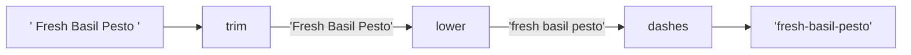

# Composition, pipelines and Unicode strings

## In plain words

This lesson has two halves that meet in a worked example at the end.

The first half is about **composition**: building a big function by snapping small ones together, the way you connect garden hose segments. Water enters one end, flows through each segment in turn, and comes out at the other end. If each segment does one clear job (filter, heat, measure), you can assemble many different lines from the same parts. In code, "the output of one function becomes the input of the next" is called a **pipeline**.

The second half is about what is really inside a **string**. To a person, text is made of characters. To a computer, text is a row of numbers, and one character on screen can occupy one, two or even more of those numbers. An emoji is a good example: it looks like one symbol and takes two slots. Code that ignores this cuts emoji in half, miscounts lengths and sorts names wrongly.

Why it matters for a job: composition is the style that libraries such as Redux, RxJS and lodash are built on, and "write `compose`" or "write `curry`" is a standard interview task. Text handling matters the moment your product has users whose names contain accents, non-Latin letters or emoji, which is to say always.

> **Before this lesson:** you need `map`, `filter` and `reduce` from [Higher-order functions](#/lesson/javascript/higher-order-functions) and closures from [Closures and recursion](#/lesson/javascript/closures-recursion).

## Part 1: Composing functions

### Nesting calls by hand

Start with three tiny functions and apply them one after another to a product title that should become part of a web address:

```js-run
const trim = (text) => text.trim();
const lower = (text) => text.toLowerCase();
const dashes = (text) => text.replaceAll(" ", "-");

const title = "  Fresh Basil Pesto  ";
console.log(dashes(lower(trim(title))));
```

The last line works and reads badly: the function applied *first* (`trim`) is written *last*, innermost. With five or six steps the nesting becomes hard to follow.

### `pipe`: left to right

We can write a helper that takes any number of functions and returns one function that runs them in order:

```js-run
const pipe = (...fns) => (input) => fns.reduce((value, fn) => fn(value), input);

const trim = (text) => text.trim();
const lower = (text) => text.toLowerCase();
const dashes = (text) => text.replaceAll(" ", "-");

const slugify = pipe(trim, lower, dashes);
console.log(slugify("  Fresh Basil Pesto  "));
console.log(slugify("Sun-Dried Tomatoes"));
```

Take the first line apart:

- `(...fns)` gathers the functions we pass (`trim`, `lower`, `dashes`) into an array.
- `pipe` returns a new function, `(input) => ...`. That is the composed function; nothing has run yet.
- When the composed function is called, `reduce` starts with `input` as the accumulator and, for each function in turn, replaces the accumulator with `fn(value)`.

So `slugify("  Fresh Basil Pesto  ")` computes `trim(...)`, feeds the result to `lower`, and feeds that to `dashes`.



### `compose`: right to left

Mathematics writes composition the other way round: $(f \circ g)(x) = f(g(x))$, so the rightmost function runs first. The helper with that order is traditionally called `compose`, and it only differs by folding from the right:

```js-run
const compose = (...fns) => (input) => fns.reduceRight((value, fn) => fn(value), input);

const double = (n) => n * 2;
const addOne = (n) => n + 1;

console.log(compose(double, addOne)(5));   // double(addOne(5)) = 12
console.log(compose(addOne, double)(5));   // addOne(double(5)) = 11
console.log(compose()(5));                 // no functions: the input comes back unchanged
```

Order matters whenever the functions do not commute, as the two results show. Which helper you use is a matter of taste; most people find `pipe` easier to read because it matches the order of execution.

> [!INTERVIEW]
> "Implement `compose`" (or `pipe`) is a common warm-up. The one-line `reduce`/`reduceRight` versions above are the expected answer. Be ready to say what happens with zero functions (it becomes the identity function, because `reduce` returns its initial value) and to explain why every function except the first to run must accept a single argument.

### Functions with more than one parameter: partial application and currying

A pipeline passes exactly one value from stage to stage. Many useful functions take two or more arguments. There are two standard ways to adapt them.

**Partial application** fixes some arguments now and leaves the rest for later:

```js-run
const partial = (fn, ...preset) => (...later) => fn(...preset, ...later);

const priceWithTax = (rate, price) => Math.round(price * (1 + rate) * 100) / 100;
const withVat = partial(priceWithTax, 0.2);

console.log(withVat(50), withVat(19.99));
console.log([10, 20, 30].map(withVat));
```

`withVat` is `priceWithTax` with its first argument permanently set to `0.2`.

**Currying** converts a function of several parameters into a chain of one-parameter functions. Written by hand with arrows it is one arrow per parameter:

```js-run
const priceWithTax = (rate) => (price) => Math.round(price * (1 + rate) * 100) / 100;
const multiplyBy = (factor) => (n) => n * factor;
const clamp = (low, high) => (n) => Math.min(high, Math.max(low, n));

const pipe = (...fns) => (input) => fns.reduce((value, fn) => fn(value), input);

const finalPrice = pipe(multiplyBy(0.9), priceWithTax(0.2), clamp(1, 500));
console.log(finalPrice(100), finalPrice(1000), finalPrice(0.5));
```

Each stage was created by calling a function that *returns* the real one-argument stage. `finalPrice(100)` takes ten percent off (90), adds tax (108) and makes sure the result lies between 1 and 500.

A general `curry` helper does the conversion automatically by collecting arguments until it has as many as the function declares (`fn.length`):

```js-run
function curry(fn) {
  return function curried(...args) {
    if (args.length >= fn.length) return fn(...args);
    return (...more) => curried(...args, ...more);
  };
}

const volume = curry((width, depth, height) => width * depth * height);
console.log(volume(2)(3)(4), volume(2, 3)(4), volume(2)(3, 4), volume(2, 3, 4));

const shelfVolume = volume(80, 30);        // width and depth fixed, height still open
console.log(shelfVolume(20), shelfVolume(35));
```

### Pipelines over collections

Stages can themselves be array operations, which gives pipelines that process whole data sets:

```js-run
const pipe = (...fns) => (input) => fns.reduce((value, fn) => fn(value), input);
const filter = (test) => (list) => list.filter(test);
const map = (fn) => (list) => list.map(fn);
const sortBy = (key) => (list) => [...list].sort((a, b) => (a[key] < b[key] ? -1 : a[key] > b[key] ? 1 : 0));
const take = (n) => (list) => list.slice(0, n);

const cheapestVegan = pipe(
  filter((dish) => dish.vegan),
  sortBy("price"),
  take(2),
  map((dish) => `${dish.name} (${dish.price})`)
);

const menu = [
  { name: "lentil soup", price: 6, vegan: true },
  { name: "cheese toast", price: 5, vegan: false },
  { name: "falafel wrap", price: 8, vegan: true },
  { name: "tofu bowl", price: 11, vegan: true },
];
console.log(cheapestVegan(menu));
console.log(menu.length);        // the menu itself is untouched
```

Two properties make such pipelines dependable. Every stage is a **pure function** (its result depends only on its input), and no stage mutates the data it receives (`sortBy` copies before sorting). If either rule is broken, stages start interfering with each other and the pieces stop being reusable.

> [!TIP]
> Composition is a tool, not a goal. Use it where it names a real sequence of steps. A chain of ten cryptic one-letter helpers is harder to debug than a plain function with three well-named local bindings. When a pipeline misbehaves, insert a `tap` stage, `(label) => (value) => { console.log(label, value); return value; }`, to look at the value flowing through.

## Part 2: What strings are made of

### Characters, code points and code units

Computers store text as numbers. **Unicode** is the international standard that assigns a number, called a **code point**, to every character of every writing system, plus symbols and emoji. The letter `A` is 65; `é` is 233; `€` is 8364; the rocket emoji is 128640.

JavaScript strings store text in an encoding called **UTF-16**, which uses 16-bit slots called **code units**. A 16-bit slot can hold numbers up to 65,535. Code points up to that limit fit in one slot. Larger ones (most emoji, many historic scripts, some Chinese characters) are split across **two** slots, known as a *surrogate pair*.

The catch: a string's `length`, its `[index]` access and most older string methods count **code units**, not characters.

```js-run
const plain = "taxi";
const fancy = "🚕";

console.log(plain.length, fancy.length);
console.log(plain.charCodeAt(0), plain.codePointAt(0));
console.log(fancy.charCodeAt(0), fancy.charCodeAt(1), fancy.codePointAt(0));
console.log(fancy[0] === "🚕");
```

- `"taxi"` has four letters and length 4. `"🚕"` is one symbol and has length **2**.
- `charCodeAt(i)` returns the code unit at position `i`. For the taxi that gives the two halves of the surrogate pair, neither of which is a character on its own.
- `codePointAt(0)` reads a whole code point, combining the pair: 128661.
- `fancy[0]` is half a character, so it is not equal to the emoji.

### Looping by character

The `for...of` loop and the spread syntax walk a string by **code point**, which is nearly always what you want:

```js-run
const text = "go🚕!";

const units = [];
for (let i = 0; i < text.length; i++) units.push(text[i].length);
console.log("index loop steps:", units.length);

const chars = [...text];
console.log("for...of steps:", chars.length, chars.join(" | "));
console.log([...text].reverse().join(""));          // safe reversal
```

The index loop takes five steps for four visible symbols, because it visits each half of the emoji separately. Spreading gives four entries, and reversing the spread array keeps the emoji intact. (The popular one-liner `text.split("").reverse().join("")` would tear it apart.)

To build a string from numbers, use `String.fromCodePoint`:

```js-run
console.log(String.fromCodePoint(72, 105, 33, 128075));
const alphabet = Array.from({ length: 26 }, (_, i) => String.fromCodePoint(97 + i)).join("");
console.log(alphabet);
```

### One visible symbol can be several code points

Even code points are not the end of the story. Some symbols that users perceive as a single character, called **grapheme clusters**, are sequences of code points: a base letter plus a combining accent, a flag (two regional indicator letters), or a family emoji (several people joined by invisible "joiner" characters).

```js-run
const eAcute1 = "\u00e9";          // é as one code point
const eAcute2 = "e\u0301";         // e followed by a combining accent
console.log(eAcute1, eAcute2, eAcute1 === eAcute2);
console.log(eAcute1.length, eAcute2.length);
console.log(eAcute1.normalize() === eAcute2.normalize());

const flag = "🇯🇵";
console.log(flag.length, [...flag].length);

const segmenter = new Intl.Segmenter("en", { granularity: "grapheme" });
console.log([...segmenter.segment("e\u0301🇯🇵!")].length);
```

Two strings that look identical on screen can therefore be unequal. `normalize()` converts text to a standard form so that such pairs compare as equal; run it on user input before comparing or storing. To count or split by what a person would call characters, use `Intl.Segmenter`, as in the last line, which reports three graphemes.

| You want to count... | Use | `"e\u0301🇯🇵"` gives |
|---|---|---|
| UTF-16 code units | `text.length` | 6 |
| code points | `[...text].length` | 4 |
| user-perceived characters | `Intl.Segmenter` | 2 |

> [!WARNING]
> Never truncate user text with `slice(0, n)` on raw indexes when the text may contain emoji or combining marks: you can cut a surrogate pair in half and leave a broken "replacement" symbol at the end. Slice an array of graphemes or code points instead.

### Comparing and sorting text for people

The comparison operators order strings by code unit value, which puts `Z` before `a` and accented letters after everything else. For human ordering use `localeCompare` or an `Intl.Collator`:

```js-run
const names = ["Zoë", "anna", "Émile", "eric", "Ångström", "bob"];

console.log([...names].sort());
console.log([...names].sort((a, b) => a.localeCompare(b, "en")));

const collator = new Intl.Collator("en", { sensitivity: "base" });
console.log(collator.compare("resume", "Résumé") === 0);
```

The first sort is by raw code units; the second is alphabetical the way a dictionary would order the names. With `sensitivity: "base"`, case and accents are ignored, which is what a search box usually needs.

### Recognising kinds of characters

Regular expressions (taught in a later module) can test a character's Unicode *properties*. `\p{L}` matches any letter of any language, `\p{N}` any digit-like character, and `\p{Script=Greek}` a letter of a given script. The `u` flag switches this on.

```js-run
const isLetter = (ch) => /\p{L}/u.test(ch);
const isDigit = (ch) => /\p{N}/u.test(ch);

for (const ch of ["k", "ß", "я", "7", "٣", "?", "猫"]) {
  console.log(ch, isLetter(ch) ? "letter" : isDigit(ch) ? "digit" : "other");
}
```

The old-fashioned test `ch >= "a" && ch <= "z"` recognises 26 letters; `\p{L}` recognises more than a hundred thousand.

## Worked example: a text statistics pipeline

Let us combine both halves. Given a piece of text, report which writing systems it uses and in what proportions, built as a pipeline of small stages.

```js-run
const pipe = (...fns) => (input) => fns.reduce((value, fn) => fn(value), input);

const scripts = ["Latin", "Cyrillic", "Greek", "Han", "Arabic"];
const scriptOf = (ch) => scripts.find((name) => new RegExp(`\\p{Script=${name}}`, "u").test(ch)) ?? null;

const toCharacters = (text) => [...text.normalize()];
const toScripts = (chars) => chars.map(scriptOf).filter((script) => script !== null);
const tally = (items) =>
  items.reduce((counts, item) => ({ ...counts, [item]: (counts[item] ?? 0) + 1 }), {});
const toPercentages = (counts) => {
  const total = Object.values(counts).reduce((a, b) => a + b, 0);
  return Object.entries(counts)
    .map(([name, n]) => ({ name, percent: Math.round((n / total) * 100) }))
    .sort((a, b) => b.percent - a.percent);
};
const format = (rows) => rows.map((row) => `${row.percent}% ${row.name}`).join(", ") || "no letters found";

const describeScripts = pipe(toCharacters, toScripts, tally, toPercentages, format);

console.log(describeScripts("Hello, мир! Γειά"));
console.log(describeScripts("東京 Tokyo 2030"));
console.log(describeScripts("12345 !?"));
```

Reading the pipeline definition tells the whole story: split into characters (by code point, after normalising), map each character to its script and drop the ones that have none (spaces, digits, punctuation), count per script, convert the counts to sorted percentages, and format. Each stage is a pure function that can be tested alone, for instance `tally(["a", "b", "a"])`.

## Common pitfalls

1. **Mixing up `pipe` and `compose` order.** `pipe(f, g)` runs `f` first; `compose(f, g)` runs `g` first.
2. **Putting a multi-argument function in a pipeline.** Later stages receive exactly one value; curry or partially apply first.
3. **Impure or mutating stages.** A stage that sorts its input in place changes data that other code still uses.
4. **Currying functions with default or rest parameters.** `fn.length` counts only the parameters before the first default, so automatic `curry` calls the function too early.
5. **Trusting `length` for visible characters.** It counts code units.
6. **Reversing or truncating by index.** Surrogate pairs and combining sequences get split.
7. **Comparing un-normalised text.** Visually identical strings can differ; call `normalize()`.
8. **Sorting names with the default `sort()`.** Use `localeCompare` or `Intl.Collator`.

## Summary

- Composition builds functions from functions. `pipe` applies them left to right and `compose` right to left; both are a single `reduce`.
- Pipelines need one-argument stages. Partial application fixes some arguments early; currying turns an n-argument function into a chain of single-argument ones.
- Pure, non-mutating stages are what make pipelines predictable and reusable.
- Strings are sequences of UTF-16 code units. A Unicode code point occupies one or two units, and a user-perceived character (grapheme) may consist of several code points.
- `length` and indexing count code units; `for...of`, spread and `codePointAt` work by code point; `Intl.Segmenter` works by grapheme.
- Use `normalize()` before comparing text, `localeCompare`/`Intl.Collator` for human ordering, and `\p{...}` with the `u` flag to classify characters.

## Glossary

- **Composition**: combining functions so that the output of one is the input of the next.
- **Pipeline**: a sequence of processing stages applied in order.
- **`pipe` / `compose`**: helpers that compose functions left-to-right / right-to-left.
- **Identity function**: a function that returns its argument unchanged.
- **Partial application**: fixing some of a function's arguments in advance to obtain a function of the remaining ones.
- **Currying**: transforming a function of several arguments into nested functions of one argument each.
- **Arity**: the number of parameters a function declares (`fn.length`).
- **Unicode**: the standard that assigns a number to every character.
- **Code point**: the Unicode number of one character.
- **UTF-16**: the encoding JavaScript strings use, built from 16-bit code units.
- **Code unit**: one 16-bit slot of a string; what `length` counts.
- **Surrogate pair**: two code units that together represent one code point above 65,535.
- **Grapheme (cluster)**: what a reader perceives as one character; possibly several code points.
- **Normalisation**: converting text to a canonical form so that equivalent sequences become identical.
- **Collation**: the rules for ordering text in a particular language.

## Check yourself

```quiz
[
  {"q": "Given `const inc = (n) => n + 1; const triple = (n) => n * 3;`, what does `pipe(inc, triple)(2)` return, where pipe applies functions left to right?", "options": ["7", "9", "6", "8"], "answer": 1,
   "explain": "pipe runs inc first: 2 + 1 = 3, then triple: 3 * 3 = 9. compose(inc, triple)(2) would give inc(triple(2)) = 7."},
  {"q": "What does `compose()(42)` return when compose is implemented with reduceRight and the input as the initial value?", "options": ["undefined", "42", "It throws a TypeError", "An empty array"], "answer": 1,
   "explain": "Reducing an empty list returns the initial value, so composing zero functions yields the identity function."},
  {"q": "What does this print?\n\n`console.log(\"🚕\".length, [...\"🚕\"].length);`", "options": ["1 1", "2 2", "2 1", "1 2"], "answer": 2,
   "explain": "The emoji is one code point stored as a surrogate pair of two code units. length counts code units; spread iterates by code point."},
  {"q": "With the automatic `curry` from this lesson and `const add3 = curry((a, b, c) => a + b + c);`, what is `add3(1, 2)`?", "options": ["3", "NaN", "A function waiting for one more argument", "undefined"], "answer": 2,
   "explain": "Only two of the three declared parameters have been supplied, so curry returns a function that will complete the call when given the third."},
  {"q": "Why can `\"\\u00e9\" === \"e\\u0301\"` be false although both display as é?", "options": ["Strings are compared by reference", "One is a single code point and the other is a base letter plus a combining mark", "=== ignores accents", "The second string is invalid"], "answer": 1,
   "explain": "They are different code unit sequences with the same appearance. Calling normalize() on both makes them equal."},
  {"q": "Which expression reverses a string without breaking emoji made of surrogate pairs?", "options": ["s.split(\"\").reverse().join(\"\")", "[...s].reverse().join(\"\")", "s.reverse()", "Array(s.length).fill(s).join(\"\")"], "answer": 1,
   "explain": "Spread iterates by code point, so each emoji stays in one array element. split(\"\") cuts between code units."},
  {"q": "What is the result of `[\"b\", \"a\", \"C\"].sort()`?", "options": ["[\"a\", \"b\", \"C\"]", "[\"C\", \"a\", \"b\"]", "[\"a\", \"C\", \"b\"]", "[\"b\", \"a\", \"C\"]"], "answer": 1,
   "explain": "The default sort compares code units, and all upper-case Latin letters have smaller values than lower-case ones. Use localeCompare for dictionary order."},
  {"q": "Why must the stages of a pipeline (other than the first) take exactly one argument?", "options": ["JavaScript functions cannot take more", "Each stage receives only the single return value of the previous stage", "reduce passes at most one argument", "Arrow functions are limited to one parameter"], "answer": 1,
   "explain": "A function returns one value, and that value is all the next stage gets. Multi-argument functions are adapted by currying or partial application."}
]
```

> **Source:** Haverbeke, *Eloquent JavaScript* (4th ed.), ch. 5 "Higher-Order Functions" (composability, strings and character codes, recognizing text). Details checked against MDN: https://developer.mozilla.org/en-US/docs/Web/JavaScript/Reference/Global_Objects/String/codePointAt , https://developer.mozilla.org/en-US/docs/Web/JavaScript/Reference/Global_Objects/String/normalize , https://developer.mozilla.org/en-US/docs/Web/JavaScript/Reference/Global_Objects/Intl/Segmenter , https://developer.mozilla.org/en-US/docs/Web/JavaScript/Reference/Regular_expressions/Unicode_character_class_escape
