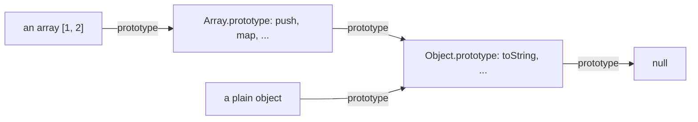

# Prototypes, classes and encapsulation

## In plain words

Think about a coffee machine. On the outside it has a few buttons: espresso, latte, clean. On the inside it has pumps, heaters and sensors that you never touch. The buttons are the machine's **interface**; hiding the insides is called **encapsulation**. You can use any machine with the same buttons without knowing how it is built, and the manufacturer can redesign the insides without retraining you.

Object-oriented programming organises code the same way. An **object** bundles some data with the functions that work on that data (its *methods*), and outside code is supposed to use the methods and leave the data alone.

Now imagine an office with a shared handbook. Each employee has a personal notebook, and anything not in the notebook is looked up in the handbook. That is how JavaScript objects share behaviour: every object has a hidden link to another object, its **prototype**, and a property that is not found on the object itself is looked up there. A **class** is a convenient way to write down "the handbook" for a whole family of objects.

Why it matters for a job: classes appear in most code bases (components, services, errors, data models), and the prototype mechanism underneath is one of the most reliably asked interview topics, together with the keyword `this`.

> **Before this lesson:** you need objects, properties and methods from [Objects, arrays and mutability](#/lesson/javascript/objects-arrays) and closures from [Closures and recursion](#/lesson/javascript/closures-recursion).

## Methods and `this`

### The simplest method

A **method** is a property whose value is a function. When a function is called as a method, written `object.method()`, a special binding named `this` is set to the object in front of the dot for the duration of that call.

```js-run
const kettle = {
  litres: 1.2,
  describe() {
    return "kettle holding " + this.litres + " litres";
  },
};

console.log(kettle.describe());
```

Line by line: `describe() { ... }` is the shorthand for a function-valued property. Inside it, `this.litres` means "the `litres` property of whichever object this method was called on". On line 8 the call is `kettle.describe()`, so `this` is `kettle`, and the output mentions 1.2 litres.

The important phrase is "called on". `this` is not fixed when the function is written; it is decided **each time the function is called**, by how it is called. One function can serve many objects:

```js-run
function describe() {
  return this.name + " weighs " + this.kg + " kg";
}

const cat = { name: "Miso", kg: 4, describe };
const dog = { name: "Rex", kg: 30, describe };

console.log(cat.describe());
console.log(dog.describe());
```

### Losing `this`, and getting it back

Because `this` depends on the call, pulling a method off its object and calling it bare loses the connection:

```js-run
const counter = {
  count: 0,
  increment() {
    this.count += 1;
    return this.count;
  },
};

console.log(counter.increment());

const loose = counter.increment;     // the function, detached from the object
console.log(String(loose()));        // `this` is not counter here
console.log(counter.count);          // unchanged by the loose call
```

In the detached call there is no object in front of a dot, so `this` is not `counter`. What it is instead depends on the mode the code runs in. This playground runs old-style "sloppy" code, in which `this` falls back to the global object; that object has no `count`, so the function computes `undefined + 1`, which is `NaN`, and quietly stores it in the wrong place. In **strict mode** (which applies inside classes and modules, and which the lesson on bugs explains) `this` would be `undefined` and the call would throw a `TypeError`. Either way `counter.count` stays at 1. This bites most often when a method is passed as a callback: `button.addEventListener("click", counter.increment)`.

Functions have three methods of their own for controlling `this`:

```js-run
function introduce(greeting, punctuation) {
  return greeting + ", I am " + this.name + punctuation;
}
const ada = { name: "Ada" };

console.log(introduce.call(ada, "Hello", "!"));        // call: this, then arguments one by one
console.log(introduce.apply(ada, ["Hi", "."]));        // apply: this, then arguments as an array
const adaIntro = introduce.bind(ada, "Good day");      // bind: returns a NEW function with this fixed
console.log(adaIntro("?"));
```

`bind` is the usual fix for the lost-`this` problem: `const safe = counter.increment.bind(counter)`.

### Arrow functions have no `this` of their own

An arrow function does not get its own `this`. It uses the `this` of the code around it, like any other outer binding. That makes arrows ideal for callbacks *inside* methods and wrong for defining methods themselves:

```js-run
const team = {
  name: "Rockets",
  members: ["Ana", "Bo"],
  roster() {
    // the arrow callback sees the same `this` as roster itself
    return this.members.map((member) => member + " (" + this.name + ")");
  },
};
console.log(team.roster());

const broken = {
  name: "Comets",
  label: () => (this === broken ? "this is the team" : "this is NOT the team object"),
};
console.log(broken.label());         // the arrow ignored the object in front of the dot
```

> [!INTERVIEW]
> "How is `this` determined?" Give the four rules in order of precedence. (1) Called with `new`: `this` is the fresh object. (2) Called with `call`, `apply` or through a `bind`-created function: `this` is the object you supplied. (3) Called as `obj.method()`: `this` is `obj`. (4) Plain call `fn()`: `undefined` in strict mode, the global object otherwise. Then the exception: arrow functions ignore all four and take `this` from the enclosing scope.

## Prototypes

### Where do `toString` and friends come from?

An empty object is not as empty as it looks:

```js-run
const empty = {};
console.log(typeof empty.toString);
console.log(empty.toString());
console.log(Object.keys(empty).length);
```

`empty` has no properties of its own, yet `empty.toString` is a function. It comes from the object's **prototype**. Every object has a hidden link to another object (or to `null`). When you read a property that the object does not have itself, the engine follows the link and looks there, then follows *that* object's link, and so on until the property is found or the chain ends at `null`. This sequence of links is the **prototype chain**.

`Object.getPrototypeOf` reveals the link:

```js-run
const empty = {};
console.log(Object.getPrototypeOf(empty) === Object.prototype);
console.log(Object.getPrototypeOf(Object.prototype));           // the chain ends here: null
console.log(Object.getPrototypeOf([]) === Array.prototype);
console.log(Object.getPrototypeOf(Array.prototype) === Object.prototype);
```

Plain objects link to `Object.prototype`, which holds general methods such as `toString`. Arrays link to `Array.prototype` (home of `push`, `map` and the rest), which in turn links to `Object.prototype`.



### Creating an object with a chosen prototype

`Object.create(proto)` makes a new object whose prototype is `proto`:

```js-run
const animalBehaviour = {
  speak() {
    return this.name + " says " + this.sound;
  },
};

const cow = Object.create(animalBehaviour);
cow.name = "Clover";
cow.sound = "moo";

const duck = Object.create(animalBehaviour);
duck.name = "Dot";
duck.sound = "quack";

console.log(cow.speak());
console.log(duck.speak());
console.log(Object.keys(cow), Object.hasOwn(cow, "speak"), "speak" in cow);
```

`speak` exists once, on the shared prototype. `cow.speak()` does not find `speak` on `cow`, finds it one link up, and calls it with `this` set to `cow` (the object in front of the dot). The last line shows the difference between **own** properties (`name`, `sound`) and **inherited** ones: `Object.hasOwn` is false for `speak`, while the `in` operator, which searches the chain, is true.

Writing never travels up the chain. Assigning `cow.speak = ...` creates an own property on `cow` that **shadows** the shared one, without affecting `duck`.

### Constructor functions and `new`

Before classes existed, the pattern for making many similar objects was a **constructor function** called with the keyword `new`:

```js-run
function Timer(label) {
  this.label = label;         // `this` is the fresh object being built
  this.seconds = 0;
}
Timer.prototype.tick = function () {
  this.seconds += 1;
  return this;
};
Timer.prototype.report = function () {
  return this.label + ": " + this.seconds + "s";
};

const eggTimer = new Timer("eggs");
eggTimer.tick().tick().tick();
console.log(eggTimer.report());
console.log(Object.getPrototypeOf(eggTimer) === Timer.prototype);
```

`new Timer("eggs")` does four things: it creates an empty object, sets that object's prototype to `Timer.prototype`, runs the function with `this` bound to the new object, and returns the object. Every function automatically has a `prototype` property for this purpose. Methods placed on it are shared by all instances.

Notice the naming trap. `Timer.prototype` is an ordinary property of the function, holding the object that will *become* the prototype of instances. The prototype *of the function itself* is `Function.prototype`. Two different things.

## Classes

### The same thing, tidier

Since 2015 JavaScript has had `class` syntax. It builds exactly the structure above (a constructor function plus methods on its `prototype`) with clearer notation:

```js-run
class Timer {
  constructor(label) {
    this.label = label;
    this.seconds = 0;
  }
  tick() {
    this.seconds += 1;
    return this;
  }
  report() {
    return this.label + ": " + this.seconds + "s";
  }
}

const eggTimer = new Timer("eggs");
const teaTimer = new Timer("tea");
eggTimer.tick().tick();
teaTimer.tick();

console.log(eggTimer.report(), "|", teaTimer.report());
console.log(typeof Timer, eggTimer.tick === teaTimer.tick);
console.log(eggTimer instanceof Timer, Object.hasOwn(eggTimer, "tick"));
```

- The method named `constructor` is the function that runs for `new Timer(...)`. It sets up the instance's **own** properties.
- The other methods (`tick`, `report`) are stored once on `Timer.prototype`. The second-to-last line proves it: both timers share the very same `tick` function, and `typeof Timer` is `"function"`.
- `instanceof` asks whether `Timer.prototype` appears anywhere in the object's prototype chain.

An object created from a class is called an **instance** of that class. Classes must be called with `new`; calling `Timer("x")` directly throws.

### Fields, private members and statics

Properties can be declared directly in the class body. A name starting with `#` is **private**: it can only be used by code written inside the class. Members marked `static` belong to the class itself, not to instances.

```js-run
class BankAccount {
  owner;                      // public field
  #balance = 0;               // private field
  static #accountsOpened = 0; // private static field, shared by the whole class

  constructor(owner) {
    this.owner = owner;
    BankAccount.#accountsOpened += 1;
  }
  deposit(amount) {
    if (!this.#isValid(amount)) throw new Error("invalid amount");
    this.#balance += amount;
    return this;
  }
  #isValid(amount) {          // private method
    return typeof amount === "number" && amount > 0;
  }
  get balance() {             // read-only access for the outside world
    return this.#balance;
  }
  static get opened() {
    return BankAccount.#accountsOpened;
  }
}

const account = new BankAccount("Noor").deposit(120).deposit(30);
new BankAccount("Sam");

console.log(account.balance, BankAccount.opened);
console.log(Object.keys(account));          // private fields are invisible
account.balance = 1_000_000;                // ignored: there is a getter and no setter
console.log(account.balance);
try {
  account.deposit(-5);
} catch (error) {
  console.log("rejected:", error.message);
}
```

Writing `account.#balance` outside the class is a syntax error, so the rule is enforced by the language, not by convention. (Older code marks "private" properties with a leading underscore, `_balance`, which is only a polite request.) The `get balance()` notation defines a **getter**: a method that runs when the property is read; the next lesson covers getters and setters.

Encapsulation pays off here in a concrete way: the only route to changing the balance is `deposit`, so the validation rule cannot be bypassed, and the class is free to change how it stores the balance later.

> [!TIP]
> Keep the public surface of a class small. Every public property or method is a promise you must keep when the internals change. Start private and expose only what callers need.

### Overriding inherited properties

When you add a property to an object, it lands on the object itself, even if the prototype already has one of that name. Lookups then find the own property first.

```js-run
class Robot {
  greet() { return "beep"; }
}
Robot.prototype.wheels = 4;            // a default shared through the prototype

const standard = new Robot();
const custom = new Robot();
custom.wheels = 6;                     // own property shadows the shared default
custom.greet = () => "BEEP BOOP";      // an own method shadows the class method

console.log(standard.wheels, custom.wheels);
console.log(standard.greet(), custom.greet());
console.log(String([1, 2]), String({}));   // Array.prototype overrides Object.prototype's toString
```

The last line shows the same mechanism in the standard library: arrays and plain objects both understand `toString`, and each gives its own kind of answer because `Array.prototype` defines a version that hides the general one.

### Polymorphism

Code that calls `thing.toString()` does not care what `thing` is, as long as it has a suitable `toString`. Different kinds of object can therefore be plugged into the same code. This is **polymorphism** ("many shapes"): one interface, many implementations.

```js-run
class Circle {
  constructor(radius) { this.radius = radius; }
  area() { return Math.PI * this.radius ** 2; }
  toString() { return `circle r=${this.radius}`; }
}
class Rectangle {
  constructor(width, height) { this.width = width; this.height = height; }
  area() { return this.width * this.height; }
  toString() { return `rectangle ${this.width}x${this.height}`; }
}

const shapes = [new Circle(1), new Rectangle(2, 3), new Circle(0.5)];
for (const shape of shapes) {
  console.log(`${shape} has area ${shape.area().toFixed(2)}`);   // template literal calls toString
}
const total = shapes.reduce((sum, shape) => sum + shape.area(), 0);
console.log(total.toFixed(2));
```

The loop and the `reduce` work with any object that has an `area` method. Adding a `Triangle` class later requires no change to them.

## Objects as dictionaries, and why `Map` exists

Plain objects are often used as lookup tables from names to values. The prototype chain makes that slightly dangerous:

```js-run
const ages = { ana: 31, bo: 27 };

console.log("ana" in ages, "toString" in ages);     // toString is "in" every plain object
console.log(Object.hasOwn(ages, "toString"));       // the safe test

const bare = Object.create(null);                   // an object with no prototype at all
bare.ana = 31;
console.log("toString" in bare);
```

Nobody is named `toString`, yet the `in` test says yes because it searches the prototype. Use `Object.hasOwn`, or an object without a prototype, or (best) the purpose-built **`Map`** class:

```js-run
const ages = new Map();
ages.set("ana", 31);
ages.set("bo", 27);
ages.set("toString", 99);                // no clash with anything

console.log(ages.get("ana"), ages.has("cy"), ages.has("toString"), ages.size);

const visits = new Map();
const keyObject = { id: 1 };
visits.set(keyObject, 3);                // keys can be any value, including objects
visits.set(42, "a number key");
console.log(visits.get(keyObject), visits.get(42));

for (const [name, age] of ages) {
  console.log(name, age);
}
console.log([...ages.keys()].join(","));
```

A `Map` keeps keys in insertion order, accepts keys of any type (object property names are always converted to strings), knows its `size`, and has no inherited entries. Its sibling `Set` stores unique values:

```js-run
const seen = new Set(["a", "b", "a", "c", "b"]);
console.log(seen.size, seen.has("c"), [...seen].join(""));
```

> [!WARNING]
> Never modify built-in prototypes such as `Array.prototype` or `Object.prototype` in application code. A property added there appears on *every* array or object in the program, including those inside libraries, and can collide with features added to the language later. A related attack, *prototype pollution*, happens when untrusted input is allowed to assign to the special key `__proto__`.

## Common pitfalls

1. **Detaching a method.** `const f = obj.method; f()` loses `this`. Bind it or wrap it in an arrow function: `() => obj.method()`.
2. **Arrow functions as methods.** They do not receive the object as `this`.
3. **Forgetting `new`.** With classes this throws; with old constructor functions it silently assigned properties to the global object.
4. **Confusing `Fn.prototype` with the prototype of `Fn`.** The first is what instances will link to.
5. **Putting mutable data on the prototype.** An array stored on `Class.prototype` is shared by all instances; create it in the constructor instead.
6. **Using `in` or `obj[key]` truthiness for dictionary lookups.** Inherited names such as `constructor` and `toString` give false positives. Use `Object.hasOwn` or a `Map`.
7. **Expecting `#private` access from subclasses or outside code.** Private names are visible only inside the class body that declares them.

## Summary

- A method is a function-valued property; `this` inside it is determined by the call (`obj.method()` sets it to `obj`). `call`, `apply` and `bind` set it explicitly; arrow functions inherit it from their surroundings.
- Every object links to a prototype. Property reads walk the prototype chain; writes always create or change own properties.
- `Object.create(proto)` builds an object with a given prototype; `new Fn()` builds one whose prototype is `Fn.prototype`.
- `class` syntax defines a constructor and prototype methods; fields, `#private` members and `static` members are declared in the class body.
- Encapsulation hides internal state behind a small interface. Polymorphism lets different classes be used through the same method names.
- For key/value tables prefer `Map` (and `Set` for unique values) over plain objects.

## Glossary

- **Method**: a function stored as a property of an object.
- **`this`**: a binding available inside a function that refers to the object the function was called on.
- **Interface**: the set of properties and methods that outside code is meant to use.
- **Encapsulation**: hiding an object's internal details behind its interface.
- **Prototype**: the object that another object falls back to for properties it does not have itself.
- **Prototype chain**: the sequence of prototype links from an object up to `null`.
- **Own property**: a property stored directly on an object, as opposed to an inherited one.
- **Constructor**: the function that initialises a new object when called with `new`.
- **Class**: a template describing the constructor and shared methods of a family of objects.
- **Instance**: an object created from a class.
- **Private field**: a `#name` member accessible only within its class.
- **Static member**: a property or method of the class itself.
- **Shadowing (overriding)**: an own property hiding an inherited property with the same name.
- **Polymorphism**: different kinds of object responding to the same method name in their own way.
- **`Map` / `Set`**: built-in classes for key/value tables and collections of unique values.

## Check yourself

```quiz
[
  {"q": "What does this print?\n\n`const o = { n: 5, get() { return this.n; } }; const g = o.get; console.log(o.get(), typeof g);`", "options": ["5 function", "undefined function", "5 number", "It throws"], "answer": 0,
   "explain": "o.get() is called as a method, so this is o and the result is 5. g merely holds the function value, whose type is function; it is not called here."},
  {"q": "Where is the method `tick` stored after `class Timer { tick() {} }` and `const t = new Timer();`?", "options": ["On t as an own property", "On Timer.prototype", "On Timer as a static property", "On Object.prototype"], "answer": 1,
   "explain": "Class methods are placed on the prototype object shared by all instances. t finds tick by following its prototype link."},
  {"q": "What does this print?\n\n`const base = { kind: \"base\" }; const child = Object.create(base); child.kind = \"child\"; console.log(base.kind, child.kind);`", "options": ["child child", "base child", "base base", "child base"], "answer": 1,
   "explain": "Assignment creates an own property on child that shadows the inherited one. The prototype object is not modified."},
  {"q": "Why does `const user = { name: \"Li\", hello: () => this.name };` not work as intended?", "options": ["Arrow functions cannot be stored in objects", "Arrow functions have no own this, so this is not the user object", "name is private", "hello must be called with new"], "answer": 1,
   "explain": "An arrow function takes this from the enclosing scope at the place where it is written, which here is not the object literal."},
  {"q": "What is the result of `\"toString\" in {}` and `Object.hasOwn({}, \"toString\")`?", "options": ["false and false", "true and true", "true and false", "false and true"], "answer": 2,
   "explain": "in searches the prototype chain and finds Object.prototype.toString. Object.hasOwn looks only at the object's own properties."},
  {"q": "Which statement about `#balance` in a class is correct?", "options": ["It can be read as obj[\"#balance\"]", "It is listed by Object.keys", "It can only be accessed by code inside the class body", "It is the same as a property named _balance"], "answer": 2,
   "explain": "Private names are enforced by the language. They are not ordinary string keys and are invisible to reflection such as Object.keys."},
  {"q": "What does `fn.bind(obj)` return?", "options": ["The result of calling fn with this set to obj", "A new function that always calls fn with this set to obj", "obj with fn added as a method", "undefined"], "answer": 1,
   "explain": "bind does not call the function. It produces a bound copy, which can be called later; call and apply invoke immediately."},
  {"q": "Give one reason to prefer `Map` over a plain object as a dictionary.", "options": ["Map lookups use the prototype chain", "Map keys may be of any type and there are no inherited entries", "Maps are automatically sorted by key", "Plain objects cannot hold more than 100 properties"], "answer": 1,
   "explain": "Object keys are strings or symbols and plain objects inherit names such as toString. A Map has neither limitation and also tracks its size and insertion order."}
]
```

> **Source:** Haverbeke, *Eloquent JavaScript* (4th ed.), ch. 6 "The Secret Life of Objects" (methods, prototypes, classes, private properties, maps, polymorphism). Details checked against MDN: https://developer.mozilla.org/en-US/docs/Web/JavaScript/Inheritance_and_the_prototype_chain , https://developer.mozilla.org/en-US/docs/Web/JavaScript/Reference/Classes , https://developer.mozilla.org/en-US/docs/Web/JavaScript/Reference/Operators/this , https://developer.mozilla.org/en-US/docs/Web/JavaScript/Reference/Global_Objects/Map
