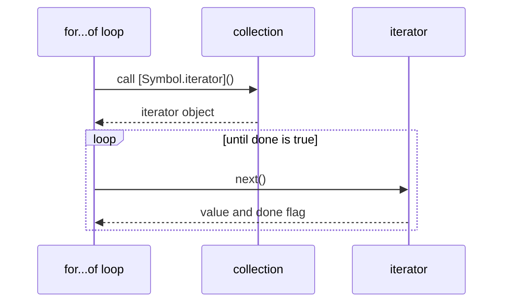
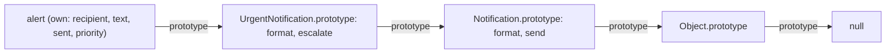

# Symbols, iterators, accessors and inheritance

## In plain words

This lesson collects four tools that let your own objects behave like the built-in ones.

- **Accessors** (getters and setters) are properties that run code when read or written. Think of a thermostat display: you read a number, and behind the display a calculation happens. From the outside it looks like a plain property.
- A **symbol** is a guaranteed-unique name tag. If two people both label a drawer "notes", they clash. A symbol is a label nobody else can accidentally reproduce, which makes it safe for attaching special behaviour to objects.
- An **iterator** is a standard way to hand out items one at a time, like a ticket dispenser: each pull gives the next ticket, until it reports that it is empty. Anything that offers such a dispenser can be used in a `for...of` loop.
- **Inheritance** lets a new class start from an existing one and add or change a few things, the way a "deluxe" product model is described as "the standard model, plus heated seats".

Why it matters for a job: these mechanisms are how arrays, strings, maps and sets work with `for...of` and spread, and how libraries define families of related classes (for example custom error types). Interviewers ask about `extends`/`super`, about making an object iterable, and about getters and setters.

> **Before this lesson:** you need classes, `this`, prototypes and private fields from [Prototypes, classes and encapsulation](#/lesson/javascript/prototypes-classes).

## Getters and setters

### A property that is computed

Start with a class for a circle that stores its radius. The diameter is always twice the radius, so storing both would allow them to disagree. A **getter** defines a property whose value is computed each time it is read:

```js-run
class Circle {
  constructor(radius) {
    this.radius = radius;
  }
  get diameter() {
    return this.radius * 2;
  }
  get area() {
    return Math.PI * this.radius ** 2;
  }
}

const plate = new Circle(10);
console.log(plate.diameter);          // no parentheses: it is read like a property
plate.radius = 15;
console.log(plate.diameter, plate.area.toFixed(1));
```

`get diameter() { ... }` declares a method that the engine calls automatically whenever someone reads `plate.diameter`. Callers write no parentheses. When the radius changes, the diameter follows, because it is recalculated on each read.

### A property that reacts to being written

A **setter** is the counterpart: a method that runs when the property is assigned. It receives the assigned value as its parameter.

```js-run
class Circle {
  #radius = 1;
  constructor(radius) {
    this.radius = radius;             // goes through the setter below
  }
  get radius() {
    return this.#radius;
  }
  set radius(value) {
    if (typeof value !== "number" || value <= 0) {
      throw new RangeError("radius must be a positive number");
    }
    this.#radius = value;
  }
  get diameter() {
    return this.#radius * 2;
  }
  set diameter(value) {
    this.radius = value / 2;          // reuse the validation
  }
}

const wheel = new Circle(30);
wheel.diameter = 70;
console.log(wheel.radius, wheel.diameter);

try {
  wheel.radius = -4;
} catch (error) {
  console.log(error.name + ": " + error.message);
}
console.log(wheel.radius);            // still 35: the bad value never got in
```

The real data sits in the private field `#radius`. The public `radius` and `diameter` are a getter/setter pair each. Outside code cannot store an invalid radius, because every assignment passes through the setter.

Getters and setters also work in plain object literals:

```js-run
const order = {
  items: [{ price: 12, qty: 2 }, { price: 5, qty: 1 }],
  get total() {
    return this.items.reduce((sum, item) => sum + item.price * item.qty, 0);
  },
};
console.log(order.total);
order.items.push({ price: 3, qty: 3 });
console.log(order.total);
```

> [!TIP]
> Use a getter for cheap, derived values with no side effects. If computing the value is slow, or reading it changes something, make it an ordinary method (`computeTotal()`), so that the parentheses warn the caller that work is being done.

### Static methods

A method marked `static` is called on the class, not on an instance. Statics are commonly used for alternative ways of constructing an object:

```js-run
class Circle {
  constructor(radius) { this.radius = radius; }
  static fromDiameter(diameter) {
    return new Circle(diameter / 2);
  }
  static fromArea(area) {
    return new Circle(Math.sqrt(area / Math.PI));
  }
}
console.log(Circle.fromDiameter(10).radius, Circle.fromArea(Math.PI * 9).radius);
```

## Symbols

### Unique property keys

Property names are normally strings. They can also be **symbols**: primitive values created with `Symbol()`, each of which is different from every other value, including other symbols with the same description.

```js-run
const tagA = Symbol("tag");
const tagB = Symbol("tag");
console.log(tagA === tagB, typeof tagA, tagA.toString(), tagA.description);

const parcel = { weight: 2 };
parcel[tagA] = "fragile";             // a symbol-keyed property needs bracket notation

console.log(parcel[tagA], String(parcel[tagB]));
console.log(Object.keys(parcel), JSON.stringify(parcel));
```

The string `"tag"` passed to `Symbol` is only a description for debugging. Two symbols with the same description are still distinct, so `parcel[tagB]` is `undefined`. Symbol-keyed properties are skipped by `Object.keys`, `for...in` and `JSON.stringify`, which keeps them out of the way of ordinary data handling.

Why is that useful? Suppose a library wants to attach bookkeeping information to objects that belong to *your* code. With a string key such as `"id"` it might overwrite one of your properties. With a symbol that only the library holds, a collision is impossible.

### Well-known symbols

The language itself uses symbols as hooks for special behaviour. These are stored as properties of the `Symbol` function and are named **well-known symbols**. You have met one already: `Symbol.toPrimitive` in the coercion lesson. The most important one is `Symbol.iterator`, the subject of the next section. Because these hooks are symbols and not strings, adding a property named `iterator` to your object can never accidentally trigger them.

## The iterator interface

### What `for...of` really does

Arrays, strings, maps and sets can all be looped over with `for...of`, and spread with `...`. They have nothing else in common, so how does the loop know what to do? Each of them follows an agreement, a **protocol**, with two parts:

1. An object is **iterable** if it has a method under the key `Symbol.iterator`. Calling that method returns an *iterator*.
2. An **iterator** is an object with a `next()` method. Each call returns an object of the form `{ value, done }`: the next item with `done: false`, and finally `{ value: undefined, done: true }` when nothing is left.

We can drive the protocol by hand:

```js-run
const letters = ["x", "y"];
const iterator = letters[Symbol.iterator]();   // ask the array for an iterator

console.log(iterator.next());
console.log(iterator.next());
console.log(JSON.stringify(iterator.next()), iterator.next().done);
```

The first two calls deliver the elements. The third reports `done: true` (its `value` is `undefined`, which JSON omits). A `for...of` loop is exactly this conversation, automated:



### Making your own class iterable

Any object that implements the two parts of the protocol works with `for...of`, spread, destructuring and `Array.from`. Here is a class representing a range of dates, written the long way so that every piece is visible:

```js-run
class DayRange {
  constructor(start, days) {
    this.start = start;        // a day number, e.g. 28
    this.days = days;
  }
  [Symbol.iterator]() {
    let offset = 0;
    const range = this;
    return {
      next() {
        if (offset >= range.days) return { value: undefined, done: true };
        const value = range.start + offset;
        offset += 1;
        return { value, done: false };
      },
    };
  }
}

const trip = new DayRange(28, 4);
for (const day of trip) {
  console.log("day", day);
}
console.log([...trip], Math.max(...trip));
const [first, second] = trip;
console.log(first, second);
```

`[Symbol.iterator]() { ... }` declares a method whose name is the symbol (the square brackets compute the key). Each call creates a fresh iterator with its own `offset`, held in a closure, so the range can be looped over many times, as the last three lines do.

### The short way: generator functions

Writing `next()` by hand is tedious. A **generator function**, marked with an asterisk, produces an iterator for you. Inside it, each `yield` hands out one value and pauses the function until the next value is requested:

```js-run
class DayRange {
  constructor(start, days) {
    this.start = start;
    this.days = days;
  }
  *[Symbol.iterator]() {
    for (let offset = 0; offset < this.days; offset++) {
      yield this.start + offset;
    }
  }
}
console.log([...new DayRange(28, 4)]);

function* countdown(from) {
  while (from > 0) yield from--;
  yield "lift off";
}
for (const step of countdown(3)) console.log(step);
```

Both versions of `DayRange` behave identically; the generator version is a third of the length. Generators get a fuller treatment in the lesson on asynchronous programming.

### Iterating the built-in collections

Maps and plain objects are worth a note. A `Map` yields `[key, value]` pairs; plain objects are **not** iterable, so you go through `Object.entries`:

```js-run
const stock = new Map([["pens", 12], ["ink", 3]]);
for (const [item, count] of stock) console.log(item, count);

const prices = { pens: 1.5, ink: 6 };
for (const [item, price] of Object.entries(prices)) console.log(item, price);

try {
  for (const x of prices) console.log(x);
} catch (error) {
  console.log(error.name);        // plain objects have no Symbol.iterator
}
```

> [!INTERVIEW]
> "How would you make an object work with `for...of`?" Give it a `[Symbol.iterator]()` method returning an object with `next()`, which returns `{ value, done }`; or write the method as a generator. Mention that spread, array destructuring, `Array.from`, `new Map(iterable)`, `new Set(iterable)` and `Promise.all` all consume the same protocol, and that `for...in` is a different thing altogether: it loops over the *property names* of an object, including inherited ones.

## Inheritance

### Starting from an existing class

Suppose we have a class for notifications:

```js-run
class Notification {
  constructor(recipient, text) {
    this.recipient = recipient;
    this.text = text;
    this.sent = false;
  }
  format() {
    return `To ${this.recipient}: ${this.text}`;
  }
  send() {
    this.sent = true;
    return "SENT " + this.format();
  }
}

console.log(new Notification("ana", "Your parcel arrived").send());
```

Now we need an urgent kind of notification that behaves the same, except that its formatted text is marked and it records a priority. Copying the class would duplicate `send`. Instead we declare a **subclass** with `extends`:

```js-run
class Notification {
  constructor(recipient, text) {
    this.recipient = recipient;
    this.text = text;
    this.sent = false;
  }
  format() { return `To ${this.recipient}: ${this.text}`; }
  send() { this.sent = true; return "SENT " + this.format(); }
}

class UrgentNotification extends Notification {
  constructor(recipient, text, priority = 1) {
    super(recipient, text);            // run the parent constructor first
    this.priority = priority;
  }
  format() {                           // override
    return `[URGENT p${this.priority}] ` + super.format().toUpperCase();
  }
  escalate() {                         // new behaviour
    this.priority += 1;
    return this;
  }
}

const alert = new UrgentNotification("bo", "server is down");
console.log(alert.escalate().send());
console.log(alert.sent, alert instanceof UrgentNotification, alert instanceof Notification);
```

What each new piece does:

- `class UrgentNotification extends Notification` says: instances get everything from `Notification`, plus what is declared here. `Notification` is the **superclass** (or parent, or base class); `UrgentNotification` is the **subclass** (child, derived class).
- In the constructor, `super(recipient, text)` calls the parent constructor so that it can set up its part of the object. In a subclass you must call `super(...)` **before** using `this`; otherwise a `ReferenceError` is thrown.
- `format` is **overridden**: the subclass version replaces the inherited one for these instances. Inside it, `super.format()` calls the parent's version, so we extend it instead of rewriting it.
- `send` is not mentioned in the subclass. It is inherited, and when it calls `this.format()`, it gets the **subclass's** `format`, because `this` is the urgent notification. That is polymorphism working through inheritance.

### What `extends` builds

Inheritance is prototype chaining, nothing more. `extends` links `UrgentNotification.prototype` to `Notification.prototype`:



Looking up `alert.send` checks `alert`, then `UrgentNotification.prototype`, then finds it on `Notification.prototype`. Looking up `alert.format` stops one step earlier. `instanceof` tests whether a class's `prototype` object appears anywhere in that chain, which is why `alert` counts as an instance of both classes.

```js-run
class A { hello() { return "A"; } }
class B extends A {}
const b = new B();
console.log(Object.getPrototypeOf(B.prototype) === A.prototype);
console.log(b instanceof B, b instanceof A, b instanceof Object, [] instanceof Object);
console.log(Object.getPrototypeOf(B) === A);     // the classes themselves are linked too, so statics are inherited
```

### Extending built-in classes

You can inherit from built-in classes. The most common real-world case is defining your own error types, which the lesson on exceptions uses heavily. Here is a small array subclass:

```js-run
class NumberList extends Array {
  sum() {
    return this.reduce((a, b) => a + b, 0);
  }
  get average() {
    return this.length === 0 ? 0 : this.sum() / this.length;
  }
}

const marks = NumberList.from([70, 85, 91]);
marks.push(64);
console.log(marks.length, marks.sum(), marks.average);
console.log(marks.filter((m) => m > 80) instanceof NumberList);   // array methods return the subclass
```

### When (not) to inherit

Inheritance couples classes tightly: the subclass depends on the internals of its parent, and a change to the parent can break every descendant. Apply a quick test before using it. Is the new thing truly a special *kind* of the old thing, usable wherever the old one is expected ("an urgent notification **is a** notification")? Then inheritance fits. Does the new thing merely *use* the old thing ("a mailer **has a** list of notifications")? Then store one inside the other. That second approach is called **composition**:

```js-run
class Stack {
  #items = [];
  push(item) { this.#items.push(item); return this; }
  pop() { return this.#items.pop(); }
  get size() { return this.#items.length; }
}

class UndoHistory {                       // has a Stack; is not a Stack
  #done = new Stack();
  record(action) { this.#done.push(action); }
  undo() { return this.#done.size > 0 ? "undo " + this.#done.pop() : "nothing to undo"; }
}

const history = new UndoHistory();
history.record("type A");
history.record("delete line");
console.log(history.undo(), "|", history.undo(), "|", history.undo());
```

`UndoHistory` exposes only `record` and `undo`. Had it extended `Array` or `Stack`, callers could also `push`, `splice` or `sort` its contents and break its rules.

> [!WARNING]
> Deep inheritance hierarchies (five levels of `extends`) are a classic source of unmaintainable code: to understand one method call you must read every ancestor. Prefer shallow hierarchies and composition; many style guides summarise this as "favour composition over inheritance".

## Worked example: an iterable, validated playlist

One class that uses every idea from this lesson: private state, getters, a static factory, the iterator protocol, a symbol-keyed hook, and a subclass.

```js-run
class Playlist {
  #tracks = [];
  constructor(name) { this.name = name; }

  static of(name, ...tracks) {
    const list = new this(name);              // `this` is the class the method was called on
    tracks.forEach((t) => list.add(t));
    return list;
  }
  add(track) {
    if (!track.title || !(track.seconds > 0)) throw new TypeError("invalid track");
    this.#tracks.push(track);
    return this;
  }
  get length() { return this.#tracks.length; }
  get duration() {
    const total = this.#tracks.reduce((sum, t) => sum + t.seconds, 0);
    return `${Math.floor(total / 60)}:${String(total % 60).padStart(2, "0")}`;
  }
  *[Symbol.iterator]() { yield* this.#tracks; }              // hand out the tracks one by one
  get [Symbol.toStringTag]() { return "Playlist"; }          // customises Object.prototype.toString
}

class ShuffledPlaylist extends Playlist {
  *[Symbol.iterator]() {
    const tracks = [...super[Symbol.iterator]()];
    for (let i = 0; i < tracks.length; i += 2) yield tracks[i];      // even positions first,
    for (let i = 1; i < tracks.length; i += 2) yield tracks[i];      // then odd (a fixed "shuffle")
  }
}

const tracks = [
  { title: "Intro", seconds: 62 }, { title: "Waves", seconds: 215 },
  { title: "Dusk", seconds: 187 }, { title: "Outro", seconds: 95 },
];
const album = Playlist.of("Evening", ...tracks);
const mixed = ShuffledPlaylist.of("Evening mix", ...tracks);

console.log(album.length, album.duration, String(album));
console.log([...album].map((t) => t.title).join(" > "));
console.log([...mixed].map((t) => t.title).join(" > "), mixed instanceof Playlist);
```

`yield*` delegates to another iterable, handing out each of its values. The subclass overrides only the iteration order and inherits validation, `length`, `duration` and the static factory; because `of` uses `new this(...)`, calling it on `ShuffledPlaylist` builds the right kind of object.

## Common pitfalls

1. **Calling a getter with parentheses.** `circle.area()` fails with "not a function"; a getter is read like a property.
2. **A setter that assigns to itself.** `set radius(v) { this.radius = v; }` calls itself for ever. Store the value under a different (private) name.
3. **Defining only a getter and then assigning.** The assignment is ignored in sloppy mode and throws in strict mode.
4. **Using `this` before `super()` in a subclass constructor.** It throws a `ReferenceError`.
5. **Forgetting `super.method()` when extending behaviour.** The parent's logic is silently skipped.
6. **Trying to iterate a plain object with `for...of`.** Use `Object.entries(obj)`.
7. **Reusing one iterator object across loops.** An iterator is used up after one pass; create a new one each time from `[Symbol.iterator]()`.
8. **Confusing `for...of` (values of an iterable) with `for...in` (property names, including inherited ones).**

## Summary

- Getters and setters define properties backed by code, giving computed values and validation without changing how callers read and write.
- `static` members live on the class; they are often factories.
- Symbols are unique, non-string property keys; well-known symbols such as `Symbol.iterator` are the language's extension hooks.
- An iterable has a `[Symbol.iterator]()` method that returns an iterator; an iterator has `next()` returning `{ value, done }`. `for...of`, spread and destructuring all rely on this protocol, and generator functions implement it concisely.
- `extends` creates a subclass by linking prototypes; `super(...)` runs the parent constructor and `super.method()` calls an overridden method; `instanceof` checks the prototype chain.
- Use inheritance for true "is a" relationships and composition for "has a".

## Glossary

- **Accessor**: a getter or setter.
- **Getter / setter**: a method that runs when a property is read / assigned.
- **Static method**: a method called on the class itself.
- **Symbol**: a unique primitive value usable as a property key.
- **Well-known symbol**: a symbol predefined by the language as a hook, such as `Symbol.iterator`.
- **Protocol**: an agreed set of methods that objects implement so that other code can work with them.
- **Iterable**: an object with a `[Symbol.iterator]()` method.
- **Iterator**: an object with a `next()` method that returns `{ value, done }` results.
- **Generator function**: a `function*` whose calls return iterators and whose body can `yield` values.
- **Inheritance**: defining a class in terms of another, receiving its properties and methods.
- **Superclass / subclass**: the class inherited from / the class that inherits.
- **Override**: to redefine an inherited method in a subclass.
- **`super`**: keyword for calling the parent's constructor or methods.
- **`instanceof`**: operator that tests whether a class's prototype is in an object's prototype chain.
- **Composition**: building an object out of other objects it holds, instead of inheriting from them.

## Check yourself

```quiz
[
  {"q": "What does this print?\n\n`class T { #c = 20; get f() { return this.#c * 9 / 5 + 32; } } const t = new T(); console.log(t.f);`", "options": ["[Function: f]", "68", "undefined", "It throws because #c is private"], "answer": 1,
   "explain": "f is a getter, so reading t.f runs it. Code inside the class may use the private field: 20 * 9 / 5 + 32 = 68."},
  {"q": "What does `Symbol(\"id\") === Symbol(\"id\")` evaluate to?", "options": ["true", "false", "It throws a TypeError", "undefined"], "answer": 1,
   "explain": "Every call to Symbol() creates a new unique value. The description is only a label for debugging."},
  {"q": "What must `obj[Symbol.iterator]()` return for `for (const x of obj)` to work?", "options": ["An array", "An object with a next() method returning { value, done } objects", "A number of elements", "A generator function"], "answer": 1,
   "explain": "The iterable's method returns an iterator, and the loop repeatedly calls next() on it until done is true."},
  {"q": "What does this print?\n\n`class A { hi() { return \"A\"; } } class B extends A { hi() { return super.hi() + \"B\"; } } console.log(new B().hi());`", "options": ["A", "B", "AB", "BA"], "answer": 2,
   "explain": "B overrides hi, calls the parent's version through super (\"A\") and appends \"B\"."},
  {"q": "In a subclass constructor, what happens if you write `this.x = 1;` before calling `super()`?", "options": ["x is set on the prototype", "A ReferenceError is thrown", "super() is called automatically first", "Nothing special"], "answer": 1,
   "explain": "In a derived class the object is created by the parent constructor, so this is unavailable until super() has run."},
  {"q": "What does this print?\n\n`function* g() { yield 1; yield 2; } const it = g(); it.next(); console.log([...it]);`", "options": ["[1, 2]", "[2]", "[]", "It throws"], "answer": 1,
   "explain": "The manual next() call consumed the first value. Spreading the same iterator continues from where it stopped and collects only 2."},
  {"q": "Given `class Dog extends Animal {}` and `const d = new Dog();`, which is false?", "options": ["d instanceof Dog", "d instanceof Animal", "d instanceof Object", "Object.getPrototypeOf(d) === Animal.prototype"], "answer": 3,
   "explain": "The direct prototype of d is Dog.prototype. Animal.prototype is one step further up the chain, which is why the instanceof tests are all true."},
  {"q": "A `Report` class needs to store a list of rows and offer `addRow` and `print`. What is usually the better design?", "options": ["class Report extends Array", "Report holds a private array field and exposes only the methods it needs", "Add addRow to Array.prototype", "Make every row a subclass of Report"], "answer": 1,
   "explain": "A report has rows; it is not a kind of array. Composition keeps the public interface small and prevents callers from using unrelated array methods."}
]
```

> **Source:** Haverbeke, *Eloquent JavaScript* (4th ed.), ch. 6 "The Secret Life of Objects" (getters, setters and statics; symbols; the iterator interface; inheritance; instanceof). Details checked against MDN: https://developer.mozilla.org/en-US/docs/Web/JavaScript/Reference/Iteration_protocols , https://developer.mozilla.org/en-US/docs/Web/JavaScript/Reference/Global_Objects/Symbol , https://developer.mozilla.org/en-US/docs/Web/JavaScript/Reference/Classes/extends , https://developer.mozilla.org/en-US/docs/Web/JavaScript/Reference/Functions/get
