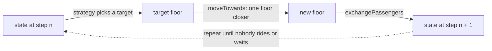

# Project: an elevator simulator

## In plain words

So far each lesson introduced a tool. A project lesson is different: we build one small, complete program and practise putting the tools together.

The program is a **simulation**: a model of a real-world process that runs inside the computer so that we can experiment cheaply. Ours models a single elevator in an office building. People wait on various floors, each wanting to go to another floor. The elevator moves one floor at a time. The interesting question is *which floor should it head for next?* Different rules for answering that question are called **strategies**, and the simulation lets us measure which one moves everybody with the least travel.

An everyday analogy: a delivery driver with ten parcels can deliver them in the order they were loaded, or always drive to the closest address, or sweep through the city from north to south. Same parcels, very different mileage. Trying all three with a real van costs fuel; trying them in a simulation costs milliseconds.

Why it matters for a job: turning a fuzzy real-world problem into data and small functions is the daily work of a programmer. This project also practises a habit that modern front-end frameworks depend on: describing "the state of the world" as a value that is never modified, only replaced by a new value.

> **Before this lesson:** you need objects, arrays, spread and immutable updates ([Destructuring, spread, rest and JSON](#/lesson/javascript/destructuring-json)), `map`/`filter`/`reduce` ([Higher-order functions](#/lesson/javascript/higher-order-functions)) and functions as values ([Functions and scope](#/lesson/javascript/functions-scope)).

## Step 1: decide what the world looks like

Before writing any behaviour, decide which facts the program must keep track of. For our elevator they are:

- the floor the elevator is on (a number; 0 is the ground floor);
- the people riding in it, each with a destination;
- the people still waiting, each with a starting floor and a destination;
- how many people have been delivered so far.

A person is a small object `{ from, to }`. The whole situation at one instant, the **state**, is one object:

```js-run
const state = {
  floor: 0,
  riding: [],
  waiting: [
    { from: 3, to: 0 },
    { from: 1, to: 4 },
  ],
  delivered: 0,
};
console.log(state.waiting.length, "people waiting; elevator at floor", state.floor);
```

Notice what is *not* here: no `Elevator` class with a `move()` method that changes its own fields, no `Person` class. It is tempting to create a class for every noun in the problem description. Often a plain data value plus a few functions is simpler, and we will see that it brings a concrete advantage.

## Step 2: state that never changes

We will treat a state as a snapshot, like one frame of a film. A frame is never repainted; the next moment in time is a *new* frame. Functions that "change the world" will take a state and **return a new state**, leaving the old one intact. Data handled this way is called **persistent** or **immutable**.

Why bother?

- Any function can be tested by calling it with a state and inspecting the result. No hidden changes happen elsewhere.
- We can keep old states around: to compare strategies from the same starting point, to draw a history, to undo.
- A strategy that receives the state cannot sabotage the simulation by modifying it.

To have the language enforce the rule, `Object.freeze` makes an object read-only. A helper builds frozen states:

```js-run
function makeState({ floor, riding, waiting, delivered }) {
  return Object.freeze({
    floor,
    riding: Object.freeze([...riding]),
    waiting: Object.freeze([...waiting]),
    delivered,
  });
}

const start = makeState({ floor: 0, riding: [], waiting: [{ from: 2, to: 0 }], delivered: 0 });

start.floor = 9;                     // ignored (it would throw in strict mode)
try {
  start.waiting.push({ from: 1, to: 2 });
} catch (error) {
  console.log("push refused:", error.name);
}
console.log(start.floor, start.waiting.length);
```

Line by line: the function takes one object and destructures the four fields. It copies the two arrays with spread (so that later changes to the caller's arrays cannot leak in), freezes the copies, and freezes the outer object. Assigning to a frozen object's property does nothing in this playground's non-strict mode, and `push` on a frozen array throws a `TypeError`.

## Step 3: what happens when the elevator stops at a floor

When the elevator is at a floor, two things happen: riders whose destination is this floor get out, and people waiting on this floor get in. We write that as a function from state to state:

```js-run
function makeState({ floor, riding, waiting, delivered }) {
  return Object.freeze({ floor, riding: Object.freeze([...riding]), waiting: Object.freeze([...waiting]), delivered });
}

function exchangePassengers(state) {
  const stayingOn = state.riding.filter((person) => person.to !== state.floor);
  const boarding = state.waiting.filter((person) => person.from === state.floor);
  const stillWaiting = state.waiting.filter((person) => person.from !== state.floor);
  const gotOut = state.riding.length - stayingOn.length;
  return makeState({
    floor: state.floor,
    riding: [...stayingOn, ...boarding],
    waiting: stillWaiting,
    delivered: state.delivered + gotOut,
  });
}

const before = makeState({
  floor: 2,
  riding: [{ from: 0, to: 2 }, { from: 0, to: 5 }],
  waiting: [{ from: 2, to: 4 }, { from: 3, to: 1 }],
  delivered: 0,
});
const after = exchangePassengers(before);

console.log("riding:", JSON.stringify(after.riding));
console.log("waiting:", JSON.stringify(after.waiting));
console.log("delivered:", after.delivered, "| the old state still says:", before.riding.length, "riders");
```

Three `filter` calls split the people into groups. The rider going to floor 2 leaves (`delivered` becomes 1); the rider going to 5 stays; the person waiting on floor 2 boards; the person on floor 3 keeps waiting. The `before` object is exactly as it was.

## Step 4: moving

The elevator moves one floor per time step towards a target floor, then exchanges passengers. `Math.sign` gives `1`, `-1` or `0` depending on whether its argument is positive, negative or zero, which is precisely the direction to move in:

```js-run
function makeState({ floor, riding, waiting, delivered }) {
  return Object.freeze({ floor, riding: Object.freeze([...riding]), waiting: Object.freeze([...waiting]), delivered });
}
function exchangePassengers(state) {
  const stayingOn = state.riding.filter((p) => p.to !== state.floor);
  return makeState({
    floor: state.floor,
    riding: [...stayingOn, ...state.waiting.filter((p) => p.from === state.floor)],
    waiting: state.waiting.filter((p) => p.from !== state.floor),
    delivered: state.delivered + state.riding.length - stayingOn.length,
  });
}

function moveTowards(state, target) {
  const floor = state.floor + Math.sign(target - state.floor);
  return exchangePassengers(makeState({ ...state, floor }));
}

let state = makeState({ floor: 0, riding: [], waiting: [{ from: 2, to: 0 }], delivered: 0 });
for (const target of [2, 2, 0, 0]) {
  state = moveTowards(state, target);
  console.log(`floor ${state.floor}: ${state.riding.length} riding, ${state.waiting.length} waiting, ${state.delivered} delivered`);
}
```

Here `let state` is re-pointed at each new snapshot; the snapshots themselves are never altered. The output shows the elevator climbing to floor 2, picking the person up, and bringing them down.



## Step 5: strategies as functions

A strategy answers one question: given the current state (and the direction the elevator last moved in), which floor do we head for? That is a function, so strategies are plain function values, and the simulation takes one as an argument: a higher-order function at work.

**Oldest request first.** Serve people strictly in the order they asked. If someone is riding, deliver the rider who boarded first; otherwise fetch the person who has waited longest.

**Nearest first.** Look at every floor where something needs doing (a rider's destination or a waiting person's floor) and go to the closest.

**Sweep.** Keep moving in the current direction as long as there is work in that direction; turn around only when there is none. Real elevators (and hard-disk heads) use this rule.

```js-run
const oldestFirst = (state) => (state.riding.length > 0 ? state.riding[0].to : state.waiting[0].from);

const stops = (state) => [...state.riding.map((p) => p.to), ...state.waiting.map((p) => p.from)];

function nearestFirst(state) {
  return stops(state).reduce((best, floor) =>
    Math.abs(floor - state.floor) < Math.abs(best - state.floor) ? floor : best
  );
}

function sweep(state, direction) {
  const ahead = stops(state).filter((floor) => (floor - state.floor) * direction > 0);
  const useful = ahead.length > 0 ? direction : -direction;
  return state.floor + useful;
}

const example = {
  floor: 5,
  riding: [{ from: 9, to: 1 }],
  waiting: [{ from: 6, to: 8 }, { from: 2, to: 7 }],
};
console.log(oldestFirst(example), nearestFirst(example), sweep(example, 1), sweep(example, -1));
```

In the example the elevator is on floor 5 with one rider going to 1, and people waiting on 6 and 2. `oldestFirst` heads for 1 (the rider). `nearestFirst` heads for 6, one floor away. `sweep` continues to 6 if it was going up and to 4 if it was going down. In `sweep`, the expression `(floor - state.floor) * direction > 0` is true exactly when `floor` lies in the direction of travel: both factors positive (above, going up) or both negative (below, going down).

## Step 6: the simulation loop

Now the pieces combine. `simulate` runs a strategy from a starting state until nobody is riding or waiting, and reports how many steps that took.

```js-run
function makeState({ floor, riding, waiting, delivered }) {
  return Object.freeze({ floor, riding: Object.freeze([...riding]), waiting: Object.freeze([...waiting]), delivered });
}
function exchangePassengers(state) {
  const stayingOn = state.riding.filter((p) => p.to !== state.floor);
  return makeState({
    floor: state.floor,
    riding: [...stayingOn, ...state.waiting.filter((p) => p.from === state.floor)],
    waiting: state.waiting.filter((p) => p.from !== state.floor),
    delivered: state.delivered + state.riding.length - stayingOn.length,
  });
}
function moveTowards(state, target) {
  return exchangePassengers(makeState({ ...state, floor: state.floor + Math.sign(target - state.floor) }));
}
const stops = (state) => [...state.riding.map((p) => p.to), ...state.waiting.map((p) => p.from)];
const oldestFirst = (state) => (state.riding.length > 0 ? state.riding[0].to : state.waiting[0].from);
const nearestFirst = (state) =>
  stops(state).reduce((best, f) => (Math.abs(f - state.floor) < Math.abs(best - state.floor) ? f : best));
const sweep = (state, direction) =>
  state.floor + (stops(state).some((f) => (f - state.floor) * direction > 0) ? direction : -direction);

function simulate(start, strategy, log = () => {}) {
  let state = exchangePassengers(start);      // people already on the starting floor board at once
  let direction = 1;
  let steps = 0;
  while (state.riding.length + state.waiting.length > 0) {
    const target = strategy(state, direction);
    const next = moveTowards(state, target);
    direction = Math.sign(next.floor - state.floor) || direction;
    state = next;
    steps += 1;
    log(steps, state);
  }
  return steps;
}

const morning = makeState({
  floor: 0,
  riding: [],
  waiting: [{ from: 8, to: 9 }, { from: 1, to: 0 }, { from: 7, to: 2 }, { from: 2, to: 6 }],
  delivered: 0,
});

simulate(morning, nearestFirst, (step, s) =>
  console.log(`step ${step}: floor ${s.floor}, riding ${s.riding.length}, waiting ${s.waiting.length}, delivered ${s.delivered}`)
);
console.log("oldestFirst:", simulate(morning, oldestFirst), "steps");
console.log("nearestFirst:", simulate(morning, nearestFirst), "steps");
console.log("sweep:", simulate(morning, sweep), "steps");
```

Points to notice:

- `simulate` receives the strategy as a parameter and calls it once per step. It also takes an optional `log` callback, defaulting to a function that does nothing, so that the same loop serves both a detailed trace and a silent measurement.
- The same frozen `morning` state is used for four runs. Because no run can modify it, every strategy starts from an identical situation. With mutable state we would have to rebuild or deep-copy the scenario before each run, and forgetting to do so would silently corrupt the comparison.
- `direction` is updated from the actual movement; `|| direction` keeps the old direction if the elevator did not move.

> [!TIP]
> When a loop depends on "something that decides", pass that something in as a function. The loop stays the same while you add strategies, and each strategy is a small pure function that can be tested with a hand-written state, as in step 5.

## Step 7: a fair comparison

One scenario proves little; a strategy might be lucky. To compare properly we need many scenarios, and they must be the *same* scenarios for every strategy. `Math.random` gives different numbers on every run, which would make results impossible to reproduce. So we write a tiny **pseudo-random number generator** with a **seed**: a starting number that fully determines the sequence. Same seed, same "random" building, every time.

```js-run
function makeState({ floor, riding, waiting, delivered }) {
  return Object.freeze({ floor, riding: Object.freeze([...riding]), waiting: Object.freeze([...waiting]), delivered });
}
function exchangePassengers(state) {
  const stayingOn = state.riding.filter((p) => p.to !== state.floor);
  return makeState({
    floor: state.floor,
    riding: [...stayingOn, ...state.waiting.filter((p) => p.from === state.floor)],
    waiting: state.waiting.filter((p) => p.from !== state.floor),
    delivered: state.delivered + state.riding.length - stayingOn.length,
  });
}
function moveTowards(state, target) {
  return exchangePassengers(makeState({ ...state, floor: state.floor + Math.sign(target - state.floor) }));
}
function simulate(start, strategy) {
  let state = exchangePassengers(start), direction = 1, steps = 0;
  while (state.riding.length + state.waiting.length > 0) {
    const next = moveTowards(state, strategy(state, direction));
    direction = Math.sign(next.floor - state.floor) || direction;
    state = next;
    steps += 1;
  }
  return steps;
}
const stops = (state) => [...state.riding.map((p) => p.to), ...state.waiting.map((p) => p.from)];
const strategies = {
  oldestFirst: (state) => (state.riding.length > 0 ? state.riding[0].to : state.waiting[0].from),
  nearestFirst: (state) =>
    stops(state).reduce((best, f) => (Math.abs(f - state.floor) < Math.abs(best - state.floor) ? f : best)),
  sweep: (state, direction) =>
    state.floor + (stops(state).some((f) => (f - state.floor) * direction > 0) ? direction : -direction),
};

// a small seeded generator: the same seed always produces the same sequence
function makeRandom(seed) {
  let value = seed;
  return () => {
    value = (value * 1664525 + 1013904223) % 4294967296;
    return value / 4294967296;                    // a number from 0 up to (not including) 1
  };
}

function randomScenario(people, floors, random) {
  const pickFloor = () => Math.floor(random() * floors);
  const waiting = [];
  while (waiting.length < people) {
    const from = pickFloor(), to = pickFloor();
    if (from !== to) waiting.push({ from, to });
  }
  return makeState({ floor: 0, riding: [], waiting, delivered: 0 });
}

function compare(strategyTable, { scenarios = 100, people = 12, floors = 10, seed = 2024 } = {}) {
  const random = makeRandom(seed);
  const worlds = Array.from({ length: scenarios }, () => randomScenario(people, floors, random));
  return Object.entries(strategyTable).map(([name, strategy]) => {
    const total = worlds.reduce((sum, world) => sum + simulate(world, strategy), 0);
    return { name, averageSteps: Math.round((total / scenarios) * 10) / 10 };
  });
}

for (const { name, averageSteps } of compare(strategies)) {
  console.log(name.padEnd(13), averageSteps, "steps on average");
}
console.log("busier building:");
for (const { name, averageSteps } of compare(strategies, { people: 40, floors: 20 })) {
  console.log(name.padEnd(13), averageSteps, "steps on average");
}
```

Press Run. With the default seed, serving requests in arrival order needs about 25 steps on average, going to the nearest stop about 20, and sweeping about 17.5. In the busier building the figures are roughly 61, 42 and 38. So oldest-first costs around half as many steps again as sweeping, because it shuttles up and down the building for one person at a time (it is saved from being far worse only because people who happen to be on the way still get in and out). Nearest-first is a big improvement, and sweeping is another 10 to 15 percent better: with many people, almost every floor passed on a sweep has someone to drop off or pick up, so little movement is wasted. Sweeping also has a fairness property that step counts do not show: nobody can be left waiting for ever while the elevator keeps serving a cluster of nearby floors, which can happen with nearest-first.

What made this experiment easy is worth spelling out:

- `compare` is another higher-order function: it takes a *table* of strategies and returns rows of results.
- All scenarios are generated once and reused for every strategy; frozen states make the reuse safe.
- The seed makes the experiment repeatable. Change `seed` and the exact averages shift a little while the ranking stays.

> [!WARNING]
> Never use `Math.random` inside code whose results you want to reproduce, whether a simulation, a test, or a bug report. Take the random source as a parameter (as `randomScenario` does) so that tests can pass in a seeded one. The simple generator above is fine for experiments and is **not** suitable for anything security-related; use `crypto.getRandomValues` for that.

## Ideas for extending the project

1. **People arriving over time.** Give each person an `at` step and only add them to `waiting` once the clock reaches it. Measure average waiting time, not total steps.
2. **Limited capacity.** Let at most six people ride; the rest keep waiting.
3. **Two elevators.** The state holds an array of cars and the strategy returns one target per car.
4. **A smarter strategy.** Sweep, but skip picking up people who want to travel against the current direction.
5. **Draw it.** After the DOM lessons, render each state as a column of floors and animate the history of states.

> [!INTERVIEW]
> Design questions such as "model an elevator / parking lot / vending machine" test whether you can separate *data* (the state), *transitions* (pure functions from state to state) and *policy* (a strategy passed in). Explain your state shape first, then the transition function, then how you would test each piece in isolation. Mentioning immutability and a seeded random source for reproducible tests shows experience.

## Common pitfalls

1. **Mutating shared state.** If `exchangePassengers` used `state.riding.push(...)`, the starting scenario would be altered and later runs would begin from a half-finished world.
2. **Shallow freezing.** `Object.freeze` protects one level. We freeze the arrays as well; the person objects inside are never modified, so we leave them.
3. **A strategy that makes no progress.** If a strategy returns the current floor while people still wait elsewhere, the loop never ends. Each of ours always returns a floor that differs from the current one, because passengers for the current floor have already been exchanged.
4. **Comparing on different inputs.** Generating fresh random scenarios per strategy mixes luck into the result.
5. **Unseeded randomness.** A surprising result cannot be reproduced and investigated.
6. **Over-modelling.** Classes for `Building`, `Floor`, `Door` and `Button` would add code without helping to answer the question we asked.

## Summary

- Model the situation as plain data first: one state object holding everything that can change.
- Write transitions as pure functions that return a new state; freeze states to enforce it. This makes testing, comparison and history trivial.
- Express "the part that decides" as a function parameter. The simulation loop is a higher-order function, and strategies are interchangeable values.
- Evaluate strategies on many identical, reproducible scenarios generated with a seeded pseudo-random source.
- Measured this way, serving requests in arrival order is clearly the most wasteful, nearest-first is considerably better, and the sweep rule used by real elevators is the most efficient of the three.

## Glossary

- **Simulation**: a program that imitates a real process step by step so that it can be studied.
- **State**: all the information describing the situation at one moment.
- **Snapshot**: one state value, never modified after creation.
- **Immutable / persistent data**: data that is not changed in place; updates produce new values.
- **`Object.freeze`**: a built-in function that makes an object's own properties read-only.
- **Transition function**: a function that computes the next state from the current one.
- **Strategy**: an interchangeable rule for making a decision, passed in as a function.
- **Pseudo-random number generator**: an algorithm producing numbers that look random and are fully determined by a starting value.
- **Seed**: that starting value.
- **Reproducible**: giving the same result every time it is run with the same inputs.
- **Benchmark / comparison**: running alternatives on the same workload to measure them against each other.

## Check yourself

```quiz
[
  {"q": "Why does `simulate(morning, oldestFirst)` followed by `simulate(morning, sweep)` give a fair comparison?", "options": ["simulate resets the elevator to floor 0 internally", "morning is frozen and transitions return new states, so the second run starts from the identical scenario", "Strategies are sorted before running", "Each call deep-copies its argument"], "answer": 1,
   "explain": "No function modifies the state it receives. The starting snapshot is untouched by the first run and can be reused as it is."},
  {"q": "What does this print?\n\n`const s = Object.freeze({ list: [1] }); s.list.push(2); console.log(s.list.length);`", "options": ["1", "2", "It throws a TypeError", "undefined"], "answer": 1,
   "explain": "freeze is shallow. The property list cannot be re-pointed, but the array it refers to is not frozen, so push succeeds."},
  {"q": "In `sweep`, when is `(floor - state.floor) * direction > 0` true?", "options": ["When floor equals the current floor", "When floor lies in the current direction of travel", "When floor is above the current floor, whatever the direction", "When floor is the nearest stop"], "answer": 1,
   "explain": "The product of two numbers is positive when they have the same sign: the stop is above and we are going up, or below and going down."},
  {"q": "Why does the comparison use a seeded generator instead of `Math.random`?", "options": ["Math.random is too slow", "So that every strategy sees the same scenarios and the experiment can be repeated exactly", "Math.random cannot produce integers", "Seeded generators are more secure"], "answer": 1,
   "explain": "A fixed seed yields a fixed sequence, making results reproducible. Such simple generators are in fact unsuitable for security purposes."},
  {"q": "What does `Math.sign(target - floor)` give when the elevator is on floor 7 and the target is floor 2?", "options": ["-5", "-1", "1", "0"], "answer": 1,
   "explain": "Math.sign reduces any negative number to -1, so the elevator moves one floor down."},
  {"q": "Which change would turn `exchangePassengers` into an impure function?", "options": ["Using three filter calls instead of one loop", "Calling state.riding.push(...) on the incoming state", "Returning a new object", "Reading state.floor"], "answer": 1,
   "explain": "Mutating its argument is a side effect visible to the caller. The other options only read the input or create new values."},
  {"q": "In this design, what is a strategy?", "options": ["A subclass of Elevator", "A function from the current state (and direction) to a target floor", "A global configuration object", "A list of floors computed once before the simulation starts"], "answer": 1,
   "explain": "Strategies are plain functions passed to simulate, which calls the chosen one at every step."},
  {"q": "Why can nearest-first be unfair to some passengers?", "options": ["It ignores riders", "It may keep serving requests close to the elevator while a distant request waits indefinitely", "It always starts at the top floor", "It moves two floors per step"], "answer": 1,
   "explain": "If new nearby requests keep appearing, the distant one is never the closest. This is known as starvation; the sweep rule avoids it."}
]
```

> **Source:** inspired by the simulation approach of Haverbeke, *Eloquent JavaScript* (4th ed.), ch. 7 "Project: A Robot" (persistent state, strategies compared by measurement); the elevator model and all code are original to this guide. Details checked against MDN: https://developer.mozilla.org/en-US/docs/Web/JavaScript/Reference/Global_Objects/Object/freeze , https://developer.mozilla.org/en-US/docs/Web/JavaScript/Reference/Global_Objects/Math/sign
