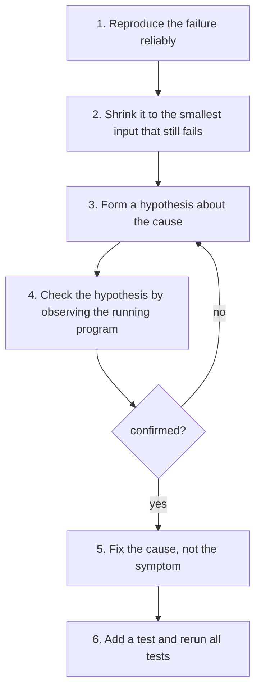

# Bugs, strict mode, testing and debugging

## In plain words

A **bug** is a mistake in a program: the computer does exactly what the code says, and the code does not say what you meant. Everybody writes bugs, including people with thirty years of experience. What separates professionals from beginners is not that they avoid mistakes; it is that they have routines for *catching* mistakes early and *finding* them quickly.

Think of a pilot. Pilots are not people who never forget things. They are people who use checklists, instruments and warning lights so that a forgotten step is noticed on the ground and not in the air. This lesson gives you the programmer's versions:

- **strict mode**, a setting that turns silent mistakes into loud errors (a warning light);
- **tests**, small programs that check your program automatically (a checklist);
- a **debugging** method, the step-by-step routine for hunting down a fault (the instruments).

Why it matters for a job: professional developers spend more time reading, testing and fixing code than writing new code. Teams expect tests with every change, and "how would you debug this?" is asked in nearly every interview.

> **Before this lesson:** you need functions and scope ([Functions and scope](#/lesson/javascript/functions-scope)), arrays and objects ([Objects, arrays and mutability](#/lesson/javascript/objects-arrays)) and coercion ([Type coercion and equality](#/lesson/javascript/coercion-equality)).

## Three kinds of mistakes

**Syntax errors.** The text is not valid JavaScript, like a sentence with a missing verb. The engine refuses to run *any* of the file and reports the position. These are the friendliest errors because they are found immediately.

```js-run
try {
  new Function("const total = (3 + 4;");     // ask the engine to read some broken code
} catch (error) {
  console.log(error.name + ": " + error.message);
}
```

(`new Function(text)` asks the engine to turn a string into a function, which lets this example show a syntax error without breaking the example itself.)

**Runtime errors.** The code is valid, and while running it attempts something impossible, such as reading a property of `undefined` or calling something that is not a function. The program stops at that point with an **exception**, an error signal that the next lesson covers in depth.

```js-run
const user = { name: "Ada" };
try {
  console.log(user.address.city);            // address is undefined
} catch (error) {
  console.log(error.name + ": " + error.message);
}
```

**Logic errors.** The program runs without complaint and produces the wrong answer. Nothing warns you. These are the dangerous ones:

```js-run
function averageRating(ratings) {
  let sum = 0;
  for (let i = 1; i < ratings.length; i++) {  // bug: starts at 1, skipping the first rating
    sum += ratings[i];
  }
  return sum / ratings.length;
}
console.log(averageRating([5, 5, 5, 5]));      // should be 5
```

JavaScript's flexibility pushes many mistakes into this third group. It does not check types, it converts values silently, and it answers `undefined` or `NaN` where other languages would stop. The rest of this lesson is about moving mistakes back towards "found immediately".

## Strict mode

### Switching it on

JavaScript has a stricter dialect that removes some of the silent failure modes. You enable it by putting the string `"use strict";` as the first statement of a file or of a function. Code inside **classes** and **modules** (files using `import`/`export`) is strict automatically, so most modern code is strict without saying so.

### What it changes

**1. Assigning to an undeclared name is an error.** Without strict mode, a misspelled variable name quietly creates a new global binding.

```js-run
function sloppyCount(items) {
  for (indx = 0; indx < items.length; indx++) {}      // forgot `let`: creates a global `indx`
  return typeof indx;
}

function strictCount(items) {
  "use strict";
  for (idx = 0; idx < items.length; idx++) {}         // same mistake
  return typeof idx;
}

console.log(sloppyCount([1, 2]));
try {
  strictCount([1, 2]);
} catch (error) {
  console.log(error.name + ": " + error.message);
}
```

The sloppy function runs, and leaves a global variable behind that any other code can trample on. The strict function fails at once with a `ReferenceError` that names the culprit.

**2. `this` is `undefined` in a plain function call.** In sloppy mode it is the global object, so a method called without its object writes to global variables. In strict mode the mistake surfaces as a `TypeError`.

```js-run
function sloppyThis() { return this === undefined; }
function strictThis() { "use strict"; return this === undefined; }
console.log(sloppyThis(), strictThis());
```

**3. Writes that cannot succeed throw.** Assigning to a read-only property, to a frozen object, or to a property that only has a getter is silently ignored in sloppy mode.

```js-run
const config = Object.freeze({ retries: 3 });

function sloppyWrite() { config.retries = 10; return config.retries; }
function strictWrite() { "use strict"; config.retries = 10; return config.retries; }

console.log(sloppyWrite());
try {
  strictWrite();
} catch (error) {
  console.log(error.name);
}
```

**4. Some confusing syntax is forbidden**, for example two parameters with the same name, or the old `with` statement.

> [!TIP]
> You rarely type `"use strict"` today, because ES modules and classes are strict by default. If you maintain older script files, add it at the top. It costs nothing and converts several kinds of silent bug into immediate, located errors.

## Types: the checks JavaScript does not make

Many bugs come from handing a function the wrong kind of value: a string where a number was expected, an object missing a property. JavaScript only notices when (and if) the wrong value causes a runtime error, possibly far from where the mistake was made.

A first, free step is to *write down* the expected types in a comment. The widely used **JSDoc** notation looks like this, and editors such as VS Code read it to warn you while you type:

```js-run
/**
 * Price of an order line after discount.
 * @param {number} unitPrice  price of one item, in cents
 * @param {number} quantity   how many items
 * @param {number} [discount] fraction between 0 and 1, default 0
 * @returns {number} total in cents
 */
function lineTotal(unitPrice, quantity, discount = 0) {
  return Math.round(unitPrice * quantity * (1 - discount));
}
console.log(lineTotal(1999, 3, 0.1));
```

The stronger step is **TypeScript**, a version of JavaScript in which types are part of the code and a tool checks them before the program runs. It has become the norm in professional projects and has its own lesson near the end of this track.

## Testing

### The idea

A **test** is a piece of code that runs your code with a known input and checks that the output is what it should be. A collection of tests is a **test suite**. Testing by hand (run the program, click around, look at the result) works once. Automated tests can be rerun after every change in seconds, so they catch the moment something that used to work stops working. That event is called a **regression**.

The smallest possible test is a comparison:

```js-run
function slugify(title) {
  return title.trim().toLowerCase().replaceAll(" ", "-");
}

console.log(slugify("Hello World") === "hello-world" ? "pass" : "FAIL");
console.log(slugify("  Padded  ") === "padded" ? "pass" : "FAIL");
```

### A tiny test runner

Printing "pass" by hand gets old. Real projects use a test framework (Vitest, Jest, or Node's built-in `node:test`). Their core is small enough to build ourselves, which removes the mystery:

```js-run
const results = [];

function test(name, body) {
  try {
    body();
    results.push("pass  " + name);
  } catch (error) {
    results.push("FAIL  " + name + " -> " + error.message);
  }
}

function expectEqual(actual, expected) {
  const a = JSON.stringify(actual), e = JSON.stringify(expected);
  if (a !== e) throw new Error(`expected ${e} but got ${a}`);
}

// --- the code under test ---
function countWords(text) {
  return text.split(" ").length;
}

// --- the tests ---
test("counts words in a plain sentence", () => {
  expectEqual(countWords("the quick brown fox"), 4);
});
test("ignores extra spaces between words", () => {
  expectEqual(countWords("the   quick"), 2);
});
test("returns 0 for an empty string", () => {
  expectEqual(countWords(""), 0);
});
test("ignores leading and trailing spaces", () => {
  expectEqual(countWords("  hi there  "), 2);
});

results.forEach((line) => console.log(line));
```

How it works:

- `test(name, body)` runs the function `body`. If `body` finishes normally the test passed. If it throws, the test failed, and we record the message. The `try`/`catch` means one failing test does not stop the others.
- `expectEqual` compares two values (through their JSON text, so arrays and objects can be compared by content) and throws a descriptive error when they differ.

Run it: one test passes and three fail. The tests have uncovered that the naive `split(" ")` treats every single space as a separator and that an empty string still yields one "word". Now fix the function and run the *same* tests:

```js-run
function countWords(text) {
  const words = text.trim().split(/\s+/);      // split on runs of whitespace
  return words[0] === "" ? 0 : words.length;
}

const cases = [
  ["the quick brown fox", 4],
  ["the   quick", 2],
  ["", 0],
  ["  hi there  ", 2],
  ["one\ttab\nnewline", 3],
];
for (const [input, expected] of cases) {
  const actual = countWords(input);
  console.log(actual === expected ? "pass" : "FAIL", JSON.stringify(input), "->", actual);
}
```

The second listing uses a **table of cases**: an array of input/expected pairs and one loop. Adding a case is one line, which encourages you to add many.

### What to test

Good test cases are chosen, not random. For any function ask:

- **The typical case.** A normal input.
- **Edge cases.** The empty string, the empty array, zero, one element, the maximum.
- **Boundaries.** If the rule changes at 18, test 17, 18 and 19.
- **Bad input.** `null`, the wrong type, negative numbers. Decide what should happen and test that it does.
- **Every bug you fix.** First write a test that fails because of the bug, then fix it. The test stays for ever and guards against the bug coming back.

Code is easy to test when it is made of pure functions (same input, same output, no side effects). Code that reads the clock, talks to a server or touches the page is harder to test, which is one more reason to keep such side effects at the edges of a program and the logic in pure functions.

> [!INTERVIEW]
> When you solve a coding problem in an interview, state your test cases *before* or right after writing the code: a normal case, the empty input, a single element, duplicates, very large input. Walking through one case by hand ("dry run") and naming the edge cases is often worth as much as the solution. For "what is the difference between unit, integration and end-to-end tests?": a unit test checks one function or class in isolation; an integration test checks several parts working together (for example code plus database); an end-to-end test drives the whole application the way a user would.

## Debugging: a method, not a talent

When a test fails or a user reports wrong behaviour, resist the urge to change things at random until the symptom disappears. Follow a loop:



### A worked debugging session

Here is a function that should turn a number of minutes into text such as `"2 h 05 min"`. A user reports that 125 minutes shows as `"2.0833333333333335 h 05 min"`.

```js-run
function formatDuration(minutes) {
  const hours = minutes / 60;
  const rest = minutes % 60;
  return hours + " h " + String(rest).padStart(2, "0") + " min";
}
console.log(formatDuration(125));
console.log(formatDuration(120));
```

**Reproduce and shrink.** The failure shows for 125. Does it show for 120? No: that prints `2 h 00 min`. So the bug depends on the minutes not being a multiple of 60.

**Hypothesis.** The hours part is wrong, the minutes part is right. `hours` must hold a fraction.

**Observe.** The simplest instrument is `console.log` placed where it tests the hypothesis:

```js-run
function formatDuration(minutes) {
  const hours = minutes / 60;
  console.log("DEBUG hours =", hours);         // temporary probe
  const rest = minutes % 60;
  return hours + " h " + String(rest).padStart(2, "0") + " min";
}
formatDuration(125);
```

Confirmed: `/` does not perform whole-number division.

**Fix the cause and lock it in with tests.**

```js-run
function formatDuration(minutes) {
  const hours = Math.floor(minutes / 60);
  const rest = minutes % 60;
  return hours + " h " + String(rest).padStart(2, "0") + " min";
}
for (const [input, expected] of [[125, "2 h 05 min"], [120, "2 h 00 min"], [59, "0 h 59 min"], [0, "0 h 00 min"]]) {
  console.log(formatDuration(input) === expected ? "pass" : "FAIL", input, formatDuration(input));
}
```

### Better instruments

- **The debugger.** Browsers (press F12, open the *Sources* tab) and editors let you set a **breakpoint**: a marked line where execution pauses. While paused you can inspect every binding, see the call stack, and step forward one line at a time. Writing the statement `debugger;` in your code pauses there when developer tools are open.
- **Richer logging.** `console.table(arrayOfObjects)` prints a grid; `console.error` prints in red with a stack trace; `console.log({ hours, rest })` uses the shorthand object notation to label values for free.
- **Reading the stack trace.** A runtime error lists the chain of function calls that led to it, innermost first, with file names and line numbers. Start at the top line that is in *your* code.
- **Bisecting.** If something worked yesterday and fails today, test the version halfway between; then halfway again. Version-control tools automate this (`git bisect`).

> [!WARNING]
> Remove temporary `console.log` probes and `debugger` statements before you commit your work. A forgotten `debugger` freezes the page for any colleague or user who has developer tools open, and stray logs bury the messages that matter.

## Assertions: catching nonsense early

An **assertion** is a check inside the program stating something that must be true at that point. If it is not, the program stops with a clear message, close to the cause of the problem, instead of limping on with bad data and failing somewhere confusing later.

```js-run
function assert(condition, message) {
  if (!condition) throw new Error("Assertion failed: " + message);
}

function percentageOf(part, whole) {
  assert(typeof part === "number" && typeof whole === "number", "percentageOf needs two numbers");
  assert(whole !== 0, "whole must not be zero");
  return (part / whole) * 100;
}

console.log(percentageOf(30, 120));
for (const args of [[5, 0], ["5", 10]]) {
  try {
    percentageOf(...args);
  } catch (error) {
    console.log(error.message);
  }
}
```

Without the assertions, `percentageOf(5, 0)` would return `Infinity` and `percentageOf("5", 10)` would return `50`, both of which hide a mistake made by the caller. Use assertions for conditions that indicate a *programming error*. Do not use them for situations that can legitimately happen while the program runs, such as a user typing bad input or a network being down; those call for the error handling of the next lesson.

## Common pitfalls

1. **Fixing the symptom.** Adding `if (result > 100) result = 100;` hides a wrong calculation without correcting it.
2. **Changing several things at once.** You will not know which change mattered. One hypothesis, one change, one rerun.
3. **Testing only the happy path.** Most bugs live at the edges: empty, zero, one, the last element.
4. **Tests that cannot fail.** A test whose assertion is always true gives false confidence. See each new test fail once before making it pass.
5. **Comparing objects with `===` in tests.** It compares identity. Compare field by field or through a deep-equality helper.
6. **Trusting that "no error" means "correct".** Logic errors raise no error at all.
7. **Leaving sloppy mode on in old scripts.** Misspelled assignments create globals without any warning.

## Summary

- Mistakes come as syntax errors (found before running), runtime errors (stop the program at the fault) and logic errors (silent wrong answers).
- Strict mode, enabled by `"use strict"` and automatic in modules and classes, turns undeclared assignments, failed writes and accidental global `this` into errors.
- Type documentation (JSDoc) and type checking (TypeScript) catch wrong-kind-of-value bugs before the program runs.
- Automated tests run code against known inputs and expected outputs; choose typical, edge, boundary and invalid cases, and add a test for every bug fixed.
- Debug with a loop: reproduce, shrink, hypothesise, observe, fix the cause, add a test. Use `console.log`, breakpoints and stack traces to observe.
- Assertions make impossible situations fail fast and near their cause.

## Glossary

- **Bug**: a mistake in a program that makes it behave differently from what was intended.
- **Syntax error**: code that breaks the grammar of the language and cannot be run at all.
- **Runtime error**: a failure that occurs while valid code is running.
- **Logic error**: code that runs and produces a wrong result.
- **Exception**: the signal raised when a runtime error occurs.
- **Strict mode**: a stricter variant of JavaScript that reports more mistakes as errors.
- **JSDoc**: a comment notation for describing the types of parameters and return values.
- **Test**: code that checks other code against an expected result.
- **Test suite**: a collection of tests.
- **Regression**: a bug in something that previously worked.
- **Edge case**: an unusual or extreme input, such as an empty list.
- **Unit test**: a test of one small piece in isolation.
- **Debugging**: the process of finding the cause of a bug.
- **Breakpoint**: a marked line at which a debugger pauses the program.
- **Stack trace**: the list of active function calls at the moment of an error.
- **Assertion**: an in-code check that stops the program when an assumption does not hold.

## Check yourself

```quiz
[
  {"q": "What does this print?\n\n`function f() { \"use strict\"; return typeof this; } console.log(f());`", "options": ["object", "undefined", "function", "It throws"], "answer": 1,
   "explain": "In strict mode a plain function call leaves this as undefined, and typeof undefined is \"undefined\". In sloppy mode this would be the global object."},
  {"q": "In strict mode, what happens on `total = 5;` when `total` was never declared?", "options": ["A global binding is created", "The assignment is silently ignored", "A ReferenceError is thrown", "total becomes a local constant"], "answer": 2,
   "explain": "Strict mode refuses to create implicit globals, which exposes misspelled variable names immediately."},
  {"q": "Which kind of mistake is the hardest to notice, and why?", "options": ["Syntax errors, because the file does not load", "Runtime errors, because the program stops", "Logic errors, because the program runs and silently gives wrong results", "All are reported the same way"], "answer": 2,
   "explain": "Nothing signals a logic error. Only checking the output, by tests or by a user, reveals it."},
  {"q": "A function `daysInMonth(month, year)` exists. Which set of test inputs is the most valuable?", "options": ["January, March, May, July", "February in a leap year, February in a normal year, a 30-day month, a 31-day month, and an invalid month", "The current month only", "Twelve random months"], "answer": 1,
   "explain": "It covers the special rule (February and leap years), both ordinary categories and bad input. The first option tests the same 31-day behaviour four times."},
  {"q": "What is the first step when a bug is reported?", "options": ["Rewrite the suspicious function", "Add try/catch around the code", "Reproduce the failure reliably, ideally with a small input", "Ask the user to restart"], "answer": 2,
   "explain": "Until you can make the failure happen on demand, you cannot observe it or confirm that a fix worked."},
  {"q": "What does this print?\n\n`const o = Object.freeze({ n: 1 }); function g() { o.n = 2; return o.n; } console.log(g());`", "options": ["2", "1", "undefined", "It throws a TypeError"], "answer": 1,
   "explain": "g is not strict, so the write to the frozen object is silently ignored and n stays 1. With \"use strict\" the assignment would throw."},
  {"q": "When is an assertion the right tool?", "options": ["To handle a user typing an invalid email address", "To retry a failed network request", "To state a condition that can only be false if the programmer made a mistake", "To replace all tests"], "answer": 2,
   "explain": "Assertions guard against programming errors. Expected run-time problems such as bad user input need proper error handling instead."},
  {"q": "Why should you watch a new test fail before making it pass?", "options": ["Failing tests run faster", "To prove that the test is able to detect the problem it was written for", "Because frameworks require one failure", "To increase the test count"], "answer": 1,
   "explain": "A test that passes no matter what the code does checks nothing. Seeing it fail first shows that it actually exercises the behaviour."}
]
```

> **Source:** Haverbeke, *Eloquent JavaScript* (4th ed.), ch. 8 "Bugs and Errors" (language, strict mode, types, testing, debugging, assertions). Details checked against MDN: https://developer.mozilla.org/en-US/docs/Web/JavaScript/Reference/Strict_mode , https://developer.mozilla.org/en-US/docs/Web/API/console , https://developer.mozilla.org/en-US/docs/Web/JavaScript/Reference/Statements/debugger
