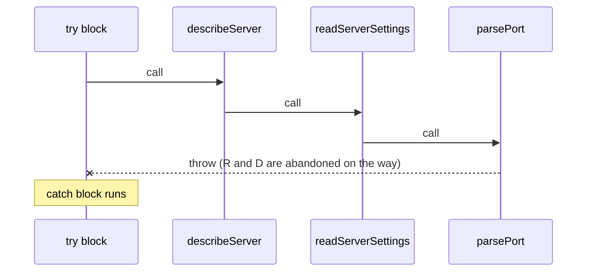

# Exceptions and error handling

## In plain words

Things go wrong while programs run, and often it is nobody's fault: the user types "abc" where a number belongs, a file is missing, the network drops. A robust program notices such problems and reacts sensibly: shows a message, tries again, or uses a fallback. Deciding what happens when something goes wrong is called **error handling**.

Picture a restaurant. A waiter takes your order to the kitchen. If the kitchen is out of fish, the cook does not silently serve an empty plate, and does not shut the restaurant either. The cook *raises the problem*; it travels back up the chain (cook, head chef, waiter) until it reaches someone who can deal with it. The waiter comes to your table and offers an alternative. In JavaScript, raising a problem is called **throwing an exception**, and the person equipped to deal with it is a `catch` block. The problem passes straight through everyone in between who has no way to handle it.

Why it matters for a job: user-facing software lives or dies by how it behaves when things fail. "The page went blank" and "it said saved but nothing was saved" are both error-handling bugs. Interviewers check that you know `try`/`catch`/`finally`, custom error classes, and when *not* to catch.

> **Before this lesson:** you need functions and the call stack ([Functions and scope](#/lesson/javascript/functions-scope)), classes and `extends` ([Symbols, iterators, accessors and inheritance](#/lesson/javascript/symbols-iterators-inheritance)), and the kinds of mistakes from [Bugs, strict mode, testing and debugging](#/lesson/javascript/bugs-strict-testing).

## Option 1: report failure through the return value

Suppose a function reads a port number from a settings text. Port numbers are whole numbers from 1 to 65535. What should the function do with `"eighty"`?

One approach is to return a special value that means "no result":

```js-run
function parsePort(text) {
  const port = Number(text);
  if (!Number.isInteger(port) || port < 1 || port > 65535) return null;
  return port;
}

console.log(parsePort("8080"), parsePort("eighty"), parsePort("70000"));

const port = parsePort("eighty");
if (port === null) {
  console.log("Invalid port, using the default 3000");
}
```

This is fine when failure is common and the caller can deal with it on the spot. It has three weaknesses:

1. The caller must **remember to check**. If they forget, the `null` travels on and causes a confusing failure somewhere else.
2. It does not say **why** it failed.
3. When the function is called deep inside other functions, every level in between has to check and pass the failure upwards by hand.

A richer variant returns an object that states success or failure, which fixes the second weakness:

```js-run
function parsePort(text) {
  const port = Number(text);
  if (!Number.isInteger(port)) return { ok: false, error: `"${text}" is not a whole number` };
  if (port < 1 || port > 65535) return { ok: false, error: `${port} is outside 1-65535` };
  return { ok: true, value: port };
}

for (const text of ["443", "eighty", "70000"]) {
  const result = parsePort(text);
  console.log(result.ok ? "port " + result.value : "problem: " + result.error);
}
```

## Option 2: exceptions

### `throw` and `try`/`catch`

An **exception** is a second way out of a function. The statement `throw value;` stops the current function immediately, and the function that called it, and the one that called that, and so on, until the jump lands in a `catch` block. Jumping out of the stacked calls is known as **unwinding the stack**.

```js-run
function parsePort(text) {
  const port = Number(text);
  if (!Number.isInteger(port) || port < 1 || port > 65535) {
    throw new Error(`invalid port: "${text}"`);
  }
  return port;
}

try {
  console.log("first:", parsePort("8080"));
  console.log("second:", parsePort("eighty"));
  console.log("this line is never reached");
} catch (error) {
  console.log("caught ->", error.message);
}
console.log("the program continues");
```

Step by step:

- The `try { ... }` block marks a region of code to watch.
- The first call returns normally and its line prints.
- The second call reaches `throw`. `parsePort` stops at once. Control jumps out of it, abandons the rest of the `try` block (the third line never runs), and enters the `catch` block.
- `catch (error)` receives the thrown value in the binding `error`.
- After the `catch` block finishes, execution continues normally below it.

If no exception occurs, the `catch` block is skipped entirely.

### The big advantage: skipping the middle

The value of exceptions shows when the failure happens several calls deep. The functions in between need no error-handling code at all:

```js-run
function parsePort(text) {
  const port = Number(text);
  if (!Number.isInteger(port) || port < 1 || port > 65535) throw new Error(`invalid port: "${text}"`);
  return port;
}
function readServerSettings(raw) {             // knows nothing about errors
  return { host: raw.host, port: parsePort(raw.port) };
}
function describeServer(raw) {                 // knows nothing about errors either
  const settings = readServerSettings(raw);
  return `${settings.host}:${settings.port}`;
}

for (const raw of [{ host: "example.org", port: "443" }, { host: "example.org", port: "http" }]) {
  try {
    console.log(describeServer(raw));
  } catch (error) {
    console.log("Could not start:", error.message);
  }
}
```



`describeServer` and `readServerSettings` are written as if nothing could go wrong. The error is handled at the one place that knows what to do about it: the top, where a message can be shown.

### Error objects

You can technically `throw` any value, even a string or a number. Always throw an **`Error` object** (or an instance of a subclass). An error object records useful information at the moment it is created:

```js-run
function inner() {
  throw new Error("disk is full");
}
try {
  inner();
} catch (error) {
  console.log(error.name);                              // the kind of error
  console.log(error.message);                           // the human-readable description
  console.log(error instanceof Error);
  console.log(typeof error.stack, error.stack.includes("inner"));   // where it happened
}
```

The `stack` property holds the stack trace: the list of function calls that were active. It is the first thing to read when debugging. A thrown string has none of this.

The engine itself throws errors of several built-in classes, all subclasses of `Error`:

| Class | Thrown when |
|---|---|
| `TypeError` | a value is of the wrong kind: calling a non-function, reading a property of `undefined` |
| `ReferenceError` | a name is used that does not exist |
| `RangeError` | a number is outside the allowed range, or the call stack overflowed |
| `SyntaxError` | text cannot be parsed, for example by `JSON.parse` |

```js-run
const attempts = [
  () => null.length,
  () => missingName + 1,
  () => new Array(-1),
  () => JSON.parse("{oops"),
];
for (const attempt of attempts) {
  try {
    attempt();
  } catch (error) {
    console.log(error.name);
  }
}
```

### Uncaught exceptions

If an exception unwinds the whole stack without meeting a `catch`, it is *uncaught*. The environment then reports it (in red, in the browser console, with the stack trace) and the current piece of work is abandoned. In Node.js an uncaught exception terminates the process. For genuine programming mistakes this is often the best outcome: a loud failure at the point of the bug is easier to fix than a program that carries on with corrupted data.

## Cleaning up with `finally`

Some actions must be undone whatever happens: a file has to be closed, a "loading" indicator hidden, a lock released. A `finally` block runs when control leaves the `try`, whether normally, through `return`, or through an exception.

```js-run
const stock = { desk: 2 };
const log = [];

function reserve(item) {
  if (!stock[item]) throw new Error(item + " is out of stock");
  stock[item] -= 1;
}

function processOrder(items) {
  log.push("spinner on");
  try {
    for (const item of items) reserve(item);
    return "order placed";
  } finally {
    log.push("spinner off");                 // runs on success AND on failure
  }
}

console.log(processOrder(["desk"]));
try {
  processOrder(["desk", "lamp"]);
} catch (error) {
  console.log("failed:", error.message);
}
console.log(log.join(", "));
```

`processOrder` has a `try` with `finally` and no `catch`. It does not handle the error; it only guarantees that the spinner is switched off, and lets the exception continue to its caller. The log shows "spinner off" twice: once after the successful `return`, once while the exception was passing through.

There is a second lesson hidden in this example. When the second order failed on `"lamp"`, the desk had *already been reserved*: the stock was changed halfway. Code that can be interrupted by an exception should avoid leaving data half-updated. The safest technique is to compute the complete new state first and apply it in one final step that cannot fail:

```js-run
let stock = { desk: 2, lamp: 0 };

function reserveAll(items) {
  const next = { ...stock };                 // work on a copy
  for (const item of items) {
    if (!next[item]) throw new Error(item + " is out of stock");
    next[item] -= 1;
  }
  stock = next;                              // only reached if every item succeeded
}

try {
  reserveAll(["desk", "lamp"]);
} catch (error) {
  console.log(error.message);
}
console.log(JSON.stringify(stock));          // untouched: no half-finished reservation
```

> [!TIP]
> Immutable updates and exceptions work well together. If you build a new value and replace the old one only at the very end, an exception in the middle leaves the old value fully intact, and there is nothing to clean up.

## Catching selectively

### The danger of catching everything

A `catch` block receives *every* exception thrown inside its `try`, including ones you did not anticipate. Look at this loop, which is meant to skip invalid ports:

```js-run
function parsePort(text) {
  const port = Number(text);
  if (!Number.isInteger(port) || port < 1 || port > 65535) throw new Error(`invalid port: "${text}"`);
  return port;
}

const valid = [];
for (const text of ["80", "http", "443"]) {
  try {
    valid.push(parsPort(text));              // typo: parsPort
  } catch (error) {
    // "must be a bad port, skip it"
  }
}
console.log(valid.length, "valid ports found");
```

The output says zero ports are valid. The real problem is the misspelled function name, which throws a `ReferenceError` on every round. The empty `catch` swallowed it, disguising a programming mistake as bad input. Silent, catch-all handlers are among the most harmful habits in JavaScript.

### Custom error classes and `instanceof`

The cure is to catch only what you expect and let everything else continue upwards. To recognise "what you expect", define your own error class:

```js-run
class ValidationError extends Error {
  constructor(message, field) {
    super(message);                 // sets this.message
    this.name = "ValidationError";  // otherwise it would say "Error"
    this.field = field;             // extra information for the handler
  }
}

function parsePort(text) {
  const port = Number(text);
  if (!Number.isInteger(port) || port < 1 || port > 65535) {
    throw new ValidationError(`invalid port: "${text}"`, "port");
  }
  return port;
}

function collectPorts(texts, parse) {
  const valid = [];
  for (const text of texts) {
    try {
      valid.push(parse(text));
    } catch (error) {
      if (error instanceof ValidationError) {
        console.log(`skipping (${error.field}): ${error.message}`);
      } else {
        throw error;                // not ours: pass it on
      }
    }
  }
  return valid;
}

console.log(collectPorts(["80", "http", "443"], parsePort));

try {
  collectPorts(["80"], (text) => parsPort(text));    // the typo again
} catch (error) {
  console.log("a real bug surfaced:", error.name);
}
```

Inside `catch`, `error instanceof ValidationError` separates the expected failure from all others. The `else throw error;` line **rethrows** anything unexpected, so the typo now produces a visible `ReferenceError` instead of a wrong result.

Never recognise errors by comparing `error.message` with a text. Messages get reworded and translated; classes (or a stable `code` property) do not.

### Wrapping errors with a cause

Low-level errors are often meaningless to higher layers. You can catch one and throw a more descriptive error, keeping the original attached as its `cause`:

```js-run
class ConfigError extends Error {
  constructor(message, options) {
    super(message, options);
    this.name = "ConfigError";
  }
}

function loadConfig(text) {
  try {
    return JSON.parse(text);
  } catch (error) {
    throw new ConfigError("settings file is not valid JSON", { cause: error });
  }
}

try {
  loadConfig("{ port: 80 }");
} catch (error) {
  console.log(error.name + ": " + error.message);
  console.log("caused by:", error.cause.name);
}
```

> [!INTERVIEW]
> Expect questions such as: "What does `finally` do if both `try` and `finally` contain a `return`?" (the `finally` value wins, which is a reason never to `return` from `finally`); "How do you create a custom error?" (`class X extends Error`, call `super(message)`, set `this.name`); "Why not catch every error?" (it hides bugs; catch what you can handle, rethrow the rest). Also know that a `try`/`catch` does **not** catch errors thrown later inside a callback such as a `setTimeout` function, because by then the `try` block has already finished. Promises and `async`/`await`, covered in the asynchronous module, have their own way of carrying errors.

## Where to throw, where to catch

A workable rule of thumb in three parts:

1. **Throw early.** Detect the problem at the point where you know the most about it and throw an error with a precise message.
2. **Catch late.** Catch only at a level that can do something useful: show the user a message, retry, use a default, or translate the error.
3. **Let the rest go.** In between, write straight-line code and use `finally` for cleanup.

```js-run
class ValidationError extends Error {
  constructor(message) { super(message); this.name = "ValidationError"; }
}

function validateSignup({ email, age }) {                 // throws early
  if (typeof email !== "string" || !email.includes("@")) throw new ValidationError("please enter a valid email address");
  if (!Number.isInteger(age) || age < 13) throw new ValidationError("you must be at least 13 years old");
  return { email: email.toLowerCase(), age };
}

function handleSignupForm(formData) {                     // catches late, at the user-interface edge
  try {
    const user = validateSignup(formData);
    return { status: "ok", message: "Welcome, " + user.email };
  } catch (error) {
    if (error instanceof ValidationError) return { status: "invalid", message: error.message };
    throw error;
  }
}

console.log(handleSignupForm({ email: "Mia@Example.com", age: 30 }));
console.log(handleSignupForm({ email: "mia.example.com", age: 30 }));
console.log(handleSignupForm({ email: "mia@example.com", age: 9 }));
```

When should a function return a failure value (option 1) and when should it throw? If failure is an ordinary, expected outcome that the direct caller will handle (looking for an item that may not exist: `find` returns `undefined`, `indexOf` returns `-1`), return a value. If failure means the function cannot do its job and the direct caller probably cannot fix it, throw.

> [!WARNING]
> An empty `catch {}` block is almost never correct. At the very least log the error with `console.error(error)`. Errors that vanish without a trace turn a five-minute fix into a day of searching.

## Common pitfalls

1. **Swallowing errors.** `catch (e) {}` hides both the expected failure and every bug nearby.
2. **Catching too broadly.** Check the type with `instanceof` and rethrow the rest.
3. **Throwing strings.** `throw "bad input"` has no stack trace and breaks handlers that read `error.message`.
4. **Forgetting `this.name` in custom errors.** Logs then show the generic "Error".
5. **Returning from `finally`.** It overrides the `try` block's return value and silently discards a pending exception.
6. **Half-finished updates.** An exception in the middle of several mutations leaves inconsistent data; build the new state first, then swap it in.
7. **Using exceptions for normal control flow.** Do not throw to exit a loop or to signal "not found" in routine searches.
8. **Expecting `try`/`catch` to cover asynchronous callbacks.** The callback runs after the `try` block has ended.

## Summary

- Failures can be reported through special return values (callers must check) or through exceptions (which propagate automatically).
- `throw` unwinds the call stack to the nearest enclosing `catch`; intermediate functions need no error code.
- Throw `Error` objects; they carry `name`, `message`, `stack` and optionally `cause`. The engine throws `TypeError`, `ReferenceError`, `RangeError` and `SyntaxError`.
- `finally` runs however the `try` block is left and is the place for cleanup.
- Define custom error classes with `extends Error`, catch selectively with `instanceof`, and rethrow what you do not recognise.
- Throw early with precise information, catch late where you can act, and never swallow errors silently.

## Glossary

- **Error handling**: the part of a program that deals with things going wrong at run time.
- **Exception**: a signal that interrupts normal execution and travels up the call stack.
- **Throw (raise)**: to start an exception with the `throw` statement.
- **Catch**: to intercept an exception with a `catch` block.
- **`try` block**: the region of code whose exceptions a following `catch` or `finally` deals with.
- **`finally` block**: code that runs when the `try` block is left, in every case.
- **Unwinding the stack**: abandoning active function calls one by one while an exception looks for a handler.
- **Error object**: an instance of `Error` or a subclass, carrying `name`, `message` and `stack`.
- **Stack trace**: the recorded list of calls that were active when the error was created.
- **Uncaught exception**: one that reaches the top of the stack without being caught.
- **Rethrow**: to throw a caught exception again so that an outer handler receives it.
- **Custom error class**: your own subclass of `Error`, used to recognise a specific kind of failure.
- **Cause**: an original error attached to a new, more descriptive one.
- **Swallowing an error**: catching it and doing nothing, so that it disappears.

## Check yourself

```quiz
[
  {"q": "What does this print?\n\n`try { console.log(\"A\"); throw new Error(\"x\"); console.log(\"B\"); } catch (e) { console.log(\"C\"); } finally { console.log(\"D\"); }`", "options": ["A B C D", "A C D", "A D", "A C"], "answer": 1,
   "explain": "A is printed, then the throw skips B and jumps to the catch block (C). The finally block always runs afterwards (D)."},
  {"q": "What does this function return?\n\n`function f() { try { return \"try\"; } finally { console.log(\"cleanup\"); } }`", "options": ["undefined, because finally has no return", "\"try\", after printing cleanup", "\"cleanup\"", "It throws"], "answer": 1,
   "explain": "The finally block runs on the way out, after the return value has been determined. Since finally does not return anything itself, the value \"try\" is returned."},
  {"q": "Why is `throw new Error(\"bad input\")` preferred over `throw \"bad input\"`?", "options": ["Strings cannot be thrown", "An Error object carries a stack trace and a message property that handlers and tools rely on", "Error objects are faster", "Only Error objects can be caught"], "answer": 1,
   "explain": "Any value can be thrown and caught, but only Error objects record where they were created and offer the standard name and message properties."},
  {"q": "A catch block should handle only `ValidationError`. What is the correct pattern?", "options": ["if (error.message.includes(\"invalid\")) {...}", "if (error instanceof ValidationError) {...} else { throw error; }", "catch (ValidationError error) {...}", "if (typeof error === \"ValidationError\") {...}"], "answer": 1,
   "explain": "JavaScript has no typed catch clauses, so the check is done inside the block with instanceof, and unrecognised errors are rethrown."},
  {"q": "What does this print?\n\n`function a() { throw new TypeError(\"t\"); } function b() { a(); return 1; } try { b(); } catch (e) { console.log(e.name, e instanceof Error); }`", "options": ["TypeError true", "Error true", "TypeError false", "Nothing: b returns 1"], "answer": 0,
   "explain": "The exception passes through b without b returning. TypeError is a subclass of Error, so instanceof Error is true and its name is TypeError."},
  {"q": "What is the main risk of `try { doWork(); } catch (e) { }`?", "options": ["It is a syntax error", "It runs doWork twice", "Every failure, including programming mistakes inside doWork, disappears without any trace", "finally is required"], "answer": 2,
   "explain": "An empty catch swallows expected and unexpected errors alike, hiding bugs and leaving the program in an unknown state."},
  {"q": "When is returning a special value such as `undefined` or `-1` more appropriate than throwing?", "options": ["Never", "When absence is a normal, expected outcome that the immediate caller will check, as with find or indexOf", "When the failure is a programming bug", "When the function is asynchronous"], "answer": 1,
   "explain": "Routine outcomes that the direct caller handles are best expressed as values. Exceptions are for failures the caller usually cannot resolve on the spot."},
  {"q": "In the two-step reservation example, why is building a copy and assigning it at the end safer than mutating `stock` directly?", "options": ["Copies are faster", "If an exception occurs midway, the original stock is still fully consistent", "Spread prevents exceptions", "const forbids mutation"], "answer": 1,
   "explain": "The replacement happens only after every step succeeded, so a failure in the middle cannot leave a half-applied change behind."}
]
```

> **Source:** Haverbeke, *Eloquent JavaScript* (4th ed.), ch. 8 "Bugs and Errors" (error propagation, exceptions, cleaning up after exceptions, selective catching). Details checked against MDN: https://developer.mozilla.org/en-US/docs/Web/JavaScript/Reference/Statements/try...catch , https://developer.mozilla.org/en-US/docs/Web/JavaScript/Reference/Global_Objects/Error , https://developer.mozilla.org/en-US/docs/Web/JavaScript/Reference/Global_Objects/Error/cause
