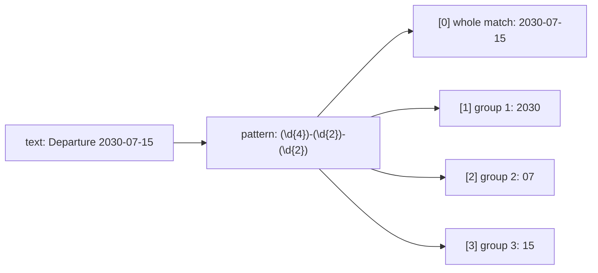

# Regular expressions: patterns, sets, groups

## In plain words

A **regular expression** (often shortened to *regex*) is a pattern that describes what a piece of text should look like. You hand the pattern and a text to the computer and ask questions such as "does this text contain something of that shape?", "where?" and "what exactly was it?".

Think of the search box in a document editor. Searching for `cat` finds exactly those three letters. Now imagine a far more capable search box in which you can say "three digits, a dash, then four digits" or "a word that starts with a capital letter" or "the word *colour*, with or without the *u*". That is what regular expressions add: instead of searching for fixed text, you search for a *description* of text.

The notation is compact and looks intimidating at first: `/^\d{3}-\d{4}$/` resembles a cat walking over a keyboard. It is built from a small number of pieces, and this lesson introduces them one at a time.

Why it matters for a job: validating form input (emails, postcodes, passwords), pulling data out of text (dates from a log file), search-and-replace in code editors, and routing URLs all use regular expressions. They appear in every programming language with almost the same syntax, so the skill transfers.

> **Before this lesson:** you need strings and their methods ([Values, types and operators](#/lesson/javascript/values-types-operators)), arrays ([Objects, arrays and mutability](#/lesson/javascript/objects-arrays)) and destructuring ([Destructuring, spread, rest and JSON](#/lesson/javascript/destructuring-json)).

## Creating a regular expression

A regular expression is a kind of object. The usual way to write one is between two forward slashes:

```js-run
const pattern = /cat/;
console.log(pattern.test("concatenate"));
console.log(pattern.test("dog"));
console.log(typeof pattern, pattern instanceof RegExp);
```

- `/cat/` creates a regular expression that looks for the letter `c` directly followed by `a` and `t`.
- `.test(text)` is a method that returns `true` if the pattern is found **anywhere** in the text and `false` otherwise. The word "concatenate" contains "cat" in the middle, so the first answer is `true`.

Most characters in a pattern stand for themselves. A few have special meanings: `. * + ? ( ) [ ] { } ^ $ | \ /`. To match one of those literally, put a backslash in front of it. Preceding a character with a backslash is called **escaping** it:

```js-run
console.log(/2+2/.test("2+2"));      // false! + is special (explained below)
console.log(/2\+2/.test("2+2"));     // true: \+ means a literal plus sign
console.log(/\$5\.00/.test("only $5.00 today"));
```

## Sets of characters

### Square brackets: "any one of these"

Putting characters between square brackets creates a **character set**, which matches exactly **one** character that is any of the listed ones. A dash between two characters means a range.

```js-run
console.log(/gr[ae]y/.test("grey"), /gr[ae]y/.test("gray"), /gr[ae]y/.test("groy"));
console.log(/[0-9]/.test("room 7"), /[0-9]/.test("room seven"));
console.log(/[a-fA-F0-9]/.test("z"), /[a-fA-F0-9]/.test("C"));
```

`/gr[ae]y/` reads: `g`, `r`, then one character that is `a` or `e`, then `y`. `[0-9]` matches any single digit.

A caret `^` right after the opening bracket **inverts** the set: any one character *except* these.

```js-run
console.log(/[^0-9]/.test("12345"));      // is there a non-digit? no
console.log(/[^0-9]/.test("123x5"));      // yes: the x
```

### Shorthand classes

Common sets have built-in abbreviations:

| Shorthand | Meaning | Roughly the same as |
|---|---|---|
| `\d` | a digit | `[0-9]` |
| `\w` | a "word" character: letter, digit or underscore | `[A-Za-z0-9_]` |
| `\s` | whitespace: space, tab, newline | |
| `\D`, `\W`, `\S` | the opposite of each (capital letter = "not") | |
| `.` | any character except a line break | |

```js-run
console.log(/\d\d:\d\d/.test("meet at 09:30"));
console.log(/\w\s\w/.test("a b"), /\w\s\w/.test("a-b"));
console.log(/c.t/.test("cut"), /c.t/.test("c t"), /c.t/.test("ct"));
```

`/\d\d:\d\d/` means two digits, a colon, two digits. Notice that it would also accept `99:99`; a pattern checks the *shape* of text, not its meaning.

> [!WARNING]
> `\w` and `\d` only know unaccented Latin letters and the digits 0 to 9. `/\w/.test("é")` is `false`. For text in other languages use Unicode property escapes with the `u` flag, shown near the end of this lesson.

## Repeating parts of a pattern

Writing `\d\d\d\d` for four digits is clumsy, and we cannot express "one or more digits" that way at all. **Quantifiers** are placed *after* an element and say how many times it may occur:

| Quantifier | Meaning |
|---|---|
| `+` | one or more |
| `*` | zero or more |
| `?` | zero or one (the element is optional) |
| `{4}` | exactly 4 |
| `{2,4}` | from 2 to 4 |
| `{2,}` | 2 or more |

```js-run
console.log(/\d+/.test("order 66"), /\d+/.test("order"));
console.log(/colou?r/.test("color"), /colou?r/.test("colour"), /colou?r/.test("colouur"));
console.log(/\d{4}-\d{2}-\d{2}/.test("due 2030-07-15"));
console.log(/ab*c/.test("ac"), /ab*c/.test("abbbc"));
console.log(/\w{8,}/.test("short"), /\w{8,}/.test("long_enough"));
```

A quantifier applies to the single element immediately before it. In `/colou?r/` only the `u` is optional. That also explains the first escaping example: in `/2+2/` the `+` means "one or more 2s", so the pattern looks for `22`, `222` and so on.

## Anchors and boundaries: *where* the match must be

So far a pattern may match anywhere inside the text. For validation that is wrong: `/\d{4}/.test("abc12345xyz")` is `true`, though the text is clearly not a four-digit number. **Anchors** match a *position* and consume no characters:

- `^` matches at the very start of the text;
- `$` matches at the very end;
- `\b` matches at a **word boundary**: a position with a word character on one side and a non-word character (or the edge of the text) on the other.

```js-run
const pin = /^\d{4}$/;
console.log(pin.test("1234"), pin.test("12345"), pin.test("a1234"), pin.test(""));

console.log(/cat/.test("concatenate"), /\bcat\b/.test("concatenate"), /\bcat\b/.test("my cat sleeps"));
console.log(/^Hello/.test("Hello there"), /there$/.test("Hello there"), /^there/.test("Hello there"));
```

`/^\d{4}$/` reads: start of text, exactly four digits, end of text. Nothing else is allowed before or after. This start-to-end form is the basic recipe for every validation pattern.

> [!TIP]
> When a validation pattern accepts things it should reject, the first thing to check is whether you forgot `^` and `$`. Without them, `test` only asks "does the text *contain* a match?".

## Grouping with parentheses

Parentheses turn several elements into one unit. A quantifier after the closing parenthesis then applies to the whole group:

```js-run
console.log(/(ha)+/.test("hahaha"), /ha+/.test("haaaa"));
console.log(/^(\d{1,3}\.){3}\d{1,3}$/.test("192.168.0.1"));
console.log(/^(\d{1,3}\.){3}\d{1,3}$/.test("192.168.1"));
```

`/(ha)+/` matches one or more repetitions of the pair `ha`. Without parentheses, `/ha+/` matches an `h` followed by one or more `a`s. The second pattern describes four number groups separated by dots: "one to three digits and a dot", three times, then one to three digits.

### Choice with `|`

The pipe character means "or". It separates complete alternatives, so it is nearly always used inside a group to limit how far it reaches:

```js-run
const drink = /\b(tea|coffee|juice)s?\b/;
console.log(drink.test("two coffees please"), drink.test("a glass of water"));

console.log(/^cat|dog$/.test("catalog"));       // true: means (^cat) or (dog$)
console.log(/^(cat|dog)$/.test("catalog"));     // false: the whole text must be cat or dog
```

The last two lines show a classic trap. `|` has the lowest priority of all pattern operators, so `^cat|dog$` means "starts with cat" **or** "ends with dog".

## Getting the matched text out

### `match` and `exec`

`test` answers yes or no. To see *what* matched, use the string method `match` (or the equivalent `pattern.exec(text)`). It returns `null` when there is no match and otherwise an array-like object:

```js-run
const result = "Your order 4417 ships Monday".match(/\d+/);
console.log(result[0]);          // the text that matched
console.log(result.index);       // where the match starts

console.log("no digits here".match(/\d+/));
```

Element `[0]` is the whole match; the extra property `index` is its position. The pattern finds the **first** match and stops.

Because the result can be `null`, always check before using it:

```js-run
function firstNumber(text) {
  const found = text.match(/\d+/);
  return found === null ? null : Number(found[0]);
}
console.log(firstNumber("gate 12, seat 7"), firstNumber("no numbers"));
```

### Capture groups

Parentheses do a second job: they **capture**. The text matched by each parenthesised group is stored in the result array at positions 1, 2, 3 and so on, numbered by the order of the opening parentheses.

```js-run
const match = "Departure: 2030-07-15 at 09:45".match(/(\d{4})-(\d{2})-(\d{2})/);
console.log(match[0]);
console.log(match[1], match[2], match[3]);

const [, year, month, day] = match;       // destructuring; the leading comma skips the whole match
console.log(Number(year), Number(month), Number(day));
```

The pattern as a whole matched `2030-07-15`; the three groups captured `2030`, `07` and `15` separately. Captured values are always **strings**; convert them with `Number` when you need numbers.

A group that did not take part in the match yields `undefined`:

```js-run
const m = "width: 40".match(/(\w+): (\d+)(px)?/);
console.log(m[1], m[2], String(m[3]));
```

### Named groups

Numbered groups become hard to follow in long patterns. Writing `(?<name>...)` gives a group a name; the captures then appear under `groups`:

```js-run
const pattern = /(?<year>\d{4})-(?<month>\d{2})-(?<day>\d{2})/;
const { year, month, day } = "Released 2031-11-03".match(pattern).groups;
console.log(year, month, day);
```

### Groups that do not capture

When you need parentheses only for grouping (for a quantifier or for `|`) and do not want a capture, start the group with `?:`. This keeps the numbering of the real captures simple:

```js-run
const m = "3 apples".match(/(\d+) (?:apple|pear)s?/);
console.log(m.length, m[1]);     // only one captured group besides the whole match
```



## Flags

Letters after the closing slash are **flags** that change how the whole pattern behaves:

| Flag | Effect |
|---|---|
| `i` | ignore case |
| `g` | global: find all matches, not only the first |
| `m` | multiline: `^` and `$` also match at the start and end of each line |
| `s` | the dot also matches line breaks |
| `u` | full Unicode support |
| `y` | sticky: match only at an exact position (next lesson) |

```js-run
console.log(/hello/.test("HELLO"), /hello/i.test("HELLO"));

console.log("a1b22c333".match(/\d+/));           // without g: first match, with details
console.log("a1b22c333".match(/\d+/g));          // with g: all matched texts as a plain array

const lines = "milk\nEggs\nbread";
console.log(lines.match(/^[a-z]+$/gm));          // m: ^ and $ work per line
```

With the `g` flag, `match` returns an array of all matched strings (and loses the capture groups). To get every match *with* its groups, use `matchAll`, which is iterable:

```js-run
const text = "Flights: LIS-OPO 55, OPO-MAD 80, MAD-BCN 62";
for (const m of text.matchAll(/([A-Z]{3})-([A-Z]{3}) (\d+)/g)) {
  console.log(`${m[1]} to ${m[2]} costs ${m[3]} (found at index ${m.index})`);
}
```

## International characters

Without the `u` flag a pattern works on UTF-16 code units, so a character such as an emoji counts as two things, and classes like `\w` know only ASCII. With `u`, the dot and quantifiers treat a full code point as one character, and you can use **Unicode property escapes**: `\p{L}` (any letter), `\p{Lu}` (upper-case letter), `\p{N}` (any number character), `\p{Script=Greek}` and so on.

```js-run
console.log(/^\w+$/.test("Zoë"), /^\p{L}+$/u.test("Zoë"), /^\p{L}+$/u.test("Ζωή"));
console.log(/^.$/.test("🌍"), /^.$/u.test("🌍"));
console.log("Ünal, Åsa and Émile".match(/\p{Lu}\p{L}*/gu));
```

For names, city names and anything else typed by real people, prefer `\p{L}` over `[A-Za-z]`.

## Worked example: validating and reading a product code

A warehouse labels items with codes like `SKU-AB-00417-L`: the letters `SKU`, a two-letter category, a five-digit number, and an optional size (`S`, `M`, `L` or `XL`). We want to validate a code and take it apart. Build the pattern piece by piece:

| Piece | Pattern |
|---|---|
| start of text | `^` |
| the fixed prefix | `SKU-` |
| two capital letters, captured as `category` | `(?<category>[A-Z]{2})` |
| a dash, five digits captured as `number` | `-(?<number>\d{5})` |
| optionally: a dash and a size | `(?:-(?<size>S\|M\|L\|XL))?` |
| end of text | `$` |

```js-run
const skuPattern = /^SKU-(?<category>[A-Z]{2})-(?<number>\d{5})(?:-(?<size>S|M|L|XL))?$/;

function parseSku(code) {
  const match = code.match(skuPattern);
  if (match === null) return null;
  const { category, number, size } = match.groups;
  return { category, number: Number(number), size: size ?? "one-size" };
}

for (const code of ["SKU-AB-00417-L", "SKU-ZX-12345", "SKU-ab-00417", "SKU-AB-417-L", "SKU-AB-00417-XXL", "xSKU-AB-00417"]) {
  console.log(code.padEnd(18), JSON.stringify(parseSku(code)));
}
```

The first two codes are accepted; the others fail for lower-case letters, too few digits, an unknown size and extra text before the prefix. The optional part is a non-capturing group `(?: ... )?` containing a named capturing group, so the size is captured without the dash, and is `undefined` (replaced by a default) when absent.

> [!INTERVIEW]
> Typical regex tasks in interviews: validate a format (anchors plus quantifiers), extract parts (capture groups), and explain a given pattern piece by piece. Say aloud what each piece means, as in the table above. Know the difference between `test` (boolean), `match` without `g` (first match with groups), `match` with `g` (all matches, no groups) and `matchAll` (all matches with groups). And be honest about limits: fully validating an email address or parsing HTML with one regular expression is a well-known bad idea.

## Common pitfalls

1. **Missing anchors in validation.** `/\d{4}/` accepts any text that *contains* four digits.
2. **Unescaped special characters.** A `.` matches any character; write `\.` for a real dot. The same goes for `+ ? * ( ) [ ] { } | ^ $ \ /`.
3. **`|` reaching too far.** Wrap alternatives in a group: `^(a|b)$`, not `^a|b$`.
4. **Using the result of `match` without checking for `null`.** `text.match(p)[1]` throws when there is no match.
5. **Forgetting that captures are strings.** `"07" + 1` is `"071"`.
6. **Expecting `\w` or `[a-z]` to match accented or non-Latin letters.**
7. **A quantifier applying to less than you think.** `ab+` repeats only the `b`; use `(ab)+`.
8. **Believing shape equals validity.** `\d\d:\d\d` accepts `99:99`. Check ranges in ordinary code after matching.

## Summary

- A regular expression describes a pattern of text; `/.../` creates one, and `test` reports whether it occurs in a string.
- Character sets `[...]`, their negation `[^...]`, and the shorthands `\d`, `\w`, `\s` and `.` match one character from a class.
- Quantifiers `+`, `*`, `?` and `{n,m}` repeat the preceding element; parentheses make a group the "preceding element" and `|` offers alternatives.
- Anchors `^`, `$` and `\b` pin a match to the start, end or a word boundary; validation patterns run from `^` to `$`.
- `match` returns the matched text plus captured groups (numbered or named); non-capturing groups `(?:...)` group without capturing.
- Flags modify the pattern: `i` ignores case, `g` finds all matches (use `matchAll` for groups), `m` and `s` change line handling, `u` enables proper Unicode with `\p{...}`.

## Glossary

- **Regular expression (regex)**: a pattern describing a set of strings.
- **Pattern**: the description between the slashes.
- **Match**: a piece of text that fits the pattern; also the act of finding it.
- **Literal character**: a character in a pattern that stands for itself.
- **Escape**: a backslash that removes (or adds) a special meaning, as in `\.` or `\d`.
- **Character set (class)**: `[...]`, matching one character out of several.
- **Quantifier**: `+`, `*`, `?` or `{n,m}`; says how often the preceding element may repeat.
- **Anchor**: an element that matches a position, such as `^`, `$` or `\b`.
- **Word boundary**: the position between a word character and a non-word character.
- **Group**: a parenthesised part of a pattern treated as one unit.
- **Capture group**: a group whose matched text is stored in the result.
- **Named group**: a capture group with a name, `(?<name>...)`.
- **Non-capturing group**: `(?:...)`, grouping without storing.
- **Alternation**: choice between alternatives with `|`.
- **Flag**: a letter after the pattern that changes its behaviour.

## Check yourself

```quiz
[
  {"q": "What does `/^\\d{3}$/.test(\"1234\")` return?", "options": ["true, because the text contains three digits", "false, because the anchors require the whole text to be exactly three digits", "It throws", "null"], "answer": 1,
   "explain": "^ and $ pin the pattern to the start and end of the text. Four digits do not fit a pattern for exactly three."},
  {"q": "Which strings does `/^ab+c?$/` accept?", "options": ["ab, abbc and abbb", "abab and abc", "ac and abc", "abcc and ab"], "answer": 0,
   "explain": "The pattern is a, then one or more b, then an optional c. abab repeats the a, ac has no b, and abcc has two c."},
  {"q": "What does this print?\n\n`const m = \"2031-11-03\".match(/(\\d+)-(\\d+)/); console.log(m[0], m[2]);`", "options": ["2031-11-03 11", "2031-11 11", "2031 11", "2031-11 03"], "answer": 1,
   "explain": "The pattern matches the first two number groups and the dash between them: 2031-11. Group 2 is the second set of digits, 11."},
  {"q": "What does `\"a1b22c333\".match(/\\d+/g)` return?", "options": ["[\"1\"]", "[\"1\", \"22\", \"333\"]", "[\"1\", \"2\", \"2\", \"3\", \"3\", \"3\"]", "null"], "answer": 1,
   "explain": "With the g flag, match returns every match as a plain array. \\d+ takes each run of digits as one match."},
  {"q": "Why does `/^cat|dog$/.test(\"dogma cat\")` return false while `/^cat|dog$/.test(\"catalog\")` returns true?", "options": ["The pattern means (^cat) or (dog$): the first text neither starts with cat nor ends with dog, the second starts with cat", "The | operator only works with the g flag", "test ignores anchors", "The first text contains a space"], "answer": 0,
   "explain": "Alternation has the lowest precedence, so each anchor belongs to only one alternative. Use ^(cat|dog)$ to anchor both."},
  {"q": "Which pattern matches a literal dot followed by exactly two digits at the end of the text, as in \"9.50\"?", "options": ["/.\\d\\d$/", "/\\.\\d{2}$/", "/\\.d{2}$/", "/[.]\\d+/"], "answer": 1,
   "explain": "The dot must be escaped to be literal, \\d{2} means exactly two digits, and $ anchors the end. The first option would accept any character before the digits."},
  {"q": "What is the difference between `(abc)` and `(?:abc)`?", "options": ["None", "The second is optional", "Both group, but only the first stores the matched text as a capture", "The second matches case-insensitively"], "answer": 2,
   "explain": "A non-capturing group provides grouping for quantifiers and alternation without adding an entry to the match result."},
  {"q": "What does `/^\\w+$/.test(\"café\")` return, and why?", "options": ["true, é is a letter", "false, \\w only covers A-Z, a-z, 0-9 and underscore", "true, because of the + quantifier", "It throws without the u flag"], "answer": 1,
   "explain": "The shorthand \\w is ASCII-only. To accept letters of all languages use \\p{L} together with the u flag."}
]
```

> **Source:** Haverbeke, *Eloquent JavaScript* (4th ed.), ch. 9 "Regular Expressions" (creating, testing, sets, repetition, grouping, matches and groups, boundaries, choice, international characters). Details checked against MDN: https://developer.mozilla.org/en-US/docs/Web/JavaScript/Guide/Regular_expressions , https://developer.mozilla.org/en-US/docs/Web/JavaScript/Reference/Global_Objects/String/match , https://developer.mozilla.org/en-US/docs/Web/JavaScript/Reference/Regular_expressions/Named_capturing_group
