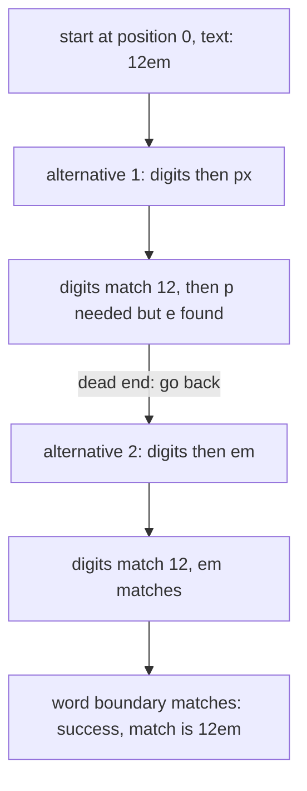

# Regular expressions: backtracking, replace, lastIndex, parsing

## In plain words

The previous lesson taught the vocabulary of regular expressions. This one explains how the computer actually *performs* a match, and then puts patterns to work.

Finding a match is like walking through a maze with a simple rule: at every fork take the first path; if you hit a dead end, walk back to the most recent fork and try the next path. Going back to try another option is called **backtracking**. Knowing that this is how the engine works explains two things beginners find mysterious: why a pattern sometimes matches *more* text than intended (it is "greedy"), and why a badly written pattern can make a program freeze.

The second half is practical. Regular expressions are not only for asking yes/no questions. They power search-and-replace (`replace`), cutting text into pieces (`split`), and reading structured text line by line (**parsing**), which we practise on a small task-list format.

Why it matters for a job: `replace` with patterns is everyday work (cleaning input, reformatting dates, renaming things). The stateful behaviour of the `g` flag is a classic source of "works the first time, fails the second" bugs, and slow patterns have caused real outages on large websites.

> **Before this lesson:** you need everything in [Regular expressions: patterns, sets, groups](#/lesson/javascript/regex-basics): sets, quantifiers, anchors, groups, `match` and flags.

## How matching works

### Trying every starting position

The engine works from left to right. It places itself at the first character of the text and tries to match the whole pattern from there. If that fails, it moves one character to the right and tries again, and so on. The first success wins.

```js-run
const result = "the cart and the cat".match(/cat/);
console.log(result.index);
```

At positions 0 to 3 the attempt fails immediately. At position 4 the engine matches `c`, `a`, then needs `t` and sees `r`: failure. It moves on, and finally succeeds at position 17.

### Backtracking through choices

Wherever the pattern offers a choice (an alternation `|`, an optional element, a quantifier that can take more or fewer characters) the engine picks one option and remembers the others. On failure further along, it returns to the latest remembered choice and tries the next option.

Take `/\b(\d+px|\d+em|\d+)\b/` on the text `12em`:



```js-run
console.log("12em".match(/\b(\d+px|\d+em|\d+)\b/)[0]);
console.log("12".match(/\b(\d+px|\d+em|\d+)\b/)[0]);
```

### Greedy and lazy quantifiers

The quantifiers `+`, `*`, `?` and `{n,m}` are **greedy**: they first take as many characters as they can, and give characters back one at a time only if the rest of the pattern cannot match otherwise.

That produces a famous surprise. Suppose we want the text inside the first pair of quotes:

```js-run
const line = 'title="Dune" author="Herbert"';
console.log(line.match(/"(.*)"/)[1]);
```

The output is `Dune" author="Herbert`, not `Dune`. Here is why. After the first quote, `.*` greedily swallows *everything* to the end of the line. Then the pattern needs a closing quote, and nothing is left. The engine backtracks: `.*` gives back one character at a time until a quote can be matched, and the first one it finds while moving backwards is the **last** quote of the line.

There are two fixes. Put a `?` after the quantifier to make it **lazy** (take as few characters as possible, and expand only when forced), or, better, describe more precisely what may appear inside the quotes:

```js-run
const line = 'title="Dune" author="Herbert"';
console.log(line.match(/"(.*?)"/)[1]);        // lazy: stops at the first closing quote
console.log(line.match(/"([^"]*)"/)[1]);      // precise: anything except a quote
console.log([...line.matchAll(/(\w+)="([^"]*)"/g)].map((m) => m[1] + " -> " + m[2]));
```

The lazy forms are `+?`, `*?`, `??` and `{n,m}?`. The "anything except the delimiter" form, `[^"]*`, is usually the best choice: it says what you mean and needs no backtracking.

### When backtracking explodes

Backtracking is harmless in most patterns. It becomes dangerous when a pattern can split the same text in very many different ways, typically a quantifier inside another quantifier, as in `(a+)+`. When the overall match *fails*, the engine tries every possible split before giving up, and the number of splits doubles with each extra character.

```js-run
function millisecondsFor(length) {
  const text = "a".repeat(length) + "!";
  const start = Date.now();
  /^(a+)+$/.test(text);                  // can never match because of the final "!"
  return Date.now() - start;
}
for (const n of [20, 22, 24, 26]) {
  console.log(n, "characters took about", millisecondsFor(n), "ms");
}
```

The exact times depend on your computer, but the trend is clear: every two extra characters make the test roughly four times slower. Add a 32 to the list and the example is likely to be stopped by this site's time limit; fifty characters would take longer than a lifetime. This is called **catastrophic backtracking**, and when an attacker can send such input to a server it becomes a denial-of-service attack known as *ReDoS*.

> [!WARNING]
> Be suspicious of nested quantifiers such as `(x+)+`, `(x*)*`, `(\w+\s?)+` and of alternations whose branches can match the same text, as in `(a|ab)+`. Rewrite them so that each character can be matched in only one way (here `/^a+$/` does the same job), and never run patterns written by users against your server without a time limit.

## Look-ahead and look-behind

Sometimes a match must be followed or preceded by something that should **not** become part of the match. A *look-around* checks the surrounding text without consuming it:

| Syntax | Meaning |
|---|---|
| `x(?=y)` | `x`, only if followed by `y` |
| `x(?!y)` | `x`, only if **not** followed by `y` |
| `(?<=y)x` | `x`, only if preceded by `y` |
| `(?<!y)x` | `x`, only if **not** preceded by `y` |

```js-run
const prices = "Tea 4 EUR, cake 12 USD, soup 7 EUR";
console.log(prices.match(/\d+(?= EUR)/g));          // numbers followed by " EUR"
console.log(prices.match(/\d+(?! EUR)\b/g));        // numbers not followed by " EUR"
console.log("cost: $45 and €30".match(/(?<=\$)\d+/g));

const strong = /^(?=.*\d)(?=.*[a-z])(?=.*[A-Z]).{8,}$/;      // three conditions checked from the start
console.log(strong.test("Tr1ckyPass"), strong.test("alllowercase1"), strong.test("Sh0rt"));
```

The last pattern is the standard recipe for "must contain a digit, a lower-case letter and an upper-case letter, and be at least 8 characters long". Each `(?=.*X)` peeks ahead from the start to confirm that an `X` exists somewhere, then returns to the start.

## Search and replace

### The basics

The string method `replace(pattern, replacement)` returns a **new** string in which matches have been replaced. Strings are immutable, so the original is unchanged.

```js-run
const text = "red sock, red shoe, red hat";
console.log(text.replace("red", "blue"));        // a plain string: first occurrence only
console.log(text.replace(/red/, "blue"));        // a regex without g: first match only
console.log(text.replace(/red/g, "blue"));       // with g: every match
console.log(text.replaceAll("red", "blue"));     // replaceAll with a plain string
console.log(text);
```

Forgetting the `g` flag, and so replacing only the first match, is the most common `replace` mistake.

### Using captured groups in the replacement

Inside the replacement string, `$1`, `$2` and so on stand for the text captured by groups 1, 2 and so on; `$<name>` refers to a named group and `$&` to the whole match.

```js-run
const dates = "Start 2030-07-15, end 2030-08-01.";
console.log(dates.replace(/(\d{4})-(\d{2})-(\d{2})/g, "$3/$2/$1"));
console.log(dates.replace(/(?<y>\d{4})-(?<m>\d{2})-(?<d>\d{2})/g, "$<d>.$<m>.$<y>"));

console.log("Lovelace, Ada\nHopper, Grace".replace(/(\p{L}+), (\p{L}+)/gu, "$2 $1"));
console.log("call 555-1234".replace(/\d+/g, "[$&]"));
```

The first line rearranges each date from year-month-day to day/month/year by reusing the three captured pieces in a different order.

### Computing the replacement with a function

The second argument may be a **function**. It is called for every match with the whole match first and then the groups, and its return value becomes the replacement. This turns `replace` into a general text-transforming tool.

```js-run
const menu = "soup 4.5, pasta 9, wine 6.25";
const withTax = menu.replace(/\d+(\.\d+)?/g, (price) => (Number(price) * 1.1).toFixed(2));
console.log(withTax);

const snake = "max_retry_count";
console.log(snake.replace(/_([a-z])/g, (whole, letter) => letter.toUpperCase()));

const template = "Hello {name}, your order {id} ships {when}.";
const data = { name: "Noor", id: "#4417", when: "tomorrow" };
console.log(template.replace(/\{(\w+)\}/g, (whole, key) => data[key] ?? whole));
```

Line by line: the first callback receives each price as text, converts it, adds ten percent and formats it. The second receives the whole match (`_r`) and the captured letter, and returns the letter in upper case, turning snake_case into camelCase. The third looks each placeholder name up in an object and leaves unknown placeholders untouched: a complete miniature template engine.

### `split` with a pattern

`split` accepts a regular expression as the separator, which handles untidy input:

```js-run
console.log("apples,  pears ;plums,figs".split(/\s*[,;]\s*/));
console.log("one  two\tthree\nfour".split(/\s+/));
```

## Building patterns from strings

When part of a pattern is only known while the program runs (a search term typed by a user), the `/.../` notation cannot be used. Build the pattern with the `RegExp` constructor from a string; the flags are the second argument.

Two traps await. In a normal string, a backslash is itself an escape character, so you must write `"\\b"` to get `\b` into the pattern. And any special characters in the user's text must be escaped, or they will be interpreted as pattern syntax:

```js-run
function escapeRegExp(text) {
  return text.replace(/[\\^$.*+?()[\]{}|]/g, "\\$&");     // put a backslash before each special character
}

function highlight(text, term) {
  const pattern = new RegExp("\\b" + escapeRegExp(term) + "\\b", "gi");
  return text.replace(pattern, (found) => "**" + found + "**");
}

console.log(highlight("Node and node.js are not Nodes", "node"));
console.log(escapeRegExp("1+1=2? (yes)"));
console.log("total: 3.50".replace(new RegExp(escapeRegExp("3.50")), "4.00"));
```

Newer JavaScript engines provide this helper built in as `RegExp.escape`.

## The `lastIndex` property: patterns with memory

A regular expression object with the `g` (global) or `y` (sticky) flag keeps a little state: a property named `lastIndex` that records where the next search should **start**. The methods `exec` and `test` read and update it.

That is useful when you want to step through matches yourself:

```js-run
const pattern = /\d+/g;
const text = "a1 b22 c333";
let match;
while ((match = pattern.exec(text)) !== null) {
  console.log(match[0], "found at", match.index, "| next search starts at", pattern.lastIndex);
}
console.log(pattern.lastIndex);          // reset to 0 after the failed final search
```

It is also the cause of a notorious bug. A global pattern stored in a binding and reused with `test` gives alternating answers:

```js-run
const hasDigit = /\d/g;
console.log(hasDigit.test("a1"));    // true, and lastIndex becomes 2
console.log(hasDigit.test("a1"));    // false! the search started at index 2
console.log(hasDigit.test("a1"));    // true again: the failure reset lastIndex to 0

const safe = /\d/;                   // no g flag: no memory
console.log(safe.test("a1"), safe.test("a1"), safe.test("a1"));
```

> [!TIP]
> Use the `g` flag only where "all matches" is what you need: with `replace`, `match`, `matchAll` and `split`. For yes/no checks with `test`, leave it off. This single habit avoids the alternating-result bug completely.

The **sticky** flag `y` is a stricter cousin: the match must begin *exactly* at `lastIndex`, with no searching ahead. It is the tool for reading a text token by token, which the language-project module uses:

```js-run
const number = /\d+/y;
const text = "12+345";
number.lastIndex = 0;
console.log(number.exec(text)?.[0]);
number.lastIndex = 2;                        // the "+" is here: no number at exactly this position
console.log(number.exec(text));
number.lastIndex = 3;
console.log(number.exec(text)?.[0]);
```

## A short detour: the `Date` class

Extracting dates from text raises the question of what to do with them. JavaScript's built-in `Date` class represents a moment in time, stored as the number of milliseconds since the start of 1970 (UTC).

```js-run
const launch = new Date(2030, 6, 15, 9, 30);          // year, MONTH INDEX, day, hour, minute (local time)
console.log(launch.getFullYear(), launch.getMonth(), launch.getDate(), launch.getDay());
console.log(new Date(Date.UTC(2030, 6, 15)).toISOString());
console.log(typeof launch.getTime(), new Date(2030, 0, 31 + 1).getMonth());

function parseIsoDate(text) {
  const match = /^(\d{4})-(\d{2})-(\d{2})$/.exec(text);
  if (match === null) return null;
  const [, y, m, d] = match.map(Number);
  const date = new Date(Date.UTC(y, m - 1, d));
  const real = date.getUTCFullYear() === y && date.getUTCMonth() === m - 1 && date.getUTCDate() === d;
  return real ? date : null;                           // rejects 2030-02-30 and the like
}
console.log(parseIsoDate("2030-02-28") !== null, parseIsoDate("2030-02-30"), parseIsoDate("30-02-2030"));
```

Two oddities catch everyone once: **months are numbered from 0** (6 is July) while days of the month start at 1, and out-of-range values roll over (the 32nd of January becomes the 1st of February). `parseIsoDate` exploits the roll-over to validate: it builds the date and checks that the parts survived unchanged. The regular expression checks the shape; ordinary code checks the meaning.

## Worked example: parsing a task list

Parsing means turning text into structured data. Here is a simple plain-text format for a to-do list, one task per line:

```text
(A) 2030-07-15 Call the dentist @phone +health
x 2030-07-01 Renew passport +admin
Buy oat milk @shop
# lines starting with a hash are comments
```

The rules: an optional `x ` at the start marks a finished task; an optional priority is a capital letter in parentheses; an optional date follows; the rest is the description, in which words starting with `@` are contexts and words starting with `+` are projects. We read the file line by line and let one pattern per line do the heavy lifting.

```js-run
const taskLine = /^(?<done>x )?(?:\((?<priority>[A-Z])\) )?(?:(?<date>\d{4}-\d{2}-\d{2}) )?(?<text>.+)$/;

function parseTasks(source) {
  const tasks = [];
  for (const rawLine of source.split(/\r?\n/)) {              // works for both kinds of line ending
    const line = rawLine.trim();
    if (line === "" || line.startsWith("#")) continue;        // skip blanks and comments
    const match = taskLine.exec(line);
    if (match === null) throw new Error("Cannot understand line: " + rawLine);
    const { done, priority, date, text } = match.groups;
    tasks.push({
      done: done !== undefined,
      priority: priority ?? null,
      date: date ?? null,
      title: text.replace(/(?<=^|\s)[@+]\w+/g, "").replace(/\s+/g, " ").trim(),   // description without tags
      contexts: [...text.matchAll(/(?<=^|\s)@(\w+)/g)].map((m) => m[1]),
      projects: [...text.matchAll(/(?<=^|\s)\+(\w+)/g)].map((m) => m[1]),
    });
  }
  return tasks;
}

const file = `(A) 2030-07-15 Call the dentist @phone +health
x 2030-07-01 Renew passport +admin

# lines starting with a hash are comments
Buy oat milk @shop
(B) Email ana@example.com about C++ course +work`;

for (const task of parseTasks(file)) {
  console.log(JSON.stringify(task));
}
```

Reading the big pattern from left to right: an optional captured `x `; an optional non-capturing group containing a parenthesised capital letter; an optional group containing a date; then everything else. The look-behind `(?<=^|\s)` in the tag patterns demands that `@` or `+` stand at the start of a word, which is why the email address and "C++" in the last task are not mistaken for tags.

The general shape of this function (split into lines, skip the irrelevant ones, match each remaining line against a pattern, reject what does not fit, build objects from named groups) covers a surprising number of real parsing jobs: log files, configuration files, CSV exports with simple values.

> [!INTERVIEW]
> Favourite questions from this material: "Why does `/".*"/` match too much, and how do you fix it?" (greedy quantifier; use `.*?` or `[^"]*`). "Why does my `regex.test()` return true then false?" (`g` flag and `lastIndex`). "What is catastrophic backtracking?" (nested quantifiers causing exponential work on non-matching input). "How do you safely build a regex from user input?" (escape special characters, or avoid a regex and use `includes`).

## Common pitfalls

1. **Greedy `.*` between delimiters.** It runs to the last delimiter. Use a negated set or a lazy quantifier.
2. **`replace` without `g`.** Only the first match is replaced.
3. **Reusing a `g` or `y` pattern with `test` or `exec`.** `lastIndex` carries over between calls.
4. **Nested quantifiers.** They can take exponential time on input that almost matches.
5. **Unescaped user input in `new RegExp`.** A search for `c++` or `(` throws or matches the wrong thing.
6. **Single backslashes in pattern strings.** `new RegExp("\d+")` is the pattern `d+`; write `"\\d+"`.
7. **Month numbers in `Date`.** They start at 0.
8. **Parsing nested structures with one regex.** HTML, JSON and program code need a real parser, because patterns cannot count matching brackets to arbitrary depth.

## Summary

- The engine tries each starting position from left to right and backtracks through remembered choices on failure.
- Quantifiers are greedy by default; appending `?` makes them lazy. Negated character sets are often clearer than either.
- Patterns in which the same text can be split in many ways cause catastrophic backtracking.
- Look-ahead `(?=...)`, `(?!...)` and look-behind `(?<=...)`, `(?<!...)` test the surroundings without consuming them.
- `replace` accepts `$1`-style references or a function; with the `g` flag it replaces every match. `split` accepts patterns too.
- Build dynamic patterns with `new RegExp(string, flags)`, doubling backslashes and escaping user text.
- Global and sticky patterns remember `lastIndex`; keep `g` off patterns used with `test`.
- Line-oriented parsing combines `split`, one anchored pattern with named groups, and ordinary validation code.

## Glossary

- **Backtracking**: returning to an earlier choice point to try a different alternative after a failure.
- **Greedy quantifier**: one that takes as many characters as possible first.
- **Lazy quantifier**: one that takes as few as possible first (`+?`, `*?`).
- **Catastrophic backtracking**: exponential slowdown caused by a pattern with too many ways to match the same text.
- **ReDoS**: a denial-of-service attack that feeds such input to a vulnerable pattern.
- **Look-ahead / look-behind**: assertions about the text after / before the current position that consume nothing.
- **Replacement function**: a callback passed to `replace` that computes each substitution.
- **`RegExp` constructor**: `new RegExp(text, flags)`, for patterns built at run time.
- **Escaping**: prefixing special characters with a backslash so they are taken literally.
- **`lastIndex`**: the position from which a global or sticky pattern starts its next search.
- **Sticky flag (`y`)**: requires a match to start exactly at `lastIndex`.
- **Parsing**: converting text into structured data according to the rules of a format.
- **Delimiter**: a character that marks the boundary of a piece of text, such as a quote or a comma.

## Check yourself

```quiz
[
  {"q": "What does this print?\n\n`console.log(\"<b>one</b> and <b>two</b>\".match(/<b>(.*)<\\/b>/)[1]);`", "options": ["one", "one</b> and <b>two", "two", "<b>one</b>"], "answer": 1,
   "explain": "The greedy .* first takes everything to the end and backs off only until the last </b> can match, so the group spans both elements."},
  {"q": "Which change makes that pattern capture only `one`?", "options": ["Add the g flag", "Replace .* with .*?", "Replace .* with .+", "Add ^ at the start"], "answer": 1,
   "explain": "A lazy quantifier extends one character at a time and stops at the first closing tag."},
  {"q": "What does this print?\n\n`console.log(\"2030-07-15\".replace(/(\\d+)-(\\d+)-(\\d+)/, \"$2/$3/$1\"));`", "options": ["07/15/2030", "15/07/2030", "\\$2/\\$3/\\$1", "2030/07/15"], "answer": 0,
   "explain": "\\$1, \\$2 and \\$3 are the captured year, month and day. The replacement puts them in the order month/day/year."},
  {"q": "What does this print?\n\n`const r = /a/g; console.log(r.test(\"a\"), r.test(\"a\"));`", "options": ["true true", "true false", "false true", "false false"], "answer": 1,
   "explain": "After the first successful test, lastIndex is 1. The second search starts there, finds nothing, returns false and resets lastIndex."},
  {"q": "What does `\"a-b_c\".replace(/[-_](\\w)/g, (m, ch) => ch.toUpperCase())` return?", "options": ["aBC", "a-B_C", "ABC", "aB_c"], "answer": 0,
   "explain": "Each separator plus the following character is replaced by that character in upper case: -b becomes B and _c becomes C."},
  {"q": "Why can `/^(\\w+\\s?)+$/` be dangerous on long input that does not match?", "options": ["It uses too much memory for groups", "The nested quantifiers allow exponentially many ways to split the text, all of which are tried", "\\s is not supported", "Anchors are slow"], "answer": 1,
   "explain": "Because the space is optional, a run of word characters can be divided between repetitions of the group in a huge number of ways, and a failing match explores them all."},
  {"q": "What does `\"5 apples and 3 pears\".match(/\\d+(?= pears)/)[0]` return?", "options": ["5", "3", "3 pears", "null"], "answer": 1,
   "explain": "The look-ahead requires \" pears\" to follow the digits but does not include it in the match, so only 3 is returned."},
  {"q": "Which expression correctly builds a pattern that finds the user-supplied text `term` as a whole word?", "options": ["new RegExp(\"\\b\" + term + \"\\b\")", "new RegExp(\"\\\\b\" + escapeRegExp(term) + \"\\\\b\")", "/\\bterm\\b/", "RegExp(term, \"b\")"], "answer": 1,
   "explain": "Inside a string literal the backslash must be doubled to reach the pattern, and the user's text must be escaped so that its special characters are taken literally."}
]
```

> **Source:** Haverbeke, *Eloquent JavaScript* (4th ed.), ch. 9 "Regular Expressions" (mechanics of matching, backtracking, replace, greed, dynamically creating RegExp objects, lastIndex, the Date class, parsing a file format). Details checked against MDN: https://developer.mozilla.org/en-US/docs/Web/JavaScript/Reference/Global_Objects/String/replace , https://developer.mozilla.org/en-US/docs/Web/JavaScript/Reference/Global_Objects/RegExp/lastIndex , https://developer.mozilla.org/en-US/docs/Web/JavaScript/Reference/Regular_expressions/Lookahead_assertion , https://developer.mozilla.org/en-US/docs/Web/JavaScript/Reference/Global_Objects/Date
