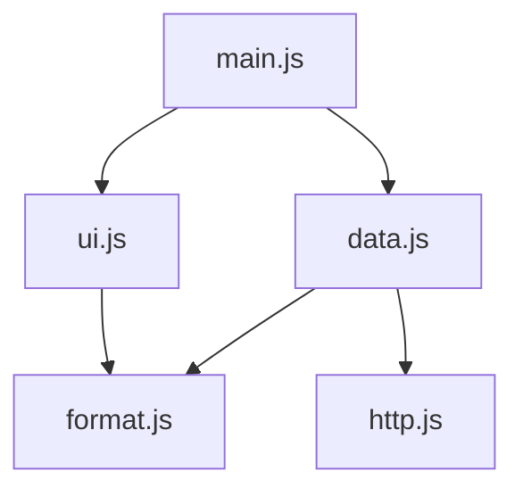
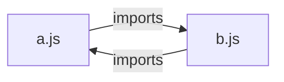

# ES modules and CommonJS

## In plain words

Imagine writing a 400-page book as one enormous paragraph with no chapters. Finding anything would be painful, two authors could not work on it at once, and changing one sentence might contradict something 300 pages away. Books are split into chapters; programs are split into **modules**.

A module is a file of code with a clear border around it. Whatever is defined inside stays private unless the module explicitly **exports** it, that is, offers it to the outside. Another file that wants to use an exported item must explicitly **import** it. Think of a restaurant kitchen with a serving hatch: the dining room sees only the dishes passed through the hatch, never the mess inside, and the cooks decide what goes on the hatch.

JavaScript has two module systems in wide use. **ES modules** (the `import` and `export` keywords) are the official standard and what you should write today. **CommonJS** (`require` and `module.exports`) is the older system that Node.js started with; a huge amount of existing code uses it, so you must be able to read it.

Why it matters for a job: every real project consists of hundreds of modules, yours and other people's. "It says X is not exported", "require is not defined" and "cannot use import statement outside a module" are among the first errors every new developer meets, and each one is explained by this lesson.

> **Before this lesson:** you need functions, scope and closures ([Functions and scope](#/lesson/javascript/functions-scope), [Closures and recursion](#/lesson/javascript/closures-recursion)) and objects with destructuring ([Destructuring, spread, rest and JSON](#/lesson/javascript/destructuring-json)).

> [!NOTE]
> The runnable panels on this site execute a single piece of code, so they cannot load other files. Code that uses `import` or `require` is therefore shown as static, highlighted listings with the file name in a comment. Where it helps, a runnable panel *simulates* the mechanism so that you can still experiment.

## The problem modules solve

In the early web, a page loaded several script files and all of them shared **one global scope**. Every top-level function and variable of every file landed in the same big bag of names.

```js-run
// pretend these two sections are separate files written by different people

// --- cart.js ---
var total = 0;
function add(price) { total += price; }

// --- analytics.js ---
var total = "page views";            // same name, silently replaces the cart's total
function add(event) { /* record an event */ }   // replaces the cart's add as well

add(5);
console.log(total);                  // the cart is broken, and no error was reported
```

Two files chose the same names and the second quietly destroyed the first. This is a **name collision**. Besides collisions, a pile of scripts has no way to express that one file *needs* another, so they had to be listed in exactly the right order by hand.

Before the language had modules, programmers built their own borders out of functions. Wrapping a file's code in a function that is called immediately gives it a private scope; returning an object decides what is public. This is the **module pattern**:

```js-run
const cart = (function () {
  let total = 0;                              // private: invisible outside this function
  const format = (n) => n.toFixed(2) + " EUR";
  return {                                    // the public interface
    add(price) { total += price; },
    summary() { return "Total: " + format(total); },
  };
})();

cart.add(5);
cart.add(7.5);
console.log(cart.summary());
console.log(typeof total, typeof format);     // neither leaked into the outer scope
```

The parentheses around the function followed by `()` define a function and call it on the spot; the name for this trick is an *immediately invoked function expression*, or IIFE. It works because of closures: `add` and `summary` keep access to `total` after the wrapper has finished. Real module systems give you the same privacy with nicer syntax, and they add the missing piece: a way to state dependencies.

## ES modules

### Exporting

In an ES module, everything is private to the file by default. The keyword `export` in front of a declaration makes it available to other modules.

```javascript
// file: geometry.js
const PI_APPROX = 3.14159;                 // not exported: private to this file

export function circleArea(radius) {
  return PI_APPROX * radius * radius;
}

export function rectangleArea(width, height) {
  return width * height;
}

export const UNIT = "cm";
```

These are **named exports**: each is known to the outside by its name.

### Importing

Another file states which names it wants and from which file:

```javascript
// file: main.js
import { circleArea, UNIT } from "./geometry.js";

console.log(circleArea(2) + " " + UNIT + "²");
```

Line by line: the braces list the names to import. They must match the exported names exactly. The string after `from` is the **module specifier**; `./` means "in the same folder as this file". `main.js` never asked for `rectangleArea`, so it does not get it, and it *cannot* reach `PI_APPROX` at all.

Variations you will meet:

```javascript
import { circleArea as area } from "./geometry.js";     // rename while importing
import * as geometry from "./geometry.js";              // everything, as one object: geometry.circleArea(2)
import { circleArea, rectangleArea } from "./geometry.js";
```

### Default exports

A module may also mark one value as its **default export**, the main thing it provides. The importer picks any name for it and writes it *without* braces:

```javascript
// file: logger.js
export default function log(message) {
  console.log("[app] " + message);
}
export const LEVELS = ["info", "warn", "error"];        // a named export alongside the default
```

```javascript
// file: main.js
import log from "./logger.js";                 // default import: no braces, name is up to you
import write, { LEVELS } from "./logger.js";   // default and named together
```

> [!TIP]
> Prefer named exports. They force every importer to use the same name, which makes searching, renaming and automatic import suggestions in editors work reliably. Default exports invite each file to invent its own name for the same thing. Whichever you use, remember the rule: **braces for named imports, no braces for the default**. Mixing them up produces the classic error "does not provide an export named ...".

### Rules that make ES modules special

**Imports and exports are static.** They may only appear at the top level of a file, never inside an `if` or a function, and the specifier must be a plain string. The price is a little flexibility; the reward is that tools can work out the complete dependency structure *without running the program*. Editors use this for auto-completion, and bundlers use it to remove unused code (next lesson).

**A module is evaluated once.** However many files import `geometry.js`, its code runs a single time and all importers share the same module instance. A module can therefore hold shared state:

```javascript
// file: counter.js
let count = 0;
export function increment() { count += 1; }
export function current() { return count; }
```

If `a.js` calls `increment()` and `b.js` then calls `current()`, `b.js` sees 1.

**Imports are live, read-only views.** An imported name is not a copy of the value; it is a window onto the exporting module's binding. If the exporter changes the value, importers see the new value. Importers cannot assign to it:

```javascript
// file: state.js
export let status = "starting";
export function ready() { status = "ready"; }

// file: main.js
import { status, ready } from "./state.js";
console.log(status);     // "starting"
ready();
console.log(status);     // "ready": the import reflects the change
status = "x";            // TypeError: imports are read-only
```

**Modules are always in strict mode**, and the top-level `this` is `undefined`.

**Dependencies run first.** Before a module's own code runs, everything it imports has been loaded and evaluated.



In this picture an arrow means "imports". The engine evaluates `format.js` and `http.js` first, then `ui.js` and `data.js`, and `main.js` last. `format.js` is imported twice and still runs only once.

### Using ES modules in the browser and in Node

In a web page, a script becomes a module when its tag says so:

```html
<script type="module" src="main.js"></script>
```

Module scripts are fetched without blocking the page, run after the document has been read, and may use `import`. Browsers require the full relative path including the `.js` extension, and loading modules needs a web server; opening the HTML file directly from disk usually fails for security reasons.

In Node.js, a file is treated as an ES module when its name ends in `.mjs`, or when the nearest `package.json` contains `"type": "module"`.

### Dynamic import

Sometimes you want to load a module only when it is needed, for example a large charting library used on one screen. The function-like form `import(specifier)` can be used anywhere and returns a **promise** (an object representing a future result, covered in the asynchronous module):

```javascript
button.addEventListener("click", async () => {
  const { drawChart } = await import("./charts.js");   // fetched on first click only
  drawChart(data);
});
```

## CommonJS

### `require` and `module.exports`

Node.js appeared in 2009, six years before the language standardised modules, and adopted a system named CommonJS. In it, every file gets an object called `module`. Whatever the file stores in `module.exports` is what other files receive when they call the function `require` with the file's path.

```javascript
// file: geometry.cjs
const PI_APPROX = 3.14159;

function circleArea(radius) {
  return PI_APPROX * radius * radius;
}

module.exports = { circleArea, UNIT: "cm" };
```

```javascript
// file: main.cjs
const geometry = require("./geometry.cjs");
const { circleArea } = require("./geometry.cjs");     // destructuring the same object

console.log(geometry.UNIT, circleArea(2));
```

There is no special syntax here. `require` is an ordinary function that returns an ordinary object, and "named imports" are ordinary destructuring.

### What `require` does, in twenty lines

Because CommonJS is made of plain functions, we can build a working miniature of it. This demystifies the whole system. Our "files" are strings in an object:

```js-run
const files = {
  "./geometry": `
    const PI_APPROX = 3.14159;
    exports.circleArea = (r) => PI_APPROX * r * r;
    exports.UNIT = "cm";
    console.log("(geometry is being evaluated)");
  `,
  "./report": `
    const { circleArea, UNIT } = require("./geometry");
    module.exports = (r) => "Area: " + circleArea(r).toFixed(1) + " " + UNIT + "^2";
  `,
};

const cache = {};

function require(name) {
  if (name in cache) return cache[name].exports;          // already loaded: reuse it
  const module = { exports: {} };
  cache[name] = module;                                   // register before running (matters for cycles)
  const wrapper = new Function("require", "module", "exports", "console", files[name]);
  wrapper(require, module, module.exports, console);      // run the file's code inside a function
  return module.exports;
}

const report = require("./report");
console.log(report(2));
console.log(require("./geometry") === require("./geometry"));   // same object every time
```

Step by step:

- `require` first looks in a **cache**. A module that was loaded before is not run again; its existing `exports` object is returned. That is why the message "(geometry is being evaluated)" appears once, although the file is required three times.
- Otherwise it creates a fresh `module` object and **wraps the file's code in a function** whose parameters are `require`, `module` and `exports`. Calling that function runs the file. Since the code runs inside a function, its top-level variables (`PI_APPROX`) are local: there is the privacy, by plain function scope.
- `exports` is a shortcut that initially points at the same object as `module.exports`. A file can add properties to it (`exports.circleArea = ...`) or replace the whole thing by assigning to `module.exports`.

Real Node.js does exactly this, plus reading files from disk and resolving paths.

> [!WARNING]
> Assigning directly to the shortcut, `exports = { ... }`, does nothing useful. It only re-points the local parameter, while `require` returns `module.exports`. Either add properties (`exports.name = value`) or assign to `module.exports`.

## The two systems side by side

| | ES modules | CommonJS |
|---|---|---|
| Syntax | `import` / `export` keywords | `require()` function, `module.exports` object |
| When dependencies are known | before running (static) | while running (dynamic) |
| Loading | asynchronous; works in browsers and Node | synchronous; Node only (browsers need a bundler) |
| What an import is | a live, read-only binding | a copy of the reference at the time of `require` |
| Strict mode | always | only if you ask for it |
| Conditional loading | `await import(...)` | `require` anywhere, even inside an `if` |
| Top-level `await` | allowed | not allowed |
| File hints in Node | `.mjs`, or `"type": "module"` | `.cjs`, or the default without `"type"` |

The difference between "live binding" and "copy" can be observed with our mini `require`:

```js-run
// A CommonJS-style module exporting a primitive value and a function that changes it
const module = { exports: {} };
(function (exports) {
  let count = 0;
  exports.count = count;                       // copies the current VALUE 0 into the exports object
  exports.increment = () => { count += 1; };
  exports.read = () => count;
})(module.exports);

const { count, increment, read } = module.exports;
increment();
increment();
console.log(count, module.exports.count, read());
```

The exported `count` stays `0` for ever, because a number was copied at export time. Only the function `read` sees the real variable. In an ES module, `export let count` would be a live binding and importers would see `2`.

### Mixing the two

Old and new code have to live together. The practical rules in Node.js:

- An ES module can import a CommonJS module: `import pkg from "./old.cjs"` gives you its `module.exports` as the default import.
- A CommonJS module historically could not `require` an ES module and had to use `await import(...)`; recent Node.js versions permit `require` of ES modules that do not use top-level `await`.
- In ES modules the CommonJS conveniences `require`, `module`, `__dirname` and `__filename` do not exist. Use `import`, and `import.meta.url` or `import.meta.dirname` for the file's location.

The two famous error messages now make sense. "Cannot use import statement outside a module" means Node is treating your file as CommonJS: add `"type": "module"` to `package.json` or rename the file to `.mjs`. "require is not defined in ES module scope" is the reverse situation.

## Circular dependencies

What if `a.js` imports `b.js` and `b.js` imports `a.js`? Both systems tolerate this cycle, with a catch: one of the two must start running before the other has finished, and may find that what it imported is not ready.



In CommonJS the second module receives the first one's `exports` object in its *current, half-filled* state (this is why our mini `require` puts the module in the cache before running it). In ES modules the binding exists, and touching it before the exporting module has run its declaration throws a `ReferenceError`. Using the import later, inside a function that is called after start-up, works in both. The robust cure is to remove the cycle: move the shared part into a third module that both import.

> [!INTERVIEW]
> "What are the differences between ES modules and CommonJS?" Cover four points: syntax (`import`/`export` versus `require`/`module.exports`); static versus dynamic structure, and that static structure enables tree shaking; asynchronous versus synchronous loading; live bindings versus copied values. Bonus points for mentioning that both evaluate a module once and cache it, that ES modules are strict by default, and for explaining `export default` versus named exports.

## Common pitfalls

1. **Braces confusion.** `import log from` takes the default export; `import { log } from` takes a named export called `log`. They are different things.
2. **Missing file extension or `./`.** Browsers and Node's ES module loader need `"./utils.js"`. A bare name like `"utils"` means an installed package.
3. **Expecting privacy from a classic `<script>`.** Without `type="module"`, top-level declarations are global.
4. **`exports = ...` in CommonJS.** It breaks the link to `module.exports`.
5. **Putting `import` inside a function or `if`.** Use dynamic `import()` for conditional loading.
6. **Relying on side effects of import order.** A module should work regardless of who imports it first.
7. **Circular imports that use values during start-up.** Extract the shared code.
8. **Assuming a module runs again when imported again.** It is evaluated once; module-level state is shared by all importers.

## Summary

- Modules split a program into files with private scope and an explicit interface, ending global name collisions and making dependencies explicit.
- Before built-in modules, closures and IIFEs provided the privacy (the module pattern).
- ES modules use `export` (named or default) and `import`; the structure is static, modules run once, imports are live read-only bindings, and code is strict.
- `import()` loads a module on demand and returns a promise.
- CommonJS uses the function `require` and the object `module.exports`; a file's code is wrapped in a function, executed once and cached. Values are copied at export time.
- Node chooses the system by file extension (`.mjs`/`.cjs`) or the `"type"` field of `package.json`; browsers use `<script type="module">`.
- Circular dependencies work only if nothing is used before it has been initialised; restructure to avoid them.

## Glossary

- **Module**: a file of code with its own scope and an explicit list of what it shares.
- **Export / import**: to make a binding available to other modules / to use a binding from another module.
- **Dependency**: a module that another module needs in order to work.
- **Global scope**: the single shared namespace that classic scripts all write into.
- **Name collision**: two pieces of code using the same name for different things in the same scope.
- **IIFE**: immediately invoked function expression; a function defined and called at once to create a private scope.
- **ES module (ESM)**: the standard JavaScript module system, using `import` and `export`.
- **Named export / default export**: an export identified by its name / the single main export of a module.
- **Module specifier**: the string that says which module to load, such as `"./geometry.js"`.
- **Static structure**: imports and exports that can be determined without running the code.
- **Live binding**: an import that always reflects the current value of the exported variable.
- **Dynamic import**: `import(specifier)`, loading a module at run time and returning a promise.
- **CommonJS (CJS)**: Node's original module system, using `require` and `module.exports`.
- **Module cache**: the record of already loaded modules, ensuring each is evaluated once.
- **Circular dependency**: modules that import each other, directly or through a chain.

## Check yourself

```quiz
[
  {"q": "A file contains `export function parse() {}` and `export default function run() {}`. Which import line is correct?", "options": ["import { run, parse } from \"./file.js\";", "import run, { parse } from \"./file.js\";", "import parse, { run } from \"./file.js\";", "import { default, parse } from \"./file.js\";"], "answer": 1,
   "explain": "The default export is imported without braces under any name you choose; named exports go inside braces with their exact names."},
  {"q": "Three different files import `./config.js`. How many times is the code in `config.js` executed?", "options": ["Three times", "Once", "Once per function call that uses it", "It depends on the import order"], "answer": 1,
   "explain": "A module is evaluated a single time and the resulting module instance is shared by every importer."},
  {"q": "In an ES module, `import { count } from \"./counter.js\"; count = 5;` does what?", "options": ["Changes count in both modules", "Changes a local copy only", "Throws a TypeError because imported bindings are read-only", "Is a syntax error only in Node"], "answer": 2,
   "explain": "Imports are read-only views of the exporter's bindings. Only the exporting module can assign to its own variables."},
  {"q": "In CommonJS, what is wrong with a file that ends with `exports = { start, stop };`?", "options": ["Nothing", "require will return the original empty object, because only the local name exports was re-pointed", "It exports only start", "It throws a ReferenceError"], "answer": 1,
   "explain": "require returns module.exports. Reassigning the exports shortcut breaks its connection to that object; assign to module.exports instead."},
  {"q": "Why can bundlers remove unused exports from ES modules but generally not from CommonJS modules?", "options": ["ES modules are smaller", "ES imports and exports are static and can be analysed without running the code", "CommonJS files are encrypted", "CommonJS has no exports"], "answer": 1,
   "explain": "Static structure reveals exactly which names are used. With require, what is loaded and used can depend on run-time values."},
  {"q": "What does this print (run as CommonJS-style code)?\n\n`const m = { exports: {} }; let n = 1; m.exports.n = n; n = 2; console.log(m.exports.n);`", "options": ["1", "2", "undefined", "It throws"], "answer": 0,
   "explain": "The value 1 was copied into the exports object. Changing the variable afterwards does not update the copy; an ES module live binding would."},
  {"q": "Node reports \"Cannot use import statement outside a module\". What is the usual fix?", "options": ["Replace const with var", "Add \"type\": \"module\" to package.json or rename the file to .mjs", "Wrap the import in try/catch", "Install a newer browser"], "answer": 1,
   "explain": "The message means Node is treating the file as CommonJS. Declaring the package as ESM or using the .mjs extension switches the loader."},
  {"q": "How do you load a large module only after the user clicks a button?", "options": ["Put an import statement inside the click handler", "Use dynamic import: await import(\"./big.js\") inside the handler", "It is impossible with ES modules", "Use export inside the handler"], "answer": 1,
   "explain": "Static import declarations must be at the top level. The function-like import() works anywhere and returns a promise for the module."}
]
```

> **Source:** Haverbeke, *Eloquent JavaScript* (4th ed.), ch. 10 "Modules" (modular programs, ES modules, CommonJS modules). Details checked against MDN: https://developer.mozilla.org/en-US/docs/Web/JavaScript/Guide/Modules , https://developer.mozilla.org/en-US/docs/Web/JavaScript/Reference/Statements/import , https://developer.mozilla.org/en-US/docs/Web/JavaScript/Reference/Operators/import ; Node.js documentation on modules: https://nodejs.org/api/esm.html
