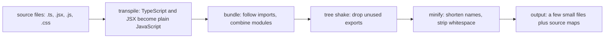
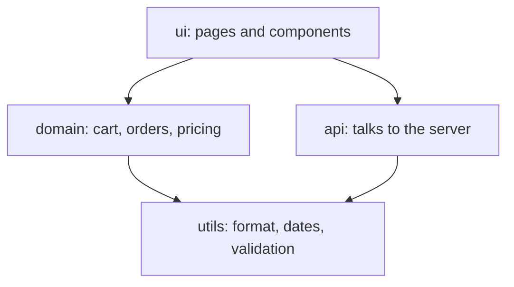

# Packages, bundlers and module design

## In plain words

The previous lesson showed how one file shares code with another. This lesson zooms out to three questions that every real project has to answer.

**How do I use code written by other people?** Nobody writes a date picker or a web server from scratch. Reusable chunks of code are published as **packages**, and a tool called a **package manager** downloads them for you. Think of an app store for code: you name what you need, the store delivers it together with everything *it* needs.

**How does my project get from many small files to something a browser can load quickly?** A **bundler** is a program that takes your hundreds of modules and packs them into a few compact files, the way you pack loose items into boxes before a house move: fewer trips, less wasted space.

**How do I decide what goes into which module?** That is **module design**. A well-designed module is like a good kitchen appliance: a few obvious buttons, one clear purpose, and no need to open the casing.

Why it matters for a job: on your first day you will type `npm install` and `npm run build`. Knowing what those commands do, what `package.json` and the lock file are for, and why the "build" exists turns confusing errors into solvable ones. Interviewers ask about semantic versioning, tree shaking and how you structure code.

> **Before this lesson:** you need `import`/`export` and `require` from [ES modules and CommonJS](#/lesson/javascript/es-modules-commonjs), and higher-order functions ([Higher-order functions](#/lesson/javascript/higher-order-functions)).

## Packages

### What a package is

A **package** is a folder of code prepared for distribution: one or more modules, plus a file named `package.json` that describes it (its name, version, and which other packages it needs). **npm** is both the standard package manager for JavaScript and the public online collection, called a **registry**, from which packages are downloaded. It is installed together with Node.js. Alternatives such as pnpm, Yarn and Bun do the same job with the same registry.

Every project you create is itself a package with its own `package.json`:

```json
{
  "name": "plant-shop",
  "version": "1.4.0",
  "type": "module",
  "scripts": {
    "dev": "vite",
    "build": "vite build",
    "test": "vitest run"
  },
  "dependencies": {
    "date-fns": "^4.1.0"
  },
  "devDependencies": {
    "vite": "^6.0.0",
    "vitest": "^3.0.0"
  }
}
```

Field by field:

- `name` and `version` identify this package.
- `"type": "module"` tells Node that `.js` files here are ES modules.
- `scripts` are named shortcuts for command lines. `npm run build` runs `vite build`.
- `dependencies` lists packages the program needs **while running**.
- `devDependencies` lists packages needed only **while developing**: build tools, test runners, linters. They are not shipped to users.

The everyday commands:

```text
npm init -y               create a package.json in the current folder
npm install date-fns      download a package and record it under dependencies
npm install -D vitest     the same, recorded under devDependencies
npm install               download everything listed in package.json
npm run build             run the script named "build"
npm update                move to newer versions allowed by the version ranges
npm uninstall date-fns    remove a package
```

Installed packages land in a folder named `node_modules` inside your project. It can contain thousands of folders, because your dependencies have dependencies of their own (so-called *transitive* dependencies). It is never committed to version control; anyone can recreate it with `npm install`.

Once installed, a package is imported by its bare name, without `./`:

```javascript
import { format, addDays } from "date-fns";       // a package from node_modules
import { cartTotal } from "./cart.js";            // a file of your own project

console.log(format(addDays(new Date(), 7), "yyyy-MM-dd"));
```

### Semantic versioning

Package versions have three numbers, `MAJOR.MINOR.PATCH`, and a convention named **semantic versioning** (semver) gives them meaning:

- **PATCH** goes up for bug fixes that change no behaviour you rely on: `4.1.0` to `4.1.1`.
- **MINOR** goes up when features are added in a backwards-compatible way: `4.1.1` to `4.2.0`.
- **MAJOR** goes up when something changes that can break existing users: `4.2.0` to `5.0.0`.

In `package.json`, the symbols in front of a version define a **range** of acceptable versions: `^4.1.0` means "4.1.0 or any later 4.x.y" (never 5), `~4.1.0` means "4.1.x only", and a bare `4.1.0` means exactly that version.

A small implementation makes the caret rule concrete:

```js-run
function parseVersion(text) {
  const [major, minor, patch] = text.split(".").map(Number);
  return { major, minor, patch };
}

function satisfiesCaret(version, base) {          // does `version` satisfy ^base ?
  const v = parseVersion(version), b = parseVersion(base);
  if (v.major !== b.major) return false;          // a different major version may break us
  if (v.minor !== b.minor) return v.minor > b.minor;
  return v.patch >= b.patch;
}

for (const candidate of ["4.1.0", "4.1.7", "4.3.0", "4.0.9", "5.0.0", "3.9.9"]) {
  console.log(candidate.padEnd(6), satisfiesCaret(candidate, "4.1.0") ? "accepted by ^4.1.0" : "rejected");
}
```

The function compares the three parts from most to least significant: the major number must be identical, and within the same major number the version must not be older than the base. (Real semver has extra rules for versions below 1.0.0 and for pre-releases.)

### The lock file

Ranges mean that two people running `npm install` a month apart could receive different versions, and "it works on my machine" follows. To prevent that, npm writes the exact version of every installed package, including transitive ones, into **`package-lock.json`**. Commit this file. With it, everyone on the team and the deployment server get an identical `node_modules`; on servers, `npm ci` installs strictly from the lock file.

> [!WARNING]
> Installing a package means running a stranger's code with your permissions. Before adding a dependency, look at how widely it is used, when it was last maintained and what licence it has, and watch for misspelled look-alike names. Run `npm audit` to list known vulnerabilities in your dependency tree. A project with fewer, better-known dependencies is easier to keep safe.

## Building and bundling

### Why not ship the source files as they are?

Browsers can load ES modules directly. For a tiny site that is fine. For a real application it is slow: a browser that discovers imports file by file must make hundreds of network requests, one round after another, and the files are larger than they need to be, full of comments, long names and unused code. Modern source code is also frequently not plain JavaScript at all (TypeScript, JSX).

So professional projects have a **build step**: a program that transforms the source files you write into optimised files for the browser. The main stages:



- **Transpiling** translates one form of source code into another: TypeScript into JavaScript, or new syntax into older syntax for old browsers.
- **Bundling** starts at an *entry* module, follows every `import` to build the dependency graph, and writes the modules into one file or a few.
- **Tree shaking** removes exported functions that nothing imports. It depends on the static structure of ES modules.
- **Minifying** rewrites code to be as short as possible without changing what it does.
- **Source maps** are side files that map positions in the unreadable output back to your original source, so error messages and the debugger still show the code you wrote.
- **Code splitting** cuts the bundle at dynamic `import()` calls, so that rarely used screens are downloaded only when needed.

Tools you will meet: **Vite** (the common default for new projects today), **esbuild** and **Rollup** (which Vite uses underneath), **webpack** (older, very widespread), and **Parcel**. A development server such as Vite's also reloads the page instantly when you save a file.

### A toy bundler

To see that nothing magical happens, here is a miniature bundler. The "files" are strings; `import` lines use a simplified one-line form. It finds each module's dependencies, orders the modules so that dependencies come first, and joins them.

```js-run
const sources = {
  "main": `import "cart"; import "format";\nconsole.log(format(cartTotal([4, 8.5])));`,
  "cart": `import "tax";\nconst cartTotal = (prices) => withTax(prices.reduce((a, b) => a + b, 0));`,
  "format": `const format = (n) => n.toFixed(2) + " EUR";`,
  "tax": `const withTax = (n) => n * 1.2;`,
  "unused": `const neverCalled = () => "nobody imports this file";`,
};

function dependenciesOf(code) {
  return [...code.matchAll(/import "([\w-]+)";/g)].map((match) => match[1]);
}

function bundle(entry) {
  const order = [];
  const seen = new Set();
  function visit(name) {
    if (seen.has(name)) return;                 // each module is included once
    seen.add(name);
    for (const dependency of dependenciesOf(sources[name])) visit(dependency);
    order.push(name);                           // after its dependencies
  }
  visit(entry);
  const body = order
    .map((name) => `// --- ${name} ---\n` + sources[name].replace(/import "[\w-]+";\s*/g, ""))
    .join("\n");
  return { order, code: body };
}

const result = bundle("main");
console.log("load order:", result.order.join(" -> "));
console.log(result.code);
console.log("--- running the bundle ---");
new Function("console", result.code)(console);
```

Walk through it:

- `dependenciesOf` uses a regular expression with `matchAll` to list the names a module imports.
- `visit` is a recursive depth-first walk. It first visits everything the module depends on and only then appends the module itself, so dependencies always precede their users. The `seen` set stops a module from being included twice.
- The module `unused` is never reached from `main`, so it is left out. That is file-level tree shaking for free.
- The final lines join the code (with the import lines stripped) and run the result.

A real bundler does the same on real syntax, keeps each module's scope separate, handles cycles, and applies the optimisations listed above. The problem attached to this module asks you to write the ordering step with cycle detection.

```js-run
// What minifying does, by hand: the same function, before and after
function calculateDiscountedPrice(originalPrice, discountPercentage) {
  const discountAmount = originalPrice * (discountPercentage / 100);
  return originalPrice - discountAmount;
}
const c = (a, b) => a - a * (b / 100);

console.log(calculateDiscountedPrice(80, 25), c(80, 25));
console.log(calculateDiscountedPrice.toString().length, "characters versus", c.toString().length);
```

> [!TIP]
> Write code for humans and let the build make it small. Short cryptic names, clever one-liners and hand-inlined functions do not make your shipped code faster or smaller, because the minifier already does all of that. They only make the source harder to maintain.

## Module design

Splitting a program into modules is easy. Splitting it *well* is a skill. These guidelines cover most of it.

### 1. One clear responsibility

A module should be describable in one sentence without the word "and". "Formats money amounts" is a module. "Formats money and sends emails and stores settings" is three modules sharing a file. Related functions that change for the same reasons belong together; this quality is named **cohesion**.

### 2. A small, stable interface

The **interface** (or API) of a module is the set of things it exports. Export as little as possible. Everything exported is a promise to the rest of the program; everything private can be rewritten at will. How strongly modules depend on each other's details is called **coupling**, and the goal is low coupling: change the inside of one module without touching any other.

### 3. Prefer plain functions and plain data

Compare two interfaces for computing a cart total:

```js-run
// Design A: a stateful object that must be configured and fed step by step
class CartCalculator {
  #items = [];
  #taxRate = 0;
  setTaxRate(rate) { this.#taxRate = rate; }
  addItem(item) { this.#items.push(item); }
  compute() {
    const net = this.#items.reduce((sum, i) => sum + i.price * i.qty, 0);
    return Math.round(net * (1 + this.#taxRate) * 100) / 100;
  }
}
const calculator = new CartCalculator();
calculator.setTaxRate(0.2);
calculator.addItem({ price: 4, qty: 2 });
calculator.addItem({ price: 8.5, qty: 1 });
console.log(calculator.compute());

// Design B: one pure function over ordinary arrays and objects
function cartTotal(items, { taxRate = 0 } = {}) {
  const net = items.reduce((sum, i) => sum + i.price * i.qty, 0);
  return Math.round(net * (1 + taxRate) * 100) / 100;
}
console.log(cartTotal([{ price: 4, qty: 2 }, { price: 8.5, qty: 1 }], { taxRate: 0.2 }));
```

Both print the same number. Design B is one call, cannot be used in the wrong order, is trivially testable, and works with any array of objects from anywhere: a server response, a test, another library. Design A forces every user to learn a custom protocol and convert their data into it. Reach for a class when there truly is long-lived state to manage; otherwise export functions that take and return standard data structures (arrays, plain objects, `Map`, `Set`, `Date`). Modules that speak in standard structures combine easily with each other.

### 4. No work at import time

A module's top-level code runs the moment someone imports it. If that code opens a network connection, reads a file or starts a timer, merely importing the module has consequences, tests become slow and order-dependent, and tree shaking is blocked, because the bundler cannot prove the module is safe to drop. Export a function that does the work and let the caller decide when to run it.

### 5. Depend in one direction

Arrange modules in layers: general utilities at the bottom, domain logic in the middle, the user interface or server entry point at the top. Imports should point downwards only. A utility that imports from the user-interface layer is a warning sign, and usually the beginning of a circular dependency.



### Worked example: designing a small module

Task: several screens need to turn article titles into web-address fragments ("slugs"), such as `fresh-basil-pesto`, and titles must not collide. Design decisions, applying the guidelines:

- Responsibility: "creates URL slugs". One sentence.
- Interface: two functions, `slugify(title)` and `uniqueSlug(title, taken)`. No class, no configuration object to set up.
- Data: strings in, a string out; the already used slugs are any iterable of strings.
- Private helpers stay unexported.

```javascript
// file: slug.js
const MAX_LENGTH = 60;                                   // private detail

function stripAccents(text) {                            // private helper
  return text.normalize("NFD").replace(/\p{M}/gu, "");
}

export function slugify(title) {
  return stripAccents(title)
    .toLowerCase()
    .replace(/[^a-z0-9]+/g, "-")
    .replace(/^-+|-+$/g, "")
    .slice(0, MAX_LENGTH);
}

export function uniqueSlug(title, taken) {
  const used = new Set(taken);
  const base = slugify(title) || "untitled";
  let candidate = base;
  for (let n = 2; used.has(candidate); n++) candidate = `${base}-${n}`;
  return candidate;
}
```

The same code in runnable form, with the exports written as a returned object so that you can try it here:

```js-run
const slug = (() => {
  const MAX_LENGTH = 60;
  const stripAccents = (text) => text.normalize("NFD").replace(/\p{M}/gu, "");
  function slugify(title) {
    return stripAccents(title).toLowerCase().replace(/[^a-z0-9]+/g, "-").replace(/^-+|-+$/g, "").slice(0, MAX_LENGTH);
  }
  function uniqueSlug(title, taken) {
    const used = new Set(taken);
    const base = slugify(title) || "untitled";
    let candidate = base;
    for (let n = 2; used.has(candidate); n++) candidate = `${base}-${n}`;
    return candidate;
  }
  return { slugify, uniqueSlug };
})();

console.log(slug.slugify("  Crème Brûlée: 5 Easy Steps!  "));
console.log(slug.uniqueSlug("Fresh Basil Pesto", ["fresh-basil-pesto", "fresh-basil-pesto-2"]));
console.log(slug.uniqueSlug("???", []));
```

`normalize("NFD")` splits accented letters into a base letter plus a separate accent mark, and `\p{M}` matches those marks, so `è` becomes `e`. Callers know none of this; they could not depend on `MAX_LENGTH` or `stripAccents` even if they wanted to, which leaves you free to change either.

> [!INTERVIEW]
> Be ready to explain: `dependencies` versus `devDependencies`; what `^1.2.3` allows (minor and patch updates, not a new major version); why the lock file is committed (reproducible installs); what a bundler does and what tree shaking is (removing unused exports, possible because ES module imports are static); and what high cohesion and low coupling mean. For design questions, describe the module's interface first, before any implementation.

## Common pitfalls

1. **Committing `node_modules` or deleting the lock file.** Commit `package.json` and the lock file; ignore `node_modules`.
2. **Putting build tools under `dependencies`.** They belong in `devDependencies`.
3. **Assuming a minor update cannot break you.** Semver is a promise made by humans. Test after updating.
4. **Importing a whole library for one function** in a way that defeats tree shaking, for example through a CommonJS build.
5. **"Utils" modules that grow without limit.** A file named `helpers.js` with forty unrelated functions has no responsibility. Split it by topic.
6. **Exporting internals "in case someone needs them".** Each one becomes something you can no longer change.
7. **Side effects at import time.** They make load order matter and block optimisation.
8. **Debugging minified code without source maps.** Enable source maps and the browser shows your original files.

## Summary

- A package is distributable code described by `package.json`; npm installs packages (and their transitive dependencies) from a registry into `node_modules`.
- Semantic versioning encodes compatibility in `MAJOR.MINOR.PATCH`; `^` allows compatible minor and patch updates; the lock file pins exact versions for reproducible installs.
- A build step transpiles, bundles, tree-shakes and minifies source code into a few small files, with source maps for debugging and code splitting for on-demand loading.
- Bundling is a walk over the dependency graph that emits each module after its dependencies.
- Good modules have one responsibility, a small interface, low coupling, no import-time side effects, and exchange plain data through simple functions.

## Glossary

- **Package**: a distributable unit of code with a `package.json`.
- **Package manager**: a tool (npm, pnpm, Yarn) that installs and updates packages.
- **Registry**: the online database from which packages are downloaded.
- **`node_modules`**: the folder holding installed packages.
- **Transitive dependency**: a dependency of one of your dependencies.
- **Semantic versioning (semver)**: the `MAJOR.MINOR.PATCH` scheme that signals compatibility.
- **Lock file**: a generated file recording the exact installed version of every package.
- **Build step**: the automated transformation of source code into deployable files.
- **Transpile**: to translate source code into another version or dialect of a language.
- **Bundler**: a tool that combines modules into fewer files.
- **Entry point**: the module where a bundler starts following imports.
- **Tree shaking**: removing exports that are never imported.
- **Minification**: shrinking code without changing its behaviour.
- **Source map**: a file linking generated code back to the original source.
- **Code splitting**: dividing a bundle into parts loaded on demand.
- **Interface (API)**: what a module exposes to its users.
- **Cohesion / coupling**: how closely the contents of a module belong together / how much modules depend on each other's details.

## Check yourself

```quiz
[
  {"q": "A project depends on `\"lib\": \"^2.4.1\"`. Which version may npm install?", "options": ["3.0.0", "2.3.9", "2.9.0", "1.9.9"], "answer": 2,
   "explain": "The caret allows newer minor and patch versions within the same major version: at least 2.4.1 and below 3.0.0."},
  {"q": "According to semantic versioning, a release that removes a function other programs use should change which number?", "options": ["PATCH", "MINOR", "MAJOR", "None"], "answer": 2,
   "explain": "Removing or changing existing behaviour can break users, which is exactly what a major version bump announces."},
  {"q": "Why is `package-lock.json` committed to version control?", "options": ["It contains the source code of dependencies", "It records exact versions so that every install produces the same dependency tree", "npm cannot run without it", "It speeds up the browser"], "answer": 1,
   "explain": "Version ranges in package.json can resolve differently over time. The lock file pins every package, including transitive ones."},
  {"q": "Where should a test runner such as Vitest be listed?", "options": ["dependencies", "devDependencies", "scripts", "It should be copied into the src folder"], "answer": 1,
   "explain": "It is needed only during development, not by the running application, so it is a development dependency."},
  {"q": "In the toy bundler, why is a module appended to `order` only after its dependencies have been visited?", "options": ["To sort modules alphabetically", "So that every definition appears in the bundle before the code that uses it", "To make the bundle smaller", "Because Set requires it"], "answer": 1,
   "explain": "A module's code may use its imports immediately, so the imported modules must already have been emitted and evaluated."},
  {"q": "What makes tree shaking possible?", "options": ["Minification", "The static, analysable structure of ES module imports and exports", "The lock file", "Source maps"], "answer": 1,
   "explain": "Because imports and exports are declared statically, a bundler can determine which exports are never used and omit them."},
  {"q": "Which module interface follows the design advice in this lesson best?", "options": ["A class requiring init(), configure() and load() calls in a fixed order", "A pure function taking plain arrays and objects and returning a result", "A module that connects to the database when imported", "A helpers file exporting every internal function"], "answer": 1,
   "explain": "Plain functions over standard data are easy to call, test and combine, and they hide the implementation."},
  {"q": "What is the purpose of a source map?", "options": ["To list the pages of a website", "To map minified or transpiled code back to the original source for debugging", "To order module loading", "To encrypt the bundle"], "answer": 1,
   "explain": "With source maps, browser developer tools show errors and breakpoints in the files you wrote, not in the generated output."}
]
```

> **Source:** Haverbeke, *Eloquent JavaScript* (4th ed.), ch. 10 "Modules" (packages, building and bundling, module design). Details checked against MDN: https://developer.mozilla.org/en-US/docs/Learn_web_development/Extensions/Client-side_tools/Package_management , https://developer.mozilla.org/en-US/docs/Glossary/Tree_shaking ; npm documentation: https://docs.npmjs.com/about-semantic-versioning
