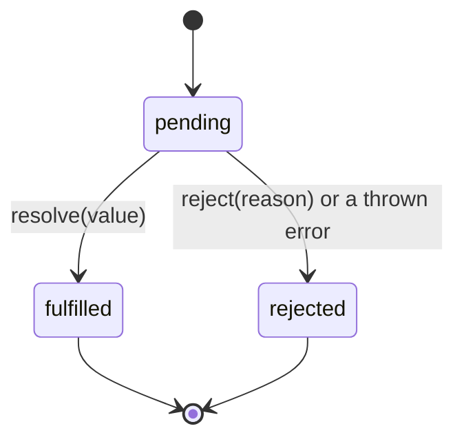

# Callbacks and promises

## In plain words

Some things take time: downloading a file, waiting for a user to click, reading from a database on another continent. A program has two ways to deal with a slow operation.

The first is to stand still until it finishes, like waiting at the counter of a coffee shop, staring at the barista, unable to do anything else. This is **synchronous** behaviour: one thing at a time, each one finished before the next begins.

The second is how busy coffee shops work. You order, you get a **buzzer**, and you go and sit down. You are free to chat or read. When the coffee is ready the buzzer goes off and you react. This is **asynchronous** behaviour: start something, carry on with other work, and deal with the result when it arrives.

JavaScript uses the second way for everything slow. This lesson covers its two basic tools. A **callback** is a function you hand over with the instruction "call this when you are done". A **promise** is the buzzer itself: an object you receive immediately that stands for a result that will exist later.

Why it matters for a job: every network request, every timer, every file read and every user interaction in JavaScript is asynchronous. You cannot build a web page that talks to a server, or a server at all, without this material, and no JavaScript interview skips it.

> **Before this lesson:** you need functions as values and callbacks ([Higher-order functions](#/lesson/javascript/higher-order-functions)), closures ([Closures and recursion](#/lesson/javascript/closures-recursion)) and exceptions ([Exceptions and error handling](#/lesson/javascript/exceptions)).

> [!NOTE]
> The ordinary runnable panels on this site show only what a program prints *before its first pause*, so they cannot display results that arrive later. The asynchronous examples in this module are therefore small live web pages: press Run and watch the lines appear in the preview. Each page starts with the same three helper lines, which define a function `log` that adds a line of text to the page. You can ignore them and read `log(...)` as `console.log(...)`.

## Why JavaScript does not wait

A JavaScript program runs on a **single thread**: it executes one piece of code at a time and never two at once. If that single thread stood still waiting two seconds for a server, *nothing else could happen* in those two seconds. In a browser, the page would freeze: no scrolling, no clicks, no animation.

So slow operations are handed to the environment (the browser or Node.js), which performs them in the background. Your code continues at once. When the operation completes, the environment arranges for a function of yours to be called.

The simplest slow operation is a timer. `setTimeout(fn, ms)` asks the environment to call `fn` after roughly `ms` milliseconds:

```html-run
<pre id="out"></pre>
<script>
const out = document.getElementById("out");
const log = (...parts) => { out.textContent += parts.join(" ") + "\n"; };

log("1. ordering coffee");
setTimeout(() => {
  log("3. buzzer! coffee is ready");
}, 1000);
log("2. sitting down, reading the news");
</script>
```

Read the code from top to bottom and then look at the order of the output. Line "2" appears **before** line "3", although it comes later in the code. `setTimeout` did not pause the program. It registered the arrow function to be called in one second and returned immediately; the program went on to the next statement. A second later, with the main code long finished, the environment called the function.

This is the central fact of the whole module: **asynchronous code does not run in the order it is written.**

## Callbacks

### The idea

The function given to `setTimeout` is a **callback**: a function passed to other code so that the other code can call it later. Callbacks by themselves are nothing new; `map` and `filter` take callbacks and call them immediately:

```js-run
const doubled = [1, 2, 3].map((n) => n * 2);     // the callback runs right now, three times
console.log(doubled);
console.log("map has completely finished before this line");
```

What makes a callback *asynchronous* is solely when it is called: later, after the current code has finished.

### Asynchronous functions with callbacks

Let us invent a slow operation to practise with. `fetchUser` pretends to load a user from a server; it takes an id and a callback that receives the result.

```html-run
<pre id="out"></pre>
<script>
const out = document.getElementById("out");
const log = (...parts) => { out.textContent += parts.join(" ") + "\n"; };

const users = { 1: { id: 1, name: "Ana", teamId: 7 }, 2: { id: 2, name: "Bo", teamId: 9 } };

function fetchUser(id, callback) {
  setTimeout(() => {
    callback(users[id]);           // "the server answered": hand the result to the caller's function
  }, 500);
}

log("asking for user 1...");
fetchUser(1, (user) => {
  log("got:", user.name);
});
log("the request is on its way; the program keeps running");
</script>
```

Notice what we **cannot** write: `const user = fetchUser(1);`. The function returns long before the answer exists, so there is nothing to return. The result can only be delivered by calling the callback. Beginners often try this:

```javascript
let user;
fetchUser(1, (result) => { user = result; });
console.log(user.name);      // TypeError: user is still undefined at this moment
```

The last line runs before the callback does. Any code that needs the result must live *inside* the callback, or be called from it.

### Errors with callbacks

A slow operation can fail. An exception thrown inside a timer callback cannot be caught by a `try`/`catch` around the original call, because by the time the callback runs that `try` block is long finished. So callback-based code must pass errors along as values. The convention from Node.js is the **error-first callback**: the callback's first parameter is an error (or `null` if all went well) and the second is the result.

```html-run
<pre id="out"></pre>
<script>
const out = document.getElementById("out");
const log = (...parts) => { out.textContent += parts.join(" ") + "\n"; };

const users = { 1: { id: 1, name: "Ana" } };

function fetchUser(id, callback) {
  setTimeout(() => {
    if (!(id in users)) callback(new Error("no user with id " + id));
    else callback(null, users[id]);
  }, 300);
}

function show(error, user) {
  if (error) {
    log("failed:", error.message);
    return;
  }
  log("loaded:", user.name);
}

fetchUser(1, show);
fetchUser(99, show);
</script>
```

Every callback must begin by checking for an error. Forget once, and a failure passes unnoticed.

### Callback hell

Real tasks consist of several slow steps where each needs the previous result: load the user, then the user's team, then the team's projects. With callbacks, each step nests inside the previous one:

```html-run
<pre id="out"></pre>
<script>
const out = document.getElementById("out");
const log = (...parts) => { out.textContent += parts.join(" ") + "\n"; };

const later = (value, callback) => setTimeout(() => callback(null, value), 250);
const fetchUser = (id, cb) => later({ id, name: "Ana", teamId: 7 }, cb);
const fetchTeam = (teamId, cb) => later({ id: teamId, name: "Rockets", projectIds: [3, 4] }, cb);
const fetchProject = (id, cb) => later({ id, title: "Project " + id }, cb);

fetchUser(1, (error, user) => {
  if (error) return log("error:", error.message);
  fetchTeam(user.teamId, (error, team) => {
    if (error) return log("error:", error.message);
    fetchProject(team.projectIds[0], (error, project) => {
      if (error) return log("error:", error.message);
      log(user.name + " (" + team.name + ") works on " + project.title);
    });
  });
});
</script>
```

Three steps, three levels of indentation, and the same error check written three times. Ten steps would march off the right edge of the screen. This shape is nicknamed **callback hell** or the *pyramid of doom*. Worse than its looks: there is no simple way to run steps in parallel, to handle all errors in one place, or to return a result to a caller. Promises were added to the language to solve exactly these problems.

## Promises

### A value that arrives later

A **promise** is an object that represents the eventual result of an asynchronous operation. Instead of taking a callback, an asynchronous function *returns a promise immediately*. You then attach callbacks to the promise.

A promise is always in one of three states:

- **pending**: the operation has not finished;
- **fulfilled**: it succeeded, and the promise holds the resulting value;
- **rejected**: it failed, and the promise holds the reason (normally an `Error`).

A promise that is no longer pending is called **settled**. It settles once and then never changes again.



### Using a promise: `then`

To use the eventual value, call the promise's `then` method with a function. The function will be called with the value once the promise is fulfilled.

```html-run
<pre id="out"></pre>
<script>
const out = document.getElementById("out");
const log = (...parts) => { out.textContent += parts.join(" ") + "\n"; };

function fetchUser(id) {
  return new Promise((resolve) => {
    setTimeout(() => resolve({ id, name: "Ana", teamId: 7 }), 500);
  });
}

const promise = fetchUser(1);
log("we already hold a promise object:", String(promise));

promise.then((user) => {
  log("fulfilled with user", user.name);
});
log("this line still runs before the result arrives");
</script>
```

`fetchUser(1)` returns at once, and what it returns is the buzzer. `promise.then(fn)` says "when the result is in, call `fn` with it". As before, the last line of the script runs first.

### Creating a promise

The first lines of `fetchUser` show how promises are made. `new Promise(executor)` takes a function, the *executor*, which runs immediately and receives two functions as arguments:

- call `resolve(value)` to fulfil the promise with a value;
- call `reject(error)` to reject it.

You need `new Promise` only when wrapping something that is not promise-based yet, such as `setTimeout` or an old callback API. A handy example is a `wait` function:

```html-run
<pre id="out"></pre>
<script>
const out = document.getElementById("out");
const log = (...parts) => { out.textContent += parts.join(" ") + "\n"; };

const wait = (ms) => new Promise((resolve) => setTimeout(resolve, ms));

function fetchStock(item) {
  return new Promise((resolve, reject) => {
    setTimeout(() => {
      if (item === "unicorn") reject(new Error("we do not sell unicorns"));
      else resolve({ item, inStock: 12 });
    }, 300);
  });
}

log("waiting...");
wait(600).then(() => log("600 ms have passed"));
fetchStock("fern").then((stock) => log("fern in stock:", stock.inStock));
</script>
```

Most of the time you will not create promises by hand. Modern APIs such as `fetch` already return them, and `async` functions (next lesson) create them automatically.

### Chaining: the cure for the pyramid

Here is the key property. **`then` returns a new promise**, which will hold whatever the callback returns. And if the callback returns a promise, the new promise *waits for it* and adopts its result. Together these two rules let sequential steps be written as a flat chain:

```html-run
<pre id="out"></pre>
<script>
const out = document.getElementById("out");
const log = (...parts) => { out.textContent += parts.join(" ") + "\n"; };

const later = (value) => new Promise((resolve) => setTimeout(() => resolve(value), 250));
const fetchUser = (id) => later({ id, name: "Ana", teamId: 7 });
const fetchTeam = (teamId) => later({ id: teamId, name: "Rockets", projectIds: [3, 4] });
const fetchProject = (id) => later({ id, title: "Project " + id });

fetchUser(1)
  .then((user) => {
    log("1. user:", user.name);
    return fetchTeam(user.teamId);          // returning a promise: the chain waits for it
  })
  .then((team) => {
    log("2. team:", team.name);
    return fetchProject(team.projectIds[0]);
  })
  .then((project) => {
    log("3. project:", project.title);
    return project.title.toUpperCase();     // returning a plain value works too
  })
  .then((shout) => log("4.", shout));
</script>
```

The same three steps as in the pyramid, now reading top to bottom. Each `then` callback receives the result of the step above it.

> [!WARNING]
> The most common promise bug is forgetting `return` inside a `then` callback. Without it, the next `then` receives `undefined` and does not wait for the inner operation. If a step starts an asynchronous operation, **return its promise**.

### Errors: `catch` and `finally`

When a promise is rejected, or when a `then` callback throws an exception, the chain skips all following `then` callbacks until it finds a `catch`. One `catch` at the end therefore handles a failure in *any* earlier step, in the same way that one `try`/`catch` covers a whole block of synchronous code. `finally` registers a callback that runs in both cases, for cleanup.

```html-run
<pre id="out"></pre>
<script>
const out = document.getElementById("out");
const log = (...parts) => { out.textContent += parts.join(" ") + "\n"; };

const later = (value) => new Promise((resolve) => setTimeout(() => resolve(value), 200));
const fetchUser = (id) => later({ id, name: "Ana", teamId: null });
const fetchTeam = (teamId) =>
  teamId === null ? Promise.reject(new Error("user has no team")) : later({ name: "Rockets" });

log("spinner on");
fetchUser(1)
  .then((user) => fetchTeam(user.teamId))
  .then((team) => log("this is skipped:", team.name))
  .then(() => log("this is skipped as well"))
  .catch((error) => {
    log("caught:", error.message);
    return { name: "(no team)" };            // recovering: the chain continues normally
  })
  .then((team) => log("continuing with", team.name))
  .finally(() => log("spinner off"));
</script>
```

Follow the flow: `fetchTeam` rejects; the two following `then` callbacks are skipped; `catch` receives the error. Because the `catch` callback returns a normal value, the promise it produces is *fulfilled*, and the chain continues with the next `then`. Had the `catch` callback thrown, the chain would have stayed in the rejected state.

A rejected promise that nobody handles produces an "unhandled promise rejection" warning in the console (and can terminate a Node.js program). End every chain with a `catch`, or return the promise to a caller who will.

### Ready-made promises

Two shortcuts create promises that are already settled. They are useful in tests, for default values, and to start a chain:

```html-run
<pre id="out"></pre>
<script>
const out = document.getElementById("out");
const log = (...parts) => { out.textContent += parts.join(" ") + "\n"; };

Promise.resolve(42).then((value) => log("resolved with", value));
Promise.reject(new Error("nope")).catch((error) => log("rejected with", error.message));
log("even already-settled promises call their callbacks later, never immediately");
</script>
```

The third line is printed first. A `then` callback is *never* called synchronously, not even when the promise is settled already. That guarantee makes promise code predictable; the lesson on the event loop explains the mechanism.

### Converting a callback API into a promise API

Wrapping an error-first callback function is mechanical: reject on error, resolve otherwise. This conversion is known as *promisifying*.

```html-run
<pre id="out"></pre>
<script>
const out = document.getElementById("out");
const log = (...parts) => { out.textContent += parts.join(" ") + "\n"; };

// an old-style function
function readSetting(name, callback) {
  setTimeout(() => {
    const settings = { theme: "dark" };
    if (name in settings) callback(null, settings[name]);
    else callback(new Error("unknown setting: " + name));
  }, 200);
}

// a general converter
function promisify(fn) {
  return (...args) =>
    new Promise((resolve, reject) => {
      fn(...args, (error, result) => (error ? reject(error) : resolve(result)));
    });
}

const readSettingAsync = promisify(readSetting);
readSettingAsync("theme").then((value) => log("theme =", value));
readSettingAsync("font").catch((error) => log("failed:", error.message));
</script>
```

Node.js ships this helper as `util.promisify`.

## Several promises at once

Chaining runs steps one after another. Independent operations should run **at the same time**. Four static methods combine an array of promises into one:

| Method | Fulfils when | Rejects when |
|---|---|---|
| `Promise.all` | all have fulfilled (gives an array of results in input order) | any one rejects (immediately) |
| `Promise.allSettled` | all have settled (gives an array of outcome objects) | never |
| `Promise.race` | the first one settles, if it fulfilled | the first one settles, if it rejected |
| `Promise.any` | the first one fulfils | all reject (with an `AggregateError`) |

```html-run
<pre id="out"></pre>
<script>
const out = document.getElementById("out");
const log = (...parts) => { out.textContent += parts.join(" ") + "\n"; };

const later = (value, ms) => new Promise((resolve) => setTimeout(() => resolve(value), ms));
const failLater = (message, ms) => new Promise((_, reject) => setTimeout(() => reject(new Error(message)), ms));
const started = Date.now();
const elapsed = () => "(after ~" + Math.round((Date.now() - started) / 100) * 100 + " ms)";

Promise.all([later("user", 300), later("orders", 500), later("settings", 100)])
  .then((results) => log("all:", results.join(", "), elapsed()));

Promise.all([later("user", 300), failLater("orders service down", 200)])
  .catch((error) => log("all rejected:", error.message, elapsed()));

Promise.allSettled([later("ok", 100), failLater("broken", 150)])
  .then((outcomes) => log("allSettled:", outcomes.map((o) => o.status).join(", "), elapsed()));

Promise.race([later("slow server", 400), later("fast server", 150)])
  .then((winner) => log("race:", winner, elapsed()));

Promise.any([failLater("mirror 1 down", 100), later("mirror 2", 250)])
  .then((first) => log("any:", first, elapsed()));
</script>
```

Look at the first result: three operations lasting 300, 500 and 100 milliseconds complete together after about 500 milliseconds, not 900, because they ran concurrently; and the results come in the order of the input array, not in order of completion.

> [!TIP]
> When two operations do not depend on each other, start them together and combine with `Promise.all`. Awaiting them one after another is the most common cause of needlessly slow pages. Use `allSettled` when you want every result even if some fail, and `race` to implement a timeout: race the real operation against a promise that rejects after a delay.

> [!INTERVIEW]
> Expect: "What are the states of a promise?" (pending, fulfilled, rejected; settled is final); "What does `then` return?" (a new promise for the callback's result, flattening returned promises); "Difference between `Promise.all` and `Promise.allSettled`?"; "How would you implement `Promise.all`?" (count fulfilled results, store each at its index, resolve when the count reaches the length, reject on the first rejection); and output-ordering puzzles that mix `setTimeout` with `then`, which the event-loop lesson prepares you for.

## Common pitfalls

1. **Trying to return an asynchronous result directly.** `const data = fetchThing()` gives a promise (or `undefined` with callbacks), not the data.
2. **Forgetting `return` in a `then` callback.** The chain neither waits nor passes the value on.
3. **Nesting `then` inside `then`.** That rebuilds the pyramid. Return the inner promise and add another `then` at the outer level.
4. **No `catch`.** Rejections go unhandled and failures stay invisible to the user.
5. **Wrapping promise-returning functions in `new Promise`.** Unnecessary and error-prone; return the existing promise.
6. **Calling the function instead of passing it.** `.then(log("done"))` runs `log` immediately; write `.then(() => log("done"))`.
7. **Sequential waits for independent work.** Use `Promise.all`.
8. **Expecting `try`/`catch` around a callback-based call to catch errors thrown later inside the callback.**

## Summary

- JavaScript runs on one thread and never blocks on slow operations; it starts them, continues, and is notified later.
- A callback is a function passed in to be called on completion. Error-first callbacks carry failures as the first argument. Sequential callback steps nest into "callback hell".
- A promise is an object standing for a future result: pending, then fulfilled with a value or rejected with a reason, exactly once.
- `then` registers a callback and returns a new promise, so steps chain flatly; returning a promise from a callback makes the chain wait.
- Rejections and thrown errors skip to the next `catch`; `finally` runs either way. Callbacks registered with `then` always run later, never synchronously.
- `Promise.all`, `allSettled`, `race` and `any` combine concurrent operations.

## Glossary

- **Synchronous**: finishing each operation before starting the next; the caller waits.
- **Asynchronous**: starting an operation and receiving its result later, without waiting in between.
- **Single-threaded**: able to run only one piece of code at any moment.
- **Blocking**: preventing all other code from running while waiting.
- **Callback**: a function handed to other code to be called later.
- **Error-first callback**: the Node.js convention `(error, result) => ...`.
- **Callback hell**: deeply nested callbacks for sequential asynchronous steps.
- **Promise**: an object representing the eventual result of an asynchronous operation.
- **Pending / fulfilled / rejected**: the three states of a promise.
- **Settled**: fulfilled or rejected; no longer pending.
- **Resolve / reject**: to settle a promise with a value / with a failure reason.
- **Executor**: the function passed to `new Promise`, which receives `resolve` and `reject`.
- **Chaining**: calling `then` on the promise returned by a previous `then`.
- **Promisify**: to wrap a callback-based function so that it returns a promise.
- **Concurrent**: in progress during overlapping periods of time.

## Check yourself

```quiz
[
  {"q": "In what order do these appear?\n\n`log(\"A\"); setTimeout(() => log(\"B\"), 0); log(\"C\");`", "options": ["A B C", "A C B", "B A C", "C A B"], "answer": 1,
   "explain": "setTimeout only schedules the callback, even with a delay of 0. The current code runs to its end first, so C is logged before B."},
  {"q": "What is the value of `x` right after `const x = fetchUser(1);` when fetchUser returns a promise?", "options": ["The user object", "undefined", "A pending promise", "null"], "answer": 2,
   "explain": "The function returns immediately with a promise that will be fulfilled later. The user is only available inside a then callback (or after await)."},
  {"q": "What does the final callback receive?\n\n`Promise.resolve(2).then((n) => { n * 10; }).then((v) => log(v));`", "options": ["20", "2", "undefined", "A promise"], "answer": 2,
   "explain": "The first callback has braces and no return statement, so it returns undefined, and that is what the next then receives."},
  {"q": "What is logged?\n\n`Promise.reject(new Error(\"x\")).then(() => log(\"A\")).catch(() => log(\"B\")).then(() => log(\"C\"));`", "options": ["A B C", "B", "B C", "A C"], "answer": 2,
   "explain": "The rejection skips the first then and reaches catch (B). The catch callback returns normally, so the chain is fulfilled again and the last then runs (C)."},
  {"q": "Three independent requests take 200, 400 and 300 ms. Roughly how long does `Promise.all` of the three take?", "options": ["900 ms", "400 ms", "200 ms", "300 ms"], "answer": 1,
   "explain": "They run concurrently, so the combined promise fulfils when the slowest one finishes."},
  {"q": "Which combinator never rejects?", "options": ["Promise.all", "Promise.race", "Promise.any", "Promise.allSettled"], "answer": 3,
   "explain": "allSettled waits for every promise and reports each outcome as an object with a status of fulfilled or rejected."},
  {"q": "Why can't a try/catch around `setTimeout(() => { throw new Error(\"late\"); }, 100)` catch the error?", "options": ["setTimeout suppresses errors", "The callback runs after the try block has already finished executing", "Errors in arrow functions cannot be caught", "It can, if the delay is 0"], "answer": 1,
   "explain": "try/catch covers only code that runs synchronously inside the block. The callback is invoked later from an empty call stack."},
  {"q": "What is wrong with `.then(saveResult())`?", "options": ["Nothing", "saveResult is called immediately and its return value, not the function, is passed to then", "then accepts only arrow functions", "It makes the promise reject"], "answer": 1,
   "explain": "The parentheses call the function right away. Pass the function itself (saveResult) or wrap the call in an arrow function."}
]
```

> **Source:** Haverbeke, *Eloquent JavaScript* (4th ed.), ch. 11 "Asynchronous Programming" (asynchronicity, callbacks, promises, failure). Details checked against MDN: https://developer.mozilla.org/en-US/docs/Web/JavaScript/Guide/Using_promises , https://developer.mozilla.org/en-US/docs/Web/JavaScript/Reference/Global_Objects/Promise , https://developer.mozilla.org/en-US/docs/Web/API/Window/setTimeout
