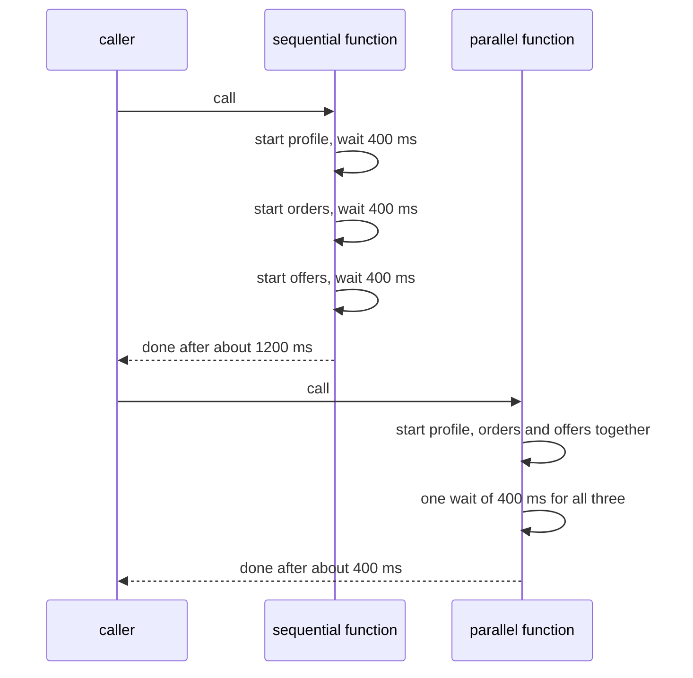

# Async functions and generators

## In plain words

Promise chains work, but they do not *look* like ordinary code: every step is a callback inside `then`. An **async function** lets you write asynchronous steps as plain lines, one under another, with the keyword `await` marking the places where the function has to wait for something.

Picture reading a recipe that says "put the cake in the oven, **wait 40 minutes**, then add the icing". You do not freeze in front of the oven for 40 minutes. You put a bookmark in the recipe, go and do other things, and when the timer rings you return to the bookmark and continue with the next line. `await` is that bookmark: the *function* pauses at that line, the rest of the program carries on, and the function resumes when the awaited result is ready.

The second half of the lesson introduces **generators**, functions that can pause in the middle and hand out values one at a time, like a ticket dispenser that prints the next ticket only when someone pulls. Generators are useful on their own for producing sequences, and they are the mechanism from which `async`/`await` was originally built.

Why it matters for a job: `async`/`await` is how practically all modern JavaScript writes asynchronous code. Interviewers ask you to convert promise chains, to explain what `await` really does, and to spot the classic mistake of awaiting things one by one that could run in parallel.

> **Before this lesson:** you need promises, `then`, `catch` and `Promise.all` from [Callbacks and promises](#/lesson/javascript/callbacks-promises), `try`/`catch` from [Exceptions and error handling](#/lesson/javascript/exceptions) and iterators from [Symbols, iterators, accessors and inheritance](#/lesson/javascript/symbols-iterators-inheritance).

> [!NOTE]
> As in the previous lesson, examples whose output arrives later are small live pages. Their first three lines define `log`, which writes a line onto the page.

## Async functions

### From a chain to straight-line code

Here is the three-step task from the previous lesson, as a promise chain and as an async function:

```html-run
<pre id="out"></pre>
<script>
const out = document.getElementById("out");
const log = (...parts) => { out.textContent += parts.join(" ") + "\n"; };

const later = (value) => new Promise((resolve) => setTimeout(() => resolve(value), 250));
const fetchUser = (id) => later({ id, name: "Ana", teamId: 7 });
const fetchTeam = (teamId) => later({ id: teamId, name: "Rockets", projectIds: [3, 4] });
const fetchProject = (id) => later({ id, title: "Project " + id });

// with then
function describeWithThen(userId) {
  return fetchUser(userId)
    .then((user) => fetchTeam(user.teamId).then((team) => ({ user, team })))
    .then(({ user, team }) =>
      fetchProject(team.projectIds[0]).then((project) => `${user.name} (${team.name}): ${project.title}`));
}

// with async / await
async function describe(userId) {
  const user = await fetchUser(userId);
  const team = await fetchTeam(user.teamId);
  const project = await fetchProject(team.projectIds[0]);
  return `${user.name} (${team.name}): ${project.title}`;
}

describeWithThen(1).then((text) => log("then:  ", text));
describe(1).then((text) => log("async: ", text));
log("both functions have returned a promise already");
</script>
```

The `then` version needs nesting because the last step uses `user`, `team` *and* `project`, and each callback only sees its own parameter. In the async version all three are ordinary local bindings. Read `describe` line by line:

- `async function` declares a function that is allowed to use `await` and that **always returns a promise**.
- `await fetchUser(userId)` hands the promise to the engine and pauses *this function*. When the promise is fulfilled, the function resumes and the `await` expression evaluates to the fulfilled value, here the user object.
- The `return` value becomes the value the function's promise is fulfilled with.

The last line of the script prints first: calling an async function returns a pending promise immediately, and the function body continues later, in steps.

### The two rules to memorise

**Rule 1: an `async` function always returns a promise.** Even if the body returns a plain value, callers receive a promise of that value.

**Rule 2: `await` pauses only the function it is in.** Everything outside continues.

```html-run
<pre id="out"></pre>
<script>
const out = document.getElementById("out");
const log = (...parts) => { out.textContent += parts.join(" ") + "\n"; };
const wait = (ms) => new Promise((resolve) => setTimeout(resolve, ms));

async function five() {
  return 5;                       // callers get a promise for 5, not 5
}
log("five() returns:", String(five()));
five().then((value) => log("the promise contains:", value));

async function brew() {
  log("  brew: start");
  await wait(500);                // brew pauses here...
  log("  brew: done");
}

log("before calling brew");
brew();                           // ...but this call returns at once
log("after calling brew (it is still waiting inside)");
</script>
```

Notice that `brew: start` appears immediately. An async function runs synchronously, like a normal function, up to its first `await`. Only there does it pause and hand control back to its caller.

`await` may be used inside `async` functions and at the top level of ES modules. In a classic script or a normal function it is a syntax error. That is why the examples on these pages wrap their logic in an async function and call it.

### Errors: back to `try`/`catch`

When an awaited promise is rejected, `await` **throws** the rejection reason as an exception at that line. So asynchronous errors are handled with the same `try`/`catch`/`finally` you already know, and one `catch` covers several awaited steps:

```html-run
<pre id="out"></pre>
<script>
const out = document.getElementById("out");
const log = (...parts) => { out.textContent += parts.join(" ") + "\n"; };

function fetchStock(item) {
  return new Promise((resolve, reject) => {
    setTimeout(() => {
      if (item === "unicorn") reject(new Error("we do not sell unicorns"));
      else resolve(12);
    }, 300);
  });
}

async function report(item) {
  log(item + ": checking...");
  try {
    const count = await fetchStock(item);
    log(item + ": " + count + " in stock");
    return count;
  } catch (error) {
    log(item + ": failed (" + error.message + ")");
    return 0;
  } finally {
    log(item + ": done");
  }
}

async function main() {
  const a = await report("fern");
  const b = await report("unicorn");
  log("total:", a + b);
}
main();
</script>
```

If an async function lets an error escape (no `catch` inside), the promise it returned is rejected with that error, and the *caller* can catch it with its own `try`/`await`/`catch` or with `.catch(...)`. An async function that is called without `await` and without `.catch` can fail silently; this is the async version of swallowing an error.

> [!WARNING]
> A forgotten `await` is the most frequent async bug. `const user = fetchUser(1);` inside an async function gives you a promise, not a user; `user.name` is then `undefined`, and a `try`/`catch` around the call will not catch a later rejection. If a value looks like `[object Promise]`, an `await` is missing.

### One after another, or all at once?

Each `await` waits for one promise before the function proceeds. For steps that depend on each other that is right. For **independent** operations it wastes time:

```html-run
<pre id="out"></pre>
<script>
const out = document.getElementById("out");
const log = (...parts) => { out.textContent += parts.join(" ") + "\n"; };
const later = (value, ms) => new Promise((resolve) => setTimeout(() => resolve(value), ms));
const roughly = (ms) => Math.round(ms / 100) * 100;

async function sequential() {
  const start = Date.now();
  const profile = await later("profile", 400);     // waits 400 ms
  const orders = await later("orders", 400);       // then another 400 ms
  const offers = await later("offers", 400);       // then another 400 ms
  log("sequential:", [profile, orders, offers].join(", "), "in ~" + roughly(Date.now() - start), "ms");
}

async function parallel() {
  const start = Date.now();
  const [profile, orders, offers] = await Promise.all([   // all three start now
    later("profile", 400),
    later("orders", 400),
    later("offers", 400),
  ]);
  log("parallel:  ", [profile, orders, offers].join(", "), "in ~" + roughly(Date.now() - start), "ms");
}

sequential();
parallel();
</script>
```

The parallel version finishes in about a third of the time. The operations start the moment the functions are *called* (when the array is built); `await Promise.all(...)` then waits for all of them together.



### `await` in loops

A `for...of` loop with `await` in its body processes items strictly one at a time. That is the right tool when order matters or when you must not flood a server. To process all items concurrently, map them to promises and await `Promise.all`:

```html-run
<pre id="out"></pre>
<script>
const out = document.getElementById("out");
const log = (...parts) => { out.textContent += parts.join(" ") + "\n"; };
const resize = (file) => new Promise((resolve) => setTimeout(() => resolve(file + " (resized)"), 300));

async function oneByOne(files) {
  const results = [];
  for (const file of files) {
    results.push(await resize(file));          // waits for each before starting the next
  }
  return results;
}

async function allTogether(files) {
  return Promise.all(files.map((file) => resize(file)));   // starts all, waits once
}

async function main() {
  const files = ["a.png", "b.png", "c.png"];
  let start = Date.now();
  log((await oneByOne(files)).join(", "), "| took ~" + Math.round((Date.now() - start) / 100) * 100, "ms");
  start = Date.now();
  log((await allTogether(files)).join(", "), "| took ~" + Math.round((Date.now() - start) / 100) * 100, "ms");
}
main();
</script>
```

> [!WARNING]
> `forEach` does not wait. `files.forEach(async (file) => { await resize(file); })` starts all the callbacks and returns immediately; code after it runs before any resizing has finished, and errors inside are unhandled. Use `for...of` (sequential) or `Promise.all` with `map` (concurrent).

### Practical patterns: timeout and retry

Two small utilities appear in almost every code base, and both combine what you have learned. A timeout races the real operation against a promise that rejects after a delay. A retry loops with `try`/`catch`, waiting a little longer after each failure (so-called *backoff*).

```html-run
<pre id="out"></pre>
<script>
const out = document.getElementById("out");
const log = (...parts) => { out.textContent += parts.join(" ") + "\n"; };
const wait = (ms) => new Promise((resolve) => setTimeout(resolve, ms));

function withTimeout(promise, ms) {
  const timer = new Promise((_, reject) => setTimeout(() => reject(new Error("timed out after " + ms + " ms")), ms));
  return Promise.race([promise, timer]);
}

async function retry(operation, attempts, delay) {
  for (let attempt = 1; ; attempt++) {
    try {
      return await operation(attempt);
    } catch (error) {
      log("  attempt " + attempt + " failed: " + error.message);
      if (attempt === attempts) throw error;     // out of attempts: give up
      await wait(delay * attempt);               // wait longer each time
    }
  }
}

// a flaky operation: fails twice, then succeeds
const flaky = async (attempt) => {
  await wait(100);
  if (attempt < 3) throw new Error("server busy");
  return "data from server";
};

async function main() {
  log("result:", await retry(flaky, 5, 100));
  try {
    await withTimeout(wait(800), 300);
  } catch (error) {
    log("slow call:", error.message);
  }
}
main();
</script>
```

In `retry`, the line `return await operation(attempt)` deserves a comment: the `await` is necessary *inside the `try` block*. With a bare `return operation(attempt)`, the function would hand back the promise without waiting, and a rejection would bypass the `catch`.

## Generators

### A function that pauses

A normal function runs from start to finish once called. A **generator function**, written `function*`, can stop in the middle and continue later. Calling it does not run the body at all; it returns a **generator object**. Each call to that object's `next()` method runs the body until the next `yield` expression, hands out the yielded value, and pauses again.

```js-run
function* threeSteps() {
  console.log("  (body started)");
  yield "first";
  console.log("  (resumed after first)");
  yield "second";
  console.log("  (resumed after second)");
  return "finished";
}

const generator = threeSteps();
console.log("created; nothing has run yet");
console.log(generator.next());
console.log(generator.next());
console.log(generator.next());
console.log(JSON.stringify(generator.next()));
```

Follow the output. Creating the generator prints nothing. The first `next()` runs up to `yield "first"` and returns `{ value: "first", done: false }`. The second continues from that exact point. The third runs to the `return`, giving `done: true`. After that the generator is exhausted.

`{ value, done }` is the iterator protocol from the lesson on iterators. Generator objects are iterators *and* iterables, so they work with `for...of`, spread and destructuring:

```js-run
function* evens(limit) {
  for (let n = 0; n <= limit; n += 2) {
    yield n;
  }
}
console.log([...evens(10)]);

for (const n of evens(6)) console.log(n);

const [a, b] = evens(100);
console.log(a, b);
```

### Laziness and infinite sequences

A generator computes each value only when asked. It can therefore describe a sequence with no end, as long as the consumer stops asking:

```js-run
function* naturals() {
  let n = 1;
  while (true) yield n++;            // never ends by itself
}

function* take(count, iterable) {
  if (count <= 0) return;
  let taken = 0;
  for (const value of iterable) {
    yield value;
    if (++taken >= count) return;
  }
}

function* map(iterable, fn) {
  for (const value of iterable) yield fn(value);
}

function* filter(iterable, test) {
  for (const value of iterable) if (test(value)) yield value;
}

const squaresOfMultiplesOf3 = map(filter(naturals(), (n) => n % 3 === 0), (n) => n * n);
console.log([...take(5, squaresOfMultiplesOf3)]);
```

No array of "all natural numbers" is ever built. Each pull through `take` draws one value through the `map`, which draws from the `filter`, which draws from `naturals` only as many numbers as needed. This is called **lazy evaluation**.

### Two-way communication

`yield` is an expression. The argument passed to `next(value)` becomes the *result* of the `yield` at which the generator was paused. This lets the caller send information in:

```js-run
function* runningAverage() {
  let total = 0, count = 0, average = null;
  while (true) {
    const value = yield average;      // hand out the average, wait to receive the next number
    total += value;
    count += 1;
    average = total / count;
  }
}

const average = runningAverage();
average.next();                       // run to the first yield ("priming")
console.log(average.next(10).value);
console.log(average.next(20).value);
console.log(average.next(60).value);
```

### From generators to `await`

Now the connection. A generator can pause at `yield` and be resumed from outside with a value. Suppose a generator yields *promises*, and a small driver function resumes it with each promise's result when it arrives. The generator body then reads as straight-line asynchronous code:

```html-run
<pre id="out"></pre>
<script>
const out = document.getElementById("out");
const log = (...parts) => { out.textContent += parts.join(" ") + "\n"; };
const later = (value) => new Promise((resolve) => setTimeout(() => resolve(value), 300));

// a driver: runs a generator that yields promises
function run(generatorFunction) {
  const generator = generatorFunction();
  return new Promise((resolve, reject) => {
    function step(method, input) {
      let result;
      try {
        result = generator[method](input);            // resume the generator
      } catch (error) {
        return reject(error);
      }
      if (result.done) return resolve(result.value);
      Promise.resolve(result.value).then(
        (value) => step("next", value),               // feed the fulfilled value back in
        (error) => step("throw", error)               // or throw the rejection into the generator
      );
    }
    step("next", undefined);
  });
}

run(function* () {
  const user = yield later({ name: "Ana", teamId: 7 });
  log("user:", user.name);
  const team = yield later({ name: "Rockets" });
  log("team:", team.name);
  return user.name + " / " + team.name;
}).then((summary) => log("result:", summary));
</script>
```

Replace `function*` with `async function` and `yield` with `await`, and delete the driver: that is `async`/`await`. The language feature is this pattern with the driver built into the engine. Knowing it removes the mystery from "how can a function pause without blocking the thread?": the function returns to its caller at each pause, and is re-entered later.

### Asynchronous iteration

Combining both ideas, an `async function*` can `await` inside and `yield` values over time. It is consumed with `for await...of`. This is the natural shape for data that arrives in pieces: pages of results, lines of a large file, messages on a connection.

```html-run
<pre id="out"></pre>
<script>
const out = document.getElementById("out");
const log = (...parts) => { out.textContent += parts.join(" ") + "\n"; };
const wait = (ms) => new Promise((resolve) => setTimeout(resolve, ms));

const pages = [["ana", "bo"], ["cleo", "dev"], ["eli"]];
async function fetchPage(number) {
  await wait(300);
  return { items: pages[number] ?? [], hasMore: number < pages.length - 1 };
}

async function* allUsers() {
  for (let page = 0; ; page++) {
    const { items, hasMore } = await fetchPage(page);
    yield* items;                         // hand out each item of this page
    if (!hasMore) return;
  }
}

async function main() {
  for await (const user of allUsers()) {
    log("user:", user);
  }
  log("no more pages");
}
main();
</script>
```

The consumer sees one flat stream of users and never deals with page numbers; the generator fetches the next page only when the loop asks for more.

> [!TIP]
> A rule of thumb for choosing: use `async`/`await` for a sequence of steps; use `Promise.all` and friends when several things should happen at once; use generators for sequences of values produced on demand; and reach for raw `then` chains only for short one-liners.

> [!INTERVIEW]
> Know these cold: an async function returns a promise; `await` suspends only that function and resumes it in a later turn; a rejected awaited promise throws; `await` in a `forEach` callback does not make the loop wait; `return await` matters inside `try`. A favourite exercise is "rewrite this `then` chain with `async`/`await`" and its reverse. For generators: `function*`, `yield`, the `{ value, done }` protocol, laziness, and that `async`/`await` can be modelled as a generator plus a promise-driven runner.

## Common pitfalls

1. **Missing `await`.** You hold a promise where you expected a value.
2. **Using `await` outside an async function** (in a classic script or a plain callback): a syntax error.
3. **Sequential awaits for independent work.** Start the operations first, then `await Promise.all`.
4. **`async` callbacks in `forEach`.** The loop does not wait and errors are lost.
5. **Unhandled rejections.** Calling an async function without awaiting it or attaching `.catch`.
6. **`return promise` inside `try` without `await`.** The `catch` block will not see the rejection.
7. **Reusing a finished generator.** A generator object can be iterated once; call the generator function again for a fresh one.
8. **Spreading an infinite generator.** `[...naturals()]` never ends; limit it first.

## Summary

- `async function` returns a promise; `await` pauses the function until a promise settles, yielding its value or throwing its rejection reason. The rest of the program keeps running.
- Async functions run synchronously up to the first `await`.
- Use `try`/`catch`/`finally` for asynchronous errors, exactly as for synchronous ones.
- Await dependent steps in sequence; run independent operations concurrently with `Promise.all`. `for...of` with `await` is sequential; `forEach` does not wait.
- Generator functions (`function*`) pause at `yield` and resume on `next()`. They implement the iterator protocol, enable lazy and infinite sequences, and can receive values through `next(value)`.
- `async`/`await` is equivalent to a generator driven by promises; `async function*` with `for await...of` handles values arriving over time.

## Glossary

- **Async function**: a function declared with `async`; it returns a promise and may contain `await`.
- **`await`**: an operator that pauses an async function until a promise settles.
- **Suspend / resume**: to pause a function at a point and continue it later from that point.
- **Sequential / concurrent**: one operation after another / several operations in progress at the same time.
- **Unhandled rejection**: a rejected promise for which no handler was registered.
- **Backoff**: waiting progressively longer between retries.
- **Generator function**: a `function*`; calling it creates a generator object without running the body.
- **Generator object**: the pausable computation, driven by `next()`; both an iterator and an iterable.
- **`yield`**: hands a value out of a generator and pauses it.
- **Lazy evaluation**: computing values only at the moment they are requested.
- **Driver (runner)**: code that repeatedly resumes a generator, for example with promise results.
- **Async generator**: an `async function*` that can both `await` and `yield`.
- **`for await...of`**: a loop that consumes asynchronous iterables, awaiting each value.

## Check yourself

```quiz
[
  {"q": "What does `f()` return for `async function f() { return 1; }`?", "options": ["1", "undefined", "A promise that fulfils with 1", "It throws without await"], "answer": 2,
   "explain": "Async functions always return a promise. A returned plain value becomes the value the promise is fulfilled with."},
  {"q": "In what order are the letters logged?\n\n`async function f() { log(\"A\"); await null; log(\"B\"); } f(); log(\"C\");`", "options": ["A B C", "A C B", "C A B", "B A C"], "answer": 1,
   "explain": "The function runs synchronously up to the first await (A). It then pauses and control returns to the caller (C). It resumes afterwards (B)."},
  {"q": "Two independent requests take 300 ms each. How long does `const a = await getA(); const b = await getB();` take, roughly?", "options": ["300 ms", "600 ms", "150 ms", "0 ms"], "answer": 1,
   "explain": "The second request is only started after the first has finished. Starting both and awaiting Promise.all would take about 300 ms."},
  {"q": "How do you handle a rejected promise when using await?", "options": ["With .error()", "By wrapping the await in try/catch", "It cannot be handled", "With an if statement on the result"], "answer": 1,
   "explain": "await throws the rejection reason as an exception at that line, so the ordinary try/catch mechanism applies."},
  {"q": "What is the problem with `items.forEach(async (item) => { await save(item); }); log(\"all saved\");`?", "options": ["forEach cannot take async functions", "The log runs before the saves have finished, because forEach does not wait for the returned promises", "save is called twice per item", "await is a syntax error there"], "answer": 1,
   "explain": "forEach ignores the promises its callbacks return. Use for...of with await, or await Promise.all(items.map(save))."},
  {"q": "What does this print?\n\n`function* g() { yield 1; yield 2; return 3; } console.log([...g()]);`", "options": ["[1, 2, 3]", "[1, 2]", "[3]", "[]"], "answer": 1,
   "explain": "Spread collects the yielded values only. The value given to return arrives with done: true and is not part of the iteration."},
  {"q": "What does this print?\n\n`function* g() { const x = yield \"a\"; yield x * 2; } const it = g(); it.next(); console.log(it.next(21).value);`", "options": ["a", "42", "21", "undefined"], "answer": 1,
   "explain": "The first next() runs to the first yield. The argument 21 of the second next becomes the value of that yield expression, so x is 21 and the generator yields 42."},
  {"q": "Why can an infinite generator such as `naturals()` be used safely with `take(5, ...)`?", "options": ["Generators are limited to 1000 values", "Values are produced lazily, only when the consumer requests them, and take stops requesting after five", "The engine detects infinite loops", "It cannot; it hangs"], "answer": 1,
   "explain": "The generator body runs only between next() calls. Once take returns, nobody asks for more, so the endless loop never continues."}
]
```

> **Source:** Haverbeke, *Eloquent JavaScript* (4th ed.), ch. 11 "Asynchronous Programming" (async functions, generators). Details checked against MDN: https://developer.mozilla.org/en-US/docs/Web/JavaScript/Reference/Statements/async_function , https://developer.mozilla.org/en-US/docs/Web/JavaScript/Reference/Operators/await , https://developer.mozilla.org/en-US/docs/Web/JavaScript/Reference/Statements/function* , https://developer.mozilla.org/en-US/docs/Web/JavaScript/Reference/Statements/for-await...of
