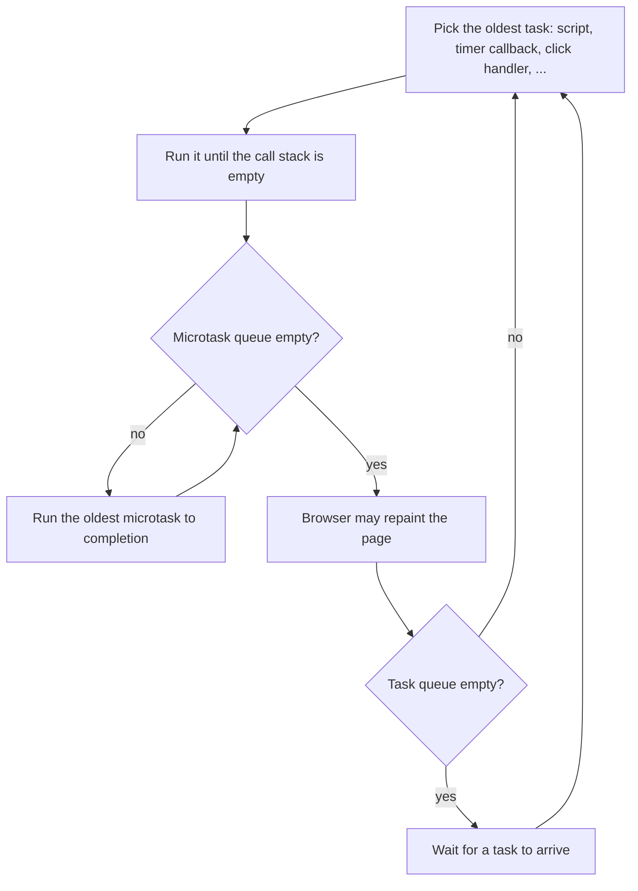

# The event loop, tasks and microtasks

## In plain words

The previous two lessons kept saying "the callback runs later". This lesson answers the obvious follow-up questions: *later when, exactly? And who decides the order?*

Picture a single cashier in a small shop. The cashier serves one customer completely before looking at the next; nobody is ever served halfway. Customers wait in a queue. There is also a special rule: if the customer being served says "oh, and one more quick thing", that quick thing is handled right away, before the next person in the queue gets a turn.

JavaScript works the same way. There is one cashier (the single thread). Pieces of work waiting their turn sit in a queue of **tasks**. The "one more quick thing" requests are **microtasks**: small follow-ups, mainly promise callbacks, that are handled immediately after the current piece of work and before the next task. The mechanism that keeps taking the next piece of work from the queues is called the **event loop**.

Why it matters for a job: the event loop explains why a page freezes during a long calculation, why `setTimeout(fn, 0)` does not run immediately, and why promise callbacks beat timers. "What does this code print, and in what order?" is probably the single most common senior-level JavaScript interview question, and it is answered entirely by the rules in this lesson.

> **Before this lesson:** you need the call stack ([Functions and scope](#/lesson/javascript/functions-scope)), `setTimeout` and promises ([Callbacks and promises](#/lesson/javascript/callbacks-promises)) and `async`/`await` ([Async functions and generators](#/lesson/javascript/async-await-generators)).

> [!NOTE]
> Examples that involve real timing are live pages whose first three lines define `log`, a function that writes a line onto the page.

## The pieces

### One call stack, run to completion

Recall the **call stack**: the engine's record of which functions are currently running. JavaScript has exactly one. A consequence with a name of its own is **run-to-completion**: once a piece of code starts, it runs until the stack is empty again, and nothing can interrupt it. No other callback can sneak in between two of your statements.

### The environment does the waiting

Timers, network requests and user input are not handled by the JavaScript engine itself. They are provided by the **host environment** (the browser or Node.js), which runs them outside your thread. When one of them has something to report, the environment does not barge into your running code. It puts a *task* into a queue: "please call this function".

### The loop

The event loop is an endless cycle with three steps:

1. Take the oldest task from the **task queue** and run it until the call stack is empty.
2. Run **all** microtasks in the **microtask queue**, including any that are added while doing so, until that queue is empty.
3. (In a browser) update the screen if needed. Then go back to step 1.



What goes where:

| Queue | What is put there |
|---|---|
| tasks (sometimes called *macrotasks*) | running a `<script>`, `setTimeout` and `setInterval` callbacks, user events such as clicks and key presses, network and message events |
| microtasks | callbacks of `then`, `catch`, `finally`; the continuation of an async function after `await`; functions passed to `queueMicrotask`; `MutationObserver` callbacks |

The initial run of your script is itself a task. That one fact explains most ordering puzzles.

## Watching it happen

### Timer versus promise

```html-run
<pre id="out"></pre>
<script>
const out = document.getElementById("out");
const log = (...parts) => { out.textContent += parts.join(" ") + "\n"; };

log("1. script start");

setTimeout(() => log("5. timeout callback (a task)"), 0);

Promise.resolve().then(() => log("3. promise callback (a microtask)"));

queueMicrotask(() => log("4. queueMicrotask callback (a microtask)"));

log("2. script end");
</script>
```

Walk through it with the three-step loop:

- The script is the current task. It logs "1".
- `setTimeout(..., 0)` asks the environment to add a task as soon as possible. The callback goes to the **task queue**.
- `Promise.resolve().then(...)` has an already fulfilled promise, so its callback goes straight to the **microtask queue**.
- `queueMicrotask` adds another microtask behind it.
- The script logs "2" and ends. The call stack is empty: step 1 of the loop is complete.
- Step 2: drain the microtasks in order: "3", then "4".
- Next round, step 1: the timer task runs: "5".

A delay of `0` therefore does not mean "now". It means "as a separate task, after the current one and all its microtasks". Browsers also impose a minimum delay of a few milliseconds on deeply nested timers.

### Microtasks queued by microtasks

Step 2 says the microtask queue is drained *completely*, new arrivals included. A microtask that schedules another microtask gets it run in the same round, still before any timer:

```html-run
<pre id="out"></pre>
<script>
const out = document.getElementById("out");
const log = (...parts) => { out.textContent += parts.join(" ") + "\n"; };

setTimeout(() => log("timeout"), 0);

Promise.resolve()
  .then(() => {
    log("microtask 1");
    Promise.resolve().then(() => log("microtask 1a (queued by microtask 1)"));
  })
  .then(() => log("microtask 2"));

log("sync");
</script>
```

The output is `sync`, `microtask 1`, `microtask 1a`, `microtask 2`, `timeout`. Why does "1a" come before "2"? When "microtask 1" runs, it queues "1a". Only when "microtask 1" *finishes* is the promise returned by the first `then` fulfilled, which queues "microtask 2" behind "1a".

> [!WARNING]
> Because the microtask queue must be emptied before anything else happens, a microtask that keeps scheduling new microtasks for ever freezes the page as thoroughly as an infinite loop: no timers fire, no clicks are processed, nothing is drawn. A chain of timers does not have this effect, because each timer callback is a separate task and the loop can do other things in between.

### Where `async`/`await` fits

An async function runs synchronously until its first `await`. Everything after an `await` is scheduled as a **microtask** once the awaited promise settles.

```html-run
<pre id="out"></pre>
<script>
const out = document.getElementById("out");
const log = (...parts) => { out.textContent += parts.join(" ") + "\n"; };

async function task(name) {
  log(name + ": before await");
  await null;
  log(name + ": after await");
}

log("start");
setTimeout(() => log("timeout"), 0);
task("A");
task("B");
Promise.resolve().then(() => log("then"));
log("end");
</script>
```

Predict before you run it. The synchronous part prints `start`, `A: before await`, `B: before await`, `end`. Three microtasks were queued, in this order: the rest of A, the rest of B, and the `then` callback. They print next. The timer comes last.

### Each task gets its own microtask round

Microtasks are drained after *every* task, not only after the main script:

```html-run
<pre id="out"></pre>
<script>
const out = document.getElementById("out");
const log = (...parts) => { out.textContent += parts.join(" ") + "\n"; };

setTimeout(() => {
  log("timer 1");
  Promise.resolve().then(() => log("  microtask from timer 1"));
}, 0);

setTimeout(() => {
  log("timer 2");
  Promise.resolve().then(() => log("  microtask from timer 2"));
}, 0);
</script>
```

The microtask queued by the first timer runs before the second timer's callback, because the loop always empties the microtask queue between two tasks.

## A simulator you can step through

To make the algorithm concrete, here is a miniature event loop written in ordinary synchronous code. It is a model, not the real thing: `schedule.task` plays the role of `setTimeout(fn, 0)` and `schedule.microtask` the role of a promise callback.

```js-run
function runEventLoop(mainScript) {
  const tasks = [];
  const microtasks = [];
  const output = [];
  const schedule = {
    task: (fn) => tasks.push(fn),
    microtask: (fn) => microtasks.push(fn),
    log: (text) => output.push(text),
  };

  tasks.push(() => mainScript(schedule));        // the script itself is the first task

  while (tasks.length > 0) {
    const task = tasks.shift();                  // step 1: oldest task
    task();
    while (microtasks.length > 0) {              // step 2: drain ALL microtasks
      microtasks.shift()();
    }
  }
  return output;
}

const result = runEventLoop(({ task, microtask, log }) => {
  log("script start");
  task(() => {
    log("timer A");
    microtask(() => log("microtask from timer A"));
  });
  microtask(() => {
    log("microtask 1");
    microtask(() => log("microtask 1a"));
    task(() => log("timer scheduled by a microtask"));
  });
  task(() => log("timer B"));
  microtask(() => log("microtask 2"));
  log("script end");
});

result.forEach((line, i) => console.log(i + 1 + ". " + line));
```

The whole event loop is the nested pair of `while` loops in the middle: an outer loop over tasks, and after each task an inner loop that empties the microtask queue. Change the order of the calls in the script and predict the output before running; this is exactly the mental exercise interview questions ask for. (The problem attached to this module extends the model with timer delays.)

## Blocking the loop

Since everything shares one thread, a task that takes a long time delays *everything* queued behind it: timers fire late, clicks get no response and the page cannot repaint. This is what "the page is frozen" means.

```html-run
<pre id="out"></pre>
<script>
const out = document.getElementById("out");
const log = (...parts) => { out.textContent += parts.join(" ") + "\n"; };

const start = Date.now();
setTimeout(() => {
  log("the 100 ms timer actually fired after ~" + Math.round((Date.now() - start) / 100) * 100 + " ms");
}, 100);

// a long synchronous calculation: keeps the thread busy for about 800 ms
let spins = 0;
while (Date.now() - start < 800) spins++;
log("heavy loop finished after ~800 ms (" + (spins > 0 ? "many" : "no") + " iterations)");
</script>
```

The timer was due after 100 milliseconds, and its task *was* queued on time. It could not run until the busy loop let go of the thread. A timer delay is a **minimum**, never a guarantee.

Remedies for heavy work, from simplest to most powerful:

- **Do less.** A better algorithm or a cache often removes the problem.
- **Split the work into chunks** and yield to the event loop between chunks, so that input and rendering can happen in the gaps.
- **Move it off the main thread** with a *Web Worker* (in browsers) or a worker thread (in Node.js): a separate thread with its own event loop that communicates through messages.

Chunking looks like this. The work is divided into slices; after each slice an `await` on a zero-delay timer ends the current task and lets the loop breathe:

```html-run
<pre id="out"></pre>
<p id="status">working...</p>
<script>
const out = document.getElementById("out");
const log = (...parts) => { out.textContent += parts.join(" ") + "\n"; };
const nextTask = () => new Promise((resolve) => setTimeout(resolve, 0));

async function sumInChunks(limit, chunkSize) {
  let total = 0;
  for (let i = 1; i <= limit; i++) {
    total += i;
    if (i % chunkSize === 0) {
      document.getElementById("status").textContent = "progress: " + Math.round((i / limit) * 100) + "%";
      await nextTask();                      // end this task; timers, clicks and painting can run now
    }
  }
  return total;
}

let ticks = 0;
const ticker = setInterval(() => { ticks++; }, 5);     // something else that wants to run

sumInChunks(3_000_000, 250_000).then((total) => {
  clearInterval(ticker);
  log("sum =", total);
  log(ticks > 0 ? "other tasks ran in between the chunks" : "nothing else got a turn");
});
</script>
```

> [!TIP]
> Yield with a *task* (`setTimeout`, or the newer `scheduler.yield()` where available), not with a microtask. `await Promise.resolve()` only queues a microtask, which runs before the browser gets a chance to paint or handle input, so the page stays frozen.

## Asynchronous bugs: race conditions

Run-to-completion protects you inside one synchronous stretch of code. But every `await` is a gap in which *other* code may run. If two asynchronous operations read a shared value, pause, and then write it back, one update can overwrite the other. This kind of bug is called a **race condition**, because the result depends on which operation finishes first.

```html-run
<pre id="out"></pre>
<script>
const out = document.getElementById("out");
const log = (...parts) => { out.textContent += parts.join(" ") + "\n"; };
const wait = (ms) => new Promise((resolve) => setTimeout(resolve, ms));

let seatsLeft = 1;

async function bookSeatBroken(customer) {
  if (seatsLeft > 0) {                 // 1. check
    await wait(100);                   //    (pretend to charge the credit card)
    seatsLeft -= 1;                    // 2. act on a check that may be out of date
    log(customer + " got a seat");
  } else {
    log(customer + " was told: sold out");
  }
}

async function main() {
  await Promise.all([bookSeatBroken("Ana"), bookSeatBroken("Bo")]);
  log("seats left:", seatsLeft, seatsLeft < 0 ? "<- oversold!" : "");

  seatsLeft = 1;
  await Promise.all([bookSeatFixed("Cleo"), bookSeatFixed("Dev")]);
  log("seats left:", seatsLeft);
}

async function bookSeatFixed(customer) {
  if (seatsLeft <= 0) return log(customer + " was told: sold out");
  seatsLeft -= 1;                      // reserve synchronously, with no await between check and update
  try {
    await wait(100);                   // charge the card
    log(customer + " got a seat");
  } catch (error) {
    seatsLeft += 1;                    // payment failed: give the seat back
    throw error;
  }
}

main();
</script>
```

In the broken version both customers pass the check while one seat is still shown, both pause, and both subtract: the flight is oversold. The fixed version performs the check **and** the update in one uninterrupted synchronous stretch, before the first `await`, so no other code can run between them.

A second classic variant concerns results arriving out of order. A search box sends a request for "ca" and then for "cat". If the first response happens to arrive last, it overwrites the newer results. The cure is to remember which request is the latest and ignore answers to older ones.

```html-run
<pre id="out"></pre>
<script>
const out = document.getElementById("out");
const log = (...parts) => { out.textContent += parts.join(" ") + "\n"; };

// a pretend server: shorter queries happen to answer more slowly
const search = (query) =>
  new Promise((resolve) => setTimeout(() => resolve("results for '" + query + "'"), 600 - query.length * 150));

let shown = "";
let latestRequest = 0;

async function onType(query) {
  const myRequest = ++latestRequest;       // number this request
  const results = await search(query);
  if (myRequest !== latestRequest) {
    log("ignoring stale answer:", results);
    return;
  }
  shown = results;
  log("showing:", shown);
}

onType("ca");
onType("cat");
</script>
```

> [!INTERVIEW]
> For "what does this print?" questions, use a fixed procedure and say it aloud. (1) Run all synchronous code top to bottom, writing down its output, and note what gets queued: timers into the task queue, promise callbacks and post-`await` code into the microtask queue. (2) Drain the microtask queue in order, adding new microtasks to its end. (3) Take the next task and repeat. State the rule "microtasks before the next task" explicitly. Extra credit: in Node.js, `process.nextTick` callbacks run before promise microtasks, and `setImmediate` callbacks run in a later phase than timers that are already due.

## Common pitfalls

1. **Assuming `setTimeout(fn, 0)` runs immediately or before promise callbacks.** It runs as a later task.
2. **Treating a timer delay as exact.** It is a minimum; a busy thread makes it late.
3. **Long synchronous loops on the main thread.** They freeze input and rendering. Chunk the work or use a worker.
4. **Yielding with a microtask to "let the page update".** Painting happens between tasks, not between microtasks.
5. **Endless microtask chains.** They starve the task queue.
6. **Check-then-act across an `await`.** The checked condition may no longer hold when the function resumes.
7. **Ignoring response order.** Later requests can be answered earlier; guard against stale results.
8. **Believing JavaScript is "multi-threaded because it is asynchronous".** Your code runs on one thread; only the waiting happens elsewhere.

## Summary

- JavaScript executes on a single call stack with run-to-completion semantics; the host environment performs slow operations and queues callbacks.
- The event loop repeats: run one task; drain the entire microtask queue; let the browser render; continue with the next task.
- Tasks include the initial script, timer callbacks and user or network events. Microtasks include promise reactions, continuations after `await`, and `queueMicrotask` callbacks.
- Therefore: synchronous code first, then microtasks in order (including newly queued ones), then the next task.
- A long task blocks everything; split heavy work across tasks or move it to a worker.
- Every `await` is a point where other code can run. Keep check-and-update sequences synchronous and discard stale asynchronous results.

## Glossary

- **Call stack**: the list of function calls currently in progress.
- **Run-to-completion**: the guarantee that a running piece of code is not interrupted by other JavaScript code.
- **Host environment**: the program that embeds the JavaScript engine and provides timers, networking and input (a browser, Node.js).
- **Event loop**: the cycle that takes work from the queues and runs it.
- **Task (macrotask)**: a unit of work in the task queue, such as a timer callback or an event handler.
- **Microtask**: a small unit of work run right after the current task, such as a promise callback.
- **Task queue / microtask queue**: the waiting lines for the two kinds of work.
- **Drain**: to run entries of a queue until it is empty.
- **Blocking**: occupying the thread so that nothing else can run.
- **Starvation**: a queue never getting its turn because another keeps being refilled.
- **Web Worker**: a separate browser thread for JavaScript, with its own event loop.
- **Race condition**: a bug whose outcome depends on the timing or order of asynchronous operations.
- **Stale result**: an answer to a request that has since been superseded.

## Check yourself

```quiz
[
  {"q": "In what order are the letters logged?\n\n`log(\"A\"); setTimeout(() => log(\"B\"), 0); Promise.resolve().then(() => log(\"C\")); log(\"D\");`", "options": ["A B C D", "A D B C", "A D C B", "A C D B"], "answer": 2,
   "explain": "Synchronous code first (A, D). Then the microtask queue is drained (C). The timer callback is a separate task and runs last (B)."},
  {"q": "When is the microtask queue processed?", "options": ["Once per second", "After each task finishes and the call stack is empty, and it is drained completely", "Only after all timers have fired", "Before the synchronous code of the script"], "answer": 1,
   "explain": "After every task the loop runs microtasks until none remain, including microtasks added during that draining."},
  {"q": "In what order are the numbers logged?\n\n`setTimeout(() => log(1), 0); Promise.resolve().then(() => { log(2); queueMicrotask(() => log(3)); }).then(() => log(4));`", "options": ["2 3 4 1", "2 4 3 1", "1 2 3 4", "2 3 1 4"], "answer": 0,
   "explain": "The first callback logs 2 and queues 3. Only when it finishes is the next then callback (4) queued, behind 3. All microtasks run before the timer (1)."},
  {"q": "A timer is set for 50 ms, and then a synchronous loop runs for 400 ms. When does the timer callback run?", "options": ["After 50 ms, interrupting the loop", "After about 400 ms, when the loop has finished", "Never", "After 450 ms exactly"], "answer": 1,
   "explain": "Nothing can interrupt running code. The callback waits in the task queue until the current task ends."},
  {"q": "In what order are the letters logged?\n\n`async function f() { log(\"A\"); await 0; log(\"B\"); } f(); Promise.resolve().then(() => log(\"C\")); log(\"D\");`", "options": ["A D B C", "A B D C", "A D C B", "D A B C"], "answer": 0,
   "explain": "f runs synchronously to the await (A). Its continuation is queued as a microtask, then the then-callback is queued. D is logged synchronously; the microtasks follow in queue order: B, then C."},
  {"q": "Why is `await Promise.resolve()` inside a heavy loop not enough to keep the page responsive?", "options": ["It throws", "It only yields to the microtask queue; rendering and input handling happen between tasks", "It makes the loop slower", "Promises are disabled during loops"], "answer": 1,
   "explain": "Microtasks run before the loop moves on to rendering or the next task. Yielding with a zero-delay timer ends the current task instead."},
  {"q": "What makes `if (stock > 0) { await pay(); stock -= 1; }` unsafe when called twice at nearly the same time?", "options": ["await cannot be used inside if", "Both calls can pass the check before either has decremented stock", "stock becomes a promise", "pay runs twice per call"], "answer": 1,
   "explain": "The await opens a gap between the check and the update in which the other call performs its own check on the old value."},
  {"q": "Which of these is queued as a task rather than a microtask?", "options": ["A then callback", "Code after an await", "A click event handler", "A queueMicrotask callback"], "answer": 2,
   "explain": "User events, timers and the initial script are tasks. Promise reactions, async continuations and queueMicrotask callbacks are microtasks."}
]
```

> **Source:** Haverbeke, *Eloquent JavaScript* (4th ed.), ch. 11 "Asynchronous Programming" (the event loop, asynchronous bugs) and ch. 15 (events and the event loop). Details checked against MDN: https://developer.mozilla.org/en-US/docs/Web/JavaScript/Reference/Execution_model , https://developer.mozilla.org/en-US/docs/Web/API/HTML_DOM_API/Microtask_guide , https://developer.mozilla.org/en-US/docs/Web/API/Window/queueMicrotask
