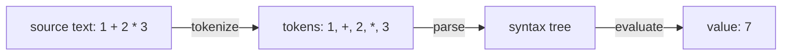
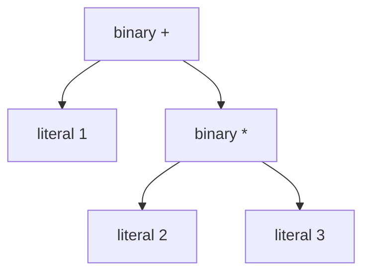

# Pebble part 1: tokens and parsing

## In plain words

A programming language can feel like a law of nature: you type `1 + 2 * 3` and the machine "knows" the answer is 7. It does not. Somewhere there is an ordinary program, written by ordinary people, that reads your text character by character and works out what you meant. Over the next two lessons we write such a program ourselves, for a small language of our own design called **Pebble**.

The work splits into stages, much like how you read a sentence in a foreign language. First you recognise the *words* and punctuation marks; nobody reads letter by letter. Then you work out the *grammar*: which word is the verb, what belongs to what. Only then can you grasp the *meaning*. For a programming language the three stages are called **tokenizing** (find the words), **parsing** (find the structure) and **evaluating** (compute the result). This lesson builds the first two; the next lesson builds the third.

Why it matters for a job: you may never write a full programming language, yet the same technique is everywhere: template engines, search-query boxes, spreadsheet formulas, configuration files, the tools that format and check your code. Knowing how text becomes structure also removes the mystery from error messages such as "Unexpected token". And "write a calculator that respects operator precedence" is a classic interview problem that this lesson solves.

> **Before this lesson:** you need recursion ([Closures and recursion](#/lesson/javascript/closures-recursion)), objects and arrays ([Objects, arrays and mutability](#/lesson/javascript/objects-arrays)), exceptions ([Exceptions and error handling](#/lesson/javascript/exceptions)) and the sticky flag of regular expressions ([Regular expressions: backtracking, replace, lastIndex, parsing](#/lesson/javascript/regex-advanced)).

## A tour of Pebble

Pebble is deliberately tiny. Everything in it is an **expression**, meaning that every piece of a program produces a value.

```text
# a comment runs from a hash sign to the end of the line
let price = 20;
let withTax = fn(amount) => amount * 1.2;
let total = withTax(price) + 5;
if total > 25 then print("expensive") else print("fine");
total
```

- `let name = value` creates a binding.
- `fn(a, b) => body` creates a function; `name(arguments)` calls one.
- `if condition then a else b` chooses between two values.
- The usual arithmetic and comparison operators exist, together with the words `and`, `or` and `not`.
- Expressions are separated by semicolons, and the value of a program is the value of its last expression (here: `total`).
- Braces `{ ... }` group several expressions into one.

The complete pipeline we are going to build:



## Stage 1: tokenizing

### What a token is

A **token** is the smallest meaningful unit of a program: a number, a name, an operator, a parenthesis. The tokenizer (also called a *lexer* or *scanner*) turns a string of characters into an array of tokens and throws away what has no meaning, such as spaces and comments.

For the text `let total = price * 2` we want this list:

| Token type | Value |
|---|---|
| keyword | `let` |
| name | `total` |
| symbol | `=` |
| name | `price` |
| symbol | `*` |
| number | `2` |

Each token will be a small object, `{ type, value, position }`. The `position` (index in the source text) is kept so that error messages can say where a problem is.

### Reading at an exact position

The tokenizer walks through the text with a position counter. At each position it asks: "does a number start *exactly here*? A name? A symbol?" The regular-expression feature for "match exactly at this index" is the sticky flag `y` together with `lastIndex`:

```js-run
const numberPattern = /\d+(\.\d+)?/y;
const source = "price * 12.5";

numberPattern.lastIndex = 0;                    // is there a number at index 0?
console.log(numberPattern.exec(source));        // no: "p" is there

numberPattern.lastIndex = 8;                    // and at index 8?
console.log(numberPattern.exec(source)[0]);     // yes
```

Without the sticky flag the first search would skip ahead and find `12.5` further along, which is not what a tokenizer wants: it must account for every character in order.

### The tokenizer

```js-run
function tokenize(source) {
  const tokenTypes = [
    ["space", /\s+|#[^\n]*/y],
    ["number", /\d+(\.\d+)?/y],
    ["string", /"[^"]*"/y],
    ["name", /[A-Za-z_]\w*/y],
    ["symbol", /=>|==|!=|<=|>=|[-+*\/%<>=(),;{}]/y],
  ];
  const keywords = new Set(["let", "if", "then", "else", "fn", "true", "false", "and", "or", "not"]);
  const tokens = [];
  let position = 0;
  while (position < source.length) {
    let matched = false;
    for (const [type, pattern] of tokenTypes) {
      pattern.lastIndex = position;
      const match = pattern.exec(source);
      if (match === null) continue;
      const text = match[0];
      if (type === "number") tokens.push({ type, value: Number(text), position });
      else if (type === "string") tokens.push({ type, value: text.slice(1, -1), position });
      else if (type === "name") tokens.push({ type: keywords.has(text) ? "keyword" : "name", value: text, position });
      else if (type === "symbol") tokens.push({ type, value: text, position });
      position += text.length;
      matched = true;
      break;
    }
    if (!matched) throw new SyntaxError(`Unexpected character "${source[position]}" at position ${position}`);
  }
  tokens.push({ type: "end", value: null, position });
  return tokens;
}

for (const token of tokenize('let total = price * 2.5  # tax included')) {
  console.log(token.position, token.type.padEnd(8), token.value);
}

try {
  tokenize("let total = 5 ? 3");
} catch (error) {
  console.log(error.name + ": " + error.message);
}
```

Reading the function from the top:

- `tokenTypes` is a table of `[type, pattern]` pairs. All patterns are sticky. Order matters twice. Whitespace and comments come first so that they are skipped; and inside the symbol pattern the two-character operators (`=>`, `==`, `<=`...) are listed before the one-character ones, because the regex engine tries alternatives from left to right and would otherwise read `<=` as `<` followed by `=`.
- `keywords` is the set of words with a built-in meaning. A keyword looks like a name, so the tokenizer first matches a name and then checks whether it is reserved.
- The `while` loop runs until the position reaches the end of the text. For each position, the inner `for` loop tries the patterns in turn at exactly that position (`pattern.lastIndex = position`).
- On a match, a token object is pushed (except for whitespace and comments), with numbers converted by `Number` and the quotes stripped from strings. Then the position jumps past the matched text.
- If no pattern matches, the character cannot be part of any Pebble program, and a `SyntaxError` with the position is thrown. The second half of the example shows the message for a stray `?`.
- Finally a special `end` token is appended. It saves the parser from constantly checking "am I past the last token?".

> [!TIP]
> Separating tokenizing from parsing keeps both simple. The parser never has to think about spaces, comments or how many digits a number has; it works with a clean list of meaningful units.

## Stage 2: parsing

### From a flat list to a tree

A list of tokens is flat. The meaning of a program depends on **structure**: in `1 + 2 * 3` the multiplication belongs together and its result is an operand of the addition. The natural shape for such nested structure is a tree, called the **abstract syntax tree** (AST). "Abstract" because it leaves out details that have done their job, such as parentheses and semicolons.



We represent each tree **node** as a plain object with a `type` property and further properties that depend on the type:

| Node | Shape |
|---|---|
| a number, string or boolean | `{ type: "literal", value }` |
| use of a name | `{ type: "name", name }` |
| `-x`, `not x` | `{ type: "unary", operator, operand }` |
| `a + b` | `{ type: "binary", operator, left, right }` |
| `let x = e` | `{ type: "let", name, value }` |
| `if c then a else b` | `{ type: "if", condition, consequent, alternate }` |
| `fn(a, b) => e` | `{ type: "function", params, body }` |
| `f(x, y)` | `{ type: "call", callee, args }` |
| `{ e1; e2 }` and the whole program | `{ type: "block", body }` |

### The grammar

A **grammar** is a set of rules stating which sequences of tokens form valid programs. Informally, for Pebble:

```text
program     :=  expression (";" expression)* [";"]
expression  :=  "let" NAME "=" expression
             |  "if" expression "then" expression "else" expression
             |  "fn" "(" [NAME ("," NAME)*] ")" "=>" expression
             |  operand (OPERATOR operand)*          with precedence rules
operand     :=  ("-" | "not") operand  |  call
call        :=  primary ( "(" [expression ("," expression)*] ")" )*
primary     :=  NUMBER | STRING | "true" | "false" | NAME
             |  "(" expression ")"  |  "{" program "}"
```

Read `:=` as "is made of", `|` as "or", `*` as "repeated zero or more times" and square brackets as "optional". Notice that the rules refer to each other and to themselves: an expression can contain a parenthesised expression, which can contain another. A recursive definition calls for a recursive program.

### Recursive descent

The parsing technique we use is called **recursive descent**: write one function per grammar rule; each function consumes the tokens that make up its rule and returns the corresponding tree node; where a rule mentions another rule, the function calls that rule's function.

Three tiny helpers manage the token list: `peek()` looks at the current token without consuming it, `next()` consumes and returns it, and `expect(text)` consumes it only if it is the required symbol or keyword, and otherwise throws a helpful `SyntaxError`.

### Operator precedence

The interesting part is the fourth alternative of `expression`: a row of operands with operators between them. Operators have different **precedence** (binding strength): `*` binds tighter than `+`, which binds tighter than `<`, which binds tighter than `and`. We give each operator a number, higher meaning tighter:

| Precedence | Operators |
|---|---|
| 1 | `or` |
| 2 | `and` |
| 3 | `==` `!=` |
| 4 | `<` `>` `<=` `>=` |
| 5 | `+` `-` |
| 6 | `*` `/` `%` |

The algorithm, known as **precedence climbing**, fits in a few lines. `parseExpression(minPrecedence)` first parses one operand. Then it loops: if the next token is an operator that binds **tighter** than `minPrecedence`, consume it, parse the right-hand side by calling `parseExpression` with *that operator's* precedence, and combine the two sides into a `binary` node, which becomes the new left side. If the next operator does not bind tighter, stop and return what we have.

Trace `1 + 2 * 3`, starting with `parseExpression(0)`:

1. Operand `1`. Next is `+` (precedence 5 > 0), so consume it and call `parseExpression(5)` for the right side.
2. Inside that call: operand `2`. Next is `*` (6 > 5), so consume it and call `parseExpression(6)`.
3. Inside that: operand `3`. Next is the end; return `3`.
4. Back in step 2: build `2 * 3`. Next is the end; return the node `2 * 3`.
5. Back in step 1: build `1 + (2 * 3)`.

And `10 - 4 - 3`? After the operand `10` and the first `-`, the right side is parsed by `parseExpression(5)`. It reads `4`, sees another `-` whose precedence 5 is **not greater** than 5, and returns only `4`. The outer loop builds `10 - 4`, sees the second `-`, and builds `(10 - 4) - 3`. The strict "greater than" comparison is what makes equal-precedence operators group from the left, which is called *left associativity*.

### The parser

```js-run
function tokenize(source) {
  const tokenTypes = [
    ["space", /\s+|#[^\n]*/y],
    ["number", /\d+(\.\d+)?/y],
    ["string", /"[^"]*"/y],
    ["name", /[A-Za-z_]\w*/y],
    ["symbol", /=>|==|!=|<=|>=|[-+*\/%<>=(),;{}]/y],
  ];
  const keywords = new Set(["let", "if", "then", "else", "fn", "true", "false", "and", "or", "not"]);
  const tokens = [];
  let position = 0;
  while (position < source.length) {
    let matched = false;
    for (const [type, pattern] of tokenTypes) {
      pattern.lastIndex = position;
      const match = pattern.exec(source);
      if (match === null) continue;
      const text = match[0];
      if (type === "number") tokens.push({ type, value: Number(text), position });
      else if (type === "string") tokens.push({ type, value: text.slice(1, -1), position });
      else if (type === "name") tokens.push({ type: keywords.has(text) ? "keyword" : "name", value: text, position });
      else if (type === "symbol") tokens.push({ type, value: text, position });
      position += text.length;
      matched = true;
      break;
    }
    if (!matched) throw new SyntaxError(`Unexpected character "${source[position]}" at position ${position}`);
  }
  tokens.push({ type: "end", value: null, position });
  return tokens;
}

const PRECEDENCE = new Map([
  ["or", 1], ["and", 2],
  ["==", 3], ["!=", 3],
  ["<", 4], [">", 4], ["<=", 4], [">=", 4],
  ["+", 5], ["-", 5],
  ["*", 6], ["/", 6], ["%", 6],
]);

function parse(source) {
  const tokens = tokenize(source);
  let index = 0;
  const peek = () => tokens[index];
  const next = () => tokens[index++];
  const is = (text) => (peek().type === "symbol" || peek().type === "keyword") && peek().value === text;
  const describe = (token) => (token.type === "end" ? "end of input" : `"${token.value}"`);

  function expect(text) {
    if (!is(text)) throw new SyntaxError(`Expected "${text}" but found ${describe(peek())} at position ${peek().position}`);
    return next();
  }
  function expectName() {
    if (peek().type !== "name") throw new SyntaxError(`Expected a name but found ${describe(peek())} at position ${peek().position}`);
    return next().value;
  }

  function parseSequence(closing) {            // closing is "}" for a block, or null for the whole program
    const atEnd = () => (closing === null ? peek().type === "end" : is(closing));
    const body = [];
    while (!atEnd()) {
      body.push(parseExpression(0));
      if (!atEnd()) expect(";");
    }
    return { type: "block", body };
  }

  function parseExpression(minPrecedence) {
    if (is("let")) {
      next();
      const name = expectName();
      expect("=");
      return { type: "let", name, value: parseExpression(0) };
    }
    if (is("if")) {
      next();
      const condition = parseExpression(0);
      expect("then");
      const consequent = parseExpression(0);
      expect("else");
      return { type: "if", condition, consequent, alternate: parseExpression(0) };
    }
    if (is("fn")) {
      next();
      expect("(");
      const params = [];
      while (!is(")")) {
        params.push(expectName());
        if (!is(")")) expect(",");
      }
      expect(")");
      expect("=>");
      return { type: "function", params, body: parseExpression(0) };
    }
    let left = parseUnary();
    for (;;) {
      const token = peek();
      const precedence = token.type === "symbol" || token.type === "keyword" ? PRECEDENCE.get(token.value) : undefined;
      if (precedence === undefined || precedence <= minPrecedence) return left;
      next();
      const right = parseExpression(precedence);
      left = { type: "binary", operator: token.value, left, right };
    }
  }

  function parseUnary() {
    if (is("-") || is("not")) {
      const operator = next().value;
      return { type: "unary", operator, operand: parseUnary() };
    }
    return parseCall();
  }

  function parseCall() {
    let expression = parsePrimary();
    while (is("(")) {
      next();
      const args = [];
      while (!is(")")) {
        args.push(parseExpression(0));
        if (!is(")")) expect(",");
      }
      expect(")");
      expression = { type: "call", callee: expression, args };
    }
    return expression;
  }

  function parsePrimary() {
    const token = next();
    if (token.type === "number" || token.type === "string") return { type: "literal", value: token.value };
    if (token.type === "keyword" && (token.value === "true" || token.value === "false")) {
      return { type: "literal", value: token.value === "true" };
    }
    if (token.type === "name") return { type: "name", name: token.value };
    if (token.type === "symbol" && token.value === "(") {
      const inner = parseExpression(0);
      expect(")");
      return inner;
    }
    if (token.type === "symbol" && token.value === "{") {
      const block = parseSequence("}");
      expect("}");
      return block;
    }
    throw new SyntaxError(`Unexpected ${describe(token)} at position ${token.position}`);
  }

  return parseSequence(null);
}

// ---- helper for showing a tree as indented text ----
function show(node, indent = "") {
  const pad = indent + "  ";
  switch (node.type) {
    case "literal": return indent + JSON.stringify(node.value);
    case "name": return indent + "name " + node.name;
    case "unary": return indent + "unary " + node.operator + "\n" + show(node.operand, pad);
    case "binary": return indent + "binary " + node.operator + "\n" + show(node.left, pad) + "\n" + show(node.right, pad);
    case "let": return indent + "let " + node.name + "\n" + show(node.value, pad);
    case "if": return indent + "if\n" + [node.condition, node.consequent, node.alternate].map((n) => show(n, pad)).join("\n");
    case "function": return indent + "function (" + node.params.join(", ") + ")\n" + show(node.body, pad);
    case "call": return indent + "call\n" + [node.callee, ...node.args].map((n) => show(n, pad)).join("\n");
    case "block": return indent + "block\n" + node.body.map((n) => show(n, pad)).join("\n");
  }
}

console.log(show(parse("1 + 2 * 3")));
console.log(show(parse("10 - 4 - 3")));
console.log(show(parse("let area = fn(w, h) => w * h; area(3, 4) >= 12 and not false")));

for (const broken of ["1 +", "let = 5", "(1 + 2", "if x then 1", "f(1 2)"]) {
  try {
    parse(broken);
  } catch (error) {
    console.log(JSON.stringify(broken), "->", error.message);
  }
}
```

Press Run and compare the printed trees with the traces above: in the first, `*` sits *below* `+`; in the second, the first subtraction sits below the second.

A guided reading of the code:

- **`PRECEDENCE`** is a `Map` from operator text to its number. A `Map` is used, not a plain object, so that a name such as `constructor` can never be mistaken for an operator through the prototype chain.
- **`parse`** tokenizes, sets up the helpers, and returns `parseSequence(null)`: the whole program is a sequence that ends at the `end` token.
- **`parseSequence(closing)`** collects expressions separated by semicolons until it reaches its terminator, which is the `end` token for a program or `}` for a block. A trailing semicolon is allowed.
- **`parseExpression`** first checks for the three constructs that begin with a keyword (`let`, `if`, `fn`). Each consumes its keyword, parses its parts by calling `parseExpression(0)` recursively, and demands the fixed words in between with `expect`. If none applies, it runs the precedence-climbing loop described above.
- **`parseUnary`** handles prefix operators by recursion (`- - x` works), otherwise delegates to `parseCall`.
- **`parseCall`** parses a primary expression and then, as long as an opening parenthesis follows, an argument list. The loop makes chained calls such as `make(1)(2)` work: the result of one call is the callee of the next.
- **`parsePrimary`** handles the leaves of the tree (literals and names) and the two bracketed forms. A parenthesised expression returns the inner node directly: parentheses leave no trace in the tree, because the tree's shape already expresses the grouping.

The last part of the example feeds broken programs to the parser. Every one produces a message that says what was expected, what was found, and where. Good error reporting is not a luxury: it is most of what makes a language pleasant to use.

> [!WARNING]
> A recursive-descent function must **consume at least one token before calling itself** on the same rule. A rule like "expression := expression + operand", translated literally, would call itself immediately without consuming anything and recurse for ever. That trap is called *left recursion*; the loop in `parseExpression` is the standard way around it.

## Looking at a real AST

Printing a tree as JSON shows exactly what the evaluator of the next lesson will receive. Here is a hand-written tree for `1 + price * 2` and a tiny function that turns a tree **back into text**, adding parentheses everywhere. Walking a tree and building a result from the leaves upwards is the same pattern the evaluator will use.

```js-run
const tree = {
  type: "binary",
  operator: "+",
  left: { type: "literal", value: 1 },
  right: {
    type: "binary",
    operator: "*",
    left: { type: "name", name: "price" },
    right: { type: "literal", value: 2 },
  },
};

function toText(node) {
  if (node.type === "literal") return String(node.value);
  if (node.type === "name") return node.name;
  if (node.type === "binary") return "(" + toText(node.left) + " " + node.operator + " " + toText(node.right) + ")";
  throw new Error("unsupported node type: " + node.type);
}

function countNodes(node) {
  if (node.type === "binary") return 1 + countNodes(node.left) + countNodes(node.right);
  return 1;
}

console.log(toText(tree));
console.log(countNodes(tree), "nodes");
console.log(JSON.stringify(tree.right));
```

Tools that format code (Prettier), check it (ESLint), translate it (TypeScript, Babel) or shrink it (minifiers) all work this way: parse the source into a tree, analyse or transform the tree, and print text again.

> [!INTERVIEW]
> The "basic calculator" family of interview problems (evaluate `"2 * (3 + 4) - 5"`) is this lesson in miniature. Describe the plan before coding: tokenize; then either recursive descent with one function per precedence level (`expression` handles `+ -`, `term` handles `* /`, `factor` handles numbers, parentheses and unary minus) or precedence climbing with a table. Mention left associativity and how your loop achieves it. Being able to explain *why* `1 - 2 - 3` must not be parsed as `1 - (2 - 3)` shows real understanding.

## Common pitfalls

1. **Ordering alternatives wrongly in the tokenizer.** `=` before `==` splits a comparison into two tokens.
2. **Treating keywords as names.** `let if = 3` must be rejected; check names against the keyword set.
3. **Losing positions.** Without them, every error message is "syntax error somewhere".
4. **Using `>=` in place of `>` in the precedence comparison.** That turns left-associative operators into right-associative ones, so `10 - 4 - 3` gives 9.
5. **Forgetting to consume a token.** A parsing loop that does not advance runs for ever.
6. **Left recursion.** A rule function that calls itself before consuming anything overflows the stack.
7. **Evaluating while parsing.** It is tempting for a calculator, but a tree lets you evaluate many times, with different variable values, and to analyse the program without running it.

## Summary

- Implementing a language is a pipeline: characters to tokens (tokenizer), tokens to a tree (parser), tree to a value (evaluator).
- A tokenizer scans left to right, matching patterns at exact positions with sticky regular expressions, skipping whitespace and comments, and reporting unknown characters with their position.
- A grammar describes valid programs with rules that refer to each other; an abstract syntax tree represents a program's structure as nested nodes, here plain objects with a `type`.
- Recursive descent implements each grammar rule as a function that consumes tokens and returns a node.
- Precedence climbing parses operator expressions with one loop and a precedence table; comparing with "strictly greater" yields left associativity.
- Precise error messages come from `expect` checks and stored token positions.

## Glossary

- **Source code**: the program as text.
- **Token**: the smallest meaningful unit of source code, such as a number, name or operator.
- **Tokenizer (lexer)**: the stage that converts characters into tokens.
- **Keyword**: a word reserved by the language, which cannot be used as a name.
- **Parser**: the stage that converts tokens into a syntax tree.
- **Grammar**: the set of rules defining which token sequences are valid programs.
- **Abstract syntax tree (AST)**: a tree of nodes representing the structure of a program.
- **Node**: one element of the tree, such as a literal, a binary operation or a call.
- **Literal**: a value written directly in the source, such as `42` or `"hi"`.
- **Recursive descent**: parsing with one function per grammar rule, calling each other recursively.
- **Precedence**: how tightly an operator binds compared with others.
- **Associativity**: how operators of equal precedence group; left-associative means from the left.
- **Precedence climbing**: an algorithm that parses operator expressions using a precedence table.
- **Left recursion**: a grammar rule that begins with itself; it makes a naive recursive parser loop for ever.
- **Syntax error**: a report that the text does not follow the grammar.

## Check yourself

```quiz
[
  {"q": "What is the job of a tokenizer?", "options": ["To compute the result of the program", "To turn a string of characters into a list of meaningful units and drop whitespace and comments", "To build a tree of nested expressions", "To translate the program into machine code"], "answer": 1,
   "explain": "Tokenizing is the first stage: it groups characters into tokens such as numbers, names and symbols. Structure comes later, in the parser."},
  {"q": "Why must the symbol pattern list `<=` before `<`?", "options": ["Alphabetical order is required", "The regex engine tries alternatives left to right, so `<` would match first and split `<=` into two tokens", "Longer patterns are faster", "It makes no difference"], "answer": 1,
   "explain": "Alternation is ordered. Putting multi-character operators first ensures the longest operator is recognised."},
  {"q": "In the AST for `2 + 3 * 4`, which node is the root?", "options": ["The literal 2", "The binary * node", "The binary + node", "A block node containing five children"], "answer": 2,
   "explain": "Multiplication binds tighter, so 3 * 4 becomes the right child of the addition. The operation performed last sits at the top."},
  {"q": "With precedence climbing as implemented here, how is `8 / 4 / 2` grouped?", "options": ["8 / (4 / 2)", "(8 / 4) / 2", "It is a syntax error", "It depends on the spacing"], "answer": 1,
   "explain": "The right-hand side is parsed with the operator's own precedence and stops at an operator of equal precedence, so the loop combines from the left."},
  {"q": "What does the parser return for the text `(5)`?", "options": ["A node of type parentheses containing a literal", "The literal node for 5; the parentheses leave no trace", "A block node", "A syntax error"], "answer": 1,
   "explain": "Parentheses only influence how the tree is shaped. Once that is done they carry no further information, so no node is created for them."},
  {"q": "What happens when `parse(\"1 +\")` is called?", "options": ["It returns the literal 1", "It returns a binary node with an undefined right side", "It throws a SyntaxError saying that the end of input was unexpected", "It loops for ever"], "answer": 2,
   "explain": "After consuming +, the parser needs an operand. parsePrimary receives the end token and reports an unexpected end of input with its position."},
  {"q": "Why does the tokenizer append a special `end` token?", "options": ["To make the token list longer", "So that the parser can always look at a current token without checking for the end of the array", "Because regular expressions require it", "To mark the last expression's value"], "answer": 1,
   "explain": "peek() never returns undefined. Reaching the end is handled like any other unexpected token, which simplifies every parsing function."},
  {"q": "Which statement about recursive descent is correct?", "options": ["Each grammar rule becomes a function that consumes tokens and returns a tree node", "It cannot handle nested parentheses", "It evaluates the program while reading it", "It requires the grammar to be left-recursive"], "answer": 0,
   "explain": "The parser's structure mirrors the grammar. Nesting is handled naturally by recursion, and left recursion must in fact be avoided."}
]
```

> **Source:** inspired by Haverbeke, *Eloquent JavaScript* (4th ed.), ch. 12 "Project: A Programming Language" (parsing); the Pebble language, its grammar and all code are original to this guide. Details checked against MDN: https://developer.mozilla.org/en-US/docs/Web/JavaScript/Reference/Global_Objects/RegExp/sticky , https://developer.mozilla.org/en-US/docs/Web/JavaScript/Reference/Global_Objects/Map
