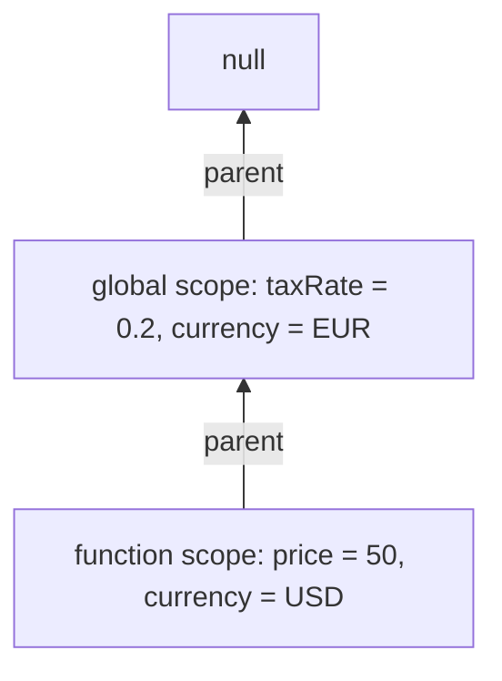
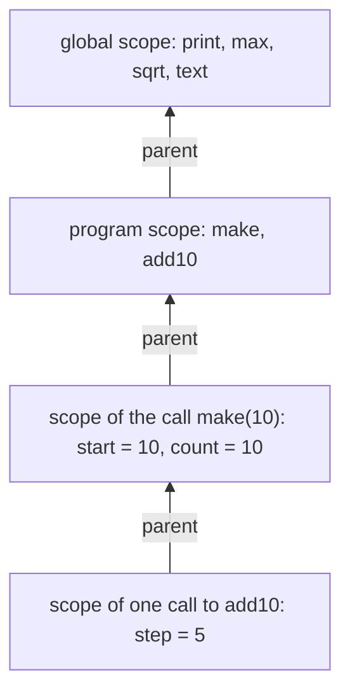

# Pebble part 2: evaluation, scope and functions

## In plain words

In part 1 we turned the text of a Pebble program into a tree. A tree is only a description, like a recipe on paper. This lesson writes the cook: a function named `evaluate` that walks the tree and actually computes the result. A program that runs another program directly from its tree is called an **interpreter**.

The idea is pleasantly simple. To find the value of a tree, find the values of its branches first and then combine them. The value of the tree for `1 + 2 * 3` is "the value of the left branch plus the value of the right branch"; the right branch is itself a small tree, handled the same way. That is recursion again, this time over the syntax tree.

Two questions make it interesting. Where do the values of *names* come from? They are kept in a lookup table called a **scope**, and scopes are chained together, like looking for your keys in your pocket, then in your bag, then on the hallway shelf. And what is a *function* at run time? We will see that it is nothing more than its code plus a reference to the scope it was created in, which is exactly the closure idea from earlier in this track, built with our own hands.

Why it matters for a job: after this lesson, scope chains, closures, "variable is not defined" errors and the difference between parsing and executing are no longer abstract. You will also have written the core of what template engines, rule engines and spreadsheet formula evaluators do.

> **Before this lesson:** you need [Pebble part 1: tokens and parsing](#/lesson/javascript/language-parsing) (the tokenizer, the parser and the node types), plus closures ([Closures and recursion](#/lesson/javascript/closures-recursion)) and classes and `Map` ([Prototypes, classes and encapsulation](#/lesson/javascript/prototypes-classes)).

## The node types, once more

The parser produces these nodes. The evaluator needs one rule for each.

| Node | Shape | Value |
|---|---|---|
| literal | `{ type: "literal", value }` | the value itself |
| name | `{ type: "name", name }` | whatever the name is bound to |
| unary | `{ type: "unary", operator, operand }` | the operator applied to the operand's value |
| binary | `{ type: "binary", operator, left, right }` | the operator applied to both values |
| let | `{ type: "let", name, value }` | defines the name; its value is the defined value |
| if | `{ type: "if", condition, consequent, alternate }` | the value of one of the two branches |
| function | `{ type: "function", params, body }` | a function value |
| call | `{ type: "call", callee, args }` | the result of running the function |
| block | `{ type: "block", body }` | the value of the last expression inside |

## Scopes: where names live

### A table with a parent

When the evaluator meets the node `{ type: "name", name: "price" }`, it must find the value bound to `price`. Bindings are stored in a **scope**: a table from names to values. Because programs have nested regions (a function body inside a program, a block inside a function), each scope also has a link to its **parent**, the scope around it. Looking a name up means: check this scope; if the name is not here, check the parent; continue outwards; if no scope has it, the name is unknown.

```js-run
class Scope {
  constructor(parent = null) {
    this.values = new Map();
    this.parent = parent;
  }
  define(name, value) {
    this.values.set(name, value);
    return value;
  }
  lookup(name) {
    for (let scope = this; scope !== null; scope = scope.parent) {
      if (scope.values.has(name)) return scope.values.get(name);
    }
    throw new ReferenceError(`Unknown name: ${name}`);
  }
}

const globalScope = new Scope();
globalScope.define("taxRate", 0.2);
globalScope.define("currency", "EUR");

const functionScope = new Scope(globalScope);       // a nested scope, e.g. for one function call
functionScope.define("price", 50);
functionScope.define("currency", "USD");            // shadows the outer currency

console.log(functionScope.lookup("price"));         // found here
console.log(functionScope.lookup("taxRate"));       // found in the parent
console.log(functionScope.lookup("currency"), globalScope.lookup("currency"));
try {
  globalScope.lookup("price");                      // the outer scope cannot see inwards
} catch (error) {
  console.log(error.name + ": " + error.message);
}
```

- The constructor stores a `Map` for this scope's own bindings and a reference to the parent (or `null` for the outermost scope).
- `define` adds a binding to *this* scope and returns the value.
- `lookup` walks from this scope outwards through the `parent` links. The `for` loop has an unusual shape: it starts at `this` and replaces `scope` by `scope.parent` each round, stopping at `null`.

The last three outputs demonstrate rules you know from JavaScript itself: inner scopes see outer names; an inner definition **shadows** an outer one of the same name without changing it; outer scopes cannot see inner names.



## The evaluator

### Expressions without names

Start with the simplest case, arithmetic on literals. `evaluate(node, scope)` looks at the node's type and acts accordingly. For a `binary` node it evaluates both children **by calling itself** and then applies the operator, which it finds in a table of small JavaScript functions.

```js-run
class Scope {
  constructor(parent = null) {
    this.values = new Map();
    this.parent = parent;
  }
  define(name, value) {
    this.values.set(name, value);
    return value;
  }
  lookup(name) {
    for (let scope = this; scope !== null; scope = scope.parent) {
      if (scope.values.has(name)) return scope.values.get(name);
    }
    throw new ReferenceError(`Unknown name: ${name}`);
  }
}

const OPERATORS = {
  "+": (a, b) => a + b, "-": (a, b) => a - b, "*": (a, b) => a * b, "/": (a, b) => a / b, "%": (a, b) => a % b,
  "==": (a, b) => a === b, "!=": (a, b) => a !== b,
  "<": (a, b) => a < b, ">": (a, b) => a > b, "<=": (a, b) => a <= b, ">=": (a, b) => a >= b,
};

function evaluate(node, scope) {
  switch (node.type) {
    case "literal":
      return node.value;
    case "name":
      return scope.lookup(node.name);
    case "let":
      return scope.define(node.name, evaluate(node.value, scope));
    case "block": {
      const inner = new Scope(scope);
      let result = null;
      for (const expression of node.body) result = evaluate(expression, inner);
      return result;
    }
    case "if":
      return evaluate(evaluate(node.condition, scope) ? node.consequent : node.alternate, scope);
    case "unary": {
      const value = evaluate(node.operand, scope);
      return node.operator === "-" ? -value : !value;
    }
    case "binary":
      if (node.operator === "and") return evaluate(node.left, scope) && evaluate(node.right, scope);
      if (node.operator === "or") return evaluate(node.left, scope) || evaluate(node.right, scope);
      return OPERATORS[node.operator](evaluate(node.left, scope), evaluate(node.right, scope));
    case "function":
      return { kind: "pebble-function", params: node.params, body: node.body, scope };
    case "call": {
      const callee = evaluate(node.callee, scope);
      const args = node.args.map((arg) => evaluate(arg, scope));
      if (typeof callee === "function") return callee(...args);               // a built-in written in JavaScript
      if (callee === null || callee.kind !== "pebble-function") throw new TypeError("Only functions can be called");
      if (args.length !== callee.params.length) {
        throw new TypeError(`Expected ${callee.params.length} argument(s) but got ${args.length}`);
      }
      const local = new Scope(callee.scope);                                   // the scope where the function was created
      callee.params.forEach((param, i) => local.define(param, args[i]));
      return evaluate(callee.body, local);
    }
    default:
      throw new Error("Unknown node type: " + node.type);
  }
}

// the tree the parser produces for:  1 + 2 * 3
const tree = {
  type: "binary", operator: "+",
  left: { type: "literal", value: 1 },
  right: {
    type: "binary", operator: "*",
    left: { type: "literal", value: 2 },
    right: { type: "literal", value: 3 },
  },
};
console.log(evaluate(tree, new Scope()));

// the tree for:  price * 2 > 75   evaluated in a scope where price is 40
const scope = new Scope();
scope.define("price", 40);
const comparison = {
  type: "binary", operator: ">",
  left: { type: "binary", operator: "*", left: { type: "name", name: "price" }, right: { type: "literal", value: 2 } },
  right: { type: "literal", value: 75 },
};
console.log(evaluate(comparison, scope));
```

Trace the first call. The node is `binary +`. To apply `+`, the evaluator needs two numbers, so it calls `evaluate` on the left child (a literal: returns `1`) and on the right child (a `binary *` node: evaluates its own two literals and returns `6`). Then `OPERATORS["+"](1, 6)` gives `7`. The order of operations was decided by the *shape of the tree*, which the parser built; the evaluator contains no knowledge of precedence at all.

Now walk through `evaluate` case by case:

- **literal**: return the stored value.
- **name**: ask the scope.
- **let**: evaluate the value expression, then define the name in the current scope. `define` returns the value, so a `let` expression has a value too.
- **block**: create a fresh scope whose parent is the current one, evaluate each expression in it, and return the last value. Names defined inside the block vanish with that scope.
- **if**: evaluate the condition, then evaluate *only one* of the two branches. This is why `if` cannot be an ordinary function: a function call would evaluate all its arguments first.
- **unary**: evaluate the operand and negate it, arithmetically or logically.
- **binary**: `and` and `or` are handled first and separately, because they must **short-circuit**: the right side is evaluated only when needed. All other operators evaluate both sides and look up a function in `OPERATORS`.
- **function** and **call** are the interesting ones and get their own section.

Constructs such as `if`, `let`, `and` and function definitions, which do not follow the plain "evaluate all the parts, then combine" rule, are known as **special forms**.

### Functions and closures

What should the value of `fn(n) => n * 2` be? When the evaluator meets a `function` node it does **not** run the body. It creates a small record:

```javascript
{ kind: "pebble-function", params: node.params, body: node.body, scope }
```

The record holds the parameter names, the body (still a tree), and, crucially, **the scope in which the function was created**. That third field is the entire implementation of closures.

When a `call` node is evaluated:

1. Evaluate the callee expression to get the function record, and evaluate each argument.
2. If the callee is a native JavaScript function (a built-in such as `print`), call it directly.
3. Otherwise check that it really is a Pebble function and that the number of arguments is right.
4. Create a **new scope whose parent is the function's creation scope** (not the scope of the caller).
5. Define each parameter in that new scope with the matching argument value.
6. Evaluate the body in the new scope and return the result.

Step 4 is the heart of it. Because the parent is the scope where the function was *written*, the body can use names from there, whoever calls it and from wherever. That is **lexical scoping**. And because every call gets a fresh scope, each call has its own parameters, which makes recursion work.



The diagram shows the scopes alive during the call `add10(5)` in the closure example below. The call's scope hangs under the scope of the *earlier, already finished* call `make(10)`, which is kept alive because the function record still refers to it.

## The complete interpreter

Everything assembled: tokenizer and parser from part 1, then `Scope`, `evaluate`, and a `run` function that creates a global scope with a few built-in functions. At the bottom is a list of Pebble programs. Change them, add your own, and press Run.

```js-run
// ===== part 1: tokenizer and parser =====
function tokenize(source) {
  const tokenTypes = [
    ["space", /\s+|#[^\n]*/y],
    ["number", /\d+(\.\d+)?/y],
    ["string", /"[^"]*"/y],
    ["name", /[A-Za-z_]\w*/y],
    ["symbol", /=>|==|!=|<=|>=|[-+*\/%<>=(),;{}]/y],
  ];
  const keywords = new Set(["let", "if", "then", "else", "fn", "true", "false", "and", "or", "not"]);
  const tokens = [];
  let position = 0;
  while (position < source.length) {
    let matched = false;
    for (const [type, pattern] of tokenTypes) {
      pattern.lastIndex = position;
      const match = pattern.exec(source);
      if (match === null) continue;
      const text = match[0];
      if (type === "number") tokens.push({ type, value: Number(text), position });
      else if (type === "string") tokens.push({ type, value: text.slice(1, -1), position });
      else if (type === "name") tokens.push({ type: keywords.has(text) ? "keyword" : "name", value: text, position });
      else if (type === "symbol") tokens.push({ type, value: text, position });
      position += text.length;
      matched = true;
      break;
    }
    if (!matched) throw new SyntaxError(`Unexpected character "${source[position]}" at position ${position}`);
  }
  tokens.push({ type: "end", value: null, position });
  return tokens;
}

const PRECEDENCE = new Map([
  ["or", 1], ["and", 2],
  ["==", 3], ["!=", 3],
  ["<", 4], [">", 4], ["<=", 4], [">=", 4],
  ["+", 5], ["-", 5],
  ["*", 6], ["/", 6], ["%", 6],
]);

function parse(source) {
  const tokens = tokenize(source);
  let index = 0;
  const peek = () => tokens[index];
  const next = () => tokens[index++];
  const is = (text) => (peek().type === "symbol" || peek().type === "keyword") && peek().value === text;
  const describe = (token) => (token.type === "end" ? "end of input" : `"${token.value}"`);

  function expect(text) {
    if (!is(text)) throw new SyntaxError(`Expected "${text}" but found ${describe(peek())} at position ${peek().position}`);
    return next();
  }
  function expectName() {
    if (peek().type !== "name") throw new SyntaxError(`Expected a name but found ${describe(peek())} at position ${peek().position}`);
    return next().value;
  }

  function parseSequence(closing) {            // closing is "}" for a block, or null for the whole program
    const atEnd = () => (closing === null ? peek().type === "end" : is(closing));
    const body = [];
    while (!atEnd()) {
      body.push(parseExpression(0));
      if (!atEnd()) expect(";");
    }
    return { type: "block", body };
  }

  function parseExpression(minPrecedence) {
    if (is("let")) {
      next();
      const name = expectName();
      expect("=");
      return { type: "let", name, value: parseExpression(0) };
    }
    if (is("if")) {
      next();
      const condition = parseExpression(0);
      expect("then");
      const consequent = parseExpression(0);
      expect("else");
      return { type: "if", condition, consequent, alternate: parseExpression(0) };
    }
    if (is("fn")) {
      next();
      expect("(");
      const params = [];
      while (!is(")")) {
        params.push(expectName());
        if (!is(")")) expect(",");
      }
      expect(")");
      expect("=>");
      return { type: "function", params, body: parseExpression(0) };
    }
    let left = parseUnary();
    for (;;) {
      const token = peek();
      const precedence = token.type === "symbol" || token.type === "keyword" ? PRECEDENCE.get(token.value) : undefined;
      if (precedence === undefined || precedence <= minPrecedence) return left;
      next();
      const right = parseExpression(precedence);
      left = { type: "binary", operator: token.value, left, right };
    }
  }

  function parseUnary() {
    if (is("-") || is("not")) {
      const operator = next().value;
      return { type: "unary", operator, operand: parseUnary() };
    }
    return parseCall();
  }

  function parseCall() {
    let expression = parsePrimary();
    while (is("(")) {
      next();
      const args = [];
      while (!is(")")) {
        args.push(parseExpression(0));
        if (!is(")")) expect(",");
      }
      expect(")");
      expression = { type: "call", callee: expression, args };
    }
    return expression;
  }

  function parsePrimary() {
    const token = next();
    if (token.type === "number" || token.type === "string") return { type: "literal", value: token.value };
    if (token.type === "keyword" && (token.value === "true" || token.value === "false")) {
      return { type: "literal", value: token.value === "true" };
    }
    if (token.type === "name") return { type: "name", name: token.value };
    if (token.type === "symbol" && token.value === "(") {
      const inner = parseExpression(0);
      expect(")");
      return inner;
    }
    if (token.type === "symbol" && token.value === "{") {
      const block = parseSequence("}");
      expect("}");
      return block;
    }
    throw new SyntaxError(`Unexpected ${describe(token)} at position ${token.position}`);
  }

  return parseSequence(null);
}

// ===== part 2: scopes and evaluation =====
class Scope {
  constructor(parent = null) {
    this.values = new Map();
    this.parent = parent;
  }
  define(name, value) {
    this.values.set(name, value);
    return value;
  }
  lookup(name) {
    for (let scope = this; scope !== null; scope = scope.parent) {
      if (scope.values.has(name)) return scope.values.get(name);
    }
    throw new ReferenceError(`Unknown name: ${name}`);
  }
}

const OPERATORS = {
  "+": (a, b) => a + b, "-": (a, b) => a - b, "*": (a, b) => a * b, "/": (a, b) => a / b, "%": (a, b) => a % b,
  "==": (a, b) => a === b, "!=": (a, b) => a !== b,
  "<": (a, b) => a < b, ">": (a, b) => a > b, "<=": (a, b) => a <= b, ">=": (a, b) => a >= b,
};

function evaluate(node, scope) {
  switch (node.type) {
    case "literal":
      return node.value;
    case "name":
      return scope.lookup(node.name);
    case "let":
      return scope.define(node.name, evaluate(node.value, scope));
    case "block": {
      const inner = new Scope(scope);
      let result = null;
      for (const expression of node.body) result = evaluate(expression, inner);
      return result;
    }
    case "if":
      return evaluate(evaluate(node.condition, scope) ? node.consequent : node.alternate, scope);
    case "unary": {
      const value = evaluate(node.operand, scope);
      return node.operator === "-" ? -value : !value;
    }
    case "binary":
      if (node.operator === "and") return evaluate(node.left, scope) && evaluate(node.right, scope);
      if (node.operator === "or") return evaluate(node.left, scope) || evaluate(node.right, scope);
      return OPERATORS[node.operator](evaluate(node.left, scope), evaluate(node.right, scope));
    case "function":
      return { kind: "pebble-function", params: node.params, body: node.body, scope };
    case "call": {
      const callee = evaluate(node.callee, scope);
      const args = node.args.map((arg) => evaluate(arg, scope));
      if (typeof callee === "function") return callee(...args);               // a built-in written in JavaScript
      if (callee === null || callee.kind !== "pebble-function") throw new TypeError("Only functions can be called");
      if (args.length !== callee.params.length) {
        throw new TypeError(`Expected ${callee.params.length} argument(s) but got ${args.length}`);
      }
      const local = new Scope(callee.scope);                                   // the scope where the function was created
      callee.params.forEach((param, i) => local.define(param, args[i]));
      return evaluate(callee.body, local);
    }
    default:
      throw new Error("Unknown node type: " + node.type);
  }
}

function run(source) {
  const output = [];
  const globals = new Scope();
  globals.define("print", (value) => { output.push(String(value)); return value; });
  globals.define("max", Math.max);
  globals.define("sqrt", Math.sqrt);
  globals.define("text", (value) => String(value));
  const result = evaluate(parse(source), globals);
  return { result, output };
}

// ===== Pebble programs to try =====
const programs = [
  `1 + 2 * 3`,

  `let radius = 3;
   let area = fn(r) => 3.14159 * r * r;
   area(radius)`,

  `# recursion: a function that calls itself
   let factorial = fn(n) => if n < 2 then 1 else n * factorial(n - 1);
   factorial(10)`,

  `# closures: make returns a function that remembers count
   let make = fn(start) => { let count = start; fn(step) => count + step };
   let add10 = make(10);
   let add100 = make(100);
   print(add10(5));
   print(add100(5))`,

  `# higher-order functions
   let twice = fn(f) => fn(x) => f(f(x));
   let addThree = fn(n) => n + 3;
   twice(addThree)(10)`,

  `# blocks have their own scope
   let x = "outer";
   { let x = "inner"; print(x) };
   x`,

  `# short-circuit: the right side of "or" is never evaluated, so the unknown name causes no error
   true or thisNameDoesNotExist`,

  `let hypotenuse = fn(a, b) => sqrt(a * a + b * b);
   print("The answer is " + text(hypotenuse(3, 4)))`,
];

for (const source of programs) {
  const { result, output } = run(source);
  for (const line of output) console.log("  printed:", line);
  console.log("=>", JSON.stringify(result));
}

// errors are reported, not hidden
for (const source of [`total * 2`, `let f = fn(a, b) => a + b; f(1)`, `let n = 5; n(1)`, `1 + * 2`]) {
  try {
    run(source);
  } catch (error) {
    console.log(JSON.stringify(source), "->", error.name + ": " + error.message);
  }
}
```

Some things to notice in the output.

**Recursion works without special support.** `factorial` is defined with `let` in the program's scope. By the time the function *runs*, the name `factorial` exists in that scope, and the body's lookup finds it through the parent chain. (The function record is created before the name is defined, but the lookup happens later, at call time.)

**Closures work without special support.** `make(10)` runs a block that defines `count` and creates an inner function whose record points at that block's scope. The scope stays alive as long as `add10` exists. `add100` has a separate scope from a separate call.

**The four kinds of error** come from four different places: an unknown name is caught by `Scope.lookup` (a `ReferenceError`), a wrong argument count and calling a non-function by the `call` case (`TypeError`s), and a malformed program by the parser (a `SyntaxError`), before any evaluation starts.

`run` also shows how a language connects to the outside world. Pebble has no syntax for output or square roots. Instead, the host program puts ordinary JavaScript functions into the global scope under the names `print`, `max`, `sqrt` and `text`. The `call` case notices that a callee is a native function and calls it directly. This is exactly how JavaScript itself gets `console.log` and `setTimeout`: they are not part of the language, they are provided by the environment.

> [!TIP]
> When you are unsure what a language feature "really does", try describing it as a rule of an evaluator like this one. "A closure is a function record that keeps a reference to its creation scope" and "calling a function creates a new scope whose parent is the function's creation scope" are complete, precise explanations that fit on one line each.

## Interpreting versus compiling

Our interpreter walks the tree every time the program runs. An alternative is to **compile**: translate the tree once into another language that can be executed directly. The translation is another tree walk; it returns text where the evaluator returns values.

Here is a compiler from a subset of Pebble (no `let`, no blocks) to JavaScript source code. The trees are written by hand to keep the example short; the parser from part 1 would produce the same ones.

```js-run
function compile(node) {
  switch (node.type) {
    case "literal":
      return JSON.stringify(node.value);
    case "name":
      return node.name;
    case "unary":
      return "(" + (node.operator === "not" ? "!" : "-") + compile(node.operand) + ")";
    case "binary": {
      const jsOperator = { and: "&&", or: "||", "==": "===", "!=": "!==" }[node.operator] ?? node.operator;
      return "(" + compile(node.left) + " " + jsOperator + " " + compile(node.right) + ")";
    }
    case "if":
      return "(" + compile(node.condition) + " ? " + compile(node.consequent) + " : " + compile(node.alternate) + ")";
    case "function":
      return "((" + node.params.join(", ") + ") => " + compile(node.body) + ")";
    case "call":
      return compile(node.callee) + "(" + node.args.map(compile).join(", ") + ")";
    default:
      throw new Error("this small compiler does not support " + node.type);
  }
}

const lit = (value) => ({ type: "literal", value });
const name = (text) => ({ type: "name", name: text });
const bin = (operator, left, right) => ({ type: "binary", operator, left, right });

// fn(c) => c * 9 / 5 + 32
const toFahrenheit = {
  type: "function", params: ["c"],
  body: bin("+", bin("/", bin("*", name("c"), lit(9)), lit(5)), lit(32)),
};
// fn(age) => if age >= 18 and age < 65 then "standard" else "reduced"
const fare = {
  type: "function", params: ["age"],
  body: {
    type: "if",
    condition: bin("and", bin(">=", name("age"), lit(18)), bin("<", name("age"), lit(65))),
    consequent: lit("standard"),
    alternate: lit("reduced"),
  },
};

const jsSource = compile(toFahrenheit);
console.log(jsSource);
console.log(compile(fare));

const compiled = new Function("return " + jsSource)();       // let the JavaScript engine take over
console.log(compiled(100), compiled(-40));
console.log(new Function("return " + compile(fare))()(70));
```

The compiled function no longer needs our `evaluate`: the JavaScript engine runs it at full speed. Real language implementations combine both approaches. JavaScript engines first interpret your code and then compile the frequently used parts to machine code while the program is running, a technique called *just-in-time compilation*. TypeScript and JSX are compiled to plain JavaScript before they ever reach a browser.

> [!WARNING]
> `new Function` and `eval` execute whatever text they receive. They are safe here because the text is produced by our own compiler from a tree we control. Never pass them text that comes from users or from the network: that hands strangers the ability to run code inside your application.

## Ideas for extending Pebble

1. **Assignment.** Add `set name = value`, which changes an existing binding. `Scope` needs a method that finds the scope holding the name and updates it there.
2. **Arrays.** Add built-ins `list(...)`, `get(list, i)` and `length(list)`, then write `map` and `sum` in Pebble itself.
3. **Loops.** Add `while condition do body`. Its value can be the last value of the body.
4. **Better errors.** Store each token's position in its node and report where a run-time error happened.
5. **A step limit.** Count calls to `evaluate` and stop with an error after a million, so that a runaway program cannot hang the host.
6. **Comments in the tree.** Write a formatter: parse, then print the program back with standard indentation.

> [!INTERVIEW]
> You can use this project to answer conceptual questions precisely. "What is a closure?" A function together with the scope in which it was created; in an interpreter, literally a record holding the code and a scope reference. "What is lexical scoping?" A call's scope is parented to the function's definition scope, not to the caller's scope. "Interpreter versus compiler?" One executes the tree directly; the other translates it to another language first. "Why is `if` not a function?" Because arguments are evaluated before a call, and `if` must evaluate only one branch.

## Common pitfalls

1. **Parenting a call's scope to the caller.** That gives *dynamic* scoping: functions would see whatever variables happen to exist where they are called, and closures would break.
2. **Evaluating both branches of `if`, or both sides of `and`/`or`.** Side effects run that should not, and recursion with a base case never stops.
3. **Reusing one scope for all calls of a function.** Recursive calls overwrite each other's parameters. Create a new scope per call.
4. **Defining block-local names in the outer scope.** Names leak out of blocks.
5. **Forgetting to check argument counts and callee types.** The failure then surfaces later as a confusing `undefined`.
6. **Using a plain object as the name table.** Names like `toString` or `constructor` are "found" on the prototype. A `Map` has no such inherited entries.
7. **Passing untrusted text to `eval` or `new Function`.**

## Summary

- An interpreter evaluates a syntax tree recursively: the value of a node is computed from the values of its children.
- A scope maps names to values and links to a parent scope; lookup walks outwards, which yields shadowing and the invisibility of inner names from outside.
- Special forms (`if`, `let`, `and`, `or`, function definitions) control *whether and when* their parts are evaluated; ordinary operators and calls evaluate all parts first.
- A function value is a record of parameters, body and creation scope. A call evaluates the body in a new scope whose parent is that creation scope. Closures, lexical scoping and recursion all follow from this one rule.
- Built-in functions supplied by the host connect a language to the outside world.
- A compiler is another tree walk that produces code in a target language.

## Glossary

- **Interpreter**: a program that executes another program directly from its source or syntax tree.
- **Evaluate**: to compute the value of an expression.
- **Scope (environment)**: a table of bindings with a link to an enclosing scope.
- **Scope chain**: the sequence of scopes reached by following parent links.
- **Shadowing**: an inner binding hiding an outer binding of the same name.
- **Special form**: a construct with its own evaluation rule, such as `if` or `let`.
- **Short-circuit evaluation**: skipping the right operand of `and`/`or` when the left one decides the result.
- **Function record (closure)**: the run-time value of a function: parameters, body and creation scope.
- **Lexical scoping**: resolving names through the scopes surrounding a function's definition.
- **Dynamic scoping**: resolving names through the scopes of the callers (the mistake described in the pitfalls).
- **Built-in (native) function**: a function provided by the host program, not written in the language itself.
- **Host**: the program in which an interpreter runs and which supplies its built-ins.
- **Compiler**: a program that translates code into another language.
- **Just-in-time compilation**: compiling parts of a program to machine code while it runs.

## Check yourself

```quiz
[
  {"q": "How does `evaluate` compute the value of a `binary` node for `+`?", "options": ["It looks the answer up in the scope", "It evaluates the left and right child nodes recursively and applies the addition to the two results", "It converts the node back to text and calls eval", "It asks the parser for the precedence"], "answer": 1,
   "explain": "The value of a node is built from the values of its children. Precedence was already settled by the shape of the tree."},
  {"q": "A function is created in scope A and later called from code running in scope B. What is the parent of the scope created for the call?", "options": ["Scope B, the caller's scope", "Scope A, where the function was created", "The global scope, always", "It has no parent"], "answer": 1,
   "explain": "The function record stores its creation scope, and each call's scope is parented to it. This is lexical scoping and is what makes closures work."},
  {"q": "Why must `if` be a special form rather than a built-in function?", "options": ["Functions cannot return booleans", "All arguments of a function call are evaluated before the call, but if must evaluate only one branch", "The parser does not support three arguments", "Built-in functions cannot be nested"], "answer": 1,
   "explain": "If both branches were evaluated, a recursive function would evaluate its recursive call even in the base case and never terminate."},
  {"q": "In Pebble, what is the result of `let x = 1; { let x = 2 }; x`?", "options": ["2", "1", "An error: x is defined twice", "null"], "answer": 1,
   "explain": "The block gets its own scope. The inner x shadows the outer one only inside the block; afterwards the outer binding is unchanged."},
  {"q": "Why does `let factorial = fn(n) => if n < 2 then 1 else n * factorial(n - 1)` work even though the function is created before the name is defined?", "options": ["The parser reorders the definitions", "The name is looked up when the body runs, by which time it exists in the creation scope", "Pebble has a special keyword for recursion", "It does not work"], "answer": 1,
   "explain": "Creating the function record does not evaluate the body. The lookup of factorial happens during a call, after let has defined it in the enclosing scope."},
  {"q": "What does the Pebble program `false and missingName` produce?", "options": ["A ReferenceError", "false", "true", "null"], "answer": 1,
   "explain": "and short-circuits: the left side is false, so the right side, with its unknown name, is never evaluated."},
  {"q": "How does Pebble code get access to `print`?", "options": ["print is a keyword recognised by the tokenizer", "The host defines a JavaScript function under that name in the global scope", "The parser inserts it automatically", "It is compiled into every program"], "answer": 1,
   "explain": "Built-ins are ordinary values placed in the outermost scope by the embedding program, in the same way that browsers provide console and setTimeout to JavaScript."},
  {"q": "What is the essential difference between the `evaluate` and `compile` functions shown in this lesson?", "options": ["compile walks the tokens, evaluate walks the tree", "Both walk the tree; evaluate returns values, compile returns source code in another language", "evaluate is recursive and compile is not", "compile can only handle numbers"], "answer": 1,
   "explain": "They have the same recursive structure over node types. One computes results directly, the other produces text for another system to execute."}
]
```

> **Source:** inspired by Haverbeke, *Eloquent JavaScript* (4th ed.), ch. 12 "Project: A Programming Language" (the evaluator, special forms, the environment, functions, compilation); the Pebble language and all code are original to this guide. Details checked against MDN: https://developer.mozilla.org/en-US/docs/Web/JavaScript/Guide/Closures , https://developer.mozilla.org/en-US/docs/Web/JavaScript/Reference/Global_Objects/Function/Function
