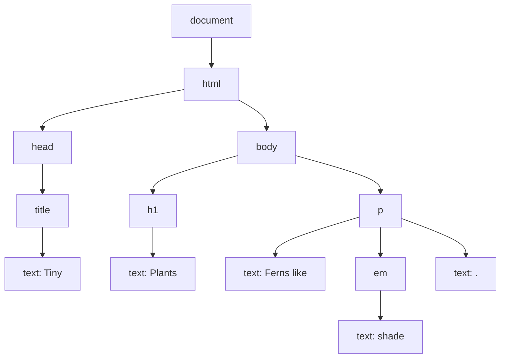
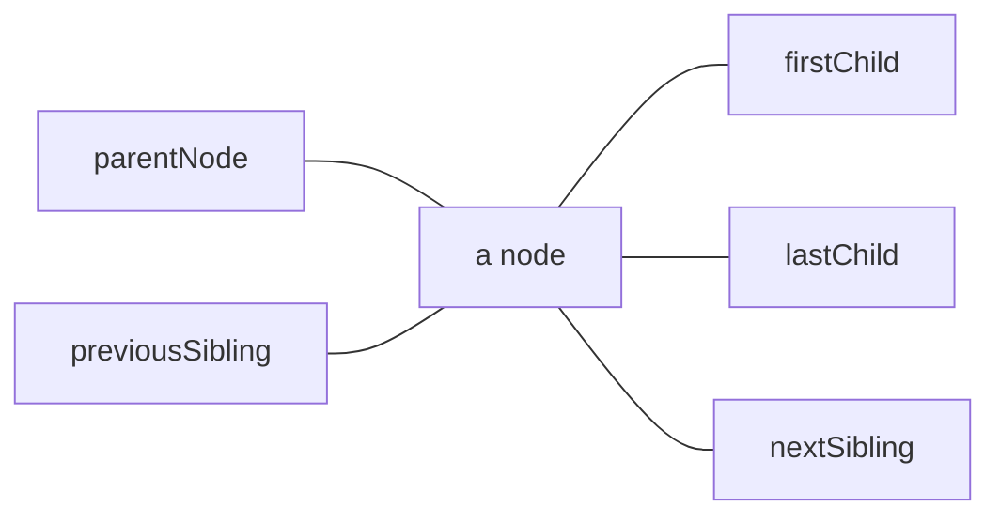

# JavaScript in the browser and the DOM tree

## In plain words

Up to now JavaScript has been a calculator with a text output. This module puts it where it was born: inside a web page, where it can read and change what the user sees.

Three ideas carry the whole lesson.

First, a **web page is a document delivered over a network**. Your browser (the *client*) asks another computer (the *server*) for a file, and the server sends it back. It is like ordering a book from a library by post: you send a request slip, the library sends the book.

Second, the document is written in **HTML**, a text format that describes the *structure* of the page: this is a heading, this is a paragraph, this paragraph contains a link.

Third, and most important: when the browser reads the HTML, it builds a live model of the page in memory, shaped like a family tree. The page is the ancestor; it has children (head and body); the body has children (headings, paragraphs); and so on down to individual pieces of text. This tree is the **Document Object Model**, or **DOM**. JavaScript can walk around the tree, read it and change it, and whatever it changes appears on screen immediately.

Why it matters for a job: front-end development *is* manipulating the DOM, whether you do it directly or through a framework such as React that does it for you. When a framework misbehaves, you debug the DOM. Interviewers expect you to know how scripts load, how to find elements, and why a "live" collection behaves strangely in a loop.

> **Before this lesson:** you need objects, arrays and loops ([Objects, arrays and mutability](#/lesson/javascript/objects-arrays)), recursion ([Closures and recursion](#/lesson/javascript/closures-recursion)) and callbacks ([Higher-order functions](#/lesson/javascript/higher-order-functions)). No HTML knowledge is assumed.

> [!NOTE]
> From here on, most examples are complete little web pages. Press Run to render the page in the preview frame below the code. Edit the HTML or the script and run again.

## How a page reaches your screen

### Networks in one minute

Computers on the **Internet** exchange data by following agreed sets of rules called **protocols**. Three names are worth knowing:

- **TCP** (Transmission Control Protocol) provides a reliable two-way connection between two computers. One computer *listens* for connections (the **server**); the other opens a connection to it (the **client**).
- **HTTP** (Hypertext Transfer Protocol) is the protocol of the Web, spoken over such a connection. The client sends a *request* ("GET me this document"); the server sends a *response* (a status and the document). HTTPS is the same conversation, encrypted.
- A **URL** (Uniform Resource Locator) is the address of a resource on the Web.

```text
  https://shop.example.com/plants/fern.html
  |       |                |
  |       |                +-- path: which document on that server
  |       +-- host name: which server
  +-- protocol: how to talk to it
```

When you type that address, the browser looks up the server for `shop.example.com`, opens a connection, sends a request for `/plants/fern.html`, receives HTML text, and turns it into a page. If the HTML mentions images, style sheets or scripts, the browser requests those too.

### HTML in three minutes

**HTML** stands for Hypertext Markup Language. A document consists of text surrounded by **tags** in angle brackets that give the text structure:

```html
<!doctype html>
<html>
  <head>
    <meta charset="utf-8">
    <title>My plant shop</title>
  </head>
  <body>
    <h1>Welcome</h1>
    <p>We sell <a href="/plants/fern.html">ferns</a> and cacti.</p>
    
  </body>
</html>
```

- `<!doctype html>` on the first line tells the browser to treat the file as modern HTML.
- A tag such as `<p>` opens an **element** and `</p>` closes it. Everything in between is the element's content. The `<p>` element here is a paragraph.
- Elements nest inside each other: the link `<a>` is inside the paragraph, which is inside `<body>`, which is inside `<html>`.
- A tag can carry **attributes**, written as `name="value"`: `href` gives the link its destination, `src` and `alt` give the image its file and its text description.
- Some elements, such as `` and `<meta>`, have no content and therefore no closing tag.
- The `<head>` holds information *about* the page (title, character encoding); the `<body>` holds what is shown.

The characters `<`, `>` and `&` have special meaning in HTML. To show them as text you write the **entities** `&lt;`, `&gt;` and `&amp;`.

Browsers are extremely forgiving. Missing closing tags or a forgotten `<body>` do not produce an error; the browser quietly repairs the structure. That keeps old pages working, and it means a typo in your HTML fails silently, so it pays to be tidy.

### Where JavaScript comes in

A `<script>` element contains a program that the browser runs as part of loading the page:

```html-run
<h1>Order summary</h1>
<p>You ordered <strong id="count">?</strong> plants.</p>

<script>
  const plantsOrdered = 3 + 4;
  document.getElementById("count").textContent = plantsOrdered;
</script>
```

Line by line: the two HTML lines produce a heading and a paragraph containing a placeholder `?` inside a `<strong>` element that has an `id` attribute. The script calculates a number, asks the document for the element whose id is `count`, and replaces its text. `document` is a global object that the browser provides; it represents the page.

Scripts are usually kept in separate files and referenced with a `src` attribute. How and *when* a script is loaded matters:

```html
<script src="app.js"></script>                 <!-- classic: page parsing stops until it has run -->
<script src="app.js" defer></script>           <!-- download in parallel, run after the page is parsed -->
<script src="app.js" async></script>           <!-- download in parallel, run as soon as it arrives -->
<script type="module" src="main.js"></script>  <!-- ES module: deferred automatically, may use import -->
```

A plain `<script>` in the `<head>` runs **before** the browser has read the `<body>`, so the elements it wants to use do not exist yet. That is the cause of the famous beginner error "Cannot read properties of null". The standard cures are to use `defer` or `type="module"`, or to place the script at the end of the body as the examples here do.

> [!WARNING]
> `document.getElementById("count")` returns `null` when no such element exists *at the moment the line runs*. If your script is in the `<head>` without `defer`, the body has not been built yet. Always check where and when your script runs before suspecting anything else.

### The sandbox

A web page is a program written by a stranger that runs on your computer the moment you follow a link. Browsers therefore run it in a **sandbox**: an isolated environment with strict limits. Page scripts cannot read your files, cannot start other programs, and cannot read data belonging to other websites (the *same-origin policy*, discussed in the HTTP lesson). Each new capability the Web gains, such as camera access or notifications, sits behind a permission prompt. As a developer you will sometimes find a restriction inconvenient; as a user you depend on it.

## The Document Object Model

### The document as a tree

Take this small page:

```html
<!doctype html>
<html>
  <head><title>Tiny</title></head>
  <body>
    <h1>Plants</h1>
    <p>Ferns like <em>shade</em>.</p>
  </body>
</html>
```

The browser turns it into this structure:



Each box is a **node**. There are several kinds, and each node has a numeric `nodeType` that says which kind it is:

| Kind | `nodeType` | Example |
|---|---|---|
| element node | 1 (`Node.ELEMENT_NODE`) | `<p>`, `<h1>` |
| text node | 3 (`Node.TEXT_NODE`) | the words inside an element |
| comment node | 8 (`Node.COMMENT_NODE`) | `<!-- note -->` |
| document node | 9 | the `document` object itself |

Notice that text is not *inside* the `<p>` node as a property; each run of text is a child node of its own. The paragraph above has three children: a text node, an `<em>` element, and another text node. Even the line breaks and spaces between tags in your HTML file become text nodes.

The entry points into the tree are `document.documentElement` (the `<html>` element), `document.head` and `document.body`.

### Moving through the tree

Every node has properties that link to its neighbours:



`childNodes` is an array-like list of *all* children, text nodes and comments included. Because the whitespace text nodes are rarely what you want, there is a parallel set of properties that consider **elements only**: `children`, `firstElementChild`, `lastElementChild`, `nextElementSibling`, `previousElementSibling` and `parentElement`.

```html-run
<ul id="menu">
  <li>Soup</li>
  <li>Pasta</li>
  <li>Cake</li>
</ul>
<pre id="out"></pre>

<script>
  const out = document.getElementById("out");
  const log = (...parts) => { out.textContent += parts.join(" ") + "\n"; };

  const menu = document.getElementById("menu");

  log("childNodes:", menu.childNodes.length, "(includes whitespace text nodes)");
  log("children:  ", menu.children.length, "(elements only)");
  log("first child node type:", menu.firstChild.nodeType, "| first element:", menu.firstElementChild.textContent);
  log("last element:", menu.lastElementChild.textContent);
  log("the element after Soup:", menu.firstElementChild.nextElementSibling.textContent);
  log("parent of the list:", menu.parentNode.nodeName);
  log("tag names:", [...menu.children].map((li) => li.nodeName).join(", "));
</script>
```

The list has three `<li>` elements and **seven** child nodes: the line break before each item and after the last one counts as a text node. `nodeName` gives the tag name in upper case. Lists such as `children` look like arrays but are not; they have a `length` and indexes and can be looped over with `for...of`, and spreading them into a real array (`[...menu.children]`) gives you `map`, `filter` and the rest.

### Walking the whole tree with recursion

A tree invites recursion. To process a node, handle the node itself and then process each of its children the same way. This function collects every piece of visible text in a subtree and counts the words:

```html-run
<article id="post">
  <h2>Caring for ferns</h2>
  <p>Ferns like <em>shade</em> and <strong>moist</strong> soil.</p>
  <ul><li>Water twice a week</li><li>No direct sun</li></ul>
</article>
<pre id="out"></pre>

<script>
  const out = document.getElementById("out");
  const log = (...parts) => { out.textContent += parts.join(" ") + "\n"; };

  function countWords(node) {
    if (node.nodeType === Node.TEXT_NODE) {
      const words = node.nodeValue.trim().split(/\s+/).filter((word) => word !== "");
      return words.length;
    }
    let total = 0;
    for (const child of node.childNodes) {
      total += countWords(child);          // the same question for each child
    }
    return total;
  }

  function outline(node, depth = 0) {
    if (node.nodeType !== Node.ELEMENT_NODE) return;
    log("  ".repeat(depth) + node.nodeName.toLowerCase());
    for (const child of node.children) outline(child, depth + 1);
  }

  const post = document.getElementById("post");
  log("words:", countWords(post));
  outline(post);
</script>
```

`countWords` has two cases. A text node is a leaf: its text is in the `nodeValue` property, and the function counts its words. Any other node contributes the sum of its children. `outline` prints the element structure with indentation and shows the tree that the browser built from the HTML.

### Finding elements

Walking from `document.body` by counting children is fragile: the smallest change to the page breaks the path. Normally you *search* for what you need.

**By id.** `document.getElementById("x")` returns the one element with that id, or `null`.

**By CSS selector.** `querySelector(selector)` returns the **first** matching element or `null`; `querySelectorAll(selector)` returns a list of **all** matches. A **CSS selector** is a small pattern language for describing elements, originally invented for style sheets:

| Selector | Matches |
|---|---|
| `p` | every `<p>` element |
| `.price` | every element with `class="price"` |
| `#total` | the element with `id="total"` |
| `ul li` | every `<li>` anywhere inside a `<ul>` |
| `ul > li` | every `<li>` that is a direct child of a `<ul>` |
| `a[href^="https"]` | every `<a>` whose `href` starts with `https` |
| `li:first-child` | every `<li>` that is the first child of its parent |
| `input:checked` | every ticked checkbox or radio button |
| `h1, h2` | every `<h1>` and every `<h2>` |

Both methods exist on `document` (search the whole page) and on every element (search only inside that element).

```html-run
<h1 id="title">Price list</h1>
<ul class="products">
  <li class="item">Fern <span class="price">12</span></li>
  <li class="item sale">Cactus <span class="price">7</span></li>
  <li class="item">Orchid <span class="price">30</span></li>
</ul>
<p>See also the <a href="https://example.com/care">care guide</a>.</p>
<pre id="out"></pre>

<script>
  const out = document.getElementById("out");
  const log = (...parts) => { out.textContent += parts.join(" ") + "\n"; };

  log(document.querySelector("#title").textContent);
  log("first price:", document.querySelector(".price").textContent);
  log("number of items:", document.querySelectorAll("li.item").length);
  log("on sale:", document.querySelector(".item.sale").firstChild.nodeValue.trim());
  log("missing element:", String(document.querySelector(".does-not-exist")));

  const prices = [...document.querySelectorAll(".products .price")].map((span) => Number(span.textContent));
  log("total:", prices.reduce((a, b) => a + b, 0));

  const list = document.querySelector(".products");
  log("last item (searching inside the list only):", list.querySelector("li:last-child").textContent.trim());
  log("external links:", document.querySelectorAll('a[href^="https"]').length);
</script>
```

### Live and static collections

Older methods, `getElementsByTagName` and `getElementsByClassName`, return a **live** collection: it updates itself whenever the document changes. `querySelectorAll` returns a **static** list: a snapshot taken at the moment of the call.

```html-run
<ul id="list"><li class="todo">one</li><li class="todo">two</li></ul>
<pre id="out"></pre>

<script>
  const out = document.getElementById("out");
  const log = (...parts) => { out.textContent += parts.join(" ") + "\n"; };

  const live = document.getElementsByClassName("todo");
  const snapshot = document.querySelectorAll(".todo");
  log("before:", live.length, snapshot.length);

  const extra = document.createElement("li");
  extra.className = "todo";
  extra.textContent = "three";
  document.getElementById("list").append(extra);

  log("after: ", live.length, snapshot.length);
</script>
```

After adding a third item, the live collection reports 3 and the snapshot still reports 2. Live collections cause a well-known bug: a loop that removes a class from each element of a live collection shrinks the collection while iterating and skips every second element. Prefer `querySelectorAll`, or copy a live collection into an array first.

> [!TIP]
> Open the developer tools of your browser (F12 or right-click, *Inspect*). The *Elements* panel shows the live DOM tree, not the original HTML file. Typing `$0` in the console gives you the element currently selected in that panel, and `document.querySelectorAll("...")` lets you test a selector instantly.

### Reading content and attributes

Once you hold an element, the commonly used properties are:

```html-run
<p id="intro" class="lead big" title="Hover text">Ferns like <em>shade</em>.</p>
<a id="link" href="/plants/fern.html" data-product-id="417">Buy a fern</a>
<pre id="out"></pre>

<script>
  const out = document.getElementById("out");
  const log = (...parts) => { out.textContent += parts.join(" ") + "\n"; };

  const intro = document.getElementById("intro");
  log("textContent:", intro.textContent);          // all text, tags removed
  log("innerHTML:  ", intro.innerHTML);            // the HTML source of the content
  log("tag:", intro.tagName, "| id:", intro.id, "| title:", intro.title);
  log("className:", intro.className, "| has class big?", intro.classList.contains("big"));

  const link = document.getElementById("link");
  log("attribute as written:", link.getAttribute("href"));
  log("data attribute:", link.dataset.productId, typeof link.dataset.productId);
  log("has a target attribute?", link.hasAttribute("target"));
</script>
```

Standard attributes are available as properties of the same name (`id`, `title`, `href`); `class` is called `className` because `class` is a reserved word, and `classList` offers a friendlier interface. Attributes whose names start with `data-` are yours to invent for attaching data to elements; they appear in the `dataset` object with camelCased names, always as strings.

> [!INTERVIEW]
> Common questions: "What is the DOM?" (a tree of objects representing the document, which scripts can read and modify; it is an API provided by the browser, not part of the JavaScript language). "Difference between `children` and `childNodes`?" (elements only versus all nodes including text and comments). "`querySelectorAll` versus `getElementsByClassName`?" (static `NodeList` versus live `HTMLCollection`). "`defer` versus `async`?" (both download without blocking; `defer` runs in document order after parsing, `async` runs as soon as it arrives, in no guaranteed order). "`textContent` versus `innerHTML`?" (plain text versus parsed markup; the next lesson covers the security side).

## Common pitfalls

1. **Running a script before the elements exist.** `getElementById` returns `null`. Use `defer`, `type="module"` or put the script at the end of the body.
2. **Counting on `childNodes` to contain only elements.** Whitespace text nodes are in there too; use `children`.
3. **Treating a NodeList as an array.** It has `forEach` but no `map` or `filter`; spread it first.
4. **Forgetting that `querySelector` may return `null`.** Reading a property of the result then throws.
5. **Modifying a live collection while looping over it.**
6. **Confusing `#name` and `.name`.** A hash selects by id, a dot by class.
7. **Expecting `dataset` values to be numbers.** They are strings; convert them.
8. **Duplicating ids.** An id must be unique in the document; `getElementById` returns only the first.

## Summary

- A browser requests documents from servers over HTTP using URLs, and builds pages from HTML, a markup language of nested elements with attributes.
- `<script>` elements run JavaScript in the page; `defer`, `async` and `type="module"` control when. Page scripts are sandboxed.
- The browser parses HTML into the DOM, a tree of nodes: elements (type 1), text (type 3), comments (type 8) under the `document` node.
- Nodes link to parents, children and siblings; the `...Element...` variants and `children` skip non-element nodes. Recursion is the natural way to process a subtree.
- Find elements with `getElementById`, `querySelector` and `querySelectorAll` using CSS selectors. `querySelectorAll` gives a static list; the `getElementsBy...` methods give live collections.
- Read content with `textContent` or `innerHTML`, classes with `classList`, attributes with properties, `getAttribute` or `dataset`.

## Glossary

- **Client / server**: the program that asks for something / the program that provides it.
- **Protocol**: an agreed set of rules for communication.
- **HTTP**: the request-and-response protocol of the Web.
- **URL**: the address of a resource, made of protocol, host and path.
- **HTML**: the markup language that describes the structure of web pages.
- **Tag / element**: the bracketed marker such as `<p>` / the complete unit it creates, including content.
- **Attribute**: a `name="value"` setting on an element.
- **Sandbox**: the restricted environment in which browsers run page scripts.
- **DOM (Document Object Model)**: the tree of objects that represents the loaded document.
- **Node**: one item in the DOM tree (an element, a piece of text, a comment, the document).
- **Element node / text node**: a node for a tag / a node for a run of text.
- **Parent, child, sibling**: the node above, a node directly below, a node with the same parent.
- **CSS selector**: a pattern that describes a set of elements, such as `ul > li.item`.
- **NodeList / HTMLCollection**: array-like lists of nodes returned by DOM methods.
- **Live collection**: a list that updates automatically when the document changes.
- **`data-` attribute**: a custom attribute for storing your own data on an element.

## Check yourself

```quiz
[
  {"q": "A script in the `<head>` (without defer) runs `document.getElementById(\"menu\").textContent = \"Hi\"` and throws. Why?", "options": ["getElementById is not allowed in the head", "The body has not been parsed yet, so the element does not exist and null is returned", "textContent is read-only", "Ids must be numbers"], "answer": 1,
   "explain": "A classic script runs at the point where the parser meets it. Elements further down the document have not been created yet."},
  {"q": "A `<ul>` is written over four lines of HTML: the opening tag, two `<li>` items on a line each, and the closing tag. What are `ul.children.length` and `ul.childNodes.length`?", "options": ["2 and 2", "2 and 5", "5 and 2", "2 and 3"], "answer": 1,
   "explain": "children holds the two li elements. childNodes also includes the three whitespace text nodes before, between and after them."},
  {"q": "Which selector matches only `<li>` elements that are direct children of the element with id `nav`?", "options": ["#nav li", "#nav > li", ".nav > li", "li #nav"], "answer": 1,
   "explain": "# selects by id and > restricts to direct children. A space would also match list items nested deeper."},
  {"q": "What does `document.querySelectorAll(\".x\")` return when no element has class x?", "options": ["null", "undefined", "An empty NodeList", "It throws"], "answer": 2,
   "explain": "querySelectorAll always returns a list, possibly empty. querySelector (singular) is the one that returns null."},
  {"q": "`const live = document.getElementsByTagName(\"p\"); const still = document.querySelectorAll(\"p\");` Then one more `<p>` is added to the page. Which statement is true?", "options": ["Both lists grow", "Neither list grows", "live grows, still does not", "still grows, live does not"], "answer": 2,
   "explain": "getElementsByTagName returns a live HTMLCollection that reflects the current document. querySelectorAll returns a static snapshot."},
  {"q": "What is the `nodeType` of the node containing the word Hello in `<p>Hello</p>`?", "options": ["1", "3", "8", "9"], "answer": 1,
   "explain": "The word is a text node, type 3. The surrounding p is an element node, type 1."},
  {"q": "Given `<button data-item-id=\"42\">Buy</button>`, what is `button.dataset.itemId`?", "options": ["The number 42", "The string \"42\"", "undefined, the name must be item-id", "null"], "answer": 1,
   "explain": "data-item-id is exposed as dataset.itemId (camelCase), and attribute values are always strings."},
  {"q": "What is the difference between `<script defer src=\"a.js\">` and `<script async src=\"a.js\">`?", "options": ["defer blocks parsing, async does not", "Both download in parallel; defer runs after parsing in document order, async runs as soon as it has loaded", "async scripts cannot access the DOM", "There is no difference"], "answer": 1,
   "explain": "Neither blocks the parser while downloading. Deferred scripts keep their order and wait for the document; async scripts run whenever they arrive."}
]
```

> **Source:** Haverbeke, *Eloquent JavaScript* (4th ed.), ch. 13 "JavaScript and the Browser" and ch. 14 "The Document Object Model" (document structure, trees, moving through the tree, finding elements). Details checked against MDN: https://developer.mozilla.org/en-US/docs/Web/API/Document_Object_Model/Introduction , https://developer.mozilla.org/en-US/docs/Web/HTML/Element/script , https://developer.mozilla.org/en-US/docs/Web/API/Document/querySelectorAll , https://developer.mozilla.org/en-US/docs/Web/API/Node/nodeType
