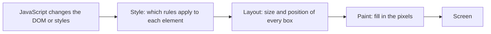

# Changing the document: nodes, attributes, layout, style

## In plain words

The previous lesson treated the page as something to look at: a tree to walk and search. This lesson treats it as something to **build and rebuild**.

Think of the DOM as a model made of toy bricks that is wired to the screen. Add a brick to the model and it appears on screen; move a brick and it moves; repaint a brick and its colour changes. Nothing has to be "refreshed": the screen always shows the current state of the model. Every interactive page works this way. A new chat message, a product dropping into a cart, an error message under a form field: each is a script creating, changing or removing nodes.

Two more ideas complete the picture. **CSS** (Cascading Style Sheets) is the language that says how elements *look*: colours, sizes, positions. And **layout** is the browser's work of computing where every box goes on the screen, which you can both read and influence from JavaScript, for instance to animate things.

Why it matters for a job: creating elements from data is the core of every user interface, and doing it carelessly opens the most common security hole on the Web (cross-site scripting). Performance problems in web pages very often come from misunderstanding layout. All three topics are regular interview material.

> **Before this lesson:** you need the DOM tree, `querySelector` and `textContent` from [JavaScript in the browser and the DOM tree](#/lesson/javascript/browser-dom-tree), plus arrays, `map` and template literals.

## Changing what is already there

The simplest change is to alter the text or an attribute of an existing element:

```html-run
<h1 id="title">Old title</h1>
<a id="link" href="https://example.com">a link</a>

<script>
  const title = document.getElementById("title");
  title.textContent = "New title, set by JavaScript";

  const link = document.getElementById("link");
  link.href = "https://developer.mozilla.org";
  link.textContent = "MDN Web Docs";
  link.setAttribute("target", "_blank");
  link.title = "Opens in a new tab";
</script>
```

Assigning to `textContent` replaces everything inside the element with plain text. Standard attributes can be set as properties (`link.href = ...`); `setAttribute(name, value)` works for any attribute, and `removeAttribute(name)` deletes one.

## Creating and inserting nodes

### The three steps

Adding something new always takes three steps: **create** a node, **fill** it, **attach** it to the tree. Until the third step the node exists only in memory and is invisible.

```html-run
<ul id="list">
  <li>Fern</li>
</ul>

<script>
  const list = document.getElementById("list");

  const item = document.createElement("li");   // 1. create an <li> element (not on the page yet)
  item.textContent = "Cactus";                 // 2. fill it
  list.append(item);                           // 3. attach it as the last child of the list

  const first = document.createElement("li");
  first.textContent = "Aloe (added at the start)";
  list.prepend(first);
</script>
```

`document.createElement("li")` makes a new, empty `<li>` element. `list.append(item)` inserts it at the end of `list`'s children; `prepend` inserts at the beginning. The full family of insertion methods:

| Method | Where the new node goes |
|---|---|
| `parent.append(node)` | inside `parent`, at the end |
| `parent.prepend(node)` | inside `parent`, at the start |
| `sibling.before(node)` | next to `sibling`, in front of it |
| `sibling.after(node)` | next to `sibling`, behind it |
| `old.replaceWith(node)` | in place of `old` |
| `node.remove()` | nowhere: removes `node` from the tree |

All of them also accept plain strings, which are inserted as text nodes.

### A node lives in one place

A node can be in the document only once. Inserting a node that is already in the tree **moves** it; it is not copied. To duplicate, use `cloneNode(true)` (the `true` means "including all descendants").

```html-run
<p>Shelf A: <span id="a"><b id="vase">[vase]</b></span></p>
<p>Shelf B: <span id="b"></span></p>
<p>Shelf C: <span id="c"></span></p>

<script>
  const vase = document.getElementById("vase");
  document.getElementById("b").append(vase);                    // moved: shelf A is now empty
  document.getElementById("c").append(vase.cloneNode(true));    // a copy for shelf C
</script>
```

### A helper for building trees

Creating nested structures with raw DOM calls is wordy. Most projects define a small helper. This one takes a tag name, an object of properties, and any number of children (nodes or strings):

```html-run
<div id="app"></div>

<script>
  function h(tag, props = {}, ...children) {
    const element = document.createElement(tag);
    Object.assign(element, props);              // copy properties such as className, href, id
    element.append(...children);                // strings become text nodes
    return element;
  }

  const card = h("article", { className: "card" },
    h("h2", {}, "Boston fern"),
    h("p", {}, "Likes shade. Price: ", h("strong", {}, "12 EUR")),
    h("a", { href: "https://example.com/fern" }, "More details")
  );
  document.getElementById("app").append(card);
</script>
```

`Object.assign(element, props)` copies every property of `props` onto the new element, and the spread `...children` hands each child to `append`. The nesting of the calls mirrors the nesting of the resulting elements. (React's JSX syntax is, underneath, a call to a function much like this `h`.)

### Rendering a list from data

The everyday task is turning an array of data into elements. Write a function that builds the DOM for the *whole* list from the data, and call it again whenever the data changes:

```html-run
<h3>Cart</h3>
<ul id="cart"></ul>
<p id="total"></p>
<button id="add">Add a cactus</button>

<script>
  let cart = [
    { name: "Fern", price: 12, qty: 1 },
    { name: "Orchid", price: 30, qty: 2 },
  ];

  function render() {
    const list = document.getElementById("cart");
    const items = cart.map((line) => {
      const li = document.createElement("li");
      li.textContent = `${line.qty} x ${line.name} = ${line.qty * line.price} EUR`;
      return li;
    });
    list.replaceChildren(...items);              // swap all old children for the new ones
    const total = cart.reduce((sum, line) => sum + line.qty * line.price, 0);
    document.getElementById("total").textContent = "Total: " + total + " EUR";
  }

  document.getElementById("add").addEventListener("click", () => {
    cart = [...cart, { name: "Cactus", price: 7, qty: 1 }];    // new data...
    render();                                                  // ...then redraw from the data
  });

  render();
</script>
```

The data (`cart`) is the single source of truth and the DOM is a *picture* of it. `replaceChildren` removes whatever was in the list and inserts the freshly built items. The button's click handler (events are the subject of the next lesson) updates the data and re-renders. This "state, then render" pattern is the central idea behind modern UI frameworks.

## `innerHTML` and the danger of injected markup

There is a shortcut for building DOM: assign a string of HTML to `innerHTML` and let the browser parse it.

```html-run
<div id="box"></div>
<script>
  document.getElementById("box").innerHTML = "<h3>Built from a string</h3><p>Quick, and <em>risky</em>.</p>";
</script>
```

It is convenient for fixed markup that you wrote yourself. It is **dangerous** the moment the string contains text that came from somewhere else: a form field, a URL, a database of user comments. Whoever controls that text controls your markup, and markup can contain code.

```html-run
<h4>Unsafe: innerHTML</h4>
<div id="unsafe"></div>
<h4>Safe: textContent</h4>
<div id="safe"></div>

<script>
  // imagine this "name" was typed by a visitor into a comment form
  const visitorName = 'I ran code in your page</b>\'">';

  document.getElementById("unsafe").innerHTML = "Hello, " + visitorName;   // the text is parsed as HTML
  document.getElementById("safe").textContent = "Hello, " + visitorName;   // the text stays text
</script>
```

In the first box the "name" became an image element whose error handler executed. In the second box the same characters are displayed harmlessly as text. An attack that smuggles script into a page through unescaped data is called **cross-site scripting** (XSS). In a real attack the injected code would not repaint a word in red; it would steal the visitor's login session.

> [!WARNING]
> Never build HTML strings from untrusted data. Use `textContent`, `createElement` and `append`, which treat data as data. If you must insert HTML that users supplied (for example from a rich-text editor), pass it through a well-tested sanitising library first.

## Styling

### Classes: the preferred way

Appearance is described with CSS rules, usually inside a `<style>` element or a separate file. A rule has a selector and a list of declarations. The cleanest way for JavaScript to change how something looks is to add or remove a **class** and let a CSS rule do the rest:

```html-run
<style>
  .task { padding: 6px 10px; border: 1px solid #999; border-radius: 6px; margin: 4px 0; }
  .task.done { text-decoration: line-through; opacity: 0.5; }
  .task.urgent { border-color: crimson; background: mistyrose; }
</style>

<div class="task" id="t1">Water the ferns</div>
<div class="task" id="t2">Pay the invoice</div>
<div class="task" id="t3">Call the supplier</div>

<script>
  document.getElementById("t1").classList.add("done");
  document.getElementById("t2").classList.add("urgent");
  const third = document.getElementById("t3");
  third.classList.toggle("urgent");                 // adds, because it was absent
  third.classList.toggle("urgent");                 // removes again
  third.textContent += third.classList.contains("urgent") ? " (urgent)" : " (normal)";
</script>
```

`classList` has `add`, `remove`, `toggle` and `contains`. Keeping the look in CSS and only switching classes from JavaScript separates *what state something is in* from *how that state is displayed*.

### The `style` property

Every element also has a `style` object for setting individual CSS properties directly. Names containing dashes are written in camelCase: `background-color` becomes `backgroundColor`. Values are strings, and lengths need a unit.

```html-run
<p id="note">A note that will be restyled.</p>
<div id="bar" style="height: 14px; background: seagreen; width: 0"></div>

<script>
  const note = document.getElementById("note");
  note.style.color = "white";
  note.style.backgroundColor = "steelblue";
  note.style.padding = "8px";

  const percent = 65;
  document.getElementById("bar").style.width = percent + "%";     // a computed value: good use of style
</script>
```

Use `style` for values that are computed at run time (a progress bar's width, a dragged element's position). For everything else prefer classes.

### How the cascade picks a winner

Several rules can apply to one element. The "cascading" in CSS is the procedure that decides which declaration wins. Simplified: a more **specific** selector beats a less specific one (id beats class, class beats tag name); between equally specific rules, the one that comes later wins; and inline `style` beats rules in style sheets. `getComputedStyle(element)` tells you the final result.

```html-run
<style>
  p { color: gray; }
  .warning { color: darkorange; }
  #special { color: purple; }
</style>
<p>tag rule only</p>
<p class="warning">tag + class</p>
<p class="warning" id="special">tag + class + id</p>
<p class="warning" id="x" style="color: teal">tag + class + inline style</p>
<pre id="out"></pre>

<script>
  const out = document.getElementById("out");
  for (const p of document.querySelectorAll("p")) {
    out.textContent += p.textContent.padEnd(28) + getComputedStyle(p).color + "\n";
  }
</script>
```

## Layout: where things are

### Reading sizes and positions

After building the DOM and applying styles, the browser computes the **layout**: the size and position of every element's box. Some elements are *block* elements, which start on a new line and take the full width available (`<p>`, `<div>`, `<h1>`); others are *inline* and flow within a line of text (`<a>`, `<strong>`, `<span>`).

You can read the results:

```html-run
<style>
  #box { width: 200px; padding: 20px; border: 5px solid slateblue; margin: 15px; }
</style>
<div id="box">A box with padding and a border.</div>
<pre id="out"></pre>

<script>
  const box = document.getElementById("box");
  const out = document.getElementById("out");
  const log = (...parts) => { out.textContent += parts.join(" ") + "\n"; };

  log("offsetWidth (content + padding + border):", box.offsetWidth);
  log("clientWidth (content + padding):", box.clientWidth);
  const rect = box.getBoundingClientRect();
  log("position in the viewport: left", Math.round(rect.left), "top", Math.round(rect.top));
  log("size from the rectangle:", Math.round(rect.width), "x", Math.round(rect.height));
</script>
```

`offsetWidth` is the element's full outer width in pixels; `clientWidth` leaves out the border. `getBoundingClientRect()` returns the box's exact rectangle relative to the visible window (the *viewport*).

### The cost of layout

Computing layout is work, sometimes a lot of it. Browsers therefore delay it: when your script changes the DOM, the page is only marked as "needs layout", and the calculation happens later, before the next repaint. But if your script *reads* a layout value (such as `offsetWidth`) after changing something, the browser must compute the layout **immediately** to give a correct answer.



A loop that alternates writing and reading forces a full layout on every round. This is known as **layout thrashing**:

```javascript
// slow: each iteration writes (invalidates layout) and then reads (forces layout)
for (const box of boxes) {
  box.style.width = container.offsetWidth / 2 + "px";
}

// fast: read once, then do all the writes
const half = container.offsetWidth / 2;
for (const box of boxes) {
  box.style.width = half + "px";
}
```

> [!TIP]
> Batch your work: do all the reading of layout values first, then all the writing. When inserting many elements, build them off-screen (in an array, or a `DocumentFragment`) and attach them with one `append(...items)` or `replaceChildren(...items)` call, so the page is laid out once and not a thousand times.

## Positioning and animation

The CSS property `position` controls how an element is placed. The default, `static`, puts it in the normal flow of the page. With `relative`, the element can be nudged from its normal place using `top` and `left`. With `absolute`, it is taken out of the flow and positioned relative to its nearest positioned ancestor.

An **animation** is a quick succession of small changes. The right tool for scheduling them is `requestAnimationFrame(callback)`: it asks the browser to call your function right before the next repaint, typically sixty times per second, and it pauses automatically when the tab is hidden. The callback receives the current time in milliseconds, which should drive the motion so that it runs at the same speed on fast and slow machines.

```html-run
<style>
  #track { position: relative; height: 90px; border: 1px solid #aaa; border-radius: 8px; overflow: hidden; }
  #ball { position: absolute; width: 24px; height: 24px; border-radius: 50%; background: tomato; }
</style>
<div id="track"><div id="ball"></div></div>
<button id="toggle">Pause</button>

<script>
  const track = document.getElementById("track");
  const ball = document.getElementById("ball");
  let running = true;
  let elapsed = 0;                 // total animated time in milliseconds
  let previous = null;

  function frame(time) {
    if (previous !== null && running) elapsed += time - previous;
    previous = time;

    const maxX = track.clientWidth - ball.offsetWidth;
    const maxY = track.clientHeight - ball.offsetHeight;
    const x = (Math.sin(elapsed / 700) + 1) / 2 * maxX;          // glides left and right
    const y = Math.abs(Math.cos(elapsed / 250)) * maxY;          // bounces up and down
    ball.style.left = x + "px";
    ball.style.top = (maxY - y) + "px";

    requestAnimationFrame(frame);  // ask for the next frame
  }
  requestAnimationFrame(frame);

  document.getElementById("toggle").addEventListener("click", (event) => {
    running = !running;
    event.target.textContent = running ? "Pause" : "Resume";
  });
</script>
```

How it works:

- The track is `position: relative` and the ball `position: absolute`, so the ball's `left` and `top` are measured from the track's corner.
- `frame` is called before each repaint. It adds the time since the previous frame to `elapsed` (only while running), computes a position from `elapsed` with sine and cosine, writes the two style properties, and requests the next frame.
- Nothing loops in the usual sense. Each call schedules the next one, and between calls the browser is free to paint and to react to the button.

A `while` loop that moved the ball a thousand times would show nothing but the final position: the browser cannot repaint while a script is running. Animation needs the script to *yield* between steps.

For simple effects (fading, sliding, colour changes) you often need no JavaScript at all: CSS `transition` and `animation` properties let the browser animate a change of class by itself, more efficiently than a script could.

> [!INTERVIEW]
> Likely questions: "How do you add an element to the page?" (`createElement`, set content, `append`). "Why is `innerHTML` dangerous?" (it parses strings as markup, so untrusted data can inject script: XSS; use `textContent`). "What is reflow / layout thrashing?" (interleaving DOM writes with layout reads forces repeated synchronous layout; batch reads and writes). "Why `requestAnimationFrame` and not `setInterval`?" (it is synchronised with the display's refresh, passes a timestamp, and stops in background tabs). "What is CSS specificity?" (inline, then id, then class, then tag; later rules win ties).

## Common pitfalls

1. **Creating an element and forgetting to attach it.** It never appears.
2. **Expecting `append` to copy.** Appending an existing node moves it. Clone if you need two.
3. **Building markup from user data with `innerHTML`.** This is the XSS hole.
4. **`element.style.width = 100`.** Lengths need units: `"100px"`.
5. **Writing `style.background-color`.** Use `style.backgroundColor`.
6. **Reading `element.style.color` to learn the current colour.** `style` only reflects inline styles; use `getComputedStyle`.
7. **Animating in a loop.** The screen updates only when the script returns; use `requestAnimationFrame`.
8. **Reading and writing layout alternately inside a loop.**
9. **Updating the DOM by hand in many places.** State and screen drift apart. Keep the data in one place and render from it.

## Summary

- Text and attributes of existing elements are changed through properties such as `textContent`, `href`, and through `setAttribute`.
- New content is created with `createElement`, filled, and attached with `append`, `prepend`, `before`, `after` or `replaceWith`; `remove` detaches. A node occupies one place; `cloneNode(true)` copies.
- Render lists by mapping data to elements and replacing the container's children; treat the data as the source of truth.
- `innerHTML` parses a string as HTML and must never receive untrusted data; `textContent` is always safe.
- Prefer switching classes with `classList`; use `style` for computed values. The cascade resolves conflicts by specificity and order; `getComputedStyle` shows the outcome.
- Layout values (`offsetWidth`, `getBoundingClientRect`) can be read, at a cost; batch reads and writes.
- Animate with `requestAnimationFrame`, deriving positions from elapsed time, or let CSS transitions do it.

## Glossary

- **Render**: to produce the visible page (or a part of it) from data.
- **`createElement`**: the method that makes a new, unattached element node.
- **Detached node**: a node that exists in memory but is not part of the document.
- **`innerHTML`**: a property that reads or replaces an element's content as an HTML string.
- **Cross-site scripting (XSS)**: an attack in which untrusted data is interpreted as code in a page.
- **Sanitise**: to remove dangerous parts from markup before using it.
- **CSS**: the language that describes the presentation of elements.
- **Class**: a label on an element (`class="..."`) used by CSS selectors and scripts.
- **Cascade / specificity**: the rules deciding which of several conflicting style declarations applies.
- **Computed style**: the final style values of an element after the cascade.
- **Layout (reflow)**: the browser's calculation of the size and position of every box.
- **Paint**: drawing the pixels after layout.
- **Layout thrashing**: forcing repeated layouts by alternating DOM writes and layout reads.
- **Viewport**: the visible area of the page in the browser window.
- **`requestAnimationFrame`**: a function that schedules a callback before the next repaint.

## Check yourself

```quiz
[
  {"q": "A script runs `const li = document.createElement(\"li\"); li.textContent = \"Tea\";` and nothing appears. Why?", "options": ["textContent cannot be used on li", "The element was never attached to the document", "createElement needs a second argument", "List items must be created with innerHTML"], "answer": 1,
   "explain": "A created element lives only in memory until it is inserted into the tree with append or a similar method."},
  {"q": "`list.append(item)` is called where `item` is already a child of another element on the page. What happens?", "options": ["item is copied into list", "item is moved to list and disappears from its old place", "An error is thrown", "Nothing"], "answer": 1,
   "explain": "A node can have only one parent. Inserting it elsewhere moves it; use cloneNode(true) to make a copy."},
  {"q": "Why is `box.innerHTML = \"Hello \" + userInput` risky?", "options": ["innerHTML is slower than textContent", "The input is parsed as HTML, so it can inject elements and scripts into the page", "It removes event listeners", "It only works in old browsers"], "answer": 1,
   "explain": "This is cross-site scripting. Assigning the same string to textContent would display it as harmless text."},
  {"q": "Which line correctly makes an element 150 pixels wide?", "options": ["el.style.width = 150;", "el.style.width = \"150px\";", "el.width = \"150px\";", "el.style(\"width\", 150);"], "answer": 1,
   "explain": "style properties take strings, and CSS lengths require a unit."},
  {"q": "An element has `class=\"note\"` and `id=\"main\"`. The style sheet says `#main { color: blue; }` and later `.note { color: red; }`. What colour is the text?", "options": ["red, because it comes later", "blue, because an id selector is more specific than a class selector", "black", "purple"], "answer": 1,
   "explain": "Specificity is compared first; order only breaks ties between equally specific rules."},
  {"q": "Why does a loop like `for (...) { el.style.left = x + \"px\"; }` with 1000 iterations not show a smooth movement?", "options": ["style.left is ignored inside loops", "The browser repaints only after the script yields, so only the final position is displayed", "Loops are limited to 60 iterations per second", "left must be animated with setAttribute"], "answer": 1,
   "explain": "Rendering happens between tasks. requestAnimationFrame performs one step per frame and returns control each time."},
  {"q": "What does `element.classList.toggle(\"open\")` do?", "options": ["Always adds the class", "Adds the class if it is absent and removes it if it is present", "Replaces all classes with open", "Returns the list of classes"], "answer": 1,
   "explain": "toggle flips the presence of one class and leaves the others untouched."},
  {"q": "Which sequence avoids layout thrashing when resizing many boxes to half of a container's width?", "options": ["Read container.offsetWidth inside the loop before each write", "Read container.offsetWidth once before the loop, then set every box's width", "Call getComputedStyle after each write", "Use innerHTML for each box"], "answer": 1,
   "explain": "One read followed by many writes needs a single layout. Reading after each write forces the browser to recompute layout every time."}
]
```

> **Source:** Haverbeke, *Eloquent JavaScript* (4th ed.), ch. 14 "The Document Object Model" (changing the document, creating nodes, attributes, layout, styling, cascading styles, positioning and animating). Details checked against MDN: https://developer.mozilla.org/en-US/docs/Web/API/Element/append , https://developer.mozilla.org/en-US/docs/Web/API/Element/innerHTML , https://developer.mozilla.org/en-US/docs/Web/API/Window/requestAnimationFrame , https://developer.mozilla.org/en-US/docs/Web/CSS/Specificity
