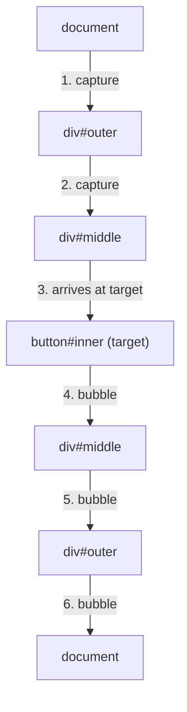

# Event handlers, propagation and delegation

## In plain words

A web page spends almost all of its time doing nothing, waiting. Then the user clicks a button, presses a key or scrolls, and the page must react. Each such happening is called an **event**.

Think of a doorbell. You do not stand at the door all day checking whether somebody is there. You install a bell, go about your business, and when the bell rings you respond. In the browser, installing the bell is called *registering an event handler* (or *listener*): you tell the browser "when a click happens on this button, call this function". The browser does the watching and calls your function at the right moment.

One more idea makes events powerful. A click on a button is also a click on the panel that contains the button, and on the page that contains the panel. The browser therefore reports the event not only to the button but to each of its ancestors in turn, like a message passed up a chain of managers. This is **propagation**, and it allows a single handler on a container to serve hundreds of elements inside it, a technique named **event delegation**.

Why it matters for a job: every interactive feature starts with an event. Knowing the event object, propagation, default actions and delegation is the difference between a page that reacts correctly and one with duplicate handlers, forms that reload the page and memory leaks. All of these are standard interview topics.

> **Before this lesson:** you need to find and change elements ([JavaScript in the browser and the DOM tree](#/lesson/javascript/browser-dom-tree), [Changing the document](#/lesson/javascript/changing-document)), callbacks and closures ([Higher-order functions](#/lesson/javascript/higher-order-functions), [Closures and recursion](#/lesson/javascript/closures-recursion)).

## Registering a handler

### The simplest example

```html-run
<button id="hello">Say hello</button>
<p id="message"></p>

<script>
  const button = document.getElementById("hello");
  const message = document.getElementById("message");

  button.addEventListener("click", () => {
    message.textContent = "Hello! The button was clicked.";
  });
</script>
```

`addEventListener(type, handler)` takes two arguments: the name of the event type as a string (`"click"`), and a function. The browser stores the function and calls it each time that event happens on that element. Nothing runs when the page loads except the registration itself; the arrow function runs later, once per click. It is a callback, exactly as in the asynchronous lessons, and it is delivered through the event loop as a task.

### Several handlers, and removing one

An element can have any number of handlers for the same event; they run in the order in which they were added. To remove a handler, call `removeEventListener` with **the same function value** that was registered, which means the function must be stored in a binding:

```html-run
<button id="btn">Click me (try three times)</button>
<pre id="out"></pre>

<script>
  const out = document.getElementById("out");
  const log = (text) => { out.textContent += text + "\n"; };
  const button = document.getElementById("btn");

  let clicks = 0;
  function countClick() {
    clicks += 1;
    log("handler A: click number " + clicks);
    if (clicks === 2) {
      button.removeEventListener("click", countClick);     // same function reference
      log("handler A removed itself");
    }
  }

  button.addEventListener("click", countClick);
  button.addEventListener("click", () => log("handler B: still here"));
  button.addEventListener("click", () => log("handler C: I run only once"), { once: true });
</script>
```

Click three times. Handler A stops after the second click, handler B keeps going, and handler C, registered with the option `{ once: true }`, removes itself automatically after its first call.

> [!WARNING]
> `removeEventListener("click", () => {...})` with a freshly written arrow function removes nothing, because that new function is a different value from the one that was added. Keep a reference to the handler if you intend to remove it.

Older code attaches handlers through properties (`button.onclick = fn`) or HTML attributes (`<button onclick="...">`). A property holds only **one** handler, so a second assignment silently replaces the first, and attribute handlers mix code into markup. Use `addEventListener`.

## The event object

When the browser calls a handler, it passes one argument: an **event object** holding the details of what happened. Different event types carry different information.

```html-run
<style> #pad { height: 90px; border: 2px dashed gray; display: grid; place-items: center; } </style>
<div id="pad">Click anywhere in this box, with any mouse button</div>
<pre id="out"></pre>

<script>
  const out = document.getElementById("out");
  document.getElementById("pad").addEventListener("mousedown", (event) => {
    const names = ["left", "middle", "right"];
    out.textContent =
      "type: " + event.type + "\n" +
      "button: " + names[event.button] + "\n" +
      "position in the page: " + Math.round(event.pageX) + ", " + Math.round(event.pageY) + "\n" +
      "shift key held: " + event.shiftKey;
  });
</script>
```

Properties found on every event object:

| Property | Meaning |
|---|---|
| `type` | the event's name, such as `"click"` |
| `target` | the element on which the event actually occurred |
| `currentTarget` | the element whose handler is running right now |
| `timeStamp` | when the event happened, in milliseconds since the page loaded |

The difference between `target` and `currentTarget` is the key to the next section.

## Propagation

### Events bubble

Handlers registered on an element also receive events that happen on its descendants. If a button sits inside a paragraph inside a section, a click on the button first runs the button's handlers, then the paragraph's, then the section's, and so on up to the document. The event is said to **bubble** outwards from the innermost element.

```html-run
<style>
  #outer { padding: 14px; background: #dbeafe; }
  #middle { padding: 14px; background: #bfdbfe; }
  #inner { padding: 8px 14px; }
</style>
<div id="outer">outer
  <div id="middle">middle
    <button id="inner">inner button</button>
  </div>
</div>
<pre id="out"></pre>

<script>
  const out = document.getElementById("out");
  for (const id of ["outer", "middle", "inner"]) {
    document.getElementById(id).addEventListener("click", (event) => {
      out.textContent += `handler on ${event.currentTarget.id} | the click was on ${event.target.id}\n`;
    });
  }
  document.addEventListener("click", () => { out.textContent += "---\n"; });
</script>
```

Click the button: three lines appear, innermost first, and in all three `event.target` is `inner` while `currentTarget` changes. Click the word "middle": two lines appear. Click "outer": one.

### The full journey: capture, target, bubble

The complete path of an event has three phases. It first travels **down** from the document to the target (the *capturing* phase), reaches the target, and then travels back **up** (the *bubbling* phase). Handlers are called during bubbling by default. Passing `{ capture: true }` as the third argument registers a handler for the downward phase.



Capturing handlers are rare in everyday code. Bubbling is what you use constantly.

### Stopping propagation

A handler can call `event.stopPropagation()` to prevent the event from travelling any further. Handlers on outer elements then never hear of it.

```html-run
<style> #card { padding: 14px; border: 1px solid gray; cursor: pointer; } </style>
<div id="card">
  A card that opens when clicked.
  <button id="delete">Delete</button>
  <button id="plain">Other button</button>
</div>
<pre id="out"></pre>

<script>
  const out = document.getElementById("out");
  const log = (text) => { out.textContent += text + "\n"; };

  document.getElementById("card").addEventListener("click", () => log("card: opening details"));
  document.getElementById("delete").addEventListener("click", (event) => {
    event.stopPropagation();                 // do not let the card see this click
    log("delete: item removed");
  });
  document.getElementById("plain").addEventListener("click", () => log("other button clicked"));
</script>
```

Clicking "Delete" logs one line; clicking "Other button" logs two, because that click bubbles up to the card. Use `stopPropagation` sparingly: it also hides the event from unrelated code higher up, such as a "close this menu when the user clicks elsewhere" handler on the document.

## Event delegation

Because events bubble, one handler on a common ancestor can handle events for all of its descendants, including ones that do not exist yet. The handler inspects `event.target` to find out which descendant was involved.

Compare the alternatives for a list of 500 items that should each react to a click: 500 handlers, which must also be added to every item created later; or one handler on the list.

```html-run
<style>
  li { cursor: pointer; padding: 3px 0; }
  li.done { text-decoration: line-through; color: gray; }
  button.remove { margin-left: 8px; }
</style>
<ul id="todos">
  <li data-id="1">Water the ferns <button class="remove">x</button></li>
  <li data-id="2">Order soil <button class="remove">x</button></li>
</ul>
<button id="add">Add a task</button>
<p id="status"></p>

<script>
  const list = document.getElementById("todos");
  const status = document.getElementById("status");
  let nextId = 3;

  list.addEventListener("click", (event) => {              // ONE handler for the whole list
    const item = event.target.closest("li");               // the <li> that contains whatever was clicked
    if (item === null) return;                             // the click was on the list's padding
    if (event.target.matches("button.remove")) {
      item.remove();
      status.textContent = "Removed task " + item.dataset.id;
    } else {
      item.classList.toggle("done");
      status.textContent = "Toggled task " + item.dataset.id;
    }
  });

  document.getElementById("add").addEventListener("click", () => {
    const item = document.createElement("li");
    item.dataset.id = nextId;
    item.append("New task " + nextId + " ", Object.assign(document.createElement("button"), { className: "remove", textContent: "x" }));
    list.append(item);                                     // no new handler needed
    nextId += 1;
  });
</script>
```

Two methods do the detective work. `element.closest(selector)` walks from the element up through its ancestors and returns the first one that matches the selector (or `null`); it finds the list item even when the click landed on something inside it. `element.matches(selector)` tests whether the element itself fits a selector. Items added later work immediately, because the handler is on the list, not on the items.

> [!TIP]
> Reach for delegation whenever many similar elements need the same behaviour, or when elements are created and destroyed dynamically. It means fewer handlers, less memory, and no forgotten registration for new elements. Store the item's identity in a `data-` attribute and read it in the handler.

## Default actions

Many events have a **default action** built into the browser: clicking a link navigates to it, clicking a submit button sends the form and reloads the page, pressing the down arrow scrolls, right-clicking opens a context menu. Your handlers run *before* the default action, and can cancel it by calling `event.preventDefault()`.

```html-run
<p><a id="link" href="https://example.com">A link that asks first</a></p>

<form id="signup">
  <input name="email" placeholder="email address">
  <button>Sign up</button>
</form>
<p id="result"></p>

<script>
  const result = document.getElementById("result");

  document.getElementById("link").addEventListener("click", (event) => {
    event.preventDefault();                                // do not navigate
    result.textContent = "Navigation cancelled. A real app might show a confirmation dialog here.";
  });

  document.getElementById("signup").addEventListener("submit", (event) => {
    event.preventDefault();                                // do not send the form and reload the page
    const email = event.target.elements.email.value.trim();
    result.textContent = email.includes("@")
      ? "Thanks! We would now send " + email + " to the server with fetch."
      : "Please enter a valid email address.";
  });
</script>
```

Handling the `submit` event of the form (not the `click` on its button) is the right hook: it also fires when the user presses Enter in the text field. Calling `preventDefault` there is the first line of nearly every form handler in a modern web application, because the page wants to send the data itself and stay where it is.

`preventDefault` and `stopPropagation` are independent. The first cancels the browser's built-in reaction; the second stops other handlers further along the path from being called. Cancelling one does not cancel the other.

> [!WARNING]
> Do not disable default behaviour without a good reason. Users rely on it: links that can be opened in a new tab, forms that submit on Enter, the context menu, keyboard scrolling. A page that hijacks these feels broken and is often unusable with a keyboard or a screen reader.

## A tour of common event types

| Category | Events |
|---|---|
| mouse and pointer | `click`, `dblclick`, `mousedown`, `mouseup`, `mousemove`, `pointerdown`, `pointermove` |
| keyboard | `keydown`, `keyup` |
| forms | `input` (value changed while typing), `change` (value committed), `submit`, `focus`, `blur` |
| page | `DOMContentLoaded` (HTML parsed), `load` (everything loaded), `scroll`, `resize` |

The next lesson examines keyboard, pointer, scroll and timer events in detail. Two form events deserve a first look here because they are so common:

```html-run
<label>Your name: <input id="name" autocomplete="off"></label>
<p id="greeting">Type something.</p>
<label><input type="checkbox" id="shout"> shout</label>

<script>
  const nameField = document.getElementById("name");
  const shout = document.getElementById("shout");
  const greeting = document.getElementById("greeting");

  function update() {
    const name = nameField.value.trim();
    const text = name === "" ? "Type something." : "Hello, " + name + "!";
    greeting.textContent = shout.checked ? text.toUpperCase() : text;
  }

  nameField.addEventListener("input", update);     // fires on every keystroke, paste or deletion
  shout.addEventListener("change", update);        // fires when the box is ticked or unticked
</script>
```

Both handlers call the same `update` function, which reads the current state of the controls and redraws the output from scratch. Reading state and re-rendering, as in the previous lesson, is more robust than trying to patch the output according to which event occurred.

## Custom events

Events are not limited to the browser's own. Your code can create an event and **dispatch** it on any element; it then propagates like a built-in one. This is a clean way for one part of a page to announce something without knowing who is interested.

```html-run
<div id="shop">
  <button data-product="Fern" data-price="12">Add fern</button>
  <button data-product="Cactus" data-price="7">Add cactus</button>
</div>
<p id="cart">Cart is empty</p>

<script>
  const shop = document.getElementById("shop");
  let total = 0, count = 0;

  shop.addEventListener("click", (event) => {
    const button = event.target.closest("button[data-product]");
    if (!button) return;
    button.dispatchEvent(new CustomEvent("cart:add", {
      bubbles: true,                                        // let ancestors hear it
      detail: { product: button.dataset.product, price: Number(button.dataset.price) },
    }));
  });

  document.addEventListener("cart:add", (event) => {        // a listener far away from the buttons
    count += 1;
    total += event.detail.price;
    document.getElementById("cart").textContent =
      count + " item(s), " + total + " EUR. Last added: " + event.detail.product;
  });
</script>
```

`new CustomEvent(name, { detail, bubbles })` builds the event; `detail` carries your data. The buttons know nothing about the cart display, and the cart display knows nothing about buttons. They are connected only by the event's name.

## Cleaning up

A registered handler keeps its function alive, and through closures everything that function refers to. If elements are removed from the page while handlers elsewhere (on `document`, on `window`, in timers) still point at them, that memory can never be freed. This is a typical **memory leak** in long-running single-page applications.

Guidelines: remove listeners you added to long-lived objects (`window`, `document`) when the component that added them goes away; prefer delegation, which needs few listeners in the first place; and consider an `AbortController`, whose signal can remove many listeners with one call:

```html-run
<button id="start">Start tracking the mouse</button>
<button id="stop">Stop</button>
<p id="pos">not tracking</p>

<script>
  let controller = null;
  const pos = document.getElementById("pos");

  document.getElementById("start").addEventListener("click", () => {
    if (controller) return;                                  // already tracking
    controller = new AbortController();
    const options = { signal: controller.signal };           // listeners tied to this signal
    document.addEventListener("mousemove", (e) => { pos.textContent = e.clientX + ", " + e.clientY; }, options);
    document.addEventListener("keydown", (e) => { pos.textContent = "key: " + e.key; }, options);
  });

  document.getElementById("stop").addEventListener("click", () => {
    controller?.abort();                                     // removes both listeners at once
    controller = null;
    pos.textContent = "not tracking";
  });
</script>
```

> [!INTERVIEW]
> Be ready for: "Explain event bubbling and capturing" (three phases; handlers run on the way up unless registered with `capture: true`). "What is event delegation and why use it?" (one listener on an ancestor using `event.target`; fewer listeners, works for dynamic content). "`target` versus `currentTarget`?" (where the event originated versus whose handler is running). "`preventDefault` versus `stopPropagation`?" (cancel the browser's default action versus stop the event from reaching other elements; `stopImmediatePropagation` additionally skips remaining handlers on the same element). "Why does my `removeEventListener` not work?" (a different function reference).

## Common pitfalls

1. **Calling the handler while registering it.** `addEventListener("click", save())` runs `save` once, immediately, and registers its return value. Pass `save`, without parentheses.
2. **Registering the same handler repeatedly.** Calling a setup function twice doubles every reaction. (Passing the identical function reference twice is ignored; identical-looking arrow functions are not.)
3. **Removing with a different function.** Anonymous functions cannot be removed.
4. **Using `target` when you need the container.** In a handler on a `<li>`, `event.target` may be a `<span>` inside it. Use `currentTarget` or `closest`.
5. **Forgetting `preventDefault` on form submission.** The page reloads and your JavaScript state is gone.
6. **Overusing `stopPropagation`.** It breaks delegation and "click outside" logic elsewhere.
7. **Attaching handlers before the elements exist, or not re-attaching to new elements.** Delegation avoids both.
8. **Leaking listeners on `window` or `document`.**

## Summary

- `addEventListener(type, handler, options)` registers a function to be called when an event occurs; `removeEventListener` needs the same function reference; `{ once: true }` and abort signals automate removal.
- Handlers receive an event object with `type`, `target`, `currentTarget` and type-specific details.
- Events travel down to the target (capture) and back up (bubble). Handlers on ancestors therefore see events from descendants. `stopPropagation` ends the journey.
- Event delegation puts one handler on an ancestor and uses `event.target`, `closest` and `matches` to identify the element concerned; it works for elements added later.
- `preventDefault` cancels the browser's built-in action, most often form submission and link navigation.
- `CustomEvent` and `dispatchEvent` let your own code announce things through the same mechanism.
- Remove long-lived listeners to avoid memory leaks.

## Glossary

- **Event**: a signal that something happened: a click, a key press, the page finishing loading.
- **Event handler (listener)**: a function registered to be called when a particular event occurs.
- **Event type**: the name of the kind of event, such as `"click"` or `"submit"`.
- **Event object**: the argument passed to a handler, describing the event.
- **`target`**: the element where the event originated.
- **`currentTarget`**: the element whose handler is currently running.
- **Propagation**: the travel of an event through the ancestors of its target.
- **Bubbling / capturing**: the upward / downward phase of propagation.
- **Event delegation**: handling events for many elements with one listener on a common ancestor.
- **Default action**: what the browser does by itself in response to an event.
- **`preventDefault`**: the method that cancels the default action.
- **`stopPropagation`**: the method that stops an event from reaching further elements.
- **Custom event**: an event created and dispatched by your own code.
- **Dispatch**: to send an event to an element so that its handlers run.
- **Memory leak**: memory that stays reserved although the program no longer needs it.

## Check yourself

```quiz
[
  {"q": "What is wrong with `button.addEventListener(\"click\", showMenu());`?", "options": ["click must be written onclick", "showMenu is called immediately and its return value is registered instead of the function", "addEventListener needs three arguments", "Nothing"], "answer": 1,
   "explain": "The parentheses call the function at registration time. Pass the function itself: addEventListener(\"click\", showMenu)."},
  {"q": "A click on a `<span>` inside a `<li>` triggers a handler registered on the `<ul>`. Inside that handler, what are `event.target` and `event.currentTarget`?", "options": ["both the ul", "target is the span, currentTarget is the ul", "target is the ul, currentTarget is the span", "both the span"], "answer": 1,
   "explain": "target is the innermost element that was clicked. currentTarget is the element on which the running handler was registered."},
  {"q": "In which order do bubbling click handlers run when a button inside a div inside the body is clicked?", "options": ["body, div, button", "button, div, body", "div, button, body", "The order is random"], "answer": 1,
   "explain": "Bubbling proceeds from the target outwards through its ancestors."},
  {"q": "A form's submit handler does not call `event.preventDefault()`. What happens after the handler runs?", "options": ["Nothing", "The browser sends the form and loads the response, replacing the current page", "The handler runs a second time", "An error is thrown"], "answer": 1,
   "explain": "Submitting is the form's default action. A script that wants to handle the data itself must cancel it."},
  {"q": "Why does `el.removeEventListener(\"click\", () => doIt())` fail to remove a handler added with `el.addEventListener(\"click\", () => doIt())`?", "options": ["Arrow functions cannot be removed", "The two arrow functions are different function objects", "removeEventListener only works on buttons", "The handler must be removed with onclick = null"], "answer": 1,
   "explain": "Removal matches by function identity. Store the handler in a binding and pass that same binding to both calls."},
  {"q": "What does `event.target.closest(\"li\")` return?", "options": ["The first li in the document", "The nearest ancestor of the target (or the target itself) that is an li, or null", "All li elements inside the target", "The next li sibling"], "answer": 1,
   "explain": "closest walks upwards from the element, testing each against the selector. It is the standard tool for delegation."},
  {"q": "A handler calls `event.stopPropagation()` but not `preventDefault()` on a link click. What happens?", "options": ["The link is not followed", "Handlers on ancestors do not run, but the browser still follows the link", "Nothing changes at all", "The page freezes"], "answer": 1,
   "explain": "The two methods are independent. Stopping propagation does not cancel the default navigation."},
  {"q": "Why is delegation useful for a list whose items are added dynamically?", "options": ["New items receive handlers automatically because the single listener lives on the list", "It makes the items load faster from the server", "It prevents bubbling", "It is required by addEventListener"], "answer": 0,
   "explain": "Events from any item, old or new, bubble to the list, where one handler inspects event.target."}
]
```

> **Source:** Haverbeke, *Eloquent JavaScript* (4th ed.), ch. 15 "Handling Events" (event handlers, events and DOM nodes, event objects, propagation, default actions). Details checked against MDN: https://developer.mozilla.org/en-US/docs/Web/API/EventTarget/addEventListener , https://developer.mozilla.org/en-US/docs/Learn_web_development/Core/Scripting/Event_bubbling , https://developer.mozilla.org/en-US/docs/Web/API/Event/preventDefault , https://developer.mozilla.org/en-US/docs/Web/API/CustomEvent
