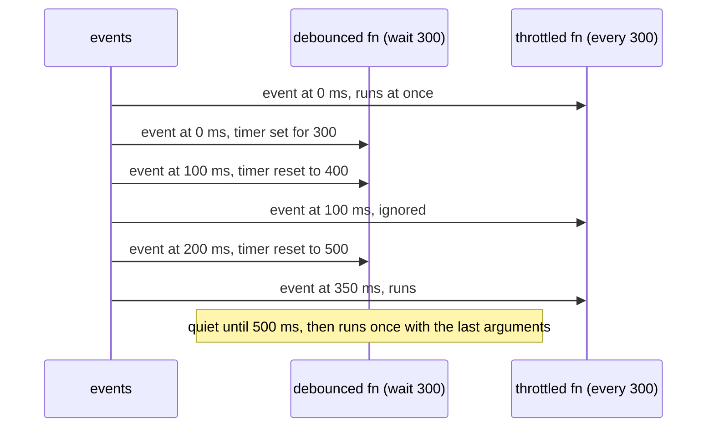

# Keys, pointers, scrolling, timers and debouncing

## In plain words

The previous lesson explained the machinery of events. This one is a guided tour of the events you will use most, grouped by where they come from: the **keyboard**, the **pointer** (mouse, finger or pen), **scrolling**, **focus** (which element is currently receiving typing), the **page loading**, and the **clock**.

The clock deserves a special mention. A user who types a search term causes one event per keystroke; a user who scrolls causes dozens of events per second. Reacting to every single one with expensive work (a network request, a big redraw) makes a page sluggish. Two classic techniques tame such floods. **Debouncing** means "wait until things have been quiet for a moment, then act once", like a lift door that only closes after nobody has walked through for three seconds. **Throttling** means "act at most once per time interval", like a turnstile that lets one person through per second no matter how many push.

Why it matters for a job: keyboard shortcuts, drag-and-drop, infinite scrolling, auto-saving forms and live search are everyday features built from exactly these events. "Implement debounce" and "explain the difference between debounce and throttle" are among the most common front-end interview tasks.

> **Before this lesson:** you need `addEventListener`, the event object, bubbling and `preventDefault` from [Event handlers, propagation and delegation](#/lesson/javascript/event-handling), closures ([Closures and recursion](#/lesson/javascript/closures-recursion)) and `setTimeout` ([Callbacks and promises](#/lesson/javascript/callbacks-promises)).

## Keyboard events

### `keydown` and `keyup`

Pressing a key fires a `keydown` event; releasing it fires `keyup`. If the key is held, `keydown` fires again and again (with `event.repeat` set to `true`). The event's `key` property says which key, as a readable string: `"a"`, `"A"`, `"Enter"`, `"Escape"`, `"ArrowLeft"`, `" "` for the space bar.

```html-run
<p>Click this frame once, then press some keys (try Shift, arrows, Enter, holding a key).</p>
<pre id="out">waiting for a key...</pre>

<script>
  const out = document.getElementById("out");
  window.addEventListener("keydown", (event) => {
    out.textContent =
      "key:    " + JSON.stringify(event.key) + "\n" +
      "code:   " + event.code + "\n" +
      "repeat: " + event.repeat + "\n" +
      "modifiers: " + ["ctrlKey", "shiftKey", "altKey", "metaKey"].filter((m) => event[m]).join(" + ");
  });
</script>
```

- `event.key` is the *character or name produced*, taking Shift and the keyboard layout into account: Shift plus the A key gives `"A"`.
- `event.code` identifies the *physical key* regardless of layout: `"KeyA"`, `"Digit1"`, `"ArrowUp"`. Games use `code` for movement keys so that controls sit in the same place on every keyboard.
- The booleans `ctrlKey`, `shiftKey`, `altKey` and `metaKey` (the Command or Windows key) tell you which modifiers were held.

Keyboard events are delivered to the element that has **focus** (explained below) and bubble up from there, so a handler on `window` or `document` sees them all.

### A keyboard shortcut

```html-run
<p>Click here, then press <kbd>/</kbd> to jump to the search box, <kbd>Escape</kbd> to leave it,
   and <kbd>Ctrl</kbd>+<kbd>B</kbd> to toggle bold text.</p>
<input id="search" placeholder="search...">
<p id="text">Some sample text.</p>

<script>
  const search = document.getElementById("search");

  document.addEventListener("keydown", (event) => {
    const typing = event.target.matches("input, textarea");
    if (event.key === "/" && !typing) {
      event.preventDefault();                 // otherwise the "/" would be typed into the box
      search.focus();
    } else if (event.key === "Escape") {
      search.blur();
    } else if (event.key.toLowerCase() === "b" && (event.ctrlKey || event.metaKey)) {
      event.preventDefault();                 // stop the browser's own Ctrl+B action
      document.getElementById("text").classList.toggle("bold");
      document.getElementById("text").style.fontWeight =
        document.getElementById("text").classList.contains("bold") ? "bold" : "normal";
    }
  });
</script>
```

Two details matter in real applications. First, the check `event.target.matches("input, textarea")` avoids hijacking keys while the user is typing text. Second, shortcuts should accept `metaKey` as well as `ctrlKey`, because Mac users press Command where others press Control.

> [!WARNING]
> Do not use keyboard events to read what a user typed into a text field. On phones, with voice input, with input methods for Chinese or Japanese, and when pasting, the keys do not correspond to the resulting text. Listen for the `input` event and read the field's `value`.

## Pointer events

### Clicks and positions

For buttons and links, `click` is all you need; it also fires when the element is activated by keyboard, which keeps your page accessible. For anything more detailed (drawing, dragging) you need the lower-level events. The modern family is **pointer events**, which cover mouse, touch and pen with one set of names: `pointerdown`, `pointermove`, `pointerup`, `pointercancel`. (The older `mousedown`/`mousemove`/`mouseup` events work the same way for a mouse only.)

Every pointer event carries coordinates in several reference frames:

| Properties | Measured from |
|---|---|
| `clientX`, `clientY` | the top-left corner of the visible window (the viewport) |
| `pageX`, `pageY` | the top-left corner of the whole document, including the scrolled-away part |
| `offsetX`, `offsetY` | the top-left corner of the element the event occurred on |

```html-run
<style>
  #canvas { position: relative; height: 150px; border: 1px solid gray; touch-action: none; overflow: hidden; }
  .dot { position: absolute; width: 10px; height: 10px; margin: -5px 0 0 -5px; border-radius: 50%; background: teal; }
</style>
<div id="canvas"></div>
<p>Click or tap inside the box to place dots. <button id="clear">Clear</button></p>

<script>
  const canvas = document.getElementById("canvas");

  canvas.addEventListener("pointerdown", (event) => {
    const box = canvas.getBoundingClientRect();
    const dot = document.createElement("div");
    dot.className = "dot";
    dot.style.left = (event.clientX - box.left) + "px";      // position inside the box
    dot.style.top = (event.clientY - box.top) + "px";
    canvas.append(dot);
  });

  document.getElementById("clear").addEventListener("click", () => canvas.replaceChildren());
</script>
```

Subtracting the box's own position (from `getBoundingClientRect`) from the pointer's viewport coordinates gives the position *inside the box*, which is what an absolutely positioned child needs.

### Dragging

Dragging is a three-part gesture: press, move while pressed, release. The naive version, listening for moves on the dragged element itself, loses the drag as soon as the pointer moves fast enough to leave the element. The robust recipe uses **pointer capture**: after `pointerdown`, ask the browser to send all further events of that pointer to your element, wherever the pointer goes.

```html-run
<style>
  #area { position: relative; height: 170px; border: 1px solid gray; overflow: hidden; }
  #box { position: absolute; left: 20px; top: 20px; width: 70px; height: 50px; background: gold;
         border-radius: 6px; cursor: grab; touch-action: none; display: grid; place-items: center; user-select: none; }
  #box.dragging { cursor: grabbing; box-shadow: 0 4px 12px rgba(0,0,0,.3); }
</style>
<div id="area"><div id="box">drag</div></div>

<script>
  const area = document.getElementById("area");
  const box = document.getElementById("box");
  let grab = null;                               // where inside the box the pointer grabbed it

  box.addEventListener("pointerdown", (event) => {
    grab = { x: event.offsetX, y: event.offsetY };
    box.setPointerCapture(event.pointerId);      // keep receiving this pointer's events
    box.classList.add("dragging");
  });

  box.addEventListener("pointermove", (event) => {
    if (grab === null) return;                   // not dragging
    const bounds = area.getBoundingClientRect();
    const x = event.clientX - bounds.left - grab.x;
    const y = event.clientY - bounds.top - grab.y;
    box.style.left = Math.max(0, Math.min(x, area.clientWidth - box.offsetWidth)) + "px";
    box.style.top = Math.max(0, Math.min(y, area.clientHeight - box.offsetHeight)) + "px";
  });

  function endDrag() {
    grab = null;
    box.classList.remove("dragging");
  }
  box.addEventListener("pointerup", endDrag);
  box.addEventListener("pointercancel", endDrag);
</script>
```

The state of the gesture lives in one binding, `grab`: `null` when idle, and the grab offset while dragging. `Math.max(0, Math.min(x, limit))` clamps the position so the box cannot leave the area. The CSS line `touch-action: none` tells touch-screen browsers not to interpret the gesture as scrolling.

## Scroll events

Whenever an element or the page is scrolled, a `scroll` event fires. `window.scrollY` gives how many pixels the page has been scrolled vertically; `document.documentElement.scrollHeight` is the total height of the document and `window.innerHeight` the height of the window.

```html-run
<style>
  #progress { position: fixed; top: 0; left: 0; height: 6px; width: 0; background: crimson; }
  p { margin: 1.2em 0; }
</style>
<div id="progress"></div>
<div id="content"></div>

<script>
  const content = document.getElementById("content");
  for (let i = 1; i <= 40; i++) {
    const p = document.createElement("p");
    p.textContent = "Paragraph " + i + ". Scroll down and watch the red bar at the top grow.";
    content.append(p);
  }

  const bar = document.getElementById("progress");
  window.addEventListener("scroll", () => {
    const scrollable = document.documentElement.scrollHeight - window.innerHeight;
    const fraction = scrollable > 0 ? window.scrollY / scrollable : 0;
    bar.style.width = Math.round(fraction * 100) + "%";
  }, { passive: true });
</script>
```

The handler runs *after* the scrolling has happened, so calling `preventDefault` in it cannot stop the scroll. The option `{ passive: true }` promises the browser that the handler will never try, which lets it scroll smoothly without waiting for your code. For the related task "tell me when this element becomes visible", prefer the purpose-built `IntersectionObserver` API over scroll arithmetic.

## Focus events

At any moment at most one element has the **focus**: it is the one that receives keyboard input. Links, buttons and form fields can be focused by clicking or by pressing Tab. When an element gains focus a `focus` event fires on it; when it loses focus, a `blur` event.

Unlike most events, `focus` and `blur` **do not bubble**. Their bubbling twins are `focusin` and `focusout`, which are the ones to use for delegation.

```html-run
<style> .hint { color: gray; font-size: 0.9em; min-height: 1.4em; } input { display: block; margin: 6px 0; } </style>
<form id="form">
  <input name="username" placeholder="username" data-hint="3 to 12 letters or digits">
  <input name="email" placeholder="email" data-hint="we never share your address">
  <input name="age" placeholder="age" data-hint="you must be at least 13">
</form>
<p class="hint" id="hint"></p>

<script>
  const hint = document.getElementById("hint");
  const form = document.getElementById("form");

  form.addEventListener("focusin", (event) => {          // one handler for all fields
    hint.textContent = event.target.dataset.hint ?? "";
  });
  form.addEventListener("focusout", () => {
    hint.textContent = "";
  });
</script>
```

Elements that are not normally focusable, such as a `<div>`, can be made so with the attribute `tabindex="0"`.

## Load events

Three events mark stages in the life of a page:

- `DOMContentLoaded` (on `document`): the HTML has been fully parsed and the DOM is complete. Images and style sheets may still be loading. This is when page scripts usually start their work.
- `load` (on `window`): everything, including images, has finished loading. Individual images and scripts also fire their own `load` (or `error`) events.
- `beforeunload` (on `window`): the page is about to be closed or left. A handler can ask the browser to show a "leave site? changes may not be saved" confirmation.

```javascript
document.addEventListener("DOMContentLoaded", () => {
  // safe to look up any element here
});

window.addEventListener("beforeunload", (event) => {
  if (hasUnsavedChanges) event.preventDefault();   // triggers the browser's own confirmation dialog
});
```

## Timers

### One-shot and repeating timers

`setTimeout(fn, ms)` schedules one call of `fn` after at least `ms` milliseconds and returns an identifier. `clearTimeout(id)` cancels the timer if it has not fired yet. `setInterval(fn, ms)` calls `fn` repeatedly, every `ms` milliseconds, until `clearInterval(id)` is called.

```html-run
<p>Rocket launch in <strong id="count">5</strong></p>
<button id="abort">Abort launch</button>
<p id="status"></p>

<script>
  const count = document.getElementById("count");
  const status = document.getElementById("status");
  let remaining = 5;

  const ticker = setInterval(() => {
    remaining -= 1;
    count.textContent = remaining;
    if (remaining === 0) {
      clearInterval(ticker);                       // stop repeating
      status.textContent = "Lift off!";
    }
  }, 1000);

  const selfDestruct = setTimeout(() => {
    status.textContent += " (this message was scheduled 7 seconds ago)";
  }, 7000);

  document.getElementById("abort").addEventListener("click", () => {
    clearInterval(ticker);
    clearTimeout(selfDestruct);
    status.textContent = "Launch aborted at " + remaining + ".";
  });
</script>
```

Always keep the identifier if there is any chance you will need to cancel. An interval that is never cleared runs for the lifetime of the page and keeps everything its callback refers to in memory.

Timers go through the event loop, so the delays are minimums, and browsers slow timers down drastically in background tabs. For anything that must stay in step with real time (a clock, a countdown to a deadline), compute from `Date.now()` on each tick instead of counting ticks.

### Debouncing

Suppose a search box should query a server as the user types. One request per keystroke wastes work: for "ferns", four of the five requests are obsolete before they return. We want to wait until the user **pauses**.

The mechanism: every event cancels the pending timer and starts a new one. Only when no event arrives for the whole waiting period does the timer survive and fire.

```html-run
<label>Search plants: <input id="query" autocomplete="off" placeholder="type quickly, then pause"></label>
<pre id="out"></pre>

<script>
  function debounce(fn, wait) {
    let timer = null;
    return function (...args) {
      clearTimeout(timer);                              // cancel the previous plan
      timer = setTimeout(() => fn.apply(this, args), wait);   // make a new one
    };
  }

  const out = document.getElementById("out");
  let keystrokes = 0, searches = 0;

  const search = debounce((text) => {
    searches += 1;
    out.textContent = `keystrokes: ${keystrokes}\nsearches sent: ${searches}\nlast search: "${text}"`;
  }, 400);

  document.getElementById("query").addEventListener("input", (event) => {
    keystrokes += 1;
    out.textContent = `keystrokes: ${keystrokes}\nsearches sent: ${searches}\n(waiting for a pause...)`;
    search(event.target.value);
  });
</script>
```

Read `debounce` closely; it is five lines and an interview classic.

- It takes a function and a waiting time and returns a **new function**.
- The returned function shares one `timer` binding through a closure.
- Each call clears whatever timer is pending and schedules a fresh one. The arguments of the *latest* call are the ones the timer will use.
- `fn.apply(this, args)` passes on both the arguments and the `this` value, so the debounced function can also be used as a method.

### Throttling

For events that should keep producing updates *during* a long burst, debouncing is wrong: while the user keeps scrolling or dragging, a debounced handler never runs. **Throttling** runs the function immediately and then ignores further calls until the interval has passed.

```html-run
<style> #zone { height: 120px; border: 1px solid gray; display: grid; place-items: center; } </style>
<div id="zone">Move the pointer around in here</div>
<pre id="out"></pre>

<script>
  function throttle(fn, interval) {
    let last = -Infinity;
    return function (...args) {
      const now = Date.now();
      if (now - last >= interval) {                     // enough time since the last run?
        last = now;
        fn.apply(this, args);
      }
    };
  }

  const out = document.getElementById("out");
  let events = 0, updates = 0;

  const report = throttle((x, y) => {
    updates += 1;
    out.textContent = `pointermove events: ${events}\nthrottled updates: ${updates}\nlast position: ${x}, ${y}`;
  }, 250);

  document.getElementById("zone").addEventListener("pointermove", (event) => {
    events += 1;
    report(Math.round(event.offsetX), Math.round(event.offsetY));
  });
</script>
```

Wave the pointer around for a few seconds: hundreds of events, a handful of updates, four per second.



| | Debounce | Throttle |
|---|---|---|
| Runs | once, after the burst has ended | at a steady rate during the burst |
| Good for | search-as-you-type, auto-save, validating a field, reacting to window resize | scroll position, drag feedback, pointer tracking, rate-limited buttons |
| Risk | never runs while events keep coming | the final event of a burst may be dropped unless a trailing call is added |

For visual updates tied to scrolling or pointer movement, a throttle built on `requestAnimationFrame` (at most one update per painted frame) is often the best choice.

> [!TIP]
> Create the debounced or throttled function **once** and reuse it. Writing `input.addEventListener("input", (e) => debounce(search, 300)(e.target.value))` creates a brand-new debounced function, with its own timer, on every event, so nothing is ever cancelled.

## Heavy work without freezing: Web Workers

Event handlers share the single main thread with rendering. A handler that computes for half a second blocks every other event for that time. For truly heavy computation, browsers offer **Web Workers**: scripts that run on a separate thread. A worker has no access to the DOM; it communicates with the page by sending messages, which arrive as `message` events.

```javascript
// main page
const worker = new Worker("prime-worker.js");
worker.addEventListener("message", (event) => {
  console.log("largest prime below the limit:", event.data);
});
worker.postMessage(5_000_000);          // send a job; the page stays responsive meanwhile

// prime-worker.js (runs on its own thread)
addEventListener("message", (event) => {
  postMessage(largestPrimeBelow(event.data));     // send the result back
});
```

The runnable JavaScript panels throughout this track work exactly this way: your code runs in a worker, which is why an accidental infinite loop cannot freeze the lesson page.

> [!INTERVIEW]
> Be able to write `debounce` and `throttle` from memory and explain each line, including why the timer variable lives in a closure and why `apply(this, args)` is used. Typical follow-ups: add a `cancel` method; add a "leading" option to debounce (fire on the first call, then stay quiet); make throttle fire a trailing call. Also expect: "`key` versus `code`?", "which events do not bubble?" (`focus`, `blur`, `mouseenter`, `mouseleave`, `load`), and "what does `passive: true` mean?".

## Common pitfalls

1. **Using the deprecated `keyCode` numbers.** Use `event.key` or `event.code`.
2. **Global shortcuts that fire while the user types in a field.** Check the event target.
3. **Reading text input from key events.** Use the `input` event.
4. **Dragging with listeners only on the element and no pointer capture.** Fast movements escape.
5. **Heavy work directly in `scroll` or `pointermove` handlers.** Throttle it.
6. **Expecting `focus` and `blur` to bubble.** Use `focusin` and `focusout`.
7. **Never clearing intervals.** They leak and keep running.
8. **Counting ticks to measure time.** Timers drift and pause in background tabs; use timestamps.
9. **Creating a new debounced function on every event.**

## Summary

- `keydown`/`keyup` report keys through `event.key` (the produced character or name) and `event.code` (the physical key), with modifier flags; they go to the focused element and bubble.
- Pointer events unify mouse, touch and pen; coordinates come relative to the viewport, the page or the target; pointer capture makes dragging reliable.
- `scroll` fires after scrolling; passive listeners keep it smooth.
- `focus`/`blur` do not bubble, `focusin`/`focusout` do. `DOMContentLoaded`, `load` and `beforeunload` mark the page life cycle.
- `setTimeout`/`clearTimeout` and `setInterval`/`clearInterval` schedule and cancel work; delays are minimums.
- Debounce runs a function once after a quiet period; throttle runs it at most once per interval. Both are small closures over a timer or a timestamp.
- Web Workers move heavy computation off the main thread and talk to the page through messages.

## Glossary

- **Modifier key**: Shift, Control, Alt or Meta (Command/Windows), held together with another key.
- **Focus**: the state of being the element that receives keyboard input.
- **Pointer**: a generic name for mouse, finger or pen input.
- **Pointer capture**: directing all events of one pointer to a chosen element until release.
- **Viewport**: the visible part of the page inside the browser window.
- **Clamp**: to restrict a value to a range.
- **Passive listener**: a listener that promises not to call `preventDefault`, letting the browser scroll without waiting.
- **Timer identifier**: the value returned by `setTimeout` or `setInterval`, used to cancel it.
- **Debounce**: postpone a function until calls have stopped for a given time.
- **Throttle**: limit a function to at most one run per time interval.
- **Leading / trailing**: running at the start of a burst / at its end.
- **Web Worker**: a script running on a background thread, communicating by messages.
- **`postMessage`**: the method for sending a message to or from a worker.

## Check yourself

```quiz
[
  {"q": "The user presses Shift and the A key on a standard English keyboard. What are `event.key` and `event.code`?", "options": ["\"a\" and \"KeyA\"", "\"A\" and \"KeyA\"", "\"A\" and \"ShiftA\"", "\"Shift\" and \"A\""], "answer": 1,
   "explain": "key is the character produced, including the effect of Shift. code names the physical key and ignores modifiers and layout."},
  {"q": "Which event should you listen to in order to react to every change of a text field's content, including paste and voice input?", "options": ["keydown", "keyup", "input", "click"], "answer": 2,
   "explain": "The input event fires whenever the value changes, however the change was made. Key events miss pasting and many mobile input methods."},
  {"q": "A debounced function with a wait of 300 ms is called at 0, 100, 200 and 250 ms and never again. When does the underlying function run?", "options": ["At 300 ms", "At 550 ms, once", "Four times", "At 0 ms and at 550 ms"], "answer": 1,
   "explain": "Each call restarts the timer. The last call at 250 ms starts a timer that expires at 550 ms, and nothing cancels it."},
  {"q": "A throttled function (interval 100 ms, leading edge) is called at 0, 30, 90, 100 and 130 ms. At which times does it run?", "options": ["0 and 100", "0, 90 and 130", "0 only", "All five times"], "answer": 0,
   "explain": "It runs at 0. Calls at 30 and 90 are too early. At 100 the interval since the last run has elapsed, so it runs again; 130 is too early."},
  {"q": "Why does a handler on a `<form>` for the `focus` event never see fields inside the form gaining focus?", "options": ["Forms cannot have handlers", "focus does not bubble; focusin should be used", "focus only fires on window", "The fields need tabindex"], "answer": 1,
   "explain": "focus and blur are delivered only to the element itself. Their bubbling counterparts are focusin and focusout."},
  {"q": "What is the bug in `input.addEventListener(\"input\", (e) => debounce(save, 500)(e.target.value));`?", "options": ["debounce cannot wrap save", "A new debounced function with its own timer is created for every event, so earlier timers are never cancelled", "500 is too long", "e.target is undefined"], "answer": 1,
   "explain": "The timer is shared only among calls of the same debounced function. Create it once outside the handler and call that."},
  {"q": "Why is pointer capture useful when implementing dragging?", "options": ["It makes the element draggable on old browsers", "It keeps delivering the pointer's move and up events to the element even when the pointer leaves it", "It prevents clicks", "It doubles the event rate"], "answer": 1,
   "explain": "Without capture, a fast movement takes the pointer outside the element and the element stops receiving events mid-drag."},
  {"q": "What can a Web Worker NOT do?", "options": ["Run JavaScript on another thread", "Receive messages", "Read or modify the page's DOM directly", "Use timers"], "answer": 2,
   "explain": "Workers have no document. They compute and exchange messages with the page, which performs any DOM updates."}
]
```

> **Source:** Haverbeke, *Eloquent JavaScript* (4th ed.), ch. 15 "Handling Events" (key events, pointer events, scroll events, focus events, load event, events and the event loop, timers, debouncing). Details checked against MDN: https://developer.mozilla.org/en-US/docs/Web/API/KeyboardEvent/key , https://developer.mozilla.org/en-US/docs/Web/API/Pointer_events , https://developer.mozilla.org/en-US/docs/Web/API/Element/setPointerCapture , https://developer.mozilla.org/en-US/docs/Web/API/Web_Workers_API/Using_web_workers
